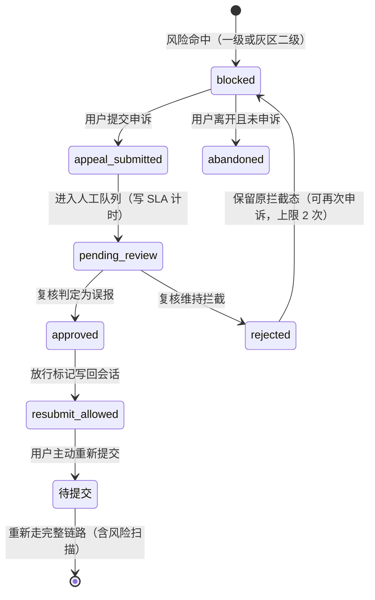

## 7.1 架构分层与命名（**重构，关闭评审第 16 项**）

> V1.1 把风险预警称为"Agent"，同时又说"5 个 Agent"，但它的实现是规则 + 模型 + 人工，和其他四个 Agent 不是同类。这直接导致成本口径、调用次数与日志字段都算不准。本节重构命名，**Architecture 层的变化不影响 FR 编号**。

### 7.1.1 三个层次

| 层 | 组成 | 是否调用 LLM | 成本口径 |
| --- | --- | --- | --- |
| **编排层** | 中枢调度器（意图识别、检索、并行分发、汇总、冲突比对、门控裁剪） | 意图分类用轻量模型；**汇总不调用 LLM** | 1 次轻量调用 |
| **领域 Agent 层**（3 个） | 0-6 岁育儿 Agent、宠物 Agent、家庭安全 Agent | 各自 1 次主力模型调用 | 单领域 1 次、复合场景 3 次 |
| **风险控制服务**（1 个服务，5 个组件） | 见下表 | 仅灰区调用 1 次语义模型 | 非灰区 0 次、灰区 1 次 |

### 7.1.2 风险控制服务组件

| 组件 | 职责 | 调用 LLM |
| --- | --- | --- |
| 一级规则引擎 | 词库 + 正则（含药名剂量模式），毫秒级，命中即阻断 | 否 |
| 二级风险分类模型 | **仅灰区触发**，输出置信度分档（0.5 / 0.8 双阈值） | 是（1 次） |
| 风险策略服务 | 阈值配置、放行打标、误报回流、类别映射 | 否 |
| 申诉工单服务 | 申诉受理、状态机、SLA 计时、回执（§7.9） | 否 |
| 人工复核后台 | 值班复核、抽检、处置留痕（PA-07） | 否 |

### 7.1.3 术语替换表（**全文一致，禁止再用旧表述**）

| 废弃表述 | 替换为 |
| --- | --- |
| 「风险预警 Agent」 | 风险控制服务 |
| 「5 个 Agent」 | **3 个领域 Agent + 1 个编排器 + 1 个风险控制服务** |
| 「所有 Agent 并行」 | 领域 Agent 并行；编排器与风险控制服务按固定顺序执行 |
| 「各 Agent 权重」 | 已删除（AS-17） |

### 7.1.4 调用次数与成本重算（与 §7.13 一致）

| 场景 | 轻量模型 | 主力模型 | 语义模型 | 合计 LLM 调用 |
| --- | --- | --- | --- | --- |
| 单领域标准 | 1（意图分类） | 1（领域 Agent） | 0 | **2** |
| 单领域灰区 | 1 | 1 | 1 | **3** |
| 复合场景标准 | 1 | **3**（并行） | 0 | **4** |
| 复合场景灰区 | 1 | 3 | 1 | **5** |

> V1.1 说"复合场景约 5–6 次调用"，是因为把风险扫描也按 Agent 计了一次并叠加。**按本节口径，复合场景标准为 4 次**。成本测算见 §7.13。

---

## 7.9 风险拦截与申诉状态机（**重写，关闭评审第 3 项**）

> V1.1 与 UI 冲突：PRD 说"申诉 24 小时人工复核"，UI 说"申诉后回会话并显示『该问题已放行』"，同时 UI 又标注"立即放行 vs 24h 后放行待拍板"。本节给出唯一状态机，并回答六个必答问题。

### 7.9.1 状态机（唯一权威）

### 7.9.2 六个必答问题（结论）

| # | 问题 | 结论 | 理由 |
| --- | --- | --- | --- |
| 1 | **申诉后是否立即放行** | **否** | 立即放行等于把风险判定的最终决定权交给用户，与"安全先于完整"冲突；且会让高危内容在无人工确认下进入生成 |
| 2 | **复核通过后自动重新生成还是用户主动重提** | **用户主动重新提交** | 自动重生成会消耗额度且用户可能已离开；主动重提也保证用户此刻确实想要该回答 |
| 3 | **复核期间能否改写问题** | **不能改写原问题**，但可**补充说明**（独立字段 `appeal_note`，≤500 字） | 允许改写等于允许绕过拦截；补充说明只用于人工判断，不进入问答链路 |
| 4 | **高危类别是否永远不自动放行** | **是，分两类**：① **硬类别**（儿童虐待、孩子自伤/自杀想法、幼儿持续高烧惊厥）**永不自动放行**，复核只能"维持拦截"或"转人工线下引导"；② 软类别（严重抑郁、宠物急症等）复核通过后可放行 | 硬类别涉及人身安全与可能的强制报告义务，任何自动化放行都是不可接受的 |
| 5 | **申诉补充文本是否再次风险扫描** | **是**，且**用的是同一套流水线**（FR-L1）；补充文本命中硬类别则申诉直接标记为"不予受理"并升级到高风险事件表 | 申诉文本本身也可能包含高危信息，不能成为扫描盲区 |
| 6 | **申诉失败是否计入额度** | **不计** | 被拦截与申诉都不产生模型调用（除灰区二级）；额度是成本闸门，不是惩罚工具 |

### 7.9.3 其他规则

| 项 | 规则 |
| --- | --- |
| 申诉次数上限 | 同一会话同一问题最多 2 次；第 3 次起只显示渠道清单 |
| SLA | 默认 **24 小时**内完成复核（🟡 默认值，需运营确认）；超时告警并升级值班 |
| 回执 | 有受理编号 + 复核结果 + 理由；**是否向用户回执**🔴 未决策（Q-26），默认回执 |
| 额度与计次 | `appeal_submit`、`appeal_allow` 均不计次；放行后**重新提交**才计次 |
| 放行有效期 | 放行标记**仅对该会话该问题有效**，有效期 24 小时；过期后再次提交重新扫描 |
| 数据 | 申诉记录进入申诉工单服务与高风险事件表（如命中硬类别），按 §11.10 留存 ≥3 年 |
| 硬类别被放行的可能性 | **不存在**。若复核人误判，通过"复核结果审计 + 每日抽检"兜底，不提供技术上的"强制放行"入口 |

### 7.9.4 对 UI 文档的同步要求

SC-13 的现有文案"申诉后回会话、显示『该问题已放行』"必须改为：

1. 提交申诉后 → 停留在 SC-13，显示"已受理 + 受理编号 + 预计复核时限"；
2. **不显示"已放行"**，直到复核结论返回；
3. 复核通过 → 显示"该问题已放行，请在 24 小时内重新提交（重新提交仍会进行内容安全检查）"；
4. 硬类别 → 不提供"继续提问"出口，只显示渠道清单。

---

## 6.17 超范围拒答口径（**新增，关闭评审第 17 项**）

> V1.1 在 FR-A7、FR-D6、固定文案、UI 之间口径不一致：判断依据是"当前绑定档案年龄"还是"问题中提到的年龄"从未写明。

### 6.17.1 判断依据（唯一口径）

| 情形 | 判断依据 | 处理 |
| --- | --- | --- |
| 已绑定儿童档案，问题**未提及**年龄 | **档案月龄** | 在范围内 → 正常；超 6 岁 → 拒答 |
| 已绑定儿童档案，问题**提及其他年龄**（如"我 8 岁的外甥"） | **以问题中提到的对象年龄为准，同时读取档案月龄作为上下文** | 只要涉及任一 >6 岁对象 → 拒答该部分并说明原因 |
| 未绑定档案 | **不拒答，但必须声明适用范围**："未绑定档案，本次按通用区间 1–3 岁给出；如孩子已满 6 岁，本产品不提供该年龄段建议" | 不静默拒答（无档案时拒答会造成"什么都问不了"的体验灾难） |
| 多孩场景 | **以"当前问答对象"选择器选中的档案为准**；若问题提到另一个孩子且 >6 岁 → 拒答并提示切换对象 | 选择器在 SC-08/09/10 顶部（FR-C5） |
| 宠物问题 | 不适用年龄拒答 | 走宠物边界（NG-4） |

### 6.17.2 拒答范围：年龄超限 vs 全部学龄期问题

**结论**：**按年龄 + 主题双重判断**。

- **年龄 >6 岁** → 一律拒答（无论主题）。
- **年龄 ≤6 岁但主题属学龄期专属**（作业辅导、学科提分、考试焦虑）→ 拒答，理由是主题不在范围内，即使孩子只有 5 岁也不作答。
- **年龄 ≤6 岁且主题在范围内**（喂养、睡眠、敏感期、行为引导、亲子沟通）→ 正常作答。
- **边界主题**（如"5 岁要不要开始认字"）→ **作答但必须标注**"该主题处于本产品范围边缘，建议同时咨询幼儿园或专业机构"。

### 6.17.3 话术（固定文案，不可由模型自由生成）

| 场景 | 文案 ID | 要点 |
| --- | --- | --- |
| 年龄超限 | `REFUSAL_AGE_V1` | 说明本产品覆盖 0–6 岁；给出 6 岁以上可用的替代方向（如与学校沟通、专业机构）；**不推荐竞品** |
| 主题超限 | `REFUSAL_TOPIC_V1` | 说明产品不做学科辅导/作业代做（NG-3）；给出"思路引导"的边界说明 |
| 无档案声明 | `REFUSAL_NO_PROFILE_V1` | 不拒答，只声明适用区间与补档案建议 |

**验收**：① 档案 7 岁 + 任意问题 → 命中 `REFUSAL_AGE_V1`；② 档案 4 岁 + "帮我写作业" → 命中 `REFUSAL_TOPIC_V1`；③ 无档案 + 任一问题 → 出现 `REFUSAL_NO_PROFILE_V1` 声明且**有正文**；④ 多孩：选中 3 岁档但问题提到"8 岁的哥哥" → 拒答并提示切换。