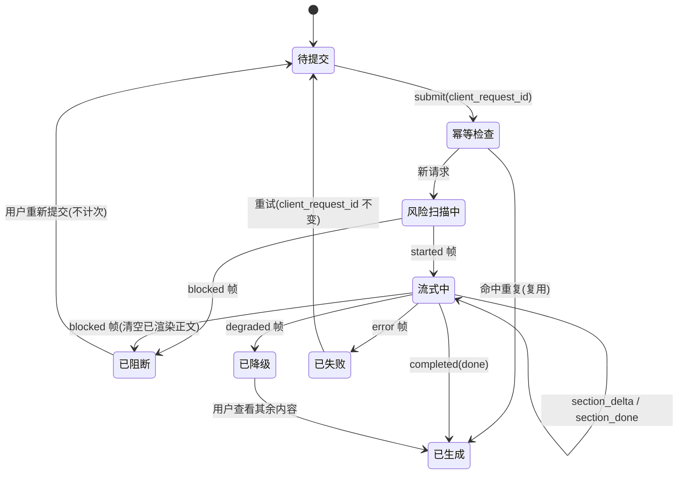

### 7.5 问答响应协议 v1（**新增，关闭评审第 4 项**）

> 本节取代 V1.1 §7.3 中"只有 `status` 枚举、没有传输与分片定义"的状态。**没有本节，流式问答不可开发。**

### 7.5.1 传输方式（含取舍）

| 方案 | 在小程序端的可行性 | 结论 |
| --- | --- | --- |
| 浏览器 SSE / `EventSource` | 微信小程序**没有** `EventSource`；`wx.request` 不支持 SSE 语义 | ❌ 不可用 |
| WebSocket（`wx.connectSocket`） | 可用，支持双向与心跳；但小程序对后台长连接有数量与保活限制，且本项目是"一问一答" | 备选（非主选） |
| **HTTP 分块接收（`wx.request` + `enableChunked: true`）** | 可用：小程序基础库 2.20.2+ 支持 `onChunkReceived`，逐块拿到 `ArrayBuffer` | ✅ **主选** |
| 轮询（提交 → 轮询任务状态） | 可用、最稳，但首字延迟与成本都更差 | **降级兜底（辅路）** |

**主选方案**：`POST /api/v1/qa/sessions/{session_id}/stream`，请求头带 `Accept: text/event-stream`（沿用 SSE 的**文本帧格式**，但传输走 HTTP 分块），响应体为按行分隔的 `event:` / `data:` 文本帧。这样：

- 小程序端用 `enableChunked` 收块，自己按 `\n\n` 切帧解析——**不依赖浏览器 SSE 实现**；
- 服务端（FastAPI `StreamingResponse`）与未来 Web 端（可直接用 `EventSource`）**共用同一套帧格式**，无需双协议；
- 断线时降级为轮询 `GET /api/v1/qa/sessions/{session_id}`（见 §7.5.5）。

**硬约束**：`Content-Type: text/event-stream; charset=utf-8`；**禁用响应压缩**（压缩会破坏分块边界）；每帧不超过 8KB；`X-Accel-Buffering: no` 防止反代缓冲。

### 7.5.2 事件类型与字段

| 事件 | 触发时机 | 必带字段 | 前端动作 |
| --- | --- | --- | --- |
| `started` | 风险扫描通过、调度决策完成 | `request_id`、`render_order`、`quota_remaining` | 渲染骨架屏与分节顺序；显示"正在检查内容安全"→"正在生成" |
| `section_delta` | 某分节的增量文本 | `section_key`、`section_version`、`sequence`、`delta` | 追加到对应分节 |
| `section_done` | 某分节完成 | `section_key`、`section_version`、`blocks`（门控裁剪后的完整块） | 用完整块替换该节（解决增量与最终不一致） |
| `blocked` | 风险命中 | `request_id`、`category`（脱敏）、`guidance_id` | **清空已渲染正文**，转入 SC-12；不保留任何已展示文本 |
| `degraded` | 部分 Agent 失败 | `reason`、`failed_sections[]` | 对应分节替换为降级条，其余保留 |
| `completed` | 全部完成 | `status`、`disclaimer_id`、`ai_generated_label`、`agents_involved[]` | 注入不可改写字段，写 `qa_result_view` |
| `error` | 不可恢复错误 | `code`、`message`、`retry_after` | 展示兜底话术 + 重试（`client_request_id` 不变） |
| `ping` | 每 15s 无数据时 | `ts` | 仅刷新"仍在生成"提示，不改变状态 |

**公共字段（每帧必带）**：`request_id`、`sequence`（**单调递增整数，从 1 开始**）、`ts`（毫秒时间戳）。

**分片解析规则**：客户端按 `\n\n` 切帧；`sequence` 出现跳号 → 说明丢帧，前端**必须**用该节最近的 `section_done` 覆盖渲染（因此 `section_done` 是强制的，不能只发 delta）；`section_version` 递增表示该节被重新生成（见 §7.8 安全 Agent 失败场景）。

### 7.5.3 已展示内容被阻断时的覆盖规则（关闭评审第 3、4 项的交点）

**这是 V1.1 缺失、也最容易出合规事故的一条。**

| 场景 | 规则 |
| --- | --- |
| 风险扫描在生成**之前**命中 | 只会收到 `blocked`，没有任何 `section_delta`，无需覆盖 |
| 已在流式中、输出侧过滤或二次风险判定命中 | 服务端发 `blocked`；前端**必须本地清空该会话已渲染的全部正文**，替换为 SC-12 拦截面，并**不保留复制入口** |
| 安全 Agent 失败（§7.8） | 服务端发 `degraded` 且 `failed_sections=["safety"]`；前端**必须隐藏所有已有正文分节**，只显示静态安全模板（不是"部分缺失"，而是"只剩安全卡"） |
| 用户已截图 / 已复制 | 产品无法回收，因此在 `blocked` 文案中不引用已生成内容；该情形计入 §14.1 风险登记册（R-17） |

**实现要求**：前端维护 `renderedSections` 状态；收到 `blocked` 或 `degraded[failed_sections 含 safety]` 时执行 `clearAll()`，不允许"灰掉但仍可读"。

### 7.5.4 取消、离开与幂等

| 问题 | 规则 |
| --- | --- |
| 取消生成 | 客户端调用 `POST /api/v1/qa/sessions/{id}/cancel`，带 `cancel_token`（`started` 帧下发）。服务端尽力停止后续 LLM 调用；**已产生的费用不退回**，但该次**不计入免费额度**（AS-24） |
| 页面离开 | 默认 `keep_alive=true`：服务端继续生成并落库，用户回到会话可见完整结果。会员可关闭（`keep_alive=false` 则离开即取消） |
| 断线重连 | 重连 `GET /api/v1/qa/sessions/{id}/stream?from_sequence=N`；服务端从 N+1 续发。超过 5 分钟未重连的任务标记为 `orphaned` 但仍落库 |
| 重试 | 用同一 `client_request_id` 重发 → 幂等表命中，**复用**上次结果或接续未完成任务；不重复扣额度（AS-24） |
| `done` 的定义 | `completed` **允许**含有失败分节（此时 `status=degraded`）。`status=done` 仅当全部分节成功；两者都算"任务结束"，但**只有 `done` 计入性能达标样本**（见 §7.7 表下注释） |
| 并发会话 | 同一用户同时只允许 1 个活跃流式会话；第二条请求返回 409 并附 `retry_after` |

### 7.5.5 前端状态转换（与 §8.6 会话状态机一致）

---

### 7.7 延迟预算表（**替换 V1.1，关闭评审第 5 项**）

> V1.1 的表存在三处口径混乱：单领域合计 7.95s 与"单 Agent 超时 12s"不自洽；复合场景说"3 个 Agent 并行"却又追加家庭安全 Agent；灰区数值与 NFR 的 12s/22.5s/30s 关系不明。本节用**四张表**重新定义，并冻结三条口径。

### 7.7.1 三条冻结口径（先定口径，再看数字）

| # | 口径 | 结论 |
| --- | --- | --- |
| 1 | 家庭安全 Agent 是否计入复合场景的 Agent 数 | **计入**。复合场景固定为 **3 个领域 Agent 并行**（育儿 + 宠物 + 家庭安全），不存在"3 个之后再追加一个" |
| 2 | 12s 是单 Agent 超时还是整请求超时 | **单 Agent 超时**（`agent_timeout=12s`）。整请求超时是 `request_timeout`，在表中单列，且**必须大于"串行阶段之和 + 单 Agent 超时"** |
| 3 | `done` 的定义 | `status=done`＝全部分节成功；`status=degraded`＝任务结束但含失败分节。**性能达标样本只统计 `done`**；`degraded` 样本单独统计降级率 |

**阶段构成（四张表共用）**：① 鉴权+幂等 ② 一级风险扫描 ③ 二级语义模型（仅灰区） ④ 意图分类+实体识别 ⑤ 检索 ⑥ 领域 Agent 并行 ⑦ 汇总（模板填充，不调 LLM） ⑧ 输出侧过滤。

### 7.7.2 表 1｜单领域标准（非灰区）

| 阶段 | P50 | P95 | 告警（1.5×P95） | 超时 | 降级触发 |
| --- | --- | --- | --- | --- | --- |
| ① 鉴权+幂等 | 80 | 150 | — | 500 | 幂等表不可用 → 仍放行但记录告警 |
| ② 一级风险扫描 | 120 | 300 | 450 | 800 | 不可用 → **禁出正文**（§7.8） |
| ③ 二级语义（不触发） | 0 | 0 | — | — | — |
| ④ 意图分类+实体 | 200 | 400 | 600 | 1000 | 失败 → 回退用户显式入口 |
| ⑤ 知识库检索 | 300 | 600 | 900 | 1500 | 无命中 → `professional_referral=true` |
| ⑥ 领域 Agent 并行（1 个） | 2400 | 6000 | 9000 | **12000（单 Agent 超时）** | 失败 → 该节降级 |
| ⑦ 汇总（模板填充） | 150 | 300 | 450 | 800 | 失败 → 回退纯模板拼接 |
| ⑧ 输出侧过滤 | 80 | 200 | 300 | 600 | 不可用 → **禁出正文** |
| **整请求** | **3330** | **7950** | **11925** | **15000** | — |

> **首包**（`started` 帧）≤ 1500ms（P95），单列为**体验指标**，不参与上表验收——但见 §7.7.6 的防滥用条款。

### 7.7.3 表 2｜单领域灰区（二级语义模型触发）

| 阶段 | P50 | P95 | 告警 | 超时 | 说明 |
| --- | --- | --- | --- | --- | --- |
| ①→⑤ 同表 1 | 700 | 1450 | — | — | — |
| ③ 二级语义模型（**仅灰区**） | 600 | 1500 | 2250 | 3000 | 超时按**命中**处理（保守） |
| ⑥ 领域 Agent（1 个） | 2400 | 6000 | 9000 | 12000 | 同上 |
| ⑦⑧ 汇总+过滤 | 230 | 500 | 750 | 1400 | — |
| **整请求** | **3930** | **9450** | **14175** | **18000** | — |

### 7.7.4 表 3｜复合场景标准（非灰区，3 个领域 Agent 并行）

| 阶段 | P50 | P95 | 告警 | 超时 | 说明 |
| --- | --- | --- | --- | --- | --- |
| ①→⑤ 同表 1 | 700 | 1450 | — | — | — |
| ⑥ 3 个领域 Agent **并行** | 3000 | 6500 | 9750 | 12000 | 取三者**最慢者**；家庭安全 Agent 通常最快，**不额外叠加** |
| ⑦ 汇总（含冲突比对） | 250 | 400 | 750 | 1200 | 冲突比对是规则计算，不是 LLM |
| ⑧ 输出侧过滤 | 80 | 200 | 300 | 600 | — |
| **整请求** | **4030** | **8550** | **12825** | **16000** | — |

> 与 V1.1 的差别：V1.1 把家庭安全 Agent 当作并行之外的额外 1500ms 叠加（得 9550ms），**这是重复计算**——它本来就是三个并行 Agent 之一。

### 7.7.5 表 4｜复合场景灰区

| 阶段 | P50 | P95 | 告警 | 超时 |
| --- | --- | --- | --- | --- |
| ①→⑤ | 700 | 1450 | — | — |
| ③ 二级语义模型 | 600 | 1500 | 2250 | 3000 |
| ⑥ 3 个领域 Agent 并行 | 3000 | 6500 | 9750 | 12000 |
| ⑦⑧ | 330 | 600 | 900 | 1800 |
| **整请求** | **4630** | **10050** | **15075** | **19000** |

### 7.7.6 与 NFR 的关系（消除 V1.1 的不一致）

| 项 | V1.1 表述 | V1.2 结论 |
| --- | --- | --- |
| NFR-2.1「单 Agent ≤8s」 | 与"单 Agent 超时 12s"冲突 | 改为：**单领域整请求 P95 ≤8s**（含全部串行阶段）；单 Agent 自身 P95 ≤6s、超时 12s。**8s 是整请求指标，不是单 Agent 指标** |
| NFR-2.2「复合 ≤15s」 | 与表 3 的 8.55s 相比余量过大 | 保留 **P95 ≤15s** 作为对外承诺（含余量）；内部目标为表 3 的 8.55s，告警 12.8s |
| 12s / 22.5s / 30s | 关系不明 | 12s = 单 Agent 超时（固定）；22.5s / 30s **废弃**，改用四张表各自的"告警 / 超时"列 |
| 首包不计入 8s | 导致性能口径偏松 | **修正**：首包单列但设上限（P95 ≤1.5s）且**纳入上线验收**；同时新增"首包后 3s 内无任何 `section_delta`"为告警项，防止"占位包达标但正文迟迟不来" |

**验收方式**：以 `done` 样本统计 P95；分别按四个场景出报表；`degraded` 与 `blocked` 样本不计入 P95，但单独出"降级率 ≤3%""阻断率"报表。

---

### 7.8 降级矩阵（**与 UI 对齐，关闭评审第 6 项**）

> V1.1 写了"安全 Agent 失败禁止出正文"，但 UI（SC-11）表现为"部分内容缺失、可继续看"。本节统一，并补齐 V1.1 未答的五个问题。

| 失败组件 | 是否出正文 | 展示什么 | 扣额度 | 存历史 | 允许重试 | UI 状态值 |
| --- | --- | --- | --- | --- | --- | --- |
| 风险扫描不可用 | **否** | 静态故障页 + 危机渠道入口 | **不扣** | 存（标记 `risk_unavailable`） | 是 | `failed` |
| **家庭安全 Agent 失败** | **否** | **仅静态安全模板**（隐藏育儿/宠物全部正文） | **不扣** | 存（标记 `safety_failed`） | 是 | `degraded`（安全专用文案） |
| 育儿或宠物 Agent 单侧失败 | 是（其余节） | 失败节位置显示"本次部分内容未能生成" | 扣 | 存 | 是（可仅重生成该节） | `degraded` |
| 两个领域 Agent 全部失败 | 否 | 兜底话术 + 稍后重试 | 不扣 | 存（标记 `all_agents_failed`） | 是 | `failed` |
| 检索无命中 | 是 | 正文 + `professional_referral` 标注 | 扣 | 存 | 是 | `done` |
| 汇总失败 | 是（回退模板） | 正常展示，无额外提示 | 扣 | 存 | 否 | `done` |
| 输出侧过滤不可用 | **否** | 静态故障页 | 不扣 | 存 | 是 | `failed` |
| 知识库服务不可用（有缓存） | 是 | 正文 + "内容可能不是最新" | 扣 | 存 | 否 | `done` |
| 知识库服务不可用（无缓存） | 否 | 兜底话术 | 不扣 | 存 | 是 | `failed` |

**统一规则（五条）**

1. **安全不可降级**：安全 Agent 失败是唯一"宁愿不出正文"的领域失败；此时**不得**展示育儿/宠物侧建议——理由是安全提示是这三个领域里唯一具有保护义务的内容，缺失它会使用户误以为已检查过风险。
2. **不扣额度的三类**：风险扫描不可用、安全 Agent 失败、全部 Agent 失败与输出过滤不可用。判定在服务端，前端不参与。
3. **一律存历史**：所有降级都落库并可在 SC-19 回看（含降级原因与当时状态），因为"失效但不消失"是本设计系统的既定原则（§2.7）。
4. **重试语义**：重试复用 `client_request_id`；可仅重生成失败节（`POST /sessions/{id}/regenerate?section=safety`），此时其余节不重新计费。
5. **UI 状态值映射**：`failed` → SC-19 用 S-4 失败态（可重试）；`degraded` → S-7 降级态（黄色提示条）。**两者不可混用**：V1.1 的 SC-11 把安全失败画成了 S-7，已按本表修正为专门文案。

**对 UI 文档的同步要求**：SC-11 的分节说明必须区分"单侧失败（其余节可读）"与"安全失败（只读安全卡）"两种视觉，不得共用同一条降级条。