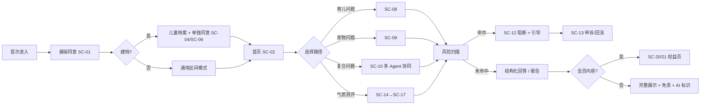

# 家伴・家庭养育多智能体助手 —— 产品需求文档（PRD）

> **文档版本**：V1.2（唯一需求基线 · 决策闭环与跨文档一致性修订版）
> **文档状态**：待业务方签字冻结。**当前不具备正式开工条件**（见文末阻塞项摘要）
> **编制日期**：2026-10-03
> **唯一基线声明**：见 §0.7。本文档是研发、测试、设计、验收的**唯一需求基线**；`家伴-家庭养育多智能体助手_需求说明文档_V1.0.md` 降为**历史来源**，`家伴-PRD_V1.1.md` 被取代。
> **配套文档**：`家伴-UI原型描述_V1.2.md`（唯一界面基线）｜`DESIGN.md`（唯一视觉 token 真源）｜`家伴-设计系统样式瓦片.html`（可视证据）
> **变更映射**：见 §0.6（继承 / 修改 / 删除 / 新增 / 废弃编号）
> **决策台账**：附录 A/B/C 与 §6.16 由 `.build/ledger.py` 机器生成，禁止手写
> **产品形态**：微信小程序（C 端，优先）+ 后台管理 Web；Web 端用户侧列后续版本
> **产品定位**：家庭养育科普参考工具。覆盖分龄儿童养育 + 伴侣宠物科学饲养。**输出仅作养育参考，不替代医生、心理咨询师、学校教师、执业兽医。**

---

## 0. 文档信息与阅读指引

### 0.1 本文档的定位：决策级，不重写验收标准

V1.0 需求文档的问题不是"不够细"，而是三类：**决策未定**（39 项 Q，其中 10 项阻塞）、**存在硬伤**（M1–M10 技术冲突、A/B/C 共 35 条矛盾与不可测项）、**缺失需求域**（N1–N9，含原型与文案资产）。

因此本文档只承担四件事，其余引用 V1.0：

| 本文档承担 | 具体做法 |
| --- | --- |
| ① 把前提补齐 | 用 `AS-xx` 假定基线登记册（附录 A）给出默认取值，使全文自洽、可开工；每条标注来源与待拍板状态 |
| ② 把硬伤改掉 | 用 `M-x`/`I-x`/`N-x`/`CG-x` 修正索引（附录 D）逐条给出"原文问题 → 本文档处理" |
| ③ 把缺口编号化 | 缺失需求域与合规缺口全部落成 `FR-x`/`NFR-x` 条目，挂验收方式 |
| ④ 把决策集中 | 所有未决策项集中在附录 B（决策登记册）与附录 C（待确认问题登记册），一张表可改 |

**本文档不做**：不重写 V1.0 的 US/FR 条目正文；不做高保真视觉稿；不写代码；不替法务、专家、财务拍板。

### 0.2 与 V1.0 的关系：三类内容

| 类型 | 含义 | 处理 |
| --- | --- | --- |
| **继承** | V1.0 已定义且无争议的内容（如四大入口、五个 Agent 的职责边界） | 直接引用编号，不重复描述 |
| **修正** | V1.0 自相矛盾或不可测的内容 | 本文档给新结论，附录 D 给出对照，V1.0 需回填 |
| **新增** | 审计与评审发现的缺失需求 | 本文档首次定义，编号不与 V1.0 冲突 |

### 0.3 编号约定

| 标记 | 含义 | 落点 |
| --- | --- | --- |
| `FR-x.x` | 功能需求条目 | 第 6 章 |
| `NFR-x.x` | 非功能需求条目 | 第 10 章 |
| `AS-xx` | **假定基线**：为推进评审而采用的默认取值，必须由责任方确认或推翻 | 附录 A |
| `D-xx` | 待拍板决策项（沿用评审材料 D1–D12 编号，新增项续编） | 附录 B |
| `Q-xx` | V1.0 遗留问题清单（Q-01~Q-39，编号保留；状态见附录 C），本文档新增续编 Q-40 ~ Q-45 | 附录 C |
| `M-x` / `I-x` | 评审材料的技术冲突 / 实现缺口 | 附录 D |
| `N-x` | 评审材料识别的缺失需求域 | 附录 D |
| `CG-x` | 合规缺口（Compliance Gap，来自审计 D1–D18 与评审 §四之二） | 第 11 章 + 附录 D |
| `S1/S2/S3` | 审计严重度（S1＝开工或上线阻塞） | 全文标注 |
| `SC-xx` / `PA-xx` | UI 页面编号（小程序 / 后台） | UI 文档第 4 章 |
| `P0/P1/P2` | P0＝MVP 必须上线；P1＝MVP 尽力上线；P2＝明确不在 V1.0 | 全文标注 |
| **B1 / B2 / B3** | 未决策项的阻塞级别（与三态严格对应）：**B1＝开工阻塞（未决策，不得开发）**；**B2＝上线阻塞（可开发但不得上线）**；**B3＝运营参数待定（有默认方案，灰度期可调）**。**禁止用"待确认"一词描述状态**，一律使用三态词汇 | 附录 C、附录 C.1 |

**硬规则（评审门槛）**：
1. **验收标准中不得出现 `Q-xx`、`AS-xx`、状态标记。** 未决策项必须与验收标准分离（V1.0 有 33 处违反，见附录 D 的 C1）。
2. 每个 FR 条目必须给出：优先级 + 依赖的 AS/决策 + 验收方式（可测）+ 对应页面编号。
3. 识别出的风险必须需求化：**识别不需求化 ＝ 没有工时、没有用例、没有验收**（V1.0 §9 的 8 类自查项全部未需求化，见 I3/N-x）。

### 0.4 阅读指引

| 读者 | 建议路径 |
| --- | --- |
| 业务方 / 决策者 | §2 目标与指标 → §4 范围基线 → §0.7 唯一基线声明 → 附录 B 决策登记册 → 附录 C.1 阻塞项摘要 |
| 产品 / 设计 | §3 用户与场景 → §5 信息架构 → §6 功能需求 → UI 文档全文 |
| 研发 / 测试 | §6 功能需求 → §7 多智能体规格 → §8 流程与状态机 → §9 数据与口径 → §10 NFR |
| 法务 / 合规 | §11 合规专项 → 附录 C.1 阻塞项摘要 → 附录 D 中 CG-x 条目 |
| 算法 | §7 全文（契约、延迟预算、降级矩阵、检索规格、模型与成本） |

### 0.5 修订记录

| 版本 | 日期 | 修订人 | 说明 |
| --- | --- | --- | --- |
| V1.0 | 2026-10-01 | 产品 | 需求说明文档草案（1099 行），识别 39 项待确认 |
| V1.1 | 2026-10-02 | 产品 | 采纳评审推荐决策为 AS 假定基线；修正 M1–M10 与 I1–I10；补齐 N1–N9；合规缺口 CG1–CG18 需求化；新增决策/待确认/修正三本登记册 |
| **V1.2** | **2026-10-03** | 产品 | **决策闭环与一致性修订**：① 冻结唯一基线并新增变更映射（§0.6/§0.7）；② 引入三态决策门槛，FR 逐条给出可开发边界（§6.16）；③ 重写风险拦截与申诉状态机（§7.9）；④ 新增问答响应协议 v1（§7.5）；⑤ 延迟预算改为四张表并冻结口径（§7.7）；⑥ 降级矩阵与 UI 对齐（§7.8）；⑦ 儿童信息合规闭环（§11.9）；⑧ 删除与留存优先级表（§11.10）；⑨ 模型供应商与版本清单（§11.11）；⑩ 知识库上线标准（§12.1）；⑪ 测评配置冻结（§12.2）；⑫ 会员与退款边界（§12.9）；⑬ 后台权限矩阵（§16）；⑭ 埋点事件字典（§17）；⑭ 接口清单（§18）；⑮ 评审意见闭环对照表（§19）；⑯ 架构分层重构，风险预警改为风险控制服务（§7.1）；⑰ 超范围拒答口径统一（§6.17） |

---

## 1. 产品概述

### 1.1 一句话定位

**家伴是一个家庭养育科普参考工具**：用多个按领域拆分的 AI Agent，回答"分龄怎么养孩子"和"猫狗怎么科学养"，并且能回答**"孩子和宠物一起生活该怎么办"**这类单一工具答不全的复合问题。

### 1.2 用户问题 → 产品解法

| 编号 | 用户问题 | 现状（用户怎么将就） | 家伴的解法 | 对应 Agent |
| --- | --- | --- | --- | --- |
| P-1 | 信息嘈杂、互相矛盾 | 短视频/社群/长辈经验三套说法 | 结构化建议：给**适用前提**与**不建议做法的原因**，而不是一句结论 | 育儿 Agent |
| P-2 | 气质话题热度高但缺科学配套 | 市面内容偏玄学，只给标签不给方法 | 「四象宝宝」趣味包装 + 底层儿童气质理论 + 配套养育方式与沟通技巧，**明确非宿命判定** | 育儿 Agent + 测评 |
| P-3 | 养娃 + 养宠的交叉问题无工具承接 | 育儿工具只答孩子、宠物工具只答宠物 | **一次问、三面答**：安全提示置顶 + 育儿侧 + 宠物侧 | 中枢调度 + 育儿 + 宠物 + 家庭安全 |
| P-4 | 亲子冲突与情绪沟通缺场景化指导 | 通用大模型给通用建议 | V1.0 **不承诺** 6 岁以上（见 §4 范围裁定 Q-01），拒答话术统一（FR-D6） | — |

### 1.3 差异化：多 Agent 协同 + 安全前置

1. **多 Agent 协同**：跨领域问题由中枢调度多个 Agent 并行推理，中枢按结构化字段汇总，比单模型单点回答更可校验。
2. **风险预警前置**：风险扫描在**调度之前、纯输入侧**执行（修正 M7/A1），命中即阻断且**不输出任何内容**。
3. **可追溯**：每次回答可还原调度决策、各 Agent 输出、耗时、风险判定、知识库引用（`evidence_ref` 必须来自检索结果，禁止模型编造）。

### 1.4 非目标（V1.0 明确不做）

| 编号 | 不做的事 | 原因 |
| --- | --- | --- |
| NG-1 | 不上线 6 岁以上小学/初中/高中学科辅导模块 | 教研成本高，后续版本 |
| NG-2 | 不做心理诊断、儿童心理疾病评估、心理治疗 | 合规红线 |
| NG-3 | 不代替老师批改作业、不代做习题、不代写作文 | 合规红线 |
| NG-4 | 不提供宠物疾病诊断、不开兽药处方、不替代执业兽医 | 合规红线 |
| NG-5 | 不做宿命论性格判定、星座算命、不对孩子终身性格下定论 | 合规红线 |
| NG-6 | 无直播、无社区 UGC 板块 | 减少内容审核压力 |
| NG-7 | 不做 B 端机构对接（早教中心、宠物门店） | 列入 V3.0 |
| NG-8 | 不支持多语言、不支持非微信小程序的其他端首发 | 收敛 MVP 范围 |
| NG-9（新） | **不做 Agent 权重配置功能**（含后台配置项与权重数据实体） | 机制无法定义且与"安全置顶"冲突，见 AS-17 / D7 |
| NG-10（新） | **不做自动续费**；不做专题付费内容包的 MVP 售卖 | iOS 虚拟支付受限，先用月卡验证转化，见 D9 |
| NG-11（新） | 不做语音输入（V1.0 内移除，保留设计位与入口占位） | ASR 服务商、方言、时长、落盘全未定，见 AS-04 |
| NG-12（新） | 不做"科学测评/信效度检验"类对外宣称 | 合规与成本交换，见 AS-14 / D3 |

### 1.5 合规地位声明（产品级，落到全部文案与分享图）

- 本产品输出内容**仅作为养育参考**，不替代医生、心理咨询师、学校教师、执业兽医。
- 全部 AI 生成内容带**显式标识 + 隐式标识**（CG1，见 §11.1）。
- 危机与高危场景**不生成任何内容**，只做引导（§11.3）。
- 儿童个人信息属敏感个人信息，需**监护人单独同意**并支持撤回（CG2/CG3/CG7，见 §11.4）。

---

## 2. 目标与成功指标

### 2.1 产品目标（V1.0 目标的结构化转写 + 修订）

| 编号 | 目标 | 类型 | 衡量方式（唯一权威见 §9.4） |
| --- | --- | --- | --- |
| G-1 | 搭建多智能体调度框架，上线 0-6 岁养育 + 猫狗饲养两大板块 | 能力 | 3 个领域 Agent + 编排器 + 风险控制服务全部可调用；两大模块可用 |
| G-2 | 上线气质测评作为核心引流功能，底层使用儿童气质理论 | 增长 | 测评入口点击率、测评完成率 |
| G-3 | 支持单领域问答 + 儿童&宠物交叉场景联合问答 | 能力 | 家庭综合问答可正确调度 ≥3 个 Agent；调度正确率 |
| G-4 | 内置风险预警，识别高危并强制引导线下专业机构 | 合规 | **冻结标注集上的召回率 ≥95%、误报率 ≤5%**；命中后不输出任何内容 = 100% |
| G-5 | 基础内容免费，会员解锁深度方案，验证留存与付费转化 | 商业 | 留存曲线、付费转化率、单位问答成本 |
| G-6 | 知识库内容经育儿/宠物专家审核，规避玄学、教育、心理、医疗红线 | 合规 | 抽检合格率、违规词命中率、**内容追溯处置闭环率** |

> **修正**：G-4 的"高危拦截率 100%"不可达且与漏报兜底策略互斥（M4/A7/C2）。改为"召回率 + 误报率 + 漏报兜底"三件套，只对"命中后不输出任何内容"保留 100%（AS-30 同类口径思路）。

### 2.2 量化指标（采纳评审 D1 推荐值 → AS-01）

【假定基线 AS-01】以下为**内部考核目标，不对外承诺**；灰度期用真实基线校准一次。

| 指标 | 目标值 | 口径（唯一权威 §9.4） |
| --- | --- | --- |
| 新用户 7 日留存 | ≥ 25% | 第 7 日回访用户数 / 当日新增用户数（cohort 窗口） |
| 气质测评完成率 | ≥ 60% | 完成提交的**用户数** / 进入测评的**用户数**（去重） |
| 问答二次提问率 | ≥ 30% | 有跟进提问的**会话数** / 有提交的**会话数**（排除重试） |
| 免费 → 会员付费转化率 | ≥ 2% | 首次支付成功**用户数** / 同期新增**用户数** |
| 高危拦截后离开率 | ≥ 90% | 拦截后未继续追问的**会话数** / 拦截**会话数** |

**触发规则（未决策 D-01；默认按 AS-01 执行）**：若灰度期 7 日留存 < 25%，则**冻结新模块开发**，资源转向留存优化。

### 2.3 护栏指标（新增，评审 N1/N3 的落点）

| 指标 | 护栏阈值 | 说明 |
| --- | --- | --- |
| 单位问答模型成本 | ≤ 目标值（待财务与技术共同定） | 一次复合问答 ≈ 5–6 次 LLM 调用，无成本测算是 V1.0 的空白 |
| Agent 失败率 / 超时率 | 超阈值告警（阈值见 NFR-5.2） | — |
| 风险误报率 | ≤ 5%（冻结标注集） | 误报必须有申诉出口 |
| 内容追溯处置闭环率 | 100%（7 日内） | 知识库驳回后受影响内容的处置 |

### 2.4 指标口径的唯一权威

**§9.4 是全文唯一指标口径权威。** V1.0 存在 4 套口径打架（C3/C4/M2）：
- 场景卡中的"成功标准"（如"8s 内拿到回答"）**不得作为指标口径**，仅作体验描述。
- 免费额度、拦截率、留存、完成率的分母一律以 §9.4 为准。

---

## 3. 用户角色与使用场景

### 3.1 角色定义

| 角色 | 类型 | 描述 | 核心诉求 | 频次 | MVP |
| --- | --- | --- | --- | --- | --- |
| 家长用户（核心） | C 端 | 25–40 岁父母，家中以 0–6 岁幼儿为主，部分养猫狗 | 拿到贴合自家孩子/宠物的可执行参考 | 每周 2–5 次 | ✅ |
| 后台管理员 | 内部 | 知识库维护、日志查看、反馈与投诉处置、开关配置 | 高效维护质量与合规 | 每日 | ✅ |
| 内容运营（新，N6） | 内部 | 内容质量标准、抽检、知识库条目数量目标、增长与分享 | 内容供给侧可控 | 每日 | ✅（可由管理员兼任，D-15） |
| 客服（新，Q-26） | 内部 | 反馈与投诉回执、误报申诉复核 | 闭环与时效 | 每日 | P1（可由管理员兼任） |
| 外部专家顾问 | 外部 | 育儿 1 名 + 宠物行为 1 名；审核知识库 + 输出抽样，**不在线接待用户** | 一次性集中审核 | 每月 8–10 小时/人 | ✅（**未签约即上线阻塞**，D5） |

### 3.2 场景卡

| 编号 | 场景 | 角色 | 期望结果 | 成功标准（体验描述，非指标口径） | 页面 |
| --- | --- | --- | --- | --- | --- |
| 场景 1 | 新手妈妈判断"该听谁的"（8 月龄夜醒） | 家长 | 给结构化建议 + 适用条件与风险，而非一句结论 | 回答引用本档案月龄 | SC-02→SC-08 |
| 场景 2 | "孩子追猫、猫哈气"（3 岁 + 1 猫） | 家长 | 一次输出三部分，**安全提示置顶** | 三维度齐全、安全置顶 | SC-10 |
| 场景 3 | 被"四象宝宝"吸引做测评（2 岁，中途被打断） | 家长 | 断点续填 → 报告 + 非宿命提示 | 断点续填生效；分享图带完整免责与 AI 标识 | SC-14→SC-17 |
| 场景 4 | 高危输入被拦截 | 家长（情绪崩溃） | **不生成任何内容**，强警示 + 线下机构引导 | 命中后正文为空 | SC-12 |
| 场景 5 | 宠物行为解读（狗护食低吼） | 家长（养狗） | 行为科普 + 家庭安全提醒 | 标注"非疾病诊断"；急症提示就医 | SC-09 |
| 场景 6 | 专家离线校验输出 | 专家 | 查看知识库与抽样 → 标注意见 → 提交 | 审核记录可追溯；驳回有回滚路径 | PA-02/PA-03 |
| 场景 7 | 管理员处置内容问题 | 管理员 | 下架条目 → 追溯受影响内容 → 留痕 | 处置闭环率 100%（7 日） | PA-07 |
| **场景 8（新）** | **多孩/多宠切换问答对象** | 家长（2 娃 1 猫） | 提问前明确"这次问的是谁" | 每条问答可追溯到档案 ID | SC-03/SC-08 |
| **场景 9（新）** | **免费额度用尽** | 家长 | 明确告知额度规则与恢复时间，给出升级入口 | 额度提示可见、不误导 | SC-02/SC-21 |
| **场景 10（新）** | **误报申诉** | 家长（正常提问被拦） | 24h 内人工复核，可继续提问 | 申诉入口可见、有受理编号 | SC-13 |
| **场景 11（新）** | **撤回同意与删除数据** | 家长 | 分项撤回 + 删除 + 导出 | 有明确后果说明与 SLA | SC-24/SC-25 |

### 3.3 用户旅程（主线）

### 3.4 场景 → 页面 → 需求 的追溯

追溯矩阵见 §21；页面清单见 UI 文档 §4。

---

## 4. MVP 范围基线

> 依据评审材料 §六「范围裁剪表决」的推荐结论，落为 AS-03/AS-04/NG-9/NG-10/NG-11/AS-33。**裁剪原则**：依赖未定且不在开发可控范围内的功能移出 MVP。

### 4.1 保留清单（V1.0 建议范围）

免责与同意（含监护人单独同意）＋ 儿童/宠物档案 ＋ 免费问答（育儿/宠物）＋ 家庭综合问答 ＋ 气质测评 ＋ 会员月卡 ＋ 风险预警与危机引导 ＋ 个人信息权利中心 ＋ 后台最小集（知识库/词库/日志/反馈与举报/高风险事件/权利请求/开关）。

### 4.2 移出清单

| 移出项 | 原编号 | 理由 | 处理方式 |
| --- | --- | --- | --- |
| Agent 权重配置 | §4.3、US-K4、§7.2 权重实体 | 机制无法定义，与"安全置顶"冲突 | **删除功能**（NG-9/AS-17）；配置版本表机制保留给知识库与开关使用 |
| 专题付费内容包 | US-J2 | iOS 支付受限，与会员权益关系未定 | 移出 MVP（AS-03）；入口不展示，需求降为 P2 |
| 语音输入 | US-D1/F1 部分、NFR-3.1 | ASR 服务商/方言/时长/落盘全未定 | 移出 MVP（AS-04）；UI 保留灰态入口与一行说明，见 SC-08 |
| 分享图"免责声明不可删除"硬验收 | US-A2 第 3 条 | 技术上无法约束截图裁剪 | **改渲染规格**：面积占比 + 重复 ≥2 次 + 字号下限 + 短链二维码（FR-E5） |
| 无障碍专项 | NFR-3.3 | 无明确标准与预算 | 保留**最低底线**（AS-33）：字号、对比度、热区 |
| 图片反馈 | US-N1 第 2 条 | 低价值且增审核负担 | **保留但加约束**：≤3 张、走内容安全检测、审核中态可见（FR-N1） |

### 4.3 边界功能的改写（移出后 V1.0 条目如何回填）

| V1.0 条目 | 改写为 |
| --- | --- |
| US-D1 验收 1/2（语音输入） | 保留文字输入；语音入口为灰态，点击提示"语音输入暂不支持，敬请期待"，不产生埋点误读 |
| US-F1 验收 1 | 同上 |
| NFR-3.1 | 改为 **P2 需求**，写入 §10 NFR-3 并标注"移出 MVP" |
| US-K4 | 删除，改由 FR-K8（系统开关与渠道清单维护）承接其"变更留痕与回滚"能力 |
| US-J2 | 降为 P2，写在 §6 模块 J 备注 |

### 4.4 版本规划（修订）

| 版本 | 内容 | 修订点 |
| --- | --- | --- |
| **V1.0 MVP** | 见 §4.1；开发周期见 §15 | 相比 V1.0 需求文档：删权重配置、移出专题包与语音、补齐 8 类缺失需求域 |
| V1.1 | 冲突处理优化、扩充小宠（需同步扩档案字段与知识库）、测评问卷与文案优化、**语音输入回归**、**Agent 权重/择时策略（若确有需要）** | — |
| V2.0 | 6-12 岁小学模块（学习习惯、亲子沟通；仅思路引导）、亲子情绪沟通 Agent | — |
| V3.0 | 初高中板块、B 端机构对接 | — |

### 4.5 范围与产能的对齐（必须提醒）

即使按上表裁剪，仍有 **4 项阻塞不在开发可控范围**：测评命名与量表（Q-06/07/08）、iOS 支付策略（Q-25）、生成式 AI 备案（Q-32）、专家资源签约（Q-11）。

**结论（待业务方拍板，D-13）**：按 §15 的估算，原"2 个月"含 3 个领域 Agent + 编排器 + 风险控制服务 + 完整后台 + 支付 + 合规链路，**不成立**。建议二选一：
- **方案 A（推荐）**：周期 3 个月，保留当前范围；
- **方案 B**：仍 2 个月，但**会员与支付移出 MVP**（先验证留存与内容质量，商业化顺延到 V1.1）。
