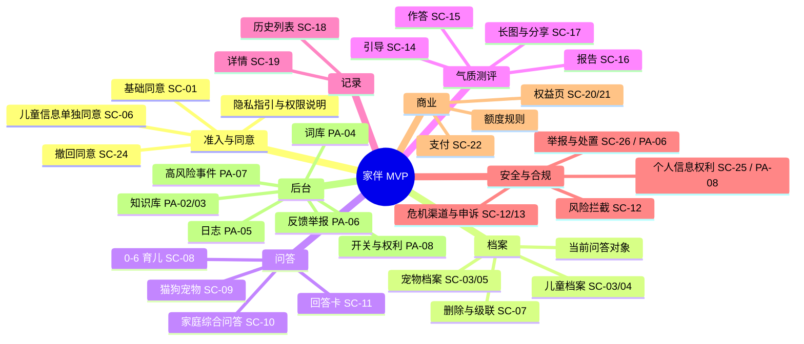

## 5. 信息架构与功能地图

### 5.1 功能地图

### 5.2 小程序导航结构

| 层级 | 内容 |
| --- | --- |
| 底部 Tab（4 个） | 首页 / 档案 / 记录 / 我的 |
| 首页一级入口（4 个） | 🔥 四象宝宝气质测评（置顶引流位）→ 0-6 岁宝宝养育 → 猫狗宠物饲养 → 家庭综合问答（AS-07） |
| 首页二级入口 | 会员权益、额度条、未建档提示条 |
| 全局常驻元素 | 免责小字 + AI 生成内容标识（每个内容页底部，不可关闭）；额度条（首页与问答页顶部） |
| 全局交互规则 | 危险操作二次确认；合规相关弹窗不可通过系统返回键关闭；生成中可离开并回看（会话状态保留） |

### 5.3 页面清单（编号与 UI 文档一致）

| 端 | 编号 | 页面 | 优先级 |
| --- | --- | --- | --- |
| C 端 | SC-01 ~ SC-07 | 准入与同意、首页、档案管理 | P0 |
| C 端 | SC-08 ~ SC-11 | 三类问答与回答卡 | P0 |
| C 端 | SC-12 ~ SC-13 | 风险拦截、申诉与回流 | P0 / P1 |
| C 端 | SC-14 ~ SC-17 | 测评引导、作答、报告、长图 | P0 |
| C 端 | SC-18 ~ SC-19 | 历史与详情 | P0 |
| C 端 | SC-20 ~ SC-22 | 会员权益（Android/iOS）、支付 | P0 |
| C 端 | SC-23 ~ SC-25 | 个人中心、账号与安全、个人信息权利中心 | P0 |
| C 端 | SC-26 | 反馈提交与一键举报 | P0 |
| 后台 | PA-01 ~ PA-08 | 登录 MFA、知识库、词库、日志、反馈举报、高风险事件、开关与权利请求 | P0 |

### 5.4 优先级与人日（估算区间，供排期，D-14）

| 模块 | 优先级 | 人日（开发，含联调） | 备注 |
| --- | --- | --- | --- |
| 准入与同意（含分层同意、版本管理） | P0 | 3–5 | 合规硬需求 |
| 档案（CRUD + 加密 + 派生 + 级联删除） | P0 | 5–7 | 含密钥与派生列方案 |
| 问答链路（前端 + 会话状态 + 分节渲染） | P0 | 8–12 | 含降级态与额度 |
| 测评（问卷引擎 + 计分 + 报告 + 长图） | P0 | 10–14 | 依赖题量与命名定稿 |
| 风险预警（两级筛选 + 渠道卡片 + 申诉） | P0 | 5–8 | 依赖高危清单 |
| 多 Agent 编排（中枢 + 3 领域 + 检索 + 汇总） | P0 | 12–18 | 含延迟预算调优 |
| 会员与支付（单次购买 + 幂等 + 对账） | P0 | 6–9 | iOS 分支另行处理 |
| 后台（7 个功能页 + 权限 + 审计） | P0 | 10–15 | 含内容追溯处置 |
| 个人信息权利中心 + 导出 | P0 | 4–6 | 合规硬需求 |
| 合规链路（内容安全、标识、留存、投诉） | P0 | 6–10 | 依赖法务清单 |
| 埋点与数据看板 | P0 | 4–6 | 口径 §9.4 |
| **合计** | — | **73–110 人日** | 未含测试、专家审核与合规申报周期 |

---

## 6. 功能需求（FR）

> **条目规则**：`状态`列标 `保留`（继承 V1.0，只补依赖）/ `改`（修正 V1.0 定义）/ `新`（本文档新增）/ `删`（移出）。每条 FR 的验收方式必须可测，且**不得引用未决策项**。

### 6.1 模块 A：准入与同意

| 编号 | 条目 | 优先级 | 说明与验收要点 | 依赖 | 状态 |
| --- | --- | --- | --- | --- | --- |
| FR-A1 | 免责声明强制同意 | P0 | 首次进入全屏弹窗；未勾选时"进入"按钮置灰不可点；同意记录持久化（类型/版本/时间/设备/IP 摘要）；协议版本变更后重新强制 | AS-05、AS-26 | 改 |
| FR-A2 | 儿童个人信息单独同意 | P0 | 建档前独立弹窗（SC-06），与 FR-A1 **分离**；写明目的、字段清单、保存期限、第三方共享、撤回方式；未同意不得落库但可浏览通用内容 | AS-06、CG2/CG3 | 新 |
| FR-A3 | 监护人身份核验与留痕 | P0 | MVP：监护声明勾选 + 操作留痕（可选手机号验证）；核验强度与文案由法务确认；记录 `guardian_verified` | AS-27、CG3 | 新 |
| FR-A4 | 隐私保护指引与权限前置说明 | P0 | 首次使用相册/录音等接口前给出场景化说明；《小程序用户隐私保护指引》与第三方 SDK 清单可查 | CG11 | 新 |
| FR-A5 | 协议与文案版本管理 | P0 | 全部合规文案走"文案 ID + 服务端下发"；版本号变更触发重新同意；AI 生成内容标识说明并入协议 | AS-26、CG1 | 新 |
| FR-A6 | 撤回同意 | P1 | 支持分项撤回（基础同意 / 儿童信息单独同意）；撤回后档案停用、历史保留但脱敏；撤回入口在 SC-24 | AS-06、CG7 | 新 |
| FR-A7 | 拒答话术（超范围问题） | P0 | 6 岁以上问题按统一话术拒答并给出替代建议；话术不可由模型自由生成 | Q-01（D-16） | 新 |

**验收（示例，逐条可测）**
- A1-1：清空本地存储 + 新用户身份进入 → 弹窗出现且"进入"不可点；勾选后可进入。
- A1-2：协议版本号 +1 → 已同意用户再次进入时重新弹窗。
- A2-1：未勾选单独同意 → 提交儿童档案的请求体**不发出**（抓包验证无档案写入）。
- A6-1：撤回儿童信息同意 → 档案 `status=disabled`，历史记录中昵称字段显示为"宝宝 A"。

### 6.2 模块 B：首页

| 编号 | 条目 | 优先级 | 说明与验收要点 | 依赖 | 状态 |
| --- | --- | --- | --- | --- | --- |
| FR-B1 | 首页入口与额度条 | P0 | 四入口 + 会员入口 + 额度条；入口排序按 AS-07；额度用尽时额度条转橙并置顶 | AS-07、AS-08 | 改 |
| FR-B2 | 未建档引导与测评断点入口 | P0 | 无档案时展示提示条；存在测评断点时测评卡显示"继续填写"并直达断点题 | AS-11、NFR-2.3 | 新 |
| FR-B3 | 一次性引导气泡 | P1 | 每日首次进入展示免责与 AI 标识说明，1 次后不再展示 | AS-07 | 新 |
| FR-B4 | 首页加载与远程开关 | P0 | 首页 ≤2s（4G）；入口支持远程开关（紧急下线时入口置灰并给说明） | NFR-2.4、FR-K8 | 新 |

### 6.3 模块 C：档案管理

| 编号 | 条目 | 优先级 | 说明与验收要点 | 依赖 | 状态 |
| --- | --- | --- | --- | --- | --- |
| FR-C1 | 儿童档案 CRUD | P0 | 字段见 AS-12；出生日期自动算月龄；多档案；加密存储；数量上限 AS-09 | AS-09、AS-12 | 改 |
| FR-C2 | 宠物档案 CRUD | P0 | 类型/品种/年龄/绝育状态（+体重、主要食物选填）；MVP 仅猫狗 | AS-10 | 改 |
| FR-C3 | 加密字段与派生列 | P0 | 明确加密字段清单（出生日期、过敏项、昵称等）；派生列 `age_months`、`age_band` 用于检索与排序；密钥 KMS 管理 + 轮换 + 解密审计 | I5、M-改 | 新 |
| FR-C4 | 档案删除与级联处置 | P0 | 二次确认；两选项："仅删档案"（历史与报告脱敏保留）/"一并删除全部相关数据"；删除不可恢复；写审计日志 | AS-13、Q-20 | 改 |
| FR-C5 | 多档案与当前问答对象 | P0 | 问答页顶部可切换"这次问的是谁"；每条问答记录档案 ID；无档案走通用区间 | AS-11、场景 8 | 新 |
| FR-C6 | 并发编辑冲突 | P1 | 可变实体带 `version`；冲突时提示"档案已被更新，请刷新"，不静默覆盖 | AS-23、I8 | 新 |

### 6.4 模块 D：0-6 岁儿童养育

| 编号 | 条目 | 优先级 | 说明与验收要点 | 依赖 | 状态 |
| --- | --- | --- | --- | --- | --- |
| FR-D1 | 文字问答 | P0 | 支持多轮追问；单 Agent 响应口径见 §7.7（首包 ≤3s、完整 ≤8s P95） | AS-30 | 改 |
| FR-D2 | 语音输入 | P2 | **移出 MVP**（AS-04）；入口为灰态并给出说明；转写文本必须过风险扫描（回归时） | AS-04 | 删 |
| FR-D3 | 结构化养育建议 | P0 | 输出分节：建议要点 / 适用前提 / 不建议做法及原因 / 观察指标 / 何时需咨询专业人士 / 免责；含 AI 标识 | §7.3 契约 | 改 |
| FR-D4 | 免费额度与会员门控 | P0 | 免费用户得单条建议；会员专属 block 按 `access_tier` 服务端不下发正文；标注哪些是会员权益 | AS-08、AS-20 | 改 |
| FR-D5 | 无档案路径 | P0 | 未绑定档案时按"通用月龄区间 1-3 岁"回答，并在回答中提示"补充档案可获得更贴合建议" | AS-11、I10 | 新 |
| FR-D6 | 超范围拒答 | P0 | 6 岁以上或超知识库范围 → 统一标注"该问题仅供参考，建议咨询专业人员"（BR-4） | FR-A7 | 改 |

### 6.5 模块 E：四象宝宝气质测评

| 编号 | 条目 | 优先级 | 说明与验收要点 | 依赖 | 状态 |
| --- | --- | --- | --- | --- | --- |
| FR-E1 | 测评引导与断点续填 | P0 | 明确"非心理测评、非宿命判定、非科学测评宣称"；断点保留 90 天；重新进入直达断点题 | AS-14、AS-15 | 改 |
| FR-E2 | 情境问卷作答 | P0 | 12–16 题、5 点李克特式情境选择题、4 个维度（每维 3–4 题）；单题单屏；作答即存 | AS-15 | 新 |
| FR-E3 | 计分与四类判定 | P0 | 维度均分 → 高/中/低三档；四象类型由 2 个主导维度交叉判定（**不做唯一类型**）；规则可配置 | AS-15、AS-16 | 新 |
| FR-E4 | 报告生成与展示 | P0 | 类型解读 + 4 维度分档展示 + 养育方式 + 沟通技巧 + 非宿命提示 + 免责 + AI 标识 | AS-16、CG1 | 改 |
| FR-E5 | 报告长图与分享 | P0 | 长图渲染规格：免责声明占比 ≥ 底部 15% 且重复 ≥2 次、字号下限、短链二维码；分享前隐私提示与默认插画头像 | A2、CG1 | 改 |
| FR-E6 | 重复测评波动提示 | P1 | 30 天内重复测评且类型变化 → 报告提示"仅反映近期行为倾向" | AS-15 | 改 |
| FR-E7 | 测评结果作为问答上下文 | P1 | 结果可作为问答上下文（用户可关闭）；关闭后调度不读取测评字段 | Q-39 | 新 |

### 6.6 模块 F：宠物饲养

| 编号 | 条目 | 优先级 | 说明与验收要点 | 依赖 | 状态 |
| --- | --- | --- | --- | --- | --- |
| FR-F1 | 宠物文字问答 | P0 | 覆盖喂养/护理/行为科普/应激识别；**不做疾病诊断**；识别急症提示就医 | — | 改 |
| FR-F2 | 宠物行为解读 | P0 | 按关键词查询（甩尾/低吼/哈气/护食）；输出"行为含义 + 可能情绪状态 + 建议应对" | — | 保留 |
| FR-F3 | 家庭安全附加提醒 | P0 | 有儿童档案且问题涉及互动风险时，自动附加"儿童—宠物互动安全"提醒（**规则化附加**，不依赖安全 Agent 触发条件） | A2、M5 | 改 |
| FR-F4 | 免费清单 / 会员长期规划 | P0 | 基础饲养清单免费；长期规划（3 个月滚动）需会员；到期只读 | AS-22 | 改 |

### 6.7 模块 G：家庭综合问答（核心差异化）

| 编号 | 条目 | 优先级 | 说明与验收要点 | 依赖 | 状态 |
| --- | --- | --- | --- | --- | --- |
| FR-G1 | 多 Agent 协同调度与三节输出 | P0 | 命中复合场景 → 育儿 + 宠物 + 家庭安全 Agent 并行；输出三节（顺序见 FR-G2） | §7.6 | 改 |
| FR-G2 | 安全提示置顶 | P0 | 安全内容**置顶且不参与排序**；独立分节，不可被折叠或下移 | AS-17 | 新 |
| FR-G3 | 参与 Agent 折叠展示 | P1 | 底部可折叠区列出参与 Agent 与耗时（可关闭） | — | 改 |
| FR-G4 | 冲突标注（规则判定） | P0 | 中枢按 `stance`/`contraindications` 规则比对；冲突时标注"观点存在差异，建议多方参考"，不阻断生成 | AS-18、M10 | 改 |
| FR-G5 | 分节渐进呈现 | P0 | 每个 Agent 返回即渲染该节；未返回节显示骨架屏；**首包＝进度占位包**（不计入 8s 验收） | M3、AS-30 | 新 |
| FR-G6 | 部分失败降级 | P0 | 按 Agent 类别降级：领域 Agent 失败 → 标注"本次部分内容未能生成"并保留其余节；**家庭安全 Agent 失败 → 禁出正文，走静态安全模板** | M8、A5 | 新 |

### 6.8 模块 H：报告与历史记录

| 编号 | 条目 | 优先级 | 说明与验收要点 | 依赖 | 状态 |
| --- | --- | --- | --- | --- | --- |
| FR-H1 | 历史列表与筛选 | P0 | 时间倒序；按档案/类型筛选；会员内容标签；分页加载 | — | 改 |
| FR-H2 | 记录详情 | P0 | 回看问答/报告；会员到期后只读；内容已被更新时提示"内容已更新"（不追溯改写历史） | AS-22、R-5 | 改 |
| FR-H3 | 报告保存图片与分享 | P0 | 保存长图；分享图带完整免责与 AI 标识（同 FR-E5） | CG1 | 改 |
| FR-H4 | 跨设备查看 | P1 | 依赖账号体系；MVP 以微信账号为边界 | Q-28 | 新 |

### 6.9 模块 I：个人中心

| 编号 | 条目 | 优先级 | 说明与验收要点 | 依赖 | 状态 |
| --- | --- | --- | --- | --- | --- |
| FR-I1 | 个人中心聚合 | P0 | 档案、历史、会员与订单、反馈记录、权利中心、协议与共享清单、账号与安全 | — | 改 |
| FR-I2 | 账号与安全 | P0 | 账号注销（后果说明 + 二次确认 + 处置时限）；权限管理（麦克风/相册状态）；登录方式说明 | NFR-1.4、CG7 | 新 |
| FR-I3 | 个人信息权利中心 | P0 | 查阅 / 更正 / 复制导出（JSON/CSV）/ 分项撤回 / 删除 / 注销；每项显示处理时限；拒绝须给理由 | CG7、N-x | 新 |

### 6.10 模块 J：会员与支付

| 编号 | 条目 | 优先级 | 说明与验收要点 | 依赖 | 状态 |
| --- | --- | --- | --- | --- | --- |
| FR-J1 | 会员权益页（Android / iOS 分支） | P0 | 权益对照表；Android 展示价格与购买；**iOS 不展示购买入口**，给设备说明 | AS-21、D9 | 改 |
| FR-J2 | 下单与支付（单次购买） | P0 | 不自动续费；价格从服务端商品配置读取（后台改价即生效）；支付幂等（`out_trade_no`/`transaction_id` 唯一索引）+ T+1 对账 | AS-21、I1/I3 | 改 |
| FR-J3 | 免费额度规则与展示 | P0 | 额度 3–5 次/日（AS-02）；失败/拦截/重试不计次；用尽后说明恢复时间与升级入口 | AS-02、AS-08、AS-24 | 新 |
| FR-J4 | 退款与售后 | P1 | 虚拟内容解锁后不支持退款（购买前明示 + 勾选留痕）；订单状态含"退款申请中""已驳回（含理由）" | CG17 | 新 |
| FR-J5 | 专题付费内容包 | P2 | **移出 MVP**（AS-03）；需求保留在 V1.1 评估 | AS-03 | 删 |

### 6.11 模块 K：后台管理端

| 编号 | 条目 | 优先级 | 说明与验收要点 | 依赖 | 状态 |
| --- | --- | --- | --- | --- | --- |
| FR-K1 | 知识库管理（含版本回滚） | P0 | 五类知识库；增删改 + 上下架 + 变更留痕；版本回滚；审核工单状态机（待审/通过/驳回） | D5、Q-10 | 改 |
| FR-K2 | 词库维护 | P0 | 高危/敏感词库；处理策略（阻断/改写/降级）；两级判定阈值配置；医疗药名剂量模式规则 | D6、CG14、I4 | 改 |
| FR-K3 | Agent 调用日志 | P0 | 记录输入摘要（脱敏）、参与 Agent、各 Agent 输出、汇总、耗时、风险命中、冲突标注；按维度筛选 | NFR-5.1、Q-34 | 改 |
| FR-K4 | 用户反馈处理 | P0 | 列表 + 状态标记 + 关联对话 + 回执（是否回执待定 Q-26） | Q-26 | 改 |
| FR-K5 | 投诉举报处置 | P0 | 分类（违法违规/医疗误导/有害未成年人/其他）；涉未成年人单列且更短 SLA；处置动作、留证、上报 | CG15/CG16 | 新 |
| FR-K6 | 高风险事件与内容追溯处置 | P0 | 事件表（含置信度、处置结果、值班人、复核 SLA）；按 kb_id 反查受影响内容 → 分级处置 → 留痕 | R-5、CG9 | 新 |
| FR-K7 | 个人信息权利请求处理 | P0 | 请求列表 + 处理（导出生成、拒绝理由）+ SLA 计时 + 留痕 | CG7 | 新 |
| FR-K8 | 系统开关与配置 | P0 | 紧急下线开关（按入口粒度）、价格配置、AI 标识与渠道清单维护、灰度开关；变更留痕与一键回滚 | NFR-7.4、FR-B4、D10 | 新 |
| FR-K9 | Agent 权重配置 | — | **删除**（NG-9/AS-17） | — | 删 |

### 6.12 模块 L：风险控制与预警（最高优先级，独立运行）

| 编号 | 条目 | 优先级 | 说明与验收要点 | 依赖 | 状态 |
| --- | --- | --- | --- | --- | --- |
| FR-L1 | 两级风险识别流水线 | P0 | 一级：词库 + 正则（毫秒级，命中即阻断）；二级：仅灰区调语义模型，置信度双阈值（>0.8 直接拦截；0.5–0.8 拦截 + 温和引导；<0.5 放行打标） | D6、I4 | 新 |
| FR-L2 | 高危阻断与引导 | P0 | 覆盖全部输入（提问、语音转写文本、测评作答）；命中即**不输出任何内容**；先于一切 Agent 执行；纯输入侧、不读档案 | M7、A1 | 改 |
| FR-L3 | 危机干预渠道卡片 | P0 | 固定模板：渠道名 + 号码 + 一键拨号/复制 + 建议话术；儿童自伤/虐待类必须含紧急报警与未成年人保护渠道；渠道清单与复核周期由法务与运营维护 | CG9、D9 | 新 |
| FR-L4 | 误报申诉与人工复核 | P1 | 结果页提供"这不是高风险，我要继续提问"；人工复核 SLA 24h；申诉受理编号；复核结果回执 | C2、场景 10 | 新 |
| FR-L5 | 漏报兜底 | P1 | 用户举报入口 + 每周抽检 200 条 + 命中后的处置留痕 | C2、CG15 | 新 |
| FR-L6 | 强制报告与升级流程 | P0 | 是否负有强制报告义务、上报对象与留透由法务定（CG9）；系统侧提供事件登记、值班复核、上报留痕 | CG9 | 新 |

**安全验收唯一权威（修正 C2/A7）**：以**冻结标注集**为准，验收口径为"召回率 ≥95% + 误报率 ≤5% + 命中后正文为空 100% + 申诉闭环率 100%"。不接受"拦截率 100%"这类不可达指标。

### 6.13 模块 M：中枢调度

| 编号 | 条目 | 优先级 | 说明与验收要点 | 依赖 | 状态 |
| --- | --- | --- | --- | --- | --- |
| FR-M1 | 意图识别与调度决策 | P0 | 意图分类 + 实体识别（是否同时出现儿童与宠物实体）；用户显式选择入口时以用户选择为准；调度决策写日志 | §7.6 | 改 |
| FR-M2 | 汇总输出（模板骨架 + 不可改写字段） | P0 | 模板骨架 + 字段填充；安全提示、冲突标注、免责声明、AI 标识为**不可改写字段**，服务端注入；连贯性改写可选且失败回退模板 | AS-19、M9/B1 | 新 |
| FR-M3 | 中枢 → 前端输出契约 | P0 | 明确字段、渲染顺序、`access_tier` 门控、`disclaimer_id`、`ai_generated_label`；无权限 block 不下发正文 | AS-20、I6 | 新 |
| FR-M4 | RAG 检索与引用约束 | P0 | `evidence_ref` 必须来自检索结果 ID，禁止模型编造；无引用时强制 `professional_referral: true`；检索规格见 §7.12 | M10/B6 | 新 |
| FR-M5 | 成本控制 | P0 | 单请求 token 上限、上下文裁剪、缓存（同问题 + 同档案区间 + 同知识库版本复用）、模型分级 | B4、N1 | 新 |

### 6.14 模块 N：用户反馈

| 编号 | 条目 | 优先级 | 说明与验收要点 | 依赖 | 状态 |
| --- | --- | --- | --- | --- | --- |
| FR-N1 | 提交反馈 | P0 | 文字；可关联对话/报告；图片 ≤3 张且走内容安全检测（审核中态可见）；提交成功有编号 | CG5 | 改 |

### 6.15 模块 O：投诉举报与内容处置（新增）

| 编号 | 条目 | 优先级 | 说明与验收要点 | 依赖 | 状态 |
| --- | --- | --- | --- | --- | --- |
| FR-O1 | 一键举报 | P0 | 回答页/报告页提供入口；分类：违法违规 / 医疗误导 / 有害未成年人 / 其他；提交后给受理编号与处置时限 | CG15/CG16 | 新 |
| FR-O2 | 违法内容处置与上报 | P0 | 处置动作（驳回/下架/上报）+ 留证 + 处置记录；涉未成年人更短 SLA | CG15 | 新 |
