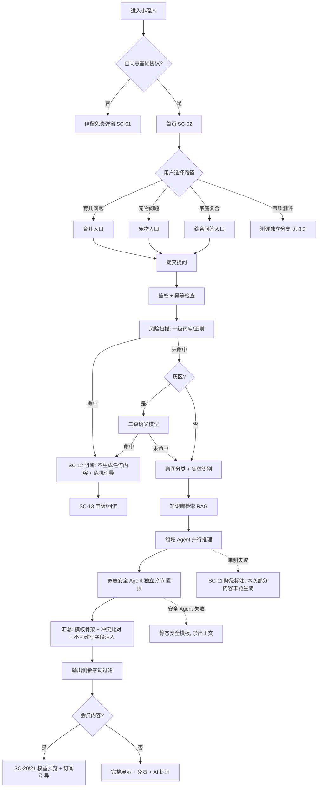
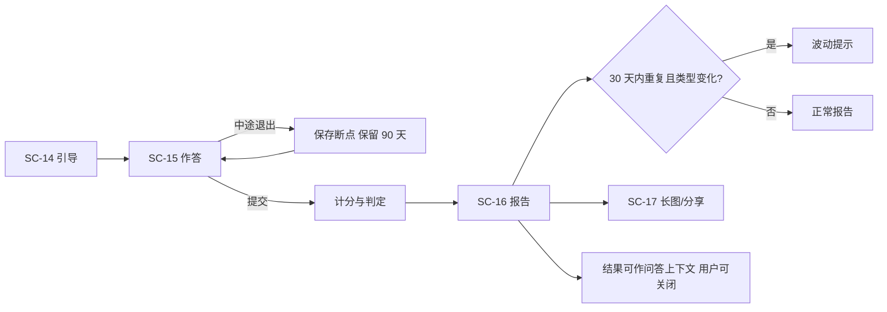
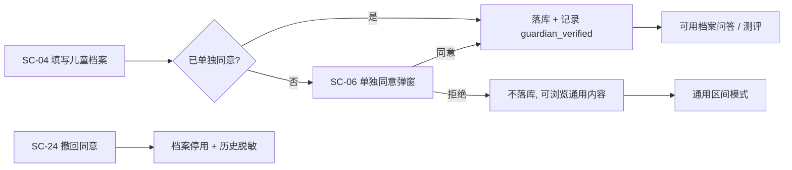

## 7. 多智能体能力规格

> **本章结构在 V1.2 被重构**：新增 §7.1 架构分层（术语澄清）、§7.5 问答响应协议、§7.7 延迟预算表、§7.8 降级矩阵、§7.9 风险拦截与申诉状态机；原 §7.1/7.2/7.3 顺延为 §7.2/7.3/7.4，原 §7.4 顺延为 §7.6。术语替换见 §7.1.3。

> 本章修正 M1–M10、B1–B13、I4 的实现缺口，并新增 RAG 检索规格与成本策略。**冲突处理原则**：架构硬约束（风险最优先、安全置顶）> 用户显式选择 > 模型判断。

### 7.2 Agent 清单与职责矩阵（修订版）

| # | Agent | MVP | 触发条件（修订） | 输入 | 输出 | 硬约束 |
| --- | --- | --- | --- | --- | --- | --- |
| 1 | **风险控制服务** | ✅ 最高优先级 | **所有输入，在任何 Agent 之前**（纯输入侧，不读档案） | 用户提问文本、语音转写文本、测评作答 | 是否命中 / 类别 / 置信度 / 引导文案 ID | 命中即阻断生成；不受其他 Agent 影响 |
| 2 | **中枢调度 Agent** | ✅ | 风险扫描通过后 | 用户问题、用户显式入口、档案区间 | 调度决策 + 汇总结果 | 汇总采用模板骨架 + 字段填充；不可改写字段服务端注入 |
| 3 | **0-6 岁幼儿养育 Agent** | ✅ 核心 | 育儿类问题、测评解读 | 宝宝档案（最小必要字段）、提问 | 结构化养育建议 / 测评解读 | 仅科普参考；不做诊断；不判定终身性格 |
| 4 | **宠物养育 Agent** | ✅ 核心 | 宠物类问题 | 宠物档案、提问 | 饲养 / 行为解读结构化内容 | 只做科普；急症提示就医 |
| 5 | **家庭安全 Agent** | ✅ | **三态触发（修正 A2/M5）**：① 同时涉及儿童 + 宠物的复合问题 → 独立分节并置顶；② 仅宠物问题但存在儿童档案且识别到互动风险 → **规则化附加提醒**（不视为独立分节）；③ 用户显式进入家庭综合问答 → 始终执行 | 复合问题、儿童与宠物档案 | 安全注意事项、行为引导 | 安全内容**置顶且不参与排序**；失败时禁出正文并走静态安全模板 |
| 6 | 学龄育儿 / 学科辅导 / 亲子情绪沟通 Agent | P2 | — | — | — | V1.1/V2.0 |
| — | ~~Agent 权重配置~~ | 删除 | — | — | — | AS-17：MVP 删除 |

**Agent 注册协议（支撑 NFR-4.1 的可验收性）**：每个 Agent 需声明 `agent_id`、`版本`、`领域`、`必需档案字段`、`输出 block 类型集合`、`超时阈值`、`降级策略`。新增 Agent 不得要求修改既有 Agent 逻辑与中枢主流程（验收：新增一个 mock Agent 并可在不改动主流程代码的前提下被调度）。

### 7.3 结构化输出契约 v2（修正 B10/M10，供后端与算法）

```json
{
  "agent_id": "child_care_0_6",
  "agent_version": "1.1.0",
  "intent": "sleep_guidance",
  "topic_key": "sleep_training",
  "confidence": 0.86,
  "answer_blocks": [
    {
      "block_id": "b1",
      "type": "advice",
      "title": "建议要点",
      "content": "……",
      "access_tier": "free",
      "preconditions": "适用于 6-12 月龄、已添加辅食的宝宝",
      "evidence_ref": ["kb_child_sleep_03"],
      "stance": "support",
      "contraindications": [],
      "immutable": false
    }
  ],
  "risk_flags": [],
  "professional_referral": false,
  "medical_advice_blocked": false,
  "ai_generated_label": "AI_GEN_LABEL_V1",
  "disclaimer_id": "DISCLAIMER_V1",
  "retrieval": { "kb_ids": ["kb_child_sleep_03"], "hit": true, "kb_version": "2026-10-01" },
  "tokens_used": 812,
  "latency_ms": 3200
}
```

| 字段 | 必需 | 说明 | 变更依据 |
| --- | --- | --- | --- |
| `topic_key` | 是 | 冲突比对的归组键（如 `sleep_training`） | 新增，M10/D8 |
| `access_tier` | 是 | `free` / `member` / `topic:{id}`；**无权限 block 不下发正文** | 新增，I6/B10 |
| `stance` | 是 | 建议方向枚举：`support` / `oppose` / `conditional` / `neutral` | 新增，D8/M10 |
| `contraindications` | 是 | 禁忌项列表（字符串数组） | 新增，D8 |
| `evidence_ref` | 是 | **必须来自检索结果 ID，禁止编造**；无命中时为空数组 | 修正，B6/M10 |
| `ai_generated_label` | 是 | AI 生成内容标识 ID（显式标识），服务端固定注入 | 新增，CG1 |
| `medical_advice_blocked` | 是 | 是否触发医疗/兽药边界规则（药名 + 剂量模式） | 新增，CG14 |
| `immutable` | 是 | 是否不可被汇总改写（`true` 时汇总只能原样透传） | 新增，M9 |

**不可改写字段（服务端注入，不经过 LLM）**：安全提示分节、冲突标注、免责声明、AI 生成标识、`professional_referral` 提示。

### 7.4 中枢 → 前端输出契约（新增，修正 A4/B1/M3）

```json
{
  "request_id": "req_…",
  "session_id": "sess_…",
  "status": "streaming | done | blocked | degraded | failed",
  "render_order": ["safety", "child", "pet"],
  "sections": [
    { "key": "safety", "title": "家庭安全提示", "blocks": ["…"], "immutable": true, "pinned": true },
    { "key": "child",  "title": "育儿侧建议",   "blocks": ["…"] }
  ],
  "conflict_note": null,
  "agents_involved": [{ "agent_id": "child_care_0_6", "latency_ms": 3200, "status": "ok" }],
  "degraded_reason": null,
  "disclaimer_id": "DISCLAIMER_V1",
  "ai_generated_label": "AI_GEN_LABEL_V1"
}
```

| 规则 | 内容 |
| --- | --- |
| 渲染顺序 | 由服务端 `render_order` 决定，前端不得重排；`pinned: true` 的分节不可折叠、不可下移 |
| 流式方案 | **分节渐进呈现**：每个 Agent 返回即渲染该节，未返回节显示骨架屏；**首包＝进度占位包**（不计入 8s 验收） |
| 覆盖与撤回 | 同名 `section.key` 的新分片覆盖旧的；若某节在渲染后变为 `blocked`，前端必须替换为阻断态并提示"内容已更新"，不允许残留 |
| 门控 | 会员 block 由服务端裁剪，前端**不做安全边界**（不靠遮罩） |
| 一致性 | `status=done` 为最终态；最终态必须包含免责声明与 AI 标识 |

### 7.6 调度规则（修正 M7/A1、I10、B13）

**执行顺序（硬约束）**：收请求 → 鉴权与幂等检查 → **风险扫描（一级 + 灰区二级；纯输入侧，不读档案）** → 意图分类与实体识别 → 检索 → 领域 Agent 并行 → 汇总（模板骨架 + 不可改写注入）→ 输出侧过滤 → 返回。

| 规则 | 内容 |
| --- | --- |
| 风险扫描位置 | **先于一切**（修正 V1.0 §5.1 步骤 5/7 与 §5.4 流程图的"先调度后扫描"） |
| 入口优先 | 用户显式选择入口时以用户选择为准（FR-M1：用户显式选择入口时以用户选择为准） |
| 安全 Agent 触发 | 三态触发（见 §7.2 #5） |
| 无档案输入契约（I10/B13） | 无档案时：`age_band = "1-3"`（默认通用区间）、`profile_bound = false`；回答中必须带"补充档案可获得更贴合建议"提示；`preconditions` 字段必须写明"未绑定档案，按通用区间给出" |
| 测评上下文 | 测评结果可作上下文（FR-E7），用户可关闭；关闭后调度不读取测评字段 |
| 调度日志 | 每次请求记录：命中意图、是否复合场景、调用的 Agent 列表、决策依据（规则 or 分类模型） |

### 7.10 汇总实现规格（修正 M9/B1）

1. **主体**：**模板骨架 + 字段填充**，由服务端完成，不调用 LLM。
2. **连贯性改写（可选）**：可选的低成本改写步骤，必须满足：① 只改写 `immutable=false` 的 `advice` 类 block；② 超时（>500ms）或失败立即回退到模板结果；③ 改写后再跑一次输出侧敏感词过滤。
3. **禁止**：任何允许模型重排分节、改写安全提示、改写冲突标注、删除免责或 AI 标识的实现。
4. **验收**：构造"汇总改写失败"与"改写模型返回恶意内容"两个用例，验证安全分节仍置顶、免责与 AI 标识仍存在。

### 7.11 冲突判定规则（修正 Q-16/D8/M10）

| 规则 | 内容 |
| --- | --- |
| 判定方式 | **结构化字段规则比对**，不用 LLM 自由判断 |
| 归组 | 按 `topic_key` 归组不同 Agent 的同一议题 block |
| 冲突条件 | 同一 `topic_key` 下，两个 Agent 的 `stance` 为相反极性（`support` vs `oppose`），或一方的 `contraindications` 命中另一方的建议 |
| 输出 | 冲突标注"观点存在差异，建议多方参考"（不可改写字段，服务端注入）；**不阻断生成** |
| 监控 | 冲突率作为线上指标（§9.4）；异常升高触发内容复核 |
| 验收 | 构造两组固定输入（一组应判冲突、一组不应判冲突），判定结果必须可复现 |

### 7.12 知识库与检索规格（**新增，修正 B6/M10**）

| 项 | 规格 |
| --- | --- |
| 检索源 | 育儿知识库、宠物知识库分别按领域过滤；测评题库不参与问答检索 |
| 召回 | 向量召回 top-k = 8 → 重排取 5；领域不匹配的条目不得进入上下文 |
| 引用约束 | `evidence_ref` **必须来自检索结果 ID**；模型中出现的其他来源一律剔除 |
| 无命中 | `hit=false` → `professional_referral=true`，正文标注超范围提示 |
| 版本绑定 | 检索结果携带知识库版本号；缓存 key 绑定版本号，知识库更新即失效 |
| 前端展示 | 引用来源**后台可见、前端不展示**（AS 沿用 V1.0 §4.2 假设，Q-33） |
| 验收 | ① 构造幻觉用例：模型编造 kb_id → 服务端剔除且 `evidence_ref` 为空；② 构造无命中用例 → 必须出现超范围标注；③ 知识库条目下架后缓存失效 |

### 7.13 模型、成本与缓存策略（新增，修正 B4/N1）

| 项 | 策略 |
| --- | --- |
| 模型分级 | 一级风险筛选/意图分类用轻量模型；领域推理用主力模型；汇总**不用模型** |
| token 上限 | 单 Agent 输入 ≤ 8k tokens（含检索上下文与档案，超出即裁剪）；输出 ≤ 2k tokens |
| 上下文裁剪 | 只传最小必要档案字段（儿童：月龄区间、性别、过敏项；宠物：类型、年龄段） |
| 缓存 | key = hash(规范化问题 + 档案区间 + 知识库版本 + `agent_version`)；命中缓存必须标注"内容来自缓存，可能不是最新"；风险扫描与会员门控**仍逐次执行**，不跳过 |
| 成本观测 | 每次请求记录 token 用量与模型调用次数；§2.3 护栏指标口径 |
| 成本闸门 | 免费额度（AS-02）是成本与转化的双重闸门；单用户单日请求上限由额度服务统一裁决 |

---

## 8. 关键流程与状态机

### 8.1 主流程（修正版，覆盖 A1/A13/M6/M7）



### 8.2 风险拦截流程（两级筛选，修正 I4/M4）

| 步骤 | 动作 | 预算 | 失败处理 |
| --- | --- | --- | --- |
| 1 | 输入规范化（长度截断 2000 字、去混淆字符） | 50ms | — |
| 2 | 一级：高危词库 + 正则（含药名剂量模式） | ≤300ms | 不可用 → 禁止出正文 |
| 3 | 命中即阻断 → 写高风险事件表 → 返回引导文案 ID | — | — |
| 4 | 灰区（二级阈值 0.5–0.8 或特征命中）→ 语义模型 | ≤800ms | 不可用 → 按命中处理（保守） |
| 5 | 置信度 >0.8 直接拦截；0.5–0.8 拦截 + 温和引导；<0.5 放行并打标 | — | — |
| 6 | 记录埋点 `qa_risk_block`，记录类别（脱敏统计） | — | — |

**覆盖范围**：用户全部输入（提问、语音转写文本、测评作答）。**上线首批 5 类**：儿童虐待、孩子自伤/自杀想法、幼儿持续高烧惊厥、严重抑郁、宠物中毒/大出血；（D6 建议）"儿童被宠物抓咬伤"是否纳入高危清单待专家与法务确认（CG18）。

### 8.3 测评流程（**独立分支**，修正 M6/A8）



**说明**：测评**不进入多 Agent 推理链路**（V1.0 §5.4 把测评并入领域 Agent 链路，与测评状态机不一致）。测评作答仍需**先过风险扫描**（FR-L2）。

### 8.4 建档与分层同意流程（新增，CG2/CG3）



### 8.5 支付与对账流程（修正 I1/I2/B3）

```mermaid
flowchart TD
    A[SC-20 权益页] --> B{平台?}
    B -- iOS --> C[提示暂不支持购买]
    B -- Android --> D[SC-22 下单]
    D --> E[微信支付]
    E -- 成功 --> F[回调: 幂等校验]
    F --> G[权益生效 + 写流水]
    E -- 失败/取消 --> H[订单关闭, 可重新发起]
    F -- 重复回调 --> I[幂等返回上次结果]
    F -- 回调丢失 --> J[订单: 支付确认中]
    J --> K[T+1 自动对账]
    K -- 一致 --> G
    K -- 差异 --> L[待人工处理 + 告警]
    G --> M{申请退款?}
    M -- 是 --> N[退款申请中 → 通过/驳回(含理由)]
```

**幂等要求**：订单表 `out_trade_no`、`transaction_id` 唯一索引；重复提交不重复发放权益；T+1 对账任务与告警（验收项见 §13.4）。

### 8.6 问答会话状态机（修正 A13）

| 当前状态 | 触发动作 | 目标状态 | 副作用 |
| --- | --- | --- | --- |
| 待提交 | 用户提交 | 幂等检查 | 记录 `client_request_id` |
| 幂等检查 | 命中重复 | 已生成（复用） | 直接返回上次结果，不扣额度 |
| 幂等检查 | 新请求 | 风险扫描中 | 启动风险 Agent |
| 风险扫描中 | 命中高危 | 已阻断 | 不生成内容、弹引导、写风险日志、埋点 |
| 风险扫描中 | 未命中 | 检索与调度中 | 记录调度决策 |
| 检索与调度中 | 完成 | 推理中 | 并行调用 1–N 个 Agent |
| 推理中 | 部分返回 | 渲染中（分节） | 逐节渲染 + 骨架屏 |
| 推理中 | 全部成功 | 汇总中 | 冲突比对 + 敏感词过滤 |
| 推理中 | 部分失败 | 已降级 | 按 §7.8 矩阵标注 |
| 推理中 | 全部失败 | 已失败 | 兜底话术、不计次 |
| 汇总中 | 完成 | 已生成 | 落库、返回、埋点 |
| **已阻断 / 已失败** | **用户重新提交** | **待提交** | **回边：允许在同一会话重试（不计次）** |
| 已生成 | 用户追问 | 待提交 | 同一会话内二次提问计数 |

### 8.7 测评状态机（修正 A13）

| 当前状态 | 触发 | 目标 | 副作用 |
| --- | --- | --- | --- |
| 未开始 | 进入测评 | 进行中 | 创建测评记录 |
| 进行中 | 中途退出 | 进行中 + `has_draft=true` | 保存断点（90 天） |
| 进行中 | 提交 | 风险扫描中 | 作答内容过风险扫描 |
| 风险扫描中 | 命中 | 已阻断 | 不生成报告 + 引导 |
| 风险扫描中 | 未命中 | 计分中 | 维度计分 |
| 计分中 | 完成 | 已完成 | 生成报告；30 天内重复且类型变化 → 波动提示 |
| 已完成 | 重新测评 | 进行中 | 新建记录，不影响历史报告 |

### 8.8 订单状态机（修正 I1/B3）

| 当前状态 | 触发 | 目标 | 副作用 |
| --- | --- | --- | --- |
| 待支付 | 调起支付 | 支付确认中 | 防重复提交 |
| 支付确认中 | 回调成功 | 已支付 | 权益生效、写流水 |
| 支付确认中 | 回调超时 | 支付确认中（保持） | T+1 对账兜底 |
| 待支付 | 取消 / 超时 | 已关闭 | 可重新发起 |
| 待支付 | 支付失败 | 已关闭 | 记录失败原因，允许重试 |
| 已支付 | 重复回调 | 已支付 | **幂等**：返回上次结果，不重复发放 |
| 已支付 | 对账差异 | 待人工处理 | 告警 + 人工补发/冲正 |
| 已支付 | 申请退款 | 退款申请中 | 记录申请留痕 |
| 退款申请中 | 通过 | 已退款 | 权益回收（未使用部分）、写退款流水 |
| 退款申请中 | 驳回 | 已支付 | 展示驳回理由 |
| 已支付 | 到期 | 已过期 | 深度内容转只读（AS-22） |

### 8.9 知识库上架与申诉工单状态机（新增，支撑 D5）

| 当前状态 | 触发 | 目标 | 副作用 |
| --- | --- | --- | --- |
| 草稿 | 提交审核 | 待审核 | 生成审核工单 |
| 待审核 | 专家通过 | 已上架 | 版本号 +1、缓存失效 |
| 待审核 | 专家驳回 | 已驳回 | 记录驳回理由；条目不可上架 |
| 已上架 | 发现违规 / 抽检不合格 | 已下架 | 触发内容追溯处置（§8.10） |
| 已下架 | 回滚到历史版本 | 已上架 | 版本回滚留痕（FR-K1） |

### 8.10 内容追溯处置流程（修正 A11/R-5）

| 步骤 | 动作 | 时限 |
| --- | --- | --- |
| 1 | 条目下架 → 按 `kb_id` 反查引用该条目的问答与报告 | 1 个工作日内 |
| 2 | 分级处置：A 无实质影响（不改）；B 追加"内容已更新，请以最新建议为准"提示；C 下架内容并在用户回看时标记"该内容已下架" | 处置决定 3 个工作日内 |
| 3 | 执行与留痕（操作人、时间、影响面、处置等级） | 7 个工作日内闭环 |
| 4 | 汇总报告给内容负责人；异常量级触发告警 | 7 个工作日内 |

**说明**：已生成的历史内容**不追溯重写正文**（成本与可解释性），只做提示级处置（对应 R-5 的闭环）。
