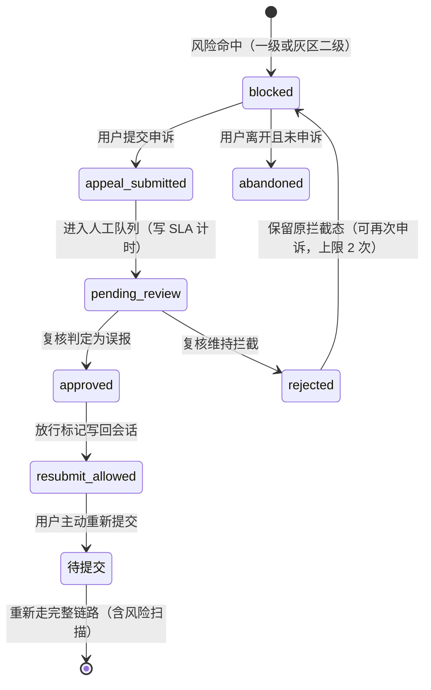

### 7.9 风险拦截与申诉状态机（**重写，关闭评审第 3 项**）

> V1.1 与 UI 冲突：PRD 说"申诉 24 小时人工复核"，UI 说"申诉后回会话并显示『该问题已放行』"，同时 UI 又标注"立即放行 vs 24h 后放行待拍板"。本节给出唯一状态机，并回答六个必答问题。

### 7.9.1 状态机（唯一权威）

### 7.9.2 六个必答问题（结论）

| # | 问题 | 结论 | 理由 |
| --- | --- | --- | --- |
| 1 | **申诉后是否立即放行** | **否** | 立即放行等于把风险判定的最终决定权交给用户，与"安全先于完整"冲突；且会让高危内容在无人工确认下进入生成 |
| 2 | **复核通过后自动重新生成还是用户主动重提** | **用户主动重新提交** | 自动重生成会消耗额度且用户可能已离开；主动重提也保证用户此刻确实想要该回答 |
| 3 | **复核期间能否改写问题** | **不能改写原问题**，但可**补充说明**（独立字段 `appeal_note`，≤500 字） | 允许改写等于允许绕过拦截；补充说明只用于人工判断，不进入问答链路 |
| 4 | **高危类别是否永远不自动放行** | **是，分两类**：① **硬类别**（儿童虐待、孩子自伤/自杀想法、幼儿持续高烧惊厥）**永不自动放行**，复核只能"维持拦截"或"转人工线下引导"；② 软类别（严重抑郁、宠物急症等）复核通过后可放行 | 硬类别涉及人身安全与可能的强制报告义务，任何自动化放行都是不可接受的 |
| 5 | **申诉补充文本是否再次风险扫描** | **是**，且**用的是同一套流水线**（FR-L1）；补充文本命中硬类别则申诉直接标记为"不予受理"并升级到高风险事件表 | 申诉文本本身也可能包含高危信息，不能成为扫描盲区 |
| 6 | **申诉失败是否计入额度** | **不计** | 被拦截与申诉都不产生模型调用（除灰区二级）；额度是成本闸门，不是惩罚工具 |

### 7.9.3 其他规则

| 项 | 规则 |
| --- | --- |
| 申诉次数上限 | 同一会话同一问题最多 2 次；第 3 次起只显示渠道清单 |
| SLA | 默认 **24 小时**内完成复核（🟡 默认值，需运营确认）；超时告警并升级值班 |
| 回执 | 有受理编号 + 复核结果 + 理由；**是否向用户回执**🔴 未决策（Q-26），默认回执 |
| 额度与计次 | `appeal_submit`、`appeal_allow` 均不计次；放行后**重新提交**才计次 |
| 放行有效期 | 放行标记**仅对该会话该问题有效**，有效期 24 小时；过期后再次提交重新扫描 |
| 数据 | 申诉记录进入申诉工单服务与高风险事件表（如命中硬类别），按 §11.10 留存 ≥3 年 |
| 硬类别被放行的可能性 | **不存在**。若复核人误判，通过"复核结果审计 + 每日抽检"兜底，不提供技术上的"强制放行"入口 |

### 7.9.4 对 UI 文档的同步要求

SC-13 的现有文案"申诉后回会话、显示『该问题已放行』"必须改为：

1. 提交申诉后 → 停留在 SC-13，显示"已受理 + 受理编号 + 预计复核时限"；
2. **不显示"已放行"**，直到复核结论返回；
3. 复核通过 → 显示"该问题已放行，请在 24 小时内重新提交（重新提交仍会进行内容安全检查）"；
4. 硬类别 → 不提供"继续提问"出口，只显示渠道清单。

---

