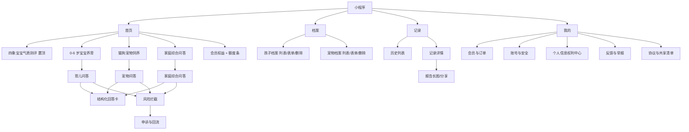

# 家伴・家庭养育多智能体助手 —— UI 界面原型描述文档

> **文档版本**：V1.2（与 `家伴-PRD_V1.2.md` 同版本号；视觉章节为 token 级，34 页线框的结构与编号未改动）
> **文档状态**：待评审。**唯一界面基线**
> **编制日期**：2026-10-03
> **效力**：本文档是页面结构、状态、交互与组件的**唯一界面基线**；`家伴-UI原型描述_V1.0.md` / `_V1.1.md` 已被取代，仅作归档。
> **配套文档**：`家伴-PRD_V1.2.md`（唯一需求基线；三态决策词汇见其 §0.3、FR 决策状态见 §6.16）｜`DESIGN.md`（唯一视觉 token 真源）｜`家伴-设计系统样式瓦片.html`（token 与组件的可视证据）
> **上游文档**：`家伴-家庭养育多智能体助手_需求说明文档_V1.0.md`（**历史来源，不具规范效力**）
> **范围**：微信小程序（C 端）26 页 + 后台管理 Web（PA）8 页 = **34 页线框图**；另含设计方向与裁决、token 级设计系统、跨页状态矩阵、关键交互时序、文案与合规呈现规范、组件规格、决策依赖索引、一致性检查清单
> **本文档不含**：高保真视觉稿（按本文档 token 制作）、交互动效原型、前端代码

---

## 0. 文档信息与阅读指引

### 0.1 本文档的职责

PRD 决定"做什么、做到什么算成功"，本文档决定"**长什么样、怎么点、异常时显示什么**"。两者通过页面编号 `SC-xx` / `PA-xx` 与需求编号 `FR-x.x` 双向绑定（追溯矩阵见 PRD §17.1）。

### 0.2 编号约定

| 标记 | 含义 |
| --- | --- |
| `SC-xx` | 小程序页面（Screen） |
| `PA-xx` | 后台管理端页面（Panel） |
| `C-x` | 组件编号（第 9 章组件规格库） |
| `S-x` | 跨页状态编号（第 6 章状态矩阵） |
| ①②③… | 线框内元素标注，与每页"元素说明"表逐行对应 |
| `FR-x.x` / `AS-xx` / `Q-xx` / `CG-x` | 与 PRD 完全一致的编号体系 |

### 0.3 线框图怎么读

1. 线框按**等宽字体**绘制，中文按 2 显示列、制表符与拉丁字符按 1 显示列计算宽度；**若查看字体不是等宽，可能出现视觉错位，此时以"元素说明"表为准**。
2. **线框内的元素标号写作 `(1) (2) (3)`**，对应的"元素说明"表格中写作 `①②③`——这是刻意的：圆括号数字是纯 ASCII，在任意等宽字体下宽度确定，能保证线框对齐；表格中的圈码不影响对齐。
3. 小程序画布按 375×812 的比例绘制（外框 46 显示列），后台按 1440×900（外框 76 显示列）。
4. 线框是**结构稿**：只表达信息层级、元素位置、状态与分支，不表达色彩与质感；视觉规格见 §2 与 `DESIGN.md`，可视证据见 `家伴-设计系统样式瓦片.html`。
5. 每个页面后附三类说明：**元素说明**（编号对应的元素、类型、交互、数据来源、状态/异常）、**状态与分支**、**埋点**。
6. `<20>` 段落为**决策依赖**：只说明该页依赖哪些未决策项与默认方案，**不阻塞页面结构开发**；完整清单集中在 §11 决策依赖索引，状态词汇与 PRD §0.3 一致。

### 0.4 阅读指引

| 读者 | 建议路径 |
| --- | --- |
| 设计 | §1 设计方向与裁决 → §2 设计系统规范 → §5 逐页线框 → §9 组件规格 → `DESIGN.md` |
| 前端 | §2 设计系统规范（token 可直接取用） → `家伴-设计系统样式瓦片.html` → §5 逐页线框 → §6 状态矩阵 → §7 时序 → §9 组件规格 |
| 产品 | §1 方向裁决 → §3 信息架构 → §4 页面清单 → §5 逐页线框（重点看状态与分支） |
| 测试 | §5 逐页线框 → §6 状态矩阵 → §10 交付与验收清单 |
| 法务 / 合规 | §2.2 色彩命名规则 与 §8 文案与合规呈现规范 → §5 中 SC-01/06/12/13/24/25/26、PA-06/07/08 |

---

## 1. 设计方向与原则

### 1.1 本次升级（V1.1 → V1.2）改了什么

V1.0 只给了语义命名的色彩（`--c-brand` 之类）与原则声明，前端拿不到能直接落地的值，视觉方向也没有定论。V1.1 用三支设计技能（`frontend-design`、`impeccable`、`design-taste-frontend`）重做视觉章节，**不动 34 页线框的结构与状态**。

| 变更 | 说明 |
| --- | --- |
| 新增设计读法与三档拨盘 | 明确本产品是 Operate 表面，并给出变化度/动效/密度的取值与理由 |
| 新增方向掷骰与裁决记录 | 避免落进品类默认；记录被指定方向与被否决的挑战者及其保留条款 |
| 色彩升级到 token 级 | 给出 hex、用途与实测对比度；确立"安全即主色""会员没有颜色"两条命名规则 |
| 字体方案落地 | 说明为什么是系统中文字体栈（小程序不加载远程字体），并给出 px / rpx 双标 |
| 新增签名组件 | 刻度带（`GraduatedBand`），把"给区间不给定论"变成可复用结构 |
| 新增状态的可视手法 | 空/加载/渐进/降级/门控/拦截/冲突逐条给视觉做法，而不只是"要有这个状态" |
| 新增浏览器表面与暗色规则 | 选中、光标、滚动条、焦点环；夜间按独立约束取值而非反相 |
| 交付物 | 新增 `DESIGN.md` 与样式瓦片，作为 token 的单一真源与可视证据 |
| **V1.2 同步** | 与 PRD V1.2 对齐：① SC-13 按 §7.9 改写（申诉不即放行、硬类别无「继续提问」出口）；② SC-11 区分两种降级视觉（单侧失败 vs 安全失败）；③ 三类问答页补 `blocked` 清空规则；④ 页面内「待确认」占位全部移入 **§11 决策依赖索引**；⑤ 新增 **§12 与 PRD V1.2 的一致性检查清单**；⑥ 阻塞级别改用 B1/B2/B3 |

### 1.2 设计读法（Design Read）

**Reading this as**：面向"一手抱娃、碎片时间、深夜低光"的中国家长（次受众为长时间密集操作的管理员）的 **Operate 表面**，采用**可信优先**的语言，落到"向主色偏移的冷中性 + 单一墨青强调色 + 刻度带签名 + 系统中文字体栈"的克制系统上。

### 1.3 三档拨盘（取值与理由）

| 拨盘 | 取值 | 理由 |
| --- | --- | --- |
| 变化度 `DESIGN_VARIANCE` | 3 | Operate 表面：用户在完成任务，熟悉度是特性而不是缺点 |
| 动效强度 `MOTION_INTENSITY` | 2 | 冲突、拦截与合规提示必须一次看清；动效只承担状态变化 |
| 信息密度 `VISUAL_DENSITY` | 6 | 产品要展示分节建议、档位与状态；后台更需要密度 |

### 1.4 方向裁决（记录来源，便于复核）

品类默认（粉与奶油底 + 糖果圆角卡片 + 大幅插画 + emoji + 三张等大功能卡）与它的反面（冷灰金融后台 + 纯表格 + 无温度）**都被拒绝**，不入候选。

按受众自身的世界（预防接种证与儿保手册、家庭挂历与冰箱磁贴、奶瓶与量具刻度、生长曲线图、监护器面板、急诊分诊牌、宜家式无字组装图，跨 4 个材料家族）列出 7 个 grounded 方向后，由掷骰指定**第 3 位：量具刻度系统**（seed key `ea6061e3`，code-led 构建）。

| 挑战者 | 裁决 | 保留下来的那一条纪律 |
| --- | --- | --- |
| 19 世纪词典页（页头导引词、页边索引、颜色封在图版内） | competitive | **范围指示行**：页头一行字说明"你现在在哪个范围里" |
| 拉班舞谱（垂直谱线、时间向上、块长＝时长） | declined | **长度即数值**：时限与耗时按比例呈现，不做装饰性进度条 |
| 动物园导览图（平涂色块、中间开口透出底色） | declined | **门控表现为"露出下沉地面"**，而不是盖一层灰罩 |
| 喷气时代机票夹（券联、VOID 章、"没有东西消失，它只是被作废"） | competitive | **失效但不消失**：到期 / 退款 / 下架 / 撤回都是"保留可见 + 明确标记" |
| Wim Crouwel 栅格字样（可见构造栅格） | declined | **刻度与布局同源**：刻度周期与内边距共用一套间距基数 |
| 可变字体样本（拖动即重算、实时读数） | declined | **`prefers-reduced-motion` 下在命名档位间跳变**，不做插值 |

另有两条对照方向供复核：**儿保手册 / 预防接种证**（本项目最容易被复制的方向；诚实风险是极易滑向通用政府表单，故不构建）与**品类标准做法**（永远可用；若选择则按其满配执行，不加私货，本系统不推荐也不比较）。

### 1.5 方向契约

| 块 | 内容 |
| --- | --- |
| THESIS | 界面是一支量具：每一次判断都落在一条有刻度的带上，并标出它落在哪一档。拒绝母婴品类的糖果卡片、粉彩色与"科学测评"话术 |
| OWN-WORLD | 器械白与青灰的冷中性底；单一墨青强调色；**安全提示就用主色**；刻度线为细墨线、数字等宽；语义色只在刻度与状态内；圆角只有两档；无渐变、无玻璃、无 emoji、无 Unicode 图标 |
| STORY | 家长看懂"我在哪一档、还剩多少、什么时候必须停下去找医生"；管理员看懂"这条内容处在什么状态、影响面多大" |
| FIRST VIEWPORT | 一张回答卡：安全分节以实底铺满整宽且不可折叠，其下是刻度带与分节正文，卡脚固定免责声明与 AI 标识；主操作落在下半屏热区 |
| FORM | 量具刻度系统（grounded 列表第 3 位），seed key `ea6061e3` |

### 1.6 设计上下文

| 项 | 内容 |
| --- | --- |
| 用户 | 25–40 岁父母，常在**抱孩子、单手操作、碎片时间**下使用；情绪状态可能焦虑甚至崩溃 |
| 设备 | 微信小程序，主流 375–430 宽度手机；需考虑 iPhone 安全区 |
| 使用姿势 | 单手可达区在下半屏 → 主操作按钮靠下，顶部只放导航与状态 |
| **光线** | **夜间低光是真实高频场景（夜醒）** → 深色模式是一等公民，按独立约束取值 |
| 内容特性 | 输出较长（多分节建议），可信度与合规提示必须显性可见 |
| 风险场景 | 高危输入、误报、会员墙、部分失败降级 —— **这些不是边缘情况，必须有专门设计** |

### 1.7 六条设计原则

| # | 原则 | 视觉落点 |
| --- | --- | --- |
| 1 | **安全可见** | 安全分节实底置顶、不可折叠；拦截页是独立全屏（`danger` 描边 + `danger-soft` 顶面），不与普通错误页共用样式 |
| 2 | **合规显性** | 免责小字与 AI 标识是固定位元素（§8.2 / §8.3），不是可关闭的提示；分层同意是两个独立勾选（§2.6 与 SC-06） |
| 3 | **给区间不给定论** | 一切判断用刻度带表达档位与区间；不出现精确分数与绝对类型（§2.6） |
| 4 | **可扫描** | 长回答用分节 + 小节标题 + 图标；正文 16px/1.6；测度 65–75 字符 |
| 5 | **单手可达** | 主操作位于下半屏热区（≥88rpx）；危险操作二次确认且避开拇指惯性点击区 |
| 6 | **状态完备** | 每一页都定义空、加载、失败、无权限、降级、断网、只读、并发冲突；每类状态都有具体视觉手法（§2.7） |

### 1.8 合规呈现四条硬规则（与 PRD §11 对应）

1. **免责声明**：所有内容页底部常驻小字（`caption` + `ink-3`，仍须 4.5:1）；弹窗正文不可通过系统返回键跳过（SC-01 / SC-06）。
2. **AI 标识**：回答卡、报告页、分享长图固定位展示；长图在生成时渲染，产品内不可去除（CG1）。
3. **分层同意**：基础同意（SC-01）与儿童信息单独同意（SC-06）**不得合并**；撤回入口在 SC-24 与 SC-25 可见。
4. **危机引导**：拦截页必须给出可拨打/可复制的渠道清单，且**不展示任何可能被误读为诊断或建议的文本**（FR-L2 / FR-L3）。

---

## 2. 设计系统规范

> **单一真源**：本章的 token 与 `DESIGN.md` 的 YAML frontmatter 一致；`DESIGN.md` 是机器可读层（本 PRD 系列工具与前端可直接读取），本章是给人读的规范层。两者冲突时以 `DESIGN.md` 为准，并同步修订本章。

### 2.1 画布与栅格

| 项 | 规格 |
| --- | --- |
| 设计基准 | 375 × 812（iPhone 标准），向上适配到 430 宽度 |
| 单位 | 使用 `rpx`（750rpx = 屏宽；**1px = 2rpx**）；输出尺寸按 2 倍图 |
| 栅格 | 4 列流式；页边距 32rpx；卡片间距 48rpx；卡片内边距 48rpx |
| 安全区 | 顶部状态栏 88rpx（含胶囊按钮避让区）；底部安全区 + 底部 Tab 112rpx |
| 后台画布 | 1440 × 900；侧边导航 240px；内容区最大宽度 1200px，超出居中 |
| 响应式 | **结构性**：折叠侧栏、表格降列、断点驱动列数；不用流体字号去解决 |

### 2.2 色彩（色值 / 用途 / 实测对比度）

**策略：克制。** 一套向主色偏移的冷中性 + 一个强调色 + 一组只服务于状态的语义色。

**浅色（默认）**

| token | hex | 用途 | 对白对比度 |
| --- | --- | --- | --- |
| `accent` | `#0A6B60` | 主操作、当前选中、**安全提示** | 6.4:1 |
| `accent-press` | `#074E46` | 主操作按下 / 悬停 | 9.0:1 |
| `accent-soft` | `#E1EFEC` | 安全分节实底 | — |
| `accent-line` | `#8FBFB7` | 次级按钮描边 | — |
| `on-accent` | `#FFFFFF` | 主操作文字 | 6.4:1 |
| `ink-1` | `#0F1E1C` | 标题与正文 | 17.2:1 |
| `ink-2` | `#455754` | 次级文本、区间说明 | 7.5:1 |
| `ink-3` | `#5F6F6C` | 免责小字、时间戳 | 5.3:1 |
| `bg` | `#F2F5F4` | 页面底 | — |
| `surface` | `#FFFFFF` | 内容面 | — |
| `surface-2` | `#E9EFED` | 第二中性层：刻度槽、工具栏、表格悬停、下沉地面 | — |
| `line` | `#D5DEDB` | 发丝线 | — |
| `line-strong` | `#B4C3BF` | 输入框描边、刻度标尺、滚动条 | — |
| `danger` | `#A8231B` | 风险拦截、危险操作、越过安全线 | 7.2:1 |
| `danger-soft` | `#F7E4E2` | 阻断面顶部实底 | — |
| `warn` | `#7A5600` | 降级、额度用尽、审核中、占位 | 6.6:1 |
| `warn-soft` | `#F6EDD8` | 冲突标注、降级条实底 | — |

**夜间（独立取值，不是反相）**

| token | hex | 取值理由 |
| --- | --- | --- |
| `bg` / `surface` | `#0C1614` / `#13201E` | 低光环境的底色，不用纯黑（纯黑会在 OLED 上产生拖影感） |
| `ink-1` / `ink-2` / `ink-3` | `#E8EFEC` / `#AEBFBB` / `#93A5A1` | 正文对比高于浅色模式（15.6:1），补偿低光下瞳孔放大带来的失焦 |
| `accent` / `accent-soft` | `#4FB3A4` / `#16332E` | 强调色提亮一档；但安全分节是**大面积实底**，故底色饱和度被显著压低 |
| `danger` / `warn` | `#E8776D` / `#DCB25C` | 语义色在深底上重新取值；浅色的朱红与陈黄在深底上会糊成一团 |

**命名规则（四条，都是产品判断不是审美偏好）**

1. **安全即主色。** 安全提示使用 `accent`，不另设"安全色"。安全是这个产品的身份，而不是又一个警告色。
2. **会员没有颜色。** 付费门控靠"正文被裁掉"与下沉地面表达；任何给会员配专属色（金、紫）的做法都会与安全、合规元素争夺颜色语义。
3. **免责小字也是正文。** `ink-3` 仍须 ≥4.5:1（实测 5.3:1），因为它承担合规作用，不是可以打折的装饰文字。
4. **语义色不上装饰。** `danger` / `warn` 只允许出现在刻度、状态标签与实底提示面内部；不得用于边框装饰、图标点缀或强调标题。

### 2.3 字体与字号

**一套字就够。** 产品界面不需要标题字体与正文字体的配对。这里是中文产品且运行在微信小程序中，而**小程序不加载远程字体**（CJK 字体体积与平台限制），因此正确做法是系统中文字体栈，而不是硬塞网络字体。

```
--f-ui: -apple-system, BlinkMacSystemFont, "PingFang SC", "HarmonyOS Sans SC",
        "Source Han Sans SC", "Noto Sans CJK SC", "Microsoft YaHei", system-ui, sans-serif;
--f-num: ui-monospace, "SF Mono", "Cascadia Mono", Consolas, monospace;
```

| 角色 | px | rpx | 字重 | 行高 | 用途 |
| --- | --- | --- | --- | --- | --- |
| display | 23 | 46 | 600 | 1.3 | 页面主标题、问题原文 |
| title | 19 | 38 | 600 | 1.3 | 卡片标题、分节标题 |
| body | 16 | 32 | 400 | 1.6 | 回答正文（**下限，不得更小**，AS-33） |
| sub | 14 | 28 | 400 | 1.6 | 次级说明、字段名 |
| caption | 12 | 24 | 400 | 1.5 | 免责小字、时间戳（仅此两处可用 12px） |
| numeric | 16 | 32 | 400 | 1.6 | 刻度读数、金额、耗时 |

- 字号比值 1.2，**固定 rem，不用流体缩放**：产品在固定 DPI 下使用，会缩放的标题在侧栏里只会更糟。
- 正文测度 65–75 字符（约 30–36 汉字）。
- **数字一律 tabular**（`font-variant-numeric: tabular-nums`）：刻度读数必须纵向对齐才能被扫读。
- **等宽字体只用于真正的代码与标识**：知识库 ID、会话 ID、文案 ID、正则规则。不拿它当"技术感"的装饰。

### 2.4 间距、半径与高度

**间距用 4 的倍数**（`--s0:6px / --s1:8px / --s1b:10px / --s2:16px / --s3:24px / --s4:32px / --s5:48px`，即 12/16/20/32/48/64/96rpx）。刻度周期固定 8px 且不随容器拉伸，因此**刻度、内边距与栅格同源**，而不是一张装饰纹理。

| token | 值（px / rpx） | 用途 |
| --- | --- | --- |
| `s0` | 6 / 12 | 图标与文字、行内紧凑节奏 |
| `s1` | 8 / 16 | 按钮内图标与文案 |
| `s1b` | 10 / 20 | 卡片头、工具栏 |
| `s2` | 16 / 32 | 页边距、行内元素组 |
| `s3` | 24 / 48 | 卡片间距、卡片内边距、分节内边距 |
| `s4` | 32 / 64 | 标本容器、区块内边距 |
| `s5` | 48 / 96 | 区块之间 |

**圆角：两档 + 一个语义例外**（这是一套有文档的混合系统，不是一个随手集合）

| token | 值（px / rpx） | 适用范围 |
| --- | --- | --- |
| `rounded/surface` | 12 / 24 | 卡片、弹层、面板、手机标本框 |
| `rounded/control` | 8 / 16 | 按钮、输入框、标签、色块、焦点环 |
| `rounded/full` | 999 | **仅**头像、图标按钮、刻度槽与填充段 |

禁止第三个圆角值出现在面或控件上；按钮不再使用胶囊形（V1.0 的 `radius-full` 按钮已废止）。

**高度：平面优先，只有两个层级**

| token | 值 | 用途 |
| --- | --- | --- |
| `e1` | `0 1px 3px rgba(15,30,28,.07)` | 吸顶栏、需要脱离页面的卡片 |
| `e2` | `0 10px 28px rgba(15,30,28,.12)` | 弹层、底部面板、抽屉 |

- 卡片由**面 + 发丝线**定义，不由阴影定义；阴影只给真正浮起的东西。
- 阴影必须带偏移与柔和模糊，并**向背景色相偏移**（用青灰而非纯黑）。零偏移的彩色光晕是装饰，不是高度。
- 同一张卡片同时有阴影与发丝线是重复表达，二选一。

### 2.5 图标与插画

| 项 | 规格 |
| --- | --- |
| 图标 | **绘制的 SVG**，24×24 网格，单一描边 **1.75**，`stroke-linecap/linejoin: round`，`fill: none`，颜色随 `currentColor` |
| 图标禁忌 | **不得用 emoji 或 Unicode 字符充当图标**（线框图里的 emoji 只是占位示意，落地一律替换为绘制图标）；安全类与危险类图标不得与普通图标共用同一形状 |
| 图标库 | 若引入图标库，全站只用一个家族、统一 `strokeWidth`；缺失字形用组合方式补齐，不手绘路径 |
| 插画 | 空态使用轻插画（单色 + 主色点缀）；**不使用真实儿童照片** |
| 头像 | 孩子/宠物默认头像为**插画**（隐私最小化，CG16）；MVP 不提供真实头像上传 |
| 分享图 | 底部固定免责区 + 二维码/短链 + AI 标识；家长可选用插画头像或打码 |

### 2.6 签名组件：刻度带（`GraduatedBand`）

这是全系统的签名：把"给区间不给定论"从一句原则变成可复用结构。

```text
   月龄区间                          24 个月 · 1-3 岁     ← 抬头：名称 + 等宽读数
   |    |    |    |    |    |    |    |    |    |         ← 标尺：小刻度 5px 高、周期 8px
   ████████████████████████░░░░░░░░░░░░░░░░░░░░░░        ← 槽：10px 高、全圆角；填充=主色
                    ┃        ┃        ┃                  ← 档位分隔：槽内 1px 竖线
                          ┃                              ← 游标：2px 实心竖线，越出槽体 ±5px
   0-6 月      6-12 月      1-3 岁        3-6 岁          ← 档位标签
```

| 用途 | 档位 | 读数示例 |
| --- | --- | --- |
| 月龄区间 | 0–6 月 / 6–12 月 / 1–3 岁 / 3–6 岁 | 24 个月 · **1–3 岁** |
| 维度分档 | 低 / 中 / 高（每维三档） | 不给精确分数 |
| 风险置信度 | <0.5 放行打标 / 0.5–0.8 拦截 + 引导 / >0.8 直接拦截 | **0.61** · 灰区 |
| 免费额度 | 5 段，已用段实底 | 剩余 **3** / 5 次 |
| 时限（SLA / 耗时） | 按比例填充 | 已过 **7h** / 24h |

**五条组件规则**

1. **长度即数值**：时限与耗时按比例呈现，不做装饰性进度条。
2. **不给精确分数**：不出现绝对类型与"你就是 X 型"的判定。
3. **语义色只在刻度内部**：越过安全线的档位才用 `danger`。
4. **`prefers-reduced-motion` 下在命名档位间跳变**，不做插值动画。
5. **必须带可读数值与 `aria-label`**，不靠颜色单独表意（无障碍底线）。

**实现注意**：槽**不得** `overflow:hidden`（否则游标被裁掉），圆角由填充段自己承担；标尺周期固定 8px，不随容器宽度拉伸。

### 2.7 状态的可视手法

状态矩阵（§6）只规定"必须有哪些状态"。这里规定**每类状态长什么样**，避免落地成"暂无数据"。

| 状态 | 视觉手法 | 反面（禁止） |
| --- | --- | --- |
| 空态 | 轻插画 + 一句价值说明 + 一个主操作（例："还没有宝宝档案 / 建档后，回答会按孩子月龄给出，而不是通用模板"） | 只显示"暂无数据" |
| 加载态 | **骨架屏**，形状与最终布局一致（含刻度槽占位） | 屏幕中央的转圈 |
| 渐进渲染 | 已返回分节直接呈现；未返回分节占位 + 呼吸动画；节标题右侧标注"生成中" | 白屏等到全部返回 |
| 降级 | `warn-soft` 实底条 + 图标 + "本次部分内容未能生成（原因）"；保留免责与 AI 标识 | 悄悄少一块内容 |
| 门控（无权限） | **下沉地面露出**（`surface-2` 底）+ 标题 + 淡出的预览摘要 + 解锁入口 | 灰罩遮住完整内容（可被抓包绕过） |
| 风险阻断 | 独立全屏：`danger` 描边 + `danger-soft` 顶面 + 渠道卡片；**无任何建议性文本** | 与普通错误页共用样式 |
| 冲突标注 | `warn-soft` 实底条 + 图标 + "观点存在差异，建议多方参考" | 用彩色边框表达 |
| 只读（会员到期） | 内容上方 `warn-soft` 状态条 + "会员已到期，内容只读"；不在内容中途弹续费窗 | 直接隐藏历史内容 |
| 审核中 | 内容置灰 + "审核中"标签；不通过则退回并说明原因 | 静默丢弃 |
| 并发冲突 | `warn-soft` 状态条 + "内容已被更新，请刷新" + 重新加载 | 静默覆盖 |
| 失效但不消失 | 到期 / 退款 / 下架 / 撤回统一为"保留可见 + 明确标记" | 隐藏或删除记录 |

### 2.8 动效

| 场景 | 规格 |
| --- | --- |
| 状态切换（悬停 / 按下 / 展开） | 160ms，`cubic-bezier(.2,.8,.2,1)`（指数缓出，从已可见的默认态出发） |
| 卡片按压 | `translateY(1px)`，不缩放（避免长列表抖动） |
| 分节渐进渲染 | 新分节淡入 200ms；未返回分节骨架呼吸 |
| 页面切换 | 200–260ms |
| 风险拦截 | **无编排动效**（直接呈现，避免情绪刺激） |
| 加载 | 骨架屏扫光 1.4s 线性循环；`prefers-reduced-motion` 下停止 |
| 禁止 | 庆祝类动效（撒花、闪光）、滚动视差、逐节统一的入场动画 |

### 2.9 无障碍底线（AS-33）

- 正文 ≥32rpx（16px）、说明 ≥24rpx（12px）；**所有文字对比度 ≥4.5:1**（含免责小字，实测 5.3:1）。
- 可点热区 ≥88×88rpx；关键状态（拦截、额度用尽、会员墙、降级）**不得只用颜色区分**，必须同时有图标与文字。
- 焦点环：2px 主色、偏移 2px、圆角与控件同族；不得移除而只留浏览器默认或完全不设。
- 系统字号放大到 1.2 倍时布局不破（换行、卡片自适应高度）。
- `prefers-reduced-motion` 必须被尊重：骨架停止扫光、档位跳变而非插值。

### 2.10 浏览器表面（自带的那一层）

浏览器默认样式不属于任何设计系统，却是"这一页是被建造的"最便宜的信号。全部从本系统调色板取值：

| 表面 | 规格 |
| --- | --- |
| 文本选中 | 底 `accent-soft`，文字保持 `ink-1`（不用浏览器默认蓝） |
| 光标 | `caret-color: accent` |
| 滚动条 | 8–10px 宽，拇指 `line-strong`、轨道透明、全圆角；不出现系统白色方块 |
| 焦点环 | 见 §2.9 |
| 下划线偏移 | `text-underline-offset: 3px` |
| 表格数字 | tabular figures，右对齐 |

### 2.11 文案语气

| 场景 | 语气 | 示例 |
| --- | --- | --- |
| 普通回答 | 中性、可执行、给前提 | 「适用于 6–12 月龄、已添加辅食的宝宝」 |
| 安全提示 | 明确但不安抚性承诺 | 「以下做法可降低风险，但不能完全避免」 |
| 风险拦截 | **不评判、不追问细节、只给出口** | 「我们无法就此问题提供参考内容。请立即联系以下机构」 |
| 会员墙 | 诚实、不制造焦虑 | 「这部分内容需要会员权限，免费部分仍可查看」 |
| 空态 | 教界面，说明能得到什么 | 「建档后，回答会按孩子月龄给出，而不是通用模板」 |
| 错误 | 说清问题与恢复方式 | 「身高应在 40–140 cm 之间。请检查是否多输了 0。」 |
| 合规提示 | 直接、不绕弯 | 「AI 生成内容，仅供参考，不替代医生诊断」 |

**动作命名一致性**：一个动作从按钮到结果用同一个词。按钮叫「保存」→ 提示就叫「已保存」；按钮叫「提交审核」→ 状态就叫「待审核」。控件命名其动作，错误命名问题与恢复方式。

---

## 3. 信息架构与导航

### 3.1 信息架构图



### 3.2 底部 Tab 与一级入口

| Tab | 承载 | 说明 |
| --- | --- | --- |
| 首页 | 四入口 + 额度 + 会员入口 | 唯一有多个二级入口的 Tab，需控制首屏信息密度 |
| 档案 | 孩子 / 宠物档案 | 建档是问答质量的前置，故提升为一级 Tab |
| 记录 | 历史问答与报告 | 报告是分享与留存的核心资产 |
| 我的 | 会员、权利中心、反馈与举报、协议 | 合规入口集中于此 |

**入口排序（AS-07）**：测评置顶（引流位）→ 育儿 → 宠物 → 综合问答；不做强制新手引导，仅每日首次一次性气泡。

### 3.3 全局常驻元素（出现在多个页面的固定元素）

| 元素 | 出现页面 | 行为 |
| --- | --- | --- |
| 免责小字 | 首页、回答页、报告页、详情页 | 点击展开完整声明；不可关闭 |
| AI 生成标识 | 回答卡、报告、长图、详情 | 固定位；长图内渲染不可删 |
| 额度条 | 首页、问答页（顶部） | 会员隐藏；用尽转橙并置顶 |
| 当前问答对象选择器 | 问答页顶部 | 多孩/多宠时可切换，决定档案上下文 |
| 返回与中断 | 所有二级页 | 生成中离开保留会话状态，可回看 |
| 举报入口 | 回答卡底、报告页、详情页 | 进入 SC-26 举报通道 |

---

## 4. 页面清单

### 4.1 小程序（26 页）

| 编号 | 页面 | 优先级 | 主要需求 | 关键状态 |
| --- | --- | --- | --- | --- |
| SC-01 | 启动与免责声明（首次强制） | P0 | FR-A1 | 首次/非首次/版本升级/网络失败 |
| SC-02 | 首页 | P0 | FR-B1~B4 | 空档案、额度用尽、加载 |
| SC-03 | 档案列表（孩子/宠物） | P0 | FR-C1/C2/C5 | 空态、达上限、并发冲突 |
| SC-04 | 新建/编辑儿童档案 | P0 | FR-C1/C3 | 校验失败、未单独同意 |
| SC-05 | 新建/编辑宠物档案 | P0 | FR-C2 | 编辑态、类型联动 |
| SC-06 | 儿童个人信息单独同意弹窗 | P0 | FR-A2/A3 | 同意/暂不同意/版本升级 |
| SC-07 | 档案删除确认与级联选择 | P0 | FR-C4 | 两种级联、二次确认 |
| SC-08 | 育儿问答会话页 | P0 | FR-D1/D3/D5 | 扫描中、分节渲染、降级、无档案 |
| SC-09 | 宠物问答会话页 | P0 | FR-F1~F4 | 安全附加提醒、急症提示 |
| SC-10 | 家庭综合问答页 | P0 | FR-G1~G6 | 三节渲染、冲突标注、安全置顶、降级 |
| SC-11 | 结构化回答卡（通用分节） | P0 | FR-M3、AS-20 | 会员门控 block、引用隐藏 |
| SC-12 | 风险拦截弹窗 | P0 | FR-L2/L3 | 命中阻断、渠道卡片 |
| SC-13 | 拦截后回流与误报申诉 | P1 | FR-L4/L5 | 申诉中、已放行、复核结果 |
| SC-14 | 测评引导页 | P0 | FR-E1 | 首次/断点续填 |
| SC-15 | 测评作答页 | P0 | FR-E2 | 作答即存、退出保存、提交中 |
| SC-16 | 测评报告页 | P0 | FR-E3/E4/E6 | 波动提示、非宿命提示 |
| SC-17 | 报告长图预览与保存 | P0 | FR-E5、FR-H3 | 生成中、隐私开关 |
| SC-18 | 历史记录列表 | P0 | FR-H1 | 空态、筛选、分页 |
| SC-19 | 记录详情 | P0 | FR-H2/H4 | 只读（到期）、内容已更新 |
| SC-20 | 会员权益页（Android 可购） | P0 | FR-J1/J2 | 未登录/已会员/退款明示勾选 |
| SC-21 | 会员权益页（iOS + 额度用尽） | P0 | FR-J1/J3 | iOS 不可购、额度用尽弹窗 |
| SC-22 | 下单与支付结果页 | P0 | FR-J2/J4 | 支付中/成功/失败/支付确认中 |
| SC-23 | 个人中心 | P0 | FR-I1 | 未登录、会员/非会员 |
| SC-24 | 账号与安全 | P0 | FR-I2、FR-A6 | 注销确认、分项撤回、权限管理 |
| SC-25 | 个人信息权利中心 | P0 | FR-I3 | 六类请求状态、处理中/已拒绝 |
| SC-26 | 反馈提交与一键举报 | P0 | FR-N1、FR-O1 | 图片送检、审核中、涉未成年人 |

### 4.2 后台管理端（8 页）

| 编号 | 页面 | 优先级 | 主要需求 | 关键状态 |
| --- | --- | --- | --- | --- |
| PA-01 | 后台登录与 MFA | P0 | NFR-7.1/7.4、Q-27 | 失败锁定、MFA 校验 |
| PA-02 | 知识库管理列表 | P0 | FR-K1、NFR-9.10 | 空态、审核工单、批量操作 |
| PA-03 | 知识库条目编辑与版本回滚 | P0 | FR-K1、CG14 | 校验不通过、并发编辑、回滚 |
| PA-04 | 词库维护（高危/敏感） | P0 | FR-K2、FR-L1 | 导入导出、阈值配置 |
| PA-05 | Agent 调用日志 | P0 | FR-K3、NFR-5.1 | 脱敏、筛选、抽屉详情 |
| PA-06 | 用户反馈与投诉举报处置 | P0 | FR-K4/K5、FR-O2 | 涉未成年人加急、处置留痕 |
| PA-07 | 高风险事件与内容追溯处置 | P0 | FR-K6、FR-L6 | 复核 SLA、分级处置、上报 |
| PA-08 | 权利请求处理与系统开关 | P0 | FR-K7/K8、FR-B4 | 导出处理中、开关回滚 |

---

## 5. 逐页线框图

> **读法**：线框为结构稿（等宽字体绘制，中文按 2 显示列）；`(1)(2)(3)` 与紧随其后的「元素说明」表逐行对应（表格内写作 `①②③`）；`<20>` 为决策依赖（见 §11 决策依赖索引）。

### 5.1 反向映射补全（未逐页标注 `fr` 的需求落在哪里）

逐页页头的「对应需求」只列该页**最主要**的需求；下表补全其余需求在设计层的落点，避免出现"需求无界面"。

| 需求 | 设计落点 | 说明 |
| --- | --- | --- |
| FR-A3 监护人身份核验与留痕 | SC-06 | 监护声明勾选 + 操作留痕；核验强度待法务定 |
| FR-A4 隐私保护指引与权限前置说明 | SC-01（协议入口）、SC-24（权限管理）、SC-23（入口） | 麦克风/相册首次使用前的场景化说明 |
| FR-A5 协议与文案版本管理 | SC-01、SC-23 | 文案 ID 化；版本变更触发重新同意 |
| FR-A7 超范围拒答话术 | SC-08 / SC-09 / SC-10（回答卡内拒答态）、SC-11 | 拒答态复用回答卡结构，但正文由服务端下发固定话术 |
| FR-B2 未建档引导与测评断点入口 | SC-02、SC-14 | 首页提示条 + 测评卡「继续填写」 |
| FR-B3 一次性引导气泡 | SC-02 | 每日首次进入展示 1 次 |
| FR-C3 加密字段与派生列 | SC-03（脱敏显示）、SC-04（月龄派生只读展示） | 派生列不在前端计算，仅展示 |
| FR-C5 多档案与当前问答对象 | SC-03、SC-08、SC-09 | 问答页顶部对象选择器 |
| FR-C6 并发编辑冲突 | SC-03 / SC-04 / SC-05、PA-03、PA-08 | 统一使用 C-17 状态条 |
| FR-E3 计分与四类判定 | SC-16 | 只展示维度分档与类型，不展示精确分数 |
| FR-E6 波动提示 | SC-16 | 30 天内重复测评且类型变化时条件触发 |
| FR-E7 测评结果作为问答上下文 | SC-16（联动开关，**待补设计位**）、SC-08/09/10（上下文来源提示） | 用户可关闭；开关位置需在视觉稿中补 |
| FR-F2 宠物行为解读 | SC-09 | 行为关键词快捷查询 |
| FR-G2 安全提示置顶 | SC-10、SC-11 | 置顶分节、pinned、不可折叠 |
| FR-H3 报告保存图片与分享 | SC-17 | 渲染规格见 §8.5 |
| FR-H4 跨设备查看 | SC-23（账号与安全中说明）、SC-24 | 依赖账号体系（Q-28），无独立页面 |
| FR-J4 退款与售后 | SC-20（购买前明示）、SC-22（订单状态与理由） | 退款政策文案待财务与法务确认 |
| FR-J5 专题付费内容包 | **无页面（已移出 MVP）** | 入口不展示，需求降为 P2 |
| FR-K9 Agent 权重配置 | **无页面（已删除）** | 见 PRD AS-17 / NG-9 |
| FR-M1 意图识别与调度决策 | 无独立界面，可在 PA-05 查看决策记录 | 后端能力 |
| FR-M5 成本控制 | 无独立界面，可在 PA-05 观察 token 与调用次数 | 护栏指标见 PRD §2.3 |

