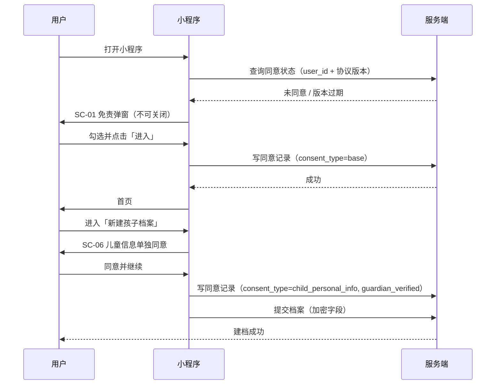
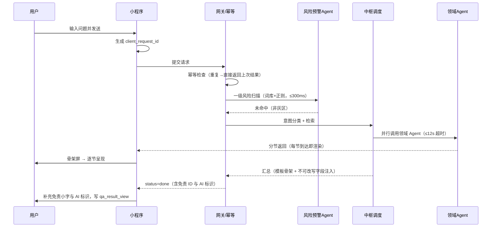
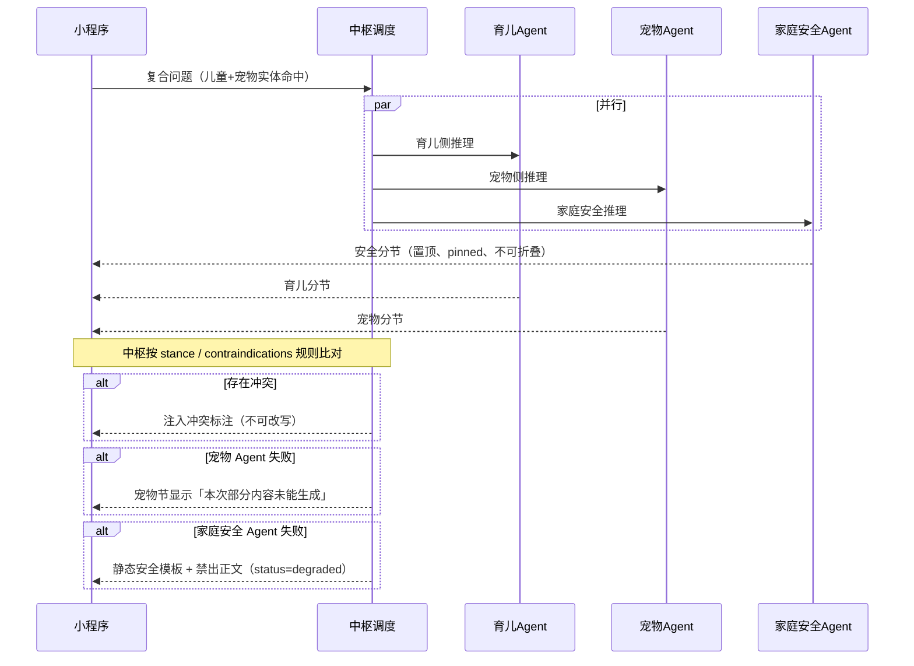
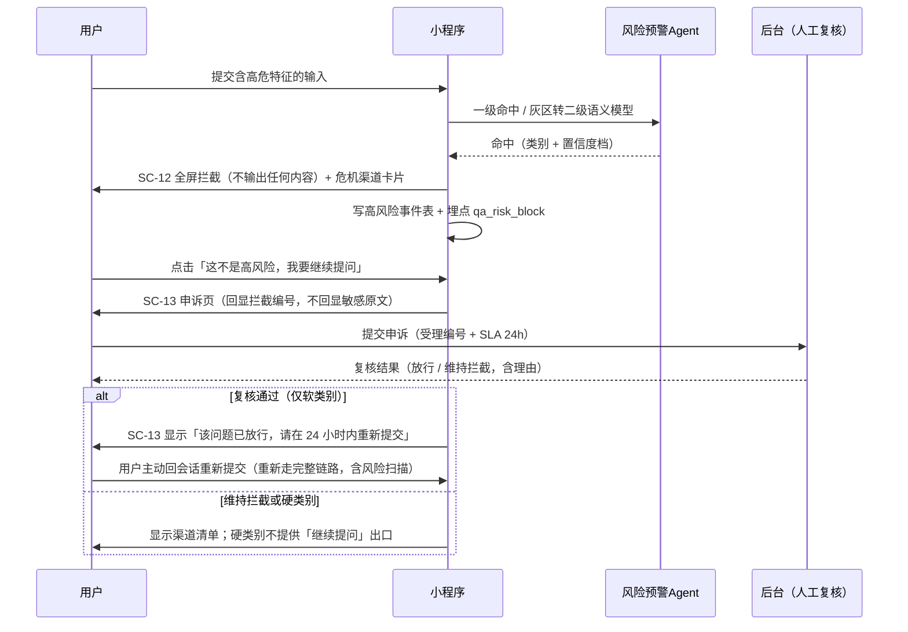
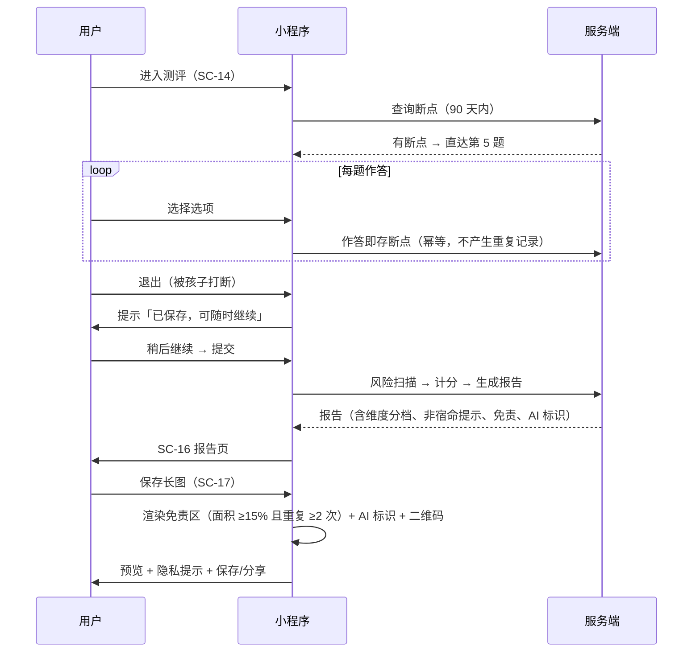
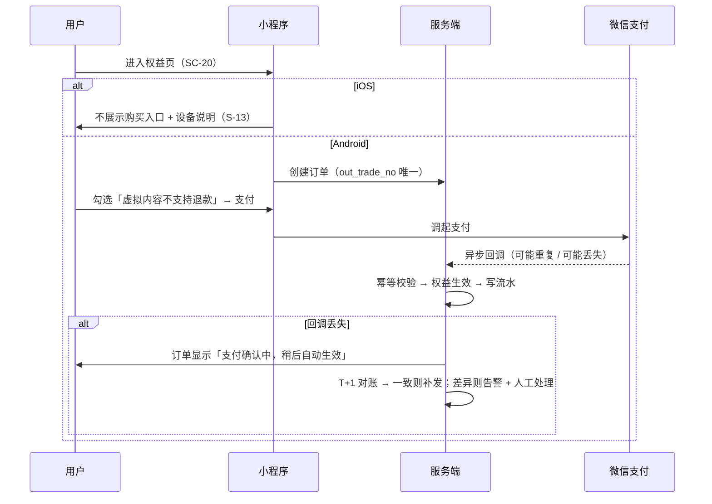
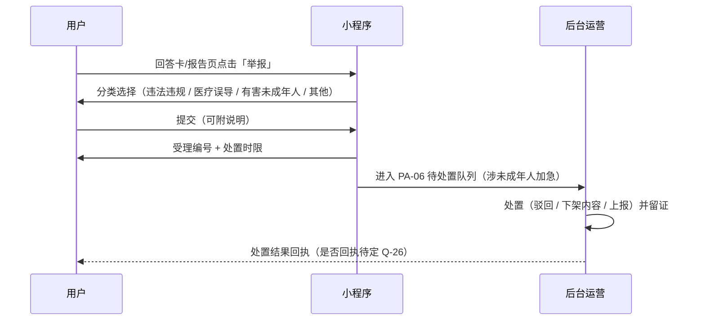
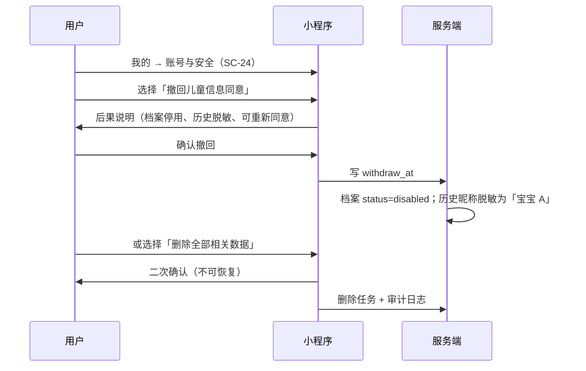

## 6. 跨页状态矩阵

### 6.1 状态定义（S-x）

| 编号 | 状态 | 定义 | 通用表现要求 |
| --- | --- | --- | --- |
| S-1 | 空态 | 无数据（无档案/无记录/无订单/无反馈） | 插画 + 一句价值说明 + 一个主操作；**不得只显示"暂无数据"** |
| S-2 | 加载态 | 首次加载页面数据 | 骨架屏（保持布局占位），≤2s；超时转 S-8 |
| S-3 | 生成中 | 模型推理中 | **分节渐进渲染**：已返回节直接渲染，未返回节骨架屏；顶部显示"正在检查内容安全/正在生成" |
| S-4 | 失败可重试 | 请求失败 | 明确失败原因（网络/服务/超时）+ 重试按钮；重试使用 `client_request_id`，**不重复扣额度** |
| S-5 | 无权限 | 会员内容、越权访问 | 只展示标题与预览摘要 + 解锁入口；**正文不下发**（前端不做遮罩级安全） |
| S-6 | 风险阻断 | 命中高危 | 独立全屏强提示 + 危机渠道卡片；**不生成任何内容**；提供申诉入口 |
| S-7 | 降级 | 部分 Agent 失败 | 失败节位置显示"本次部分内容未能生成"；保留免责与 AI 标识；安全 Agent 失败 → 静态安全模板且禁出正文 |
| S-8 | 断网 / 超时 | 网络不可用 | 顶部条提示 + 本地缓存内容（标注"内容可能不是最新"）；恢复后自动重试 |
| S-9 | 审核中 | 图片送内容安全检测 | 内容置灰 + "审核中"标签；不通过 → 退回并说明原因 |
| S-10 | 并发冲突 | 版本号不匹配 | 提示"内容已被更新，请刷新"，提供重新加载；**不静默覆盖** |
| S-11 | 额度用尽 | 免费额度耗尽 | 说明已用次数、恢复时间、升级入口；问答入口不静默失败 |
| S-12 | 只读 / 到期 | 会员到期后查看 | 顶部条"会员已到期，内容只读"；不展示续费诱导弹窗（仅在权益页引导） |
| S-13 | 平台不支持 | iOS 购买受限 | 不展示价格与购买按钮；给设备说明与替代路径 |

### 6.2 逐页状态矩阵

| 页面 | S-1 | S-2 | S-3 | S-4 | S-5 | S-6 | S-7 | S-8 | S-9 | S-10 | S-11 | S-12 | S-13 |
| --- | --- | --- | --- | --- | --- | --- | --- | --- | --- | --- | --- | --- | --- |
| SC-01 免责同意 | — | ✓ | — | ✓ | — | — | — | ✓ | — | — | — | — | — |
| SC-02 首页 | ✓ | ✓ | — | ✓ | — | — | — | ✓ | — | — | ✓ | — | — |
| SC-03 档案列表 | ✓ | ✓ | — | ✓ | — | — | — | ✓ | — | ✓ | — | — | — |
| SC-04 儿童档案表单 | — | ✓ | — | ✓ | — | — | — | ✓ | — | ✓ | — | — | — |
| SC-05 宠物档案表单 | — | ✓ | — | ✓ | — | — | — | ✓ | — | ✓ | — | — | — |
| SC-06 单独同意 | — | ✓ | — | ✓ | — | — | — | ✓ | — | — | — | — | — |
| SC-07 删除确认 | — | ✓ | — | ✓ | — | — | — | ✓ | — | — | — | — | — |
| SC-08 育儿问答 | ✓ | ✓ | ✓ | ✓ | ✓ | ✓ | ✓ | ✓ | — | — | ✓ | — | — |
| SC-09 宠物问答 | ✓ | ✓ | ✓ | ✓ | ✓ | ✓ | ✓ | ✓ | — | — | ✓ | — | — |
| SC-10 综合问答 | — | ✓ | ✓ | ✓ | ✓ | ✓ | ✓ | ✓ | — | — | ✓ | — | — |
| SC-11 回答卡 | — | ✓ | ✓ | — | ✓ | — | ✓ | — | — | — | ✓ | ✓ | — |
| SC-12 风险拦截 | — | — | — | — | — | ✓ | — | — | — | — | — | — | — |
| SC-13 申诉与回流 | — | ✓ | — | ✓ | — | — | — | ✓ | — | — | — | — | — |
| SC-14 测评引导 | — | ✓ | — | ✓ | — | — | — | ✓ | — | — | — | — | — |
| SC-15 测评作答 | — | ✓ | ✓ | ✓ | — | ✓ | — | ✓ | — | — | — | — | — |
| SC-16 测评报告 | — | ✓ | — | ✓ | ✓ | — | — | ✓ | — | — | — | ✓ | — |
| SC-17 报告长图 | — | ✓ | ✓ | ✓ | — | — | — | ✓ | — | — | — | ✓ | — |
| SC-18 历史列表 | ✓ | ✓ | — | ✓ | — | — | — | ✓ | — | — | — | — | — |
| SC-19 记录详情 | — | ✓ | — | ✓ | ✓ | — | ✓ | ✓ | — | — | — | ✓ | — |
| SC-20 权益页 Android | — | ✓ | — | ✓ | — | — | — | ✓ | — | — | ✓ | ✓ | — |
| SC-21 权益页 iOS | — | ✓ | — | ✓ | — | — | — | ✓ | — | — | ✓ | ✓ | ✓ |
| SC-22 支付结果 | — | ✓ | ✓ | ✓ | — | — | — | ✓ | — | — | — | — | ✓ |
| SC-23 个人中心 | — | ✓ | — | ✓ | — | — | — | ✓ | — | — | — | ✓ | — |
| SC-24 账号与安全 | — | ✓ | — | ✓ | — | — | — | ✓ | — | — | — | — | — |
| SC-25 权利中心 | ✓ | ✓ | — | ✓ | — | — | — | ✓ | ✓ | — | — | — | — |
| SC-26 反馈与举报 | ✓ | ✓ | — | ✓ | — | — | — | ✓ | ✓ | — | — | — | — |
| PA-01 登录 MFA | — | ✓ | — | ✓ | ✓ | — | — | ✓ | — | — | — | — | — |
| PA-02 知识库列表 | ✓ | ✓ | — | ✓ | ✓ | — | — | ✓ | — | — | — | — | — |
| PA-03 条目编辑 | — | ✓ | — | ✓ | ✓ | — | — | ✓ | — | ✓ | — | — | — |
| PA-04 词库维护 | ✓ | ✓ | — | ✓ | ✓ | — | — | ✓ | — | — | — | — | — |
| PA-05 调用日志 | ✓ | ✓ | — | ✓ | ✓ | — | — | ✓ | — | — | — | — | — |
| PA-06 反馈与举报处置 | ✓ | ✓ | — | ✓ | ✓ | — | — | ✓ | — | — | — | — | — |
| PA-07 高风险事件 | ✓ | ✓ | — | ✓ | ✓ | — | — | ✓ | — | — | — | — | — |
| PA-08 开关与权利请求 | ✓ | ✓ | — | ✓ | ✓ | — | — | ✓ | ✓ | — | — | — | — |

### 6.3 状态设计通则

1. **不允许空白**：任何列表页必须先设计空态，再设计有数据态。
2. **不允许静默失败**：失败必须可见、可重试、可解释；重试不额外计数（AS-24）。
3. **降级必须显性**：降级不是"少一块内容"，而是"明确告知少了一块内容"（FR-G6）。
4. **门控靠服务端**：前端不得依赖遮罩实现付费墙（AS-20），UI 只负责展示"标题 + 预览摘要 + 解锁入口"；视觉上是**露出下沉地面**，不是灰罩（§2.7）。
5. **安全优先于完整性**：安全 Agent 失败时宁可不出正文（S-7 的特例）。
6. **每类状态都有具体视觉手法**：见 §2.7 的对照表（含每条的反面禁止项）。**"要有这个状态"不等于"知道它长什么样"**，只写前半句等于没写。
7. **失效但不消失**：到期 / 退款 / 下架 / 撤回同意统一为"保留可见 + 明确标记"，不隐藏、不删除。
8. **状态不只靠颜色**：拦截、额度用尽、会员墙、降级四类必须同时有图标与文字（§2.9）。

---

## 7. 关键交互时序（线图）

### 7.1 首次进入与分层同意

### 7.2 单领域问答（含风险扫描与分节渲染）

### 7.3 家庭综合问答（三节 + 降级）

### 7.4 风险命中与申诉回流

### 7.5 测评断点与报告分享

### 7.6 支付与对账

### 7.7 举报与内容处置

### 7.8 撤回同意与删除

---

## 8. 文案与合规呈现规范

### 8.1 固定文案清单（文案 ID 化，禁止硬编码散落）

| 文案 ID | 用途 | 出现页面 | 变更要求 |
| --- | --- | --- | --- |
| `DISCLAIMER_V1` | 免责与使用说明全文 | SC-01、全部回答与报告页底部 | 版本变更触发重新同意 |
| `CHILD_CONSENT_V1` | 儿童信息处理告知与单独同意 | SC-06 | 同上 |
| `AI_GEN_LABEL_V1` | AI 生成内容标识文案 | 回答卡、报告、长图、详情 | 与合规文件同步 |
| `RISK_BLOCK_V1` | 风险拦截强提示（不含用户原文） | SC-12 | 法务确认 |
| `CRISIS_CHANNELS_V1` | 危机干预渠道清单（渠道名+号码+话术） | SC-12、SC-13 | **定期复核**（到期提醒，CG9） |
| `REPORT_DISCLAIMER_V1` | 分享长图底部免责区 | SC-17 | 与渲染规格绑定 |
| `QUOTA_RULE_V1` | 免费额度规则说明 | SC-02、SC-21 | 随额度规则变更 |
| `REFUND_NOTICE_V1` | 退款政策与虚拟内容说明 | SC-20、SC-22 | 财务/法务确认 |
| `REFUSAL_V1` | 超范围拒答话术（6 岁以上等） | SC-08/09/10 | 产品确认 |
| `DEIDENTIFIED_NAME` | 脱敏档案名（"宝宝 A"） | SC-18、SC-19 | — |
| `IMMUTABLE_*` | 不可改写字段（安全提示/冲突标注/免责/AI 标识） | 服务端注入 | 与 PRD §7.2 对齐 |

### 8.2 免责声明呈现规格

| 位置 | 规格 |
| --- | --- |
| 首次弹窗 | 全屏、不可关闭；正文可滚动；四个协议入口；勾选框 + 置灰按钮 |
| 页面底部常驻 | 24rpx、`--c-text-3`、单行截断 + 点击展开；**不可关闭、不可移除** |
| 回答卡内 | 卡片底部独立分节，与正文用分割线隔开 |
| 报告页 | 报告尾部固定分节 + 底部常驻小字（两处） |
| 分享长图 | 底部固定区：面积 ≥15%、重复 ≥2 次、字号下限、含二维码/短链与版本号（具体数值为 **有默认方案，可开发但需记录风险**，见 Q-22） |

### 8.3 AI 生成内容标识呈现规格（CG1）

| 形式 | 位置 | 要求 |
| --- | --- | --- |
| 显式标识 | 回答卡标题行右侧、报告页头部、月度计划头部、长图底部 | 固定位、不可关闭、与免责声明区分 |
| 隐式标识 | 导出图片与 PDF 元数据、接口响应 `ai_generated_label` | 生成时写入 |
| 说明入口 | SC-23「AI 生成内容标识说明」 | 与协议同类入口 |

### 8.4 风险与危机文案规则

| 规则 | 内容 |
| --- | --- |
| 禁止 | 复述用户高危原文、询问细节、出现任何诊断/评估/建议性表述、使用恐吓或评判语气 |
| 必须 | 直接说明"无法提供参考内容"、给渠道清单、给可执行动作（拨打/复制） |
| 通道路径 | 儿童自伤/虐待类必须含紧急报警与未成年人保护渠道（清单待法务确认，CG9） |
| 误报出口 | 必须提供"这不是高风险，我要继续提问"入口（FR-L4） |
| 回执 | 申诉受理编号 + 24h 复核 SLA（默认值；**有默认方案，可开发但需记录风险**） |

### 8.5 分享图渲染规格（替代"不可删除"硬验收）

| 项 | 规格 |
| --- | --- |
| 免责区 | 固定在底部，面积占比与重复次数为 **有默认方案，可开发但需记录风险**（Q-22），默认按 ≥15%、≥2 次落地 |
| AI 标识 | 与免责区同框，不可去除 |
| 归因 | 短链或小程序码（可归因分享者） |
| 隐私 | 默认插画头像；提供打码开关；提示"请勿暴露孩子的可识别信息"（CG16） |
| 分辨率 | 按 2 倍图导出；长图最大高度限制（超出分页或截断，规则待定） |

### 8.6 价格、额度与退款文案

| 场景 | 要求 |
| --- | --- |
| 价格展示 | 从服务端商品配置读取；下单前二次校验价格一致性 |
| iOS | 不展示价格与购买按钮；文案说明"当前设备暂不支持购买" |
| 额度 | 显示已用/上限与恢复时间；用尽不静默失败 |
| 退款 | 购买前明示 + 勾选留痕（`contract_confirm_at`）；订单页展示退款政策入口 |
| 会员到期 | 顶部只读条；不在内容中途弹续费窗 |

### 8.7 用词规范（规则来源：PRD §11.12）

| 类别 | 用词 |
| --- | --- |
| ✅ 允许 | 养育参考、儿童气质测评（趣味问卷）、行为倾向参考、亲子沟通方法、宠物行为科普、家庭养育方案 |
| ❌ 禁止 | 心理诊断、治疗、儿科诊断、兽医诊疗、**科学测评/信效度**、包提分、算命、天生注定、代做作业、性格永久判定 |
| 模式规则 | 药名 + 剂量模式（`mg/kg`、`片`、`ml`、`每日 N 次`）一律拦截或改写（CG14） |
| 抽检范围 | 前端固定文案、分享图、AI 提示词、知识库文案（CG1/C5） |

---

## 9. 组件规格库

> **结构 vs 视觉**：本表规定组件的**结构与状态覆盖**；颜色、字号、间距、圆角、阴影等**视觉规格在 §2 与 `DESIGN.md`**，可视证据在 `家伴-设计系统样式瓦片.html`。本节不再重复色值，避免双份维护。

| 编号 | 组件 | 结构 | 状态 | 规范要点 |
| --- | --- | --- | --- | --- |
| C-01 | 主按钮 | 文字 + 可选图标 | 默认/悬停/按下/禁用/加载 | 高 44px（88rpx）、圆角 8px、实底主色白字；**加载态保留可读文案，绝不把文字设为透明**；禁用态必须在近旁给原因 |
| C-02 | 次按钮 / 文字链 | 文字 | 默认/按下/禁用 | 与主按钮区分层级；危险操作用 `--c-danger` |
| C-03 | 输入框 | 标签 + 输入 + 单位 + 错误位 | 默认/聚焦/错误/禁用 | 错误时字段下方红字；数字键盘与单位对齐 |
| C-04 | 选择器 | 标签 + 值 + 箭头 | 默认/展开/已选 | 支持"不确定"选项（宠物年龄、品种） |
| C-05 | 勾选组 | 勾选框 + 说明文本 | 未选/已选/禁用 | 同意类勾选必须可回看全文；未勾选时主按钮置灰并给原因 |
| C-06 | 卡片 | 标题 + 副文 + 右侧操作 | 默认/按下/禁用/断点标记 | 断点标记（"继续填写"）单独样式，不可与普通标签混淆 |
| C-07 | 额度条 | 文案 + 进度 + 升级入口 | 正常/用尽/会员隐藏 | 用尽态转 `--c-quota`；不遮挡主入口 |
| C-08 | 回答卡（分节） | 分节标题 + 正文 + 前提 + 不建议 + 观察指标 + 就医提示 | 渲染中（骨架）/完成/降级 | 分节顺序由服务端指定；安全分节置顶不可折叠 |
| C-09 | 安全提示条 | 图标 + 标题 + 正文 | 常驻/可折叠（**仅非置顶安全分节可折叠**） | 与危险态样式区分（`--c-safe` vs `--c-danger`） |
| C-10 | 冲突标注条 | 文字 + 图标 | 条件触发 | 服务端注入，不可改写；不阻断生成 |
| C-11 | 付费墙 block | 标题 + 预览摘要 + 解锁按钮 | 无权限/已解锁 | 正文不下发；不靠遮罩 |
| C-12 | Agent 折叠器 | 标题 + 展开箭头 + 列表 | 折叠/展开 | 列出参与 Agent 与耗时；默认折叠 |
| C-13 | 风险拦截全屏 | 强提示 + 渠道卡片 + 两个出口 | 命中态 | 不可关闭为普通弹窗；渠道卡片含拨号与复制 |
| C-14 | 危机渠道卡片 | 渠道名 + 号码 + 拨号 + 复制 + 话术 | 默认 | 儿童类必须含报警与未成年人保护渠道 |
| C-15 | 申诉面板 | 说明 + 补充输入 + 提交 | 待提交/已受理/已复核 | 回显拦截编号，不回显敏感原文 |
| C-16 | 骨架屏 | 占位块 | 呼吸动画 | 保持布局占位，避免跳变 |
| C-17 | 状态条（只读/降级/审核中） | 图标 + 文案 | 只读/降级/审核中/网络 | 位置固定在内容上方；文案必须说明后果 |
| C-18 | 二次确认弹窗 | 标题 + 后果说明 + 双按钮 | 默认/危险操作 | 危险按钮不用主色；删除类必须列出将删除的内容 |
| C-19 | 底部 Tab 栏 | 4 个 Tab + 图标 | 默认/选中 | 高度含安全区；选中态不只靠颜色 |
| C-20 | 后台数据表 | 表头 + 行 + 行操作 + 分页 | 空/加载/选中/批量 | 列宽固定；敏感字段默认脱敏 + 展开审计 |
| C-21 | 后台抽屉/详情 | 抽屉 + 分区字段 | 展开/收起 | 用于日志详情、处置详情；字段与 PRD §9.1 实体对齐 |
| C-22 | 后台权限门控 | 无权限提示 + 角色说明 | 无权限 | 明确"当前角色无此权限"而非隐藏入口 |
| C-23 | **刻度带（签名）** | 标尺 + 槽 + 档位分隔 + 游标 + 档位标签 + 等宽读数 | 单档/多档/越线（语义色） | 见 §2.6 五条规则；槽不得 `overflow:hidden`；必须带 `aria-label` 与可读数值 |
| C-24 | 安全分节（置顶） | 图标 + 标题 + 正文 + 要点 | 常驻 | 实底铺满整宽、置顶、不可折叠；**不做左侧色条**（用面不用线） |
| C-25 | 下沉门控块 | 标题 + 淡出摘要 + 解锁入口 | 未解锁 | 露出下沉地面（`surface-2`），不做灰罩与条纹；正文由服务端不下发 |

---

## 10. 设计交付与验收清单

### 10.1 设计交付物

| # | 交付物 | 说明 |
| --- | --- | --- |
| 1 | 本文档（线框 + 说明 + token 级规范） | 评审与开发依据 |
| 2 | **`DESIGN.md`（已交付）** | 机器可读 token（YAML frontmatter）+ 设计系统规范；**token 的单一真源** |
| 3 | **`家伴-设计系统样式瓦片.html`（已交付）** | 单文件、无构建、无外部依赖；可直接打开与打印，是 token 与组件的可视证据 |
| 4 | 高保真视觉稿（后续） | 覆盖全部 P0 页面 + 关键状态（空 / 降级 / 拦截 / 门控 / 暗色） |
| 5 | 组件库（Design Token + 组件） | 与 §2 及 `DESIGN.md` 一致；命名与 C-xx 对应 |
| 6 | 切图与图标资源 | 2 倍图；**图标一律为绘制 SVG**（24 网格、描边 1.75），不使用 emoji 或 Unicode 字符 |
| 7 | 文案清单（文案 ID 表） | 与 §8.1 一致，交付给前端与运营 |
| 8 | 分享图模板 | 含免责区、AI 标识、二维码位、打码开关 |

### 10.2 开发前置确认清单

| # | 确认项 | 责任 |
| --- | --- | --- |
| 1 | 测评命名与题型（D-02/D-04） | 业务 + 专家 |
| 2 | iOS 支付展示口径（D-09） | 业务 + 法务 |
| 3 | 额度数值（D-11） | 业务方 |
| 4 | 危机渠道清单与复核周期（Q-42/Q-43） | 法务 + 运营 |
| 5 | 分享图免责区数值（Q-22） | 产品 + 法务 |
| 6 | 举报分类与 SLA（AS-34） | 运营 + 法务 |
| 7 | 权利请求 SLA 与导出方式（Q-44） | 法务 |

### 10.3 走查清单（设计自检，逐条勾选）

| # | 检查项 |
| --- | --- |
| 1 | 每页都定义了空/加载/失败/断网状态（§6） |
| 2 | 所有危险操作有二次确认，且确认文案说明了后果 |
| 3 | 免责声明与 AI 标识在每个内容页可见，且不可关闭 |
| 4 | 风险拦截页不含任何建议性文本，且渠道卡片可拨号/复制 |
| 5 | 会员墙只展示标题与预览摘要，正文由服务端不下发 |
| 6 | 降级态有明确文案，安全 Agent 失败时不出正文 |
| 7 | 按钮热区 ≥88rpx，正文 ≥32rpx，所有文字对比度 ≥4.5:1（含免责小字） |
| 8 | 敏感字段（出生日期、过敏项）默认脱敏展示 |
| 9 | iOS 不出现价格与购买按钮 |
| 10 | 额度用尽、审核中、只读、并发冲突四种状态均有可见表现（对照 §2.7） |
| 11 | 文案符合 §8.7 用词规范，无"科学测评/诊断/算命"类表述 |
| 12 | 埋点事件与 PRD §17 事件字典一致；新增事件已在 §17.4 登记 |
| 13 | **视觉：安全分节用主色实底且置顶不可折叠；`danger`/`warn` 未用于边框装饰或标题强调** |
| 14 | **视觉：所有"处在哪一档 / 还剩多少 / 过了多久"都用刻度带表达，未出现精确分数或绝对类型** |
| 15 | **视觉：无会员专属色；门控表现为下沉地面而非灰罩** |
| 16 | **视觉：卡片/列表项/提示条上没有超过 1px 的彩色左/右边框，没有零偏移彩色光晕** |
| 17 | **视觉：图标全部为绘制 SVG，无 emoji 与 Unicode 字符充当图标** |
| 18 | **视觉：圆角只用 12px（面）与 8px（控件）两档，例外仅头像/图标按钮/刻度槽** |
| 19 | **暗色模式完整走查一遍（夜醒是核心场景），语义色用夜间值而非浅色值** |
| 20 | **动效仅承担状态变化；`prefers-reduced-motion` 下骨架停止扫光、档位跳变** |
| 13 | 分享图含免责区、AI 标识、二维码与隐私提示 |
| 14 | 所有未决策项已按三态标注，且未在界面上编造数值（未决策内容留占位） |

---

## 11. 决策依赖索引

> **用途**：页面定义中**不再保留**"待确认 / 待拍板"措辞。每页只写"决策依赖"并指向本索引；本索引是页面与 PRD 决策台账（§6.16、附录 A/B/C）之间的唯一桥梁。
> **状态词汇**：与 PRD §0.3 一致——`已决策，可开发` / `有默认方案，可开发但需记录风险` / `未决策，不得开发`。**阻塞级别**：B1 开工阻塞 / B2 上线阻塞 / B3 运营参数待定。
> **读法**：`未决策，不得开发` 不等于整页不能开工，只表示该页面中**对应元素/文案/数值**不得定稿；页面结构本身可按线框开发。

| 页面 | 元素 / 区块 | 依赖编号 | 依赖内容 | 状态 |
| --- | --- | --- | --- | --- |
| SC-01 | 协议入口与同意勾选 | AS-05、FR-A1 | 同意频次（首次 + 版本升级重强制）已给默认；协议文本定稿随版本管理 | 有默认方案，可开发但需记录风险 |
| SC-01 | 协议文本与隐私指引 | CG11、FR-A4 | 《小程序用户隐私保护指引》与 SDK 清单需发布 | 有默认方案，可开发但需记录风险 |
| SC-02 | 额度条与用尽态 | AS-02、FR-J3 | 免费额度数值（默认 3–5 次/日） | 有默认方案，可开发但需记录风险 |
| SC-02 | 入口排序与一次性气泡 | AS-07 | 测评置顶、不做强制引导 | 已决策，可开发 |
| SC-03 / SC-04 / SC-05 | 档案字段与脱敏展示 | AS-12、AS-09、FR-C3 | 字段集与上限已给默认；密钥管理方案待技术确认 | 有默认方案，可开发但需记录风险 |
| SC-06 | 监护人核验强度与告知文本 | FR-A3、Q-31、CG3 | 默认"声明勾选 + 留痕"；是否强制手机号需法务结论 | 未决策，不得开发（核验强度部分） |
| SC-07 | 删除级联与留存提示 | FR-C4、AS-13、§11.10 | 默认脱敏保留；法定留存冲突按 §11.10 优先级表 | 有默认方案，可开发但需记录风险 |
| SC-08 / SC-09 / SC-10 | 语音入口 | AS-04、FR-D2 | 已移出 MVP，入口灰态 | 已移出 / 已删除 |
| SC-08 / SC-09 / SC-10 | 无档案区间与拒答口径 | AS-11、§6.17 | 通用区间 1–3 岁；拒答判断依据已统一 | 已决策，可开发 |
| SC-08 / SC-09 / SC-10 | `blocked` 到达时清空已渲染正文 | PRD §7.5.3 | 阻断必须清空，不允许"灰掉但仍可读" | 已决策，可开发 |
| SC-10 | 安全提示置顶与三节顺序 | FR-G2、AS-17 | 安全内容置顶、不参与排序 | 已决策，可开发 |
| SC-11 | 单侧失败 vs 安全失败的降级视觉 | PRD §7.8 | 安全 Agent 失败＝只显示静态安全卡；扣额度/存历史/可重试均已定 | 已决策，可开发 |
| SC-11 | 会员门控块的正文 | AS-20、FR-D4 | 无权限 block 服务端不下发正文 | 已决策，可开发 |
| SC-12 | 危机干预渠道清单与号码 | FR-L3、Q-42、CG9 | **必须留占位，不得编造号码**；复核周期与责任人未定 | 未决策，不得开发（清单内容） |
| SC-13 | 申诉状态机与回执 | PRD §7.9、FR-L4、Q-26 | 不即放行、复核通过后主动重提、硬类别永不自动放行；是否回执待定 | 已决策，可开发（回执口径待定） |
| SC-14 / SC-15 / SC-16 | 题目、计分、阈值、并列规则 | Q-08、AS-15、PRD §12.2 | 已给唯一默认配置（16 题 / 四维各 4 / 2.50–3.50 / 固定优先级），**需专家签字冻结** | 有默认方案，可开发但需记录风险 |
| SC-14 / SC-16 | 四象类型命名与理论映射表述 | Q-06、AS-16、D-02 | 仅内部占位名可用，对外命名与商标检索未出 | 未决策，不得开发（对外命名） |
| SC-14 | "科学测评 / 信效度"类宣称 | AS-14、Q-07、D-03、§11.12 | 已确定放弃该宣称；**禁止出现** | 已决策，可开发 |
| SC-16 / SC-17 | 报告模块与长图免责区数值 | Q-22、FR-E5 | 默认 ≥15% 面积、≥2 次重复；具体数值待法务 | 有默认方案，可开发但需记录风险 |
| SC-17 | 分享图隐私提示与打码 | CG16、FR-E5 | 默认插画头像 + 打码开关 | 已决策，可开发 |
| SC-18 / SC-19 | 跨设备查看与迁移 | Q-28、FR-H4 | MVP 以微信账号为边界，迁移规则未定 | 有默认方案，可开发但需记录风险 |
| SC-20 / SC-21 / SC-22 | iOS 购买入口与价格展示 | AS-21、Q-25、D-09 | 默认 iOS 不展示购买入口；**是否连价格一并隐藏需按微信审核口径确认** | 有默认方案，可开发但需记录风险 |
| SC-22 | 退款与售后异常场景 | FR-J4、CG17、PRD §12.9 | 七类异常场景已给处理；退款政策未定 | 未决策，不得开发（退款政策部分） |
| SC-23 | 合规入口集合 | CG3、CG7、§11.9 | 儿童规则易懂版、共享清单、权利中心入口 | 已决策，可开发 |
| SC-24 | 注销后果与撤回同意 | FR-A6、FR-I2、§11.9 | 撤回后处理已定；注销冷静期与迁移规则未定 | 有默认方案，可开发但需记录风险 |
| SC-25 | 权利请求 SLA 与导出交付 | FR-I3、Q-44、CG7 | 默认 15 个工作日、JSON/CSV、24h 过期链接、需再次核验 | 未决策，不得开发（SLA 数值与交付方式） |
| SC-26 | 举报分类与 SLA | FR-O1、AS-34、CG15/CG16 | 分类命名与 SLA 默认值、是否回执未定；**未成年人类别单列** | 有默认方案，可开发但需记录风险 |
| SC-26 | 图片反馈送检与超配额 | CG5、AS-28 | 送检 → 审核中 → 不通过退回；超配额拒绝放行 | 有默认方案，可开发但需记录风险 |
| PA-02 / PA-03 | 内容可上线与否 | Q-10、Q-11、§12.1 | 代码可开发；**条目内容不得上架**直到来源与版权结论落地 | 未决策，不得开发（内容上架） |
| PA-04 | 词库来源与首批词表 | Q-13 | 工具与阈值配置可开发；词表为空时仅走正则兜底 | 未决策，不得开发（词表内容） |
| PA-05 | 用户原文可见粒度 | Q-34、§16.5 U-1 | 默认只可见脱敏摘要，无原文展开入口 | 未决策，不得开发（可见粒度） |
| PA-06 | 举报处置 SLA 与回执 | AS-34、Q-26 | 涉未成年人加急；SLA 数值与回执未定 | 有默认方案，可开发但需记录风险 |
| PA-07 | 是否上报与上报对象 | Q-43、CG9、FR-L6 | **当前无角色可操作，按钮置灰**；登记/复核/留痕可开发 | 未决策，不得开发（上报动作） |
| PA-07 | 抓咬伤是否入高危清单 | CG18 | 待专家确认 | 未决策，不得开发（清单条目） |
| PA-08 | 价格、开关、文案、渠道清单维护 | FR-K8、Q-42 | 权限已定（仅超管）；渠道清单复核周期未定 | 有默认方案，可开发但需记录风险 |
| PA-08 | 紧急下线开关 | FR-B4、FR-K8 | 按入口粒度、二次确认、可回滚 | 已决策，可开发 |
| PA-01 / 全后台 | 角色权限矩阵 | PRD §16 | 角色×页面×字段×导出×二次确认已定 | 已决策，可开发 |

---

## 12. 与 PRD V1.2 的一致性检查清单

> 用途：UI 文档交付前的自检，确保与 PRD V1.2 不冲突。逐条勾选，任一条不通过则不得交付。

| # | 检查项 | 依据 | ☐ |
| --- | --- | --- | --- |
| 1 | SC-13 全文**不出现**"已放行"（除非复核通过态），且无"申诉后回会话"表述 | PRD §7.9.4 | ☐ |
| 2 | SC-13 在硬类别（儿童虐待 / 孩子自伤自杀想法 / 幼儿持续高烧惊厥）下**不提供"继续提问"出口** | PRD §7.9.2 | ☐ |
| 3 | SC-11 区分两种降级视觉：单侧失败＝其余分节可读；安全失败＝只显示静态安全卡 | PRD §7.8 | ☐ |
| 4 | SC-08/09/10 写明 `blocked` 到达时**必须清空已渲染正文**，不接受"灰掉但仍可读" | PRD §7.5.3 | ☐ |
| 5 | 全部 34 页正文**无"待确认 / 待拍板"**措辞，统一写"决策依赖"并指向 §11 | 评审第 19.4 条 | ☐ |
| 6 | 页面编号 SC-01~SC-26、PA-01~PA-08 与 PRD §5.3 页面清单完全一致 | PRD §5.3 | ☐ |
| 7 | 每个页面页头「对应需求」只引用 FR/NFR 编号，不引用 US-xx 作为验收依据 | PRD §0.7.1 | ☐ |
| 8 | 埋点名称与 PRD §17 事件字典一致；新事件已在 §17.4 登记 | PRD §17 | ☐ |
| 9 | 用词规范符合 PRD §11.12：无"科学测评 / 信效度 / 诊断 / 算命"类表述 | PRD §11.12 | ☐ |
| 10 | 后台页面的角色可见范围与 PRD §16 权限矩阵一致（尤其 PA-05 导出、PA-07 上报、PA-08 开关） | PRD §16 | ☐ |
| 11 | 状态矩阵 §6.2 的 `degraded` / `failed` 两态在两文档中含义一致 | PRD §7.8 | ☐ |
| 12 | 会员门控只展示标题 + 淡出摘要 + 解锁入口，正文由服务端不下发 | PRD §7.3 / AS-20 | ☐ |
| 13 | 儿童信息相关界面（SC-06/SC-17/SC-24/SC-25）与 PRD §11.9 六个结论一致 | PRD §11.9 | ☐ |
| 14 | 删除/撤回界面明确列出"将保留的项目及法定原因" | PRD §11.10.3 | ☐ |
| 15 | 视觉 token 与 `DESIGN.md` 一致，无第二套硬编码色值 | `DESIGN.md` | ☐ |
