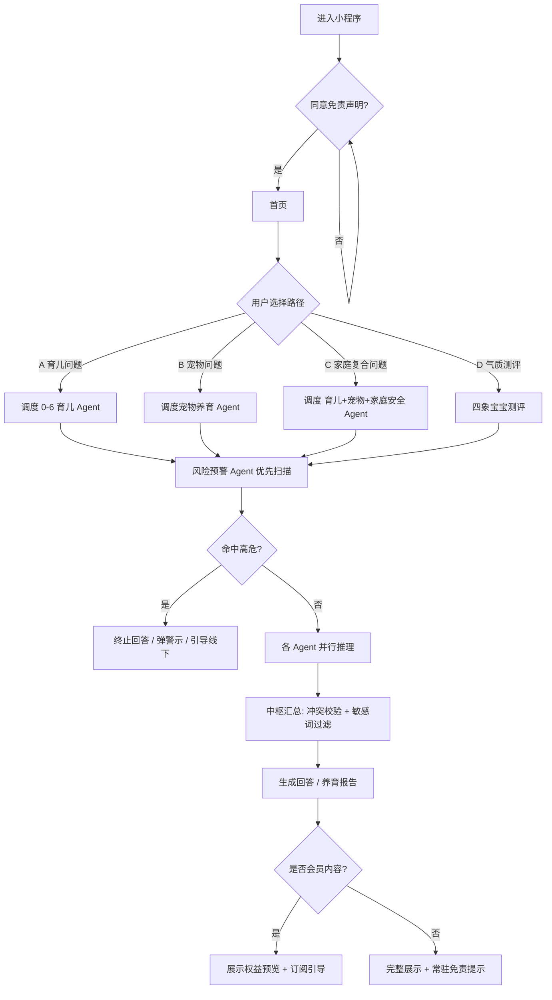

# 家伴・家庭养育多智能体助手 —— 需求说明文档（V1.0 / MVP）

> **文档状态**：草案 · 待评审
> **文档日期**：2026-10-01
> **适用版本**：V1.0 MVP（2 个月开发周期）
> **产品形态**：微信小程序（优先），后续扩展 Web 端
> **产品定位**：家庭养育科普参考工具。面向家长，覆盖分龄儿童养育 + 伴侣宠物科学饲养。**输出内容仅作为养育参考，不替代医生、心理咨询师、学校教师、执业兽医。**

---

## 0. 文档说明与阅读指引

### 0.1 本文档的构成

| 章节 | 用途 | 主要读者 |
| --- | --- | --- |
| 第 1 章 背景与目标 | 判断「要不要做、做到什么算成功」 | 业务方 / 决策者 |
| 第 2 章 角色与场景 | 确认「为谁做、在什么情况下用」 | 全体 |
| 第 3 章 需求详述 | 开发实现与测试验收的唯一依据 | 研发 / 测试 |
| 第 4 章 Agent 规格 | 多智能体输入输出契约与调度规则 | 后端 / 算法 |
| 第 5 章 流程与状态 | 主流程、分支、状态流转 | 研发 / 测试 |
| 第 6 章 非功能需求 | 性能、安全、合规、可扩展底线 | 研发 / 法务 |
| 第 7 章 数据与埋点 | 数据实体、埋点事件、指标口径 | 研发 / 数据 |
| 第 8 章 约束条件 | 不可逾越的红线与外部依赖 | 全体 |
| 第 9 章 边界与异常 | 上线前逐条自查清单 | 测试 |
| 第 10–13 章 | 风险处理、验收上线、商业化、迭代 | 全体 |
| 第 14 章 待确认问题清单 | **需业务方逐条拍板** | 业务方 |

### 0.2 编号与标记约定

| 标记 | 含义 |
| --- | --- |
| `US-xx` | 用户故事编号（User Story），每条独立可测 |
| `FR-x.x` | 功能需求条目 |
| `NFR-x` | 非功能性需求条目 |
| `Q-xx` | 待确认问题编号，汇总于第 14 章 |
| `⚠️【Q-xx】` | 正文中的歧义 / 信息缺失标注，指向第 14 章的待确认项 |
| `【假设】` | 原文未给出，本文档为推进评审而补充的假设，**必须由业务方确认或推翻** |
| **P0 / P1 / P2** | P0 = MVP 必须上线；P1 = MVP 尽力上线；P2 = 明确不在 V1.0 范围 |

### 0.3 修订记录

| 版本 | 日期 | 修订人 | 说明 |
| --- | --- | --- | --- |
| V1.0 | 2026-10-01 | 产品 | 基于《家伴・家庭养育多智能体助手 V1.0 MVP 版》草案整理，补齐验收标准、边界异常、数据埋点与待确认问题 |

---

## 1. 背景与目标

### 1.1 问题描述（场景化，非空话）

**背景**：当前育儿类 App 与宠物饲养类 App 互相独立。育儿工具多为静态文章或单模型 AI 问答，缺少分年龄段的精细化养育方案；宠物工具只聚焦动物喂养，无法覆盖「孩子与宠物共处」这类家庭复合场景。

**家长的四类具体痛点**：

| 编号 | 痛点 | 具体表现（场景） |
| --- | --- | --- |
| P-1 | 信息嘈杂且互相矛盾 | 新手父母在短视频、社群、长辈经验之间拿到互相冲突的说法（如「该不该抱睡」「几月加辅食」），无法判断哪条科学 |
| P-2 | 气质话题热度高但缺科学配套 | 家长被「四象宝宝」类话题吸引，但市面内容偏玄学，只给了标签、没给可执行的养育方法 |
| P-3 | 养娃 + 养宠的交叉问题无工具承接 | 例：3 岁孩子总追家里的猫、猫频繁哈气；谁来统一回答「怎么引导孩子 + 怎么缓解猫应激」？现有工具都只答一半 |
| P-4 | 亲子冲突与情绪沟通缺场景化指导 | 学龄期亲子冲突、情绪沟通、学习习惯问题，缺少贴着具体场景给的方法 ⚠️【Q-01】 |

**现有替代方案与不足（用户现在怎么将就的）**：

- 短视频 / 图文平台搜索 → 信息碎片化、来源不明、无档案上下文，回答不贴合自家孩子情况
- 育儿社群提问 → 答案来自其他家长经验，非专业审核，无法识别高危场景
- 通用大模型直接提问 → 单一模型单点回答，跨领域问题只答一侧；无风险拦截，无免责机制，合规风险高

**本产品的解题思路**：采用多智能体架构，按领域拆分 Agent 独立处理对应领域问题；遇到跨领域家庭场景，由中枢 Agent 调度多个 Agent 协同输出并交叉校验，比普通单大模型问答更结构化、可信度更高。

### 1.2 目标

原文仅给出方向性目标，**缺少可衡量的目标值** ⚠️【Q-02】。以下 1–5 条为原文目标的结构化转写；第 6 条为本文档补充的衡量指标建议。

| 编号 | 目标 | 类型 | 衡量方式 |
| --- | --- | --- | --- |
| G-1 | 搭建多智能体基础调度框架，上线 0-6 岁幼儿养育 + 猫狗宠物饲养两大核心板块 | 能力目标 | 5 个 Agent 全部可调用，两大模块可用 |
| G-2 | 上线「儿童气质测评（四象宝宝）」作为核心引流功能，底层使用科学儿童气质理论 | 增长目标 | 测评入口点击率、测评完成率 |
| G-3 | 支持单一领域问答 + 儿童 & 宠物交叉场景联合问答 | 能力目标 | 家庭综合问答可正确调度 ≥3 个 Agent |
| G-4 | 内置风险预警 Agent，识别高危场景，强制引导用户寻求线下专业人员 | 合规目标 | 高危样本召回率、拦截后引导弹窗 100% 触达 |
| G-5 | 基础内容免费，会员解锁深度养育计划，验证用户留存与付费转化 | 商业目标 | 留存曲线、付费转化率 |
| G-6 | 知识库内容经育儿 / 宠物专家审核，规避玄学、教育、心理、医疗合规红线 | 合规目标 | 抽检合格率、违规词命中率 |

**【假设】建议的量化目标（待业务方拍板，改数即可，勿沿用为承诺）**：

- 新用户 7 日留存 ≥ 25%
- 气质测评完成率 ≥ 60%（进入测评页的用户中完成提交的比例）
- 问答会话二次提问率 ≥ 30%（衡量「答得有用」）
- 免费用户 → 会员付费转化率 ≥ 2%
- 高危输入拦截后，用户离开高风险追问的占比 ≥ 90%

### 1.3 非目标（V1.0 明确不做）

非目标是防止范围蔓延最有效的一段，逐条列出：

| 编号 | 不做的事 | 原因 |
| --- | --- | --- |
| NG-1 | 不上线 6 岁以上小学、初中、高中学科辅导模块 | 教研成本高，放到后续版本迭代 |
| NG-2 | 不做心理诊断、儿童心理疾病评估、心理治疗 | 合规红线 |
| NG-3 | 不代替老师批改作业、不代做习题、不代写作文 | 合规红线 |
| NG-4 | 不提供宠物疾病诊断、不开兽药处方、不替代执业兽医 | 合规红线 |
| NG-5 | 不做宿命论性格判定、星座算命，不对孩子终身性格下定论 | 合规红线 |
| NG-6 | 无直播、无社区 UGC 板块 | 减少内容审核压力 |
| NG-7 | 不做 B 端机构对接（早教中心、宠物门店） | 列入 V3.0 |
| NG-8 | 不支持多语言、不支持非微信小程序的其他端首发 | 收敛 MVP 范围 |

---

## 2. 用户角色与使用场景

### 2.1 角色定义

| 角色 | 用户类型 | 描述 | 核心诉求 | 使用频次（假设） |
| --- | --- | --- | --- | --- |
| **家长用户（核心用户）** | C 端 | 25–40 岁父母，家中以 0–6 岁幼儿为主，部分同时饲养猫狗；焦虑型新手家长，反感碎片化短视频信息 | 拿到贴合自家孩子 / 宠物的、可执行的养育参考 | 每周 2–5 次 |
| **后台管理员** | 内部 | 知识库维护、查看 Agent 调用日志、处理用户反馈、配置 Agent 权重、维护敏感词库 | 高效维护内容质量与合规安全 | 每日 |
| **外部专家顾问（育儿 + 宠物）** | 外部协作 | 定期审核知识库、校验 Agent 输出内容，**不在线直接接待用户** | 一次性集中审核，不被打断 | 每月 / 每双周（⚠️【Q-11】） |

**【假设】角色扩充建议**：原文未定义「内容运营」与「客服」角色，若反馈量增长需拆分，见 ⚠️【Q-26】【Q-27】。

### 2.2 典型使用场景（场景卡）

**场景 1｜新手妈妈判断「该听谁的」**（对应 P-1）
- 角色：家长用户，宝宝 8 个月
- 触发：宝宝夜醒 3 次，长辈说「要抱睡」，社群里说「千万别抱」
- 行为：进入小程序 → 同意免责声明 → 建立宝宝档案（月龄、性别、生长情况）→ 在「0-6 岁宝宝养育」提问
- 期望结果：给出结构化养育建议，说明不同做法的适用条件与风险，而非一句结论
- 成功标准：用户在 8s 内拿到回答，且回答中引用了本档案月龄

**场景 2｜「孩子追猫、猫哈气」的复合场景**（对应 P-3，多 Agent 协同）
- 角色：家长用户，孩子 3 岁，家中 1 只成猫
- 触发：孩子总追猫，猫频繁哈气，家长担心抓伤孩子也心疼猫
- 行为：进入「家庭综合问答」提问
- 期望结果：一次输出三部分 —— 育儿侧（如何引导孩子善待动物）、宠物侧（如何缓解猫应激）、安全侧（如何避免抓伤的具体动作）
- 成功标准：回答同时包含三个维度，且安全提示置顶；≤15s 返回

**场景 3｜被「四象宝宝」吸引进来做测评**（对应 P-2，引流场景）
- 角色：家长用户，孩子 2 岁
- 触发：被首页「🔥四象宝宝气质测评」卡片吸引
- 行为：进入测评 → 中途被孩子打断退出 → 稍后回来续填 → 提交
- 期望结果：拿到气质类型解读 + 适配该气质的养育方式与沟通技巧，并看到「非宿命判定」的强制提示
- 成功标准：断点续填生效；报告可保存图片；分享图片自带完整免责声明

**场景 4｜高危输入被拦截**（对应 G-4，安全场景）
- 角色：家长用户，情绪崩溃状态
- 触发：提问中出现自伤、虐待、严重疾病等高危表述
- 行为：提交提问
- 期望结果：**不生成任何内容**，立即弹出强警示 + 线下专业机构引导
- 成功标准：拦截率 100%，不出现任何可能被误读为诊断或建议的文本

**场景 5｜宠物行为解读**（对应宠物模块）
- 角色：家长用户（养狗）
- 触发：狗护食低吼
- 行为：在「猫狗宠物饲养」提问，或直接问「狗狗低吼代表什么」
- 期望结果：行为科普 + 家庭安全提醒（家中有幼儿时）
- 成功标准：明确标注「非疾病诊断」，如识别到急症症状则提示前往宠物医院

**场景 6｜专家离线校验输出**（后台场景）
- 角色：外部专家顾问
- 触发：月度审核周期到
- 行为：查看知识库与 Agent 输出抽样记录 → 标注意见 → 提交
- 成功标准：审核记录可追溯，被驳回内容有回滚路径 ⚠️【Q-11】

**场景 7｜管理员调整 Agent 权重**（后台场景）
- 角色：后台管理员
- 触发：发现多 Agent 协同结果中育儿建议被宠物内容稀释
- 行为：在后台调整权重并生效
- 成功标准：新权重在下一轮问答生效，且变更留痕 ⚠️【Q-14】

---

## 3. 需求详述（用户故事 + 验收标准）

> 编号规则：`US-模块序号`。每条验收标准均可独立测试。涉及结构化输入输出的模块，附「关键输入 / 关键输出」契约表。

### 3.1 模块 A：准入与免责声明

**US-A1｜必须同意免责声明才能使用**
> 作为家长用户，我希望在进入产品前明确知道这是一款科普参考工具，以便我对结果建立正确预期。

验收标准：
1. 首次进入小程序时，弹出全屏免责声明弹窗
2. **未勾选「我已阅读并同意」时，「进入」按钮保持不可点击状态**
3. 勾选后方可进入首页
4. 同意记录需持久化（含时间戳与协议版本号），供后续追溯
5. 弹窗内提供「用户协议 / 隐私政策 / 免责声明」的可点击入口
6. ⚠️【Q-17】勾选频次未定义：原方案为「进入即弹」。需业务方确认是「仅首次」还是「每次进入」还是「每自然日一次」。本文档【假设】为**首次强制 + 后续进入以页面底部常驻小字替代**，以避免影响用户频次

**US-A2｜免责提示常驻**
> 作为家长用户，我希望每次看到结果时都能看到免责提示，以便我不过度依赖。

验收标准：
1. 首页页面底部常驻免责声明小字
2. 所有回答结果页、所有测评报告页均附带免责声明
3. 分享图片自带完整免责声明，且**在图片生成时即渲染进图，不可通过产品内操作删除**
4. ⚠️【Q-22】「不可删除」在技术上无法约束用户裁剪 / 二次编辑截图。需业务方确认可接受的实现程度（本文档【假设】：免责声明占据固定比例画面 + 水印式重复出现，提高裁剪成本）

| 关键输入 | 关键输出 |
| --- | --- |
| 用户勾选动作、设备信息 | 同意记录（用户 ID、协议版本、同意时间、IP / 设备标识） |

---

### 3.2 模块 B：首页

**US-B1｜首页承载四大入口**
> 作为家长用户，我希望一眼看到产品能帮我做什么，并快速进入对应板块。

验收标准：
1. 展示产品一句话介绍：家庭养育智能参考助手，养娃 + 养宠一站式养育科普工具
2. 展示四个核心入口卡片：「0-6 岁宝宝养育」「猫狗宠物饲养」「🔥四象宝宝气质测评」「家庭综合问答」
3. 展示会员解锁入口：深度养育计划、月度方案、专属档案
4. 页面底部常驻免责声明小字（同 US-A2）
5. ⚠️【Q-30】入口排序、是否有新手引导、是否有未建档案时的引导文案均未定义，需业务方确认

| 关键输入 | 关键输出 |
| --- | --- |
| 用户登录态、是否已建档案、是否已订阅 | 入口列表（含未读 / 待续填标记，如测评断点存在时提示「继续填写」） |

---

### 3.3 模块 C：档案管理（核心基础）

**US-C1｜建立儿童档案**
> 作为家长用户，我希望录入孩子的基本情况，以便回答贴合我家孩子，而不是通用模板。

验收标准：
1. 字段：昵称、出生日期、性别、简单生长情况 ⚠️【Q-19】「简单生长情况」需展开穷举，本文档【假设】为：身高、体重、是否早产、已知过敏项、辅食开始月龄
2. 出生日期用于自动计算月龄，月龄决定 Agent 分龄建议的区间
3. 可新建多个孩子档案
4. 档案数据加密存储
5. ⚠️【Q-20】档案数量上限未定义，本文档【假设】为免费用户 3 个、会员 10 个
6. ⚠️【Q-21】提问时是否必须绑定某一档案未定义，本文档【假设】为**不强制**，未绑定档案时按「通用月龄区间」回答并提示补全档案

**US-C2｜建立宠物档案**
> 作为家长用户，我希望录入宠物的基本情况，以便获得针对性的饲养建议。

验收标准：
1. 字段：类型（猫 / 狗）、品种、年龄、绝育状态
2. 可新建多只宠物档案
3. 档案数据加密存储

**US-C3｜用户可删除档案数据**
> 作为家长用户，我希望能够删除我的档案，以便我掌控自己的个人信息。

验收标准：
1. 支持删除单个孩子 / 宠物档案
2. 删除需二次确认
3. ⚠️【Q-20】删除后的级联规则未定义：历史问答记录、测评报告是否保留？本文档【假设】为 **报告保留但脱敏（去除昵称，仅显示「宝宝 A」）**，且用户可选择「一并删除全部相关数据」
4. 支持账号注销，注销后个人数据按第 8.1 节合规要求处理 ⚠️【Q-28】

| 关键输入 | 关键输出 |
| --- | --- |
| 昵称、出生日期、性别、生长情况、宠物类型 / 品种 / 年龄 / 绝育状态 | 档案对象；派生字段：月龄、年龄段区间（0-6 月 / 6-12 月 / 1-3 岁 / 3-6 岁；宠物：幼年 / 成年 / 老年） |

---

### 3.4 模块 D：0-6 岁儿童养育

**US-D1｜自由问答（文字 / 语音）**
> 作为家长用户，我希望用文字或语音提问，以便单手抱娃时也能用。

验收标准：
1. 支持文字输入与语音输入两种方式
2. ⚠️【Q-18】语音方案未定义：ASR 服务商、是否支持方言、单次时长上限、音频是否落盘均缺失。本文档【假设】：语音转文字后**以文字形式回显给用户并可编辑确认**，原始音频不落盘
3. 回答为结构化养育建议（分点、含适用前提与风险提示）
4. 回答内容与档案月龄匹配
5. 单 Agent 问答响应 ≤8s（详见 NFR-2.1）
6. 覆盖领域：婴幼儿喂养、睡眠引导、幼儿敏感期、辅食、早教、行为引导
7. 不做儿科疾病诊断，不判定终身性格

**US-D2｜免费基础方案**
> 作为免费用户，我希望看到单条养育建议，以便判断这个产品值不值得付费。

验收标准：
1. 免费用户可获得单条养育建议
2. 免费内容明确标注哪些部分属于会员权益

**US-D3｜会员深度方案**
> 作为付费用户，我希望拿到月度养育规划与场景化脚本，以便真正落地执行。

验收标准：
1. 交付物包含：月度养育规划、分阶段引导清单、场景化应对脚本
2. ⚠️【Q-23】交付物形态未定义：是图文页、可下载文档、还是可打印清单？更新频率？本文档【假设】为**站内图文页 + 可保存长图**，月度计划按月龄自动滚动生成
3. ⚠️【Q-24】会员到期后深度方案是否仍可访问未定义，本文档【假设】为**保留只读访问，不再生成新方案**

| 关键输入 | 关键输出 |
| --- | --- |
| 档案月龄区间、用户提问文本（含语音转写文本） | 结构化养育建议：`建议要点[]`、`适用前提`、`不建议做法及原因`、`观察指标`、`何时需咨询专业人士`、`免责声明` |

---

### 3.5 模块 E：四象宝宝气质测评（引流王牌功能）

**US-E1｜完成气质测评并获取解读报告**
> 作为家长用户，我希望通过一套选择题了解孩子的气质倾向，并拿到对应的养育方法，以便我知道该怎么跟孩子相处。

验收标准：
1. 问卷形式，多道选择题 ⚠️【Q-08】题量、题型、计分规则、维度权重、分数分档阈值**均未定义，为重大缺失**，需与专家共同定义后才能开发
2. 覆盖 0-6 岁
3. 输出 4 类气质类型解读，对外包装为「四象宝宝」趣味命名 ⚠️【Q-06】四类的**具体命名、与托马斯-切斯气质理论的映射关系、命名是否涉及商标风险**均未定义
4. 输出适配该气质的养育方式与沟通技巧
5. **强制提示**：气质仅为当下行为倾向参考，孩子性格会随成长变化，不属于宿命判定
6. 问卷支持断点保存，中途退出下次可继续填写
7. 报告保存至历史记录，支持保存图片
8. 不出现任何诊断性、宿命性表述（受第 8.2 节用词规范约束）
9. ⚠️【Q-07】量表来源与信效度：若采用既有量表需处理版权授权；若自研需说明依据。**这直接决定产品能否对外宣称「科学」** ⚠️【Q-09】

**US-E2｜反复测评的结果波动处理**
> 作为家长用户，我希望理解为什么两次测评结果不同，以便我不把它当成「定论」。

验收标准：
1. 当同一孩子短期内多次测评结果不一致时，报告页提示：气质测评仅反映近期行为倾向，单次结果不代表长期特质
2. ⚠️「短期内」需量化定义，本文档【假设】为 30 天内 ⚠️【Q-08】

| 关键输入 | 关键输出 |
| --- | --- |
| 被测评儿童档案、全部答题选项、提交时间 | 测评结果：`气质类型`、`各维度得分`、`类型解读`、`养育方式建议[]`、`沟通技巧[]`、`波动提示（条件触发）`、`免责声明` |

---

### 3.6 模块 F：宠物饲养

**US-F1｜宠物自由问答**
> 作为养宠家长，我希望提问喂养与护理问题，以便科学地照顾宠物。

验收标准：
1. 支持文字 / 语音提问
2. 覆盖：猫狗喂养、日常护理、宠物肢体语言解读、基础行为科普、宠物应激识别
3. 只做科普，**不做疾病诊断**
4. 识别到急症症状时，提示前往宠物医院
5. 家中有幼儿档案时，相关回答自动附加家庭安全提醒

**US-F2｜宠物行为解读**
> 作为养宠家长，我希望知道猫咪甩尾、狗狗低吼代表什么，以便判断它是不是不舒服。

验收标准：
1. 支持按行为关键词查询（如「甩尾」「低吼」「哈气」「护食」）
2. 输出「行为含义 + 可能的情绪状态 + 建议应对方式」
3. 明确标注「个体差异存在，需结合具体情境判断」

**US-F3｜免费清单与会员规划**
> 作为免费用户，我希望看到基础饲养清单；作为会员，我希望拿到长期饲养规划。

验收标准：
1. 基础饲养清单免费
2. 长期饲养规划需会员解锁
3. ⚠️【Q-23】「长期」的周期定义未给，本文档【假设】为 3 个月滚动规划

| 关键输入 | 关键输出 |
| --- | --- |
| 宠物档案（类型 / 品种 / 年龄 / 绝育状态）、用户提问 | 结构化饲养建议 / 行为解读：`行为描述`、`可能含义`、`建议应对`、`风险提示`、`何时需就医`、`免责声明` |

---

### 3.7 模块 G：家庭综合问答（多 Agent 协同场景，核心差异化）

**US-G1｜复合问题一次答全**
> 作为同时养娃养宠的家长，我希望一个问题同时拿到育儿、宠物、安全三方面建议，以便不用在几个工具之间来回切换。

验收标准：
1. 命中复合场景时，中枢 Agent 自动调度 **育儿 Agent + 宠物 Agent + 家庭安全 Agent** 协同
2. 输出必须包含三个独立维度分节，且**安全提示置于最前**
3. 三个 Agent 并行推理，端到端 ≤15s
4. 结果中标注本次参与协同的 Agent（可折叠展示）
5. 示例场景可用：**「我家 3 岁四象慢热型宝宝，总追家里的猫，猫咪经常哈气，怎么引导？」**
6. ⚠️【Q-14】示例中出现的「四象慢热型」说明测评结果会作为上下文带入问答，但**该联动机制原文未定义**，需确认：测评结果是否作为问答上下文、是否可被用户关闭

**US-G2｜冲突结论的标注**
> 作为家长用户，我希望知道不同建议之间是否有分歧，以便我不盲目照做。

验收标准：
1. 多 Agent 结论矛盾时，最终内容标注「观点存在差异，建议多方参考」
2. ⚠️【Q-16】「矛盾」的判定标准未定义（阈值？由 LLM 判断还是规则判断？）**为重大缺失**
3. 冲突标注不阻断回答生成

| 关键输入 | 关键输出 |
| --- | --- |
| 用户提问、相关档案（儿童 + 宠物）、[可选] 测评结果 | 汇总回答：`安全提示`、`育儿侧建议`、`宠物侧建议`、`冲突标注（条件触发）`、`参与 Agent 列表`、`免责声明` |

---

### 3.8 模块 H：报告与历史记录

**US-H1｜查看与保存历史**
> 作为家长用户，我希望回看以前的问答和测评报告，以便对比孩子的变化。

验收标准：
1. 保存历史问答记录与气质测评报告
2. 按时间倒序展示，支持按孩子 / 宠物筛选
3. 报告支持保存图片
4. 分享图片自带完整免责声明，不可通过产品内操作删除（同 US-A2）
5. ⚠️【Q-28】是否支持跨设备查看（依赖账号体系）未定义

| 关键输入 | 关键输出 |
| --- | --- |
| 用户 ID、时间范围、筛选条件 | 记录列表（问答 / 报告），每条含时间、关联档案、摘要、是否会员内容 |

---

### 3.9 模块 I：个人中心

**US-I1｜个人中心聚合入口**
> 作为家长用户，我希望在一个地方管理档案、订阅和协议。

验收标准：
1. 孩子、宠物档案管理入口
2. 会员订阅管理、订单记录
3. 用户反馈入口
4. 用户协议、隐私协议、免责声明查看
5. ⚠️【Q-28】账号注销入口是否在此未明确，本文档【假设】为「个人中心 → 账号与安全 → 注销账号」

---

### 3.10 模块 J：会员与支付（原文缺口较大，建议重点确认）

**US-J1｜开通会员**
> 作为家长用户，我希望订阅会员以解锁深度养育方案。

验收标准：
1. 会员定价 19.9 元 / 月
2. 权益：深度四象宝宝完整养育方案、月度宝宝养育计划、宠物长期饲养规划、家庭复合场景完整指导方案
3. 支付成功后可立即访问会员内容
4. ⚠️【Q-25】**微信小程序虚拟支付在 iOS 端受限**（iOS 不允许小程序内用微信支付购买虚拟内容），必须明确应对策略，否则 iOS 用户无法付费。为**上线阻塞项**
5. ⚠️【Q-25】是否自动续费、退款政策、发票、价格调整策略均未定义
6. ⚠️【Q-23】「深度完整养育方案」的具体交付物与颗粒度未定义

**US-J2｜专题付费内容包**
> 作为家长用户，我希望单独购买某个专题，以便只为需要的部分付费。

验收标准：
1. 单价区间 9.9–29.9 元 / 套
2. 示例专题：幼儿睡眠引导专题、猫狗行为矫正专题
3. 与会员权益的关系需明确：会员是否包含全部专题？⚠️【Q-25】

| 关键输入 | 关键输出 |
| --- | --- |
| 用户 ID、商品 ID、支付渠道 | 订单状态、权益生效时间、到期时间、支付流水号 |

**订单状态机**（本文档补充）

| 当前状态 | 触发动作 | 目标状态 | 副作用 |
| --- | --- | --- | --- |
| 待支付 | 支付成功 | 已支付 | 权益生效、写支付流水 |
| 待支付 | 用户取消 / 超时 | 已关闭 | 释放权益占用，订单可重新发起 |
| 待支付 | 支付失败 | 已关闭 | 记录失败原因，允许重试 |
| 已支付 | 申请退款并通过 | 已退款 | 权益回收（未使用部分），记录退款流水 |
| 已支付 | 到期 | 已过期 | 深度内容转为只读（见 US-D3） |

---

### 3.11 模块 K：后台管理端

**US-K1｜知识库管理**
> 作为后台管理员，我希望维护各类知识库，以便保证内容质量与合规。

验收标准：
1. 可维护：育儿知识库、宠物知识库、气质测评题库、高危风险词库、敏感词库
2. 支持新增 / 编辑 / 下架，变更留痕（操作人、时间、变更前后内容）
3. ⚠️【Q-13】词库维护责任人、更新频率、命中后的处理策略（阻断 / 改写 / 降级）未定义
4. ⚠️【Q-10】知识库内容来源与版权归属未定义

**US-K2｜Agent 日志**
> 作为后台管理员，我希望查看每一次多 Agent 调用记录与输出，以便迭代优化。

验收标准：
1. 记录每次调用的输入、参与 Agent、各 Agent 输出、汇总结果、耗时、是否命中风险词、是否冲突标注
2. 支持按时间、Agent、是否命中风险筛选
3. ⚠️【Q-34】日志中的用户隐私需脱敏；留存期限未定义

**US-K3｜用户反馈管理**
> 作为后台管理员，我希望处理用户反馈，以便闭环改进。

验收标准：
1. 展示反馈列表（内容、提交用户、提交时间、关联对话）
2. 支持标记处理状态
3. ⚠️【Q-26】响应时效与是否向用户回执未定义

**US-K4｜Agent 权重配置**
> 作为后台管理员，我希望调整 Agent 输出权重，以便优化协同结果质量。

验收标准：
1. 可调整各 Agent 权重
2. 变更留痕，可回滚
3. 新权重在下一轮问答生效
4. ⚠️【Q-14】权重的实际作用机制必须先定义（见第 4.3 节），否则该配置项无意义
5. ⚠️【Q-27】后台权限分级未定义（谁有权改权重？）

| 关键输入 | 关键输出 |
| --- | --- |
| 管理员身份、知识库内容、词条、权重值 | 配置生效结果、变更日志 |

---

### 3.12 模块 L：风险预警 Agent（最高优先级，独立运行）

**US-L1｜高危输入强制拦截**
> 作为产品方，我希望高危场景被强制阻断并引导线下求助，以便履行合规与保护责任。

验收标准：
1. 输入范围覆盖：**用户所有提问、测评填写的全部信息**
2. 高危识别库至少覆盖：儿童虐待、幼儿持续高烧惊厥、孩子自伤自杀想法、严重抑郁、宠物大出血 / 中毒等急症
3. 一旦命中：**直接阻断内容生成**，不输出任何回答文本
4. 弹出强提示，引导线下就医 / 心理机构 / 兽医
5. 不受其他 Agent 结果影响，**优先执行**（在任何 Agent 之前运行）
6. ⚠️【Q-12】完整高危清单、判定方式（纯关键词 / 语义模型 / 置信阈值）、误报与漏报的处理策略**均未定义，为重大缺失**
7. ⚠️【Q-12】语音输入是否在转写后同样过一遍风险扫描未定义，本文档【假设】为**必须扫描转写文本**
8. 拦截事件需记录日志并纳入埋点（见 7.2）
9. 提示文案需包含具体求助渠道（本文档【假设】：需业务方与法务共同确认渠道清单与表述）

| 关键输入 | 关键输出 |
| --- | --- |
| 用户全部输入（文本 / 语音转写文本 / 测评作答） | 判定结果：`是否命中`、`命中类别`、`置信度`；命中时输出 `阻断信号` + `引导文案 ID` |

---

### 3.13 模块 M：中枢调度 Agent（总调度 & 汇总）

**US-M1｜问题领域识别与调度决策**
> 作为产品方，我希望系统自动判断需要调用哪些 Agent，以便用户不需要自己选择。

验收标准：
1. 识别用户问题领域，判断调用 1 个或多个 Agent
2. ⚠️【Q-14】调度判定方式未定义（关键词规则？分类模型？），本文档【假设】为「意图分类 + 实体识别（是否同时出现儿童与宠物实体）」
3. 调度结果需记录日志
4. 用户可自主选择入口（专项板块 vs 家庭综合问答），入口选择与自动调度冲突时以用户选择为准

**US-M2｜结果汇总与冲突校验**
> 作为产品方，我希望多 Agent 结果被统一校验后输出，以便回答自然可读且可信。

验收标准：
1. 收集各 Agent 输出的结构化 JSON（而非自由长文本）
2. 执行冲突校验，冲突时标注「观点存在差异，建议多方参考」
3. 调用敏感词库过滤违规表述
4. 统一整理为自然可读回答
5. 按权重管理 Agent 输出 ⚠️【Q-14】机制待定义

**US-M3｜超范围问题的兜底**
> 作为家长用户，我希望当问题超出知识库范围时得到明确说明，而不是被编造答案。

验收标准：
1. 用户提问超出知识库范围时，回复内容标注：该问题仅供参考，建议咨询专业人员
2. ⚠️【Q-35】「超出范围」的判定方式与「医疗建议边界」的可执行规则需法务参与定义

---

### 3.14 模块 N：用户反馈

**US-N1｜提交反馈**
> 作为家长用户，我希望反馈问题，以便产品改进。

验收标准：
1. 支持文字反馈，可关联具体对话或报告
2. 可附图片 ⚠️【Q-26】是否支持图片未在原文定义，本文档【假设】为支持，最多 3 张
3. 提交后有明确成功提示

---

## 4. 多智能体架构规格与关键输入输出

### 4.1 Agent 清单与职责矩阵

| # | Agent | 是否 MVP | 触发条件 | 输入 | 输出 | 硬约束 |
| --- | --- | --- | --- | --- | --- | --- |
| 1 | **0-6 岁幼儿养育 Agent** | ✅ 核心 | 育儿类问题 / 气质测评 | 宝宝档案（年龄、性别、生长情况）、文字 / 语音提问 | 结构化养育建议、气质测评结果 | 仅养育科普参考；不做儿科疾病诊断；不判定终身性格；「四象宝宝」仅为气质分类趣味名称，底层是发展心理学儿童气质模型 |
| 2 | **宠物养育 Agent** | ✅ 核心 | 宠物类问题 | 宠物档案（猫 / 狗、年龄、品种、绝育情况）、用户提问 | 饲养、行为解读结构化内容 | 只做科普，不做疾病诊断；识别急症症状提示前往宠物医院 |
| 3 | **家庭安全 Agent** | ✅ | **问题同时涉及儿童 + 宠物时自动激活** | 复合问题、儿童与宠物档案 | 家庭安全注意事项、行为引导建议 | 评估互动风险（如防幼儿抓猫、猫狗护食规避伤害） |
| 4 | **风险预警 Agent** | ✅ 最高优先级 | **所有输入，先于一切执行** | 用户所有提问、测评全部信息 | 是否命中 / 类别 / 置信度 | 命中即阻断生成，强制引导线下专业机构；不受其他 Agent 影响 |
| 5 | **中枢调度 Agent** | ✅ | 每次请求 | 用户问题、各 Agent 输出 | 调度决策、汇总回答 | 冲突校验、敏感词过滤、权重管理 |
| 6 | 学龄育儿 Agent | P2（后续） | — | — | — | V1.1/V2.0 |
| 7 | 学科辅导 Agent | P2（后续） | — | — | — | V2.0，仅思路引导，禁止代做作业 |
| 8 | 亲子情绪沟通 Agent | P2（后续） | — | — | — | V2.0 |

### 4.2 结构化输出契约（建议 Schema）

所有 Agent 输出结构化 JSON，由中枢 Agent 统一整合。建议字段：

```json
{
  "agent_id": "child_care_0_6",
  "agent_version": "1.0.0",
  "intent": "sleep_guidance",
  "confidence": 0.86,
  "answer_blocks": [
    {
      "type": "advice",
      "title": "建议要点",
      "content": "……",
      "preconditions": "适用于 6-12 月龄、已添加辅食的宝宝",
      "evidence_ref": ["kb_child_sleep_03"]
    }
  ],
  "risk_flags": ["敏感期相关"],
  "professional_referral": false,
  "disclaimer_id": "DISCLAIMER_V1",
  "tokens_used": 812,
  "latency_ms": 3200
}
```

⚠️【Q-33】`evidence_ref`（知识库引用来源）是否需要向前端展示给用户未定义。本文档【假设】为**后台可见、前端不展示**，以降低合规风险。

### 4.3 权重机制（**重大缺口，上线阻塞项**）

原文给出 MVP 权重：0-6 育儿 Agent 0.5 / 宠物养育 Agent 0.3 / 家庭安全 Agent 0.2。

需明确的问题 ⚠️【Q-14】：

1. 权重作用于**什么**？是加权求和得分、还是影响输出内容的篇幅占比、还是影响冲突时的采信优先级？
2. 权重对**单一领域问题**是否生效？例如纯宠物问题，育儿 Agent 权重 0.5 是否仍参与计算？
3. **权重机制与「家庭安全优先」存在潜在冲突**：家庭安全 Agent 权重最低（0.2），但安全提示在 US-G1 中要求置顶。两者需对齐 —— 本文档【假设】：**权重仅影响「建议类内容」的排序与采信，安全类内容拥有一票否决 / 置顶权，不参与加权**
4. 权重变更是否需要 A/B 验证？变更生效范围（全量 / 灰度）？

### 4.4 通信与调度规则

| 规则 | 内容 |
| --- | --- |
| 执行顺序 | 风险预警 Agent →（未命中时）中枢调度 Agent → 领域 Agent 并行推理 → 中枢汇总 |
| 并行策略 | 多 Agent **并行**推理，非串行，以满足 15s 时限 |
| 数据传递 | 各 Agent 只接收自身领域所需的档案字段，最小必要原则 |
| 失败降级 | ⚠️单个 Agent 超时或失败时的降级策略未定义，本文档【假设】：**其余 Agent 结果正常输出，并标注「本次部分内容未能生成」；若育儿 / 宠物核心 Agent 全部失败，则返回兜底话术并建议稍后重试** |
| 超时阈值 | ⚠️各 Agent 单独超时阈值未定义，本文档【假设】单 Agent 12s、整体 15s |

---

## 5. 主要业务流程

### 5.1 主流程（编号步骤）

1. 用户进入小程序
2. 系统弹出【免责声明】弹窗
3. 用户勾选同意 → 进入首页；未勾选 → 停留弹窗
4. 首页展示两大板块入口 + 家庭综合问答 + 气质测评
5. 用户选择路径：
   - 方案 A：单独提问幼儿养育问题 → 调度 0-6 育儿 Agent
   - 方案 B：单独提问宠物饲养问题 → 调度宠物养育 Agent
   - 方案 C：家庭复合问题（孩子 + 宠物）→ 中枢 Agent 同时调度【育儿 Agent + 宠物 Agent + 家庭安全 Agent】协同生成方案
   - 方案 D：四象气质测评（0-6 岁宝宝）
6. 用户提交提问 / 测评
7. **【风险预警 Agent 优先扫描输入内容】**
   - 命中高危风险 → **终止回答**，弹出警示，引导线下专业人士（流程结束）
   - 无高危风险 → 各 Agent 并行推理，中枢汇总、冲突校验、敏感词过滤
8. 生成回答 / 养育报告
9. 基础内容免费展示；月度养育规划、深度方案提示需开通会员解锁
10. 页面底部常驻免责提示

### 5.2 分支流程

| 编号 | 分支 | 处理 |
| --- | --- | --- |
| BR-1 | 用户未同意免责声明 | 阻断进入，停留弹窗 |
| BR-2 | 风险预警命中高危 | 阻断生成，弹强提示，写日志（见 US-L1） |
| BR-3 | 多 Agent 结论冲突 | 标注「观点存在差异，建议多方参考」，不阻断 |
| BR-4 | 提问超出知识库范围 | 标注「该问题仅供参考，建议咨询专业人员」 |
| BR-5 | 用户反复测评结果波动 | 报告提示「仅反映近期行为倾向，单次结果不代表长期特质」 |
| BR-6 | 免费用户访问会员内容 | 展示权益预览 + 订阅引导，不展示完整内容 |
| BR-7 | 单 Agent 超时 / 失败 | 降级输出 + 标注（见 4.4） |
| BR-8 | 语音识别失败 / 置信度过低 | ⚠️未定义，本文档【假设】：提示用户改用文字输入，不消耗提问次数 |
| BR-9 | 用户未建档案直接提问 | 按通用区间回答并引导建档（见 US-C1） |

### 5.3 状态机

**问答会话状态**

| 当前状态 | 触发动作 | 目标状态 | 副作用 |
| --- | --- | --- | --- |
| 待提交 | 用户提交 | 风险扫描中 | 记录输入，启动风险 Agent |
| 风险扫描中 | 命中高危 | 已阻断 | 不生成内容、弹引导、写风险日志、计入埋点 |
| 风险扫描中 | 未命中 | 并行推理中 | 按调度结果调用 1–N 个 Agent |
| 并行推理中 | 全部 / 部分返回 | 汇总中 | 收集 JSON 结果 |
| 并行推理中 | 全部失败 / 超时 | 已失败 | 返回兜底话术 |
| 汇总中 | 校验完成 | 已生成 | 敏感词过滤、冲突标注、落库、返回前端 |

**测评状态**

| 当前状态 | 触发动作 | 目标状态 | 副作用 |
| --- | --- | --- | --- |
| 未开始 | 进入测评 | 进行中 | 创建测评记录 |
| 进行中 | 中途退出 | 进行中（有断点） | 保存已答题目 |
| 进行中 | 提交 | 已完成 | 计分、生成报告 |
| 已完成 | 30 天内再次完成 | 已完成 | 触发波动提示（见 US-E2） |

### 5.4 流程图



---

## 6. 非功能性需求

### 6.1 NFR-1 合规安全（最高优先级）

| 编号 | 需求 | 验收标准 |
| --- | --- | --- |
| NFR-1.1 | 全链路敏感词过滤 | 医疗、心理、教育违禁词在**输入侧与输出侧**均被拦截；输出侧过滤不允许被绕过 |
| NFR-1.2 | 免责声明强制附着 | 所有回答、测评报告 100% 附带免责声明；可自动化抽检 |
| NFR-1.3 | 用户档案加密存储 | 儿童与宠物档案加密存储，密钥与数据分离 |
| NFR-1.4 | 用户可删除档案数据 | 支持手动删除，删除后不可恢复；符合个人信息保护法规 |
| NFR-1.5 | 儿童个人信息特殊保护 | 儿童信息属敏感个人信息，需监护人单独同意 ⚠️【Q-31】 |
| NFR-1.6 | 生成式 AI 服务合规 | 面向公众提供生成式 AI 服务需完成备案 ⚠️【Q-32】为**上线阻塞项** |

### 6.2 NFR-2 性能

| 编号 | 需求 | 验收标准 |
| --- | --- | --- |
| NFR-2.1 | 单 Agent 问答响应 | ≤8s（⚠️【Q-36】口径未定义：是否含首包时间？是否流式输出？本文档【假设】为**首包 ≤3s、完整响应 ≤8s，采用流式输出**） |
| NFR-2.2 | 多 Agent 协同推理 | 跨领域复合问题 ≤15s |
| NFR-2.3 | 测评断点续填 | 中途退出下次可继续填写；断点数据保留 ⚠️【Q-08】保留期限未定义，本文档【假设】90 天 |
| NFR-2.4 | 首页加载 | ⚠️未定义，本文档【假设】≤2s（4G 网络） |
| NFR-2.5 | 并发承载 | ⚠️【Q-05】未定义，需业务方给出目标 DAU / 峰值并发 |

### 6.3 NFR-3 体验

| 编号 | 需求 | 验收标准 |
| --- | --- | --- |
| NFR-3.1 | 语音输入 | 支持语音输入提问，适合家长单手操作 |
| NFR-3.2 | 表达通俗 | 回答通俗易懂，避免晦涩专业术语；如必须使用专业词，需在旁给出通俗解释 |
| NFR-3.3 | 无障碍 | ⚠️【Q-29】未定义，包括字号调节、色彩对比度是否需达标 |

### 6.4 NFR-4 可扩展性

| 编号 | 需求 | 验收标准 |
| --- | --- | --- |
| NFR-4.1 | Agent 解耦 | 新增 Agent 不需改动既有 Agent 逻辑与中枢调度主流程 |
| NFR-4.2 | 后续可扩展 | 支持快速新增学龄育儿、亲子心理 Agent |
| NFR-4.3 | B 端预留 | 支持后续 B 端机构对接（V3.0） |
| NFR-4.4 | 端可扩展 | 后续可扩展 Web 端，前端需与后端接口解耦 |

### 6.5 NFR-5 可观测性（本文档补充）

| 编号 | 需求 | 验收标准 |
| --- | --- | --- |
| NFR-5.1 | Agent 调用链路可追溯 | 每次请求可还原：输入、调度决策、各 Agent 输出、耗时、风险判定结果 |
| NFR-5.2 | 异常告警 | Agent 失败率、超时率、风险拦截量超阈值时告警 ⚠️【Q-37】阈值未定义 |

---

## 7. 数据与埋点

### 7.1 核心数据实体（本文档补充，供研发评估）

| 实体 | 关键字段 | 备注 |
| --- | --- | --- |
| 用户 | user_id、微信 openid、手机号（⚠️是否采集未定义）、注册时间、会员状态 | ⚠️【Q-28】账号体系未定义 |
| 同意记录 | 记录 ID、user_id、协议版本、同意时间、设备标识 | 用于合规追溯 |
| 儿童档案 | profile_id、user_id、昵称、出生日期、性别、身高、体重、早产标记、过敏项、辅食开始月龄、创建时间 | 敏感个人信息 |
| 宠物档案 | pet_id、user_id、类型、品种、年龄、绝育状态 | — |
| 问答会话 | session_id、user_id、关联档案 ID、问题文本、命中风险标记、参与 Agent、回答内容、耗时、是否会员内容、创建时间 | — |
| Agent 调用日志 | log_id、session_id、agent_id、输入、输出 JSON、耗时、置信度、是否冲突 | 需脱敏 ⚠️【Q-34】 |
| 测评记录 | assessment_id、user_id、profile_id、题目版本、作答明细、各维度得分、气质类型、完成状态、断点数据、创建时间 | — |
| 报告 | report_id、user_id、类型（测评 / 问答）、内容、图片生成记录、分享次数 | — |
| 订单 | order_id、user_id、商品 ID、金额、状态、支付流水号、创建 / 支付时间 | — |
| 会员订阅 | subscription_id、user_id、开始时间、到期时间、状态 | — |
| 知识库条目 | kb_id、领域、标题、内容、版本、审核状态、审核人、上架时间 | — |
| 词库条目 | term_id、词库类型（高危 / 敏感）、词条、处理策略、生效状态 | — |
| Agent 权重配置 | 配置 ID、agent_id、权重值、生效时间、操作人 | — |

### 7.2 埋点事件

| 事件名 | 触发时机 | 关键参数 |
| --- | --- | --- |
| `app_launch` | 小程序启动 | 来源场景、是否新用户 |
| `disclaimer_show` / `disclaimer_agree` | 弹窗展示 / 勾选同意 | 协议版本 |
| `home_view` | 进入首页 | — |
| `entry_click` | 点击首页入口卡片 | 卡片类型（育儿 / 宠物 / 测评 / 综合问答） |
| `profile_create` | 建立档案 | 类型（儿童 / 宠物） |
| `qa_submit` | 提交提问 | 输入方式（文字 / 语音）、是否绑定档案 |
| `qa_risk_block` | 风险拦截 | 命中类别（脱敏统计） |
| `qa_result_view` | 查看回答 | 耗时、参与 Agent 数、是否冲突标注 |
| `qa_followup` | 同一会话再次提问 | — |
| `assessment_start` / `assessment_resume` / `assessment_complete` | 测评开始 / 续填 / 完成 | 题量、耗时、气质类型 |
| `report_save_image` / `report_share` | 保存 / 分享 | 报告类型 |
| `paywall_view` | 查看会员权益页 | 来源页 |
| `order_create` / `pay_success` / `pay_fail` | 下单 / 支付成功 / 失败 | 商品 ID、金额、失败原因 |
| `feedback_submit` | 提交反馈 | 是否关联对话 |

### 7.3 指标口径

| 指标 | 计算方式 |
| --- | --- |
| 新用户 7 日留存 | 第 7 日回访用户数 / 当日新增用户数 |
| 测评完成率 | `assessment_complete` 次数 / `assessment_start` 次数 |
| 问答二次提问率 | 有 `qa_followup` 的会话数 / 有 `qa_submit` 的会话数 |
| 付费转化率 | 首次 `pay_success` 用户数 / 新增用户数 |
| 风险拦截率 | `qa_risk_block` 次数 / 含高危样本的提问数（需标注集评估） |
| 冲突标注率 | 含冲突标注的回答数 / 多 Agent 协同回答数 |
| P95 响应时长 | 按单 Agent / 多 Agent 分别统计 |
| ARPU | 周期内总收入 / 活跃用户数 |

---

## 8. 约束条件

### 8.1 合规红线（不可逾越）

| 编号 | 约束 | 来源 |
| --- | --- | --- |
| C-1 | 输出内容仅作为养育参考，不替代医生、心理咨询师、学校教师、执业兽医 | 产品定位 |
| C-2 | 不做心理诊断、儿童心理疾病评估、心理治疗 | 非目标 NG-2 |
| C-3 | 不代做作业 / 习题 / 作文 | 非目标 NG-3 |
| C-4 | 不提供宠物疾病诊断、不开兽药处方 | 非目标 NG-4 |
| C-5 | 不做宿命论性格判定、不做星座算命、不对终身性格下定论 | 非目标 NG-5 |
| C-6 | 用户档案信息加密存储，支持用户手动删除，符合个人隐私法规 | NFR-1.3 / 1.4 |
| C-7 | 儿童个人信息属敏感个人信息，处理需取得监护人同意 | ⚠️【Q-31】需法务确认可执行流程 |
| C-8 | 面向公众提供生成式 AI 服务需完成备案 | ⚠️【Q-32】上线阻塞项 |
| C-9 | 全链路敏感词过滤，医疗、心理、教育违禁词拦截 | NFR-1.1 |
| C-10 | 数据出境：调用境外模型需评估用户数据出境合规 | ⚠️【Q-33】 |

### 8.2 强制用词规范（落到产品文案与知识库）

| 类别 | 用词 |
| --- | --- |
| ✅ **允许** | 养育参考、儿童气质测评、行为倾向参考、亲子沟通方法、宠物行为科普、家庭养育方案 |
| ❌ **禁止** | 心理诊断、治疗、儿科诊断、兽医诊疗、包提分、算命、天生注定、代做作业、性格永久判定 |

**落地要求**：
1. 该规范需同时应用于：知识库文案、Agent 系统提示词（System Prompt）、前端固定文案、分享图片文案
2. 建议将禁用词清单接入敏感词库（US-K1），实现自动校验 ⚠️【Q-13】
3. 需建立抽检机制，抽检频率待定 ⚠️【Q-11】

### 8.3 技术约束

| 编号 | 约束 | 说明 |
| --- | --- | --- |
| C-11 | 后端：FastAPI + Python | 原文推荐技术栈 |
| C-12 | Agent 调度：LangGraph / LlamaIndex | 二者择一或组合，需最终确定 ⚠️【Q-38】 |
| C-13 | 数据库：MySQL | 原文推荐 |
| C-14 | 前端：uni-app（编译微信小程序） | 原文推荐 |
| C-15 | 所有 Agent 输出必须为结构化 JSON | 保证中枢可校验 |
| C-16 | 风险预警 Agent 必须优先于其他所有 Agent 执行 | 架构硬约束 |

### 8.4 时间与资源约束

| 编号 | 约束 | 风险 |
| --- | --- | --- |
| C-17 | V1.0 MVP 开发周期 2 个月 | ⚠️【Q-03】起止日期未定义。当前范围内含 5 个 Agent + 完整后台 + 支付，**时间压力较大** |
| C-18 | 需育儿顾问 1 名 + 宠物行为科普顾问 1 名 | ⚠️【Q-11】是否已签约？审核周期如何嵌入开发排期？**若未到位将阻塞知识库上线** |
| C-19 | 需要可备案的小程序主体 | ⚠️【Q-04】未确认 |

### 8.5 外部依赖

| 依赖 | 用途 | 状态 |
| --- | --- | --- |
| 大模型服务（未指定厂商） | 全部 Agent 推理 | ⚠️【Q-33】【Q-38】未定义 |
| ASR 服务 | 语音输入转写 | ⚠️【Q-18】未定义 |
| 微信支付 | 会员与专题付费 | ⚠️【Q-25】iOS 虚拟支付受限 |
| 微信登录 | 账号体系 | ⚠️【Q-28】未定义 |

---

## 9. 边界与异常自查清单

| 类别 | 需回答的问题 | 本产品对应情况 |
| --- | --- | --- |
| **空态** | 没有数据时页面显示什么 | ⚠️未定义。需覆盖：无档案时的首页、无历史记录时的列表页、无订单时的订单页、无宠物档案时进入宠物模块 |
| **极值** | 超长文本、超大文件、超多条目 | ⚠️未定义。需覆盖：单次提问文本长度上限、单用户历史记录条数上限、档案数量上限（本文档【假设】3 / 10）、测评断点数据量 |
| **并发** | 两个人同时操作同一条数据 | 用户间数据隔离（各自档案独立）；需覆盖：同一用户多端同时提问、同一档案被两处同时编辑、后台两人同时改同一 Agent 权重 |
| **失败** | 网络中断、第三方超时、余额不足 | ⚠️未定义。需覆盖：LLM 超时 / 限流、ASR 失败、支付失败、支付成功后回调丢失（**需幂等 + 对账机制**）、小程序端网络中断后重试 |
| **权限** | 越权访问、跨组织数据隔离 | 用户 A 不可访问用户 B 的档案 / 报告 / 订单；后台权限分级 ⚠️【Q-27】未定义 |
| **幂等** | 重复提交是否产生两条记录 | ⚠️未定义。需覆盖：重复点击提交提问（不得重复扣减免费额度 / 重复生成）、重复支付回调（不得重复发放权益）、重复提交测评 |
| **合规边界** | 回答游离在「科普」与「诊疗建议」之间 | ⚠️【Q-35】缺乏可执行判定规则，**建议法务出具判定清单** |
| **风险误判** | 正常提问被高危词库误拦 | ⚠️【Q-12】未定义。需覆盖：误报的用户申诉入口与人工复核 |
| **风险漏判** | 高危内容绕过词库 | ⚠️【Q-12】需定义漏报兜底（如语义模型 + 人工抽检） |

---

## 10. 风险与异常处理（业务风险）

| 编号 | 场景 | 处理策略 | 来源 |
| --- | --- | --- | --- |
| R-1 | 用户提问包含高危内容 | 风险预警 Agent 拦截，终止回答，弹出紧急就医提示 | 原文 |
| R-2 | 多个 Agent 输出结论冲突 | 中枢 Agent 标注信息存在分歧，提示多方参考，建议咨询线下专业人士 | 原文 |
| R-3 | 用户提问超出知识库范围 | 回复标注：该问题仅供参考，建议咨询专业人员 | 原文 |
| R-4 | 用户反复测评，气质结果波动 | 报告提示：气质测评仅反映近期行为倾向，单次结果不代表长期特质 | 原文 |
| R-5 | ⚠️【新增】知识库 / Agent 输出被专家判定不通过 | **回滚策略缺失**，需定义下架流程与已生成历史内容是否追溯处理 | 本文档补充 |
| R-6 | ⚠️【新增】专家资源未到位 | 知识库无法上线审核 → **上线阻塞**，需提前签约 | 本文档补充 |
| R-7 | ⚠️【新增】四象宝宝命名 / 量表版权争议 | 需在上线前完成商标检索与量表授权评估 | 本文档补充 |
| R-8 | ⚠️【新增】iOS 虚拟支付受限导致付费不可用 | 需商业模式侧提前决策 | 本文档补充 |

---

## 11. 验收与上线

### 11.1 验收清单（上线前必须全绿）

**功能验收**
1. 免责声明弹窗阻断生效，同意记录可追溯
2. 首页四大入口与会员入口均可正常跳转
3. 儿童 / 宠物档案可增删改查，数据加密落库
4. 单一领域问答（育儿 / 宠物）可正常返回结构化回答
5. 家庭综合问答可自动调度 3 个 Agent 并在 15s 内返回
6. 气质测评可完成、可断点续填、可生成报告
7. 历史记录与报告可查看、可保存图片、分享图含免责声明
8. 会员订阅与专题包可下单、可支付、权益可生效
9. 后台可管理知识库、查看 Agent 日志、处理反馈、配置权重
10. 风险预警 Agent 对高危样本集 100% 拦截且不输出任何内容

**非功能验收**
11. 单 Agent 响应 ≤8s，多 Agent ≤15s（以 P95 口径统计）
12. 敏感词输入 / 输出双侧过滤生效
13. 全链路日志可追溯，隐私字段已脱敏
14. 生成式 AI 服务备案完成（⚠️【Q-32】）
15. 强制用词规范抽检通过

**内容验收**
16. 知识库经育儿专家 + 宠物行为专家审核并签字确认
17. 高危风险词库、敏感词库完成并经过误报 / 漏报压测

### 11.2 灰度与发布策略 ⚠️【Q-30】（本文档补充，待确认）

1. 建议先小范围内测（微信小程序体验版 + 邀请制），验证风险拦截与合规文案
2. 内测通过后再正式发布，首周重点监控风险拦截量与误报率
3. 会员功能建议在内测期不开放支付，待支付合规确认后再开

### 11.3 回滚方案 ⚠️【Q-30】（本文档补充，待确认）

1. 知识库条目支持版本回滚
2. Agent 权重变更支持一键回滚
3. 支付异常时支持订单状态人工修正与权益补发
4. 若出现合规事故：立即下线相关入口（可远程配置开关）→ 追溯日志 → 评估已生成内容

---

## 12. 商业化方案（MVP）

| 层级 | 内容 | 价格 |
| --- | --- | --- |
| 免费 | 基础问答、单次简易测评 | 免费（引流获客） |
| 会员订阅（核心盈利） | 深度四象宝宝完整养育方案、月度宝宝养育计划、宠物长期饲养规划、家庭复合场景完整指导方案 | 19.9 元 / 月 |
| 专题付费内容包（单品） | 如幼儿睡眠引导专题、猫狗行为矫正专题 | 9.9–29.9 元 / 套 |
| B 端（中长期） | 早教中心、宠物门店接入该智能助手 | 账号年费模式 ⚠️价格未定义 |

**待明确** ⚠️【Q-25】：会员是否包含全部专题包？是否自动续费？退款政策？iOS 端虚拟支付如何规避？免费额度的「基础问答」是否限次？

---

## 13. 版本迭代规划

### V1.0 MVP（2 个月开发周期）

- **Agent**：0-6 育儿 Agent、宠物饲养 Agent、家庭安全 Agent、风险预警 Agent、中枢调度 Agent
- **核心功能**：宝宝 & 宠物档案、自由问答、四象宝宝气质测评、历史记录、会员订阅、后台知识库管理
- **目标**：验证产品差异化，测试用户留存与付费转化

### V1.1

- 优化多 Agent 协同冲突处理逻辑
- 扩充宠物种类（兔子、仓鼠等小宠）—— ⚠️注意：MVP 中「宠物」明确定义为猫狗，新增种类需同步扩充宠物档案字段与知识库
- 优化测评问卷，优化气质解读文案

### V2.0

- 新增 6-12 岁小学模块：学习习惯、亲子沟通；学科仅做思路引导，禁止代做作业
- 新增亲子情绪沟通 Agent，处理亲子矛盾、情绪引导科普

### V3.0

- 上线初中、高中板块：青春期沟通、学业规划
- 完善完整多 Agent 全家养育体系
- 开放 B 端机构对接

---

## 14. 待确认问题清单

> 以下问题需业务方（或法务 / 专家）逐条拍板后才能进入开发。标注 **🔴 阻塞项** 的，未确认前不建议开工。

### 14.1 范围与目标

| 编号 | 问题 | 影响 | 建议决策人 |
| --- | --- | --- | --- |
| 🔴 Q-02 | MVP 的量化成功指标是什么？（7 日留存、付费转化率、测评完成率的目标值） | 无法判定 MVP 成败；无法确定投入规模 | 业务方 |
| Q-01 | 目标用户写「0-6 岁为主」但痛点含「学龄期亲子冲突」，MVP 是否允许回答 6 岁以上问题？若不允许，拒答话术是什么？ | 影响 Agent 边界与用户预期 | 业务方 |
| Q-03 | 2 个月开发周期的起止日期与对外发布时间？ | 排期与资源投入 | 业务方 |
| Q-05 | 目标用户量级 / 峰值并发是多少？ | 影响架构与模型成本预算 | 业务方 |
| Q-30 | 灰度策略、入口排序、新手引导是否需要？ | 上线方案 | 业务方 |

### 14.2 内容与理论（**本期最大不确定性**）

| 编号 | 问题 | 影响 | 建议决策人 |
| --- | --- | --- | --- |
| 🔴 Q-06 | 「四象宝宝」四类的具体命名是什么？与托马斯-切斯气质理论如何映射？名称是否有商标 / 在先使用风险？ | 核心引流功能无法开发；存在法律风险 | 业务方 + 法务 |
| 🔴 Q-07 | 测评量表来源：自研还是采用既有量表（需授权）？是否做过信效度检验？ | 决定能否宣称「科学」；涉及版权 | 育儿专家 + 法务 |
| 🔴 Q-08 | 问卷题量、题型、计分规则、维度权重、分档阈值、断点保留期限、「短期」的量化定义 | 测评功能无法开发 | 育儿专家 |
| Q-09 | 「气质测评」在文案上如何与「心理测评 / 心理诊断」划清界限？是否需要加注「非心理测评工具」？ | 合规风险 | 法务 |
| Q-10 | 知识库内容来源与版权归属？ | 合规与成本 | 业务方 |
| Q-11 | 专家审核的对象是「知识库」还是「Agent 每一次输出」？审核频次、SLA、不通过的回滚流程？专家是否已签约？ | **若审核每次输出则成本极高、不可行**；专家未到位将阻塞上线 | 业务方 |
| Q-13 | 敏感词库来源、维护责任人、更新频率、命中后的处理策略（阻断 / 改写 / 降级） | 合规模块无法开发 | 业务方 + 法务 |
| Q-35 | 如何界定「科普」与「诊疗建议」？需要可执行的判定规则 | 合规底线 | 法务 |

### 14.3 Agent 与算法

| 编号 | 问题 | 影响 | 建议决策人 |
| --- | --- | --- | --- |
| 🔴 Q-12 | 高危识别库完整清单？判定方式（纯关键词 / 语义模型 / 置信阈值）？误报与漏报如何处理？语音转写文本是否扫描？误报的用户申诉路径？ | 安全与合规核心，无法开发 | 业务方 + 法务 + 专家 |
| 🔴 Q-14 | 权重 0.5 / 0.3 / 0.2 的具体作用机制？对单一领域问题是否生效？与「安全优先」如何对齐？权重变更是否需 A/B？ | **权重配置功能无意义**，协同逻辑无法实现 | 业务方 + 算法 |
| 🔴 Q-16 | 「冲突」的判定标准（阈值？LLM 判断还是规则？） | 核心差异化能力无法实现 | 算法 |
| Q-15 | 家庭安全 Agent 是否有对结论的一票否决权？ | 与安全优先原则对齐 | 业务方 |
| Q-17 | 免责声明勾选频次：每次进入 / 仅首次 / 每自然日？ | 影响体验与合规 | 业务方 + 法务 |
| Q-18 | 语音方案：ASR 服务商、方言支持、时长上限、音频是否落盘、转写文本是否可编辑？ | 语音功能无法开发 | 技术 |
| Q-36 | ≤8s / ≤15s 的口径：是否含首包？是否流式输出？ | 性能验收标准 | 技术 |
| Q-37 | 各 Agent 超时阈值、失败降级策略、异常告警阈值 | 稳定性 | 技术 |
| Q-38 | LangGraph 与 LlamaIndex 最终选型？大模型厂商选定？ | 技术栈与成本 | 技术 |

### 14.4 功能与体验

| 编号 | 问题 | 影响 | 建议决策人 |
| --- | --- | --- | --- |
| Q-19 | 「简单生长情况」的字段穷举 | 档案功能无法开发 | 业务方 + 专家 |
| Q-20 | 档案数量上限？删除档案后的级联规则（历史记录 / 报告是否保留、是否脱敏）？ | 数据模型设计 | 业务方 |
| Q-21 | 提问时是否强制绑定档案？未建档案能否提问？ | 交互流程 | 业务方 |
| Q-22 | 分享图片「免责声明不可删除」在技术上无法约束截图裁剪，可接受的实现程度？ | 合规风险与体验 | 业务方 + 法务 |
| Q-23 | 会员深度内容的交付物形态（图文页 / 可下载 / 可打印）？更新频率？「长期饲养规划」的周期？ | 会员功能无法开发 | 业务方 |
| Q-24 | 会员到期后深度报告是否仍可访问？ | 定价与体验 | 业务方 |
| Q-26 | 用户反馈的响应时效、是否回执、是否支持图片、谁负责处理？ | 反馈闭环 | 业务方 |
| Q-27 | 后台权限分级（谁可改权重 / 谁可改知识库 / 谁可看日志）？ | 安全与流程 | 业务方 |
| Q-28 | 账号体系：微信登录绑定方式？是否支持换手机迁移数据？账号注销流程？是否采集手机号？ | 数据模型与合规 | 业务方 + 法务 |
| Q-29 | 是否有无障碍 / 字号调节要求？ | 体验合规 | 业务方 |
| Q-39 | 测评结果是否作为后续问答的上下文（US-G1 示例暗示是）？用户能否关闭该联动？ | 影响调度与上下文设计 | 业务方 |

### 14.5 商业与合规

| 编号 | 问题 | 影响 | 建议决策人 |
| --- | --- | --- | --- |
| 🔴 Q-25 | iOS 端微信小程序虚拟支付受限，会员与专题包如何售卖？是否自动续费？退款政策？发票？会员是否包含全部专题包？免费问答是否限次？B 端年费价格？ | **影响核心盈利模式与上线** | 业务方 + 财务 + 法务 |
| 🔴 Q-32 | 生成式 AI 服务备案是否已完成 / 计划何时完成？ | **上线阻塞项** | 业务方 + 法务 |
| Q-31 | 儿童敏感个人信息的监护人同意流程如何实现？ | 合规 | 法务 |
| Q-33 | 是否调用境外模型？涉及用户数据出境吗？知识库引用来源是否向前端展示？ | 合规 | 法务 + 技术 |
| Q-34 | Agent 日志中的用户隐私如何脱敏？日志留存期限？ | 合规 | 法务 + 技术 |
| Q-04 | 小程序主体（企业 / 个体户）是否已确定并可备案？ | 上线前提 | 业务方 |

---

## 附录

### 附录 A：术语表

| 术语 | 定义 |
| --- | --- |
| 多智能体（Multi-Agent） | 按领域拆分的多个 AI 智能体，由中枢统一调度协同工作 |
| 中枢调度 Agent | 负责领域识别、调度决策、结果汇总、冲突校验、敏感词过滤的总控 Agent |
| 风险预警 Agent | 独立运行、优先级最高的安全 Agent，命中高危即阻断生成 |
| 四象宝宝 | 产品对外使用的气质分类趣味命名，底层为发展心理学儿童气质理论，**非玄学算命** |
| 气质测评 | 对儿童当下行为倾向的参考性评估，**非心理诊断、非终身性格判定** |
| 家庭综合问答 | 同时涉及儿童与宠物的复合场景问答，触发多 Agent 协同 |
| 断点续填 | 测评中途退出后可从上次进度继续作答 |
| 冲突标注 | 多 Agent 结论矛盾时在最终内容中提示「观点存在差异，建议多方参考」 |

### 附录 B：参考理论

1. **托马斯-切斯儿童气质理论**（四象宝宝包装的底层科学依据）
   - ⚠️【Q-06】【Q-07】需明确：该理论的气质类型划分与「四象宝宝」四类的映射关系；是否需引用原始量表；引用是否需要授权
2. **伴侣动物行为学科普资料**
   - ⚠️【Q-10】需明确资料来源与版权

### 附录 C：推荐技术栈（原文）

| 层 | 选型 | 状态 |
| --- | --- | --- |
| 后端 | FastAPI + Python | 已定 |
| Agent 调度 | LangGraph / LlamaIndex | ⚠️【Q-38】二者择一待定 |
| 数据库 | MySQL | 已定 |
| 前端 | uni-app（编译微信小程序） | 已定 |
| 大模型 | 未指定 | ⚠️【Q-33】【Q-38】待定 |
| ASR | 未指定 | ⚠️【Q-18】待定 |

### 附录 D：专家资源需求

| 角色 | 数量 | 职责 | 状态 |
| --- | --- | --- | --- |
| 育儿顾问 | 1 名 | 定期审核知识库、校验 Agent 输出内容 | ⚠️【Q-11】是否已签约未知 |
| 宠物行为科普顾问 | 1 名 | 定期审核知识库、校验 Agent 输出内容 | ⚠️【Q-11】是否已签约未知 |

---

> **文档使用说明**：本文档中标注 `⚠️` 的条目均为原文未定义、或经拆分后发现的缺失点，共 **39 项（Q-01 ~ Q-39）**。其中 9 项为上线阻塞项，已在第 14 章用 🔴 标记（Q-02、Q-06、Q-07、Q-08、Q-12、Q-14、Q-16、Q-25、Q-32）。建议在评审会上按第 14 章顺序逐条过，确认后回填至本文档，形成 V1.0 正式版。
