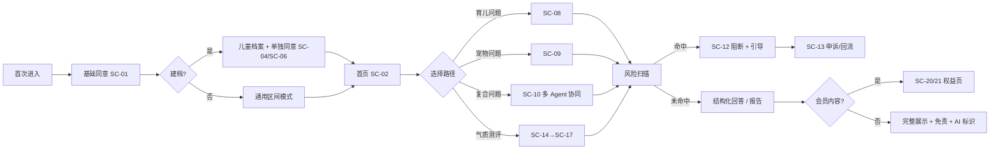
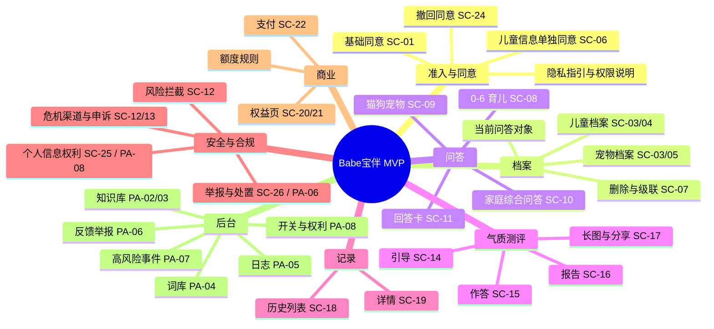
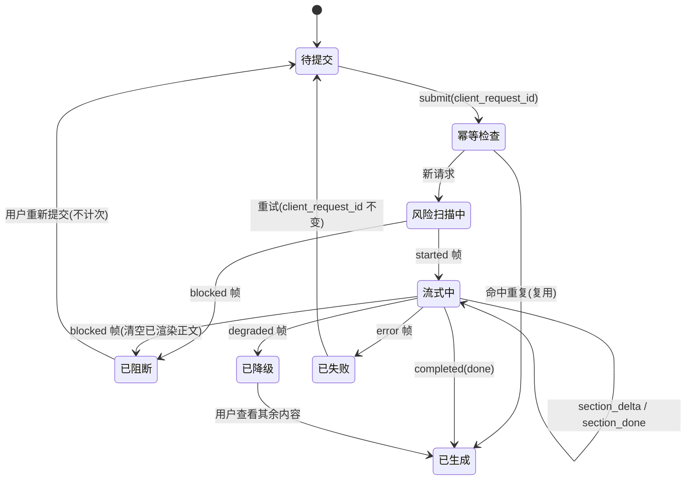
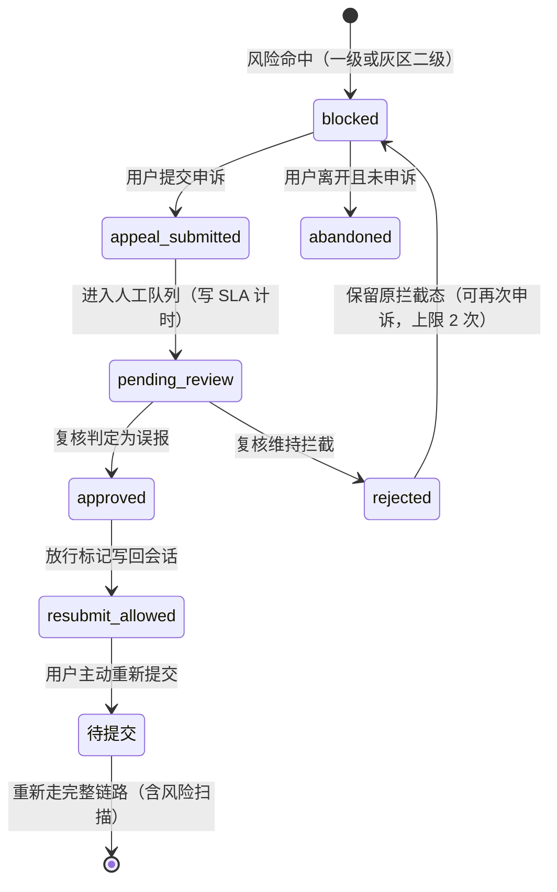
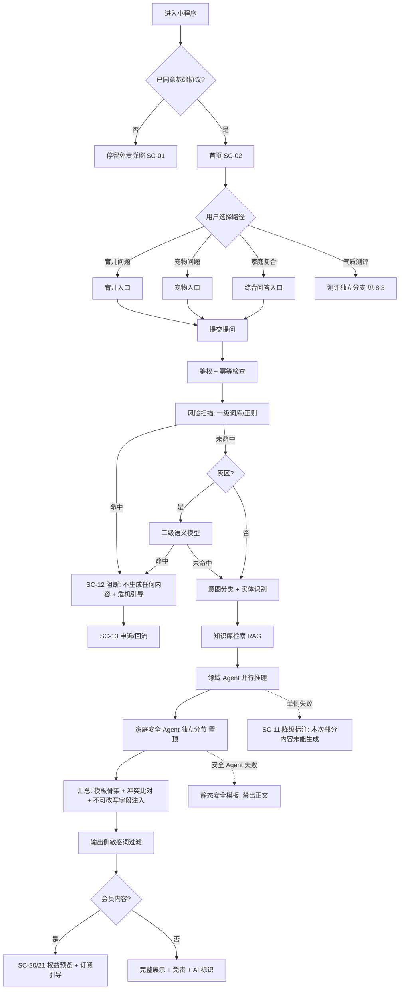
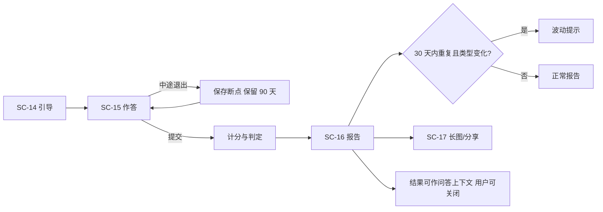
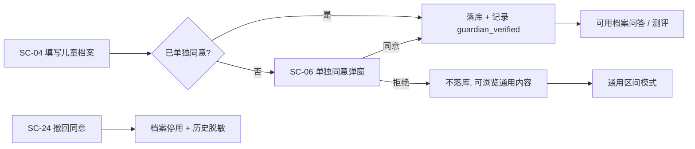

# Babe宝伴｜AI 多智能体，家庭养育伙伴 —— 产品需求文档（PRD）

> **文档版本**：**V1.5（最终交付版）** · S1 全部修复 · S2/S3 收口 · 台账一致 · 可开工
> **文档状态**：**具备编码起步条件**（见 §23）。签字与上线前置仍受约束：§0.5 签字前可开发但不得对外发布；B1/B2 未关闭项见附录 C.1
> **编制日期**：2026-10-08（**V1.5 最终版同日**）
> **唯一基线声明**：见 §0.7。本文档是研发、测试、设计、验收的**唯一需求基线**；`宝伴-家庭养育多智能体助手_需求说明文档_V1.0.md` 降为**历史来源**，`宝伴-PRD_V1.1.md` ~ `宝伴-PRD_V1.4.md` 均被取代，全部归档于 `docs/99-归档/`。
> **配套文档**：`宝伴-UI原型描述_V1.3.md`（唯一界面基线）｜`DESIGN.md`（唯一视觉 token 真源）｜`宝伴-设计系统样式瓦片.html`（可视证据）
> **变更映射**：见 §0.6（继承 / 修改 / 删除 / 新增 / 废弃编号）；V1.2→V1.3 登记于 §0.6.1，V1.3.1→V1.4 登记于 §0.6.2
> **决策台账**：附录 A/B/C 与 §6.16 由 `.build/ledger.py` 机器生成，禁止手写
> **产品形态**：微信小程序（C 端，优先）+ 后台管理 Web；**不做多端扩张**（NG-8）
> **产品定位**：**面向「家庭养育」垂直领域**的科普参考工具，只做两个板块——0–6 岁分龄儿童养育 + 伴侣宠物（猫/狗）科学饲养，并承接两者的交叉问题。**输出仅作养育参考，不替代医生、心理咨询师、学校教师、执业兽医。**
> **V1.5 修订**：审核报告的 **S1 全部 10 处、S2 全部 16 条、S3 全部 8 条**已逐条处理完毕，逐条对照见 **§0.6.2 / §0.6.3**。台账由 `ledger.py` 重新生成并与正文一致。**结论：可开工动手**（§23）；剩余仅 **7 项外部事实依赖**（§23.3 + §24.2），全部**不阻塞编码**
> **品牌名**：对外主名「**Babe宝伴**」，副标题「**AI 多智能体，家庭养育伙伴**」；仓库内部代号 `jiaban` 保持不变。

---

## 0. 文档信息与阅读指引

### 0.1 本文档的定位：决策级，不重写验收标准

V1.0 需求文档的问题不是"不够细"，而是三类：**决策未定**（39 项 Q，其中 10 项阻塞）、**存在硬伤**（M1–M10 技术冲突、A/B/C 共 35 条矛盾与不可测项）、**缺失需求域**（N1–N9，含原型与文案资产）。

因此本文档只承担四件事，其余引用 V1.0：

| 本文档承担 | 具体做法 |
| --- | --- |
| ① 把前提补齐 | 用 `AS-xx` 假定基线登记册（附录 A）给出默认取值，使全文自洽、可开工；每条标注来源与待拍板状态 |
| ② 把硬伤改掉 | 用 `M-x`/`I-x`/`N-x`/`CG-x` 修正索引（附录 D）逐条给出"原文问题 → 本文档处理" |
| ③ 把缺口编号化 | 缺失需求域与合规缺口全部落成 `FR-x`/`NFR-x` 条目，挂验收方式 |
| ④ 把决策集中 | 所有未决策项集中在附录 B（决策登记册）与附录 C（待确认问题登记册），一张表可改 |

**本文档不做**：不重写 V1.0 的 US/FR 条目正文；不做高保真视觉稿；不写代码；不替法务、专家、财务拍板。

### 0.2 与 V1.0 的关系：三类内容

| 类型 | 含义 | 处理 |
| --- | --- | --- |
| **继承** | V1.0 已定义且无争议的内容（如四大入口、五个 Agent 的职责边界） | 直接引用编号，不重复描述 |
| **修正** | V1.0 自相矛盾或不可测的内容 | 本文档给新结论，附录 D 给出对照，V1.0 需回填 |
| **新增** | 审计与评审发现的缺失需求 | 本文档首次定义，编号不与 V1.0 冲突 |

### 0.3 编号约定

| 标记 | 含义 | 落点 |
| --- | --- | --- |
| `FR-x.x` | 功能需求条目 | 第 6 章 |
| `NFR-x.x` | 非功能需求条目 | 第 10 章 |
| `AS-xx` | **假定基线**：为推进评审而采用的默认取值，必须由责任方确认或推翻 | 附录 A |
| `D-xx` | 待拍板决策项（沿用评审材料 D1–D12 编号，新增项续编） | 附录 B |
| `Q-xx` | V1.0 遗留问题清单（Q-01~Q-39，编号保留；状态见附录 C），本文档新增续编 Q-40 ~ Q-45 | 附录 C |
| `M-x` / `I-x` | 评审材料的技术冲突 / 实现缺口 | 附录 D |
| `N-x` | 评审材料识别的缺失需求域 | 附录 D |
| `CG-x` | 合规缺口（Compliance Gap，来自审计 D1–D18 与评审 §四之二） | 第 11 章 + 附录 D |
| `S1/S2/S3` | 审计严重度（S1＝开工或上线阻塞） | 全文标注 |
| `SC-xx` / `PA-xx` | UI 页面编号（小程序 / 后台） | UI 文档第 4 章 |
| `P0/P1/P2` | P0＝MVP 必须上线；P1＝MVP 尽力上线；P2＝明确不在 V1.0 | 全文标注 |
| **B1 / B2 / B3** | 未决策项的阻塞级别（与三态严格对应）：**B1＝开工阻塞（未决策，不得开发）**；**B2＝上线阻塞（可开发但不得上线）**；**B3＝运营参数待定（有默认方案，灰度期可调）**。**禁止用"待确认"一词描述状态**，一律使用三态词汇 | 附录 C、附录 C.1 |

**硬规则（评审门槛）**：
1. **验收标准中不得出现 `Q-xx`、`AS-xx`、状态标记。** 未决策项必须与验收标准分离（V1.0 有 33 处违反，见附录 D 的 C1）。
2. 每个 FR 条目必须给出：优先级 + 依赖的 AS/决策 + 验收方式（可测）+ 对应页面编号。
3. 识别出的风险必须需求化：**识别不需求化 ＝ 没有工时、没有用例、没有验收**（V1.0 §9 的 8 类自查项全部未需求化，见 I3/N-x）。

### 0.4 阅读指引

| 读者 | 建议路径 |
| --- | --- |
| 业务方 / 决策者 | §2 目标与指标 → §4 范围基线 → §0.7 唯一基线声明 → 附录 B 决策登记册 → 附录 C.1 阻塞项摘要 |
| 产品 / 设计 | §3 用户与场景 → §5 信息架构 → §6 功能需求 → UI 文档全文 |
| 研发 / 测试 | §6 功能需求 → §7 多智能体规格 → §8 流程与状态机 → §9 数据与口径 → §10 NFR |
| 法务 / 合规 | §11 合规专项 → 附录 C.1 阻塞项摘要 → 附录 D 中 CG-x 条目 |
| 算法 | §7 全文（契约、延迟预算、降级矩阵、检索规格、模型与成本） |

### 0.5 修订记录

| 版本 | 日期 | 修订人 | 说明 |
| --- | --- | --- | --- |
| V1.0 | 2026-10-01 | 产品 | 需求说明文档草案（1099 行），识别 39 项待确认 |
| V1.1 | 2026-10-02 | 产品 | 采纳评审推荐决策为 AS 假定基线；修正 M1–M10 与 I1–I10；补齐 N1–N9；合规缺口 CG1–CG18 需求化；新增决策/待确认/修正三本登记册 |
| **V1.2** | **2026-10-03** | 产品 | **决策闭环与一致性修订**：① 冻结唯一基线并新增变更映射（§0.6/§0.7）；② 引入三态决策门槛，FR 逐条给出可开发边界（§6.16）；③ 重写风险拦截与申诉状态机（§7.9）；④ 新增问答响应协议 v1（§7.5）；⑤ 延迟预算改为四张表并冻结口径（§7.7）；⑥ 降级矩阵与 UI 对齐（§7.8）；⑦ 儿童信息合规闭环（§11.9）；⑧ 删除与留存优先级表（§11.10）；⑨ 模型供应商与版本清单（§11.11）；⑩ 知识库上线标准（§12.1）；⑪ 测评配置冻结（§12.2）；⑫ 会员与退款边界（§12.9）；⑬ 后台权限矩阵（§16）；⑭ 埋点事件字典（§17）；⑭ 接口清单（§18）；⑮ 评审意见闭环对照表（§19）；⑯ 架构分层重构，风险预警改为风险控制服务（§7.1）；⑰ 超范围拒答口径统一（§6.17） |

| **V1.4** | **2026-10-08** | 产品 | **开工就绪版**：① 修复全部 10 处 S1（首包口径、延迟预算、开工判据、运营权限、成本口径、`blocked` 语义、题量、Q-01、计次规则、落点错引）；② 台账重算并拆号（Q-06a/b、Q-11a/b），外部依赖与开发解耦；③ 新增 §23 开工就绪声明 + §23.2 技术选型表（关闭 Q-38）；④ 修正 §12.1 三处幽灵级别 `G1`。**B1 未关闭 9→7、B2 未关闭 15→5、真·未决策 9→5** |
| **V1.3** | **2026-10-08** | 产品 | **垂直定位收敛 + 开源竞品分析**：① 新增 §1.4 竞品分析（以**开源项目**为对标，数据可复核，明细见附录 F 与 `docs/07-竞品调研/`）；② §1.1 重写为垂直领域定位并给出垂直边界表；③ §1.3 差异化重写，明确「多 Agent 协同」**不构成壁垒**；④ 新增 §1.7 垂直领域战略方向（只做纵深不做横向 + 机构方向单列）；⑤ **取消 V2.0 / V3.0 路线**（§4.4.1 收敛声明），6–12 岁与初高中**永久移出**（NG-1 改写）；⑥ 连带修改：NG-7、§7.2 学龄 Agent 行、NFR-4.2、NFR-4.3、§12.3 B 端行、`REFUSAL_AGE_V1` 话术；⑦ 新增附录 F 开源竞品清单。**不改变任何 FR / NFR 编号，不减少任何阻塞项** |

| **V1.3.1** | **2026-10-08** | 产品 | **竞品分析补齐上市产品（B 类）维度**：① §1.4 分析口径由「仅开源量化对标」扩展为「开源（量化、可复核）+ 上市产品（定性、公开报道口径）」；② 新增 **§1.4.7 上市产品（B 类）竞品分析**（育儿侧：妈妈网孕育 / 宝宝树米卡 AI / 亲宝宝 / 育学园；宠物侧：阿闻医生 / 宠智灵 / 莫莫宠医 / 微宠医 / 京东健康宠物；交叉场景空白在上市产品侧同样成立）；③ §1.4.1 B 类行改为指向 §1.4.7；④ §1.4.5 增加上市维度交叉引用；⑤ 调研底稿新增 `docs/07-竞品调研/上市竞品调研_育儿与宠物.md`。**不改变任何 FR / NFR 编号、验收标准与阻塞项清单**；月活与 AI 能力数据为公开报道口径（单一时点），评审前应对米卡 AI 做端内实测复核（见 §1.4.7 表注） |
| **V1.5（追加）** | **2026-10-19** | 产品 | **对外品牌名确定（非需求变更）**：主名「**Babe宝伴**」、副标题「**AI 多智能体，家庭养育伙伴**」；全文名称口径统一，**不改变任何 FR / NFR / 编号 / 验收标准与阻塞项**；内部代号 `jiaban` 保持不变 |

---

### 0.6 需求变更映射（相对 V1.0 与 V1.1）

> 由台账自动生成。**这张表是判断"某个老编号还算不算数"的唯一依据**：凡出现在「废弃」与「删除」两组的编号，任何文档、代码注释、测试用例都不得再引用。

#### 继承（6 项）

| 对象 / 编号 | V1.0 / V1.1 原状 | V1.2 现状 | 依据 |
| --- | --- | --- | --- |
| FR-B1 首页四大入口 | V1.0 已定义 | 原文保留，仅补 FR 编号与依赖 | §6.2 |
| FR-F2 宠物行为解读 | V1.0 已定义 | 原文保留 | §6.6 |
| NG-1~NG-8 非目标 | V1.0 已定义 | 保留，并新增 NG-9~NG-12；**V1.3 改写 NG-1 / NG-7** | §1.5 |
| P-1~P-4 用户问题、场景 1–7 | V1.0 已定义 | 保留，新增场景 8–11 | §3.2 |
| C-1~C-11 合规红线与技术约束 | V1.0 已定义 | 保留，新增 C-20（仅境内已备案模型） | §1.6/§11 |
| 7.1 核心数据实体 | V1.0 已定义 | 保留，补加密字段、派生列、`version`、留存期 | §9.1 |

#### 修改（16 项）

| 对象 / 编号 | V1.0 / V1.1 原状 | V1.2 现状 | 依据 |
| --- | --- | --- | --- |
| §5.1 步骤 5/7 与 §5.4 流程图 | 先调度 Agent、后风险扫描 | **风险扫描前置**：纯输入侧、先于一切 | M7/A1 |
| FR-G1 验收 2「三节必须完整」 | 与降级策略互斥 | 改为按 §7.7 降级矩阵；安全 Agent 失败禁出正文 | M8/A5 |
| FR-G2 冲突判定 | 判定标准未定义 | 改为 `stance`/`contraindications` 规则比对（§7.10） | Q-16/D-08 |
| G-4「高危拦截率 100%」 | 不可达，与漏报兜底矛盾 | 改为召回 ≥95% + 误报 ≤5% + 命中后正文为空 100% | M4/C2 |
| NFR-2.1/2.2 + §4.4 超时阈值 | 4 套响应口径并存 | **§7.6 四张表**：P50/P95/告警/超时/降级，场景×灰区 | M2/A3/Q-36 |
| §4.3 权重机制 | 自认重大缺口却进入验收清单 | **删除功能**（AS-17） | Q-14/D-07 |
| §4.2 输出契约 | 无门控、无立场、引用可编造 | 契约 v2：`access_tier`/`stance`/`contraindications`/`ai_generated_label`；`evidence_ref` 必须来自检索 | I6/B6/B10/M10 |
| §3.13 FR-M2「统一整理为自然可读回答」 | 实现主体未定义 | **模板骨架 + 字段填充**，不可改写字段服务端注入（§7.9） | M9/B1 |
| FR-A2「免责不可删除」 | 技术无法约束截图 | 改为**可验收的渲染规格**（面积占比 + 重复次数 + 字号 + 二维码） | Q-22 |
| NFR-2.3 断点保留期限 | 未定义 | 90 天（§12.2 同步冻结） | Q-08 |
| §7.3 指标口径 | 拦截率量纲不匹配、留存/完成率口径打架 | **§9.4 为唯一权威**，拆线上/离线两表并定义排除规则 | C3/C4/C8 |
| §9 边界与异常自查 | 识别 8 类问题但未需求化 | 全部转为 **NFR-9.1~9.10** 并挂验收 | I3 |
| §11.1 验收清单 | 含无法验收的条目（iOS 可支付） | 按类别与平台拆分，iOS 侧改为可验收行为 | I2/C9 |
| §8.3 C-12 技术选型 | 把待定选型写成约束 | 移出约束，标注未决策并列入 §11.11 | B12 |
| 风险预警模块的定位 | 称为「Agent」，实际是规则+模型+人工 | 重构为**风险控制服务**（5 个组件），见 §7.1 | 评审第 16 项 |
| 「5 个 Agent」表述 | 与实现不符、成本口径含糊 | 改为 **3 个领域 Agent + 1 个编排器 + 1 个风险控制服务**，成本按 LLM 调用次数重算（§7.1/§7.12） | 评审第 16 项 |

#### 删除（4 项）

| 对象 / 编号 | V1.0 / V1.1 原状 | V1.2 现状 | 依据 |
| --- | --- | --- | --- |
| FR-K4 + §4.3 + 权重数据实体 | Agent 权重配置 | **删除**，能力由 FR-K8 承接 | AS-17 |
| FR-J2 专题付费内容包 | MVP 售卖 | **移出 MVP**，降为 P2 | AS-03 |
| NFR-3.1 语音输入 | MVP 需求 | **移出 MVP**（AS-04），UI 保留灰态入口 | AS-04 |
| 无障碍专项 NFR-3.3 | 独立专项 | 降为**最低底线**（AS-33） | 范围裁剪 |

#### 新增（16 项）

| 对象 / 编号 | V1.0 / V1.1 原状 | V1.2 现状 | 依据 |
| --- | --- | --- | --- |
| FR-A2~A7 | — | 儿童信息单独同意、监护人核验、隐私指引、文案版本、撤回同意、超范围拒答 | CG2/CG3/CG7/CG11 |
| FR-K5~K8 | — | 投诉举报处置、高风险事件与追溯、权利请求处理、系统开关与配置 | N-x/CG7/CG9/CG15 |
| FR-L1/L5/L6 | — | 两级风险筛选、漏报兜底、强制报告与升级流程 | I4/C2/CG9 |
| FR-M1~M5 | — | 意图识别与调度、汇总实现、中枢→前端契约、RAG 约束、成本控制 | M9/M10/B4/B6 |
| FR-O1/O2 | — | 一键举报、违法内容处置与上报 | CG15/CG16 |
| FR-J3 | — | 免费额度规则与展示（V1.0 只在 BR-8/§9 被暗示） | A10/D-11 |
| NFR-1.7~1.11 | — | AI 内容标识、PIA、留存与清理、禁止境外模型、SDK 声明 | CG1/CG4/CG6/CG8/CG11 |
| NFR-6 / NFR-7 / NFR-8 / NFR-9 | — | 成本与配额、安全、可靠性与可用性、内容质量与边界异常 | N1/N3/N4/I3 |
| CG1~CG18 合规缺口编号 | — | 把审计与评审的合规缺口编号化并逐条落到需求 | 附录 D |
| §7.4 问答响应协议 v1 | — | 传输方式、事件类型、字段、重连、取消、已展示内容覆盖规则 | 评审第 4 项 |
| §7.8 风险拦截与申诉状态机 | — | blocked→appeal_submitted→pending_review→rejected/approved→resubmit_allowed | 评审第 3 项 |
| §11.9 儿童信息合规闭环 / §11.10 删除与留存优先级 / §11.11 模型供应商与版本清单 | — | 关闭 CG2/CG3/CG6/CG7/CG8 的落地条件 | 评审第 7/8/9 项 |
| §12.1 知识库上线标准 / §12.2 测评配置冻结表 | — | 合并关闭 Q-10/Q-40/Q-41 与 D-04 | 评审第 10/11 项 |
| §12.9 会员与退款边界 | — | 重复扣款、权益未到账、服务故障、未成年人误购、退款回收、售后入口 | 评审第 12 项 |
| §16 后台权限矩阵 / §17 埋点事件字典 / §18 接口清单 | — | 关闭 Q-27、统一埋点定义、补 API 契约目录 | 评审第 13/14 项、N5 |
| §6.16 FR 决策状态与可开发边界 / §附录 C.1 阻塞项摘要 | — | 由台账自动生成，杜绝「待确认」一码多义与数量漂移 | 评审第 2/15 项 |

#### 废弃（6 项）

| 对象 / 编号 | V1.0 / V1.1 原状 | V1.2 现状 | 依据 |
| --- | --- | --- | --- |
| Q-14 / Q-15 / Q-16 / Q-18 / Q-19 / Q-21 / Q-27 / Q-29 / Q-30 / Q-36 / Q-37 / Q-40 / Q-41 | V1.0 待确认项 | **已关闭**（编号保留、状态置为已关闭，不再计入阻塞） | 附录 C.2 |
| V1.0 §4.3 权重机制 + `agent_weight_config` 实体 | — | 废弃，物理删除 | AS-17 |
| V1.0 §5.1 步骤顺序（先调度后扫描） | — | 废弃，被风险前置取代 | M7 |
| 「高危拦截率 100%」指标 | — | 废弃，被召回/误报/正文为空三件套取代 | M4/C2 |
| 4 套并行响应时间口径（8s / 首包 3s / 单 12s 整体 15s / P95） | — | 废弃，统一为 §7.6 四张表 | Q-36 |
| 查询全文「5 个 Agent」的表述 | — | 废弃，改为领域 Agent / 编排器 / 风险控制服务的分层表述 | 评审第 16 项 |

#### 0.6.1 V1.2 → V1.3 变更登记（**V1.3 新增**）

> 本次修订**不改变任何 FR / NFR 编号**，只做定位收敛、新增分析章节与取消路线。因此「某个编号还算不算数」的判断规则不变（仍以 §0.6 为准）。

| # | 变更 | 位置 | 类型 | 依据 |
| --- | --- | --- | --- | --- |
| 1 | 新增「竞品分析（开源生态对标）」 | §1.4（1.4.1–1.4.6） | **新增** | 需求方要求 |
| 2 | 一句话定位改为垂直领域定位 + 垂直边界表 | §1.1 | 修改 | 需求方要求「明确面向热门垂直行业」 |
| 3 | 差异化按「能立住 / 立不住」重写 | §1.3 | 修改 | §1.4 调研结论 |
| 4 | 新增「垂直领域战略方向」 | §1.7（1.7.1 / 1.7.2） | **新增** | 同上 |
| 5 | 取消 V2.0 / V3.0 路线 + 收敛声明 | §4.4 / §4.4.1 | **删除 + 新增** | 需求方要求「精于一两个板块」 |
| 6 | NG-1 改为「永久不做 6 岁以上学科辅导与学龄 Agent」 | §1.5 | 修改 | 同上 |
| 7 | NG-7 改为「本版不做机构工作台；机构方向为独立产品线」 | §1.5 | 修改 | §1.7.2 |
| 8 | Agent 表删除学龄育儿 / 亲子情绪 Agent 行（标注永久不做） | §7.2 | **删除** | NG-1 |
| 9 | NFR-4.2 改为「纵深可扩展」；NFR-4.3 改为「机构维度预留」 | §10.4 | 修改 | §4.4.1 / §1.7.2 |
| 10 | B 端行改为「本版不做，属独立产品线」 | §12.3 | 修改 | §1.7.2 |
| 11 | `REFUSAL_AGE_V1` 话术增加「不做年龄段扩张」 | §6.17.3 | 修改 | NG-1 |
| 12 | 新增附录 F「开源竞品清单」 | §20 | **新增** | §1.4 |
| 13 | 新增「上市产品（B 类）竞品分析」 | §1.4.7（**V1.3.1 新增**） | **新增** | 需求方要求「与当前上市项目对比」 |
| 14 | §1.4 分析口径扩展为「开源量化 + 上市定性」；B 类行改为指向 §1.4.7 | §1.4 / §1.4.1 | 修改 | §1.4.7 |

**未改变的**：全部 FR / NFR 编号、验收标准、状态机、接口清单、埋点字典、权限矩阵、阻塞项清单（仍为 **B1 开工阻塞 9 项 / B2 上线阻塞 15 项**）。**本次修订不减少任何阻塞项，产品仍不具备正式开工条件。**

#### 0.6.3 V1.4 → V1.5 变更登记（**V1.5 新增**）

> 本版为**收口版**：处理审核报告剩余的全部 S2 与 S3，并把 U-2/U-5 纳入台账。

| # | 变更 | 位置 | 类型 |
| --- | --- | --- | --- |
| 1 | T-06：`risk_appeal_allow` 由"未决策不得开发"改为"已决策可开发"，与 §7.9.2/§7.9.3 及 §19.1 对齐 | §17.9.2 | 修改 |
| 2 | T-14：补"超管清除已记住设备 / 账号解锁"两条接口（A-051 / A-052），并把 A-047 审计日志查询归入 PA-08 | §18.4.9 | 新增 |
| 3 | T-15：追溯矩阵增「接口反查规则」与「缺口声明」，补入漏掉的 4 条 FR（FR-A7/B3/D4/D6） | §21 | 新增 |
| 4 | T-16：§0.7.2 的"§17 追溯矩阵"改为 §21 | §0.7.2 | 修改 |
| 5 | T-17：**U-2 / U-5 登记为 Q-46 / Q-47（B2）**，纳入附录 C.1 口径 | §16.5、附录 C | 新增 |
| 6 | T-18：角色口径统一为「5 个账号类型 = 4 类角色 + 专家按领域分 2 个」；`consent_withdraw` 统一用 `consent_withdraw_start` | §16.1、§17.9.3、§21.1 | 修改 |
| 7 | F-15：§13.4 验收清单来源列由 `US-xx` 改为 `FR-xx` | §13.4 | 修改 |
| 8 | §24：新增**最终交付状态与冻结声明** | §24 | 新增 |

#### 0.6.2 V1.3.1 → V1.4 变更登记（**V1.4 新增**）

> **本次修订目标**：把文档从「不具备开工条件」推进到「**可开工动手**」。做法＝修完 10 处 S1 内部矛盾 + 把外部依赖与编码起步解耦。**不改变任何 FR / NFR 编号。**

| # | 变更 | 位置 | 类型 |
| --- | --- | --- | --- |
| 1 | 首包口径统一为「**P95 ≤1.5s 验收值；≤3s 告警阈值**」（原来 5 处两个值并存） | §7.7.6、NFR-2.1、FR-D1、§13.4-34、§18.2.6 | 修改 |
| 2 | 延迟预算表 ①→⑤ 统一为 **930 / 1750**（原表 2/3/4 写 700/1450） | §7.7 表 2 / 表 3 / 表 4 | 修改 |
| 3 | NFR-2.2 删除已宣告废弃的 22.5s / 30s，改为引用 §7.7 表 3 | §10.2 | 修改 |
| 4 | 开工判据删掉**不存在的 `G1` 级别**与含已关闭项的名单，改为「B1 项全部有结论或已写明可开发边界」 | §13.1、附录 C.1 | 修改 |
| 5 | §4.5 手写的「4 项阻塞」改为引用文末摘要 | §4.5 | 修改 |
| 6 | §16.10 敏感字段展开主体由「运营」改为「**超级管理员**」；§16.3 运营列改 ❌ | §16.10、§16.3 | 修改 |
| 7 | 模型调用次数统一为「单领域 2 次 / 复合 **4** 次」，并补模型单价变量 | §12.7、NFR-6 | 修改 |
| 8 | `blocked` 帧语义统一为「**一律执行 `clearAll()`，不得分支判断**」 | §7.5.3 | 修改 |
| 9 | 测评题量统一为 **16 题**，**取消 A/B 轮换** | FR-E2、§12.1.2③、§12.1.10 | 修改 |
| 10 | **Q-01 关闭**（NG-1 已定「永久不做年龄段扩张」，决策空间消失） | §1.2、FR-A7、附录 C | 修改 |
| 11 | 新建唯一的「**额度计次规则表**」，明确**缓存命中不计次** | §12.5 | 新增 |
| 12 | FR-K4 验收位列去掉未决项；§19.3 两处落点错引修正（§12.3→§12.1、§12.4→§12.2） | FR-K4、§19.3 | 修改 |
| 13 | §16.2 新增「**PA-07 申诉复核队列**」行，关闭「误报申诉无人可操作」缺口 | §16.2、§16.1 | 新增 |
| 14 | §12.1 三处**幽灵级别 `G1`** 修正为 B1 / 已关闭 | §12.1 | 修改 |
| 15 | **台账重算**：Q 拆号（Q-06a/Q-06b、Q-11a/Q-11b），状态按「有默认结论即回填」的原则重定 | 附录 C、C.1、§22、§6.16 | 修改 |
| 16 | **新增 §23 开工就绪声明与外部依赖跟踪**（含 §23.2 技术选型表，**关闭 Q-38**） | §23 | 新增 |
| 18 | **S2 第二批修复（V1.4 追加）**：T-07 `orphaned` 状态未定义（错误码 1405 / C-022 / A-050 都在用，但 status 枚举与状态机均无）；T-09 `gray_triggered`、`app_launch.share_trace_id` 未登记进 schema（灰区 P95 与分享归因算不出）；T-12/T-13 订单与审核工单的「已驳回」无目标状态、无出边；T-05 Q-40/Q-41 状态口径与附录 C 不一致 | §7.4、§8.6、§8.8、§8.9、§17.3、§17.9.2、§12.2 | 修改 |
| 17 | **S2 批次修复（V1.4 追加）**：T-08 专家权限口径冲突（PA-02 与 PA-03/条件说明互否，按 PA-02 实现会砍掉专家审核动作）；T-10 保留期矛盾（`admin_login_*` 同时归 ≥3 年与 ≥6 个月、`refund_*` 通配跨类）；T-11 灰度开关与词库阈值变更未纳入二次确认与必填原因 | §16.2、条件说明 1、§16.6、§16.7、§17.7.1 | 修改 |

**结果**：B1 开工阻塞**未关闭 9 → 7**；B2 上线阻塞**未关闭 15 → 5**；**真·未决策（🔴 不得开发）9 → 5**；§6.16 中状态为 🔴 的 FR 条目 **6 → 2**。

**未改变**：FR / NFR 编号、验收标准条目、状态机、接口清单、埋点字典、权限矩阵结构、§1.4 竞品分析（含 §1.4.7 上市产品部分）。

### 0.7 唯一基线声明（**新增，关闭评审第 1 项**）

> V1.1 首页写"V1.0 是需求条目与验收标准的唯一来源"，但 V1.1 又新增/修改/删除了大量 FR/NFR，UI 文档也仍在引用 V1.0 的编号与待确认项。这使"以哪份为准"无法回答。本节一次性定死。

### 0.7.1 效力顺序（**唯一基线**）

| 文档 | 效力 | 说明 |
| --- | --- | --- |
| **`宝伴-PRD_V1.5.md`（本文档）** | **唯一需求基线** | 研发、测试、设计、验收**一律以本文档为准**。冲突时本文档优先 |
| `宝伴-UI原型描述_V1.3.md` | 唯一界面基线 | 页面结构、状态、交互、组件以它为准；视觉 token 以 `DESIGN.md` 为准 |
| `DESIGN.md` | 唯一视觉真源 | 机器可读 token；与 UI 文档冲突时以 `DESIGN.md` 为准 |
| `宝伴-家庭养育多智能体助手_需求说明文档_V1.0.md` | **仅历史来源** | **不再具备规范效力**；保留用于追溯原始意图与场景素材 |
| `宝伴需求评审材料_V1.md`、两份审计/审核意见 | 仅决策依据与审计证据 | 其结论凡已采纳的，已落入本文档 §0.6 与附录 B |
| `宝伴-PRD_V1.1.md`、`宝伴-UI原型描述_V1.0/V1.1.md` | **被取代** | 保留归档；任何引用应改指 V1.2 |

**引用规则（硬性）**：

1. 本文档中出现的 `US-xx`（来自 V1.0）**只作为历史对照**，正式需求编号一律使用 `FR-x.x` / `NFR-x.x`。
2. 任何代码注释、测试用例、设计稿、会议记录引用需求时，必须引用 **FR/NFR 编号 + 本文档章节号**，不得引用 `US-xx` 作为验收依据。
3. 凡在 §0.6 中列为「删除」或「废弃」的编号与表述，任何文档不得再引用。
4. `Q-xx`、`AS-xx`、`D-x`、`CG-x`、`M-x`、`I-x`、`N-x` 为本体系的内部编号，**不得进入验收标准正文**（见 §0.3 硬规则），只能出现在附录与"来源"列。

### 0.7.2 变更控制

| 变更类型 | 流程 |
| --- | --- |
| 新增 / 修改 FR 或 NFR | 改 §0.6 映射表 + 对应章节 + §21 追溯矩阵，三处必须同步（**V1.5 修正 T-16**：原写 §17，追溯矩阵实为 §21） |
| 关闭一个 B1/B2 阻塞项 | 改 `ledger.py` 台账状态 → 重新生成附录 A/B/C 与文末摘要（**不得手改生成的 Markdown**） |
| 推翻某个 🟢 决策 | 走业务方书面确认，并在 §0.6 增加一行「修改」 |
| 视觉 token 变更 | 改 `DESIGN.md` → 同步 UI 文档 §2 与样式瓦片 |

### 0.7.3 版本命名约定

- 需求文档：`宝伴-PRD_V<主>.<次>.md`；**主版本**＝基线变更（含删除/废弃编号），**次版本**＝澄清与补充。
- UI 文档与 PRD 的主次版本号**必须一致**；不一致即视为不可用基线。
- 每次修订必须更新：文档头修订记录、§0.6 变更映射、§19 评审意见闭环对照表。

## 1. 产品概述

### 1.1 一句话定位（**V1.3 重写：明确垂直领域**）

**Babe宝伴是一个面向「家庭养育」垂直领域的科普参考工具——不做通用 AI 助手，只做两个板块**：用多个按领域拆分的 AI Agent，回答"分龄怎么养孩子"和"猫狗怎么科学养"，并且能回答**"孩子和宠物一起生活该怎么办"**这类单一工具答不全的复合问题。

**垂直边界（三条同时成立才算范围内）**：

| 维度 | 范围内 | 范围外（一律拒答或不做） |
| --- | --- | --- |
| 对象 | 0–6 岁儿童；伴侣宠物（猫 / 狗） | 6 岁以上儿童、初高中生、非伴侣动物、野生动物 |
| 主题 | 养育、行为引导、安全与家庭互动 | 学科辅导、作业代做、疾病诊断、心理治疗、算命 |
| 输出 | 科普参考，档位化、可追溯 | 诊疗结论、确定性判定、终身性格结论 |

**战略边界**：只做**纵深**（把这两个板块做准、做安全、做快），不做**横向**（更多年龄段、更多端、更多业务形态）——见 §1.7.1。

### 1.2 用户问题 → 产品解法

| 编号 | 用户问题 | 现状（用户怎么将就） | Babe宝伴的解法 | 对应 Agent |
| --- | --- | --- | --- | --- |
| P-1 | 信息嘈杂、互相矛盾 | 短视频/社群/长辈经验三套说法 | 结构化建议：给**适用前提**与**不建议做法的原因**，而不是一句结论 | 育儿 Agent |
| P-2 | 气质话题热度高但缺科学配套 | 市面内容偏玄学，只给标签不给方法 | 「四象宝宝」趣味包装 + 底层儿童气质理论 + 配套养育方式与沟通技巧，**明确非宿命判定** | 育儿 Agent + 测评 |
| P-3 | 养娃 + 养宠的交叉问题无工具承接 | 育儿工具只答孩子、宠物工具只答宠物 | **一次问、三面答**：安全提示置顶 + 育儿侧 + 宠物侧 | 中枢调度 + 育儿 + 宠物 + 家庭安全 |
| P-4 | 亲子冲突与情绪沟通缺场景化指导 | 通用大模型给通用建议 | **永久不做** 6 岁以上（NG-1 / §4.4.1），拒答话术统一（FR-D6、FR-A7） | — |

### 1.3 差异化主张与竞争定位（**V1.3 重写**）

> **修订原因**：经 §1.4 开源对标，「多 Agent 协同」已是**人人可得的基础设施**（LangGraph 42.8k★ / CrewAI 59.4k★ / OpenAI Agents SDK 29.9k★，均为 MIT），**不构成竞争壁垒**。本节按「能立住 / 立不住」重写，不再把基建当卖点。

1. **多 Agent 协同**：跨领域问题由中枢调度多个 Agent 并行推理，中枢按结构化字段汇总，比单模型单点回答更可校验。
2. **风险预警前置**：风险扫描在**调度之前、纯输入侧**执行（修正 M7/A1），命中即阻断且**不输出任何内容**。
3. **可追溯**：每次回答可还原调度决策、各 Agent 输出、耗时、风险判定、知识库引用（`evidence_ref` 必须来自检索结果，禁止模型编造）。
4. **垂直深耕（V1.3 新增）**：只做 0–6 岁育儿 + 伴侣宠物两个板块，并在**两者的交叉场景**（孩子与宠物共同生活）上有完整需求定义（FR-G 模块 + 家庭安全 Agent 三态触发）。
5. **档位化输出（V1.3 新增）**：所有判定以档位/区间/置信度呈现，且由**结构化 schema 强约束**（不只靠提示词），见 §7.3。

**关于差异化的诚实说明（V1.3 新增，务必同步给市场与销售）**：上述 5 条里，**第 1 条（多 Agent 协同）不构成壁垒**——开源编排框架让任何团队一周内获得同等能力；**第 3 条中的「带引用」也已被 LLMOps 平台做成标准节点**。真正能立住的是 **第 2 条的「能力」部分**（中文家庭场景的危机分级 + 干预话术 + 转介链路）与 **第 4 条**（交叉场景）。判断依据见 §1.4。

### 1.4 竞品分析（开源生态对标）（**V1.3 新增**）

> **分析口径**：以**开源项目**为量化对标对象（可核查仓库、可验证许可、可评估复用），并以**上市产品（B 类，闭源垂直 App）**为定性对标对象（定位、AI 能力边界、商业模式），辅以对通用大模型的判断。**两类对标可信度不同档，引用时必须分别标注**（开源＝GitHub API 直连可复核；上市＝公开报道口径，单一时点）。
> **数据来源**：① 开源数据来自 GitHub 官方 REST API（`/search/repositories`、`/repos/{owner}/{repo}`）与 `raw.githubusercontent.com` 上的 LICENSE / README 原文**直连抓取**，抓取日期 **2026-10-08**；② 上市产品数据来自公开媒体报道、行业报告与产品商店页（WebSearch 检索，检索日期 **2026-10-08**）。开源明细见**附录 F**；上市产品明细见 **§1.4.7** 与调研底稿 `docs/07-竞品调研/上市竞品调研_育儿与宠物.md`。
> **方法学诚实声明**：本次调研期间本机 `web_search` 工具不可用（HTTP 401），因此**未采用任何搜索引擎摘要**；`huggingface.co` 网络不可达，**凡涉及模型权重的许可信息一律标注「未验证」**，不得作为商用依据。GitHub 未认证 API 有速率限制，明细数据以抓取当日为准。

#### 1.4.1 竞品坐标系（四类，各自回答不同问题）

| 类别 | 代表 | 与Babe宝伴的关系 | 对Babe宝伴的意义 |
| --- | --- | --- | --- |
| A. 通用大模型 | 通用对话模型 | 用户「用免费通用模型凑合」的替代方案 | 必须在**分龄贴合、准确性、安全拦截**三点给出通用模型给不了的东西 |
| B. 闭源垂直 App | 市面母婴记录类、宠物社区类 | 真竞品，但不可核查 | **已纳入定性对比（V1.3.1），见 §1.4.7**；数据为公开报道口径，不可逐字段复核，只用于量级与定位判断 |
| C. **开源项目** | 见 §1.4.2 | 既可能是**可复用零件**，也可能是**替代品** | 决定「哪些能力该花钱自研、哪些直接拿来用」 |
| D. 平台级编排框架 | LangGraph / Dify 等 | **不是竞品，是基建** | Babe宝伴与任何竞品都能同等获得 → **不得作为差异化主张** |

#### 1.4.2 开源项目盘点

**表 1 · 育儿方向 —— 结论：生态极不成熟，没有可对标的产品级竞品**

| 项目 | 许可 | ★ | 最近更新 | 定位 | 与Babe宝伴的差距 |
| --- | --- | --- | --- | --- | --- |
| `babybuddy/babybuddy` | BSD-2-Clause | **2,909** | 2026-10-08 | 育儿**记录工具**（睡眠/喂养/尿布/趴卧） | **不是助手** |
| `Oak-and-Sprout/sprout-track` | NOASSERTION | 389 | 2026-08-31 | 育儿记录（尿布/喂养/小睡/吸奶） | 不是助手 |
| `calebolson123/BabySleepCoach` | NOASSERTION | 232 | 2024-04-21 | DIY 婴儿睡眠追踪 | 不是助手 |
| `mikebarkmin/baby-tracker` | MIT | 73 | 2023-03-29 | PWA 育儿记录 | 不是助手 |
| `codeperfectplus/AI-Baby-Monitor` | MIT | 44 | 2025-08-17 | AI 婴儿监护（实时检测 + 睡眠追踪 + 安全告警） | **有 AI 但是「监护」不是「顾问」**：无知识库、无多 Agent、无问答 |
| `brossign/dadAI` | MIT | **43** | 2026-02-15 | Mistral 7B 微调的新手爸爸助手（**助手方向最高 star**） | 单一角色、无风险拦截、无宠物侧、无中文 |
| `ki-tools/growthstandards` | NOASSERTION | 14 | 2025-07-21 | **WHO/CDC 生长标准计算（R 包）** | **可复用资产**：分龄身高体重百分位计算；不是问答 |
| `hms-homelab/hms-baby-tracker` | MIT | 12 | 2026-09-12 | 新生儿照护记录（Home Assistant 插件） | 不是助手 |
| `AbrarAhmed111/mamtaAi` | MIT | 5 | 2026-09-11 | Next.js + FastAPI 婴儿护理平台 | 记录 + 问答，无多 Agent、无安全链路 |
| `rohinigaonkar/baby-care-agent` | 未声明 | 2 | 2025-05-02 | RAG 育儿建议助手 | 无安全兜底、无年龄拒答 |
| `Ankitsharma2023/MumzAI` | 未声明 | 2 | 2026-06-08 | 母婴电商双语 RAG 购物助手 | 电商导购，不是养育顾问 |
| `babybuddy/babybuddy-mcp` | BSD-2-Clause | 2 | 2026-09-21 | Baby Buddy 的 **MCP 服务** | 说明该领域最成熟项目的演进方向是 MCP 接口，**不是助手** |
| `Cissy714/parenting-agent` | 未声明 | 0 | 2026-06-06 | hybrid RAG + 四层记忆育儿助手 | 个人练手项目 |
| `IyadMahdy/parenting-assistant-api` | 未声明 | 0 | 2025-09-29 | LLM + RAG 育儿问答 API | 无审核、无分龄档案 |

**检索量级证据（关键对比）**：

- **「助手」方向**：`parenting assistant llm` 全站**仅 14 个仓库**（最高 43★）；`baby care ai` 60 个（最高 8★）；`pediatric LLM` 25 个（最高 1★）。
- **「记录工具」方向**：`baby tracker` **1,560 个仓库**，头部密集在 25–2,909★（`babybuddy` 2,909★ / `sprout-track` 389★ / `BabySleepCoach` 232★ / `baby-tracker` 73★…）。

**→ 结论**：这个垂直领域的开源供给**极度偏向「记录」，几乎没有人做「咨询」**；而「可信知识供给 + 安全拦截」在开源里**完全空白**。**Babe宝伴要做的正是这块空白。**

**表 2 · 宠物方向 —— 结论：无产品级助手，但有一个可直接复用的数据资产与两个高价值参照**

| 项目 | 许可 | ★ | 最近更新 | 定位 | 与Babe宝伴的关系 |
| --- | --- | --- | --- | --- | --- |
| `OpenVet-Projects/VetClaw` | MIT | 40 | 2026-09-09 | 兽医 AI 技能库（51 skill，6 域含 Safety） | 宠物方向**星数最高**；但面向**兽医专业决策**（含诊断分级与药物剂量）→ **与Babe宝伴「不做诊断、不开处方」直接冲突**，只能借其 Safety / Species 分域思路 |
| `evangauer/openvpm` | **AGPL-3.0** | 39 | 2026-10-04 | 开源**兽医院管理系统**（PIMS），API-first + 内置 AI Agent | **机构方向唯一像样的开源解**；REST API + 签名 Webhook 是Babe宝伴转交急症的天然对接面；⚠️ **AGPL 对闭源商业产品有约束**，建议只做 API 层数据对接 |
| `kk20040411/aicat` | **MIT** ✅ | 1 | 2026-05-06 | 中文全栈：档案 + 问诊 + **风险四级（低/中/高/急诊）** + 本地规则引擎兜底 + 管理端知识库 | **功能面与Babe宝伴宠物侧最接近的干净许可项目**；值得学其「无大模型 Key 也能完整跑」的降级与规则兜底设计 |
| `pavlapintaric235/pet-first-aid-assistant` | **未标注** ⛔ | 1 | 2026-09-03 | 犬猫急症 RAG 问答，**把安全约束写进架构**（禁确诊、禁剂量、禁催吐、禁虚构引用） | 与Babe宝伴安全边界最接近；**无许可 → 只能学思路不能抄代码** |
| `vancer17/veterinary_agent` | **未标注** ⛔ | 0 | 2026-09-10 | 中文多 Agent 兽医原型，急症红旗 + 涉药拦截做成独立安全 Agent、**双端护栏** | 中文 + 硬安全规则与Babe宝伴近乎逐条对应；无许可 |
| `chongchonghaoman/feline-health-advisory` | **未标注** ⛔ | 2 | 2026-07-01 | 中文猫咪健康 + 行为分诊 skill：**五步框架**（先排危险 → 标准线 → 看个体 → 行动方案 → 升级阈值） | **行为科普话术骨架的最佳参考**；其权威来源分层表（AAFP / AAHA / ISFM / WSAVA / Cornell / Tufts / ASPCA 等）可作 RAG 语料白名单起点；只做猫不做狗 |
| **`Bio-Vet/pet-food-safety`** | **数据 CC BY 4.0 / 代码 MIT** ✅ | 0 | 2026-10-01 | 兽医逐条审核的「食物/植物/人用药/家用化学品对宠物安全性」数据集（101 条，**5 物种独立判定**） | **唯一明确可商用的宠物毒物数据资产**：`permethrin` 狗 safe / 猫 danger、`xylitol` 狗 danger / 猫 caution —— **天然支持猫狗同养场景**；含 `toxic_dose` 与 ASPCA / Merck 来源，附证据分级。代价：量小、无中文、项目极新且 0★ |
| `Luminoid/plantfolio-common-plants` | **CC BY-NC-SA 4.0** ⛔ | 2 | 2026-09-08 | 952 种植物 + ASPCA 猫狗毒性 + **现成简体中文** | **看起来完美但禁止商用**（含 ShareAlike 传染性）：只能作字段与分类口径参考，或单独取得作者授权 |
| `dogeplusplus/cat-alan` | MIT | 24 | 2022-01-19 | 猫叫情绪分类（行为识别方向星数最高） | **行为识别类全部只有模型、没有科普问答层**；且已停更约 4.5 年 |
| `Shuang-code999/pethome` | 未标注 | 55 | 2026-08-29 | 中文一站式宠物服务（档案 + 社区 + 商城 + 秒杀 + 标称「AI 问诊」） | 功能面重叠最高，但 **AI 无实现证据**、无许可 |
| `giteecode/*`、`small-bears/*`、`666bears/*` | 未标注 | 41–362 | 2026 年 | 描述堆砌「微信小程序 + AI 对话 + 协同过滤」的毕设资源包 | ⚠️ **既不能当竞品也不能当技术参考**——AI 能力完全无法核实 |

**检索量级证据**：`veterinary ai` 376 个（最高 40★）；`pet health llm` **仅 14 个**（最高 29★）；`pet behavior` **仅 7 个**（最高 6★ 且是机器人项目）；宠物 AI 仓库 star 中位数 **0–2**，且绝大多数是课程作业 / Hackathon，**提交一次即停**。

**→ 结论**：宠物方向没有产品级开源助手，行为科普问答层基本空白；**且没有任何项目把「档案 + 科普 + 急症引导 + RAG + 高危拦截」五件事同时做齐**。**唯一可商用的知识资产是 `Bio-Vet/pet-food-safety`（毒物数据）。**

**表 3 · 育儿 × 宠物交叉场景（Babe宝伴的核心卖点）—— 结论：完整空白**

- 以 `parenting pet assistant` 检索，**全站仅 2 个仓库**，且是同一作者同日提交的两个 0★ 重复仓库。
- **「猫狗同养」的多物种共存视角同样空白**：宠物侧项目要么只做猫（`feline-health-advisory` / `cat-alan` / 中文猫毒植物图谱），要么只做狗，要么泛化到「宠物」却**不区分物种差异**。**没有任何项目面向「家里同时有孩子和猫狗」这个场景。**
- 而 `Bio-Vet/pet-food-safety` 的**分物种判定**（`permethrin` 狗 safe / 猫 danger）恰好证明：**物种差异是真实且可能致命的**——这正是Babe宝伴「一次问、三面答」要解决的问题，也是开源完全没覆盖的位置。
- **结论**：这是Babe宝伴唯一「无人竞争」的位置，且已有对应需求定义（FR-G 家庭综合问答 + 家庭安全 Agent 三态触发，见 §7.2）。

**表 4 · 平台级编排框架（基建，非壁垒）**

| 项目 | 许可 | ★ | 最近更新 | 备注 |
| --- | --- | --- | --- | --- |
| `CrewAIInc/crewAI` | MIT | 59,433 | 2026-10-07 | 角色式协作，概念原型最快 |
| `langchain-ai/langgraph` | MIT | 42,856 | 2026-10-07 | 图编排 + checkpointer + `interrupt()`，最贴合风险门控 |
| `openai/openai-agents-python` | MIT | 29,894 | 2026-10-08 | **guardrails 一等公民 + tripwire 中断**，天然承载「命中即阻断」 |
| `langgenius/dify` | **自定义（NOASSERTION）** | 158,051 | 2026-10-08 | LLMOps + RAG 工作流；**禁多租户 SaaS 对外服务、禁去 LOGO** |
| `langflow-ai/langflow` | MIT | 155,571 | 2026-10-08 | 可视化编排，适合原型不适合安全关键路径 |
| `microsoft/autogen` | **CC-BY-4.0** | 61,287 | **2026-04-15（停更约半年）** | 许可与活跃度双风险 |
| `FoundationAgents/MetaGPT` | MIT | 70,769 | 2026-01-21（停更约 9 个月） | 定位为软件开发，域不匹配 |
| `FlowiseAI/Flowise` | 自定义 | 55,490 | 2026-08-13 | **仓库已归档（archived）** |
| `protectai/llm-guard` | MIT | 3,216 | 2026-07-08 | **仓库已归档** |

**→ 结论：多 Agent 编排能力「人人可得」，不能作为壁垒；但许可与活跃度差异很大，选型必须逐条核 LICENSE。**

**表 5 · 安全护栏与危机识别 —— 结论：机制开源可得，能力是真空白**

| 项目 | 许可 | ★ | 最近更新 | 能替代Babe宝伴的什么 |
| --- | --- | --- | --- | --- |
| `NVIDIA-NeMo/Guardrails` | Apache-2.0 | 7,262 | 2026-10-07 | **input/retrieval/output rails**，直接承载「命中即阻断、不生成任何内容」；注意默认开启匿名遥测，须启动前设环境变量关闭 |
| `guardrails-ai/guardrails` | Apache-2.0 | 7,496 | 2026-10-06 | **schema 强约束**，承载「只给档位不给结论」 |
| `houbb/sensitive-word` | Apache-2.0 | 6,061 | 2026-03-23 | DFA 词库引擎，微秒级 → 「最便宜的入口」第一层 |
| `konsheng/Sensitive-lexicon` | MIT | 4,180 | 2026-08-17 | 中文敏感词表（词表来源） |
| `meta-llama/PurpleLlama`（Llama Guard 3） | Llama 3.2 Community | 4,423 | 2026-09-29 | 1B 量化版可做第二层小模型判定；**分发须署「Built with Llama」** |
| `QwenLM/Qwen3Guard` | **未声明（license: null）** | 518 | 2025-10-21 | 中文 + **三级严重度**输出；**许可未验证、已停更** |
| `thu-coai/ShieldLM` | MIT | 231 | 2024-09-29 | 可定制安全检测器（可注入Babe宝伴自己的红线），已停更 |
| **`qiuhuachuan/PsyGUARD`** | **MIT** | **24** | 2025-04-21 | **自杀意念检测 + 风险分级框架**（EMNLP 2024）→ Babe宝伴「档位化」的学术依据；但**是论文级产物、非工程级组件** |
| `SmartFlowAI/EmoLLM` | MIT | 1,789 | 2026-06-18 | 中文心理健康大模型全流程；**共情对话 ≠ 危机识别** |
| `scutcyr/SoulChat` | Apache-2.0 | 765 | 2024-06-15 | 中文心理对话，已停更 |
| `BerriAI/litellm` | **NOASSERTION** | 60,316 | 2026-10-08 | AI 网关（100+ 模型、成本追踪、guardrails、负载均衡）→ 可作**模型白名单 + 成本分账的统一入口**，对应 §11.11「未登记模型拒绝启动」 |
| `Portkey-AI/gateway` | MIT | 13,146 | 2026-05-25 | AI 网关，**内置 50+ guardrails** → 网关层护栏的现成选项 |
| `BoundaryML/baml` | Apache-2.0 | 9,384 | 2026-10-07 | 「面向 Agent 的编程语言」，**强类型结构化输出** → 承载「档位化输出」的另一条实现路径（与 Guardrails AI 二选一） |

**本节最重要的发现**：以 `suicide risk detection mental health` 检索 GitHub，**全站仅 29 个仓库**，头部全是 0–2★ 的个人项目；**危机干预话术、转介链路（对接国内心理援助热线）在开源里完全空白**。同时确认以下内容**不存在**，不得在任何材料中引用：UMD Reddit Suicidality Dataset 官方仓库、CLPsych 官方仓库、C-SSRS 开源实现、Safety Planning Intervention 开源实现、`AIMH/Suicidality` / `MedRAG/medrag` / `suicide-detection/reddit-suicide` 等仓库名（均为 404）。

#### 1.4.3 可复用资产与许可状态（**法务必读**）

| 资产 | 许可 | 可否商用 | 用途与代价 |
| --- | --- | --- | --- |
| **`Bio-Vet/pet-food-safety`** | 数据 **CC BY 4.0** / 代码 MIT | ✅ **可以**（须署名 `Data: BioVet veterinary clinic network, bio.vet`） | **宠物毒物知识库 + 高危拦截规则源**的唯一直采资产。代价：101 条、无中文（需自行翻译并做别名/俗名映射）、0★ 项目**长期维护风险需评估** |
| `kk20040411/aicat` | MIT | ✅ 可以 | 风险四级模型与「本地规则引擎兜底」的**工程实现参考** |
| `Vetdatahub/VetDataHub`（+Website） | MIT | ✅ 可以 | 兽医开源数据集索引；已停更近 2 年，需自行续维护 |
| `NVIDIA-NeMo/Guardrails` | Apache-2.0 | ✅ 可以 | 风险门控工程化；**须在启动前关闭匿名遥测** |
| `guardrails-ai/guardrails` | Apache-2.0 | ✅ 可以 | 档位化输出的 schema 强约束 |
| `houbb/sensitive-word` + `konsheng/Sensitive-lexicon` | Apache-2.0 / MIT | ✅ 可以 | 第一层毫秒级硬门 + 中文词表 |
| `Luminoid/plantfolio-common-plants` | **CC BY-NC-SA 4.0** | ⛔ **不可以** | 952 种植物 + 猫狗毒性 + 现成简中，**但禁商用且 ShareAlike** → 只能作分类口径参考，或联系作者单独授权 |
| `pet-first-aid-assistant`、`veterinary_agent`、`feline-health-advisory`、`VetVerse` | **未标注 LICENSE** | ⛔ **不可以** | **功能最贴合的四个项目全部没有许可** → 只能学思路，不能抄代码或数据 |
| `dify` | 自定义（NOASSERTION） | ⚠️ 有条件 | **禁多租户 SaaS 对外服务、禁去 LOGO**，商用前须逐条读 LICENSE |
| `microsoft/autogen` | CC-BY-4.0 | ⚠️ 需法务 | 非软件友好许可，无专利明示授权 |
| Llama 系权重（Llama Guard 3 / meditron） | Llama Community License | ⚠️ 有条件 | 分发须显著标注「Built with Llama」；MAU > 7 亿需另行申请 |
| `Qwen3Guard`、`PsyQA`、`HuatuoGPT-II`、`funNLP` | **未声明** | ⛔ 高风险 | 许可不明即不可依赖，须逐项回溯原始来源 |
| ASPCA 数据（含社区爬虫产出） | 受 ASPCA 网站条款约束 | ⚠️ 不建议 | **爬取 ≠ 授权**；如需全量植物毒性，应直接联系 ASPCA APCC 取得数据授权 |

**结论（须进法务清单）**：开源里**「最像Babe宝伴」的项目恰好都没有许可**；能合法复用的只有 `Bio-Vet/pet-food-safety`（毒物数据）与几个 MIT / Apache-2.0 的工程组件。**中文宠物毒物知识库很可能需要「Bio-Vet 的 CC BY 4.0 数据 + 权威来源（Merck / ASPCA）自建 + 中文兽医审核」三件套自己攒。**

#### 1.4.4 开源空白点清单（＝ Babe宝伴的机会）

| 空白 | 证据 | Babe宝伴的应对 |
| --- | --- | --- |
| 中文家庭场景的**危机风险分级** | 仅 PsyGUARD 一个学术级项目（24★），RoBERTa 编码器、无服务化 | **自研**：细粒度分级 + 家庭语境（短句、ASR 转写、儿童/老人表述）适配 |
| **危机干预话术与转介链路** | 全站空白（国内热线无任何开源对接） | **自研 + 法务确认**（Q-42 / Q-43） |
| **育儿 × 宠物交叉场景** | 仅 2 个 0★ 重复仓库 | **已有完整需求定义**（FR-G + 家庭安全 Agent），是现成优势 |
| **带引用的中文家庭 RAG 端到端脚手架** | 无现成方案；中文项目要么是训练框架（MedicalGPT 5,851★）要么是英文医学基准（MedRAG 603★） | 复用 Dify / LangGraph 组装 + **自建知识源准入标准** |
| 0–6 岁**分龄 + 多档位输出**的产品化 | 无 | 已有 §6 / §7 完整需求 |

#### 1.4.5 结论：哪些差异化能立住、哪些立不住

**✅ 能立住（开源拿不到的）**

1. **育儿 × 宠物交叉场景** —— 全站空白，且Babe宝伴已有完整需求定义。
2. **风险前置的「能力」部分** —— 门控机制开源可得，但**中文家庭场景的危机分级 + 干预话术 + 转介链路**是真空白。
3. **「分龄贴合 + 档位化输出 + 全链路可追溯」的组合** —— 单项都有开源零件，组合成**可验收的产品级链路**没有现成方案。

**❌ 立不住（不得写进对外材料当卖点）**

1. **「多 Agent 协同」本身** —— MIT 许可的 3 万–6 万★框架让任何竞品一周内获得同等能力。**这是基建，不是壁垒。**
2. **「用了 RAG / 输出带引用」** —— LLMOps 平台已把带来源的检索做成标准节点。
3. **「大模型能力强」** —— 通用模型人人可得。

**⚠️ 最容易踩的三个坑（已登记进 §14 风险册）**

1. **引用 ≠ 正确**：`evidence_ref` 只保证「这段话来自某个 chunk」。若知识源不权威（自媒体育儿帖、非兽医来源），引用反而制造**虚假权威感** → 必须自建**知识源准入标准与来源等级**（与 §11 机构授权、Q-10 挂接；需在 `kb_entry` 增「来源等级」字段）。
2. **档位化若只靠提示词必然失败**：模型仍会给出绝对结论，必须用 schema 强约束从工程上堵死。
3. **许可地雷**：Dify 自定义许可（禁多租户 SaaS、禁去 LOGO）、AutoGen CC-BY-4.0、Llama 系权重（MAU 门槛 + 署名义务）、Qwen3Guard / PsyQA / HuatuoGPT-II **未声明许可**。**任何复用前须逐条核 LICENSE，并出具法务意见。**

**上市产品维度（V1.3.1 补充）**：上述「能立住 / 立不住」的结论在**上市产品侧同样得到验证**——育儿侧最激进的 AI 竞品（宝宝树米卡 AI）未覆盖安全链路，宠物侧已出现「AI 直接开药」的对立样本，交叉场景在上市产品中同样空白。详见 §1.4.7。

#### 1.4.6 本节与 Q-38（框架与模型选型）的关系

本节结论**可作为 Q-38 框架部分选型的依据**（编排：LangGraph / OpenAI Agents SDK；门控：NeMo Guardrails / Guardrails AI；速拦：DFA 词库；危机分级：PsyGUARD 作学术参考）。

但 **Q-38 属 B1 开工阻塞项，其关闭需业务方 / 技术负责人签字**：本节**仅提供依据，不改变 Q-38 的阻塞状态**。

#### 1.4.7 上市产品（B 类）竞品分析（**V1.3.1 新增**）

> **定位**：§1.4.2 已用开源项目回答「哪些能力该自研、哪些可复用」；本节用**当前上市产品**回答「真实市场里谁在竞争、竞争到什么程度、Babe宝伴的位置在哪」。
> **数据可信度（低于 §1.4.2，必须连同标注引用）**：月活与 AI 能力数据来自**公开媒体报道、行业报告与产品商店页**（检索日期 2026-10-08），口径不一且可能互相矛盾（同一产品月活不同报告相差可达 30%+），**只用于量级判断，不用于精确对标**；AI 能力描述多为官方宣传口径 ⚠️，**未经端内实测验证**。逐项明细与检索记录见 `docs/07-竞品调研/上市竞品调研_育儿与宠物.md`。

**表 6 · 育儿方向上市产品 —— 结论：真竞品已出现（宝宝树米卡 AI），但安全链路仍是空白**

| 产品 | 月活（公开口径） | 定位 | AI 能力 | 与Babe宝伴的关系 |
| --- | --- | --- | --- | --- |
| **宝宝树孕育** | 约 1383 万–1796 万 | 老牌母婴社区 + 成长测评 + 在线问诊 | **自研垂域模型 Mika-Brain**（已算法备案）+ 2025 年 5 月上线 **「米卡 AI」Agent**：126 个工具矩阵、关联喂养/生长记录的 1v1 个性化问答、B 超单/化验单 AI 解读、辅食方案生成、日程管家 ⚠️ | **育儿侧最直接竞品**。已做到「垂域模型 + Agent + 个性化」，公开材料**未见风险前置拦截、危机分级、拒答与转介链路**；无宠物侧、无交叉场景。Babe宝伴对标维度应是**安全链路**，而非工具数量（126 个工具矩阵不可比也不必比） |
| 妈妈网孕育 | 约 1796 万–2461 万 | 综合知识 + 社区 + 本地化服务（同城圈、医院/月子中心） | 真人医生极速问诊；无自研垂域大模型 | 流量级竞品，核心竞争力是社区与本地服务，与Babe宝伴「可信科普 + 安全拦截」**错位** |
| 亲宝宝 | 约 1272 万（累计下载超 2 亿） | 家庭相册/成长记录共享 + AI 内容推荐 + 自有商城 | AI 推荐（非对话式） | 记录型竞品，与开源 `babybuddy` 同构；与Babe宝伴「咨询顾问」定位错位 |
| 育学园（崔玉涛） | 未获可靠数据 | 0–6 岁健康管理，专家 IP + 分龄测评 | 分龄发育测评、「能不能吃」等工具；对话式 AI 弱 | 专业内容型竞品：分龄测评与权威内容是Babe宝伴知识库同类项；工具形态为主，无多 Agent 与安全链路 |

**→ 育儿侧判断**：头部三强（合计约占垂直赛道月活 70%）形态全是「社区 + 记录 + 电商」；**唯一在「垂域 AI 问答」上正面重叠的是米卡 AI**。米卡验证了这条路的可行性（Babe宝伴方向不孤独），但其公开能力清单集中于**服务效率**（日程、解读、方案生成），**没有一条涉及风险拦截、危机分级、干预话术与转介**——§7 的安全链路在上市产品中仍是空白，这是Babe宝伴育儿侧唯一可防守的差异点。

**表 7 · 宠物方向上市产品 —— 结论：AI 问诊已上线且「直接开药」，与Babe宝伴边界完全对立**

| 产品 | 形态 | 模式 | AI 能力 | 与Babe宝伴的关系 |
| --- | --- | --- | --- | --- |
| **阿闻医生**（瑞鹏系） | App + 小程序 | **真人兽医** 24h 问诊 + 到店预约 + 处方药，与瑞鹏线下网络闭环 | 无自研大模型公开证据 ⚠️ | 真人问诊标杆；**Babe宝伴「高危转介链路」（§7.9）最现实的对接方之一**，与 §1.7 机构方向衔接 |
| **宠智灵** | App + 小程序（2025 年 1 月上线） | **全免费 AI 问诊** | 宣传「精准诊断并输出治疗方案和用药建议」、化验单识别、剂量参考 ⚠️ | **边界对立的活案例**：与Babe宝伴「不诊断、不开方、不给剂量」红线**完全相反**。其官方文章自列三大风险（信息不全→建议宽泛、药物中毒真实案例、训练数据滞后与地域偏差）——可直接引用作为「Babe宝伴为何坚持档位化 + 转介」的佐证 |
| 莫莫宠医 | App | **免费 AI 初筛 + 付费真人兽医** | AI 问诊入口 ⚠️ | 商业模式参照：「AI 初筛 → 真人付费」路径已被市场接受，与Babe宝伴转介链路的潜在商业化同构 |
| 微宠医 / 京东健康宠物专区 | App | 真人兽医问诊 / 电商 + 问诊 + 购药 | 弱 / 标准化 ⚠️ | 区域问诊与供应链型玩家，与Babe宝伴不正面竞争 |

**→ 宠物侧判断**：上市产品集中于**真人问诊**与**电商服务**；纯 AI 问诊是新变量且已出现「AI 直接开药」形态。海外兽医临床已报告**因 AI 建议「轻度胃炎」延误肠道异物手术**的真实病例，海外测评已把「拒绝诊断/处方、主动推动就医、诚实说不知道」列为 AI 宠物助手可信度标准——**行业级背书恰好站在Babe宝伴的安全边界一侧**；相关误诊案例应登记进 §14 风险册并纳入用户教育话术。

**表 8 · 育儿 × 宠物交叉场景（上市产品侧复核）—— 结论：空白在两侧同时成立**

- 多轮检索（中文关键词组）未发现**任何一家上市产品**同时覆盖育儿与宠物两个板块；「孩子 × 宠物共同生活」在开源侧（§1.4.2 表 3）与上市侧**双重空白**。这与 §1.4.5「交叉场景是唯一无人竞争位置」的结论互相印证。

**本节给战略的五个直接推论**：

1. 育儿侧的真实对手是**宝宝树米卡 AI**，而非社区三强；胜负手在安全链路，不在工具数量。
2. 宠物侧「AI 免费问诊 + 直接给药」已经出现，Babe宝伴的「档位化 + 不诊断 + 转介」既是合规自保，也将是 AI 误诊舆情周期中的**信任卖点**。
3. **转介链路有现实对接面**：瑞鹏/新瑞鹏系（阿闻）等真人问诊网络是 §7.9「高危转介」的可落地出口，机构方向（§1.7）可优先评估。
4. 交叉场景空白在开源与上市两侧同时成立，Babe宝伴位置唯一。
5. **数据引用纪律**：本节数据为公开报道口径，对外材料引用月活/AI 能力必须带来源标注；**米卡 AI 能力清单来自官方宣传稿，评审前应做一次端内实测复核**（建议作为评审会前待办）。

### 1.5 非目标（V1.0 明确不做）

| 编号 | 不做的事 | 原因 |
| --- | --- | --- |
| NG-1 | **永久不做** 6 岁以上小学/初中/高中学科辅导模块；**也不规划**学龄育儿 / 亲子情绪沟通 Agent | 垂直定位收敛：只做纵深、不做横向年龄扩张，**无后续版本计划**（§1.7.1 / §4.4） |
| NG-2 | 不做心理诊断、儿童心理疾病评估、心理治疗 | 合规红线 |
| NG-3 | 不代替老师批改作业、不代做习题、不代写作文 | 合规红线 |
| NG-4 | 不提供宠物疾病诊断、不开兽药处方、不替代执业兽医 | 合规红线 |
| NG-5 | 不做宿命论性格判定、星座算命、不对孩子终身性格下定论 | 合规红线 |
| NG-6 | 无直播、无社区 UGC 板块 | 减少内容审核压力 |
| NG-7 | **本版不做机构工作台（B 端）**；机构方向为**独立产品线**，不在本版范围、不排期 | 定位按垂直领域写、机构方向单列，见 §1.7.2；原「列入 V3.0」表述随 V3.0 一并取消 |
| NG-8 | 不支持多语言、不支持非微信小程序的其他端首发 | 收敛 MVP 范围 |
| NG-9（新） | **不做 Agent 权重配置功能**（含后台配置项与权重数据实体） | 机制无法定义且与"安全置顶"冲突，见 AS-17 / D7 |
| NG-10（新） | **不做自动续费**；不做专题付费内容包的 MVP 售卖 | iOS 虚拟支付受限，先用月卡验证转化，见 D9 |
| NG-11（新） | 不做语音输入（V1.0 内移除，保留设计位与入口占位） | ASR 服务商、方言、时长、落盘全未定，见 AS-04 |
| NG-12（新） | 不做"科学测评/信效度检验"类对外宣称 | 合规与成本交换，见 AS-14 / D3 |

### 1.6 合规地位声明（产品级，落到全部文案与分享图）

- 本产品输出内容**仅作为养育参考**，不替代医生、心理咨询师、学校教师、执业兽医。
- 全部 AI 生成内容带**显式标识 + 隐式标识**（CG1，见 §11.1）。
- 危机与高危场景**不生成任何内容**，只做引导（§11.3）。
- 儿童个人信息属敏感个人信息，需**监护人单独同意**并支持撤回（CG2/CG3/CG7，见 §11.4）。

### 1.7 垂直领域战略方向（**V1.3 新增**）

#### 1.7.1 战略收敛：只做纵深，不做横向

本产品**只做「家庭养育」这一个垂直领域**，不做通用 AI 助手。V1.3 明确**取消全部横向扩张计划**：

| 横向扩张 | 处置 | 依据 |
| --- | --- | --- |
| 年龄段扩张（6–12 岁小学 / 初高中） | **永久移出**，不设版本、不排期 | NG-1 |
| 多端扩张（Web 用户侧、App、其他平台） | **不做**，首发只做微信小程序 + 内部后台 | NG-8 |
| 业务形态扩张（社区、直播、电商、课包） | **不做** | NG-6 |
| 机构业务扩张 | **不在本版范围**，单列为独立产品线方向 | §1.7.2 |

后续版本**只在既有两个板块内做纵深**：0–6 岁育儿 + 伴侣宠物，把准确性、安全性、响应速度做到同类最优。

**判定规则（供需求评审使用，可验收）**：任何新增需求，若不能回答「它让**0–6 岁育儿**或**伴侣宠物**这两块中的哪一块更准 / 更安全 / 更快」，则**不予纳入**。

#### 1.7.2 机构方向（机构工作台）：明确方向，不在本版范围

| 项 | 结论 |
| --- | --- |
| **方向** | 把Babe宝伴作为**机构服务其客户的工具**：机构员工登录 → 为机构客户建档 → 生成正式建议书 → 打印 / 签字 / 留档 |
| **性质** | **第二条产品线**（Web 机构工作台），**不是本小程序的功能**，与 V1.0 不存在范围包含关系 |
| **本版处置** | 不在 V1.0 / V1.1 范围，**不排期、不承诺** |
| **现在只做两项预留** | ① 数据模型预留机构维度（NFR-4.3）；② 提级 Q-10（机构授权是否覆盖 AI 检索与生成） |
| **前置条件** | **付费验证通过前不投入开发**（方法见 `docs/06-机构方向/机构工作台方向-收敛与验证方案_V0.1.md`） |
| **优先级行业** | 早教（0–6 岁）优先；宠物医院限定非诊疗业务线；学科培训（6 岁以上）**不做** |
| **人力冲突提示** | 与 V1.0 争夺同一批人力，任何启动决策必须显式评估对 V1.0 工期的影响 |

---

## 2. 目标与成功指标

### 2.1 产品目标（V1.0 目标的结构化转写 + 修订）

| 编号 | 目标 | 类型 | 衡量方式（唯一权威见 §9.4） |
| --- | --- | --- | --- |
| G-1 | 搭建多智能体调度框架，上线 0-6 岁养育 + 猫狗饲养两大板块 | 能力 | 3 个领域 Agent + 编排器 + 风险控制服务全部可调用；两大模块可用 |
| G-2 | 上线气质测评作为核心引流功能，底层使用儿童气质理论 | 增长 | 测评入口点击率、测评完成率 |
| G-3 | 支持单领域问答 + 儿童&宠物交叉场景联合问答 | 能力 | 家庭综合问答可正确调度 ≥3 个 Agent；调度正确率 |
| G-4 | 内置风险预警，识别高危并强制引导线下专业机构 | 合规 | **冻结标注集上的召回率 ≥95%、误报率 ≤5%**；命中后不输出任何内容 = 100% |
| G-5 | 基础内容免费，会员解锁深度方案，验证留存与付费转化 | 商业 | 留存曲线、付费转化率、单位问答成本 |
| G-6 | 知识库内容经育儿/宠物专家审核，规避玄学、教育、心理、医疗红线 | 合规 | 抽检合格率、违规词命中率、**内容追溯处置闭环率** |

> **修正**：G-4 的"高危拦截率 100%"不可达且与漏报兜底策略互斥（M4/A7/C2）。改为"召回率 + 误报率 + 漏报兜底"三件套，只对"命中后不输出任何内容"保留 100%（AS-30 同类口径思路）。

### 2.2 量化指标（采纳评审 D1 推荐值 → AS-01）

【假定基线 AS-01】以下为**内部考核目标，不对外承诺**；灰度期用真实基线校准一次。

| 指标 | 目标值 | 口径（唯一权威 §9.4） |
| --- | --- | --- |
| 新用户 7 日留存 | ≥ 25% | 第 7 日回访用户数 / 当日新增用户数（cohort 窗口） |
| 气质测评完成率 | ≥ 60% | 完成提交的**用户数** / 进入测评的**用户数**（去重） |
| 问答二次提问率 | ≥ 30% | 有跟进提问的**会话数** / 有提交的**会话数**（排除重试） |
| 免费 → 会员付费转化率 | ≥ 2% | 首次支付成功**用户数** / 同期新增**用户数** |
| 高危拦截后离开率 | ≥ 90% | 拦截后未继续追问的**会话数** / 拦截**会话数** |

**触发规则（未决策 D-01；默认按 AS-01 执行）**：若灰度期 7 日留存 < 25%，则**冻结新模块开发**，资源转向留存优化。

### 2.3 护栏指标（新增，评审 N1/N3 的落点）

| 指标 | 护栏阈值 | 说明 |
| --- | --- | --- |
| 单位问答模型成本 | ≤ 目标值（**模型单价待财务补，落位见 §12.7 单价来源表**） | 一次复合问答 = **4 次** LLM 调用（§7.1.4），无成本测算是 V1.0 的空白 |
| Agent 失败率 / 超时率 | 超阈值告警（阈值见 NFR-5.2） | — |
| 风险误报率 | ≤ 5%（冻结标注集） | 误报必须有申诉出口 |
| 内容追溯处置闭环率 | 100%（7 日内） | 知识库驳回后受影响内容的处置 |

### 2.4 指标口径的唯一权威

**§9.4 是全文唯一指标口径权威。** V1.0 存在 4 套口径打架（C3/C4/M2）：
- 场景卡中的"成功标准"（如"8s 内拿到回答"）**不得作为指标口径**，仅作体验描述。
- 免费额度、拦截率、留存、完成率的分母一律以 §9.4 为准。

---

## 3. 用户角色与使用场景

### 3.1 角色定义

| 角色 | 类型 | 描述 | 核心诉求 | 频次 | MVP |
| --- | --- | --- | --- | --- | --- |
| 家长用户（核心） | C 端 | 25–40 岁父母，家中以 0–6 岁幼儿为主，部分养猫狗 | 拿到贴合自家孩子/宠物的可执行参考 | 每周 2–5 次 | ✅ |
| 后台管理员 | 内部 | 知识库维护、日志查看、反馈与投诉处置、开关配置 | 高效维护质量与合规 | 每日 | ✅ |
| 内容运营（新，N6） | 内部 | 内容质量标准、抽检、知识库条目数量目标、增长与分享 | 内容供给侧可控 | 每日 | ✅（可由管理员兼任，D-15） |
| 客服（新，Q-26） | 内部 | 反馈与投诉回执、误报申诉复核 | 闭环与时效 | 每日 | P1（可由管理员兼任） |
| 外部专家顾问 | 外部 | 育儿 1 名 + 宠物行为 1 名；审核知识库 + 输出抽样，**不在线接待用户** | 一次性集中审核 | 每月 8–10 小时/人 | ✅（**未签约即上线阻塞**，D5） |

### 3.2 场景卡

| 编号 | 场景 | 角色 | 期望结果 | 成功标准（体验描述，非指标口径） | 页面 |
| --- | --- | --- | --- | --- | --- |
| 场景 1 | 新手妈妈判断"该听谁的"（8 月龄夜醒） | 家长 | 给结构化建议 + 适用条件与风险，而非一句结论 | 回答引用本档案月龄 | SC-02→SC-08 |
| 场景 2 | "孩子追猫、猫哈气"（3 岁 + 1 猫） | 家长 | 一次输出三部分，**安全提示置顶** | 三维度齐全、安全置顶 | SC-10 |
| 场景 3 | 被"四象宝宝"吸引做测评（2 岁，中途被打断） | 家长 | 断点续填 → 报告 + 非宿命提示 | 断点续填生效；分享图带完整免责与 AI 标识 | SC-14→SC-17 |
| 场景 4 | 高危输入被拦截 | 家长（情绪崩溃） | **不生成任何内容**，强警示 + 线下机构引导 | 命中后正文为空 | SC-12 |
| 场景 5 | 宠物行为解读（狗护食低吼） | 家长（养狗） | 行为科普 + 家庭安全提醒 | 标注"非疾病诊断"；急症提示就医 | SC-09 |
| 场景 6 | 专家离线校验输出 | 专家 | 查看知识库与抽样 → 标注意见 → 提交 | 审核记录可追溯；驳回有回滚路径 | PA-02/PA-03 |
| 场景 7 | 管理员处置内容问题 | 管理员 | 下架条目 → 追溯受影响内容 → 留痕 | 处置闭环率 100%（7 日） | PA-07 |
| **场景 8（新）** | **多孩/多宠切换问答对象** | 家长（2 娃 1 猫） | 提问前明确"这次问的是谁" | 每条问答可追溯到档案 ID | SC-03/SC-08 |
| **场景 9（新）** | **免费额度用尽** | 家长 | 明确告知额度规则与恢复时间，给出升级入口 | 额度提示可见、不误导 | SC-02/SC-21 |
| **场景 10（新）** | **误报申诉** | 家长（正常提问被拦） | 24h 内人工复核，可继续提问 | 申诉入口可见、有受理编号 | SC-13 |
| **场景 11（新）** | **撤回同意与删除数据** | 家长 | 分项撤回 + 删除 + 导出 | 有明确后果说明与 SLA | SC-24/SC-25 |

### 3.3 用户旅程（主线）



### 3.4 场景 → 页面 → 需求 的追溯

追溯矩阵见 §21；页面清单见 UI 文档 §4。

---

## 4. MVP 范围基线

> 依据评审材料 §六「范围裁剪表决」的推荐结论，落为 AS-03/AS-04/NG-9/NG-10/NG-11/AS-33。**裁剪原则**：依赖未定且不在开发可控范围内的功能移出 MVP。

### 4.1 保留清单（V1.0 建议范围）

免责与同意（含监护人单独同意）＋ 儿童/宠物档案 ＋ 免费问答（育儿/宠物）＋ 家庭综合问答 ＋ 气质测评 ＋ 会员月卡 ＋ 风险预警与危机引导 ＋ 个人信息权利中心 ＋ 后台最小集（知识库/词库/日志/反馈与举报/高风险事件/权利请求/开关）。

### 4.2 移出清单

| 移出项 | 原编号 | 理由 | 处理方式 |
| --- | --- | --- | --- |
| Agent 权重配置 | §4.3、FR-K4、§7.2 权重实体 | 机制无法定义，与"安全置顶"冲突 | **删除功能**（NG-9/AS-17）；配置版本表机制保留给知识库与开关使用 |
| 专题付费内容包 | FR-J2 | iOS 支付受限，与会员权益关系未定 | 移出 MVP（AS-03）；入口不展示，需求降为 P2 |
| 语音输入 | FR-D1/F1 部分、NFR-3.1 | ASR 服务商/方言/时长/落盘全未定 | 移出 MVP（AS-04）；UI 保留灰态入口与一行说明，见 SC-08 |
| 分享图"免责声明不可删除"硬验收 | FR-A2 第 3 条 | 技术上无法约束截图裁剪 | **改渲染规格**：面积占比 + 重复 ≥2 次 + 字号下限 + 短链二维码（FR-E5） |
| 无障碍专项 | NFR-3.3 | 无明确标准与预算 | 保留**最低底线**（AS-33）：字号、对比度、热区 |
| 图片反馈 | FR-N1 第 2 条 | 低价值且增审核负担 | **保留但加约束**：≤3 张、走内容安全检测、审核中态可见（FR-N1） |

### 4.3 边界功能的改写（移出后 V1.0 条目如何回填）

| V1.0 条目 | 改写为 |
| --- | --- |
| FR-D1 验收 1/2（语音输入） | 保留文字输入；语音入口为灰态，点击提示"语音输入暂不支持，敬请期待"，不产生埋点误读 |
| FR-F1 验收 1 | 同上 |
| NFR-3.1 | 改为 **P2 需求**，写入 §10 NFR-3 并标注"移出 MVP" |
| FR-K4 | 删除，改由 FR-K8（系统开关与渠道清单维护）承接其"变更留痕与回滚"能力 |
| FR-J2 | 降为 P2，写在 §6 模块 J 备注 |

### 4.4 版本规划（修订）

| 版本 | 内容 | 修订点 |
| --- | --- | --- |
| **V1.0 MVP** | 见 §4.1；开发周期见 §15 | 相比 V1.0 需求文档：删权重配置、移出专题包与语音、补齐 8 类缺失需求域 |
| V1.1 | 冲突处理优化、扩充小宠（需同步扩档案字段与知识库）、测评问卷与文案优化、**语音输入回归** | 收敛为「纵深优化」：**不含任何年龄段扩张或新业务形态** |
| **——（不设 V2.0 / V3.0）** | **无** | **V1.3 取消**：6–12 岁小学模块、初高中板块、亲子情绪沟通 Agent **永久移出**（NG-1）；机构方向移出本路线，单列为独立产品线（§1.7.2） |

#### 4.4.1 收敛声明（**V1.3 新增，需业务方确认**）

**结论**：本产品**不做年龄段横向扩张**。原 V2.0（6–12 岁小学模块 + 亲子情绪沟通 Agent）与 V3.0（初高中板块 + B 端机构对接）**整版取消**。理由三条：

1. **不是一个小程序能承担的范围**：每新增一个年龄段，等于新增一整套分龄知识库、专家审核资源、合规口径与安全评测集，**教研与内容成本远超开发成本**。
2. **与垂直深耕战略不一致**：见 §1.7.1——只做纵深（把 0–6 岁育儿 + 宠物做得更准 / 更安全 / 更快），不做横向。
3. **开源对标支持这一判断**：本次调研（§1.4）显示，**没有任何开源项目把「档案 + 科普 + 急症引导 + RAG + 高危拦截」五件事同时做齐**；把两个板块做透本身就是尚未被占据的位置，横向铺开只会稀释它。

**连带影响（本次已同步修改）**：NG-1 改写；§7.2 Agent 表的学龄行标记删除；NFR-4.2 改写；§12.3 的 B 端行改写；超龄拒答话术 `REFUSAL_AGE_V1` 不再暗示「以后会有」。

### 4.5 范围与产能的对齐（必须提醒）

即使按上表裁剪，仍有外部依赖：测评命名与商标检索（Q-06a/Q-06b）、iOS 支付策略（Q-25）、生成式 AI 备案（Q-32）、专家签约（Q-11b）。**这些已与编码起步解耦**，处理方式见 §23。

**结论（待业务方拍板，D-13）**：按 §15 的估算，原"2 个月"含 3 个领域 Agent + 编排器 + 风险控制服务 + 完整后台 + 支付 + 合规链路，**不成立**。建议二选一：
- **方案 A（推荐）**：周期 3 个月，保留当前范围；
- **方案 B**：仍 2 个月，但**会员与支付移出 MVP**（先验证留存与内容质量，商业化顺延到 V1.1）。

## 5. 信息架构与功能地图

### 5.1 功能地图



### 5.2 小程序导航结构

| 层级 | 内容 |
| --- | --- |
| 底部 Tab（4 个） | 首页 / 档案 / 记录 / 我的 |
| 首页一级入口（4 个） | 🔥 四象宝宝气质测评（置顶引流位）→ 0-6 岁宝宝养育 → 猫狗宠物饲养 → 家庭综合问答（AS-07） |
| 首页二级入口 | 会员权益、额度条、未建档提示条 |
| 全局常驻元素 | 免责小字 + AI 生成内容标识（每个内容页底部，不可关闭）；额度条（首页与问答页顶部） |
| 全局交互规则 | 危险操作二次确认；合规相关弹窗不可通过系统返回键关闭；生成中可离开并回看（会话状态保留） |

### 5.3 页面清单（编号与 UI 文档一致）

| 端 | 编号 | 页面 | 优先级 |
| --- | --- | --- | --- |
| C 端 | SC-01 ~ SC-07 | 准入与同意、首页、档案管理 | P0 |
| C 端 | SC-08 ~ SC-11 | 三类问答与回答卡 | P0 |
| C 端 | SC-12 ~ SC-13 | 风险拦截、申诉与回流 | P0 / P1 |
| C 端 | SC-14 ~ SC-17 | 测评引导、作答、报告、长图 | P0 |
| C 端 | SC-18 ~ SC-19 | 历史与详情 | P0 |
| C 端 | SC-20 ~ SC-22 | 会员权益（Android/iOS）、支付 | P0 |
| C 端 | SC-23 ~ SC-25 | 个人中心、账号与安全、个人信息权利中心 | P0 |
| C 端 | SC-26 | 反馈提交与一键举报 | P0 |
| 后台 | PA-01 ~ PA-08 | 登录 MFA、知识库、词库、日志、反馈举报、高风险事件、开关与权利请求 | P0 |

### 5.4 优先级与人日（估算区间，供排期，D-14）

| 模块 | 优先级 | 人日（开发，含联调） | 备注 |
| --- | --- | --- | --- |
| 准入与同意（含分层同意、版本管理） | P0 | 3–5 | 合规硬需求 |
| 档案（CRUD + 加密 + 派生 + 级联删除） | P0 | 5–7 | 含密钥与派生列方案 |
| 问答链路（前端 + 会话状态 + 分节渲染） | P0 | 8–12 | 含降级态与额度 |
| 测评（问卷引擎 + 计分 + 报告 + 长图） | P0 | 10–14 | 依赖题量与命名定稿 |
| 风险预警（两级筛选 + 渠道卡片 + 申诉） | P0 | 5–8 | 依赖高危清单 |
| 多 Agent 编排（中枢 + 3 领域 + 检索 + 汇总） | P0 | 12–18 | 含延迟预算调优 |
| 会员与支付（单次购买 + 幂等 + 对账） | P0 | 6–9 | iOS 分支另行处理 |
| 后台（7 个功能页 + 权限 + 审计） | P0 | 10–15 | 含内容追溯处置 |
| 个人信息权利中心 + 导出 | P0 | 4–6 | 合规硬需求 |
| 合规链路（内容安全、标识、留存、投诉） | P0 | 6–10 | 依赖法务清单 |
| 埋点与数据看板 | P0 | 4–6 | 口径 §9.4 |
| **合计** | — | **73–110 人日** | 未含测试、专家审核与合规申报周期 |

---

## 6. 功能需求（FR）

> **条目规则**：`状态`列标 `保留`（继承 V1.0，只补依赖）/ `改`（修正 V1.0 定义）/ `新`（本文档新增）/ `删`（移出）。每条 FR 的验收方式必须可测，且**不得引用未决策项**。

### 6.1 模块 A：准入与同意

| 编号 | 条目 | 优先级 | 说明与验收要点 | 依赖 | 状态 |
| --- | --- | --- | --- | --- | --- |
| FR-A1 | 免责声明强制同意 | P0 | 首次进入全屏弹窗；未勾选时"进入"按钮置灰不可点；同意记录持久化（类型/版本/时间/设备/IP 摘要）；协议版本变更后重新强制 | AS-05、AS-26 | 改 |
| FR-A2 | 儿童个人信息单独同意 | P0 | 建档前独立弹窗（SC-06），与 FR-A1 **分离**；写明目的、字段清单、保存期限、第三方共享、撤回方式；未同意不得落库但可浏览通用内容 | AS-06、CG2/CG3 | 新 |
| FR-A3 | 监护人身份核验与留痕 | P0 | MVP：监护声明勾选 + 操作留痕（可选手机号验证）；核验强度与文案由法务确认；记录 `guardian_verified` | AS-27、CG3 | 新 |
| FR-A4 | 隐私保护指引与权限前置说明 | P0 | 首次使用相册/录音等接口前给出场景化说明；《小程序用户隐私保护指引》与第三方 SDK 清单可查 | CG11 | 新 |
| FR-A5 | 协议与文案版本管理 | P0 | 全部合规文案走"文案 ID + 服务端下发"；版本号变更触发重新同意；AI 生成内容标识说明并入协议 | AS-26、CG1 | 新 |
| FR-A6 | 撤回同意 | P1 | 支持分项撤回（基础同意 / 儿童信息单独同意）；撤回后档案停用、历史保留但脱敏；撤回入口在 SC-24 | AS-06、CG7 | 新 |
| FR-A7 | 拒答话术（超范围问题） | P0 | 6 岁以上问题按统一话术拒答并给出替代建议；话术不可由模型自由生成 | Q-01（D-16） | 新 |

**验收（示例，逐条可测）**
- A1-1：清空本地存储 + 新用户身份进入 → 弹窗出现且"进入"不可点；勾选后可进入。
- A1-2：协议版本号 +1 → 已同意用户再次进入时重新弹窗。
- A2-1：未勾选单独同意 → 提交儿童档案的请求体**不发出**（抓包验证无档案写入）。
- A6-1：撤回儿童信息同意 → 档案 `status=disabled`，历史记录中昵称字段显示为"宝宝 A"。

### 6.2 模块 B：首页

| 编号 | 条目 | 优先级 | 说明与验收要点 | 依赖 | 状态 |
| --- | --- | --- | --- | --- | --- |
| FR-B1 | 首页入口与额度条 | P0 | 四入口 + 会员入口 + 额度条；入口排序按 AS-07；额度用尽时额度条转橙并置顶 | AS-07、AS-08 | 改 |
| FR-B2 | 未建档引导与测评断点入口 | P0 | 无档案时展示提示条；存在测评断点时测评卡显示"继续填写"并直达断点题 | AS-11、NFR-2.3 | 新 |
| FR-B3 | 一次性引导气泡 | P1 | 每日首次进入展示免责与 AI 标识说明，1 次后不再展示 | AS-07 | 新 |
| FR-B4 | 首页加载与远程开关 | P0 | 首页 ≤2s（4G）；入口支持远程开关（紧急下线时入口置灰并给说明） | NFR-2.4、FR-K8 | 新 |

### 6.3 模块 C：档案管理

| 编号 | 条目 | 优先级 | 说明与验收要点 | 依赖 | 状态 |
| --- | --- | --- | --- | --- | --- |
| FR-C1 | 儿童档案 CRUD | P0 | 字段见 AS-12；出生日期自动算月龄；多档案；加密存储；数量上限 AS-09 | AS-09、AS-12 | 改 |
| FR-C2 | 宠物档案 CRUD | P0 | 类型/品种/年龄/绝育状态（+体重、主要食物选填）；MVP 仅猫狗 | AS-10 | 改 |
| FR-C3 | 加密字段与派生列 | P0 | 明确加密字段清单（出生日期、过敏项、昵称等）；派生列 `age_months`、`age_band` 用于检索与排序；密钥 KMS 管理 + 轮换 + 解密审计 | I5、M-改 | 新 |
| FR-C4 | 档案删除与级联处置 | P0 | 二次确认；两选项："仅删档案"（历史与报告脱敏保留）/"一并删除全部相关数据"；删除不可恢复；写审计日志 | AS-13、Q-20 | 改 |
| FR-C5 | 多档案与当前问答对象 | P0 | 问答页顶部可切换"这次问的是谁"；每条问答记录档案 ID；无档案走通用区间 | AS-11、场景 8 | 新 |
| FR-C6 | 并发编辑冲突 | P1 | 可变实体带 `version`；冲突时提示"档案已被更新，请刷新"，不静默覆盖 | AS-23、I8 | 新 |

### 6.4 模块 D：0-6 岁儿童养育

| 编号 | 条目 | 优先级 | 说明与验收要点 | 依赖 | 状态 |
| --- | --- | --- | --- | --- | --- |
| FR-D1 | 文字问答 | P0 | 支持多轮追问；单 Agent 响应口径见 §7.7（首包 P95 ≤1.5s、完整 ≤8s P95） | AS-30 | 改 |
| FR-D2 | 语音输入 | P2 | **移出 MVP**（AS-04）；入口为灰态并给出说明；转写文本必须过风险扫描（回归时） | AS-04 | 删 |
| FR-D3 | 结构化养育建议 | P0 | 输出分节：建议要点 / 适用前提 / 不建议做法及原因 / 观察指标 / 何时需咨询专业人士 / 免责；含 AI 标识 | §7.3 契约 | 改 |
| FR-D4 | 免费额度与会员门控 | P0 | 免费用户得单条建议；会员专属 block 按 `access_tier` 服务端不下发正文；标注哪些是会员权益 | AS-08、AS-20 | 改 |
| FR-D5 | 无档案路径 | P0 | 未绑定档案时按"通用月龄区间 1-3 岁"回答，并在回答中提示"补充档案可获得更贴合建议" | AS-11、I10 | 新 |
| FR-D6 | 超范围拒答 | P0 | 6 岁以上或超知识库范围 → 统一标注"该问题仅供参考，建议咨询专业人员"（BR-4） | FR-A7 | 改 |

### 6.5 模块 E：四象宝宝气质测评

| 编号 | 条目 | 优先级 | 说明与验收要点 | 依赖 | 状态 |
| --- | --- | --- | --- | --- | --- |
| FR-E1 | 测评引导与断点续填 | P0 | 明确"非心理测评、非宿命判定、非科学测评宣称"；断点保留 90 天；重新进入直达断点题 | AS-14、AS-15 | 改 |
| FR-E2 | 情境问卷作答 | P0 | **16 题**（§12.2 冻结）、5 点李克特式情境选择题、4 个维度（每维 4 题）；单题单屏；作答即存 | AS-15 | 新 |
| FR-E3 | 计分与四类判定 | P0 | 维度均分 → 高/中/低三档；四象类型由 2 个主导维度交叉判定（**不做唯一类型**）；规则可配置 | AS-15、AS-16 | 新 |
| FR-E4 | 报告生成与展示 | P0 | 类型解读 + 4 维度分档展示 + 养育方式 + 沟通技巧 + 非宿命提示 + 免责 + AI 标识 | AS-16、CG1 | 改 |
| FR-E5 | 报告长图与分享 | P0 | 长图渲染规格：免责声明占比 ≥ 底部 15% 且重复 ≥2 次、字号下限、短链二维码；分享前隐私提示与默认插画头像 | A2、CG1 | 改 |
| FR-E6 | 重复测评波动提示 | P1 | 30 天内重复测评且类型变化 → 报告提示"仅反映近期行为倾向" | AS-15 | 改 |
| FR-E7 | 测评结果作为问答上下文 | P1 | 结果可作为问答上下文（用户可关闭）；关闭后调度不读取测评字段 | Q-39 | 新 |

### 6.6 模块 F：宠物饲养

| 编号 | 条目 | 优先级 | 说明与验收要点 | 依赖 | 状态 |
| --- | --- | --- | --- | --- | --- |
| FR-F1 | 宠物文字问答 | P0 | 覆盖喂养/护理/行为科普/应激识别；**不做疾病诊断**；识别 **§8.2.1 宠物急症红旗清单**（V1.4 清单化）即强制置顶就医提示 | — | 改 |
| FR-F2 | 宠物行为解读 | P0 | 按关键词查询（甩尾/低吼/哈气/护食）；输出"行为含义 + 可能情绪状态 + 建议应对" | — | 保留 |
| FR-F3 | 家庭安全附加提醒 | P0 | 有儿童档案且问题涉及互动风险时，自动附加"儿童—宠物互动安全"提醒（**规则化附加**，不依赖安全 Agent 触发条件） | A2、M5 | 改 |
| FR-F4 | 免费清单 / 会员长期规划 | P0 | 基础饲养清单免费；长期规划（3 个月滚动）需会员；到期只读 | AS-22 | 改 |

### 6.7 模块 G：家庭综合问答（核心差异化）

| 编号 | 条目 | 优先级 | 说明与验收要点 | 依赖 | 状态 |
| --- | --- | --- | --- | --- | --- |
| FR-G1 | 多 Agent 协同调度与三节输出 | P0 | 命中复合场景 → 育儿 + 宠物 + 家庭安全 Agent 并行；输出三节（顺序见 FR-G2） | §7.6 | 改 |
| FR-G2 | 安全提示置顶 | P0 | 安全内容**置顶且不参与排序**；独立分节，不可被折叠或下移 | AS-17 | 新 |
| FR-G3 | 参与 Agent 折叠展示 | P1 | 底部可折叠区列出参与 Agent 与耗时（可关闭） | — | 改 |
| FR-G4 | 冲突标注（规则判定） | P0 | 中枢按 `stance`/`contraindications` 规则比对；冲突时标注"观点存在差异，建议多方参考"，不阻断生成 | AS-18、M10 | 改 |
| FR-G5 | 分节渐进呈现 | P0 | 每个 Agent 返回即渲染该节；未返回节显示骨架屏；**首包＝进度占位包**（不计入 8s 验收） | M3、AS-30 | 新 |
| FR-G6 | 部分失败降级 | P0 | 按 Agent 类别降级：领域 Agent 失败 → 标注"本次部分内容未能生成"并保留其余节；**家庭安全 Agent 失败 → 禁出正文，走静态安全模板** | M8、A5 | 新 |

### 6.8 模块 H：报告与历史记录

| 编号 | 条目 | 优先级 | 说明与验收要点 | 依赖 | 状态 |
| --- | --- | --- | --- | --- | --- |
| FR-H1 | 历史列表与筛选 | P0 | 时间倒序；按档案/类型筛选；会员内容标签；分页加载 | — | 改 |
| FR-H2 | 记录详情 | P0 | 回看问答/报告；会员到期后只读；内容已被更新时提示"内容已更新"（不追溯改写历史） | AS-22、R-5 | 改 |
| FR-H3 | 报告保存图片与分享 | P0 | 保存长图；分享图带完整免责与 AI 标识（同 FR-E5） | CG1 | 改 |
| FR-H4 | 跨设备查看 | P1 | 依赖账号体系；MVP 以微信账号为边界 | Q-28 | 新 |

### 6.9 模块 I：个人中心

| 编号 | 条目 | 优先级 | 说明与验收要点 | 依赖 | 状态 |
| --- | --- | --- | --- | --- | --- |
| FR-I1 | 个人中心聚合 | P0 | 档案、历史、会员与订单、反馈记录、权利中心、协议与共享清单、账号与安全 | — | 改 |
| FR-I2 | 账号与安全 | P0 | 账号注销（后果说明 + 二次确认 + 处置时限）；权限管理（麦克风/相册状态）；登录方式说明 | NFR-1.4、CG7 | 新 |
| FR-I3 | 个人信息权利中心 | P0 | 查阅 / 更正 / 复制导出（JSON/CSV）/ 分项撤回 / 删除 / 注销；每项显示处理时限；拒绝须给理由 | CG7、N-x | 新 |

### 6.10 模块 J：会员与支付

| 编号 | 条目 | 优先级 | 说明与验收要点 | 依赖 | 状态 |
| --- | --- | --- | --- | --- | --- |
| FR-J1 | 会员权益页（Android / iOS 分支） | P0 | 权益对照表；Android 展示价格与购买；**iOS 不展示购买入口**，给设备说明 | AS-21、D9 | 改 |
| FR-J2 | 下单与支付（单次购买） | P0 | 不自动续费；价格从服务端商品配置读取（后台改价即生效）；支付幂等（`out_trade_no`/`transaction_id` 唯一索引）+ T+1 对账 | AS-21、I1/I3 | 改 |
| FR-J3 | 免费额度规则与展示 | P0 | 额度 3–5 次/日（AS-02）；**计次规则见 §12.5 唯一权威表**；用尽后说明恢复时间与升级入口 | AS-02、AS-08、AS-24 | 新 |
| FR-J4 | 退款与售后 | P1 | 虚拟内容解锁后不支持退款（购买前明示 + 勾选留痕）；订单状态含"退款申请中""已驳回（含理由）" | CG17 | 新 |
| FR-J5 | 专题付费内容包 | P2 | **移出 MVP**（AS-03）；需求保留在 V1.1 评估 | AS-03 | 删 |

### 6.11 模块 K：后台管理端

| 编号 | 条目 | 优先级 | 说明与验收要点 | 依赖 | 状态 |
| --- | --- | --- | --- | --- | --- |
| FR-K1 | 知识库管理（含版本回滚） | P0 | 五类知识库；增删改 + 上下架 + 变更留痕；版本回滚；审核工单状态机（待审/通过/驳回） | D5、Q-10 | 改 |
| FR-K2 | 词库维护 | P0 | 高危/敏感词库；处理策略（阻断/改写/降级）；两级判定阈值配置；医疗药名剂量模式规则 | D6、CG14、I4 | 改 |
| FR-K3 | Agent 调用日志 | P0 | 记录输入摘要（脱敏）、参与 Agent、各 Agent 输出、汇总、耗时、风险命中、冲突标注；按维度筛选 | NFR-5.1、Q-34 | 改 |
| FR-K4 | 用户反馈处理 | P0 | 列表 + 状态标记 + 关联对话 + **回执默认 72 小时**（规则见 FR-N1、§12.5 计次表） | Q-26 | 改 |
| FR-K5 | 投诉举报处置 | P0 | 分类（违法违规/医疗误导/有害未成年人/其他）；涉未成年人单列且更短 SLA；处置动作、留证、上报 | CG15/CG16 | 新 |
| FR-K6 | 高风险事件与内容追溯处置 | P0 | 事件表（含置信度、处置结果、值班人、复核 SLA）；按 kb_id 反查受影响内容 → 分级处置 → 留痕 | R-5、CG9 | 新 |
| FR-K7 | 个人信息权利请求处理 | P0 | 请求列表 + 处理（导出生成、拒绝理由）+ SLA 计时 + 留痕 | CG7 | 新 |
| FR-K8 | 系统开关与配置 | P0 | 紧急下线开关（按入口粒度）、价格配置、AI 标识与渠道清单维护、灰度开关；变更留痕与一键回滚 | NFR-7.4、FR-B4、D10 | 新 |
| FR-K9 | Agent 权重配置 | — | **删除**（NG-9/AS-17） | — | 删 |

### 6.12 模块 L：风险控制与预警（最高优先级，独立运行）

| 编号 | 条目 | 优先级 | 说明与验收要点 | 依赖 | 状态 |
| --- | --- | --- | --- | --- | --- |
| FR-L1 | 两级风险识别流水线 | P0 | 一级：词库 + 正则（毫秒级，命中即阻断）；二级：仅灰区调语义模型，置信度双阈值（>0.8 直接拦截；0.5–0.8 拦截 + 温和引导；<0.5 放行打标） | D6、I4 | 新 |
| FR-L2 | 高危阻断与引导 | P0 | 覆盖全部输入（提问、语音转写文本、测评作答）；命中即**不输出任何内容**；先于一切 Agent 执行；纯输入侧、不读档案 | M7、A1 | 改 |
| FR-L3 | 危机干预渠道卡片 | P0 | 固定模板：渠道名 + 号码 + 一键拨号/复制 + 建议话术；儿童自伤/虐待类必须含紧急报警与未成年人保护渠道；渠道清单与复核周期由法务与运营维护 | CG9、D9 | 新 |
| FR-L4 | 误报申诉与人工复核 | P1 | 结果页提供"这不是高风险，我要继续提问"；人工复核 SLA 24h；申诉受理编号；复核结果回执 | C2、场景 10 | 新 |
| FR-L5 | 漏报兜底 | P1 | 用户举报入口 + 每周抽检 200 条 + 命中后的处置留痕 | C2、CG15 | 新 |
| FR-L6 | 强制报告与升级流程 | P0 | 是否负有强制报告义务、上报对象与留透由法务定（CG9）；系统侧提供事件登记、值班复核、上报留痕 | CG9 | 新 |

**安全验收唯一权威（修正 C2/A7）**：以**冻结标注集**为准，验收口径为"召回率 ≥95% + 误报率 ≤5% + 命中后正文为空 100% + 申诉闭环率 100%"。不接受"拦截率 100%"这类不可达指标。

### 6.13 模块 M：中枢调度

| 编号 | 条目 | 优先级 | 说明与验收要点 | 依赖 | 状态 |
| --- | --- | --- | --- | --- | --- |
| FR-M1 | 意图识别与调度决策 | P0 | 意图分类 + 实体识别（是否同时出现儿童与宠物实体）；用户显式选择入口时以用户选择为准；调度决策写日志 | §7.6 | 改 |
| FR-M2 | 汇总输出（模板骨架 + 不可改写字段） | P0 | 模板骨架 + 字段填充；安全提示、冲突标注、免责声明、AI 标识为**不可改写字段**，服务端注入；连贯性改写可选且失败回退模板 | AS-19、M9/B1 | 新 |
| FR-M3 | 中枢 → 前端输出契约 | P0 | 明确字段、渲染顺序、`access_tier` 门控、`disclaimer_id`、`ai_generated_label`；无权限 block 不下发正文 | AS-20、I6 | 新 |
| FR-M4 | RAG 检索与引用约束 | P0 | `evidence_ref` 必须来自检索结果 ID，禁止模型编造；无引用时强制 `professional_referral: true`；检索规格见 §7.12 | M10/B6 | 新 |
| FR-M5 | 成本控制 | P0 | 单请求 token 上限、上下文裁剪、缓存（同问题 + 同档案区间 + 同知识库版本复用）、模型分级 | B4、N1 | 新 |

### 6.14 模块 N：用户反馈

| 编号 | 条目 | 优先级 | 说明与验收要点 | 依赖 | 状态 |
| --- | --- | --- | --- | --- | --- |
| FR-N1 | 提交反馈 | P0 | 文字；可关联对话/报告；图片 ≤3 张且走内容安全检测（审核中态可见）；提交成功有编号 | CG5 | 改 |

### 6.15 模块 O：投诉举报与内容处置（新增）

| 编号 | 条目 | 优先级 | 说明与验收要点 | 依赖 | 状态 |
| --- | --- | --- | --- | --- | --- |
| FR-O1 | 一键举报 | P0 | 回答页/报告页提供入口；分类：违法违规 / 医疗误导 / 有害未成年人 / 其他；提交后给受理编号与处置时限 | CG15/CG16 | 新 |
| FR-O2 | 违法内容处置与上报 | P0 | 处置动作（驳回/下架/上报）+ 留证 + 处置记录；涉未成年人更短 SLA | CG15 | 新 |

### 6.16 FR 决策状态与可开发边界

> **本节由 `ledger.py` 自动生成**（`gen.py`），禁止手工编辑。任何状态变化只能改台账，然后重新生成——这是防止「待确认」一码多义、以及防止阻塞项数量与正文不一致的机制。

**统计（机器计数）**：共 75 条 FR｜🟢 已决策，可开发 **41**｜🟡 有默认方案，可开发但需记录风险 **29**｜🔴 未决策，不得开发 **2**（部分条目只有局部未决）｜⬜ 已移出 / 已删除 **3**。

**读法**：🔴 不等于整条不能开工。绝大多数 🔴 条目是「**机制可开发、内容或数值不得定稿**」，其可开发边界写在第四列；只有该列同时写着"未决"的部分才禁止开发。

| 编号 | 条目 | 决策状态 | 可开发边界 / 未决部分 | 关联编号 |
| --- | --- | --- | --- | --- |
| FR-A1 | 免责声明强制同意 | 🟢 已决策，可开发 | 全文可开发；同意频次按 AS-05 默认值执行，灰度期可调 | AS-05, AS-26 |
| FR-A2 | 儿童个人信息单独同意 | 🟢 已决策，可开发 | 全文可开发 | AS-06, CG2 |
| FR-A3 | 监护人身份核验与留痕 | 🔴 未决策，不得开发 | **可开发**：监护声明勾选 + 操作留痕 + 记录 `guardian_verified`；**未决**：核验强度（是否强制手机号/人脸）与告知文本，需法务出具结论 | Q-31, CG3 |
| FR-A4 | 隐私保护指引与权限前置说明 | 🟢 已决策，可开发 | 全文可开发 | CG11 |
| FR-A5 | 协议与文案版本管理 | 🟢 已决策，可开发 | 全文可开发 | AS-26 |
| FR-A6 | 撤回同意 | 🟡 有默认方案，可开发但需记录风险 | 默认：撤回后档案停用、历史保留但脱敏；撤回前已完成处理不受影响的表述需法务确认 | CG7 |
| FR-A7 | 超范围拒答话术 | 🟢 已决策，可开发 | 已决策：6 岁以上统一拒答 + 替代建议（NG-1 永久不做年龄段扩张）；判断依据与多孩口径见 §6.17 | NG-1, D-16 |
| FR-B1 | 首页入口与额度条 | 🟢 已决策，可开发 | 全文可开发；默认排序 AS-07 | AS-07, AS-08 |
| FR-B2 | 未建档引导与测评断点入口 | 🟢 已决策，可开发 | 全文可开发 | AS-11, NFR-2.3 |
| FR-B3 | 一次性引导气泡 | 🟢 已决策，可开发 | 全文可开发 | AS-07 |
| FR-B4 | 首页加载与远程开关 | 🟢 已决策，可开发 | 全文可开发 | NFR-2.4, FR-K8 |
| FR-C1 | 儿童档案 CRUD | 🟢 已决策，可开发 | 全文可开发；字段集按 AS-12 | AS-09, AS-12 |
| FR-C2 | 宠物档案 CRUD | 🟢 已决策，可开发 | 全文可开发；MVP 仅猫狗（AS-10） | AS-10 |
| FR-C3 | 加密字段与派生列 | 🟡 有默认方案，可开发但需记录风险 | 机制可开发；密钥管理方案（KMS 选型、轮换周期）需技术确认 | I5 |
| FR-C4 | 档案删除与级联处置 | 🟡 有默认方案，可开发但需记录风险 | 默认：历史与报告保留但脱敏；法定留存冲突见 §11.10 | Q-20, AS-13 |
| FR-C5 | 多档案与当前问答对象 | 🟢 已决策，可开发 | 全文可开发 | AS-11 |
| FR-C6 | 并发编辑冲突 | 🟢 已决策，可开发 | 全文可开发；`version` 乐观锁 | AS-23 |
| FR-D1 | 文字问答 | 🟢 已决策，可开发 | 全文可开发；性能口径见 §7.6 | AS-30 |
| FR-D2 | 语音输入 | ⬜ 已移出 / 已删除 | 已移出 MVP（AS-04）：保留灰态入口与一行说明，不产生埋点误读 | AS-04 |
| FR-D3 | 结构化养育建议 | 🟢 已决策，可开发 | 全文可开发；分节字段见 §7.2 | §7.2 |
| FR-D4 | 免费额度与会员门控 | 🟡 有默认方案，可开发但需记录风险 | 机制可开发；额度数值默认 3–5 次/日，灰度期按成本校准 | AS-02, AS-20 |
| FR-D5 | 无档案路径 | 🟢 已决策，可开发 | 全文可开发；默认通用区间 1–3 岁 | AS-11, I10 |
| FR-D6 | 超范围拒答 | 🟢 已决策，可开发 | 全文可开发；与 FR-A7 统一口径，见 §6.17 | FR-A7 |
| FR-E1 | 测评引导与断点续填 | 🟢 已决策，可开发 | 全文可开发；断点保留 90 天 | AS-15 |
| FR-E2 | 情境问卷作答 | 🟡 有默认方案，可开发但需记录风险 | 问卷引擎、断点、幂等提交、题目配置**全部可开发**：按 §12.2 冻结表默认值（16 题、四维各 4 题、反向题 04/08/12/16）实现，专家签字后只改配置 | Q-08 |
| FR-E3 | 计分与四类判定 | 🟡 有默认方案，可开发但需记录风险 | 计分流水线与阈值配置化**全部可开发**：阈值 2.50/3.50、并列维度固定优先级、6 格无序对映射按 §12.2 默认值实现 | Q-08 |
| FR-E4 | 报告生成与展示 | 🟡 有默认方案，可开发但需记录风险 | 结构可开发；报告模板与类型命名需专家与法务签字（四象命名仍为未决策） | Q-06a, Q-06b, §12.2 |
| FR-E5 | 报告长图与分享 | 🟡 有默认方案，可开发但需记录风险 | 机制可开发；免责区面积与重复次数的具体数值默认 ≥15% / ≥2 次，需法务确认 | Q-22, CG1 |
| FR-E6 | 重复测评波动提示 | 🟢 已决策，可开发 | 全文可开发；30 天窗口 | AS-15 |
| FR-E7 | 测评结果作为问答上下文 | 🟡 有默认方案，可开发但需记录风险 | 默认：可作上下文且用户可关闭；关闭状态需在调度层生效 | Q-39 |
| FR-F1 | 宠物文字问答 | 🟢 已决策，可开发 | 全文可开发 | — |
| FR-F2 | 宠物行为解读 | 🟢 已决策，可开发 | 全文可开发 | — |
| FR-F3 | 家庭安全附加提醒 | 🟢 已决策，可开发 | 全文可开发；规则化附加，不依赖安全 Agent 触发条件 | A2 / M5 |
| FR-F4 | 免费清单 / 会员长期规划 | 🟢 已决策，可开发 | 全文可开发；到期只读按 AS-22 | AS-22 |
| FR-G1 | 多 Agent 协同调度与三节输出 | 🟢 已决策，可开发 | 全文可开发 | §7.5 |
| FR-G2 | 安全提示置顶 | 🟢 已决策，可开发 | 全文可开发；安全内容置顶且不参与排序 | AS-17 |
| FR-G3 | 参与 Agent 折叠展示 | 🟢 已决策，可开发 | 全文可开发 | — |
| FR-G4 | 冲突标注（规则判定） | 🟢 已决策，可开发 | 全文可开发；规则见 §7.10 | AS-18 |
| FR-G5 | 分节渐进呈现 | 🟢 已决策，可开发 | 全文可开发；协议见 §7.4 | AS-30, §7.4 |
| FR-G6 | 部分失败降级 | 🟢 已决策，可开发 | 全文可开发；降级矩阵见 §7.7 | §7.7 |
| FR-H1 | 历史列表与筛选 | 🟢 已决策，可开发 | 全文可开发 | — |
| FR-H2 | 记录详情 | 🟢 已决策，可开发 | 全文可开发；只读与「内容已更新」两条状态互不覆盖 | AS-22 |
| FR-H3 | 报告保存图片与分享 | 🟢 已决策，可开发 | 全文可开发；渲染规格同 FR-E5 | CG1 |
| FR-H4 | 跨设备查看 | 🟡 有默认方案，可开发但需记录风险 | 能力依赖账号体系，待 Q-28 结论；MVP 以微信账号为边界 | Q-28 |
| FR-I1 | 个人中心聚合 | 🟢 已决策，可开发 | 全文可开发 | — |
| FR-I2 | 账号与安全 | 🟡 有默认方案，可开发但需记录风险 | 机制可开发；注销冷静期与换机迁移规则未决策 | Q-28 |
| FR-I3 | 个人信息权利中心 | 🟡 有默认方案，可开发但需记录风险 | 六类请求可开发；SLA 默认 15 个工作日、导出 JSON/CSV 需法务确认 | Q-44, CG7 |
| FR-J1 | 会员权益页（Android / iOS 分支） | 🟡 有默认方案，可开发但需记录风险 | 默认：iOS 不展示购买入口；19.9 元/月来自现有文档，价格可服务端配置 | AS-21, Q-25 |
| FR-J2 | 下单与支付（单次购买） | 🟡 有默认方案，可开发但需记录风险 | 下单、支付、幂等、T+1 对账可开发；退款政策未决策 | I1, Q-25 |
| FR-J3 | 免费额度规则与展示 | 🟡 有默认方案，可开发但需记录风险 | 规则可开发；数值默认 3–5 次/日（AS-02） | AS-02 |
| FR-J4 | 退款与售后 | 🟡 有默认方案，可开发但需记录风险 | 退款政策与权益回收按 §12.9 默认边界实现（虚拟内容解锁后不退款 + 购买前明示）；未成年人误购走客服工单，需财务与法务复核 | CG17, Q-25 |
| FR-J5 | 专题付费内容包 | ⬜ 已移出 / 已删除 | 已移出 MVP（AS-03），降为 P2 | AS-03 |
| FR-K1 | 知识库管理（含版本回滚） | 🟡 有默认方案，可开发但需记录风险 | 代码可开发；**内容不得上架**直到 §12.1 门槛通过（来源与版权结论） | Q-10, §12.1 |
| FR-K2 | 词库维护 | 🟡 有默认方案，可开发但需记录风险 | 配置机制可开发；词库来源默认＝自建 + 采购合规词库、责任人＝内容运营（Q-13 已定）；首批词表为空时拦截仅走正则兜底 | Q-13 |
| FR-K3 | Agent 调用日志 | 🟡 有默认方案，可开发但需记录风险 | 机制可开发；脱敏字段清单与留存期限默认按 §11.10，需法务确认 | Q-34 |
| FR-K4 | 用户反馈处理 | 🟡 有默认方案，可开发但需记录风险 | 状态与列表可开发；回执与 SLA 默认 72 小时 | Q-26 |
| FR-K5 | 投诉举报处置 | 🟡 有默认方案，可开发但需记录风险 | 工作流可开发；分类命名与 SLA 默认值、是否回执未决策 | CG15, AS-34 |
| FR-K6 | 高风险事件与内容追溯处置 | 🟡 有默认方案，可开发但需记录风险 | 事件登记、分级处置、留痕可开发；**是否上报**未决策，按钮保持置灰 | CG9 |
| FR-K7 | 个人信息权利请求处理 | 🟡 有默认方案，可开发但需记录风险 | 受理、处理、留痕可开发；SLA 与导出交付方式默认值待法务确认 | Q-44 |
| FR-K8 | 系统开关与配置 | 🟢 已决策，可开发 | 全文可开发；变更留痕与一键回滚 | FR-B4 |
| FR-K9 | Agent 权重配置 | ⬜ 已移出 / 已删除 | 已删除（AS-17）：功能、后台项与数据实体一并移除 | AS-17 |
| FR-L1 | 两级风险识别流水线 | 🟢 已决策，可开发 | 流水线（一级词库+正则 → 灰区二级语义模型）可开发；**首批 6 类高危清单已定（§8.2，含儿童被动物抓咬伤/出血，硬类别）**；词表内容待填（Q-13） | Q-12, I4 |
| FR-L2 | 高危阻断与引导 | 🟢 已决策，可开发 | 全文可开发；先于一切、纯输入侧、不读档案 | M7 |
| FR-L3 | 危机干预渠道卡片 | 🟡 有默认方案，可开发但需记录风险 | 渠道卡片组件、一键拨号/复制、到期提醒可开发；**复核周期＝季度、责任人＝内容运营 + 法务会签（Q-42 已定）**；渠道清单内容仍须法务确认，**界面必须留占位，不得编造号码** | CG9, Q-42 |
| FR-L4 | 误报申诉与人工复核 | 🟢 已决策，可开发 | 全文可开发；状态机见 §7.8 | §7.8 |
| FR-L5 | 漏报兜底 | 🟡 有默认方案，可开发但需记录风险 | 举报入口与抽检任务可开发；抽检量默认 200 条/周 | Q-12 |
| FR-L6 | 强制报告与升级流程 | 🔴 未决策，不得开发 | **未决**：是否负有强制报告义务、上报对象与时效，需法务定性；系统侧仅提供登记与留痕 | CG9, Q-43 |
| FR-M1 | 意图识别与调度决策 | 🟢 已决策，可开发 | 全文可开发 | §7.5 |
| FR-M2 | 汇总输出（模板骨架 + 不可改写字段） | 🟢 已决策，可开发 | 全文可开发；不调用 LLM 汇总 | M9 |
| FR-M3 | 中枢 → 前端输出契约 | 🟢 已决策，可开发 | 全文可开发；字段与顺序见 §7.3/§7.4 | AS-20 |
| FR-M4 | RAG 检索与引用约束 | 🟢 已决策，可开发 | 全文可开发；`evidence_ref` 必须来自检索结果 | M10 |
| FR-M5 | 成本控制 | 🟡 有默认方案，可开发但需记录风险 | 机制可开发；token 上限与成本告警阈值需财务与技术共同定 | B4, N1 |
| FR-N1 | 提交反馈 | 🟡 有默认方案，可开发但需记录风险 | 表单与送检流程可开发；图片反馈是否保留取决于范围裁定，默认保留 ≤3 张 | CG5 |
| FR-O1 | 一键举报 | 🟡 有默认方案，可开发但需记录风险 | 入口与分类可开发；分类命名与 SLA 默认值待运营与法务确认 | CG15, AS-34 |
| FR-O2 | 违法内容处置与上报 | 🟡 有默认方案，可开发但需记录风险 | 处置动作与留证可开发；上报口径未决策 | CG15 |


### 6.17 超范围拒答口径（**新增，关闭评审第 17 项**）

> V1.1 在 FR-A7、FR-D6、固定文案、UI 之间口径不一致：判断依据是"当前绑定档案年龄"还是"问题中提到的年龄"从未写明。

### 6.17.1 判断依据（唯一口径）

| 情形 | 判断依据 | 处理 |
| --- | --- | --- |
| 已绑定儿童档案，问题**未提及**年龄 | **档案月龄** | 在范围内 → 正常；超 6 岁 → 拒答 |
| 已绑定儿童档案，问题**提及其他年龄**（如"我 8 岁的外甥"） | **以问题中提到的对象年龄为准，同时读取档案月龄作为上下文** | 只要涉及任一 >6 岁对象 → 拒答该部分并说明原因 |
| 未绑定档案 | **不拒答，但必须声明适用范围**："未绑定档案，本次按通用区间 1–3 岁给出；如孩子已满 6 岁，本产品不提供该年龄段建议" | 不静默拒答（无档案时拒答会造成"什么都问不了"的体验灾难） |
| 多孩场景 | **以"当前问答对象"选择器选中的档案为准**；若问题提到另一个孩子且 >6 岁 → 拒答并提示切换对象 | 选择器在 SC-08/09/10 顶部（FR-C5） |
| 宠物问题 | 不适用年龄拒答 | 走宠物边界（NG-4） |

### 6.17.2 拒答范围：年龄超限 vs 全部学龄期问题

**结论**：**按年龄 + 主题双重判断**。

- **年龄 >6 岁** → 一律拒答（无论主题）。
- **年龄 ≤6 岁但主题属学龄期专属**（作业辅导、学科提分、考试焦虑）→ 拒答，理由是主题不在范围内，即使孩子只有 5 岁也不作答。
- **年龄 ≤6 岁且主题在范围内**（喂养、睡眠、敏感期、行为引导、亲子沟通）→ 正常作答。
- **边界主题**（如"5 岁要不要开始认字"）→ **作答但必须标注**"该主题处于本产品范围边缘，建议同时咨询幼儿园或专业机构"。

### 6.17.3 话术（固定文案，不可由模型自由生成）

| 场景 | 文案 ID | 要点 |
| --- | --- | --- |
| 年龄超限 | `REFUSAL_AGE_V1` | 说明本产品覆盖 0–6 岁且**不做年龄段扩张**（NG-1）；给出 6 岁以上可用的替代方向（如与学校沟通、专业机构）；**不推荐竞品** |
| 主题超限 | `REFUSAL_TOPIC_V1` | 说明产品不做学科辅导/作业代做（NG-3）；给出"思路引导"的边界说明 |
| 无档案声明 | `REFUSAL_NO_PROFILE_V1` | 不拒答，只声明适用区间与补档案建议 |

**验收**：① 档案 7 岁 + 任意问题 → 命中 `REFUSAL_AGE_V1`；② 档案 4 岁 + "帮我写作业" → 命中 `REFUSAL_TOPIC_V1`；③ 无档案 + 任一问题 → 出现 `REFUSAL_NO_PROFILE_V1` 声明且**有正文**；④ 多孩：选中 3 岁档但问题提到"8 岁的哥哥" → 拒答并提示切换。

## 7. 多智能体能力规格

> **本章结构在 V1.2 被重构**：新增 §7.1 架构分层（术语澄清）、§7.5 问答响应协议、§7.7 延迟预算表、§7.8 降级矩阵、§7.9 风险拦截与申诉状态机；原 §7.1/7.2/7.3 顺延为 §7.2/7.3/7.4，原 §7.4 顺延为 §7.6。术语替换见 §7.1.3。

> 本章修正 M1–M10、B1–B13、I4 的实现缺口，并新增 RAG 检索规格与成本策略。**冲突处理原则**：架构硬约束（风险最优先、安全置顶）> 用户显式选择 > 模型判断。

### 7.1 架构分层与命名（**重构，关闭评审第 16 项**）

> V1.1 把风险预警称为"Agent"，同时又说"5 个 Agent"，但它的实现是规则 + 模型 + 人工，和其他四个 Agent 不是同类。这直接导致成本口径、调用次数与日志字段都算不准。本节重构命名，**Architecture 层的变化不影响 FR 编号**。

### 7.1.1 三个层次

| 层 | 组成 | 是否调用 LLM | 成本口径 |
| --- | --- | --- | --- |
| **编排层** | 中枢调度器（意图识别、检索、并行分发、汇总、冲突比对、门控裁剪） | 意图分类用轻量模型；**汇总不调用 LLM** | 1 次轻量调用 |
| **领域 Agent 层**（3 个） | 0-6 岁育儿 Agent、宠物 Agent、家庭安全 Agent | 各自 1 次主力模型调用 | 单领域 1 次、复合场景 3 次 |
| **风险控制服务**（1 个服务，5 个组件） | 见下表 | 仅灰区调用 1 次语义模型 | 非灰区 0 次、灰区 1 次 |

### 7.1.2 风险控制服务组件

| 组件 | 职责 | 调用 LLM |
| --- | --- | --- |
| 一级规则引擎 | 词库 + 正则（含药名剂量模式），毫秒级，命中即阻断 | 否 |
| 二级风险分类模型 | **仅灰区触发**，输出置信度分档（0.5 / 0.8 双阈值） | 是（1 次） |
| 风险策略服务 | 阈值配置、放行打标、误报回流、类别映射 | 否 |
| 申诉工单服务 | 申诉受理、状态机、SLA 计时、回执（§7.9） | 否 |
| 人工复核后台 | 值班复核、抽检、处置留痕（PA-07） | 否 |

### 7.1.3 术语替换表（**全文一致，禁止再用旧表述**）

| 废弃表述 | 替换为 |
| --- | --- |
| 「风险预警 Agent」 | 风险控制服务 |
| 「5 个 Agent」 | **3 个领域 Agent + 1 个编排器 + 1 个风险控制服务** |
| 「所有 Agent 并行」 | 领域 Agent 并行；编排器与风险控制服务按固定顺序执行 |
| 「各 Agent 权重」 | 已删除（AS-17） |

### 7.1.4 调用次数与成本重算（与 §7.13 一致）

| 场景 | 轻量模型 | 主力模型 | 语义模型 | 合计 LLM 调用 |
| --- | --- | --- | --- | --- |
| 单领域标准 | 1（意图分类） | 1（领域 Agent） | 0 | **2** |
| 单领域灰区 | 1 | 1 | 1 | **3** |
| 复合场景标准 | 1 | **3**（并行） | 0 | **4** |
| 复合场景灰区 | 1 | 3 | 1 | **5** |

> V1.1 说"复合场景约 5–6 次调用"，是因为把风险扫描也按 Agent 计了一次并叠加。**按本节口径，复合场景标准为 4 次**。成本测算见 §7.13。

---

### 7.2 Agent 清单与职责矩阵（修订版）

| # | Agent | MVP | 触发条件（修订） | 输入 | 输出 | 硬约束 |
| --- | --- | --- | --- | --- | --- | --- |
| 1 | **风险控制服务** | ✅ 最高优先级 | **所有输入，在任何 Agent 之前**（纯输入侧，不读档案） | 用户提问文本、语音转写文本、测评作答 | 是否命中 / 类别 / 置信度 / 引导文案 ID | 命中即阻断生成；不受其他 Agent 影响 |
| 2 | **中枢调度 Agent** | ✅ | 风险扫描通过后 | 用户问题、用户显式入口、档案区间 | 调度决策 + 汇总结果 | 汇总采用模板骨架 + 字段填充；不可改写字段服务端注入 |
| 3 | **0-6 岁幼儿养育 Agent** | ✅ 核心 | 育儿类问题、测评解读 | 宝宝档案（最小必要字段）、提问 | 结构化养育建议 / 测评解读 | 仅科普参考；不做诊断；不判定终身性格 |
| 4 | **宠物养育 Agent** | ✅ 核心 | 宠物类问题 | 宠物档案、提问 | 饲养 / 行为解读结构化内容 | 只做科普；急症提示就医 |
| 5 | **家庭安全 Agent** | ✅ | **三态触发（修正 A2/M5）**：① 同时涉及儿童 + 宠物的复合问题 → 独立分节并置顶；② 仅宠物问题但存在儿童档案且识别到互动风险 → **规则化附加提醒**（不视为独立分节）；③ 用户显式进入家庭综合问答 → 始终执行 | 复合问题、儿童与宠物档案 | 安全注意事项、行为引导 | 安全内容**置顶且不参与排序**；失败时禁出正文并走静态安全模板 |
| — | ~~学龄育儿 / 学科辅导 / 亲子情绪沟通 Agent~~ | **永久不做** | — | — | — | **V1.3 取消**：不做年龄段横向扩张（NG-1 / §4.4.1） |
| — | ~~Agent 权重配置~~ | 删除 | — | — | — | AS-17：MVP 删除 |

**Agent 注册协议（支撑 NFR-4.1 的可验收性）**：每个 Agent 需声明 `agent_id`、`版本`、`领域`、`必需档案字段`、`输出 block 类型集合`、`超时阈值`、`降级策略`。新增 Agent 不得要求修改既有 Agent 逻辑与中枢主流程（验收：新增一个 mock Agent 并可在不改动主流程代码的前提下被调度）。

### 7.3 结构化输出契约 v2（修正 B10/M10，供后端与算法）

```json
{
  "agent_id": "child_care_0_6",
  "agent_version": "1.1.0",
  "intent": "sleep_guidance",
  "topic_key": "sleep_training",
  "confidence": 0.86,
  "answer_blocks": [
    {
      "block_id": "b1",
      "type": "advice",
      "title": "建议要点",
      "content": "……",
      "access_tier": "free",
      "preconditions": "适用于 6-12 月龄、已添加辅食的宝宝",
      "evidence_ref": ["kb_child_sleep_03"],
      "stance": "support",
      "contraindications": [],
      "immutable": false
    }
  ],
  "risk_flags": [],
  "professional_referral": false,
  "medical_advice_blocked": false,
  "ai_generated_label": "AI_GEN_LABEL_V1",
  "disclaimer_id": "DISCLAIMER_V1",
  "retrieval": { "kb_ids": ["kb_child_sleep_03"], "hit": true, "kb_version": "2026-10-01" },
  "tokens_used": 812,
  "latency_ms": 3200
}
```

| 字段 | 必需 | 说明 | 变更依据 |
| --- | --- | --- | --- |
| `topic_key` | 是 | 冲突比对的归组键（如 `sleep_training`） | 新增，M10/D8 |
| `access_tier` | 是 | `free` / `member` / `topic:{id}`；**无权限 block 不下发正文** | 新增，I6/B10 |
| `stance` | 是 | 建议方向枚举：`support` / `oppose` / `conditional` / `neutral` | 新增，D8/M10 |
| `contraindications` | 是 | 禁忌项列表（字符串数组） | 新增，D8 |
| `evidence_ref` | 是 | **必须来自检索结果 ID，禁止编造**；无命中时为空数组 | 修正，B6/M10 |
| `ai_generated_label` | 是 | AI 生成内容标识 ID（显式标识），服务端固定注入 | 新增，CG1 |
| `medical_advice_blocked` | 是 | 是否触发医疗/兽药边界规则（药名 + 剂量模式） | 新增，CG14 |
| `immutable` | 是 | 是否不可被汇总改写（`true` 时汇总只能原样透传） | 新增，M9 |

**不可改写字段（服务端注入，不经过 LLM）**：安全提示分节、冲突标注、免责声明、AI 生成标识、`professional_referral` 提示。

### 7.4 中枢 → 前端输出契约（新增，修正 A4/B1/M3）

```json
{
  "request_id": "req_…",
  "session_id": "sess_…",
  "status": "streaming | done | blocked | degraded | failed | orphaned",
  "render_order": ["safety", "child", "pet"],
  "sections": [
    { "key": "safety", "title": "家庭安全提示", "blocks": ["…"], "immutable": true, "pinned": true },
    { "key": "child",  "title": "育儿侧建议",   "blocks": ["…"] }
  ],
  "conflict_note": null,
  "agents_involved": [{ "agent_id": "child_care_0_6", "latency_ms": 3200, "status": "ok" }],
  "degraded_reason": null,
  "disclaimer_id": "DISCLAIMER_V1",
  "ai_generated_label": "AI_GEN_LABEL_V1"
}
```

| 规则 | 内容 |
| --- | --- |
| 渲染顺序 | 由服务端 `render_order` 决定，前端不得重排；`pinned: true` 的分节不可折叠、不可下移 |
| 流式方案 | **分节渐进呈现**：每个 Agent 返回即渲染该节，未返回节显示骨架屏；**首包＝进度占位包**（不计入 8s 验收） |
| 覆盖与撤回 | 同名 `section.key` 的新分片覆盖旧的；若某节在渲染后变为 `blocked`，前端必须替换为阻断态并提示"内容已更新"，不允许残留 |
| 门控 | 会员 block 由服务端裁剪，前端**不做安全边界**（不靠遮罩） |
| 一致性 | `status=done` 为最终态；最终态必须包含免责声明与 AI 标识 |

### 7.5 问答响应协议 v1（**新增，关闭评审第 4 项**）

> 本节取代 V1.1 §7.3 中"只有 `status` 枚举、没有传输与分片定义"的状态。**没有本节，流式问答不可开发。**

### 7.5.1 传输方式（含取舍）

| 方案 | 在小程序端的可行性 | 结论 |
| --- | --- | --- |
| 浏览器 SSE / `EventSource` | 微信小程序**没有** `EventSource`；`wx.request` 不支持 SSE 语义 | ❌ 不可用 |
| WebSocket（`wx.connectSocket`） | 可用，支持双向与心跳；但小程序对后台长连接有数量与保活限制，且本项目是"一问一答" | 备选（非主选） |
| **HTTP 分块接收（`wx.request` + `enableChunked: true`）** | 可用：小程序基础库 2.20.2+ 支持 `onChunkReceived`，逐块拿到 `ArrayBuffer` | ✅ **主选** |
| 轮询（提交 → 轮询任务状态） | 可用、最稳，但首字延迟与成本都更差 | **降级兜底（辅路）** |

**主选方案**：`POST /api/v1/qa/sessions/{session_id}/stream`，请求头带 `Accept: text/event-stream`（沿用 SSE 的**文本帧格式**，但传输走 HTTP 分块），响应体为按行分隔的 `event:` / `data:` 文本帧。这样：

- 小程序端用 `enableChunked` 收块，自己按 `\n\n` 切帧解析——**不依赖浏览器 SSE 实现**；
- 服务端（FastAPI `StreamingResponse`）与未来 Web 端（可直接用 `EventSource`）**共用同一套帧格式**，无需双协议；
- 断线时降级为轮询 `GET /api/v1/qa/sessions/{session_id}`（见 §7.5.5）。

**硬约束**：`Content-Type: text/event-stream; charset=utf-8`；**禁用响应压缩**（压缩会破坏分块边界）；每帧不超过 8KB；`X-Accel-Buffering: no` 防止反代缓冲。

### 7.5.2 事件类型与字段

| 事件 | 触发时机 | 必带字段 | 前端动作 |
| --- | --- | --- | --- |
| `started` | 风险扫描通过、调度决策完成 | `request_id`、`render_order`、`quota_remaining` | 渲染骨架屏与分节顺序；显示"正在检查内容安全"→"正在生成" |
| `section_delta` | 某分节的增量文本 | `section_key`、`section_version`、`sequence`、`delta` | 追加到对应分节 |
| `section_done` | 某分节完成 | `section_key`、`section_version`、`blocks`（门控裁剪后的完整块） | 用完整块替换该节（解决增量与最终不一致） |
| `blocked` | 风险命中 | `request_id`、`category`（脱敏）、`guidance_id` | **清空已渲染正文**，转入 SC-12；不保留任何已展示文本 |
| `degraded` | 部分 Agent 失败 | `reason`、`failed_sections[]` | 对应分节替换为降级条，其余保留 |
| `completed` | 全部完成 | `status`、`disclaimer_id`、`ai_generated_label`、`agents_involved[]` | 注入不可改写字段，写 `qa_result_view` |
| `error` | 不可恢复错误 | `code`、`message`、`retry_after` | 展示兜底话术 + 重试（`client_request_id` 不变） |
| `ping` | 每 15s 无数据时 | `ts` | 仅刷新"仍在生成"提示，不改变状态 |

**公共字段（每帧必带）**：`request_id`、`sequence`（**单调递增整数，从 1 开始**）、`ts`（毫秒时间戳）。

**分片解析规则**：客户端按 `\n\n` 切帧；`sequence` 出现跳号 → 说明丢帧，前端**必须**用该节最近的 `section_done` 覆盖渲染（因此 `section_done` 是强制的，不能只发 delta）；`section_version` 递增表示该节被重新生成（见 §7.8 安全 Agent 失败场景）。

### 7.5.3 已展示内容被阻断时的覆盖规则（关闭评审第 3、4 项的交点）

**这是 V1.1 缺失、也最容易出合规事故的一条。**

| 场景 | 规则 |
| --- | --- |
| 风险扫描在生成**之前**命中 | 只会收到 `blocked`，没有任何 `section_delta`，因此 `clearAll()` 为**幂等空操作**；**实现上一律执行 `clearAll()`，不得分支判断** |
| 已在流式中、输出侧过滤或二次风险判定命中 | 服务端发 `blocked`；前端**必须本地清空该会话已渲染的全部正文**，替换为 SC-12 拦截面，并**不保留复制入口** |
| 安全 Agent 失败（§7.8） | 服务端发 `degraded` 且 `failed_sections=["safety"]`；前端**必须隐藏所有已有正文分节**，只显示静态安全模板（不是"部分缺失"，而是"只剩安全卡"） |
| 用户已截图 / 已复制 | 产品无法回收，因此在 `blocked` 文案中不引用已生成内容；该情形计入 §14.1 风险登记册（R-17） |

**实现要求**：前端维护 `renderedSections` 状态；收到 `blocked` 或 `degraded[failed_sections 含 safety]` 时执行 `clearAll()`，不允许"灰掉但仍可读"。

### 7.5.4 取消、离开与幂等

| 问题 | 规则 |
| --- | --- |
| 取消生成 | 客户端调用 `POST /api/v1/qa/sessions/{id}/cancel`，带 `cancel_token`（`started` 帧下发）。服务端尽力停止后续 LLM 调用；**已产生的费用不退回**，但该次**不计入免费额度**（AS-24） |
| 页面离开 | 默认 `keep_alive=true`：服务端继续生成并落库，用户回到会话可见完整结果。会员可关闭（`keep_alive=false` 则离开即取消） |
| 断线重连 | 重连 `GET /api/v1/qa/sessions/{id}/stream?from_sequence=N`；服务端从 N+1 续发。超过 5 分钟未重连的任务标记为 `orphaned` 但仍落库 |
| 重试 | 用同一 `client_request_id` 重发 → 幂等表命中，**复用**上次结果或接续未完成任务；不重复扣额度（AS-24） |
| `done` 的定义 | `completed` **允许**含有失败分节（此时 `status=degraded`）。`status=done` 仅当全部分节成功；两者都算"任务结束"，但**只有 `done` 计入性能达标样本**（见 §7.7 表下注释） |
| 并发会话 | 同一用户同时只允许 1 个活跃流式会话；第二条请求返回 409 并附 `retry_after` |

### 7.5.5 前端状态转换（与 §8.6 会话状态机一致）



---

### 7.6 调度规则（修正 M7/A1、I10、B13）

**执行顺序（硬约束）**：收请求 → 鉴权与幂等检查 → **风险扫描（一级 + 灰区二级；纯输入侧，不读档案）** → 意图分类与实体识别 → 检索 → 领域 Agent 并行 → 汇总（模板骨架 + 不可改写注入）→ 输出侧过滤 → 返回。

| 规则 | 内容 |
| --- | --- |
| 风险扫描位置 | **先于一切**（修正 V1.0 §5.1 步骤 5/7 与 §5.4 流程图的"先调度后扫描"） |
| 入口优先 | 用户显式选择入口时以用户选择为准（FR-M1：用户显式选择入口时以用户选择为准） |
| 安全 Agent 触发 | 三态触发（见 §7.2 #5） |
| 无档案输入契约（I10/B13） | 无档案时：`age_band = "1-3"`（默认通用区间）、`profile_bound = false`；回答中必须带"补充档案可获得更贴合建议"提示；`preconditions` 字段必须写明"未绑定档案，按通用区间给出" |
| 测评上下文 | 测评结果可作上下文（FR-E7），用户可关闭；关闭后调度不读取测评字段 |
| 调度日志 | 每次请求记录：命中意图、是否复合场景、调用的 Agent 列表、决策依据（规则 or 分类模型） |

### 7.7 延迟预算表（**替换 V1.1，关闭评审第 5 项**）

> V1.1 的表存在三处口径混乱：单领域合计 7.95s 与"单 Agent 超时 12s"不自洽；复合场景说"3 个 Agent 并行"却又追加家庭安全 Agent；灰区数值与 NFR 的 12s/22.5s/30s 关系不明。本节用**四张表**重新定义，并冻结三条口径。

### 7.7.1 三条冻结口径（先定口径，再看数字）

| # | 口径 | 结论 |
| --- | --- | --- |
| 1 | 家庭安全 Agent 是否计入复合场景的 Agent 数 | **计入**。复合场景固定为 **3 个领域 Agent 并行**（育儿 + 宠物 + 家庭安全），不存在"3 个之后再追加一个" |
| 2 | 12s 是单 Agent 超时还是整请求超时 | **单 Agent 超时**（`agent_timeout=12s`）。整请求超时是 `request_timeout`，在表中单列，且**必须大于"串行阶段之和 + 单 Agent 超时"** |
| 3 | `done` 的定义 | `status=done`＝全部分节成功；`status=degraded`＝任务结束但含失败分节。**性能达标样本只统计 `done`**；`degraded` 样本单独统计降级率 |

**阶段构成（四张表共用）**：① 鉴权+幂等 ② 一级风险扫描 ③ 二级语义模型（仅灰区） ④ 意图分类+实体识别 ⑤ 检索 ⑥ 领域 Agent 并行 ⑦ 汇总（模板填充，不调 LLM） ⑧ 输出侧过滤。

### 7.7.2 表 1｜单领域标准（非灰区）

| 阶段 | P50 | P95 | 告警（1.5×P95） | 超时 | 降级触发 |
| --- | --- | --- | --- | --- | --- |
| ① 鉴权+幂等 | 80 | 150 | — | 500 | 幂等表不可用 → 仍放行但记录告警 |
| ② 一级风险扫描 | 120 | 300 | 450 | 800 | 不可用 → **禁出正文**（§7.8） |
| ③ 二级语义（不触发） | 0 | 0 | — | — | — |
| ④ 意图分类+实体 | 200 | 400 | 600 | 1000 | 失败 → 回退用户显式入口 |
| ⑤ 知识库检索 | 300 | 600 | 900 | 1500 | 无命中 → `professional_referral=true` |
| ⑥ 领域 Agent 并行（1 个） | 2400 | 6000 | 9000 | **12000（单 Agent 超时）** | 失败 → 该节降级 |
| ⑦ 汇总（模板填充） | 150 | 300 | 450 | 800 | 失败 → 回退纯模板拼接 |
| ⑧ 输出侧过滤 | 80 | 200 | 300 | 600 | 不可用 → **禁出正文** |
| **整请求** | **3330** | **7950** | **11925** | **15000** | — |

> **首包**（`started` 帧）≤ 1500ms（P95），单列为**体验指标**，不参与上表验收——但见 §7.7.6 的防滥用条款。

### 7.7.3 表 2｜单领域灰区（二级语义模型触发）

| 阶段 | P50 | P95 | 告警 | 超时 | 说明 |
| --- | --- | --- | --- | --- | --- |
| ①→⑤ 同表 1 | **930** | **1750** | — | — | — |
| ③ 二级语义模型（**仅灰区**） | 600 | 1500 | 2250 | 3000 | 超时按**命中**处理（保守） |
| ⑥ 领域 Agent（1 个） | 2400 | 6000 | 9000 | 12000 | 同上 |
| ⑦⑧ 汇总+过滤 | 230 | 500 | 750 | 1400 | — |
| **整请求** | **3930** | **9450** | **14175** | **18000** | — |

### 7.7.4 表 3｜复合场景标准（非灰区，3 个领域 Agent 并行）

| 阶段 | P50 | P95 | 告警 | 超时 | 说明 |
| --- | --- | --- | --- | --- | --- |
| ①→⑤ 同表 1 | **930** | **1750** | — | — | — |
| ⑥ 3 个领域 Agent **并行** | 3000 | 6500 | 9750 | 12000 | 取三者**最慢者**；家庭安全 Agent 通常最快，**不额外叠加** |
| ⑦ 汇总（含冲突比对） | 250 | 400 | 750 | 1200 | 冲突比对是规则计算，不是 LLM |
| ⑧ 输出侧过滤 | 80 | 200 | 300 | 600 | — |
| **整请求** | **4030** | **8550** | **12825** | **16000** | — |

> 与 V1.1 的差别：V1.1 把家庭安全 Agent 当作并行之外的额外 1500ms 叠加（得 9550ms），**这是重复计算**——它本来就是三个并行 Agent 之一。

### 7.7.5 表 4｜复合场景灰区

| 阶段 | P50 | P95 | 告警 | 超时 |
| --- | --- | --- | --- | --- |
| ①→⑤ | **930** | **1750** | — | — |
| ③ 二级语义模型 | 600 | 1500 | 2250 | 3000 |
| ⑥ 3 个领域 Agent 并行 | 3000 | 6500 | 9750 | 12000 |
| ⑦⑧ | 330 | 600 | 900 | 1800 |
| **整请求** | **4630** | **10050** | **15075** | **19000** |

### 7.7.6 与 NFR 的关系（消除 V1.1 的不一致）

| 项 | V1.1 表述 | V1.2 结论 |
| --- | --- | --- |
| NFR-2.1「单 Agent ≤8s」 | 与"单 Agent 超时 12s"冲突 | 改为：**单领域整请求 P95 ≤8s**（含全部串行阶段）；单 Agent 自身 P95 ≤6s、超时 12s。**8s 是整请求指标，不是单 Agent 指标** |
| NFR-2.2「复合 ≤15s」 | 与表 3 的 8.55s 相比余量过大 | 保留 **P95 ≤15s** 作为对外承诺（含余量）；内部目标为表 3 的 8.55s，告警 12.8s |
| 12s / 22.5s / 30s | 关系不明 | 12s = 单 Agent 超时（固定）；22.5s / 30s **废弃**，改用四张表各自的"告警 / 超时"列 |
| 首包不计入 8s | 导致性能口径偏松 | **修正**：首包单列但设上限（P95 ≤1.5s）且**纳入上线验收**；同时新增"首包后 3s 内无任何 `section_delta`"为告警项，防止"占位包达标但正文迟迟不来" |

**验收方式**：以 `done` 样本统计 P95；分别按四个场景出报表；`degraded` 与 `blocked` 样本不计入 P95，但单独出"降级率 ≤3%""阻断率"报表。

---

### 7.8 降级矩阵（**与 UI 对齐，关闭评审第 6 项**）

> V1.1 写了"安全 Agent 失败禁止出正文"，但 UI（SC-11）表现为"部分内容缺失、可继续看"。本节统一，并补齐 V1.1 未答的五个问题。

| 失败组件 | 是否出正文 | 展示什么 | 扣额度 | 存历史 | 允许重试 | UI 状态值 |
| --- | --- | --- | --- | --- | --- | --- |
| 风险扫描不可用 | **否** | 静态故障页 + 危机渠道入口 | **不扣** | 存（标记 `risk_unavailable`） | 是 | `failed` |
| **家庭安全 Agent 失败** | **否** | **仅静态安全模板**（隐藏育儿/宠物全部正文） | **不扣** | 存（标记 `safety_failed`） | 是 | `degraded`（安全专用文案） |
| 育儿或宠物 Agent 单侧失败 | 是（其余节） | 失败节位置显示"本次部分内容未能生成" | 扣 | 存 | 是（可仅重生成该节） | `degraded` |
| 两个领域 Agent 全部失败 | 否 | 兜底话术 + 稍后重试 | 不扣 | 存（标记 `all_agents_failed`） | 是 | `failed` |
| 检索无命中 | 是 | 正文 + `professional_referral` 标注 | 扣 | 存 | 是 | `done` |
| 汇总失败 | 是（回退模板） | 正常展示，无额外提示 | 扣 | 存 | 否 | `done` |
| 输出侧过滤不可用 | **否** | 静态故障页 | 不扣 | 存 | 是 | `failed` |
| 知识库服务不可用（有缓存） | 是 | 正文 + "内容可能不是最新" | 扣 | 存 | 否 | `done` |
| 知识库服务不可用（无缓存） | 否 | 兜底话术 | 不扣 | 存 | 是 | `failed` |

**统一规则（五条）**

1. **安全不可降级**：安全 Agent 失败是唯一"宁愿不出正文"的领域失败；此时**不得**展示育儿/宠物侧建议——理由是安全提示是这三个领域里唯一具有保护义务的内容，缺失它会使用户误以为已检查过风险。
2. **不扣额度的三类**：风险扫描不可用、安全 Agent 失败、全部 Agent 失败与输出过滤不可用。判定在服务端，前端不参与。
3. **一律存历史**：所有降级都落库并可在 SC-19 回看（含降级原因与当时状态），因为"失效但不消失"是本设计系统的既定原则（§2.7）。
4. **重试语义**：重试复用 `client_request_id`；可仅重生成失败节（`POST /sessions/{id}/regenerate?section=safety`），此时其余节不重新计费。
5. **UI 状态值映射**：`failed` → SC-19 用 S-4 失败态（可重试）；`degraded` → S-7 降级态（黄色提示条）。**两者不可混用**：V1.1 的 SC-11 把安全失败画成了 S-7，已按本表修正为专门文案。

**对 UI 文档的同步要求**：SC-11 的分节说明必须区分"单侧失败（其余节可读）"与"安全失败（只读安全卡）"两种视觉，不得共用同一条降级条。

### 7.9 风险拦截与申诉状态机（**重写，关闭评审第 3 项**）

> V1.1 与 UI 冲突：PRD 说"申诉 24 小时人工复核"，UI 说"申诉后回会话并显示『该问题已放行』"，同时 UI 又标注"立即放行 vs 24h 后放行待拍板"。本节给出唯一状态机，并回答六个必答问题。

### 7.9.1 状态机（唯一权威）



### 7.9.2 六个必答问题（结论）

| # | 问题 | 结论 | 理由 |
| --- | --- | --- | --- |
| 1 | **申诉后是否立即放行** | **否** | 立即放行等于把风险判定的最终决定权交给用户，与"安全先于完整"冲突；且会让高危内容在无人工确认下进入生成 |
| 2 | **复核通过后自动重新生成还是用户主动重提** | **用户主动重新提交** | 自动重生成会消耗额度且用户可能已离开；主动重提也保证用户此刻确实想要该回答 |
| 3 | **复核期间能否改写问题** | **不能改写原问题**，但可**补充说明**（独立字段 `appeal_note`，≤500 字） | 允许改写等于允许绕过拦截；补充说明只用于人工判断，不进入问答链路 |
| 4 | **高危类别是否永远不自动放行** | **是，分两类**：① **硬类别**（儿童虐待、孩子自伤/自杀想法、幼儿持续高烧惊厥、**儿童被动物抓咬伤 / 皮肤破损出血**）**永不自动放行**，复核只能"维持拦截"或"转人工线下引导"；② 软类别（严重抑郁、宠物中毒/大出血、其他宠物急症）复核通过后可放行 | 硬类别涉及人身安全与可能的强制报告义务，任何自动化放行都是不可接受的 |
| 5 | **申诉补充文本是否再次风险扫描** | **是**，且**用的是同一套流水线**（FR-L1）；补充文本命中硬类别则申诉直接标记为"不予受理"并升级到高风险事件表 | 申诉文本本身也可能包含高危信息，不能成为扫描盲区 |
| 6 | **申诉失败是否计入额度** | **不计** | 被拦截与申诉都不产生模型调用（除灰区二级）；额度是成本闸门，不是惩罚工具 |

### 7.9.3 其他规则

| 项 | 规则 |
| --- | --- |
| 申诉次数上限 | 同一会话同一问题最多 2 次；第 3 次起只显示渠道清单 |
| SLA | 默认 **24 小时**内完成复核（🟡 默认值，需运营确认）；超时告警并升级值班 |
| 回执 | 有受理编号 + 复核结果 + 理由；**是否向用户回执**🔴 未决策（Q-26），默认回执 |
| 额度与计次 | `appeal_submit`、`appeal_allow` 均不计次；放行后**重新提交**才计次 |
| 放行有效期 | 放行标记**仅对该会话该问题有效**，有效期 24 小时；过期后再次提交重新扫描 |
| 数据 | 申诉记录进入申诉工单服务与高风险事件表（如命中硬类别），按 §11.10 留存 ≥3 年 |
| 硬类别被放行的可能性 | **不存在**。若复核人误判，通过"复核结果审计 + 每日抽检"兜底，不提供技术上的"强制放行"入口 |

### 7.9.4 对 UI 文档的同步要求

SC-13 的现有文案"申诉后回会话、显示『该问题已放行』"必须改为：

1. 提交申诉后 → 停留在 SC-13，显示"已受理 + 受理编号 + 预计复核时限"；
2. **不显示"已放行"**，直到复核结论返回；
3. 复核通过 → 显示"该问题已放行，请在 24 小时内重新提交（重新提交仍会进行内容安全检查）"；
4. 硬类别 → 不提供"继续提问"出口，只显示渠道清单。

---

### 7.10 汇总实现规格（修正 M9/B1）

1. **主体**：**模板骨架 + 字段填充**，由服务端完成，不调用 LLM。
2. **连贯性改写（可选）**：可选的低成本改写步骤，必须满足：① 只改写 `immutable=false` 的 `advice` 类 block；② 超时（>500ms）或失败立即回退到模板结果；③ 改写后再跑一次输出侧敏感词过滤。
3. **禁止**：任何允许模型重排分节、改写安全提示、改写冲突标注、删除免责或 AI 标识的实现。
4. **验收**：构造"汇总改写失败"与"改写模型返回恶意内容"两个用例，验证安全分节仍置顶、免责与 AI 标识仍存在。

### 7.11 冲突判定规则（修正 Q-16/D8/M10）

| 规则 | 内容 |
| --- | --- |
| 判定方式 | **结构化字段规则比对**，不用 LLM 自由判断 |
| 归组 | 按 `topic_key` 归组不同 Agent 的同一议题 block |
| 冲突条件 | 同一 `topic_key` 下，两个 Agent 的 `stance` 为相反极性（`support` vs `oppose`），或一方的 `contraindications` 命中另一方的建议 |
| 输出 | 冲突标注"观点存在差异，建议多方参考"（不可改写字段，服务端注入）；**不阻断生成** |
| 监控 | 冲突率作为线上指标（§9.4）；异常升高触发内容复核 |
| 验收 | 构造两组固定输入（一组应判冲突、一组不应判冲突），判定结果必须可复现 |

### 7.12 知识库与检索规格（**新增，修正 B6/M10**）

| 项 | 规格 |
| --- | --- |
| 检索源 | 育儿知识库、宠物知识库分别按领域过滤；测评题库不参与问答检索 |
| 召回 | 向量召回 top-k = 8 → 重排取 5；领域不匹配的条目不得进入上下文 |
| 引用约束 | `evidence_ref` **必须来自检索结果 ID**；模型中出现的其他来源一律剔除 |
| 无命中 | `hit=false` → `professional_referral=true`，正文标注超范围提示 |
| 版本绑定 | 检索结果携带知识库版本号；缓存 key 绑定版本号，知识库更新即失效 |
| 前端展示 | 引用来源**后台可见、前端不展示**（AS 沿用 V1.0 §4.2 假设，Q-33） |
| 验收 | ① 构造幻觉用例：模型编造 kb_id → 服务端剔除且 `evidence_ref` 为空；② 构造无命中用例 → 必须出现超范围标注；③ 知识库条目下架后缓存失效 |

### 7.13 模型、成本与缓存策略（新增，修正 B4/N1）

| 项 | 策略 |
| --- | --- |
| 模型分级 | 一级风险筛选/意图分类用轻量模型；领域推理用主力模型；汇总**不用模型** |
| token 上限 | 单 Agent 输入 ≤ 8k tokens（含检索上下文与档案，超出即裁剪）；输出 ≤ 2k tokens |
| 上下文裁剪 | 只传最小必要档案字段（儿童：月龄区间、性别、过敏项；宠物：类型、年龄段） |
| 缓存 | key = hash(规范化问题 + 档案区间 + 知识库版本 + `agent_version`)；命中缓存必须标注"内容来自缓存，可能不是最新"；风险扫描与会员门控**仍逐次执行**，不跳过 |
| 成本观测 | 每次请求记录 token 用量与模型调用次数；§2.3 护栏指标口径 |
| 成本闸门 | 免费额度（AS-02）是成本与转化的双重闸门；单用户单日请求上限由额度服务统一裁决 |

---

## 8. 关键流程与状态机

### 8.1 主流程（修正版，覆盖 A1/A13/M6/M7）



### 8.2 风险拦截流程（两级筛选，修正 I4/M4）

| 步骤 | 动作 | 预算 | 失败处理 |
| --- | --- | --- | --- |
| 1 | 输入规范化（长度截断 2000 字、去混淆字符） | 50ms | — |
| 2 | 一级：高危词库 + 正则（含药名剂量模式） | ≤300ms | 不可用 → 禁止出正文 |
| 3 | 命中即阻断 → 写高风险事件表 → 返回引导文案 ID | — | — |
| 4 | 灰区（二级阈值 0.5–0.8 或特征命中）→ 语义模型 | ≤800ms | 不可用 → 按命中处理（保守） |
| 5 | 置信度 >0.8 直接拦截；0.5–0.8 拦截 + 温和引导；<0.5 放行并打标 | — | — |
| 6 | 记录埋点 `qa_risk_block`，记录类别（脱敏统计） | — | — |

**覆盖范围**：用户全部输入（提问、语音转写文本、测评作答）。**上线首批 6 类（V1.4 修订，关闭 D18 / CG18）**：

| # | 高危类别 | 等级 | 处置 |
| --- | --- | --- | --- |
| 1 | 儿童虐待 | **硬类别** | 拦截 + 危机渠道（报警 / 未成年人保护）；不提供"继续提问"出口 |
| 2 | 孩子自伤 / 自杀想法 | **硬类别** | 同上 + 心理援助渠道 |
| 3 | 幼儿持续高烧惊厥 | **硬类别** | 拦截 + 就近儿科急诊引导 |
| 4 | **儿童被动物抓咬伤 / 皮肤破损出血**（**V1.4 新增**） | **硬类别** | 拦截 + **就近犬伤处置门诊 / 疾控中心**引导 |
| 5 | 严重抑郁 | 软类别 | 拦截 + 心理援助渠道；复核通过可放行 |
| 6 | 宠物中毒 / 大出血 | 软类别 | 拦截 + 就近宠物医院引导；复核通过可放行 |

> **为什么「儿童被动物抓咬伤」必须是硬类别、且属"拦截 + 就医引导"级而非"安全提示"级**：动物（犬、猫、蝙蝠等）致伤涉及**狂犬病暴露后处置**——狂犬病一旦发病**致死率接近 100%**，而**暴露分级（I/II/III 级）与是否需要狂犬病疫苗、狂犬病免疫球蛋白必须由专业门诊判断**，AI 不得替代，更不得给出"自行冲洗即可"这类可能延误处置的表述。因处置具强时效性，命中后**不生成任何正文**，只给渠道与时间提示（文案 ID `RABIES_EXPOSURE_V1`）。

#### 8.2.1 宠物急症红旗清单（**V1.4 新增，关闭 D18 的"急症症状未清单化"部分**）

> 用于 FR-F1 与宠物养育 Agent 判定"是否提示就医"。**只做就医提示，不做分级诊断、不给用药与剂量**（NG-4）。命中任一条 → 回答中**强制置顶**「建议尽快前往宠物医院」并给就近医院渠道，正文其余部分不得弱化该提示。

| # | 红旗征象 | 处置强度 |
| --- | --- | --- |
| 1 | 呼吸困难 / 张口呼吸 / 舌色发紫 | 立即就医（可同时走高危拦截） |
| 2 | 抽搐、意识丧失、无法站立 | 立即就医（可同时走高危拦截） |
| 3 | 大出血、外伤、疑似骨折 | 立即就医（**软类别高危**） |
| 4 | 误食可疑毒物（巧克力、木糖醇、百合、灭鼠药、人用药等） | 立即就医（**软类别高危**）；**不给催吐与剂量建议** |
| 5 | 持续呕吐 / 腹泻带血 | 尽快就医 |
| 6 | 排尿困难（尤其公猫）、腹胀发硬 | 尽快就医 |
| 7 | 与其他动物打斗被咬伤 | 尽快就医（含伤口处置与免疫咨询） |
| 8 | 体温 >40℃ 或 <37.5℃ | 尽快就医 |

> **与"儿童被抓咬伤"的区别（勿混用）**：**儿童**被动物抓咬伤走**硬类别拦截**（本节表第 4 行，涉狂犬病暴露）；**宠物**被咬伤走本清单第 7 条（就医提示，不拦截）。

### 8.3 测评流程（**独立分支**，修正 M6/A8）



**说明**：测评**不进入多 Agent 推理链路**（V1.0 §5.4 把测评并入领域 Agent 链路，与测评状态机不一致）。测评作答仍需**先过风险扫描**（FR-L2）。

### 8.4 建档与分层同意流程（新增，CG2/CG3）



### 8.5 支付与对账流程（修正 I1/I2/B3）

```mermaid
flowchart TD
    A[SC-20 权益页] --> B{平台?}
    B -- iOS --> C[提示暂不支持购买]
    B -- Android --> D[SC-22 下单]
    D --> E[微信支付]
    E -- 成功 --> F[回调: 幂等校验]
    F --> G[权益生效 + 写流水]
    E -- 失败/取消 --> H[订单关闭, 可重新发起]
    F -- 重复回调 --> I[幂等返回上次结果]
    F -- 回调丢失 --> J[订单: 支付确认中]
    J --> K[T+1 自动对账]
    K -- 一致 --> G
    K -- 差异 --> L[待人工处理 + 告警]
    G --> M{申请退款?}
    M -- 是 --> N[退款申请中 → 通过/驳回(含理由)]
```

**幂等要求**：订单表 `out_trade_no`、`transaction_id` 唯一索引；重复提交不重复发放权益；T+1 对账任务与告警（验收项见 §13.4）。

### 8.6 问答会话状态机（修正 A13）

| 当前状态 | 触发动作 | 目标状态 | 副作用 |
| --- | --- | --- | --- |
| 待提交 | 用户提交 | 幂等检查 | 记录 `client_request_id` |
| 幂等检查 | 命中重复 | 已生成（复用） | 直接返回上次结果，不扣额度 |
| 幂等检查 | 新请求 | 风险扫描中 | 启动风险 Agent |
| 风险扫描中 | 命中高危 | 已阻断 | 不生成内容、弹引导、写风险日志、埋点 |
| 风险扫描中 | 未命中 | 检索与调度中 | 记录调度决策 |
| 检索与调度中 | 完成 | 推理中 | 并行调用 1–N 个 Agent |
| 推理中 | 部分返回 | 渲染中（分节） | 逐节渲染 + 骨架屏 |
| 推理中 | 全部成功 | 汇总中 | 冲突比对 + 敏感词过滤 |
| 推理中 | 部分失败 | 已降级 | 按 §7.8 矩阵标注 |
| 推理中 | 全部失败 | 已失败 | 兜底话术、不计次 |
| 汇总中 | 完成 | 已生成 | 落库、返回、埋点 |
| **已阻断 / 已失败** | **用户重新提交** | **待提交** | **回边：允许在同一会话重试（不计次）** |
| 已生成 | 用户追问 | 待提交 | 同一会话内二次提问计数 |
| 推理中 / 渲染中 | **断线超过 5 分钟未重连** | **已孤立（`orphaned`）** | 由定时任务 A-050 扫描标记：**仍落库、可在 SC-19 回看**；**不计入失败率**、不影响额度（§7.5.4）。**V1.4 修正 T-07**：原枚举与状态机均无此状态，而错误码 1405 / C-022 / A-050 都在用它 |

### 8.7 测评状态机（修正 A13）

| 当前状态 | 触发 | 目标 | 副作用 |
| --- | --- | --- | --- |
| 未开始 | 进入测评 | 进行中 | 创建测评记录 |
| 进行中 | 中途退出 | 进行中 + `has_draft=true` | 保存断点（90 天） |
| 进行中 | 提交 | 风险扫描中 | 作答内容过风险扫描 |
| 风险扫描中 | 命中 | 已阻断 | 不生成报告 + 引导 |
| 风险扫描中 | 未命中 | 计分中 | 维度计分 |
| 计分中 | 完成 | 已完成 | 生成报告；30 天内重复且类型变化 → 波动提示 |
| 已完成 | 重新测评 | 进行中 | 新建记录，不影响历史报告 |

### 8.8 订单状态机（修正 I1/B3）

| 当前状态 | 触发 | 目标 | 副作用 |
| --- | --- | --- | --- |
| 待支付 | 调起支付 | 支付确认中 | 防重复提交 |
| 支付确认中 | 回调成功 | 已支付 | 权益生效、写流水 |
| 支付确认中 | 回调超时 | 支付确认中（保持） | T+1 对账兜底 |
| 待支付 | 取消 / 超时 | 已关闭 | 可重新发起 |
| 待支付 | 支付失败 | 已关闭 | 记录失败原因，允许重试 |
| 已支付 | 重复回调 | 已支付 | **幂等**：返回上次结果，不重复发放 |
| 已支付 | 对账差异 | 待人工处理 | 告警 + 人工补发/冲正 |
| 已支付 | 申请退款 | 退款申请中 | 记录申请留痕 |
| 退款申请中 | 通过 | 已退款 | 权益回收（未使用部分）、写退款流水 |
| 退款申请中 | 驳回 | **已驳回** | 展示驳回理由；**不再回到"已支付"**（**V1.4 修正 T-12**：原写法目标状态写"已支付"，而 FR-J4 / C-055 / §12.9.1 都承诺存在"已驳回"状态，导致 UI 无法表达） |
| 已支付 | 到期 | 已过期 | 深度内容转只读（AS-22） |
| **已驳回** | **用户补充材料后重新申请** | 退款申请中 | **合法重审路径**（**V1.4 修正 T-13**）；同一订单最多重申 2 次，第 3 次起只显示客服入口 |
| **已驳回** | 用户放弃 / 7 天内未重申 | 已支付 | 权益保持有效（等同未退款）；驳回记录与理由留痕 ≥3 年 |

### 8.9 知识库上架与审核工单状态机（新增，支撑 D5）

> **V1.4 修正 T-13**：原标题含"申诉工单"，但本表内并无申诉状态——**用户侧误报申诉在 §7.9.1**（blocked→appeal_submitted→pending_review→…），本节只管知识库条目的上架与审核工单。

| 当前状态 | 触发 | 目标 | 副作用 |
| --- | --- | --- | --- |
| 草稿 | 提交审核 | 待审核 | 生成审核工单 |
| 待审核 | 专家通过 | 已上架 | 版本号 +1、缓存失效 |
| 待审核 | 专家驳回 | 已驳回 | 记录驳回理由；条目不可上架 |
| **已驳回** | **运营 / 专家重新编辑并重申** | 待审核 | **合法重审路径**（**V1.4 修正 T-13**：原表"已驳回"无出边，条目被驳回后永久无法再上架）；每次重审写审核记录，重申次数不限 |
| **已驳回** | 放弃 | 草稿（归档） | 保留驳回理由供复盘与专家工时统计 |
| 已上架 | 发现违规 / 抽检不合格 | 已下架 | 触发内容追溯处置（§8.10） |
| 已下架 | 回滚到历史版本 | 已上架 | 版本回滚留痕（FR-K1） |

### 8.10 内容追溯处置流程（修正 A11/R-5）

| 步骤 | 动作 | 时限 |
| --- | --- | --- |
| 1 | 条目下架 → 按 `kb_id` 反查引用该条目的问答与报告 | 1 个工作日内 |
| 2 | 分级处置：A 无实质影响（不改）；B 追加"内容已更新，请以最新建议为准"提示；C 下架内容并在用户回看时标记"该内容已下架" | 处置决定 3 个工作日内 |
| 3 | 执行与留痕（操作人、时间、影响面、处置等级） | 7 个工作日内闭环 |
| 4 | 汇总报告给内容负责人；异常量级触发告警 | 7 个工作日内 |

**说明**：已生成的历史内容**不追溯重写正文**（成本与可解释性），只做提示级处置（对应 R-5 的闭环）。

## 9. 数据需求

### 9.1 核心数据实体（含新增与留存期）

> 新增依据：评审 §四之二"5 个合规举证实体"、I1/I5/I8、N1/N3。

| 实体 | 关键字段 | 脱敏级别 | 留存期 |
| --- | --- | --- | --- |
| 用户 | user_id、微信 openid、会员状态、注册时间、手机号（**可选且最小化**） | P1 | 账号存续期 |
| **同意记录**（改） | 记录 ID、user_id、`consent_type`（`base`/`child_personal_info`/`asr_third_party`）、`consent_version`、同意时间、`guardian_verified`、设备标识、`withdraw_at` | P1 | ≥3 年（合规留档） |
| 儿童档案 | profile_id、user_id、昵称、出生日期、性别、身高、体重、早产标记、过敏项、辅食月龄、`version`、`age_months`（派生）、`age_band`（派生）、`status` | P0（出生日期/过敏项加密） | 账号存续期 + 30 天 |
| 宠物档案 | pet_id、user_id、类型、品种、年龄、绝育状态、`version`、`age_band` | P2 | 账号存续期 |
| 问答会话 | session_id、user_id、关联档案 ID、问题文本、`client_request_id`、命中风险标记、参与 Agent、回答内容、耗时、`is_member_content`、`is_retry`、`kb_refs` | P0（问题文本） | ≥6 个月（网络日志口径） |
| Agent 调用日志 | log_id、session_id、agent_id、输入摘要（脱敏）、输出 JSON、耗时、置信度、是否冲突、`evidence_ref` | P0 | ≥6 个月 |
| 测评记录 | assessment_id、user_id、profile_id、题目版本、作答明细、各维度得分、气质类型、完成状态、断点数据、创建时间 | P1 | 断点 90 天；报告随账号 |
| 报告 | report_id、user_id、类型、内容、图片生成记录、分享次数 | P1 | 账号存续期 |
| 订单（改） | order_id、user_id、商品 ID、金额、状态、`out_trade_no`（唯一）、`transaction_id`（唯一）、`notify_status`、`reconcile_status`、`refund_*`、`contract_confirm_at` | P0 | ≥3 年（交易信息） |
| 会员订阅 | subscription_id、user_id、开始时间、到期时间、状态、来源订单 | P2 | ≥3 年 |
| **免费额度用量**（新） | user_id、日期、已用次数、上限快照、是否会员 | P2 | ≥1 年 |
| 知识库条目 | kb_id、领域、标题、内容、版本、审核状态、审核人、上架时间、适用月龄/宠物类型 | P2 | 长期（含历史版本） |
| 词库条目 | term_id、词库类型、词条、处理策略、阈值档、生效状态、更新人 | P2 | 长期 |
| **内容安全审核记录**（新） | 记录 ID、对象类型（文本/图片）、对象 ID、送检时间、结果、处置动作、回调日志 | P1 | ≥6 个月 |
| **高风险事件表**（新） | 事件号、user_id（脱敏）、命中类别、置信度、判定层级、处置结果、值班人、复核 SLA、是否上报 | P0 | ≥3 年（合规留档） |
| **权利请求记录**（新） | 请求号、user_id、类型（查阅/更正/导出/撤回/删除/注销）、受理时间、SLA、状态、拒绝理由、处理人 | P1 | ≥3 年 |
| **投诉举报处置记录**（新） | 举报号、对象（内容/用户）、分类、是否涉未成年人、SLA、处置动作、留证、上报、回执 | P1 | ≥3 年 |
| **配置版本表**（新，替代权重表） | 配置 ID、类型（开关/价格/文案/渠道清单/词库阈值）、快照 JSON、状态、生效时间、操作人、`version` | P2 | 长期 |

### 9.2 关键字段与约束（修正 I5/I8/B7/B11）

| 约束 | 内容 |
| --- | --- |
| 加密字段清单 | 儿童档案：出生日期、昵称、过敏项；问答会话：问题文本；订单：支付相关标识。加密算法与密钥管理由技术定，**密钥与数据分离（KMS + 轮换 + 解密审计）** |
| 派生列方案 | `age_months`、`age_band` 由服务端在写入时计算并落为派生列，**排序列与筛选列不得依赖加密字段**；`age_months_updated_at` 记录刷新时间 |
| 乐观锁 | 可变实体（档案、知识库条目、配置）均带 `version`；更新时 `WHERE version = ?`，冲突返回 409 并提示刷新（AS-23） |
| 唯一索引 | 订单 `out_trade_no`、`transaction_id`；幂等表 `client_request_id`；同意记录（user_id + consent_type + consent_version） |
| 幂等表 | `client_request_id` + 请求指纹 + 结果引用 + 过期时间；命中直接返回上次结果，不重复扣额度 |
| 分页与极值 | 提问文本上限 2000 字；历史记录默认每页 20 条；单用户历史保留上限与档案上限见 §10 NFR-9 |

### 9.3 埋点事件（补全，修正 I7/C8）

| 事件名 | 触发时机 | 关键参数 |
| --- | --- | --- |
| `app_launch` | 小程序启动 | 来源场景、是否新用户 |
| `disclaimer_show` / `disclaimer_agree` / `disclaimer_decline` | 弹窗展示 / 同意 / 拒绝离开 | 协议版本 |
| `consent_child_show` / `consent_child_agree` / `consent_child_decline` | 儿童信息单独同意 | 版本、guardian_verified |
| `consent_withdraw` | 撤回同意 | 类型、后果确认 |
| `home_view` | 进入首页 | — |
| `entry_click` | 点击首页入口卡 | 卡片类型、是否已建档（去重维度） |
| `profile_view` / `profile_create` / `profile_set_current` / `profile_delete_start` / `profile_delete_confirm` | 档案相关 | 类型、是否级联删除 |
| `qa_submit` | 提交提问 | 输入方式、是否绑定档案、入口 |
| **`qa_retry`** | 失败或阻断后重试 | `is_retry=true`、重试原因 |
| `qa_risk_block` | 风险拦截 | 命中类别（脱敏）、层级（一级/二级）、置信度档 |
| **`qa_risk_block_followup`** | 拦截后的用户行为 | 离开会话 / 转向非高风险提问 / 重复提交 / 点击求助渠道 / 提交申诉 |
| `qa_result_view` | 查看回答 | 耗时、参与 Agent 数、是否冲突标注、是否降级 |
| **`qa_degraded`** | 降级输出 | 原因（risk_unavailable / agent_failed / rag_no_hit / kb_unavailable） |
| `qa_followup` | 同一会话再次提问 | — |
| `assessment_start` / `assessment_resume` / `assessment_complete` | 测评 | 题量、耗时、气质类型、是否断点续填 |
| **`assessment_answer` / `assessment_exit_save`** | 作答 / 退出保存断点 | 当前题号 |
| `report_view` / `report_save_image` / `report_share` / **`report_link_copy`** | 报告相关 | 报告类型、是否含二维码 |
| **`history_view`** / **`content_report`** | 历史查看 / 内容举报 | 筛选条件、举报分类、是否涉未成年人 |
| `paywall_view` | 查看会员权益页 | 来源页 |
| `order_create` / `pay_success` / `pay_fail` / **`pay_confirming`** | 支付链路 | 商品 ID、金额、失败原因、平台 |
| **`quota_exhausted`** | 免费额度用尽 | 当日已用次数 |
| `feedback_submit` | 提交反馈 | 是否关联对话 |
| **`kb_review`** / **`content_removal`** | 后台审核 / 内容下架处置 | 结果、影响面分级 |

### 9.4 指标口径（**全文唯一权威**，修正 C3/C4/C8）

**线上指标表**

| 指标 | 分子 | 分母 | 去重维度 | 排除规则 |
| --- | --- | --- | --- | --- |
| 新用户 7 日留存 | 第 7 日回访用户数 | 当日新增用户数 | user_id | cohort 窗口 = 自然日 |
| 测评完成率 | `assessment_complete` 用户数 | `assessment_start` 用户数 | user_id | 排除 7 日内重复计算 |
| 问答二次提问率 | 有 `qa_followup` 的会话数 | 有 `qa_submit` 的会话数 | session_id | **排除 `is_retry=true`、排除被拦截会话** |
| 付费转化率 | 首次 `pay_success` 用户数 | 同期新增用户数 | user_id | 排除退款用户（退款后不计入） |
| 高危拦截后离开率 | 拦截后无 `qa_risk_block_followup`（继续追问）的会话数 | 拦截会话数 | session_id | 只计 `qa_risk_block` 命中的会话 |
| 冲突标注率 | 含冲突标注的回答数 | 多 Agent 协同回答数 | session_id | — |
| 单位问答成本 | 周期内模型费用 | 周期内问答数 | — | 含缓存命中为 0 的请求 |
| P95 响应时长 | — | — | — | 按单领域 / 复合 / 灰区分别统计（§7.7） |

**离线（安全）指标表**

| 指标 | 口径 |
| --- | --- |
| 召回率 | 冻结标注集中被命中的高危样本数 / 标注集高危样本总数（目标 ≥95%） |
| 误报率 | 冻结标注集中被误拦的正常样本数 / 标注集正常样本总数（目标 ≤5%） |
| 命中后正文为空率 | 命中且响应体正文为空的请求数 / 命中请求数（目标 100%） |
| 申诉闭环率 | 24h 内完成复核的申诉数 / 申诉总数（目标 100%） |

### 9.5 数据流向与出境约束（CG8）

- 仅允许使用**境内已备案**的大模型服务；**禁止**将用户数据（尤其儿童信息）传输至境外。
- 不得将用户数据用于模型训练或微调（硬约束）。
- 第三方 SDK 与共享清单必须在《隐私保护指引》中声明；新增 SDK 需走上线前置检查表。

---

## 10. 非功能需求（NFR）

### 10.1 NFR-1 合规安全（最高优先级）

| 编号 | 需求 | 验收标准 |
| --- | --- | --- |
| NFR-1.1 | 全链路敏感词过滤（**拆两层**，修正 CG5） | 自建词库：输入侧 + 输出侧均拦截；**平台内容安全能力**：文本与图片送检，超配额不得放行 |
| NFR-1.2 | 免责声明强制附着 | 所有回答、报告 100% 附带；可自动化抽检 |
| NFR-1.3 | 档案加密存储 | 加密字段清单可枚举；密钥与数据分离；解密有审计日志 |
| NFR-1.4 | 用户可删除档案数据 | 删除后不可恢复；支持账号注销并给出处置时限 |
| NFR-1.5 | 儿童信息特殊保护 | 单独同意 + 监护人核验留痕 + 可撤回（FR-A2/A3/A6） |
| NFR-1.6 | 生成式 AI 服务合规 | 完成**生成式 AI 服务备案**；展示备案号（G2 阻塞项） |
| **NFR-1.7** | **AI 生成内容标识** | 显式标识（页面固定位 + 分享图渲染）+ 隐式标识（文件元数据）；抽检项 |
| **NFR-1.8** | **个人信息保护影响评估（PIA）** | 上线前完成并留档 ≥3 年 |
| **NFR-1.9** | **留存期与自动清理** | 各实体留存期见 §9.1；到期自动清理任务与执行日志 |
| **NFR-1.10** | **禁止境外模型与数据出境** | 模型接入白名单仅含境内已备案服务；CI/评审检查项 |
| **NFR-1.11** | **第三方清单与权限声明** | 《隐私保护指引》+ SDK 清单；录音/相册接口前置说明（FR-A4） |

### 10.2 NFR-2 性能（口径见 §7.7）

| 编号 | 需求 | 验收标准 |
| --- | --- | --- |
| NFR-2.1 | 单领域问答响应 | P95 ≤ 8s（完整响应）；首包 **P95 ≤1.5s（验收值）、≤3s 为告警阈值**（进度占位包，不计入 8s）；告警 12s、熔断 16s |
| NFR-2.2 | 复合场景响应 | P95 ≤ 15s；告警与超时**一律引用 §7.7 表 3 的对应列**（原 22.5s / 30s 已废弃，见 §7.7.6） |
| NFR-2.3 | 测评断点续填 | 断点保留 90 天；重新进入直达断点题 |
| NFR-2.4 | 首页加载 | ≤2s（4G） |
| NFR-2.5 | 并发承载 | 待业务方给出目标 DAU / 峰值并发（G3）；压测报告作为上线前置项 |

### 10.3 NFR-3 体验

| 编号 | 需求 | 验收标准 |
| --- | --- | --- |
| NFR-3.1 | 语音输入 | **P2，移出 MVP**（AS-04） |
| NFR-3.2 | 表达通俗 | 回答避免晦涩术语；出现专业词必须旁注通俗解释（抽检项） |
| NFR-3.3 | 无障碍底线 | 正文字号 ≥28rpx、对比度 ≥4.5:1、可点热区 ≥88rpx；不做独立专项（AS-33） |

### 10.4 NFR-4 可扩展性

| 编号 | 需求 | 验收标准 |
| --- | --- | --- |
| NFR-4.1 | Agent 解耦 | 新增 mock Agent 可在不改动既有 Agent 与中枢主流程的前提下被调度（见 §7.2 注册协议） |
| NFR-4.2 | 纵深可扩展 | 支持在**既有两个板块内**新增 / 替换 Agent（如扩充宠物种类、新增安全规则）；**不支持**新增年龄段板块（NG-1 / §4.4.1） |
| NFR-4.3 | 机构维度预留 | 数据模型预留 `org_id` 与机构维度（服务 §1.7.2 的战略方向）；**本版不建机构表、不做机构功能** |
| NFR-4.4 | 端可扩展 | 前端与后端接口解耦，支持后续 Web 端 |

### 10.5 NFR-5 可观测性

| 编号 | 需求 | 验收标准 |
| --- | --- | --- |
| NFR-5.1 | 调用链路可追溯 | 每次请求可还原：输入、调度决策、各 Agent 输出、耗时、风险判定、引用 kb_id |
| NFR-5.2 | 异常告警 | 阈值：Agent 失败率 >3%、超时率 >5%、风险拦截量日环比 >3σ、对账差异 >0 → 告警；阈值可配置 |

### 10.6 NFR-6 成本与配额（新增，N1）

| 编号 | 需求 | 验收标准 |
| --- | --- | --- |
| NFR-6.1 | 单请求成本上限 | 单次问答模型调用次数与 token 上限可配置并可观测 |
| NFR-6.2 | 免费额度闸门 | 额度裁决统一由服务端执行，客户端不可绕过；超额请求拒绝且不产生模型调用 |
| NFR-6.3 | 成本告警 | 单位问答成本超过目标值 1.5 倍告警；日报可见 |
| NFR-6.4 | 毛利测算 | 上线前给出会员定价与单位成本的敏感性分析（§12.7） |

### 10.7 NFR-7 安全（新增，N3）

| 编号 | 需求 | 验收标准 |
| --- | --- | --- |
| NFR-7.1 | 鉴权与越权防护 | 用户 A 不可访问用户 B 的档案/报告/订单（横向越权自动化用例） |
| NFR-7.2 | 限流与防刷 | 按用户与 IP 限流；异常刷量可拦截并告警 |
| NFR-7.3 | 密钥管理 | KMS 托管；密钥轮换；解密审计 |
| NFR-7.4 | 后台权限分级与审计 | 角色（超管/内容运营/客服/专家）最小权限；敏感操作（改价、下线、导出、改词库）全部留痕；后台登录启用 MFA |

### 10.8 NFR-8 可靠性与可用性（新增，N4）

| 编号 | 需求 | 验收标准 |
| --- | --- | --- |
| NFR-8.1 | 可用性目标 | 核心问答链路月度可用性 ≥99.5%（待业务确认） |
| NFR-8.2 | 备份与恢复 | 数据库每日备份；RTO ≤4h、RPO ≤1h（待技术确认） |
| NFR-8.3 | 三方故障降级 | 大模型/ASR（P2）/微信支付故障均有降级路径（§7.8、§8.5） |
| NFR-8.4 | 熔断与重试 | 超阈值熔断；重试使用 `client_request_id` 幂等 |
| NFR-8.5 | 故障演练 | 上线前至少完成 1 次三方故障降级演练并留记录 |

### 10.9 NFR-9 内容质量与边界异常（把 V1.0 §9 自查清单需求化，修正 I3）

| 编号 | 需求 | 验收标准 |
| --- | --- | --- |
| NFR-9.1 | 空态覆盖 | 无档案首页、无历史记录、无订单、无反馈、宠物模块无宠物、无权限页均定义空态（UI 文档 §6） |
| NFR-9.2 | 极值约束 | 提问 ≤2000 字、历史分页 20 条、档案上限 3/10、测评断点数据上限、图片 ≤3 张 |
| NFR-9.3 | 并发一致性 | 同档案并发编辑返回冲突提示；后台同条目并发编辑有锁与审计 |
| NFR-9.4 | 失败兜底 | LLM 超时/限流、支付失败与回调丢失、断网重试均有可验收行为（§7.8/§8.5） |
| NFR-9.5 | 幂等 | 重复提交提问不重复生成、不重复扣额度；重复支付回调不重复发放权益（验收用例） |
| NFR-9.6 | 对账 | T+1 自动对账任务 + 差异告警 + 人工处理入口（§8.5） |
| NFR-9.7 | 权限边界 | 横向越权用例通过；后台角色越权用例通过 |
| NFR-9.8 | 合规边界可执行 | "科普 vs 诊疗建议"判定规则 + 药名剂量模式规则（CG14），抽检通过率 ≥98% |
| NFR-9.9 | 风险误报/漏报 | 误报有申诉入口与 24h 复核；漏报有举报入口与每周抽检 200 条 |
| NFR-9.10 | 内容质量闭环 | 知识库上线前 100% 审核；上线后每月抽检 30 条 + 高危类目 100%；合格线 ≥98% |

---

## 11. 合规专项（CG1–CG18 落点）

> 合规缺口的**法律定性一律标注"待法务确认"**，本文档只做需求化与落点，不代替法律意见。

### 11.1 AI 生成内容标识（CG1）

| 项 | 要求 |
| --- | --- |
| 显式标识 | 回答页、测评报告页、月度计划页、分享长图固定位展示"AI 生成内容"；分享图在**生成时即渲染**，产品内不可删除 |
| 隐式标识 | 导出文件（PDF/图片）写入元数据标识；接口响应包含 `ai_generated_label` |
| 抽检 | 前端固定文案 + 分享图纳入抽检范围（修正 C5-10） |
| 落点 | FR-A5、FR-E4/E5、FR-H3、NFR-1.7、PA-08（文案维护） |

### 11.2 未成年人保护（CG2/CG3/CG16）

- 分层同意（FR-A2）、监护人核验与留痕（FR-A3）、儿童个人信息处理规则易懂版入口、第三方共享清单。
- 分享图隐私提示与默认插画头像/打码（FR-E5）。
- 举报分类单列"涉未成年人"并给更短 SLA（FR-O1）。
- 《未成年人网络保护条例》等法规的适用性结论**待法务论证**（CG16，V1.0 未做）。

### 11.3 强制报告与危机干预（CG9）

| 项 | 要求 |
| --- | --- |
| 渠道清单 | 固定模板：渠道名 + 号码 + 一键拨号/复制 + 建议话术；儿童自伤/虐待类必须含紧急报警与未成年人保护渠道 |
| 复核机制 | 渠道清单需**定期复核**（热线失效是真实合规风险），复核周期与责任人待定，系统提供到期提醒（PA-08） |
| 强制报告 | 是否负有报告义务、上报对象与流程待法务认定；系统提供事件登记、值班复核、上报留痕（FR-L6、PA-07） |
| 落点 | FR-L3/L6、PA-07、PA-08 |

### 11.4 隐私与个人信息权利（CG7/CG6）

- 个人信息权利中心：查阅 / 更正 / 复制导出（JSON/CSV）/ 分项撤回 / 删除 / 注销（FR-I3、SC-25）。
- 撤回同意的后果说明与留痕（FR-A6）。
- PIA 与合规留档 ≥3 年（NFR-1.8）。

### 11.5 平台内容安全（CG5/CG11）

- 接入微信内容安全能力：文本（含反馈文本）与图片送检；**超配额不得放行**（NFR-1.1）。
- 图片存储：私有存储 + 签名 URL + 检测回调后删除并留日志（修正 I9；音频方案随语音需求延后）。
- 《小程序用户隐私保护指引》与第三方 SDK 声明；录音/相册权限前置说明（FR-A4）。

### 11.6 备案与资质（CG10、G2 阻塞项）

| 项 | 说明 |
| --- | --- |
| 三类备案辨析 | **生成式 AI 服务备案 ≠ 算法备案 ≠ 安全评估**，三者路径与材料不同，需分别核对 |
| 小程序类目与前置资质 | 教育/健康类目常有资质要求，与主体备案联动（Q-04） |
| 排期要求 | 建议**开发第 1 周**即启动备案，按 1–2 个月预留；备案未完成时首发仅做体验版内测 |

### 11.7 留存期基线（CG6）

| 数据 | 最短留存 |
| --- | --- |
| 网络与操作日志 | ≥6 个月 |
| 交易与订单信息 | ≥3 年 |
| 同意记录、PIA、高风险事件、权利请求、举报处置 | ≥3 年（合规留档） |
| 其他个人信息 | 最短必要；儿童档案账号注销后 30 天删除 |

### 11.8 上线前置合规检查表（新增，替代 V1.0 §11.1 中无法验收的条目）

| # | 检查项 | 判定 | 责任 |
| --- | --- | --- | --- |
| 1 | 生成式 AI 服务备案完成并展示备案号 | ☐ | 业务/法务 |
| 2 | 小程序主体与服务类目资质核对完成 | ☐ | 业务 |
| 3 | 《小程序用户隐私保护指引》与 SDK 清单发布 | ☐ | 技术 |
| 4 | 分层同意 + 监护人核验流程上线并留痕可查 | ☐ | 产品/法务 |
| 5 | PIA 完成并留档 | ☐ | 法务 |
| 6 | AI 生成内容标识（显式 + 隐式）全链路生效 | ☐ | 技术 |
| 7 | 内容安全能力（文本 + 图片）接入并验证超配额拒绝 | ☐ | 技术 |
| 8 | 留存期与自动清理任务上线 | ☐ | 技术/法务 |
| 9 | 危险内容处置与举报 SLA 工单可运行 | ☐ | 产品/运营 |
| 10 | 危机干预渠道清单已复核且系统有到期提醒 | ☐ | 法务/运营 |
| 11 | "科普 vs 诊疗建议"判定规则 + 药名剂量模式规则已上线 | ☐ | 法务/专家 |
| 12 | 冻结标注集安全验收通过（召回 ≥95%、误报 ≤5%） | ☐ | 算法/测试 |

---

### 11.9 儿童信息合规闭环（**新增，关闭评审第 7 项**）

> V1.1 的 FR-A3 写"监护声明勾选 + 操作留痕，**可选**手机号验证"——"可选"不能作为上线合规标准。本节把六个问题逐一给出结论；需法务定性的部分标 🔴 并同时给出默认方案与可开发边界。

### 11.9.1 哪些场景必须进行身份核验

| 场景 | 核验强度 | 状态 |
| --- | --- | --- |
| 仅浏览通用内容（不建档） | 不需要 | 🟢 |
| 创建**第一个**儿童档案 | 监护声明勾选 + 操作留痕（设备、IP 摘要、时间） | 🟡 默认方案 |
| 创建第 2 个及以后儿童档案 | 同上，**不重复核验**（避免过度打扰；同一监护人） | 🟡 默认方案 |
| 修改档案中的敏感字段（出生日期、过敏项） | 同上 + 字段级变更留痕 | 🟡 默认方案 |
| 使用语音输入（V1.1 回归后） | 首次使用前 ASR 第三方处理单独告知 | 🔴 未决策，不得开发 |
| 导出 / 复制儿童数据 | **重新核验**（见 §11.9.5） | 🔴 未决策，不得开发 |
| 账号注销 | 微信侧身份校验 + 二次确认 | 🟡 默认方案 |

**是否"仅声明"就够** 🔴 **未决策，不得开发**（法务）。默认方案：MVP 采用"监护声明 + 留痕"；**若法务要求实人核验，则改为手机号验证码 + 声明确认**，接口预留 `guardian_verified_method` 字段（取值 `declaration` / `phone_otp` / `face`），前端弹窗结构不变，只多一步验证。这条保证"法务结论后置不阻塞前端开发"。

### 11.9.2 多个孩子建档是否重复确认

**结论**：不重复。同一账号下第 2 个及以后儿童档案**沿用首次的单独同意**，但：① 弹窗内一句话说明"将继续按首次同意处理新档案"；② 每次新建都写一条同意记录（`consent_type=child_personal_info`、`scope=profile:{id}`），保证可追溯到具体档案；③ 撤回同意**按档案粒度**生效，支持只撤回某一个孩子。

### 11.9.3 撤回同意后的历史记录怎么处理

| 数据 | 处理 | 依据 |
| --- | --- | --- |
| 儿童档案 | `status=disabled`，不再参与问答与测评 | FR-A6 |
| 历史问答与报告 | **保留但脱敏**（昵称→"宝宝 A"，对照组标识） | AS-13 |
| 分享图 / 已导出内容 | 产品无法回收，撤回文案中明确告知 | §11.10 |
| 缓存 | 24 小时内清除该档案区间的缓存条目 | §11.10 |
| 备份 | 按备份周期自然过期（≤35 天），不单独删除备份 | §11.10 |

### 11.9.4 撤回同意后能否继续使用

可以。撤回只停用该儿童档案，用户仍可浏览通用内容与使用宠物模块；**不得因撤回而拒绝提供必需服务**（这是合规要求，不是体验优化）。

### 11.9.5 导出数据是否需要再次核验

🔴 **未决策，不得开发**（法务）。默认方案：**需要**。导出属于"复制权"行使，风险高于查阅，默认要求二次身份确认（微信授权校验或手机号验证码），并在导出文件上写入：请求号、生成时间、水印化的"仅供本人使用"标识、以及隐式 AI/来源标识（CG1）。导出链接 **24 小时过期**、**限一次下载**、下载行为写审计。

### 11.9.6 缓存、分享图、备份是否同步删除

| 载体 | 是否同步删除 | 方式 | 时限 |
| --- | --- | --- | --- |
| 应用缓存（问答结果、检索结果） | 是 | 按 `profile_id` 失效 | ≤24h |
| 分享图 / 长图 | **否（技术不可回收）** | 撤回与删除文案中显式告知"已保存到相册或已分享的图片无法由本产品删除" | — |
| 数据库备份 | 否（自然过期） | 不单独删除备份；在隐私政策中说明备份周期与最长滞留 | ≤35 天 |
| 日志与调用记录 | 按 §11.10 留存优先级 | 按时限清理 | 见 §11.10 |
| 第三方（内容安全送检副本） | 是 | 检测回调后删除并留日志 | 即时 |

**UI 同步要求**：SC-17（长图保存）与 SC-24（撤回/注销确认）必须包含"已保存的图片无法由本产品删除"这句话，否则用户预期错误。

---

### 11.10 删除与留存优先级表（**新增，关闭评审第 8 项**）

> V1.1 同时写着"儿童档案注销后 30 天删除""高风险事件保留 3 年""Agent 日志保留 6 个月""用户可删除全部相关数据"——彼此冲突且没有优先级。本节定义**冲突时的裁决顺序**。

### 11.10.1 裁决原则（三条，顺序不可颠倒）

1. **法定义务优先**：法律法规要求留存的数据（交易、合规留档）**不得**因用户请求而删除；但必须**去标识化**。
2. **最短必要**：无法定义务的数据，按最短必要保留；用户请求删除即删。
3. **可见性区分**：删除的是"可用性"，不是"存在性"——高敏数据在留存期内必须去标识化到**不可回溯到个人**。

### 11.10.2 主表

| 数据 | 用户请求删除后 | 是否保留 | 法定依据 | 去标识化方式 | 留存期 |
| --- | --- | --- | --- | --- | --- |
| 儿童档案（昵称/出生日期/过敏项） | **删除** | 否 | — | — | 请求后 ≤30 天（含备份自然过期） |
| 宠物档案 | **删除** | 否 | — | — | 同上 |
| 问答会话正文 | 删除正文 | 否 | — | 保留会话元数据（时间、参与 Agent、耗时、是否命中风险），**不含问题与回答文本** | 元数据 ≥6 个月 |
| Agent 调用日志 | 按期限删除 + 去标识 | 视结论 | 网络日志 ≥6 个月 | 输入摘要化（不可还原原文）；`user_id` 替换为不可逆哈希 | ≥6 个月 |
| 高风险事件 | **脱敏留存** | 是 | 合规留档 | 去除 `user_id`（改哈希）、去除用户原文、保留类别/置信度/处置结果 | ≥3 年 |
| 权利请求记录 | **脱敏留存** | 是 | 合规举证 | 保留请求号与处理轨迹，去除身份信息 | ≥3 年 |
| 投诉举报处置记录 | **脱敏留存** | 是 | 合规举证 | 保留举报号与处置动作，去除举报人身份 | ≥3 年 |
| 同意记录 | **脱敏留存** | 是 | 合规举证 | 保留类型/版本/时间，`guardian_verified` 保留，身份标识哈希化 | ≥3 年 |
| 订单与交易信息 | **保留** | 是 | 交易信息 ≥3 年 | 保留金额、状态、流水号；去除可识别联系方式 | ≥3 年 |
| 免费额度用量 | 删除 | 否 | — | — | ≥1 年（用于成本核算，去 `user_id`） |
| 测评记录与报告 | 删除报告正文 | 否（用户选择"一并删除"时） | — | 若选择仅删档案：报告保留但脱敏（"宝宝 A"） | — |
| 备份与缓存 | 延迟删除 | 备份是 | — | 备份不单独删除；缓存 24h 内失效 | 备份 ≤35 天 |

### 11.10.3 执行要求

| 项 | 要求 |
| --- | --- |
| 删除任务 | 异步任务 + 执行日志；**必须**产出"已删除清单"回执给用户（含未删除项与原因） |
| 不可恢复 | 删除后不可恢复；超市/客服均无恢复入口 |
| 定时清理 | 每类数据按留存期配置定时清理（NFR-1.9），清理本身写审计 |
| 冲突提示 | 用户选择"删除全部相关数据"时，界面必须列出**将保留的项目及法定原因**（§11.10.2 中"是"的行） |
| 验收 | 构造删除请求 → 校验正文已消失、元数据/合规留档仍存在且**无法回溯到个人** |

---

### 11.11 模型供应商与版本清单（**新增，关闭评审第 9 项**）

> V1.1 只有一句"仅允许境内已备案模型"——这是原则，不是可验收对象。本节把它变成**清单 + 校验机制**。

### 11.11.1 供应商清单（表格结构 + 当前状态）

| 用途 | 供应商 | 模型与版本 | 备案号 | 数据处理协议 | 是否用于训练 | 数据出境 | 状态 |
| --- | --- | --- | --- | --- | --- | --- | --- |
| 领域 Agent 推理（主力） | DeepSeek（深度求索） | `deepseek-flash`（网关白名单登记） | **待补录** | 待签 | 必须为"否" | 必须为"境内" | 🟢 **已接入**（2026-10-12 真实模式运行，备案号/协议待法务补录） |
| 意图分类 / 轻量任务 | DeepSeek（同主力，purpose 区分采样温度） | `deepseek-flash` | 同上 | 同上 | 否 | 境内 | 🟢 已接入 |
| 灰区风险语义模型 | DeepSeek（同主力，temperature=0） | `deepseek-flash` | 同上 | 同上 | 否 | 境内 | 🟢 已接入 |
| 故障切换模型（备选） | 待定（暂由主力单供应商承担；语义不可用时按 fail-closed 拦截，见 `semantic_unavailable`） | — | — | — | — | — | 🟡 备选未决策 |
| 向量化（Embedding，RAG 检索） | 智谱 BigModel | `embedding-3`（2048 维，OpenAI 兼容端点） | **待补录** | 待签 | 否 | 境内 | 🟢 **已接入**（2026-10-12 真实模式运行，供应商已登记 `model_whitelist`，备案号/协议待法务补录） |
| ASR（V1.1 回归时才需要） | 待定 | — | — | — | — | — | ⬜ 移出 MVP |

> **落地注（2026-10-12）**：上表「已接入」两项即当前生产态——服务端启动白名单校验（`model_whitelist`）已含 deepseek-flash 与 embedding-3 两条，未登记模型拒绝启动；向量存储后端为独立向量库 Milvus standalone 3.0.2（集合 `jiaban_kb_entries`，2048 维 HNSW COSINE + Strong 一致性，见架构 T-2 与《独立向量库接入方案_Milvus_2026-10-12》）。

**约束**：一个用途**只允许一个主选 + 至多一个备选**；两者都必须满足"境内 + 已备案 + 不用于训练"三项硬条件。**禁止**通过网关把请求路由到未登记模型。

### 11.11.2 变更审批

| 变更类型 | 审批 | 留痕 |
| --- | --- | --- |
| 新增备选模型 | 技术 + 法务双签 | 写入配置版本表（类型＝模型清单） |
| 切换主备 | 技术负责人 + 产品 | 同上，且必须记录切换原因与影响面 |
| 修改模型参数（温度、上限） | 技术 | 配置版本表 |
| 任何涉及出境或训练用途的变化 | **一票否决**（不允许） | — |

### 11.11.3 校验机制（可执行）

| 机制 | 位置 | 说明 |
| --- | --- | --- |
| 配置白名单 | 服务端启动时加载模型清单；**未登记的 provider/model 直接拒绝启动** | 硬失败，不降级 |
| 单元测试 | CI 中一条测试断言"所有被调用的模型 ID ∈ 清单" | 阻断合并 |
| 运行期校验 | 每次调用前校验 provider 与 model 是否在白名单；出名单即拒绝并告警 | NFR-5.2 |
| 备案号展示 | 小程序"关于"页展示生成式 AI 服务备案号（§11.8 第 1 项） | 6 个月内 |
| 定期复核 | 每季度复核一次备案状态与协议有效期，写审计 | 运营 |

### 11.11.4 与成本、日志的关系

模型清单同时是**成本口径的来源**（§7.13）：每次调用记录 `provider`、`model`、`model_version`、`tokens`，因此成本可按模型分账；Agent 日志中该字段属必填。**未登记模型无法产生成本数据**，这也是白名单的第二个作用。

### 11.12 强制用词规范（**补回 V1.0 §8.2 的丢失内容**）

> **背景**：V1.0 在 §8.2 定义了强制用词规范并写明"需同时应用于知识库文案、Agent 系统提示词、前端固定文案、分享图片文案"。V1.1 重构章节时该表被遗漏，导致合规要求失去落点。V1.2 补回，并与 §12.1（知识库规范校验）、§17（埋点抽检）挂接。

#### 11.12.1 用词对照表

| 类别 | 用词 |
| --- | --- |
| ✅ **允许** | 养育参考、儿童气质测评、行为倾向参考、亲子沟通方法、宠物行为科普、家庭养育方案、分阶段引导、沟通技巧、观察指标 |
| ❌ **禁止** | 心理诊断、心理治疗、儿科诊断、兽医诊疗、**科学测评、信效度检验**、包提分、算命、天生注定、代做作业、性格永久判定、确诊、治愈、药到病除 |

#### 11.12.2 落地要求（四类载体，缺一不可）

| # | 载体 | 落地方式 | 校验节点 |
| --- | --- | --- | --- |
| 1 | 知识库文案 | 条目提交审核时自动校验禁用项 | §12.1 发布前校验（PA-03） |
| 2 | Agent 系统提示词（System Prompt） | 提示词内固化禁用项；输出侧过滤兜底 | 代码评审 + NFR-1.1 |
| 3 | 前端固定文案 | 文案 ID 化（§8.1），禁用项纳入文案评审 | SC-14 引导页、免责声明、报告页 |
| 4 | 分享图片文案 | 长图渲染前校验；与免责区、AI 标识同批出图 | FR-E5 / SC-17 |

#### 11.12.3 模式规则（比禁用词更强，覆盖"药名 + 剂量"）

| 规则 | 正则 | 命中处理 |
| --- | --- | --- |
| 药名 + 剂量 | `(药名) + (mg/kg｜片｜ml｜每日 N 次)` | 拦截；改写为"请遵医嘱"或删除剂量 |
| 诊断断言 | `(确诊｜诊断为｜患有) + (疾病名)` | 拦截并改写为"如出现以下情况，建议就医" |
| 疗效承诺 | `(治愈｜药到病除｜保证|一定) + (好｜有效｜痊愈)` | 拦截 |

#### 11.12.4 抽检与验收

| 项 | 要求 |
| --- | --- |
| 抽检范围 | 前端固定文案、分享图、Agent 系统提示词、知识库文案（四类全覆盖） |
| 抽检频率 | 上线前 100% 校验；上线后每月随知识库抽检一并执行（§12.1） |
| 合格线 | 禁用项命中 0；模式规则命中必须全部有人工处置记录 |
| 验收条目 | ① 构造含"科学测评"的知识库条目 → 提交审核被拒；② 构造含"每日 3 次，每次 5ml"的条目 → 命中模式规则并进入人工处置；③ 长图渲染前校验拦截含禁用词的文案；④ 抽检报告显示四类载体覆盖率 100% |
| 落点 | FR-K1、FR-K2、FR-E5、NFR-9.8、PA-03、PA-04 |

#### 11.12.5 与其它章节的关系

- 与 §12.1 的分工：本节定义**用词与模式规则本身**；§12.1 定义**知识库条目如何校验与放行**（含一票否决项）。本节是 §12.1 校验清单的规则来源。
- 与 §17 的分工：本节定义规则；§17 定义**违规词命中率**如何采集（`output_filter_hit`）与计算。
- 与 §1.6 的关系：§1.6 是产品级合规地位声明（对用户可见的定位表述）；本节是可机械校验的用词清单。

## 12. 商业化与成本

### 12.1 知识库上线标准（合并 Q-10、Q-40、Q-41）

> **本节定位**：把 Q-10（知识库来源与版权归属）、Q-40（知识库条目数量目标）、Q-41（抽检评分标准与合格线）三项合并成一套可验收的上线标准。
> **编号落点**：对应 FR-K1（知识库管理含版本回滚）、§7.12（知识库与检索规格）、§8.9（知识库上架与申诉工单状态机）、§8.10（内容追溯处置流程）、§9.1（知识库条目实体）、§10.9（NFR-9.10 内容质量闭环）、§11（合规专项）、附录 A（AS 假定基线）、附录 C（Q 登记册）。
> **不重复**：§7.12 的检索行为规格、§8.9 的状态机、§8.10 的 A/B/C 分级与 7 个工作日时限均已定义，本节只引用、不另造第二套规则。

#### 12.1.1 状态用语与合并范围

| 用语（V1.2 定义） | 含义 | 本节用法 |
| --- | --- | --- |
| `已决策，可开发` | V1.1 已定，可直接进入开发与验收 | 本节引用时不重复定义 |
| `有默认方案，可开发但需记录风险` | 本节给出默认取值；机制可按默认值开发，数值与方案需登记为假定基线（见附录 A） | 数量目标、覆盖矩阵、评分表、召回目标 |
| `未决策，不得开发` | 需法务 / 专家 / 业务方拍板；拍板前机制可开发，**相关条目内容不得上架** | 版权归属与授权充分性、量表文本、词库来源、用户原文沉淀 |

> **口径说明**：附录 A 的 `AS-xx` 假定基线统一按「有默认方案，可开发但需记录风险」处理；本节新给默认值一律写「默认值（登记为假定基线，见附录 A）」，不新增 `AS-xx` 编号。
> **验收硬规则（§0.3）**：以下所有「验收要点 / 勾选清单」条目文本内不出现 `Q-xx`、`AS-xx`、`⚠️` 标注；编号一律放「来源 / 依赖（不计入验收判定）」列。

| 编号 | 原问题摘要 | 级别 | 本节结论落点 | 关闭条件 |
| --- | --- | --- | --- | --- |
| Q-10 | 知识库来源与版权归属 | B1 | 12.1.4、12.1.9、12.1.11 | 机制：有默认方案，可开发；内容上架：未决策，不得开发 |
| Q-40 | 知识库条目数量目标（决定专家工时） | 已关闭 | 12.1.2、12.1.3 | 已决策，见 §12.1 |
| Q-41 | 内容抽检的评分标准与合格线 | 已关闭 | 12.1.6、12.1.7 | 已决策，见 §12.1 |

---

#### 12.1.2 首批条目数量目标（关闭 Q-40）

**① 推导输入（全部参数可被推翻，推翻后重算）**

| 参数 | 取值 | 来源标注 | 依据 |
| --- | --- | --- | --- |
| 专家月度工时预算 | 8–10 小时/人月 | `评审推荐值` | 评审 D5（＝Q-11）；§15.2 资源需求 |
| 上线前首次审核可用窗口 | W2 条目模板冻结 → W12 内测 ≈ 10 周 ≈ 2.3 个月 | `本文档默认值` | 对齐 §15.1 周粒度里程碑 |
| 基础条目单条审核耗时 | 6 分钟/条（读稿 + 核出处 + 写审核记录） | `本文档默认值` | 计入专家工时预算内 |
| 高危类目 / 题清单条审核耗时 | 10 分钟/条 | `本文档默认值` | 高危类目 100% 审核的额外强度要求 |
| 月度抽检占用的专家工时 | 30 条 × 6 分钟 ≈ 3.0 小时/月 | `评审推荐值` | NFR-9.10（每月抽检 30 条 + 高危类目 100%） |
| 专家人数 | 育儿顾问 1 名 + 宠物顾问 1 名 | `评审推荐值` | §15.2；C-18 |

**② 承载力算式（必须写清算式）**

| 步骤 | 算式 | 结果 |
| --- | --- | --- |
| 净可用首次审核工时 | （8 ~ 10）− 3.0 小时/月 | **5.0 ~ 7.0 小时/人月** |
| 窗口内净可用工时 | （5.0 ~ 7.0）× 2.3 个月 | **11.5 ~ 16.1 小时/人** |
| 首次审核承载力 | （11.5 ~ 16.1）÷ 0.1 小时/条 | **115 ~ 161 条/人** |

> **结论口径**：单名专家在「不超预算 + 同时承担月度抽检」的前提下，上线前最多完成约 **115–161 条**首次全量审核。数量目标必须落在此区间内，否则必须追加专家工时预算或延期。

**③ 两档数量目标（五类知识库口径，FR-K1）**

| 知识库 | 最低可上线门槛 | 目标值 | 约束方（binding constraint） | 数值来源 |
| --- | --- | --- | --- | --- |
| 育儿知识库 | **90 条** | **120 条** | 育儿顾问 1 人（115–161 条）兼测评题库 | `本文档默认值` |
| 宠物知识库 | **48 条** | **96 条** | 宠物顾问 1 人（115–161 条），余量留给急症类目复核 | `本文档默认值` |
| 气质测评题库（题池） | **24 题** | **32 题（有条件）** | 上线题量 = **16 题**；题库版本按整体替换（**V1.4 决定：不做 A/B 轮换**） | `本文档默认值` |
| 高危风险词库 | **200 条** | **300 条** | 上线先覆盖 5 类高危 × ≥40 条（词条 + 正则模式） | `本文档默认值` |
| 敏感词库 | **300 条** | **500 条** | 强制用词规范禁用项 + 医疗药名剂量模式 + 平台敏感词 | `本文档默认值` |
| **合计** | **662 条/题** | **1074 条/题** | — | — |

**④ 专家工时占用核对（决定目标值能否成立）**

| 专家 | 任务组合 | 工时 | 判定 |
| --- | --- | --- | --- |
| 育儿顾问 | 育儿知识库 90 条 + 题库 24 题 = 9.0 + 4.0 | **13.0 h** | 落在 11.5–16.1 h 内，**最低门槛组合成立** |
| 育儿顾问 | 育儿知识库 120 条 + 题库 24 题 = 12.0 + 4.0 | **16.0 h** | 恰在承载力上沿，**推荐冻结组合**（余量 ≤0.1 h） |
| 育儿顾问 | 育儿知识库 120 条 + 题库 32 题 = 12.0 + 5.3 | **17.3 h** | 超出预算 1.2–5.8 h，**题库目标值不成立** |
| 宠物顾问 | 宠物知识库 96 条 = 9.6 | **9.6 h** | 成立，余量 1.9–6.5 h 可转急症类目复核 |

> **必须先解决的结论**：`有默认方案，可开发但需记录风险`。单一育儿顾问**无法同时**承载「育儿知识库目标值 + 测评题库目标值」。
> - **默认处理**：题库目标值 32 题标记为「有条件目标」，仅当①追加专家工时预算，或②育儿知识库降至最低门槛 90 条时启用；否则题库冻结在最低门槛 24 题。
> - **风险记录**：若专家工时被抽检、驳回复审、跨月延期占用，育儿知识库实际交付量可能落在 90–120 条之间 → 按 12.1.3 的空档降级策略承接，不得拖延安期。

**⑤ 词库的特殊口径（与 NFR-9.10 的「上线前 100% 审核」冲突）**

| 项 | 内容 |
| --- | --- |
| 冲突 | 词库 500–800 条若逐条专家签署，按 10 分钟/条需 83–133 小时，远超 8–10 小时/人月预算，**NFR-9.10 的逐条 100% 审核对词库不可行** |
| 默认替代路径 | ① 机器校验（强制用词规范禁用项接入敏感词库，V1.0 §8.2 落地要求 2 已有此设计）；② 运营初筛；③ 高危 / 医疗药名剂量类目由专家 100% 复核（其余抽检） |
| 三态 | `有默认方案，可开发但需记录风险`；该替代路径改变 NFR-9.10 的逐条口径，需业务方 + 专家确认 |
| 连带影响 | 词库未达门槛将直接阻断 FR-L1 一级风险筛选 → 词库门槛与知识库门槛同为上线阻塞项 |
| 词条来源与责任人 | `未决策，不得开发`（Q-13）：来源、责任人、命中策略未定；后台词库工具与阈值配置机制（PA-04）可开发，**词条内容不得作为生效词库上线** |

**⑥ 数值冻结要求**

| 数值 | 三态 | 冻结方式 |
| --- | --- | --- |
| 662 / 1074 两档总量、各库分项数量 | 有默认方案，可开发但需记录风险 | `需专家签字冻结`：育儿顾问 + 宠物顾问 + 业务方三方签字 |
| 单条审核耗时 6 / 10 分钟 | 有默认方案，可开发但需记录风险 | `需专家签字冻结`（作为后续工时估算的基准） |
| 词库三级审核替代路径 | 有默认方案，可开发但需记录风险 | `需专家签字冻结` + 业务方确认预算口径 |

---

#### 12.1.3 主题覆盖范围与空白格行为（Q-40 的覆盖侧）

**① 覆盖矩阵——育儿（按已有分龄区间 0–6 月 / 6–12 月 / 1–3 岁 / 3–6 岁）**

| 主题 | 0–6 月 | 6–12 月 | 1–3 岁 | 3–6 岁 |
| --- | --- | --- | --- | --- |
| 喂养与辅食 ★ | 5 / 6 | 5 / 6 | 5 / 6 | 5 / 6 |
| 睡眠 ★ | 5 / 6 | 5 / 6 | 5 / 6 | 5 / 6 |
| 安全与意外预防 ★ | 5 / 6 | 5 / 6 | 5 / 6 | 5 / 6 |
| 日常护理与卫生 | 3 / 5 | 3 / 5 | 3 / 5 | **允许为空** |
| 生长发育与里程碑观察 | 3 / 5 | 3 / 5 | 3 / 5 | **允许为空** |
| 行为与情绪引导 | 3 / 5 | 3 / 5 | 3 / 5 | 3 / 5 |

- 单元格「最低 / 目标」＝该格最少 / 目标条目数；★＝关键主题格（每档必开，标准更高）。
- 育儿格数：22 格（关键格 12 + 其余格 10）→ 最低 12×5 + 10×3 = **90 条**；目标 12×6 + 10×5 = 122 条，**取整为 120 条**（±5% 浮动）。
- **允许为空的格（MVP）＝ 3–6 岁 × 「日常护理与卫生」「生长发育与里程碑观察」共 2 格**。理由：3–6 岁属 UR 边界（6 岁以上不做 NG-1），这两类主题可由 1–3 岁条目 + 超范围提示承接；其余 20 格不得为空。
- **允许为空集合的三态**：`有默认方案，可开发但需记录风险`（默认值登记为假定基线，见附录 A）。

**② 覆盖矩阵——宠物（幼年 / 成年 / 老年）**

| 主题 | 幼年（＜1 岁） | 成年（1–7 岁） | 老年（＞7 岁） |
| --- | --- | --- | --- |
| 喂养与营养 ★ | 2 / 4 条·物种 | 2 / 4 条·物种 | 2 / 4 条·物种 |
| 应激与情绪识别 ★ | 2 / 4 条·物种 | 2 / 4 条·物种 | 2 / 4 条·物种 |
| 环境与家庭安全（含儿童—宠物互动）★ | 2 / 4 条·物种 | 2 / 4 条·物种 | 2 / 4 条·物种 |
| 日常护理与卫生 | 1 / 2 条·物种 | 1 / 2 条·物种 | 1 / 2 条·物种 |
| 行为与训练 | 1 / 2 条·物种 | 1 / 2 条·物种 | 1 / 2 条·物种 |

- 格内必须**同时含猫、狗两个物种**（MVP 宠物范围仅猫狗）。
- 宠物格数：15 格（关键格 9 + 其余格 6）→ 最低 9×(2×2) + 6×(1×2) = **48 条**；目标 9×(4×2) + 6×(2×2) = **96 条**。
- **宠物不允许任何格为空**（允许为空集合＝∅）。理由：宠物问题常携带急症信号（中毒、大出血、应激），空档比育儿 3–6 岁的空档风险更高。
- **允许为空集合的三态**：`有默认方案，可开发但需记录风险`。

**③ 合计口径**

| 项 | 数值 | 来源标注 |
| --- | --- | --- |
| 矩阵总格数 | 37 格（育儿 22 + 宠物 15） | `本文档默认值` |
| 必开格 | 35 格 | `本文档默认值` |
| 允许为空格 | 2 格（育儿 3–6 岁 × 2 主题） | `本文档默认值` |
| 每格最少 / 目标条数 | 关键格 5–2 条·物种 / 6–4 条·物种；其余格 3–1 条·物种 / 5–2 条·物种 | `本文档默认值`，`需专家签字冻结` |

**④ 空白格在产品里必须显示什么（不得「没有内容但也不提示」）**

| 位置 | 空白格 / 无命中时的必须行为 | 三态 | 已有定义处 |
| --- | --- | --- | --- |
| 回答正文 | `hit=false` → `professional_referral=true`，正文标注超范围提示（文案沿用 BR-4） | `已决策，可开发` | §7.12、FR-D6 |
| 引用字段 | `evidence_ref` 为空；禁止编造来源 | `已决策，可开发` | §7.12、FR-M4 |
| 埋点 | `qa_degraded` 原因记 `rag_no_hit`；`qa_result_view` 记录是否降级 | `已决策，可开发` | §9.3 |
| 后台覆盖矩阵 | 空档格在知识库列表 / 详情页（PA-02 / PA-03）显示「覆盖缺口」标记 + 缺口条目数 + 补齐责任人 + 补齐截止日 | `有默认方案，可开发但需记录风险` | 字段为本文档默认值 |
| 主题入口 / 引导处 | 无条目主题呈灰态，点击提示「该主题内容准备中，可先看相邻主题」；**不得静默进入空白回答页** | `有默认方案，可开发但需记录风险` | 沿用 SC-08 灰态入口既有模式 |
| 明确禁止 | ① 返回空 block；② 用相邻格内容冒充该格内容而不加提示；③ `hit=false` 却不显示任何提示；④ 后台隐藏空档（覆盖矩阵必须显示缺口） | `有默认方案，可开发但需记录风险` | — |

> **行为与目标的分工**：无命中时的产品行为规格**唯一权威是 §7.12**；本节只提供「空档必须被提示」的覆盖侧要求与后台缺口可视化，不改写 §7.12。

---

#### 12.1.4 来源与版权证明（关闭 Q-10）

**① 四类来源通道**

| 来源类型 `source_type` | 允许进入的内容 | 必须的证明文件 | 保管人 | 保存期限 | 登记位置 |
| --- | --- | --- | --- | --- | --- |
| 专家原创 | 顾问本人撰写的育儿 / 宠物条目 | ①《原创声明与著作权归属协议》；②顾问签约合同；③交付稿含修改留痕；④《内容依据说明》（沿用 AS-14 既有要求） | 法务（合同）+ 内容运营（交付稿） | 著作权存续期，最短 ≥3 年 | 条目 `source_type` + `source_ref`；后台条目详情「来源与授权」区块（PA-03）；授权台账 |
| 公开文献改写 | 公开文献中的**事实性信息**的重新表达 | ①出处（题名 / 作者 / 出版年 / ISBN·DOI 或可访问 URL）；②改写前后对照；③「不复制原表达、仅用事实性信息」自查单 | 内容运营 | ≥3 年 | 同上，`source_ref` 指向出处 |
| 机构授权 | 授权范围内的内容 | ①授权书 / 许可协议（授权范围、期限、地域、可否转授权、**是否覆盖用于 AI 检索与生成**）；②授权方资质；③到期日 | 法务（原件）+ 内容运营（扫描件） | 合同期满后 ≥3 年 | 授权台账（`license_id` + 到期提醒） |
| 用户提问沉淀 | **仅**问题模式与主题需求（用于补齐覆盖矩阵，不作回答内容） | ①提问模式登记（去标识化，不含用户原文与儿童个人信息）；②确需使用原文时：监护人单独同意记录 | 产品 + 合规 | ≥3 年 | **单独台账；不得进入对外知识库检索源** |

> 留存期限来源：`评审推荐值`（§11.7 留存期基线、AS-25 合规留档 ≥3 年）；「著作权存续期」为 `本文档默认值`。

**② 不允许的来源（任一命中即不得上架）**

| # | 不允许的来源 | 依据 |
| --- | --- | --- |
| 1 | 未授权的量表题目文本（理论框架可公开引用，题目文本受版权保护） | AS-14、Q-07、D-03 |
| 2 | 无法追溯出处的网络内容（无 `source_ref`，或 `source_ref` 不可核） | Q-10 |
| 3 | AI 生成且未经专家复核的内容（**含本产品 Agent 输出直接回灌知识库**） | Q-10、NFR-9.10 |
| 4 | 用户提问原文、含儿童个人信息或可识别个人身份的内容 | CG2、CG3、NFR-1.5、§9.5 |
| 5 | 诊断、处方、用药剂量结论类内容 | NG-2、NG-4、CG14、NFR-9.8 |
| 6 | 玄学、宿命判定类内容 | NG-5、强制用词规范 |
| 7 | 授权范围未覆盖「用于 AI 检索与生成」的授权内容 | Q-10 |

**③ 可开发边界（未决策与可开发的分界）**

| 事项 | 三态 | 说明 |
| --- | --- | --- |
| 来源字段、授权台账、到期提醒、「来源与授权」区块、禁止来源的自动校验规则 | `有默认方案，可开发但需记录风险` | 字段与台账结构为本文档默认值，机制可开工 |
| 版权归属认定、授权充分性判断、公开文献改写的引用比例与合理使用边界 | `未决策，不得开发` | 需法务书面结论（Q-10）；拍板前**条目内容不得上架** |
| 机构授权中「可用于 AI 检索与生成」条款是否必须 | `未决策，不得开发` | 需法务与授权方确认 |

---

#### 12.1.5 专家审核记录格式与状态流转

**① 审核记录字段表**

| 字段 | 取值 / 类型 | 必填 | 说明 |
| --- | --- | --- | --- |
| `review_id` | 字符串 | 是 | 审核工单号，全局唯一 |
| `kb_id` | 字符串 | 是 | 关联条目（§9.1 知识库条目实体） |
| `kb_kind` | 育儿 / 宠物 / 测评题库 / 高危词库 / 敏感词库 | 是 | 五类知识库口径 |
| `version` | 整数 | 是 | 被审条目版本（乐观锁字段，AS-23） |
| `review_round` | 上线前全量 / 月度抽检 / 高危类目 100% / 驳回重提 / 逾期复核 | 是 | 决定评分强度与时限 |
| `reviewer_id` / `reviewer_role` | 字符串 / 育儿顾问·宠物顾问 | 是 | 审核人身份 |
| `submitted_at` / `reviewed_at` | 时间戳 | 是 | 用于 SLA 统计 |
| `effort_minutes` | 整数 | 是 | 实际耗用工时，用于校准 12.1.2 的 6 / 10 分钟假设 |
| `score` | 0–100 | 是 | 按 12.1.6 六维度评分表打分 |
| `veto_hits` | 一票否决项代码列表，可为空 | 是 | 命中任一即条目不合格 |
| `verdict` | 通过 / 驳回 | 是 | 本节不引入第三种判定 |
| `reject_code` | 驳回理由代码 | 驳回复填 | 用于驳回原因统计与回流 |
| `source_ref_checked` | 是 / 否 | 是 | 出处是否核实（12.1.4 前置） |
| `sign_off` | 电子签名 / 工单确认号 | 是 | 「专家签字」的机器可查凭证 |
| `next_review_due_at` | 日期 | 是 | 复核到期日（12.1.8 过期规则输入） |
| `rollback_target_version` | 整数，可为空 | 否 | 驳回后回滚目标版本 |
| `trace_at` | 时间戳 | 是 | 留痕时间（FR-K1 变更留痕） |

**② 状态流转（严格对齐 §8.9，不新增状态）**

| 当前状态 | 触发 | 目标状态 | 审核记录动作 | 副作用 |
| --- | --- | --- | --- | --- |
| 草稿 | 提交审核 | 待审核 | 生成 `review_id`，写 `submitted_at` | 生成审核工单 |
| 待审核 | 专家通过 | 已上架 | 写 `score` / `veto_hits` / `verdict=通过` / `sign_off` / `next_review_due_at` | 版本号 +1、缓存失效 |
| 待审核 | 专家驳回 | 已驳回 | 写 `verdict=驳回` + `reject_code` + `rollback_target_version` | 条目不可上架 |
| 已上架 | 抽检不合格 / 发现违规 | 已下架 | 追加 `review_round=月度抽检` 记录 | 触发内容追溯处置（§8.10） |
| 已下架 | 回滚到历史版本 | 已上架 | 追加回滚记录 | 版本回滚留痕（FR-K1） |

> **不新增状态**：需要「整改后再上」时，一律走「驳回」并由运营重新提交审核；本节不引入「有条件通过」「整改中」等第六种状态。
> **复核到期不改变状态**：条目保持「已上架」，仅按 12.1.8 在检索中降权 / 排除；逾期后按 §8.9「抽检不合格」路径下架。

**③ 示例行（填好的审核记录）**

| 字段 | 示例值 |
| --- | --- |
| `review_id` | RV-2026-000731 |
| `kb_id` / `kb_kind` / `version` | KB-Y-000142 / 育儿 / 3 |
| `review_round` | 上线前全量 |
| `reviewer_id` / `reviewer_role` | EXP-Y-01 / 育儿顾问 |
| `submitted_at` → `reviewed_at` | 2026-11-03 09:20 → 2026-11-04 14:05 |
| `effort_minutes` | 7 |
| `score` | 88 |
| `veto_hits` | 无 |
| `verdict` / `reject_code` | 通过 / — |
| `source_ref_checked` | 是（公开文献改写，`source_ref` = ISBN 已登记） |
| `sign_off` | SIGN-2026-1104-017 |
| `next_review_due_at` | 2027-11-04 |
| `rollback_target_version` | — |
| `trace_at` | 2026-11-04 14:06 |

> 该示例同时说明工时口径：`effort_minutes=7` 高于 12.1.2 假设的 6 分钟 → 每 1 分钟偏差会让 115–161 条的承载力上下浮动约 17 条，**须在 W12 用真实 `effort_minutes` 均值重算一次**（重算结论回写本节）。

**④ 三态**

| 事项 | 三态 |
| --- | --- |
| 字段表、工单状态机、`sign_off` 留痕、驳回理由码、`effort_minutes` 统计 | `已决策，可开发`（§8.9 已定）＋字段扩充部分 `有默认方案，可开发但需记录风险` |
| 专家签字的法律效力形式（电子签名是否满足内部合规留档要求） | `未决策，不得开发`（需法务确认；不阻塞工单机制开发） |

---

#### 12.1.6 抽检评分标准与合格线（关闭 Q-41）

**① 一票否决项（命中任一 → 该条不合格，不再计分）**

| # | 一票否决项 | 校验方式 |
| --- | --- | --- |
| 1 | 命中强制用词规范的禁用类别 | 规则校验（禁用项接入敏感词库） |
| 2 | 未标注适用前提（`preconditions` 为空） | JSON Schema 断言 |
| 3 | 出现诊断结论、处方或用药剂量 | 审核人判定 + 「科普 vs 诊疗建议」判定规则 |
| 4 | 来源不可追溯（`source_ref` 为空或不可核） | `source_ref_checked=false` |
| 5 | 与已有裁决结论矛盾且未引用裁决 | 审核人判定 + 裁决记录比对 |

**② 评分表（满分 100，逐项扣分）**

| 维度 | 权重 | 判定要点 |
| --- | --- | --- |
| 主题相关性与覆盖 | 25 | 是否直答问题；是否落在该覆盖格主题内 |
| 合规与用词 | 25 | 强制用词规范；非诊疗、非宿命表述 |
| 适用前提与禁忌 | 20 | `preconditions` / `contraindications` 完整，月龄 / 物种 / 健康状况明确 |
| 来源与可追溯 | 15 | `source_ref` 可核、授权有效 |
| 可读性与术语旁注 | 10 | 术语密度达标；术语出现处有通俗解释（NFR-3.2） |
| 结构与字段完整 | 5 | 输出契约字段齐全，`evidence_ref` 非空 |

**③ 合格线**

| 对象 | 合格线 | 来源标注 |
| --- | --- | --- |
| 单条（一般类目） | `score ≥ 80` 且 `veto_hits` 为空 | `本文档默认值` |
| 单条（高危类目） | `score ≥ 90` 且 `veto_hits` 为空 | `本文档默认值` |
| 批次抽检通过率 | **≥ 98%** | `评审推荐值`（NFR-9.10 已定合格线，本节不改数值） |
| 高危类目审核覆盖 | **100% 逐条审核**（不适用抽检豁免） | `评审推荐值`（NFR-9.10） |
| 合规边界项 | 抽检通过率 ≥98%（科普 vs 诊疗建议 + 药名剂量模式） | `评审推荐值`（NFR-9.8） |
| 强制用词规范 | 禁用项命中 0 次；规范符合率 ≥98%（知识库 + Agent 输出 + 前端固定文案 + 分享图） | `评审推荐值`（审计 C5 第 10 条） |

**④ 抽样方案与评分人**

| 项 | 方案 | 来源标注 |
| --- | --- | --- |
| 上线前 | 100% 逐条审核（词库按 12.1.2⑤ 的替代路径） | `评审推荐值`（NFR-9.10） |
| 上线后 | 每月抽检 30 条 + 高危类目 100% | `评审推荐值`（NFR-9.10） |
| 漏报兜底抽检 | 每周 200 条（抽检对象含知识库条目与 Agent 输出） | `评审推荐值`（FR-L5） |
| 抽样方法 | 分层随机：按「领域 × 覆盖格 × 是否高危」分层，必开格每季度至少被抽到 1 次 | `本文档默认值` |
| 评分人 | 育儿顾问 / 宠物顾问按领域评分；10% 由第二名专家交叉复评 | `本文档默认值` |
| 分歧处理 | 两评 `score` 差 ≥10 分 → 进入裁决记录（12.1.8 冲突通道），裁决人签字 | `本文档默认值` |
| 评分人资质 | 与知识库审核人同一批签约顾问 | `评审推荐值`（D5 / §15.2） |

**⑤ 三态**

| 事项 | 三态 |
| --- | --- |
| 评分表维度与权重、单条 80 / 90 分、抽样分层方法、交叉复评比例 | `有默认方案，可开发但需记录风险`（`需专家签字冻结`） |
| 批次合格线 ≥98%、高危类目 100%、每月 30 条、每周 200 条 | `评审推荐值`（NFR-9.10 / FR-L5 已定，本节不推翻） |
| 抽检不合格后的处置动作 | `已决策，可开发`（走 §8.9 → §8.10，不另造规则） |

---

#### 12.1.7 召回准确率目标与无命中率目标

> **分工声明**：无命中时的**产品行为**（`hit=false` → `professional_referral=true` + 超范围标注、引用只能来自检索结果 ID、top-k=8→5、版本绑定、前端不展示引用）**已由 §7.12 定义**。本节只负责**目标值与评测口径**，不改写 §7.12。

**① 指标定义与目标值**

| 指标 | 定义（分子 / 分母） | 目标值 | 来源标注 |
| --- | --- | --- | --- |
| 召回准确率 `Recall5` | 分子＝top-5 检索结果中包含人工标注「期望命中条目」的问题数；分母＝评测集中**应有知识库覆盖**的问题数 | **≥ 90%** | `评审推荐值`（审计 C5 第 1 条「命中率 ≥90%」） |
| 检索准确率 `Precision5` | 分子＝top-5 返回条目中人工判定与问题相关的条目数；分母＝返回的 top-5 条目总数 | **≥ 90%** | `本文档默认值` |
| 覆盖内无命中率 | 分子＝评测集中**应有覆盖却 `hit=false`** 的问题数；分母＝评测集中应有覆盖的问题数 | **≤ 5%** | `本文档默认值` |
| 超范围识别率 | 分子＝确实无知识库覆盖且正确返回 `hit=false` + `professional_referral=true` 的问题数；分母＝评测集中确实无覆盖的问题数 | **≥ 95%** | `本文档默认值` |

**② 评测口径（分母怎么来、怎么抽样、谁来评）**

| 项 | 方案 | 来源标注 |
| --- | --- | --- |
| 评测集构成 | 育儿 1 套 + 宠物 1 套，各自独立冻结、带版本号 | `本文档默认值` |
| 评测集样本量 | 每套 ≥100 条问题（覆盖 35 个必开格，每格 ≥2 条），并含 ≥20 条「确实无覆盖」的负样本 | `本文档默认值`（审计 C5 建议下限为每领域 ≥20 条，本节提高以满足分层统计） |
| 标注内容 | 每条问题标注「期望命中条目集合」或「应判无覆盖」 | `本文档默认值` |
| 谁评 | 算法出检索结果 → 育儿顾问 / 宠物顾问按领域标注期望命中条目（工时计入 8–10 h/人月预算） → 分歧由第二名专家复评 → 冻结 | `本文档默认值` |
| 结果判定 | 测试按 ① 表逐条计算，附评测集版本号 + 检索 top-k 配置快照 | `本文档默认值` |
| 线上口径（护栏） | 覆盖内无命中率（线上）＝周期内 `qa_degraded` 原因含 `rag_no_hit` 的会话数 ÷ 周期内 `qa_submit` 会话数（排除被拦截会话），口径权威 §9.4 | `本文档默认值` |
| 校准 | 灰度期用真实基线与每月抽检 30 条（NFR-9.10）交叉校准一次 | `本文档默认值` |

**③ 门禁**

| 条件 | 结论 | 三态 |
| --- | --- | --- |
| `Recall5` < 90%，或覆盖内无命中率 > 5% | 「知识库未达上线门槛」→ 阻断上线（12.1.10 E 组不得勾选） | `有默认方案，可开发但需记录风险` |
| 目标值本身 | 需专家 + 测试共同签字冻结；冻结后写入验收 | `需专家签字冻结` |

---

#### 12.1.8 冲突、过期、重复的处理

**① 三类判定规则与处理动作**

| 类别 | 判定规则 | 处理动作（按优先级） | 留痕 |
| --- | --- | --- | --- |
| **冲突**（同主题两条建议矛盾） | 结构化字段比对，不用 LLM 自由判断：① 同一 `topic_key` 下 `stance` 为相反极性（support vs oppose）；② 一方 `contraindications` 命中另一方的建议（对齐 §7.11 既有规则） | ① **归并**：同源、同结论 → 合并为一条，保留双出处；② **标注适用前提差异**：月龄 / 物种 / 健康状况不同 → 拆为两条，各自补写 `preconditions`，不视为冲突；③ **专家裁决**：前提相同仍矛盾 → 由对应领域顾问裁决 | 裁决结果写入条目 `adjudication_ref`（结论、依据、裁决人、日期）；被否条目置「已下架」而**不物理删除**（§9.1 长期留存含历史版本）；裁决结果进入下次抽检必检项；审核记录追加 `review_round=驳回重提` |
| **过期**（依据被取代 / 超复核周期未复核） | ① `next_review_due_at` 到期未复核；② 引用出处发布新版本；③ 关联事实（渠道清单、备案号、授权期限）变更 | ① 到期即标记「待复核」：状态**不变**，但在检索中降权、不参与 top-k 重排；② 逾期 **30 天** 未复核 → 按 §8.9「抽检不合格」下架 → 走 §8.10；③ 出处更新 → 优先重写，无法重写则下架 | 逾期天数与降权/下架动作写入审核记录与变更留痕（FR-K1）；复核周期变更记录在配置版本表 |
| **重复**（同主题同结论多条） | 判定**不用向量相似度单独定案**：向量相似度只作召回候选；判定需 ① `topic_key` 相同；② 结论指纹（`conclusion_fingerprint`）一致；③ `preconditions` 一致 | ① **合并**：保留最早 `kb_id` 为主条，其余置「已下架—归并」；② `evidence_ref` 反查映射到主条；③ 触发器强制缓存失效（§7.12 版本绑定） | 归并映射表（被并 `kb_id` → 主条 `kb_id`）+ 审核记录；**不得物理删除**，历史版本长期留存 |

**② 复核周期默认值**

| 类目 | 复核周期 | 来源标注 |
| --- | --- | --- |
| 一般育儿 / 宠物条目 | 12 个月 | `本文档默认值`，`需专家签字冻结` |
| 高危类目（虐待、自伤、高热惊厥、严重抑郁、宠物中毒/大出血相关） | 6 个月 | `本文档默认值`，`需专家签字冻结` |
| 逾期未复核的宽限 | 30 天后下架 | `本文档默认值` |
| 题库（随 AS-15 参数变更） | 参数变更即触发全量复核 | `本文档默认值` |

**③ 三态**

| 事项 | 三态 |
| --- | --- |
| 冲突判定规则 | `已决策，可开发`（§7.11 / AS-18 已定，本节只补知识库侧动作） |
| 归并、拆分、裁决流程、归并映射表、检索降权与逾期下架机制 | `有默认方案，可开发但需记录风险` |
| 裁决人身份与裁决效力的合规形式 | `未决策，不得开发`（需专家 / 法务确认签字形式；不阻塞流程机制开发） |
| 复核周期数值 | `有默认方案，可开发但需记录风险`（`需专家签字冻结`） |

---

#### 12.1.9 下架后的历史内容处理（对齐 §8.10）

> **本节不另造规则**：分级 A/B/C 与 7 个工作日闭环**唯一权威是 §8.10**。本节只做两点对接：知识库侧动作、以及各触发点如何进入 §8.10。

**① 触发点 → 统一进入 §8.10**

| 触发点 | 知识库侧动作 | 后续 |
| --- | --- | --- |
| 发现违规 | 条目置「已下架」（§8.9） | → §8.10 步骤 1–4 |
| 抽检不合格（含批次合格率不达标） | 条目置「已下架」 | → §8.10 步骤 1–4 |
| 专家驳回（已上架态的历史版本被否） | 保留历史版本，最新版本置「已下架」 | → §8.10 步骤 1–4 |
| 授权到期 | 视为「发现违规」触发下架 | → §8.10 步骤 1–4 |
| 逾期未复核满 30 天 | 按「抽检不合格」下架 | → §8.10 步骤 1–4 |

**② §8.10 步骤对接（时限不改）**

| 步骤 | §8.10 原定义 | 知识库侧落点 |
| --- | --- | --- |
| 1 | 条目下架 → 按 `kb_id` 反查引用该条目的问答与报告（1 个工作日内） | 依赖历史版本不物理删除，`evidence_ref` 反查仍可用（§9.1 知识库条目长期留存含历史版本） |
| 2 | 分级处置：A 无实质影响（不改）；B 追加「内容已更新，请以最新建议为准」；C 下架内容并在用户回看时标记「该内容已下架」（处置决定 3 个工作日内） | **不新增第三套文案**，直接复用 §8.10 的 B / C 级文案 |
| 3 | 执行与留痕（操作人、时间、影响面、处置等级）（7 个工作日内闭环） | 留痕写入 FR-K6 高风险事件与内容追溯处置 |
| 4 | 汇总报告给内容负责人；异常量级触发告警（7 个工作日内） | 闭环率口径见 §2.3 护栏指标（100% / 7 日），本节不重复定义 |

**③ 三态**

| 事项 | 三态 |
| --- | --- |
| A/B/C 分级、7 个工作日闭环、历史版本不追溯重写正文 | `已决策，可开发`（§8.10 已定） |
| 历史版本长期留存与 `evidence_ref` 可反查 | `已决策，可开发`（§9.1 / NFR-1.9） |
| 授权到期是否需单独通知用户 | `未决策，不得开发`（需法务定性；机制侧按 §8.10 通用通道执行，不阻塞开发） |

---

#### 12.1.10 「知识库可上线」勾选清单

> 判定规则：全部 26 项勾选后方可上线；任一项未勾选 → 知识库不得作为检索源生效（可开发完成但检索开关保持关闭）。验收项文本内不含待决编号，编号只出现在「来源」列。参照 §11.8 上线前置合规检查表格式。

**A. 资源与人力（3 项）**

| # | 勾选 | 验收要点（可独立判定） | 来源 |
| --- | --- | --- | --- |
| A1 | ☐ | 育儿顾问 1 名 + 宠物顾问 1 名已签约，《原创声明与著作权归属协议》与合同已归档 | Q-11 / D-05 / C-18 |
| A2 | ☐ | 每名专家月度工时 ≥8 小时写入合同且可核 | §15.2 |
| A3 | ☐ | 全部条目审核记录存在 `sign_off`，无未签字条目 | FR-K1 / §8.9 |

**B. 数量与覆盖（6 项）**

| # | 勾选 | 验收要点（可独立判定） | 来源 |
| --- | --- | --- | --- |
| B1 | ☐ | 育儿知识库 ≥90 条且已按覆盖矩阵逐格核验 | 12.1.2 / 12.1.3 |
| B2 | ☐ | 宠物知识库 ≥48 条且格内同时含猫、狗样本 | 12.1.2 / 12.1.3 |
| B3 | ☐ | 测评题库题池 ≥24 题，上线题量 = **16 题**且与问卷参数版本一致 | Q-40 / AS-15 |
| B4 | ☐ | 高危风险词库 ≥200 条、敏感词库 ≥300 条 | 12.1.2⑤ |
| B5 | ☐ | 35 个必开格全部非空，且每格达到该格最低条数 | 12.1.3 |
| B6 | ☐ | 2 个允许为空的格子在产品内有空态提示与灰态入口，无「静默空白回答」 | 12.1.3④ |

**C. 来源与版权（5 项）**

| # | 勾选 | 验收要点（可独立判定） | 来源 |
| --- | --- | --- | --- |
| C1 | ☐ | 每个条目 `source_type` 与 `source_ref` 非空且可核（抽查 30 条 100% 通过） | 12.1.4 |
| C2 | ☐ | 四类来源通道的证明文件齐备并登记入台账 | 12.1.4① |
| C3 | ☐ | 授权台账含授权到期日，且后台到期提醒可触发 | PA-03 / PA-08 / 12.1.4① |
| C4 | ☐ | 7 类「不允许的来源」逐项排查 0 例命中 | 12.1.4② |
| C5 | ☐ | 法务就版权归属与授权充分性出具书面结论并归档 | Q-10 |

**D. 审核与抽检（5 项）**

| # | 勾选 | 验收要点（可独立判定） | 来源 |
| --- | --- | --- | --- |
| D1 | ☐ | 上线前逐条审核覆盖率 100%（词库按已确认的替代路径执行） | NFR-9.10 / 12.1.2⑤ |
| D2 | ☐ | 抽检评分表 6 维度可执行，单条 ≥80 分且无一票否决项 | 12.1.6②③ |
| D3 | ☐ | 批次抽检通过率 ≥98% | NFR-9.10 |
| D4 | ☐ | 高危类目逐条审核率 100% 且单条 ≥90 分 | NFR-9.10 / 12.1.6③ |
| D5 | ☐ | 月度 30 条 + 每周 200 条抽检计划已排期并指定责任人 | NFR-9.10 / FR-L5 |

**E. 检索质量（5 项）**

| # | 勾选 | 验收要点（可独立判定） | 来源 |
| --- | --- | --- | --- |
| E1 | ☐ | 冻结评测集上 `Recall5` ≥90%（附评测集版本号） | 12.1.7① |
| E2 | ☐ | 冻结评测集上 `Precision5` ≥90% | 12.1.7① |
| E3 | ☐ | 覆盖内无命中率 ≤5% | 12.1.7① |
| E4 | ☐ | 超范围识别率 ≥95%（`hit=false` 且 `professional_referral=true`） | 12.1.7① |
| E5 | ☐ | 检索三条验收用例全通过：幻觉 `kb_id` 被剔除、无命中必现超范围标注、条目下架后缓存失效 | §7.12 验收 |

**F. 处置与机制（2 项）**

| # | 勾选 | 验收要点（可独立判定） | 来源 |
| --- | --- | --- | --- |
| F1 | ☐ | 上架工单状态机可运行，驳回留痕与版本回滚可复现 | §8.9 / FR-K1 |
| F2 | ☐ | 内容追溯处置演练完成，7 个工作日内闭环率 100% | §8.10 / §2.3 |

**G. 与 W12 内测门槛的衔接**

| 项 | 内容 |
| --- | --- |
| 时点 | W11 完成知识库 / 词库功能页 → W12 内测前必须完成 A–F 全部勾选 |
| 未勾选时的行为 | 知识库检索开关保持关闭；问答走降级（`qa_degraded` 记 `kb_unavailable`），不得以未审条目作答 |
| 责任 | A 组＝业务方；B / D 组＝运营 + 专家；C 组＝法务 + 运营；E 组＝算法 + 测试；F 组＝产品 + 技术 |

---

#### 12.1.11 本节结论、未决策事项与冻结清单

**① Q-10 / Q-40 / Q-41 合并结论**

| 编号 | 议题 | 本节结论 | 三态 | 关闭条件 |
| --- | --- | --- | --- | --- |
| Q-10 | 知识库来源与版权归属 | 四类来源通道 + 证明文件 + 保管人 + 留存期 + 登记位置 + 7 类不允许来源 + 授权台账到期提醒已给默认值；版权归属与授权充分性判定不在本文档权限内 | 机制＝`有默认方案，可开发但需记录风险`；**条目内容上架＝`未决策，不得开发`** | 法务书面结论 + 12.1.10 C 组全绿 |
| Q-40 | 条目数量目标（**Q-40 已于附录 C 关闭**） | 最低门槛合计 **662 条/题**、目标值合计 **1074 条/题**（育儿 90/120、宠物 48/96、题库 24/32(有条件)、高危词库 200/300、敏感词库 300/500）；覆盖矩阵 37 格、必开 35 格、允许为空 2 格 | `有默认方案，可开发但需记录风险` | 育儿顾问 + 宠物顾问 + 业务方签字冻结 |
| Q-41 | 抽检评分标准与合格线（**Q-41 已于附录 C 关闭**） | 一票否决项 5 条 + 六维度 100 分制；单条 ≥80（高危 ≥90）+ 无一票否决；批次通过率 ≥98%；每月 30 条 + 高危 100% + 每周 200 条 | `有默认方案，可开发但需记录风险` | 专家签字冻结评分表与合格线 |

**② 未决策，不得开发（清单，逐项明确）**

| # | 事项 | 卡在谁 | 可开发的机制边界（不阻塞部分） |
| --- | --- | --- | --- |
| 1 | 任何条目**内容上架**（版权归属与授权充分性未定性） | 法务（Q-10） | 来源字段、授权台账、到期提醒、后台「来源与授权」区块、禁止来源自动校验、工单状态机 |
| 2 | 引用既有量表的题目文本 | 专家 + 法务（Q-07 / AS-14 / D-03） | 自研情境题撰写、题库引擎、计分与分档规则可配置 |
| 3 | 词库的词条来源、责任人与命中策略 | 业务方 + 运营（Q-13） | 词库管理工具、阈值档配置、机器校验接入、抽检统计 |
| 4 | 用户提问原文沉淀为知识库内容 | 法务 + 产品（CG2 / CG3 / FR-A2） | 去标识化的「问题模式 / 主题需求」台账，用于补齐覆盖矩阵 |
| 5 | 公开文献改写的引用比例与合理使用边界 | 法务（Q-10） | 出处登记、改写前后对照留档、自查单流程 |
| 6 | 机构授权中「可用于 AI 检索与生成」条款是否必须 | 法务 + 授权方（Q-10） | 授权台账字段与到期提醒 |
| 7 | 专家签字的法律效力形式 | 法务 + 专家（Q-11） | `sign_off` 字段、工单确认号、审核记录留痕 |
| 8 | 病例 / 裁决结果的对外可见性 | 法务 + 专家 | 后台裁决记录与归并映射表（仅后台可见） |
| 9 | 授权到期是否需单独通知用户 | 法务（Q-10） | 走 §8.10 通用 B / C 级提示通道 |

**③ 需专家 / 业务方签字冻结的数值清单**

| # | 数值 | 当前默认取值 | 来源标注 | 冻结人 |
| --- | --- | --- | --- | --- |
| 1 | 单条审核耗时 | 6 分钟（基础）/ 10 分钟（高危、题清） | `本文档默认值` | 育儿 + 宠物顾问 |
| 2 | 两档条目数量 | 662 / 1074 条·题 | `本文档默认值` | 顾问 + 业务方 |
| 3 | 覆盖矩阵每格条数 | 关键格 5–6 / 其余格 3–5（育儿）；关键格 2–4·物种 / 其余格 1–2·物种（宠物） | `本文档默认值` | 顾问 + 产品 |
| 4 | 允许为空的格 | 育儿 3–6 岁 × 2 格；宠物 ∅ | `本文档默认值` | 产品 + 业务方 |
| 5 | 复核周期 | 一般 12 个月 / 高危 6 个月 / 逾期 30 天下架 | `本文档默认值` | 顾问 |
| 6 | 召回与无命中目标 | `Recall5` ≥90%、`Precision5` ≥90%、无命中 ≤5%、超范围识别 ≥95% | 召回值＝`评审推荐值`；其余＝`本文档默认值` | 顾问 + 算法 + 测试 |
| 7 | 抽检评分表与合格线 | 单条 80（高危 90）、批次 ≥98% | 单条值＝`本文档默认值`；批次＝`评审推荐值` | 顾问 |

**④ 与既有章节的引用关系（本节未改写的部分）**

| 既有定义 | 章节 | 本节处理 |
| --- | --- | --- |
| 检索行为规格（top-k、引用约束、无命中、版本绑定、前端不展示引用） | §7.12 | 只引用、只给目标值 |
| 上架工单状态机 | §8.9 | 只引用、不新增状态 |
| 内容追溯处置 A/B/C 分级与 7 个工作日 | §8.10 | 只引用、不另造规则 |
| 知识库条目实体与留存期 | §9.1 | 只引用 |
| 抽检频次与合格线 ≥98% | §10.9（NFR-9.10） | 只引用、不改数值 |
| 冲突判定结构化规则 | §7.11 | 只引用、只补知识库侧动作 |
| 用词规范与药名剂量模式规则 | §11 / CG14 / NFR-9.8 | 只引用 |
| 上线前置合规检查表 | §11.8 | 本节勾选清单与其并列，不替代 |

### 12.2 测评配置冻结表

> **用途**：把「四象宝宝气质测评」从"区间描述"冻结为**唯一配置**，让研发与测试不必再猜参数即可开工、可直接写用例。
> **范围**：仅测评自身的配置参数（题量与分配、题目—维度映射、正反向计分、缺答与重复提交、阈值、并列判定、报告区块、题库版本与回滚、专家签字记录）。本文档不改写任何既有文件。
> **引用编号（均为已有编号）**：FR-E1 ~ FR-E7（§6.5）、§8.3 测评流程、§8.7 测评状态机、§9.1 测评记录实体、§9.2 关键字段与约束、NFR-2.3、NFR-9.5、NFR-5.1、§11.1、§11.7、§12.1、§13.3、附录 E 术语表；假定基线 AS-14 / AS-15 / AS-16 / AS-20 / AS-24；决策议题 D-02 / D-03 / D-04；问题 Q-06 / Q-07 / Q-08 / Q-09；页面 SC-14 ~ SC-17；后台配置落点 PA-08。
> **状态词汇**（沿用 §0.3 编号约定的三态）：`已决策，可开发` / `有默认方案，可开发但需记录风险` / `未决策，不得开发`。
> **来源类型（只用这三种）**：`评审推荐值` / `本文档默认值` / `需专家签字冻结`。若某一冻结值由技术或业务方确认而非专家，来源类型仍写 `本文档默认值`，并在其后以括号标注确认方，作为风险记录项。

**一句话结论**：唯一题目数 **16 题**，每维 **4 题**；三档阈值为 **2.50 / 3.50**；四类占位名由**双主导维度对**判定，无任一主导维度达"高"档时判"随和型"；四类命名本身仍为未决策，仅作内部占位。

---

#### 冻结值总览（九个必冻结项）

| # | 冻结项 | 冻结结论（唯一值） | 来源类型 | 依赖 | 状态 |
| --- | --- | --- | --- | --- | --- |
| 1 | 题目总数 | **16 题**（每维 4 题） | `本文档默认值` → `需专家签字冻结` | AS-15 / D-04 / Q-08 | `有默认方案，可开发但需记录风险` |
| 2 | 题目—维度映射 | 4 维度各 4 题，正向 3 / 反向 1，见映射表 | `本文档默认值` → `需专家签字冻结` | AS-15 / D-02 / Q-08 | `有默认方案，可开发但需记录风险` |
| 3 | 计分与维度均分 | 反向题 `6 − r`；维度均分四舍五入保留 2 位小数 | `本文档默认值` → `需专家签字冻结` | AS-15 / D-04 | `有默认方案，可开发但需记录风险` |
| 4 | 缺答与重复提交 | 允许缺答：单维 ≤1 题、全局 ≤3 题；提交幂等键 `assessment_id + client_request_id` | 缺答上限＝`本文档默认值`；幂等＝`评审推荐值` | AS-24 / NFR-9.5 / §9.2 | 幂等 `已决策，可开发`；缺答上限 `有默认方案，可开发但需记录风险` |
| 5 | 三档阈值 | 低 `[1.00, 2.50)`、中 `[2.50, 3.50)`、高 `[3.50, 5.00]` | `本文档默认值` → `需专家签字冻结` | AS-15 / D-04 / Q-08 | `有默认方案，可开发但需记录风险` |
| 6 | 并列维度处理 | 并列最高者按固定优先级 `活动水平 ＞ 情绪强度 ＞ 趋近—退缩 ＞ 适应性` 取名次；类型判定按**无序维度对**（顺序不影响类型） | `本文档默认值` → `需专家签字冻结` | AS-15 / AS-16 / D-02 / Q-06 | `有默认方案，可开发但需记录风险` |
| 7 | 报告模板 | 13 个区块固定顺序，其中 9 个为不可裁剪区块、5 项为合规与结论强制项；会员门控按 `access_tier` 服务端不下发正文 | `评审推荐值` | FR-E4 / FR-E5 / AS-20 / §11.1 / §12.1 | `已决策，可开发`（区块内文案定稿除外，见未决策清单） |
| 8 | 题库版本与回滚 | 版本号 `QB-<主>.<次>`；旧报告**沿用旧版本解读 + 标注依据版本**，不自动重算 | `本文档默认值`（技术确认项）；回滚机制本身＝`评审推荐值` | §13.3 / FR-K8 / PA-08 | `有默认方案，可开发但需记录风险` |
| 9 | 专家签字记录 | 14 个字段，主记录存配置版本表（类型＝题库配置），原件存后台文档区 | `本文档默认值`（技术确认项）；三方签字闸门＝`评审推荐值` | AS-14 / NFR-9.10 / §9.1 / §11.7 | `有默认方案，可开发但需记录风险` |

> 第 1 项为**全文唯一的题目数**。专家签字前，研发与测试一律以 **16 题** 为准；签字如发生变更，按"题库版本与回滚"的主版本流程处理，不在本章节叠加第二套参数。

---

#### 题目总数与每维分配

| 维度（中性描述性占位） | 题数 | 其中正向 | 其中反向 | 题号 |
| --- | --- | --- | --- | --- |
| 活动水平 | 4 | 3 | 1 | 01、02、03、04 |
| 趋近—退缩 | 4 | 3 | 1 | 05、06、07、08 |
| 适应性 | 4 | 3 | 1 | 09、10、11、12 |
| 情绪强度 | 4 | 3 | 1 | 13、14、15、16 |
| **合计** | **16** | **12** | **4** | 01 ~ 16 |

| 项 | 冻结结论 | 来源类型 | 状态 |
| --- | --- | --- | --- |
| 唯一题目数 | **本文档默认值 16 题，需专家签字冻结为最终值** | `本文档默认值` → `需专家签字冻结` | `有默认方案，可开发但需记录风险` |
| 题型（5 点李克特式情境选择题） | 5 点李克特式情境选择题（单选，非抽象自评） | `评审推荐值`（AS-15，属 Q-08 / D-04 范围） | `有默认方案，可开发但需记录风险` |
| 单屏规则 | 单题单屏；上一题回看只读，修改后需重新确认后续题 | `评审推荐值`（FR-E2） | `已决策，可开发` |
| 作答即存 | 每次选择即落库（`assessment_answer`），不等提交 | `评审推荐值`（FR-E2） | `已决策，可开发` |
| 月龄分版 | **每题都适用全段 0–6 岁**，题干按 `age_band` 切换两个变体：`0–12 月` 走家长观察句式，`1–6 岁` 走情境句式 | `本文档默认值` | `有默认方案，可开发但需记录风险` |

> **为什么要"双题干变体"而不是"按年龄抽不同题"**：如果不同月龄抽到的题数不同，每维题数与阈值就失去可比性。固定 16 题、只换题干句式，才能保证计分口径唯一、报告可对比。

---

#### 题目 → 维度映射表（题号、维度、正反向、题型、适用月龄段齐全）

题型统一为「5 点李克特式情境选择题」；`0–12 月` 与 `1–6 岁` 为同一题的两个题干变体（`[题干占位-题号-变体]` 仅占位，内容由《内容依据说明》对应）。两种变体的选项锚点必须同向、同序（1 分 → 5 分），否则反向计分失效。

| 题号 | 所属维度 | 计分方向 | 题型 | 0–12 月变体（家长观察作答） | 1–6 岁变体（情境作答） | 适用月龄段 |
| --- | --- | --- | --- | --- | --- | --- |
| 01 | 活动水平 | 正向 | 5 点情境单选 | `[题干占位-01-家长观察]` | `[题干占位-01-情境]` | 0–6 岁全段（按 `age_band` 切变体） |
| 02 | 活动水平 | 正向 | 5 点情境单选 | `[题干占位-02-家长观察]` | `[题干占位-02-情境]` | 0–6 岁全段 |
| 03 | 活动水平 | 正向 | 5 点情境单选 | `[题干占位-03-家长观察]` | `[题干占位-03-情境]` | 0–6 岁全段 |
| 04 | 活动水平 | **反向** | 5 点情境单选 | `[题干占位-04-家长观察]` | `[题干占位-04-情境]` | 0–6 岁全段 |
| 05 | 趋近—退缩 | 正向 | 5 点情境单选 | `[题干占位-05-家长观察]` | `[题干占位-05-情境]` | 0–6 岁全段 |
| 06 | 趋近—退缩 | 正向 | 5 点情境单选 | `[题干占位-06-家长观察]` | `[题干占位-06-情境]` | 0–6 岁全段 |
| 07 | 趋近—退缩 | 正向 | 5 点情境单选 | `[题干占位-07-家长观察]` | `[题干占位-07-情境]` | 0–6 岁全段 |
| 08 | 趋近—退缩 | **反向** | 5 点情境单选 | `[题干占位-08-家长观察]` | `[题干占位-08-情境]` | 0–6 岁全段 |
| 09 | 适应性 | 正向 | 5 点情境单选 | `[题干占位-09-家长观察]` | `[题干占位-09-情境]` | 0–6 岁全段 |
| 10 | 适应性 | 正向 | 5 点情境单选 | `[题干占位-10-家长观察]` | `[题干占位-10-情境]` | 0–6 岁全段 |
| 11 | 适应性 | 正向 | 5 点情境单选 | `[题干占位-11-家长观察]` | `[题干占位-11-情境]` | 0–6 岁全段 |
| 12 | 适应性 | **反向** | 5 点情境单选 | `[题干占位-12-家长观察]` | `[题干占位-12-情境]` | 0–6 岁全段 |
| 13 | 情绪强度 | 正向 | 5 点情境单选 | `[题干占位-13-家长观察]` | `[题干占位-13-情境]` | 0–6 岁全段 |
| 14 | 情绪强度 | 正向 | 5 点情境单选 | `[题干占位-14-家长观察]` | `[题干占位-14-情境]` | 0–6 岁全段 |
| 15 | 情绪强度 | 正向 | 5 点情境单选 | `[题干占位-15-家长观察]` | `[题干占位-15-情境]` | 0–6 岁全段 |
| 16 | 情绪强度 | **反向** | 5 点情境单选 | `[题干占位-16-家长观察]` | `[题干占位-16-情境]` | 0–6 岁全段 |

**反向题汇总（唯一清单）**：`04、08、12、16`（每维各 1 题，位于该维末位）。
**维度名称与理论的对外映射关系**属 D-02 未决策范围，本章节只冻结内部字段名，见"未决策清单"。

---

#### 正向 / 反向计分与维度均分

| 规则 | 冻结结论 |
| --- | --- |
| 选项原始分 `r` | 5 点选项依次记 `1、2、3、4、5`（选项文案由题干变体提供，锚点同向同序） |
| 正向题得分 | `s = r` |
| 反向题得分 | `s = 6 − r`（题号 04、08、12、16） |
| 维度均分 `M` | `M = Σs(该维已答题) ÷ 该维已答题数` |
| 舍入 | 四舍五入到 **2 位小数**（HALF_UP：第 3 位小数 ≥5 进位）。**全程只在此处舍入一次** |
| 舍入值的用途 | 舍入后的 2 位小数值**同时**用于分档比较与报告展示；分档**不得**用未舍入值，避免"展示为 2.50、判定为低档"这类不一致 |
| 分档缓存 | 分档结果与所用题库版本号一起落库（§9.1 测评记录），保证历史可追溯 |
| 不做加权 | 4 维度等权，无权重、无总分（AS-17 已删除权重机制，不得在测评里重新引入权重） |
| 允许部分作答 | 单维缺答 1 题（在允许范围内）时，按已答 3 题求均分；报告该维度标注"依据部分作答" |

| 项 | 来源类型 | 状态 |
| --- | --- | --- |
| 计分公式、反向题清单、保留 2 位、等权无总分 | `本文档默认值` → `需专家签字冻结` | `有默认方案，可开发但需记录风险` |

**边界用例（研发与测试共用）**

| 用例 | 输入 | 期望 |
| --- | --- | --- |
| C1 | 某维 4 题原始分 `5, 4, 5, 2`，最后 1 题为反向 | `s = 5, 4, 5, 4` → `M = 4.50`，判"高" |
| C2 | 某维 4 题原始分 `3, 3, 2, 3`，最后 1 题为反向 | `s = 3, 3, 2, 3` → `M = 2.75`，判"中" |
| C3 | 某维均分未舍入为 `2.4999` | 舍入为 `2.50` → 判"中"（半开区间下界归档） |
| C4 | 某维均分未舍入为 `3.4999` | 舍入为 `3.50` → 判"高" |

---

#### 缺答与重复提交

**缺答处理（禁止静默跳题，允许显式跳过）**

| 规则 | 冻结结论 |
| --- | --- |
| 是否允许跳题 | 允许。但**必须显式操作**（点"暂不回答"）才可进入下一题；不得因滑动、超时或返回而静默跳过 |
| 跳题留痕 | 该题记 `skipped`，计入缺答计数，并在作答明细中保留缺答标记 |
| 允许缺答上限 | 单维度 **≤1 题**；全局 **≤3 题**（上限阈值，非题目数） |
| 超上限：单维度 | 该维度**不出分档**，标记"该维度信息不足"，且**不参与主导维度判定**与类型判定 |
| 超上限：全局 | **不出报告**。提示已完成题数与还需完成的题数，保留断点供继续作答；不写 `assessment_complete`（不影响 §9.4 测评完成率分母口径） |
| 缺答的计分口径 | 按**已答题**求该维均分，不按 0 分补、不按中位数补、不做插补 |
| 报告呈现 | 该维度分档位展示为"信息不足"，并在报告底部给出"补充作答后可更新"入口 |

**重复提交幂等**

| 规则 | 冻结结论 |
| --- | --- |
| 幂等键 | `assessment_id + client_request_id`（复用 §9.2 幂等表，按 AS-24 口径） |
| 重复提交（双击 / 断网重试 / 回调重放） | 幂等表命中 → 返回**同一** `report_id` 与同一结果；不重复计分、不重复写测评记录、不重复触发波动提示、不重复计 `assessment_complete` |
| 提交进行中再次提交 | 检测到同一 `assessment_id` 处于"计分中"→ 返回"处理中"并**复用同一生成任务**，不新建任务、不新建记录 |
| 断点数据与已提交记录的区分 | 同一 `assessment_id` 状态流转（§8.7）：`has_draft=true` 且 `status≠已完成` → 断点；`submitted_at` 非空且 `status=已完成` → 已提交。**不用两张表、不用两个 ID** |
| 断点可见性 | 断点记录**不进历史报告列表**（FR-H1），仅"继续作答"入口可见 |
| 断点有效期 | 90 天（NFR-2.3 / FR-E1）；过期由清理任务删除，`assessment_resume` 不命中则新建记录 |
| 重新测评 | "已完成 → 重新测评"**新建 assessment_id**，不影响历史报告（§8.7） |
| 同一孩子同一题库版本是否允许重复测评 | **允许，不做硬拦截**。窗口规则：距上次报告生成 <7 天再次提交 → 报告顶部固定展示"距上次测评较近，结果可能仅反映当前状态"（不阻断、不拒答）；**30 天内**重复且类型变化 → 触发波动提示（FR-E6） |
| 测评是否计入免费问答额度 | **不计入**（AS-02/§12.3 的额度只约束问答）；重复测评次数不做层级限制 |

| 项 | 来源类型 | 状态 |
| --- | --- | --- |
| 缺答上限（单维 1 / 全局 3）、7 天窗口、测评不计问答额度 | `本文档默认值`（业务方确认项） | `有默认方案，可开发但需记录风险` |
| 幂等键与重放返回同一报告 | `评审推荐值`（AS-24 / NFR-9.5） | `已决策，可开发` |
| 断点 90 天与状态流转区分 | `评审推荐值`（AS-15 / NFR-2.3 / §8.7） | `已决策，可开发` |
| §12.1「单次简易测评」若被解释为"免费仅 1 次"的限制分支 | — | `未决策，不得开发` |

---

#### 三档阈值

| 档位 | 区间（含下界、不含上界） | 取值理由 |
| --- | --- | --- |
| 低 | `[1.00, 2.50)` | 低于理论中点 0.50 以上，代表该倾向**不明显或不活跃** |
| 中 | `[2.50, 3.50)` | 以 5 点量表理论中点 `3.00` 为锚、左右各取 `0.50`，构成"倾向不明显"缓冲带，避免把正常波动读成倾向 |
| 高 | `[3.50, 5.00]` | 高于理论中点 0.50 以上，代表该倾向**清晰可观察到** |

**取值理由（数值本身）**

1. **锚点来自量表自身**：5 点量表的理论中点是 3.00，三档以它为中心对称展开（中档 `3.00 ± 0.50`），不引入外部常数。
2. **中档宽度 = 全距的 1/4**：中档宽 `1.00`，家长因睡眠、健康状况、情境差异带来的 `0.2–0.3` 级波动不会改变档位，报告因此抗抖动。
3. **半开区间保证唯一归档**：`2.50` 只归"中"，`3.50` 只归"高"，同一分值不可能同时命中两档。
4. **覆盖完整值域**：`[1.00, 5.00]` 无缝覆盖，任何合法均分必落一档，无"未定义区间"。
5. **阈值随题库版本冻结**：阈值变更属题库主版本变更，走"题库版本与回滚"流程与 FR-K8 配置回滚（含 PA-08 后台入口）。

**为什么不在报告主线呈现精确分数**

| 理由 | 说明 |
| --- | --- |
| 与产品定位一致 | 附录 E 术语表把气质测评定义为"对儿童当下行为倾向的**参考性**评估，非心理诊断、非终身性格判定"；精确分数会制造"测量精度"错觉，与定位冲突 |
| 抗误读 | 小数点位容易被家长读成"得分/等级"，进而读成宿命结论；档位＋文字更贴近"观察到的倾向" |
| 文案边界 | 精确分数式呈现更接近心理测量得分的表达形态，触碰 Q-09 的文案边界；档位形态风险更低 |
| 仍然可核对 | 均分**不删除**：在报告的"维度均分详情"区块（会员门控）以 2 位小数展示，供家长理解档位来源与做前后对比 |

| 项 | 来源类型 | 状态 |
| --- | --- | --- |
| 阈值 2.50 / 3.50、半开区间、主线不显示精确分数 | `本文档默认值` → `需专家签字冻结` | `有默认方案，可开发但需记录风险` |

---

#### 并列维度与四类判定（确定规则，不留"由算法决定"）

**术语**：`主导维度`＝4 维均分中排名前 2 的维度；`主维度`＝第 1 名；`次维度`＝第 2 名（主/次仅影响报告文案呈现顺序）。

**R-1 排名与并列取名**

1. 4 个维度按均分**降序**排序。
2. 出现**同分并列**时，按固定优先级顺序取名次：`活动水平 ＞ 情绪强度 ＞ 趋近—退缩 ＞ 适应性`（该顺序为本文档默认值，需专家签字冻结）。
3. 若并列涉及 3 个及以上维度（例如 3 个维度同为最高分），按第 2 步顺序取前 2 个作为主导维度。
4. 若最高分只有 1 个维度，则次维度取其余维度中均分最高者；再次并列时仍按第 2 步顺序取。

**R-2 类型判定（以无序维度对为准，因此主/次互换不影响类型，判定对并列天然稳健）**

| 主导维度对（无序） | 四类占位名 | 来源 |
| --- | --- | --- |
| 活动水平 + 趋近—退缩 | 慢热型（占位） | AS-16 占位名 · `评审推荐值` |
| 活动水平 + 适应性 | 活跃型（占位） | 同上 |
| 活动水平 + 情绪强度 | 活跃型（占位） | 同上 |
| 趋近—退缩 + 适应性 | 慢热型（占位） | 同上 |
| 趋近—退缩 + 情绪强度 | 敏感型（占位） | 同上 |
| 适应性 + 情绪强度 | 敏感型（占位） | 同上 |

> 上表为**唯一判定依据**：6 种无序维度对各自对应唯一类型（不存在"一对多"或"无法判定"的格子），且对主/次顺序对称，因此并列顺序不改变类型。表中"活动水平 + 趋近—退缩 → 慢热型"一行易被误读为按维度直觉命名，**以本表为准，不按名称直觉推断**；"随和型"不由维度对产生，只由 R-3 的兜底条件产生。

**R-3 无"高"档时的兜底（唯一产生"随和型"的条件）**

- 若 4 个维度**没有任何一维落在"高"档**（即全部为"中"或"低"）→ 类型判定为 **随和型（占位）**，并在报告中附加"本次作答显示各维度倾向均不明显"的说明（说明文案不改变类型）。
- 4 维全部为"低"档时同样判"随和型"，不判"低类型"以外的其它类型，也不得因全低而不出报告（全低不属缺答）。

**R-4 判定伪代码（供研发实现，逻辑唯一）**

代码代号对照：`ACT`＝活动水平、`APP`＝趋近—退缩、`ADP`＝适应性、`EMO`＝情绪强度（仅实现代号，不对外展示）。

```text
等级 = {ACT: 档位(M_ACT), APP: 档位(M_APP), ADP: 档位(M_ADP), EMO: 档位(M_EMO)}
若 等级.values 均不为 "高":
    类型 = "随和型"
否则:
    有序排名 = 按 (均分降序, 优先级[ACT,EMO,APP,ADP]) 排序 4 个维度
    主导对 = 无序集合{有序排名[0], 有序排名[1]}
    类型 = 映射表[主导对]     # 6 种组合，见 R-2
```

**R-5 判定用例（研发与测试共用，含并列场景）**

| 用例 | 四维均分（活动水平 / 趋近—退缩 / 适应性 / 情绪强度） | 期望主导对 | 期望类型 |
| --- | --- | --- | --- |
| T1 | `4.20 / 2.10 / 2.00 / 4.20` | {活动水平, 情绪强度}（并列，按优先级定呈现顺序：主＝活动水平、次＝情绪强度） | 活跃型 |
| T2 | `3.80 / 3.80 / 3.80 / 2.00` | {活动水平, 趋近—退缩}（三个并列最高，取优先级前 2） | 慢热型 |
| T3 | `3.40 / 3.30 / 2.90 / 2.80` | 无（无维度达"高"档） | 随和型 |
| T4 | `3.50 / 3.10 / 2.20 / 2.10` | {活动水平, 趋近—退缩} | 慢热型 |
| T5 | `2.50 / 2.50 / 2.40 / 2.30` | 无（全为"中/低"档） | 随和型 |
| T6 | `1.80 / 1.70 / 1.60 / 1.50` | 无（全为"低"档） | 随和型 |

> T4 同时验证 `3.50` 归档为"高"档；T5 同时验证 `2.50` 归档为"中"档（半开区间）。

**R-6 必须写进报告的判定说明书**

- 报告在类型结论旁固定展示"类型由两个最明显的行为倾向共同决定；倾向接近时按固定规则取名次，不代表其它维度不重要"。
- 双主导维度之外的两个维度，在报告中以"次要倾向"文字出现（会员区块），**不参与类型判定**，不得让用户以为存在 4 种以上的类型。

| 项 | 来源类型 | 状态 |
| --- | --- | --- |
| R-1 并列优先级顺序、R-2 维度对映射、R-3 随和型兜底条件、R-5 用例期望值 | `本文档默认值` → `需专家签字冻结` | `有默认方案，可开发但需记录风险` |
| 四类占位名作为**对外定稿用词** | `评审推荐值`（AS-16，仅"暂用"） | `未决策，不得开发` |

---

#### 报告模板（区块与顺序、强制项、会员门控）

页面归属：报告页 SC-16，长图/分享页 SC-17；引导 SC-14、作答 SC-15。

| 序 | 区块 | 内容要点 | 强制 / 可裁剪 | 触发条件 |
| --- | --- | --- | --- | --- |
| 1 | AI 生成标识（页首固定位） | 固定文案，服务端注入，不可改写、不可删除 | **强制**（任何层级、任何端） | 恒显示 |
| 2 | 报告头 | 孩子昵称（脱敏）、月龄、报告时间、题库版本号（内部追溯用）、类型占位名 | 强制 | 恒显示 |
| 3 | **波动提示** | "本次与上次结果不同，仅反映近期行为倾向" | **强制**（触发时不得裁剪、不得折叠到页尾） | 30 天内重复测评且类型发生变化（FR-E6）；<7 天内重复测评另加"距上次测评较近"提示 |
| 4 | **非宿命提示** | 固定文案：类型是当下行为倾向的参考，不是终身标签，会随成长变化 | **强制** | 恒显示，且**必须早于或紧随类型结论**，不得只在页尾出现 |
| 5 | 类型结论 | 占位名 + 一句趣味包装解读（"四象宝宝"仅作包装） | 强制（命名仍为未决策，见未决策清单） | 恒显示 |
| 6 | 4 维度分档展示 | 4 个维度各一档位徽标 + 文字解读；**不展示精确分数** | 强制（不得裁剪，否则测评无结论） | 恒显示 |
| 7 | 养育方式建议（基础版） | 按主导维度排序的 2–3 条可执行建议 | 强制 | 恒显示 |
| 8 | 养育方式建议（细化方案） | 分维度分层建议、按 `age_band` 的场景脚本 | 会员门控 | 会员可见 |
| 9 | 沟通技巧 | 情境化对话脚本（含可直接照读的示例句） | 会员门控 | 会员可见 |
| 10 | 维度均分详情 | 4 维均分（2 位小数）+ 档位来源说明 | 会员门控 | 会员可见 |
| 11 | 历史对比 | 与上一次报告的档位/类型对比；无历史时显示空态 | 会员门控 | 会员可见 |
| 12 | **免责声明** | 完整免责文案，服务端注入，不可改写 | **强制**（长图规格：占底部 ≥15%、重复 ≥2 次，字号下限按 FR-E5） | 恒显示 |
| 13 | 再次测评入口 + 分享入口 + 页尾 AI 标识 | 分享长图带完整免责与 AI 标识；分享前隐私提示、默认插画头像（FR-E5/FR-H3） | 强制 | 恒显示 |

**会员门控裁剪规则**

| 规则 | 冻结结论 |
| --- | --- |
| 门控字段 | `access_tier`（AS-20）；无权限 block **服务端不下发正文** |
| 裁剪后的呈现 | 被裁剪区块位置显示统一占位条 + 升级入口，标注"会员内容"；**不得**用模糊、遮挡、"仅会员可见"假文本变相展示正文 |
| 不可裁剪清单 | 序 1、2、3（触发时）、4、5、6、7、12、13 —— 共 9 项，含 AI 标识、报告头（含依据版本标注）、波动提示、非宿命提示、类型与档位结论、基础养育建议、免责声明、分享入口 |
| 可裁剪清单 | 序 8、9、10、11 |
| 免费层级下限 | 免费用户可完成测评并看到类型结论 + 4 维度分档 + 全部强制项（对应 §12.1 免费层"单次简易测评"） |
| 到期处理 | 会员到期后，历史报告深度区块转**只读**，不再生成新方案（AS-22）；强制项不受影响 |
| 验证方式 | 免费账号抓包，响应体中不含会员区块正文（§13.4 数据与一致性验收项 32 口径） |

| 项 | 来源类型 | 状态 |
| --- | --- | --- |
| 区块顺序、强制项清单、门控规则 | `评审推荐值`（FR-E4 / FR-E5 / AS-20 / §11.1 / §12.1 / §12.2） | `已决策，可开发` |
| 各区块**内文文案定稿**（含类型解读、养育建议、沟通技巧的实际措辞） | `评审推荐值`（评审 §七 样例资产①的最低内容要求） | `未决策，不得开发`（样例资产①未交付前，仅可开发结构与占位文案） |

---

#### 题库版本与回滚

| 项 | 冻结结论 |
| --- | --- |
| 版本号规则 | `QB-<主版本>.<次版本>`，例：`QB-1.0`。主版本与次版本均为从 0 起的整数，只增不减 |
| **主版本**变更（破坏性） | 题目增删、题号调整、维度归属变更、正反向变更、阈值变更、并列优先级变更、维度对映射变更 → 必须重新计分口径、重新专家签字、重跑回归 |
| **次版本**变更（兼容） | 题干文案润色、错别字、排版、无障碍描述 → 不改变计分与判定，**不重算历史报告** |
| 版本存储 | 落 `题目版本`（§9.1 测评记录）＋ 报告头内嵌展示（供追溯）；阈值不单独设版本号，随主版本冻结 |
| 发布流程 | 新题库版本默认灰度为**关闭** → 体验版邀请内测验证（§13.2）→ 全量；灰度开关按入口粒度（PA-08 / FR-K8） |
| **旧报告处理** | 默认：**沿用旧版本解读 + 标注"依据旧版题库（QB-x.y）"**，**不自动重算**。理由：已分享长图与站内报告必须一致，重算会造成同一报告两套结论 |
| 旧报告例外 | 若旧版本存在合规缺陷（违规文案、禁用词命中、边界错误）→ 走合规事故流程（§13.3）：先远程下线相关入口 → 追溯受影响报告 → 报告内加"内容已更新"标注（FR-H2 口径，不追溯改写正文）→ 评估是否上报 |
| 用户可见性 | 报告头只显示"依据旧版题库"这一中性标注，不显示版本号差异的技术细节；版本号供客服与后台追溯 |
| 回滚流程 | 由后台「系统开关与配置」（FR-K8）在**配置版本表**（§9.1）上一键回滚到指定 `QB-x.y` → 新测评立即使用回滚后版本 → 已生成报告按"旧报告处理"处理 → 回滚动作留痕（操作人、时间、原因、影响面）→ 通知测试回归并抽检 3 份新报告 |
| 回滚触发条件 | 计分错误、阈值错配、题干歧义被大面积反馈、合规文案问题、灰度期类型分布异常（作为监控项，异常阈值由技术定） |
| 回滚与签字的联动 | 回滚到旧主版本时，该版本的签字记录自动重新生效；回滚到从未签字的版本 → 入口保持关闭 |

| 项 | 来源类型 | 状态 |
| --- | --- | --- |
| 版本号规则、旧报告沿用不重算、质检与留痕要求 | `本文档默认值`（技术确认项） | `有默认方案，可开发但需记录风险` |
| 一键回滚机制本身 | `评审推荐值`（FR-K8 / §13.3 / PA-08） | `已决策，可开发` |

---

#### 专家签字记录

| 字段 | 说明 | 必填 |
| --- | --- | --- |
| 记录 ID | 服务端生成，唯一，不可复用 | 是 |
| 题库版本号 | `QB-<主>.<次>`，签字只对该版本有效 | 是 |
| 冻结值快照 | 题目数、每维题数、反向题号清单、阈值、并列优先级、维度对映射、报告区块顺序，存为 JSON 快照 | 是 |
| 《内容依据说明》 | 文档名 + 版本 + 文件哈希 + 存放路径（育儿顾问出具） | 是 |
| 量表来源声明 | 声明为自研通俗情境问卷，并写明"未引用任何既有量表题目文本"的核对结论；引用理论框架时写明公开来源（不引用受版权保护的题目文本） | 是 |
| 对外宣称词自查结果 | 自测样本量、**违规宣称词命中 = 0**、规范符合率（对齐 §13.4 内容验收项 39 的口径与阈值） | 是 |
| 禁用词/诊断性表述自查 | 对抗样本量、违规率结果（对齐 §13.4 抽检口径） | 是 |
| 四类命名与商标结论 | 命名结论 + 商标检索/在先使用检索的机构、日期、结论 | 是 |
| 心理测评文案边界结论 | 引用 Q-09 的正式结论（结论文件 ID，不在此重述内容） | 是 |
| 签字人 | 育儿顾问、法务、业务方三方，记角色 + 姓名 + 时间 | 是 |
| 签字方式 | 电子签或扫描件 + 文件哈希 | 是 |
| 生效时间 | 该题库版本的生效时刻 | 是 |
| 失效条件 | 题库主版本变更、四类命名变更、阈值变更 → 自动置"需重新签字"并关闭灰度 | 是 |
| 存放位置 | 主记录：**配置版本表**（§9.1，类型取值新增"题库配置"）；签字原件与《内容依据说明》：后台文档区，通过主记录附件 ID 关联 | 是 |

| 存放与权限要求 | 冻结结论 |
| --- | --- |
| 主记录存放 | 配置版本表（§9.1），与知识库条目同级的版本与审核留痕机制（FR-K1 口径） |
| 原件存放 | 后台文档区（PDF/扫描件），仅管理员可见，读取与导出留痕（NFR-5.1） |
| 权限 | 与知识库条目同级；写操作需管理员角色，读操作留痕 |
| 留存期 | ≥3 年（合规留档口径，§11.7） |
| 与灰度的联动 | 无有效签字记录 → 题库版本不得开启灰度、不得对外发布 |

| 项 | 来源类型 | 状态 |
| --- | --- | --- |
| 字段表与存放位置 | `本文档默认值`（技术确认项） | `有默认方案，可开发但需记录风险` |
| 三方签字是开工/上线前置 | `评审推荐值`（AS-14 / Q-11 / D-05 / NFR-9.10） | `已决策，可开发`（作为闸门规则） |

---

#### 验收要点（本清单不含任何未决策标注，按 §0.3 硬规则与未决策项分离）

1. 测评必须恰好呈现 **16 道题**，每维 4 题；题干变体随 `age_band` 正确切换（0–12 月家长观察句式 / 1–6 岁情境句式），题数与题号不随月龄变化。
2. 题号与维度归属、计分方向与映射表逐题一致；反向题恰为 `04、08、12、16`。
3. 反向题按 `6 − r` 计分；维度均分四舍五入保留 2 位小数；四维等权、无总分、无权重。
4. 阈值归档正确：`[1.00, 2.50)` 为低、`[2.50, 3.50)` 为中、`[3.50, 5.00]` 为高；`2.50` 归中、`3.50` 归高（半开区间）。
5. 并列场景按固定优先级取名次；T1 ~ T6 六条用例的类型结果与期望完全一致；主/次维度互换不改变类型。
6. 无任一维度达"高"档 → 类型为随和型；全低档同样为随和型且仍出报告。
7. 缺答上限生效：单维缺答 ≤1 题按已答计分并标注"依据部分作答"；单维超限 → 该维度"信息不足"且不参与判定；全局超限 → 不出报告、保留断点、不写完成事件。
8. 跳题必须显式操作；静默跳题不发生（滑屏/超时/返回不产生 skip）。
9. 重复提交返回同一报告：双击、断网重试、回调重放均不产生第二份报告、不重复计分、不重复计完成事件。
10. 断点与已提交记录区分正确：断点不出现在历史报告列表；断点 90 天内可续填并直达断点题；超期后不命中续填、新建记录。
11. 同一孩子同一题库版本可重复测评；30 天内重复且类型变化时波动提示出现在类型结论之前；7 天内重复出现"距上次测评较近"提示且不阻断。
12. 报告 13 个区块按表内顺序渲染；AI 标识、非宿命提示、免责声明在验收报告中 100% 存在且不可通过产品内操作删除；长图免责占底部 ≥15% 且重复 ≥2 次。
13. 主线不出现精确分数；均分只在"维度均分详情"区块（会员门控）以 2 位小数出现。
14. 免费账号抓包响应体中**不含**会员区块正文；被裁剪区块显示占位条与升级入口，且强制项全部保留。
15. 报告头展示"依据旧版题库（QB-x.y）"标注；题库版本变更后历史报告结论**不被改写**。
16. 回滚后新测评使用回滚版本，回滚动作有操作人/时间/原因留痕；未签字版本无法开启灰度。
17. 专家签字记录字段完整、快照与线上生效配置一致（逐字段比对），失效条件触发后灰度自动关闭。

---

#### 未决策清单（未决策，不得开发）

| # | 事项 | 对应议题 | 为什么不得开发 | 可开发的边界 |
| --- | --- | --- | --- | --- |
| 1 | 四类命名的**对外定稿用词** | Q-06 / D-02 / AS-16 | 命名直接影响已分享素材与用户认知，一旦对外发布再改成本极高；AS-16 明确为"暂用"占位 | 可用占位名开发内部结构、原型与测试用例 |
| 2 | 商标检索与在先使用检索结论 | Q-06 / AS-16 | 结论未出前，任何含四类名的对外素材都有侵权风险 | 内部代号与测试数据可用占位名 |
| 3 | 对外权威性 / 功效性宣称类文案 | Q-07 / D-03 / AS-14 / NG-12 | 已决策为放弃该类宣称；边界未定前任何扩展措辞都可能构成误导 | 可开发"禁止类"校验规则与已定的否定式固定文案（FR-E1 / FR-E4） |
| 4 | 气质测评与心理测评的**文案边界扩展用法** | Q-09 | 边界判定规则未定，新增措辞无法判定是否越界 | FR-E1 已定的否定式表述可开发；不得新增"测评""检测""评估报告"类的扩展措辞 |
| 5 | 维度 → 理论的**对外映射表述** | D-02 | 对外映射关系的正式表述需业务方 + 法务确认 | 内部字段名与内部映射表可开发 |
| 6 | 数据模型的**理论完备性**表述（如宣称覆盖某理论的完整维度体系） | Q-07 / D-03 | 属宣称边界问题 | 不得开发此类表述 |
| 7 | §12.1「单次简易测评」若被解释为"免费仅 1 次"的**限制分支** | §12.1 解释权在业务方 | 解释未定，做限制分支会误伤免费用户体验与测评完成率指标 | 按"不限制、不计问答额度"默认方案开发，并记录风险 |
| 8 | 报告各区块**内文文案定稿**（类型解读、养育建议、沟通技巧的实际措辞） | 评审 §七 样例资产① | 样例资产未交付，文案无法验收形态 | 可开发区块结构、顺序、门控与占位文案 |

---

#### 与既有条目的冻结前后对照

| 既有编号 | 冻结前（区间/未定义） | 本表冻结后（唯一值） |
| --- | --- | --- |
| AS-15 / D-04（题目数与每维题数） | 区间表述（题量与每维题数均为范围） | **16 题**，每维 **4 题**（正向 3 / 反向 1） |
| AS-15 / D-04（计分与分档） | 维度均分分三档，阈值未定义 | 反向 `6 − r`；保留 2 位小数；阈值 **2.50 / 3.50**，半开区间 |
| AS-15 / D-04（四象判定） | "由 2 个主导维度交叉判定" | R-1 ~ R-6 确定规则 + 优先级顺序 + 6 组维度对映射 + 随和型兜底 + 6 条判定用例 |
| AS-15 / FR-E1 / NFR-2.3（断点） | 断点 90 天（已定）；断点与提交记录的区分未写 | 同 id 状态流转区分；过期清理；不进历史列表 |
| FR-E2（作答） | 题量区间、题型、四维；单题单屏；作答即存 | 保留已定项，题量冻结为唯一值，新增双题干变体规则 |
| FR-E3（计分与判定） | 规则可配置 | 配置粒度、版本号与回滚路径冻结 |
| FR-E4 / FR-E5（报告） | 区块要素列举，顺序未定 | 13 区块固定顺序 + 不可裁剪清单（9 项）+ 可裁剪清单（4 项） |
| FR-E6（波动提示） | 30 天内重复且类型变化 → 提示 | 保留，并新增 <7 天提示与提示位次（早于类型结论） |
| §9.1（测评记录） | 字段名列举 | 明确 `has_draft` / `submitted_at` / `题目版本` / 阈值快照的落库用法 |
| Q-08（题量/题型/计分/维度/阈值/短期定义） | 问题项 | 除四类命名与对外表述外，全部给出唯一默认值并标注 `需专家签字冻结` |

---

**本章节自检**

| 检查项 | 结论 |
| --- | --- |
| 题目数字是否唯一 | 是。全文只出现 **16 题** 一个题目数 |
| 是否发明新编号 | 否。仅引用已有 FR / NFR / AS / D / Q / SC / PA 与章节号 |
| 是否使用三态词汇 | 是。全文只用 `已决策，可开发` / `有默认方案，可开发但需记录风险` / `未决策，不得开发` |
| 是否出现被禁宣称词 | 否。仅以编号（Q-07 / D-03 / AS-14 / NG-12）指代，不重述宣称措辞 |
| 是否出现玄学联想词 | 否。四类仅用中性描述性占位名并标注为未决策 |
| 验收要点是否与未决策项分离 | 是。验收要点清单不含任何 AS / Q / D 标注（§0.3 硬规则 1） |
| 每个数值是否标注来源类型 | 是。每张表均带来源类型与状态列 |

### 12.3 定价与权益

| 层级 | 内容 | 价格 |
| --- | --- | --- |
| 免费 | 基础问答、单次简易测评、基础饲养清单 | 免费（含每日额度） |
| 会员（核心盈利） | 深度气质养育方案、月度养育计划、宠物长期规划、复合场景完整方案 | 19.9 元/月（**单次购买，不自动续费**） |
| 专题内容包 | 幼儿睡眠引导专题、猫狗行为矫正专题 | **移出 MVP**（AS-03），V1.1 评估 |
| B 端（机构工作台） | 早教机构、宠物医院 / 门店等 | **本版不做**；属独立产品线（§1.7.2），价格未定、不排期 |

**价格实现要求**：价格从服务端商品配置读取，后台改价即生效、无需发版（修正 C6）。

### 12.4 平台策略（AS-21 / D9）

| 平台 | 行为 |
| --- | --- |
| Android | 正常展示价格与购买入口 |
| iOS | **不展示购买入口**；展示"当前设备暂不支持购买，可在 Android 设备开通会员" |
| 验收 | 按平台拆分：iOS 端的验收项为"购买入口不出现 + 说明文案出现"，而非"可支付"（修正 I2/C9） |

### 12.5 免费额度规则（AS-02 / D11）

- 免费用户每日 3–5 次问答（**数值待业务方拍板**）。
- **额度计次规则（唯一权威表；其他各处一律引用本表，不得再自行列举）**：

| 计次 | 不计次 |
| --- | --- |
| 正常生成的问答（单领域 / 复合）；误报申诉放行后**重新提交** | 失败、被风险拦截、重试（同一 `client_request_id`）、**缓存命中**、误报申诉提交与放行、测评 |

> **V1.4 决定**：**缓存命中不计次**（未产生模型成本）。重试与缓存命中**仍需过风险扫描与内容门控**。
- 用尽后：明确恢复时间（次日 0 点）+ 升级入口；额度条在首页与问答页可见。
- 额度同时是**成本闸门**与**转化闸门**（NFR-6.2）。

### 12.6 退款与售后（CG17）

- 虚拟内容一经解锁**不支持退款**；购买前必须明示并勾选确认，`contract_confirm_at` 留痕。
- 退款政策、发票开具方式按微信支付平台规则执行。
- 订单状态支持"退款申请中""已驳回（含理由）"（§8.8）。

### 12.7 成本-毛利测算（新增，N1）

| 项 | 说明 |
| --- | --- |
| 单次问答成本 | **单领域 2 次（含意图分类）；复合 4 次（§7.1.4 冻结口径）；灰区各 +1 次；缓存命中 0 次**。模型单价变量 `unit_price_in` / `unit_price_out` 见下方"单价来源表" |
| 单用户成本 | = 日均问答次数 × 单次成本 × 30 |
| 毛利公式 | 毛利 = 19.9 − 单用户月成本 − 支付通道费 − 内容审核与运营分摊 |
| 上线前提 | **需在开发中期完成敏感性分析**（问答次数、缓存命中率、模型单价三变量）；若不达目标，触发降本方案（模型分级、额度收紧、缓存策略加强） |

### 12.8 增长与分享（新增，N7）

| 项 | 要求 |
| --- | --- |
| 分享路径 | 报告/回答长图带短链或小程序码，可归因到分享者 |
| 分享图内容 | 结论脱敏（不暴露孩子可识别信息）+ 完整免责 + AI 标识 |
| 增长指标 | 分享率、分享带来的新增用户数、测评入口点击率（V1.0 的 G-2 无埋点支撑，已补 `entry_click` 去重维度） |
| 激励机制 | MVP **不做**邀请激励（避免合规与预算风险），仅做可归因分享 |

### 12.9 会员与退款边界（**新增，关闭评审第 12 项**）

> V1.1 把以下内容当成已确定：19.9 元/月、iOS 不展示购买入口、会员不受额度限制、虚拟内容不支持退款、会员到期只读。但 Q-23/Q-24/Q-25 并未全部关闭。本节区分**已定**与**未定**，并补齐七类异常场景的处理。

### 12.9.1 已定与未定（先划清）

| 项 | 结论 | 状态 |
| --- | --- | --- |
| 价格 19.9 元/月 | 保留，且**从服务端商品配置读取**，后台改价即生效 | 🟢 |
| 不做自动续费 | 确定 | 🟢 |
| iOS 不展示购买入口 | 默认方案（评审 D9）；**是否连价格一并隐藏需按微信审核口径确认** | 🟡 |
| 会员到期后深度内容只读 | 确定（AS-22） | 🟢 |
| 会员是否不受免费额度限制 | 确定：会员不受额度限制（额度服务以会员态直接放行） | 🟢 |
| 虚拟内容解锁后不支持退款 | 默认方案；**完整退款政策未定** | 🟡 |
| 会员交付物形态与更新频率 | **未决策，不得开发**（Q-23）：会员页可开发，但"深度方案"的具体形态未定前不得作为交付承诺 | 🔴 |
| iOS 支付方案（是否走其他合规路径） | **未决策，不得开发** | 🔴 |

### 12.9.2 七类异常场景的处理（本节核心）

| # | 场景 | 检测方式 | 处理 | 用户可见 | 额度与权益 |
| --- | --- | --- | --- | --- | --- |
| 1 | **重复扣款** | 同一 `user_id` 在 10 分钟内两笔成功支付且商品相同 | 自动发起第二笔退款；`out_trade_no` 唯一索引从源头防止重复下单 | 订单页显示"重复支付已自动退款，预计 1–3 个工作日到账" | 权益只发一次 |
| 2 | **支付成功但权益未到账** | 回调成功但权益写入失败；或对账发现的差异单 | 权益补发任务（幂等，按 `transaction_id` 去重） | "支付确认中，权益将自动生效；若 24 小时未生效请联系客服" | 补发后正常计 |
| 3 | **服务故障**（生成了但内容不可用） | 会话 `status=failed` 且为付费内容 | 不扣额度、不计次；已消耗的模型成本由平台承担 | 失败态 + 重试按钮 | 不计次 |
| 4 | **未成年人误购** | 用户主动申诉，或风控识别（如短时间内多笔） | 走人工售后：核实后**全额退款**，权益回收 | 售后入口可见、可提交 | 退款后回收 |
| 5 | **退款后权益是否回收** | 退款成功 | **回收**：未使用部分立即失效；已生成的深度内容转为"仅可读 7 天"后关闭 | 明确告知回收范围 | 回收 |
| 6 | **已生成内容是否保留** | 退款后 | 历史问答（免费内容）保留；**会员专属内容**在 7 天宽限期后不可访问，已保存的图片无法回收（如实告知） | 记录详情页显示"会员内容已到期" | — |
| 7 | **人工售后入口** | 常驻 | SC-23 个人中心 → "会员与订单" → "售后与申诉"；提交后可查处理进度 | 有受理编号与时限 | — |

### 12.9.3 购买前的明示义务（可验收）

| 要求 | 实现 |
| --- | --- |
| 退款政策链接 | 购买按钮上方常驻文字链，点击可读全文 |
| 勾选留痕 | 未勾选"我已阅读并同意《虚拟内容服务说明》"时购买按钮置灰；勾选后写 `contract_confirm_at` |
| 权益范围 | 购买页必须列出**本次解锁的具体内容类型**（当前为"深度养育方案/月度计划/宠物长期规划/复合场景完整方案"） |
| 到期规则 | 明示"到期后内容转为只读" |
| 价格一致性 | 下单前二次校验服务端价格，不一致则中止并提示 |

**验收条目**（5 条）：① 不勾选 → 购买按钮不可点；② 抓包确认下单请求携带价格与服务端配置一致；③ 模拟重复回调 → 权益只发一次、生成一条退款任务；④ 模拟权益写入失败 → 24 小时内补发成功且用户可见状态变化；⑤ 提交售后 → 可在个人中心查到受理编号与状态。

## 13. 发布与验收

### 13.1 阶段门槛（进入下一阶段的条件）

| 阶段 | 进入条件 |
| --- | --- |
| 开发启动 | **见附录 C.1 的开工判据**：B1 项全部已有结论或已写明可开发边界；知识库"来源与版权"结论未出前**代码可开发、内容不得上架** |
| 提测 | 契约 v2（§7.3/§7.4）冻结；延迟预算表（§7.7）被技术确认；降级矩阵（§7.8）实现 |
| 内测 | §11.8 上线前置合规检查表 **≥ 8 项通过**；冻结标注集安全验收通过；支付链路幂等与对账用例通过 |
| 正式发布 | §11.8 全部通过；§13.4 验收清单全绿（按平台拆分） |

### 13.2 灰度与发布策略

1. 首发仅做**微信小程序体验版 + 邀请制内测**，验证风险拦截、合规文案与降级路径。
2. 内测期**不开放支付**（AS-32），待支付与备案合规确认后再开。
3. 首周重点监控：风险拦截量、误报率、申诉量、降级率、Agent 失败率、单位问答成本。
4. 灰度开关按入口粒度控制（PA-08），可只放开育儿问答而不放开测评。

### 13.3 回滚方案

| 场景 | 回滚动作 |
| --- | --- |
| 知识库条目有问题 | 版本回滚 + 触发内容追溯处置（§8.10） |
| 配置 / 价格 / 开关异常 | 配置版本表一键回滚 |
| 支付异常 | 订单状态人工修正 + 权益补发/冲正（T+1 对账兜底） |
| 合规事故 | 立即远程下线相关入口 → 追溯日志 → 评估已生成内容 → 上报评估 |

### 13.4 验收清单（按类别与平台拆分，标注来源与依赖）

**功能验收**

| # | 验收项 | 来源 | 平台差异 |
| --- | --- | --- | --- |
| 1 | 基础免责弹窗阻断生效，同意记录可追溯 | FR-A1 | — |
| 2 | 儿童信息单独同意生效，未同意不落库 | FR-A2 | — |
| 3 | 首页入口、额度条、未建档提示可正常跳转 | FR-B1 | — |
| 4 | 儿童/宠物档案增删改查 + 加密落库 + 派生月龄正确 | FR-C1/C2 | — |
| 5 | 档案删除支持两种级联选择且不可恢复 | FR-C4 | — |
| 6 | 单领域问答返回结构化回答（含各分节） | FR-D1/F1 | — |
| 7 | 家庭综合问答自动调度 ≥3 个 Agent，安全提示置顶，P95 ≤15s | FR-G1 | — |
| 8 | 部分失败时按降级矩阵展示；安全 Agent 失败禁出正文 | FR-G6 | — |
| 9 | 冲突标注按规则判定且可复现 | FR-G4 | — |
| 10 | 测评可完成、可断点续填、生成报告、长图带免责与 AI 标识 | FR-E1 | — |
| 11 | 30 天内重复测评触发波动提示 | FR-E2 | — |
| 12 | 历史与报告可查看、可保存图片；到期后只读 | FR-H1 | — |
| 13 | 会员下单、支付、权益生效 | FR-J1 | **Android 必测；iOS 验收项＝购买入口不出现 + 说明文案出现** |
| 14 | 支付幂等：重复回调不重复发放；T+1 对账差异有告警与人工入口 | I1/NFR-9.6 | — |
| 15 | 免费额度裁决在服务端生效，超额请求不产生模型调用 | FR-J3 | — |
| 16 | 风险预警对冻结标注集召回 ≥95%、误报 ≤5%、命中后正文为空 100% | G-4（修正） | — |
| 17 | 误报申诉 24h 内闭环，且有受理编号与回执 | FR-L4 | — |
| 18 | 后台可管理知识库（含版本回滚）、词库、日志、反馈举报、高风险事件、权利请求、开关 | FR-K1~K3/FR-K1~K8 | — |
| 19 | 一键举报分类含"涉未成年人"且 SLA 更短；处置留痕 | FR-O1/O2 | — |
| 20 | 个人信息权利中心六类请求可提交并显示状态与时限 | FR-I3 | — |

**安全与合规验收**

| # | 验收项 | 来源 |
| --- | --- | --- |
| 21 | 敏感词输入/输出双侧过滤生效；平台内容安全超配额拒绝放行 | NFR-1.1 |
| 22 | AI 生成内容标识（显式 + 隐式）全链路生效，分享图内渲染不可删 | NFR-1.7 |
| 23 | 分层同意、监护人核验留痕、撤回同意后果可见 | FR-A2/A3/A6 |
| 24 | 留存期与自动清理任务执行并有日志 | NFR-1.9 |
| 25 | PIA 完成并留档；上线前置合规检查表全绿 | NFR-1.8/§11.8 |
| 26 | "科普 vs 诊疗建议"判定规则 + 药名剂量模式规则抽检通过率 ≥98% | NFR-9.8 |
| 27 | 生成式 AI 服务备案完成并展示备案号 | NFR-1.6 |

**数据与一致性验收**

| # | 验收项 | 来源 |
| --- | --- | --- |
| 28 | 横向越权用例通过（A 不可访问 B 的档案/报告/订单） | NFR-7.1 |
| 29 | 重复提交提问幂等（不重复生成、不重复扣额度） | NFR-9.5 |
| 30 | 并发编辑返回冲突提示，不静默覆盖 | FR-C6 |
| 31 | 全链路日志可追溯且隐私字段脱敏；留存期标注齐全 | NFR-5.1 |
| 32 | 会员专属内容在免费账号响应体中不存在（抓包验证） | AS-20/I6 |

**性能验收**

| # | 验收项 | 来源 |
| --- | --- | --- |
| 33 | 单领域 P95 ≤8s、复合 ≤15s、灰区请求单独统计达标 | NFR-2.1/2.2 |
| 34 | 首包（进度占位包）P95 ≤1.5s（验收值）；≤3s 为告警阈值 | §7.7 |
| 35 | 首页 ≤2s（4G） | NFR-2.4 |
| 36 | 三方故障降级演练通过并留记录 | NFR-8.5 |

**内容验收**

| # | 验收项 | 来源 |
| --- | --- | --- |
| 37 | 知识库经育儿 + 宠物专家审核并签字 | C-18 |
| 38 | 高危词库、敏感词库完成并经过冻结标注集压测 | §2.2 |
| 39 | 强制用词规范抽检通过（含前端固定文案与分享图） | §11.12 |
| 40 | 内容追溯处置闭环率 100%（7 个工作日内） | §8.10 |
| 41 | **首批 6 类高危样本**（含"儿童被动物抓咬伤 / 皮肤破损出血"）命中后：**不生成任何正文** + 渠道卡片含完整号码 + 一键拨打可用 + 高风险事件表有记录 + 复核在 SLA 内完成 | FR-L1 / FR-L2 / FR-L3 / FR-K6 |
| 42 | 抓咬伤命中后渠道含**犬伤处置门诊 / 疾控中心**，且话术不含任何伤口处理、用药或剂量建议 | FR-L2 / FR-L3、§8.2 |

---

## 14. 风险与依赖登记册

### 14.1 业务与合规风险

| 编号 | 风险 | 等级 | 应对 | 责任 |
| --- | --- | --- | --- | --- |
| R-1 | 用户提问含高危内容 | 高 | 风险预警拦截 + 危机引导（FR-L1/L2/L3） | 产品/算法 |
| R-2 | 多 Agent 结论冲突 | 中 | 规则判定 + 冲突标注 | 算法 |
| R-3 | 问题超出知识库范围 | 中 | 超范围标注 + `professional_referral` | 算法/内容 |
| R-4 | 反复测评结果波动 | 中 | 波动提示 + 三档而非唯一类型 | 产品/专家 |
| R-5 | 知识库/输出被专家判定不通过 | 高 | 下架 + 版本回滚 + 内容追溯处置（§8.10） | 内容/技术 |
| R-6 | 专家资源未到位 | **高（上线阻塞）** | 提前签约；未签约则知识库无法上架 | 业务 |
| R-7 | 四象命名/量表版权争议 | **高（开工阻塞）** | 商标与在先使用检索；自研问卷不含既有量表题目文本 | 业务/法务 |
| R-8 | iOS 虚拟支付受限导致付费不可用 | **高** | iOS 不开放支付 + 平台拆分验收 | 业务 |
| R-9 | 生成式 AI 备案未完成 | **高（上线阻塞）** | 开发第 1 周启动；未完成则只做内测 | 业务/法务 |
| R-10 | 危机热线失效 | 中 | 渠道清单定期复核 + 系统到期提醒 | 法务/运营 |
| R-11 | 模型成本失控 | 中 | 额度闸门 + 缓存 + 模型分级 + 成本告警（NFR-6） | 技术/财务 |
| R-12 | 风险误报伤害体验 | 中 | 申诉入口 + 24h 复核 + 双阈值 | 产品/算法 |
| R-13 | 儿童信息泄露 | **高** | 加密 + 最小必要 + 权限分级 + 审计 + 泄露应急预案 | 技术/法务 |
| R-14 | 内容安全能力超配额 | 中 | 超配额拒绝放行 + 转人工，不得静默通过 | 技术 |
| R-15 | 排期不可行（2 个月） | **高** | §4.5 方案 A/B 二选一 | 业务 |
| R-16 | 无档案用户答案不贴合导致口碑差 | 中 | 通用区间 + 补档案引导 + 文案说明适用范围 | 产品 |

### 14.2 外部依赖

| 依赖 | 用途 | 状态 / 门槛 |
| --- | --- | --- |
| 大模型服务 | 全部 Agent 推理 | **仅境内已备案模型**（NFR-1.10）；附录 C 模型选型表需登记备案号 |
| ASR 服务 | 语音输入 | **移出 MVP**（AS-04），V1.1 回归 |
| 微信支付 | 会员购买 | Android 可用；iOS 受限 |
| 微信登录 | 账号体系 | Q-28 待定（换机与迁移规则） |
| 微信内容安全能力 | 文本/图片送检 | 入参与配额规则待核对（CG5/I9） |
| 专家资源（育儿 1 + 宠物 1） | 知识库审核 | **是否已签约未知（R-6）** |
| 可备案的小程序主体 | 上线前提 | Q-04 未确认 |

---

## 15. 里程碑与资源（D-13）

### 15.1 周粒度里程碑（按 3 个月 / 13 周估算）

| 周 | 里程碑 | 产出与门槛 |
| --- | --- | --- |
| W1 | 立项与合规启动 | 备案启动、主体与类目核对、专家签约推进、契约 v2 冻结 |
| W2 | 架构与契约 | Agent 注册协议、延迟预算表确认、数据模型与加密方案评审 |
| W3–W4 | 基础能力 | 准入与同意（含分层）、档案（含派生列与级联删除）、首页 |
| W5–W6 | 问答链路 | 风险两级筛选、调度与检索、单领域问答、降级矩阵 |
| W7 | 综合问答 | 多 Agent 协同、安全置顶、冲突比对、分节渐进呈现 |
| W8–W9 | 测评 | 题库与计分（依赖 D2/D4 定稿）、报告、长图渲染规格 |
| W10 | 会员与支付 | 商品配置、下单支付、幂等与对账、iOS 分支 |
| W11 | 后台与合规链路 | 知识库/词库/日志/反馈举报/高风险事件/权利请求/开关；内容安全接入 |
| W12 | 联调与内测 | 冻结标注集安全验收、压测、三方故障演练、合规检查表 |
| W13 | 灰度与发布 | 体验版内测 → 正式发布（或按方案 B 顺延商业化） |

### 15.2 资源需求

| 角色 | 数量 | 关键职责 | 风险 |
| --- | --- | --- | --- |
| 产品 | 1 | 决策收口、验收、文案与合规对接 | — |
| 设计 | 1 | 页面与组件、状态与线框落地 | — |
| 前端（uni-app） | 1–2 | 小程序 + 后台前端 | 后台工作量易被低估 |
| 后端（FastAPI） | 2 | 业务 + 调度 + 支付 + 合规链路 | 排期最紧 |
| 算法 | 1 | Agent 编排、检索、风险模型、评测集 | 依赖标注集建设 |
| 测试 | 1 | 用例、安全标注集验收、压测 | — |
| 育儿顾问 / 宠物顾问 | 各 1 | 知识库 100% 审核 + 月度抽检（8–10 小时/人月） | **未签约即阻塞** |
| 法务（外部） | 0.2 | 分层同意、报告义务、判定规则、PIA | 结论滞后会阻塞上线 |

### 15.3 结论与建议

按 §5.4 估算，P0 范围约 **73–110 人日**（不含测试、专家审核与合规申报周期）。原"2 个月"仅在**移出会员与支付**（方案 B）时才勉强成立。

**建议**：采用方案 A（3 个月 + 保留商业化），并在 W1 同步启动备案与专家签约——这两项是**唯一无法用开发人力压缩的外部依赖**。

---

## 16. 后台权限矩阵

> **本章用途**：把「谁能在哪个页面看什么、改什么、导出什么、哪些操作要二次确认」定死，**关闭 Q-27（后台权限分级，G2）**，并为 NFR-7.4（后台权限分级与审计）、NFR-9.7（权限边界）、NFR-7.1（越权防护）提供唯一可测口径。
> **编号规则**：本章只引用已存在编号（`FR-x.x`、`NFR-x.x`、`AS-xx`、`Q-xx`、`D-x`、`CG-x`、`PA-xx`、`C-xx`、`S-x`）；**不新增 AS/D/Q/NFR 编号**。新增验收条目见 §16.10，用文字编号。
> **状态词汇（三态，PRD §0.3）**：`已决策，可开发` ／ `有默认方案，可开发但需记录风险` ／ `未决策，不得开发`。
> **页面与元素编号**：PA-01~PA-08 的页内区块一律用该页「元素说明」表中的 ①~⑦ 指代，与《宝伴-UI原型描述_V1.1》§5 一致。
> **依赖**：§6.11（FR-K1~K8）、§6.15（FR-O1/O2）、§8.9、§8.10、§9.1、§9.2、§10.7（NFR-7.4）、§11.3、§11.4、§11.5、附录 C（Q-26/Q-27/Q-34/Q-42/Q-43/Q-44）、附录 B（D-05/D-06/D-15）、UI 文档 §5（PA-01~PA-08）、§6.1（S-5/S-10）、§9（C-18/C-20/C-21/C-22）。

### 16.1 角色定义与职责边界

| 角色 | 类型 | 可否登录后台 | 职责边界（可与不可） | 账号数量 / 工时限制 | 开发状态 |
| --- | --- | --- | --- | --- | --- |
| 超级管理员 | 内部 | ✅ 可登录（PA-01） | 可：系统开关与配置、价格、AI 标识文案、危机渠道清单、紧急下线、配置回滚、账号与权限生命周期、全部导出、敏感字段展开（需二次确认）、系统开关区全部写操作（PA-08 ④⑤⑥⑦）。不可：代专家出具专业审核结论、代运营填写处置依据 | 默认 ≤2 席（主备，互为备份）；不设工时上限；账号须绑定本人手机号并强制 MFA | 已决策，可开发 |
| 内容运营 | 内部 | ✅ 可登录 | 可：知识库增删改/上下架/回滚、词库与阈值维护、医疗模式规则、日志查询（只读）、反馈与举报处置、高风险事件值班复核与追溯处置、内容抽检。不可：改价格、改开关、导出日志、处理个人信息权利请求的执行动作、看儿童档案明文、看用户原文 | 默认 ≤3 席（D-15：MVP 可由管理员兼任）；不设工时上限 | 已决策，可开发 |
| 客服 | 内部 | ✅ 可登录 | 可：反馈通道处置与回执（PA-06 ①~⑥）、举报通道受理与分类、**误报申诉受理与状态推进（PA-07 申诉复核队列 ◐，不得判定误报）**、权利请求**受理与状态推进/拒绝（必填理由）**、日志只读。不可：编辑知识库与词库、导出日志、生成与交付权利请求导出文件、执行删除/注销、改价格与开关、看高风险事件详情、看儿童档案明文、看用户原文 | 默认 ≤5 席（P1，可由管理员兼任，D-15）；不设工时上限 | 已决策，可开发 |
| 外部专家（育儿） | 外部 | ✅ 可登录（受限 PA-02/PA-03） | 可：**仅育儿与题库领域**知识库条目的查看、编辑、提交审核结论（通过/驳回）、填写专家意见；高风险事件**只读**并可提交专业意见。不可：宠物领域任何条目、上下架与批量操作、词库、导出、价格与开关、用户档案与用户原文 | 默认 1 名（D-05）；工时 8–10 小时/人月（NFR-9.10）；**临时授权**，单次任务窗口默认 30 天到期自动失效 | 已决策，可开发 |
| 外部专家（宠物） | 外部 | ✅ 可登录（受限） | 同上，领域边界为**宠物知识库**；不涉及育儿/题库条目 | 默认 1 名（D-05）；工时 8–10 小时/人月；临时授权同上 | 已决策，可开发 |

**边界说明（三条硬规则）**：

| 规则 | 内容 | 依据 |
| --- | --- | --- |
| R-1 领域隔离 | 专家账号与其可访问领域**硬绑定**（育儿专家 ⟷ 育儿/题库；宠物专家 ⟷ 宠物）；跨领域请求按后台越权处理（§16.8） | NFR-7.4 最小权限 |
| R-2 无自助注册 | 后台无注册入口，账号仅由超级管理员创建/停用；任何角色不得自行提权 | NFR-7.4 |
| R-3 前端不是安全边界 | 前端隐藏入口只做体验收敛（C-22 文案"当前角色无此权限"）；**鉴权与字段裁剪一律在服务端**，与 AS-20 的付费墙门控同源原则 | AS-20、NFR-7.1 |

### 16.2 主矩阵（行＝页面／页内区块，列＝查看／编辑／导出／二次确认／字段级限制）

**图例**：`✅` 允许 ／ `◐` 条件允许（限定范围或需二次确认 + 留痕） ／ `○` 只读且默认脱敏 ／ `❌` 禁止（服务端 403 + 写审计） ／ `—` 不适用。

**总览（角色 × 页面，单元格＝`查看 / 编辑`）**：用于快速判断"这个角色能不能进这个页面、能不能改"。

| 页面 | 超级管理员 | 内容运营 | 客服 | 专家（育儿） | 专家（宠物） |
| --- | --- | --- | --- | --- | --- |
| PA-01 登录与 MFA | ✅ / ✅（本人账号） | ✅ / ✅（本人账号） | ✅ / ✅（本人账号） | ✅ / ✅（本人账号） | ✅ / ✅（本人账号） |
| PA-02 知识库列表 | ✅ / ✅ | ✅ / ✅ | ◐ / ❌ | ◐ / ◐（仅本领域） | ◐ / ◐（仅宠物） |
| PA-03 条目编辑与回滚 | ✅ / ✅ | ✅ / ✅ | ○ / ❌ | ◐ / ◐（编辑+审核，无回滚） | ◐ / ◐（同左） |
| PA-04 词库维护 | ✅ / ✅ | ✅ / ✅ | ○ / ❌ | ○ / ❌ | ○ / ❌ |
| PA-05 调用日志 | ✅ / ❌ | ○ / ❌ | ○ / ❌ | ◐ / ❌ | ◐ / ❌ |
| PA-06 反馈与举报 | ✅ / ✅ | ✅ / ✅ | ✅ / ◐（受理与分类） | ○ / ❌ | ○ / ❌ |
| PA-07 高风险与追溯 | ✅ / ✅ | ✅ / ✅（值班复核） | ❌ / ❌ | ○ / ◐（仅专家意见） | ○ / ◐（仅专家意见） |
| PA-08 权利请求区 | ✅ / ✅ | ○ / ❌ | ✅ / ◐（受理/推进/拒绝） | ❌ / ❌ | ❌ / ❌ |
| PA-08 系统开关区 | ✅ / ✅ | ❌ / ❌ | ❌ / ❌ | ❌ / ❌ | ❌ / ❌ |

**逐区块矩阵（唯一权威，冲突时以本表为准）**：

| 页面 / 页内区块（UI 元素编号） | 查看 | 编辑 | 导出 | 二次确认 | 字段级限制 |
| --- | --- | --- | --- | --- | --- |
| PA-01 后台登录与 MFA（①–⑤） | 全部角色（**仅本人登录记录**） | ❌（无自助注册、无自助改角色） | — | ◐ ③ 记住此设备（7 天）；④ 已锁定账号不得绕过 | ⑤ 仅显示"最近登录时间/地点/结果"；不得显示他人登录记录 |
| PA-02 知识库管理列表（①–⑥） | 全部角色（按角色裁剪列表列） | 超管 ✅；运营 ✅；**专家 ◐（仅本领域：正文编辑 + 审核结论；不含上下架 / 批量 / 回滚 / 导出）**；客服 ❌ | 超管 ✅（脱敏表）；运营 ◐（分领域导出）；专家 ❌；客服 ❌ | ④ 批量上架/批量下架；单条下架 | 已下架行置灰（③）；**客服不出现任何编辑入口；专家不出现上下架 / 批量 / 回滚 / 导出入口，但可从列表进入本领域条目的 PA-03 编辑区与审核结论**（与 PA-03 行、条件说明 1 一致；条目正文对**客服**只读） |
| PA-03 条目元数据与正文编辑区（①②③④） | 全部角色 | 超管 ✅；运营 ✅；专家 ◐（仅本领域）；客服 ❌ | ❌（正文不得导出为可发布文件） | ◐ 模式规则命中未处理时不得提交审核（③）；④ 变更说明必填 | 引用来源与版权字段（Q-10）不得留空；正文不含用户档案字段 |
| PA-03 版本历史与回滚区（⑤⑥） | 全部角色 | 超管 ✅；运营 ✅；专家 ❌（不得回滚） | ❌ | ⑤⑥ 回滚到指定版本（危险操作） | 回滚后**不重写历史问答正文**，仅追加提示（§8.10） |
| PA-03 审核结论（对应 §8.9 工单） | 全部角色 | 专家 ✅（本领域）；超管 ✅；运营 ◐（不得审核本人提交的条目）；客服 ❌ | ❌ | ◐ 驳回必填理由 | 驳回后条目不可上架（PA-02 ⑤） |
| PA-04 词库维护（①–⑥） | 超管 ✅；运营 ✅；专家 ○；客服 ○（仅命中日志） | 超管 ✅；运营 ✅（含两级阈值与医疗模式规则 ③④）；专家 ❌（可提建议）；客服 ❌ | 超管 ✅（脱敏词条表）；运营 ✅；专家 ❌；客服 ❌ | ② 高危词条新增/停用；③④ 阈值与模式规则变更；⑥ 一键回滚 | 客服只读命中日志、不可改阈值（PA-04 无权限分支）；变更后 1 分钟内全量生效并记版本 |
| PA-05 Agent 调用日志列表与详情（①②③④⑤） | 超管 ✅；运营 ○；客服 ○（仅 ② 风险命中筛选视图）；专家 ◐（仅被抽样记录） | ❌（日志不可改，任何角色） | 见下（导出独立成行） | — | ③ 输入摘要默认脱敏、不可复制全文；④ 抽屉字段与 §9.1 实体对齐；缺失字段显示"未记录" |
| PA-05 日志导出（⑥） | 仅超管可见入口 | ❌ | 超管 ✅（脱敏 CSV）；运营 ❌；客服 ❌；专家 ❌ | ✅ 导出前二次确认（范围 + 行数 + 脱敏说明） | 导出文件不得含手机号、档案昵称、用户原文；导出人/范围/时间写入审计 |
| PA-06 反馈通道（①–⑥） | 超管 ✅；运营 ✅；客服 ✅；专家 ❌ | 超管 ✅；运营 ✅；客服 ✅（状态、回执、处置依据）；专家 ❌ | 超管 ✅；运营 ✅（分通道）；客服 ◐（仅本人工单）；专家 ❌ | ① 批量处理；③ 超时转红后的强制处置 | 反馈文本如需落库展示，先过内容安全检测（NFR-1.1/CG5）；客服不可见用户联系方式（PA-06 无权限分支） |
| PA-06 举报通道与处置面板（③④⑤⑥） | 超管 ✅；运营 ✅；客服 ✅（受理与分类）；专家 ○（只读） | 超管 ✅；运营 ✅（驳回/下架/上报）；客服 ◐（受理、分类、留证核对，**不得单独执行下架**）；专家 ❌ | 超管 ✅；运营 ◐（留证清单）；客服 ❌；专家 ❌ | ✅ 下架内容；✅ 上报；④ 依据必填 | ⑤ 无证据不允许上报；涉未成年人举报单列并加急（AS-34/CG16）；举报人身份默认不可见（§16.3） |
| PA-07 高风险事件列表（①②） | 超管 ✅；运营 ✅（值班）；专家 ○；**客服 ❌（不可见事件详情）** | ❌（事件表只读，靠复核写结论） | 超管 ✅；运营 ◐（脱敏统计）；专家 ❌；客服 ❌ | — | ② 命中类别按脱敏统计口径呈现；事件号与 user_id 分离（§9.1） |
| PA-07 值班复核区（③④） | 超管 ✅；运营 ✅；专家 ○ | 超管 ✅；运营 ✅（维持阻断/判定误报/需补充信息 + 必填依据）；专家 ◐（仅提交专家意见，不改判定）；客服 ❌ | ❌ | ✅ 复核结论提交；④ 上报动作（当前置灰，见 §16.5 U-3） | ④ 上报留痕字段（对象/时间/责任人）可开发；**上报按钮在法务结论录入前置灰**（Q-43/CG9） |
| PA-07 内容追溯处置区（⑤⑥） | 超管 ✅；运营 ✅；专家 ○；客服 ❌ | 超管 ✅；运营 ✅（分级 A/B/C + 执行）；专家 ❌；客服 ❌ | 超管 ✅；运营 ◐（影响清单，脱敏）；客服 ❌；专家 ❌ | ✅ 执行处置（A 无影响 / B 加提示 / C 下架） | ⑤ 影响清单可分页但不得导出用户原文；闭环 7 个工作日（§8.10） |
| **PA-07 申诉复核队列（新增，V1.4）** | 超管 ✅；运营 ✅ | 超管 ✅；运营 ✅ | 超管 ✅；**客服 ◐（仅受理与状态推进，不得判定误报）** | ◐ 队列按 SLA 排序（§7.8） | **V1.4 新增行**：关闭"误报申诉无人可操作"缺口；复核结论仅超管/运营可提交（FR-L4、§13.4-17） |
| PA-08 权利请求区（①②③） | 超管 ✅；运营 ○（只读，不可操作）；客服 ✅；专家 ❌ | 超管 ✅（生成导出、标记完成、拒绝）；客服 ◐（受理、状态推进、拒绝必填理由；**不得生成与交付导出文件**）；运营 ❌；专家 ❌ | 超管 ✅（导出处理记录）；客服 ❌；运营 ❌ | ✅ 拒绝（必填理由）；✅ 生成导出（含个人信息） | ②③ 导出格式 JSON/CSV、交付方式（邮件/本地下载）与 SLA 数值见 §16.5 U-4 |
| PA-08 系统开关区（④⑤⑥⑦） | **仅超管** | **仅超管**（紧急下线、价格、AI 标识文案、危机渠道清单、灰度开关）；运营 ❌；客服 ❌；专家 ❌ | 超管 ✅（配置变更历史） | ✅ ④ 紧急下线（必填原因）；✅ ⑤ 改价；✅ ⑤⑥ 文案与渠道清单；**✅ ⑥ 灰度开关变更（必填原因，V1.4 修正 T-11）**；✅ ⑦ 回滚 | ④ 开关按入口粒度（育儿/宠物/综合/测评/会员）；⑤ 价格改动即刻生效、无需发版；⑥ 渠道清单到期前 7 天提醒 |

**条件说明（表下解释）**：

| # | 条件 | 说明 |
| --- | --- | --- |
| 1 | 专家"◐ 编辑"的含义 | 仅限本领域条目的正文编辑与审核结论；**不含**上下架、批量、回滚、词库、导出。**V1.4 修正 T-08**：本行是专家权限的**唯一权威口径**——PA-02 的"不出现编辑入口"仅指上下架 / 批量 / 回滚 / 导出四类，**不得理解为正文只读** |
| 2 | 运营"◐ 导出"的含义 | 仅限分领域/分工单的脱敏表；**日志导出与权利请求导出记录对运营不开放** |
| 3 | 客服"◐"的含义 | 只在本人工单或本通道范围内；不得跨通道、不得跨用户批量拉取 |
| 4 | 逐条"下架"与"批量下架" | 两者都必须二次确认；批量下架额外显示影响面预估（问答条数/报告份数） |
| 5 | 二次确认的通用形态 | 统一使用 C-18：标题 + 后果说明 + 双按钮；危险按钮不用主色；删除/下架类必须列出将被影响的对象 |
| 6 | 导出通用约束 | 任何导出都走"脱敏后导出 + 二次确认 + 审计"；导出任务并发受限，超限提示排队（PA-05 S-9） |

### 16.3 字段级敏感表（逐字段谁能看）

**通用规则**：`P0` 字段（§9.1）默认**脱敏呈现**，任何展开动作都要**二次确认 + 填写原因 + 写审计**（对应组件规范 C-20"敏感字段默认脱敏 + 展开审计"）。角色符号含义同 §16.2。

| 字段（实体 ｜ 脱敏级别） | 超管 | 运营 | 客服 | 专家（育儿） | 专家（宠物） | 默认呈现 | 展开条件与留痕 | 开发状态 |
| --- | --- | --- | --- | --- | --- | --- | --- | --- |
| 用户原文（问答会话 ｜ P0，加密字段） | ◐ | **❌** | ❌ | ❌ | ❌ | **仅脱敏输入摘要**（如"8月龄夜醒…"），不可复制全文 | **仅超管**展开需二次确认 + 原因，审计记录展开人/字段/对象/时间；**专家与客服不得展开，接口不返回原文** | 未决策，不得开发（粒度待法务，见 §16.5 U-1；默认只可见脱敏摘要） |
| 儿童档案 · 昵称（P0，加密字段） | ◐ | ❌ | ○ | ❌ | ❌ | 脱敏为"宝宝 A"（`DEIDENTIFIED_NAME`） | 超管展开需二次确认 + 原因；客服仅见脱敏值 | 有默认方案，可开发但需记录风险 |
| 儿童档案 · 出生日期（P0，加密字段） | ◐ | ❌ | ❌ | ❌ | ❌ | **不可见**；页面只展示派生列 `age_months` / `age_band`（§9.2） | 超管展开需二次确认 + 原因 + 解密审计（NFR-1.3）；其余角色接口不返回 | 已决策，可开发 |
| 儿童档案 · 过敏项（P0，加密字段） | ◐ | ❌ | ❌ | ❌ | ❌ | 不可见 | 同出生日期；且**不得用于知识库审核抽样** | 有默认方案，可开发但需记录风险 |
| 手机号（用户 ｜ P1，可选且最小化） | ◐ | ❌ | ○ | ❌ | ❌ | 中间四位打码（`138****`） | 超管展开需二次确认 + 原因；客服仅见打码值；导出中一律打码 | 已决策，可开发 |
| 宠物档案（宠物档案 ｜ P2） | ○ | ○ | ○ | ❌ | ◐ | 类型 + 品种 + `age_band`；宠物名默认脱敏 | 专家（宠物）可在被抽样记录内看到脱敏摘要；不返回 user_id | 已决策，可开发 |
| 订单与支付信息（订单 ｜ P0） | ◐ | ○ | ○ | ❌ | ❌ | 订单号 + 金额 + 状态；**支付标识（`transaction_id` 等）不可见** | 超管展开支付标识需二次确认 + 原因；客服仅见本工单关联订单的金额/状态 | 有默认方案，可开发但需记录风险 |
| Agent 日志输入摘要（Agent 调用日志 ｜ P0） | ○ | ○ | ○ | ◐ | ◐ | 脱敏摘要，超长截断，不可复制全文 | 原文展开**不提供**（见本表第 1 行）；专家仅在被抽样记录内可见 | 未决策，不得开发（随 §16.5 U-1 一并关闭） |
| 高风险事件命中类别（高风险事件表 ｜ P0） | ○ | ○ | ❌ | ○ | ○ | 类别 + 置信度档 + 层级；user_id 脱敏 | 客服不可见事件详情，仅可见统计口径（PA-07 无权限分支） | 已决策，可开发 |
| 举报人身份（投诉举报处置记录 ｜ P1） | ◐ | ❌ | ❌ | ❌ | ❌ | **不可见**；仅显示举报编号与分类 | 超管展开需二次确认 + 原因并写审计（举报人保护，CG15）；不提供批量查询 | 有默认方案，可开发但需记录风险 |
| 专家意见（知识库审核工单 ｜ P2） | ○ | ○ | ❌ | ✅（本人意见可编辑） | ✅（本人意见可编辑） | 审核记录可追溯（操作人/时间/结论/理由） | 不可删除他人意见；驳回理由必填 | 已决策，可开发 |
| 同意记录 `guardian_verified`（同意记录 ｜ P1） | ◐ | ❌ | ○（仅"已核验/未核验"） | ❌ | ❌ | 布尔值 + 同意版本 + 时间 | 超管展开设备标识/IP 摘要需二次确认 + 原因 | 有默认方案，可开发但需记录风险 |

**必须"默认脱敏 + 展开需二次确认并留痕"的字段清单**（实现时必须逐字段落到接口层）：用户原文、儿童档案昵称、儿童档案出生日期、儿童档案过敏项、手机号、举报人身份、订单支付标识、同意记录的设备与 IP 摘要。

### 16.4 重点问答（逐条结论）

| # | 问题 | 结论 | 依据 | 开发状态 |
| --- | --- | --- | --- | --- |
| 1 | 专家能否看到用户原文？ | **不能。** 专家仅可见与本领域审核相关的**脱敏输出抽样摘要**，接口不返回用户原文，后台不提供展开入口 | NFR-7.4、Q-34、PA-05 说明行 | 未决策，不得开发（粒度待法务；默认只可见脱敏摘要） |
| 2 | 客服能否看到儿童信息？ | **不能看明文。** 仅可见脱敏昵称（"宝宝 A"）与派生月龄区间；出生日期、过敏项、儿童档案原文接口对客服不返回 | NFR-1.5、§11.4、C-20 | 有默认方案，可开发但需记录风险 |
| 3 | 内容运营能否修改风险词库？ | **能。** 含高危/敏感词条、两级判定阈值与医疗模式规则；高危词条新增/停用、阈值变更、回滚均需二次确认并留痕，变更后 1 分钟内全量生效 | FR-K2、FR-L1、Q-13、PA-04 ②③④⑥ | 有默认方案，可开发但需记录风险（阈值与高危清单推荐值待拍板，Q-12/D-06） |
| 4 | 谁能改价格？ | **仅超级管理员。** 运营、客服、专家均不可见价格配置的编辑入口；改价即刻生效（无需发版）并需二次确认 + 原因 + 留痕 + 可回滚 | FR-J2、FR-K8、PA-08 ⑤、NFR-7.4 | 已决策，可开发 |
| 5 | 谁能下线知识库？ | **超管与内容运营**（含批量下架，均需二次确认）；**专家不能**（只能审核驳回）；客服不能。下架触发内容追溯处置（§8.10） | FR-K1、§8.9、§8.10、PA-02 ④ | 已决策，可开发 |
| 6 | 谁能导出日志？ | **仅超级管理员**，且只导出脱敏 CSV（不含手机号/档案昵称/用户原文），导出需二次确认并写 `log_export` 审计；运营、客服、专家均禁止 | FR-K3、NFR-5.1、PA-05 ⑥、Q-34 | 有默认方案，可开发但需记录风险（是否需第二人审批属未决策，见 §16.5 U-5） |
| 7 | 谁能处理高风险上报（是否上报、上报对象）？ | **"是否上报/上报对象"目前无角色可操作**：法务结论未出前按钮置灰，不由运营自行判定。可操作部分：超管与内容运营做值班复核（维持/误报/补充信息）；专家只读并可提意见；客服不可见事件详情 | FR-L6、§11.3、Q-43、CG9、PA-07 ③④ | 未决策，不得开发（上报动作本身；登记/复核/留痕可开发） |
| 8 | 谁能修改 AI 标识文案与危机渠道清单？ | **仅超级管理员**（文案 ID 化管理，改后即生效）；文案变更触发版本记录，渠道清单变更需二次确认 + 回滚能力 + 到期提醒。运营不可编辑 | FR-K8、CG1、CG9、AS-26、PA-08 ⑤⑥ | 有默认方案，可开发但需记录风险（渠道清单复核周期与责任人未定，Q-42） |
| 9 | 谁能执行紧急下线开关？ | **仅超级管理员**（按入口粒度：育儿/宠物/综合/测评/会员）；二次确认 + 必填原因 + 留痕 + 一键回滚；开通后客户端入口置灰并给说明文案 | FR-B4、FR-K8、PA-08 ④、NFR-7.4 | 已决策，可开发 |
| 10 | 谁能处理个人信息权利请求（导出/删除/注销）？ | **受理与状态推进：客服 + 超管**（拒绝须必填理由）；**导出文件生成与交付、删除执行、注销执行：仅超管**；运营只读 | FR-I3、FR-K7、CG7、Q-44、PA-08 ①②③ | 未决策，不得开发（SLA 数值与导出交付方式，见 §16.5 U-4；受理/状态/留痕/拒绝理由可开发） |

### 16.5 未决策事项与默认方案（可开发边界）

> 以下 5 项只有法务/合规能定，一律标 `未决策，不得开发`；**但默认方案与可开发边界明确**，开发不得因等待结论而停摆——按"默认方案"实现，结论到达后只改配置与开关，不改架构。

| # | 未决策事项 | 责任方 / 编号 | 默认方案（不得作为验收依据） | 可开发边界（现在就能做） |
| --- | --- | --- | --- | --- |
| U-1 | 专家（含运营/客服）可见**用户原文**的程度 | 法务 ／ Q-34、NFR-1.3 | 只可见脱敏输入摘要；不提供原文展开 | 脱敏管道、摘要字段、按角色的字段裁剪开关、审计字段全部可开发 |
| U-2 | 客服可见**儿童档案明文**的字段范围 | 法务 ／ NFR-1.5、§11.4 | 全不可见，仅脱敏昵称 + 月龄区间 | 字段级 RBAC、脱敏渲染、派生列展示可开发 |
| U-3 | 是否负有**强制报告义务**、上报对象与流程 | 法务 ／ Q-43、CG9、FR-L6 | 只登记、只留痕、不上报 | 事件表、值班复核、上报留痕字段（对象/时间/责任人）、按钮置灰逻辑可开发 |
| U-4 | 个人信息权利请求的 **SLA 数值与导出交付方式** | 法务 ／ Q-44、FR-I3 | 受理 + 状态 + 生成 JSON/CSV 文件 + 留痕；SLA 与交付渠道走配置，不写死 | 请求列表、处理动作、拒绝理由必填、文件生成与过期链接可开发 |
| U-5 | 日志导出是否需**第二人审批** | 法务/合规 ／ Q-34、CG6 | 第一版不做审批链（超管单一角色 + 二次确认即视为控制点） | 审计字段预留"审批人/审批时间"，审批流本身暂不开发 |

> **V1.5 修正 T-17**：U-2 与 U-5 **已正式登记为阻塞项 Q-46 / Q-47（B2 上线阻塞）**，纳入附录 C.1 口径。原先把它们留在本节而不进台账，会让"上线判据＝B1+B2 全关"漏掉这两项。

### 16.6 二次确认清单（必须二次确认的操作）

> 统一形态：C-18（标题 + 后果说明 + 双按钮）；危险按钮不用主色；确认记录与审计日志一并写入。

| # | 操作 | 页面 / 元素 | 确认文案要点（必须包含） |
| --- | --- | --- | --- |
| 1 | 知识库单条下架 | PA-02 ③、PA-03 ⑥ | 条目 ID + 将**触发内容追溯处置** + 影响面预估（问答条数/报告份数）+ 不可自动恢复 |
| 2 | 批量上架 / 批量下架 | PA-02 ④ | 勾选条数 + 逐条结果提示 + 部分失败不静默 |
| 3 | 版本回滚（知识库/词库/配置） | PA-03 ⑤⑥、PA-04 ⑥、PA-08 ⑦ | 目标版本号 + 生效范围 + 生效时间（1 分钟内） + 回滚本身也留痕 |
| 4 | 高危词条新增/停用、双阈值变更、医疗模式规则编辑 | PA-04 ②③④ | 词条/规则内容 + **直接影响线上拦截** + 生效时间 + 可一键回滚 |
| 5 | 日志导出 | PA-05 ⑥ | 时间范围 + 行数 + "已脱敏，不含手机号/昵称/用户原文" + 并发排队规则 |
| 6 | 高风险事件复核结论提交 | PA-07 ③ | 结论（维持/误报/补充信息）+ 误报将回流抽检集 + 必填依据 |
| 7 | 内容追溯分级处置执行 | PA-07 ⑥ | 处置等级 A/B/C + 影响面 + 闭环时限（7 个工作日） |
| 8 | 上报主管部门 | PA-07 ④ | 上报对象 + 上报时间 + 责任人 + "结论未录入前按钮置灰"（U-3） |
| 9 | 权利请求：拒绝 / 生成导出 / 标记完成 | PA-08 ②③ | 拒绝理由必填 + 导出含个人信息 + 交付方式与过期链接 + 全部操作留痕 |
| 10 | 紧急下线开关 | PA-08 ④ | 下线入口清单 + 生效时间（1 分钟内） + 客户端置灰与说明文案 + 必填原因 |
| 11 | 价格配置修改 | PA-08 ⑤ | 原价 → 新价 + "即刻生效、无需发版" + 下单前价格二次校验（UI §8.6） |
| 12 | AI 标识文案 / 危机渠道清单编辑 | PA-08 ⑤⑥ | 文案 ID + 变更前后对比 + 渠道清单需法务/运营复核结论（Q-42） |
| 16 | **灰度开关变更** | PA-08 ⑥ | 开关名 + **当前灰度比例 → 新比例** + 影响入口 + 流量量级预估 + 生效时间（1 分钟内）+ **必填原因** + 可一键回滚（**V1.4 新增，修正 T-11**） |
| 13 | 敏感字段展开查看 | PA-05 ③、§16.3 各 P0 字段 | 字段名 + 对象 + 必填"查看原因" + 记录展开人与时间（C-20） |
| 14 | 后台账号的创建 / 变更角色 / 停用 | PA-01（超管操作位） | 被操作账号 + 角色变更前后 + 生效时间 + 离职即刻失效 |
| 15 | 专家账号临时授权延期 | PA-01 / PA-02 | 授权领域 + 新的到期时间 + 到期自动失效 |

### 16.7 审计日志必须记录的字段

| 字段 | 说明 | 依据 |
| --- | --- | --- |
| 审计 ID | 全局唯一，可按对象反查全部操作 | NFR-7.4 |
| 操作人 | 账号 + 姓名 + 角色（角色取**操作当时**的角色快照，不随后来变更而改写） | NFR-7.4 |
| 时间 | 服务端时间（含时区），精确到秒 | §8.10 |
| 对象 | 对象类型 + 对象 ID（`kb_id` / `term_id` / 事件号 / 请求号 / 配置 ID / 账号） | §8.10、FR-K8 |
| 变更前后 | 结构化 diff（配置与条目存快照 JSON，走配置版本表） | §9.1、FR-K8 |
| 原因 | 必填（改价、下线、**灰度开关变更**、**词库与阈值变更**、回滚、导出、展开敏感字段、上报、拒绝请求）（**V1.4 修正 T-11**：原清单漏灰度开关与词库/阈值） | PA-08 ④⑥、PA-04 ②③④、PA-06 ④ |
| IP / 设备 | IP + 设备指纹 + 是否 MFA 通过 + 是否"记住设备" | PA-01 ②③、NFR-7.4 |
| 结果 | 成功 / 失败 / 被拒（403）；被拒也要写审计并触发越权告警 | NFR-9.7、NFR-5.2 |
| 二次确认 | 是否经过二次确认 + 确认文案版本 | C-18、FR-K8 |
| 留存 | 登录与操作审计 ≥6 个月；配置变更、处置与上报留痕 ≥3 年 | CG6、§11.7 |

### 16.8 越权与并发防护

| 类别 | 判定 | 提示与落点 |
| --- | --- | --- |
| 横向越权（用户间数据隔离） | A 用户凭 `profile_id` / `report_id` / `order_id` 遍历 B 用户数据；后台任何页面都不得提供"按 user_id 任意查询"的入口 | 服务端 403，用户侧按 S-5 表现（只给标题与预览摘要，**正文不下发**）；后台侧按 C-22 显示"当前角色无此权限"；依据 NFR-7.1 |
| 后台越权（角色间） | 角色 A 调用角色 B 的接口（如客服调用导出接口、专家访问宠物领域条目、运营写开关区）；**专家跨领域**按后台越权处理 | 服务端 403 + 写审计（操作人/角色/对象/IP）；同一账号短时间内多次 403 触发越权告警（NFR-5.2 告警通道） |
| 未登录 / 会话失效 | 无有效会话或会话过期 | 跳 PA-01；不得以缓存数据继续操作 |
| 并发编辑（后台） | 可变实体（知识库条目、词库、配置）带 `version`（§9.2）；保存时 `WHERE version = ?`，不匹配返回 409 | 前端按 S-10 提示"内容已被更新，请刷新后重试"，**不静默覆盖**；列表页显示"他人编辑中"锁标记（PA-02）；依据 AS-23、FR-C6、NFR-9.3 |
| 并发处置（工单类） | 两人同时处置同一举报/同一事件/同一权利请求 | 后提交者收到冲突提示并保留已填内容（PA-06/PA-07/PA-08 并发分支） |
| 导出并发 | 同一账号/全局导出任务数超限 | 提示排队，不失败（PA-05 S-9）；导出任务与审计记录一一对应 |

### 16.9 账号安全（MFA、锁定、会话、回收、临时授权）

| 项 | 要求 | 依据 / 状态 |
| --- | --- | --- |
| MFA 适用范围 | **全部后台角色强制**（超管/运营/客服/两位专家），无豁免；MFA 未通过不得签发会话 | NFR-7.4、PA-01 ②；已决策，可开发 |
| 记住设备 | 勾选后 7 天内免 MFA；**换设备必须重新验证**；超管可一键清除已记住设备 | PA-01 ③；已决策，可开发 |
| 登录失败锁定 | 连续失败 5 次锁定 15 分钟；密码错误不提示具体原因；锁定与解锁均写审计 | PA-01 ④⑤、NFR-7.2；已决策，可开发 |
| 敏感操作再校验 | 改价、紧急下线、日志导出、上报、配置回滚前建议叠加一次 step-up 验证 | 有默认方案，可开发但需记录风险（强度待法务/技术） |
| 会话时长 | 默认：空闲 30 分钟超时、绝对 8 小时强制重新登录；专家账号空闲 15 分钟、绝对 2 小时 | 有默认方案，可开发但需记录风险（数值可配置，未经业务确认前不作为验收依据） |
| 网络来源 | 后台建议内网 / VPN 白名单访问；非白名单来源拒绝登录并告警 | 有默认方案，可开发但需记录风险（部署形态待技术确认） |
| 权限回收（离职/换岗） | 离职即刻停用账号并失效全部令牌（≤24 小时内完成）；换岗按新职责重发最小权限，旧权限同时回收；全过程留痕 | NFR-7.4；已决策，可开发 |
| 专家临时授权 | 按"领域 + 有效期"授权，默认单次任务窗口 30 天；到期自动失效，无需人工回收；到期前 7 天提醒（参照渠道清单提醒机制） | D-05、NFR-9.10；有默认方案，可开发但需记录风险（窗口长度待业务确认） |
| 账号与唯一性 | 一人一号，禁止共享账号；账号须绑定本人手机号（MFA 依赖） | NFR-7.4；已决策，可开发 |

### 16.10 权限矩阵的可验收形式（可测条目）

> 下列条目为文字编号（不新增 NFR 编号），可直接进 §13.4 验收清单；每条都给出可复现动作与判定。

1. **客服导出日志被拒**：以客服账号调用 PA-05 ⑥ 导出接口 → 返回 403，前端按 C-22 提示"当前角色无此权限"，且**不产生任何导出文件**，审计日志新增一条被拒记录（含操作人、角色、对象、IP）。依据 FR-K3、NFR-7.4、NFR-9.7。
2. **运营写开关区被拒**：以内容运营账号调用 PA-08 价格/紧急下线写接口 → 返回 403 并写审计；运营账号的 PA-08 系统开关区编辑入口不出现。依据 FR-K8、NFR-7.4。
3. **专家跨领域越权被拒**：以育儿专家账号访问宠物知识库条目（列表不可见）；直连其详情/编辑接口 → 返回 403 并写审计。依据 NFR-7.4、§16.1 R-1。
4. **客服看不到儿童明文**：以客服账号请求儿童档案接口（含 `profile_id` 枚举）→ 响应体中**不存在**出生日期与过敏项的明文与密文；昵称返回"宝宝 A"，月龄仅返回派生区间。依据 NFR-1.5、NFR-7.1、§16.3。
5. **敏感字段展开留痕**：以**超级管理员账号**展开用户原文/儿童昵称（**运营不得展开**，待 §16.5 U-1 关闭后再评估是否放开）→ 弹出二次确认并要求填写原因；未填原因不可提交；提交成功后审计日志记录展开人、角色、字段、对象、原因、时间。依据 C-20、NFR-7.4。
6. **并发编辑不静默覆盖**：两个会话同时打开 KB-001（同一 `version`）并先后保存 → 后者返回 409，前端提示"内容已被更新，请刷新后重试"，条目正文保持前者的提交结果，版本历史仅新增 1 条。依据 AS-23、FR-C6、NFR-9.3。
7. **登录锁定与 MFA 强制**：连续 5 次密码错误 → 账号锁定 15 分钟；MFA 未通过（短信验证码错误）不得签发会话；成功与失败登录均写审计（含 IP、设备、失败原因）；换设备登录必须重新验证。依据 NFR-7.4、PA-01 ②③④。
8. **专家临时授权到期失效**：将专家账号有效期设为已过期 → 登录被拒，且其历史审核记录仍可追溯（不做数据删除）。依据 D-05、NFR-9.10、§16.9。
9. **上报动作的"未决策"边界**：在法务结论未录入前，PA-07 ④ 上报按钮保持置灰，直接调用上报接口返回 403；同时事件登记、值班复核、留痕字段可正常流转并写审计。依据 Q-43、CG9、FR-L6。
10. **导出脱敏与并发**：导出任务超并发上限时提示排队而非失败；抽查导出 CSV 100 行，手机号、档案昵称、用户原文三列均不可见（或为打码值），且每条导出都有对应审计记录。依据 NFR-5.1、Q-34、CG6。

### 16.11 Q-27 关闭说明

| 项 | 结论 |
| --- | --- |
| Q-27 状态 | 由本章关闭（原级别 G2，落点 NFR-7.4）。建议在 PRD 附录 C 将 Q-27 状态更新为"已给方案" |
| 已定死的内容 | **5 个账号类型（4 类角色：超管 / 内容运营 / 客服 / 专家；专家按领域分 2 个）**与领域隔离（§16.1）、PA-01~PA-08 查看/编辑/导出/二次确认/字段级限制（§16.2）、12 类敏感字段可见性（§16.3）、10 条重点问答（§16.4）、15 类二次确认操作（§16.6）、10 个审计字段（§16.7）、越权与并发判定（§16.8）、账号安全（§16.9）、10 条可测验收（§16.10） |
| 残留未决策 | 5 项，全部标 `未决策，不得开发` 并附默认方案与可开发边界：U-1 用户原文可见粒度（Q-34）、U-2 客服可见儿童明文范围（NFR-1.5）、U-3 是否上报与上报对象（Q-43/CG9）、U-4 权利请求 SLA 与导出交付方式（Q-44）、U-5 日志导出是否需第二人审批（CG6） |
| 与 Q-26 的关系 | 客服的回执动作与响应时效仍属 Q-26（G3），本章只定"客服可执行回执操作"的权限，不定时效数值 |
| 与 D-15 的关系 | 若 D-15 结论为"运营与客服拆分"，本章角色表无需改动；若结论为"由管理员兼任"，则同一账号需**显式切换角色**产生审计，不允许同账号同时持有两套权限 |

## 17. 埋点事件字典

> **本章定位**：把 §9.3 的「事件名 + 关键参数」两列清单，升级为**可开发、可验收、可审计**的事件字典。§9.3 仍是事件登记的**权威清单**；本章是它的**字段级展开**，并为 UI 文档逐页「埋点」行中出现、但 §9.3 未登记的事件补齐登记。
>
> **合稿提示（章号已按当前版本更正，V1.5）**：本章为 §17「埋点事件字典」；追溯矩阵现为 **§21**（不是 §17，也不是 §18）。§21.1 的「需求 → 页面 → 埋点 → 验收」表内容未变。
>
> **口径权威**：指标口径唯一权威＝§9.4；性能口径唯一权威＝§7.7；留存期唯一权威＝§9.1 + §11.7（AS-25）；安全验收唯一权威＝§6.12 脚注（冻结标注集）。本章**不新设**口径，只把口径落到事件与字段上。
>
> **编号**：本章只引用已存在的 `FR-x.x` / `NFR-x.x` / `AS-xx` / `Q-xx` / `D-xx` / `CG-x` / `SC-xx` / `PA-xx`，不新增编号。

### 17.1 状态词汇与简写约定

**状态词汇（三态，与 V1.2 §0.3 一致）**：本章对每个事件/字段标注以下三态之一。

| 状态 | 含义 | 本章落点 |
| --- | --- | --- |
| `已决策，可开发` | 上游决策与口径已闭合，可直接排期开发 | 总表默认态（未额外标注者） |
| `有默认方案，可开发但需记录风险` | 有可执行的默认取值，但上游 AS/Q/D 未最终拍板，需在技术方案中登记残余风险 | 见 §17.9.1 |
| `未决策，不得开发` | 缺少决策即无法确定字段值域或触发时机，**不得开工**，只允许预留字段名 | 见 §17.9.2 |

**简写码**（总表单元格使用，避免长句）：

| 列 | 码 | 含义 |
| --- | --- | --- |
| 是否去重 | `—` | 不去重，明细全量 |
| | `U/D` | `user_id` + 自然日 |
| | `U/E/D` | `user_id` + 事件名 + 自然日 |
| | `U/∞` | `user_id` + 事件名，永久仅 1 条（首次类） |
| | `S` | `session_id`（同会话仅 1 条） |
| | `R` | `client_request_id`（幂等键，同键折叠为 1 条） |
| | `B` | 业务主键（`order_id`/`kb_id+version`/`request_no`/`appeal_id`/`report_no`/`assessment_id`） |
| 失败是否上报 | `A` | 异步；失败静默丢弃；**不影响主流程**；不重试 |
| | `B` | 异步 + 客户端本地缓存补发（≤500 条 / ≤7 天）；不影响主流程 |
| | `C` | **服务端与业务同源落库**（审计/合规/交易留痕）；写入失败按业务失败处理；不依赖客户端重试 |
| | `D` | 服务端异步 + 重试队列（≥3 次指数退避）；失败告警；不影响主流程 |
| 隐私限制 | `N0` | 无个人信息，仅匿名聚合计数 |
| | `N1` | 含 `user_id` 等内部标识；可进分析库；**禁止出境**；不含敏感个人信息 |
| | `N2` | 含敏感个人信息或业务敏感字段；须哈希/脱敏；分析库**仅收聚合** |
| | `N3` | 仅落合规/审计库；**禁止进入分析库** |
| | `N4` | 该字段禁止采集（见 §17.8） |
| 保留期 | `L6M` | ≥6 个月（网络与操作日志口径，§11.7） |
| | `L3Y` | ≥3 年（合规留档 / 交易信息，§11.7） |
| | `L1Y` | ≥1 年（用量口径，§9.1 免费额度用量） |
| | `ACCT` | 账号存续期（其他个人信息，最短必要，§11.7） |
| | `AGG` | 聚合长期 / 明细 90 天 |
| | `AGG6` | 聚合长期 / 明细 ≥6 个月 |

**两条防双计规则（开发必须遵守）**：

1. `risk_block_leave`（SC-13）触发时**必须同时**写 `qa_risk_block_followup(next_action=leave)`；报表口径**只取** `qa_risk_block_followup`。
2. `content_report`（§9.3，举报入口/详情）与 `content_report_submit`（SC-11/SC-26，提交成功）为**漏斗两步**，不得相加；举报量口径只取 `content_report_submit`。

### 17.2 埋点规范

#### 17.2.1 事件命名规则

| 规则 | 内容 |
| --- | --- |
| 结构 | `<域>_<对象>_<动作>`，全小写 snake_case，只用 `[a-z0-9_]` |
| 域前缀 | `app`/`disclaimer`/`consent`/`home`/`entry`/`profile`/`pet`/`qa`/`risk`/`crisis`/`assessment`/`report`/`history`/`paywall`/`order`/`pay`/`refund`/`quota`/`feedback`/`content`/`kb`/`term`/`log`/`privacy`/`rights`/`account`/`admin`/`config`/`agent`/`output`/`reconcile` |
| 动作后缀表 | `_view` 曝光/页面可见、`_show` 弹窗或组件渲染成功、`_click` 点击、`_exposure` 进入可视区、`_submit` 提交**成功**、`_agree`/`_decline` 同意/拒绝、`_start`/`_done`/`_complete` 流程成对、`_save` 保存成功、`_fail` 失败、`_rollback` 回滚、`_publish`/`_unpublish` 上架/下架、`_change` 变更、`_result` 结果落定 |
| 禁止 | ① 事件名携带参数值（禁 `qa_submit_voice`，应为 `qa_submit` + `input_mode`）；② 一个事件描述两个动作；③ 复用事件名表达不同语义 |
| 成对约束 | `_start` 必须有对应 `_done`/`_complete`/`_fail`；`_view` 与 `_click` 必须可配成漏斗（曝光分母缺失时按 §17.6 补 `_exposure`） |
| 命名权威 | 事件名的唯一权威是 §9.3 + 本章 §17.3；UI 文档出现的名称与本章不一致时，以本章「别名」列映射，**代码只实现本章事件名** |

#### 17.2.2 字段命名规则

| 规则 | 内容 |
| --- | --- |
| 结构 | snake_case；布尔加 `is_`/`has_` 前缀；枚举后缀 `_type`/`_status`/`_mode`/`_reason`/`_code`/`_band`；计数 `_count`；时长 `_ms`（int 毫秒）；金额 `_micro`（int，1 元 = 1 000 000，**禁浮点**）；标识 `_id` |
| 可识别标识 | 可识别 ID 必须哈希后以 `_hash` 结尾（如 `profile_id_hash`），**禁止** `nickname`/`phone`/`openid`/`birthday` 等字段名出现在 schema 中（`N4`） |
| 数组 | `xxx_ids[]`，元素只允许 ID/枚举；长度 ≤50；**禁止自由文本数组** |
| 文本长度 | 文本类只上报长度 `char_len`（int）；仅 `N3` 合规库允许存原文，且**不经埋点通道** |
| 枚举 | 每个枚举字段必须在 schema 中登记完整值域；未登记值一律上报为 `unknown` 并计入 `schema_violation` 告警，**禁止**上报原始值 |
| 版本 | 每次 schema 变更（增删字段、改枚举）必须升 `schema_version`；字段删除需保留 ≥2 个版本 |

#### 17.2.3 时间戳与时区

| 项 | 规定 |
| --- | --- |
| `ts_client` | 客户端事件发生时间，int64 毫秒；客户端时间不可信 |
| `ts_server` | 服务端接收时间，int64 毫秒（UTC）；**所有分析口径一律用 `ts_server`** |
| 时钟偏移 | `|ts_client − ts_server| > 5 分钟` 时置 `clock_skew=true`，该事件不参与耗时类指标 |
| 时区 | 自然日、cohort 窗口、额度周期**统一按 Asia/Shanghai（UTC+8）** 切分；周口径为自然周（周一 00:00 起） |
| 耗时 | 一律用服务端 `_ms` 差值，不得用客户端上报的 `elapsed_ms` 计算 P95（`elapsed_ms` 仅作体验观测） |

#### 17.2.4 公共字段（每个事件必带）

| 字段 | 类型 | 说明 |
| --- | --- | --- |
| `event_id` | str(uuid4) | 事件幂等键；同 `event_id` 重复上报服务端去重 |
| `event_name` | enum | 本章 §17.3 登记的事件名 |
| `schema_version` | str | 事件 schema 版本 |
| `ts_client` / `ts_server` | int64(ms) | 见 §17.2.3 |
| `user_id` | str | 匿名内部 ID；**禁止** openid/unionid（`N4`） |
| `session_id` | str | 会话 ID；`session_id` 按账号维度生成，跨端不复用 |
| `platform` | enum | `mp`（小程序）/`android`/`ios`/`admin` |
| `app_version` / `os_version` / `sdk_version` | str | 版本三元组，用于灰度归因 |
| `device_type` | enum | 机型档位（`low`/`mid`/`high`），**禁止**设备指纹与 IMEI/OAID |
| `network` | enum | `wifi`/`4g`/`5g`/`other`/`offline` |
| `is_member` | bool | 事件发生时点会员状态 |
| `is_new_user` | bool | 仅 `app_launch` 权威写入；判定规则＝该 `user_id` 首次 `app_launch` |
| `page_id` | enum | `SC-01`~`SC-26` / `PA-01`~`PA-08` / `backend`（无页面） |
| `experiment_id` / `bucket` | str / int | 灰度与实验分流，见 §17.2.6 |
| `config_version` | str | 命中的配置版本号，用于配置回滚归因（FR-K8） |
| `client_request_id` | str | 问答/支付链路幂等键；非链路事件可缺省 |
| `trace_id` | str | 服务端链路追踪 ID，用于还原 NFR-5.1 |

#### 17.2.5 批量、压缩与上报可靠性

| 项 | 规定 |
| --- | --- |
| 触发上报 | 本地队列满 20 条、或 15s 定时、或切后台/退出前 flush |
| 批量上限 | 单批 ≤100 条；gzip 压缩后 ≤64KB；单次上报超时 3s |
| 重试 | 失败重试 3 次指数退避（1s / 5s / 30s） |
| 补发 | 3 次仍失败入本地持久队列（≤500 条 / ≤7 天），下次启动补发（码 `B`） |
| 主流程隔离 | 除码 `C` 的事件外，**任何埋点失败不得阻断、不得回滚主流程**；SDK 异常必须 catch 并静默降级 |
| 采样 | 安全类（`qa_risk_block`、`risk_*`、`crisis_*`）、交易类（`order_*`、`pay_*`、`refund_*`）、同意与权利类（`consent_*`、`rights_*`、`account_delete_*`）**100% 上报，禁止采样**；曝光类（`home_view`、`entry_exposure`）在 DAU 超阈值后可 10% 采样，但必须带 `sampled=true` 与 `sample_rate` |
| 超大参数截断 | 单字段字符串 ≤256 字符，超长截断并置 `_truncated=true`；数组 ≤50 元素；单事件序列化 ≤4KB；超限时**先丢非必填字段**并上报 `_dropped_fields`；**枚举字段禁止截断**（属值域错误，上报 `schema_violation`） |
| 服务端权威 | `qa_risk_block`、`pay_success`、`consent_*`、`rights_request_submit`、`account_delete_confirm` 的业务事实以**服务端落库为准**，客户端事件只作体验观测，冲突时以服务端为准 |

#### 17.2.6 灰度与实验分流字段

| 字段 | 规定 |
| --- | --- |
| `experiment_id` | 来自配置版本表（FR-K8 / PA-08）；无实验时置 `none` |
| `bucket` | 0–99 整数，`hash(user_id) % 100`，保证同用户同桶；跨端一致 |
| 分流三元组 | `platform` + `app_version` + `bucket` 共同构成灰度分流键（§13.2 灰度开关按入口粒度） |
| `config_version` | 每次事件携带命中配置版本，用于「配置回滚前后行为对比」（§13.3） |
| 入口粒度 | 紧急下线开关按入口（育儿问答/宠物问答/综合问答/测评/会员）分别生效，事件须带 `entry_type` 或 `page_id` 以便按入口切分 |
| 状态 | 灰度与实验分流字段：`有默认方案，可开发但需记录风险`（默认取值＝AS-32 体验版邀请内测 + PA-08 灰度开关；Q-30 关闭前按此实现） |

### 17.3 事件字典总表

> 共 **119** 个事件：§9.3 已登记 **42** 个 + 本次新登记 **77** 个（UI 来源 68 个 + 口径缺口补登记 9 个）。每个事件一行，列为固定 10 列。

#### 17.3.1 准入与同意（9 个）

> **采集目的**：验证合规同意链路的送达—同意—拒绝—撤回闭环，支撑留存与放弃率口径；本组**不含任何身份原文**。

| 事件名 | 触发时机 | 必填字段 | 字段类型 | 是否去重 | 失败是否上报 | 隐私限制 | 保留期 | 对应 FR/NFR | 支撑的指标 |
| --- | --- | --- | --- | --- | --- | --- | --- | --- | --- |
| `app_launch` | 小程序冷启/热启 | `launch_scene`、`is_new_user`、`network`、**`share_trace_id`** | enum、bool、enum、**str** | `U`+`session_id` | `B` | `N1`；`launch_scene` 只允许白名单枚举，**禁止上报 scene 原始串（含 query）**；**`share_trace_id` 为随机短链 token，不含用户标识**（**V1.4 补登记，修正 T-09**） | `L6M` | FR-B4、NFR-5.1、§12.8 | 新用户 7 日留存、入口点击率分母、**分享带来新增（归因口径见 §12.8）** |
| `disclaimer_show` | SC-01 弹窗渲染成功 | `protocol_version`、`is_first_show` | str、bool | `U/E/D` | `B` | `N1` | `L6M` | FR-A1、FR-A5 | 免责触达率 |
| `disclaimer_agree` | 勾选并点「进入」 | `protocol_version`、`guardian_claimed` | str、bool | `—` | `C`（同意记录同源） | `N1`；`guardian_claimed` 仅为布尔声明，**禁止**上报核验材料与手机号 | `L3Y` | FR-A1、FR-A3 | 同意转化率 |
| `disclaimer_decline` | 未勾选点「进入」被拦截 / 主动退出 | `protocol_version`、`decline_reason` | str、enum | `—` | `B` | `N1`；`decline_reason` 只允许枚举，**禁自由文本** | `L6M` | FR-A1 | 拒绝放弃率 |
| `consent_child_show` | SC-06 独立同意弹窗渲染 | `consent_version`、`entry_scene` | str、enum | `U/E/D` | `B` | `N1` | `L6M` | FR-A2 | 单独同意触达率 |
| `consent_child_agree` | 勾选并提交 | `consent_version`、`guardian_verified` | str、enum | `—` | `C` | `N1`；`guardian_verified` 只记核验方式枚举 | `L3Y` | FR-A2、FR-A3、CG2/CG3 | 单独同意通过率 |
| `consent_child_decline` | 拒绝/关闭弹窗 | `consent_version`、`decline_action` | str、enum | `—` | `B` | `N1` | `L6M` | FR-A2 | 儿童档案流失率（分母 `consent_child_show`） |
| `consent_withdraw_start`（别名 `consent_withdraw`＝§9.3，UI SC-24 名称优先） | SC-24 进入撤回流程 | `consent_type`、`warn_shown` | enum、bool | `U/E/D` | `B` | `N1` | `L6M` | FR-A6、CG7 | 撤回漏斗分母 |
| `consent_withdraw_done` | 确认撤回成功 | `consent_type`、`affect_profile_count` | enum、int | `—` | `C` | `N1`；只记受影响档案数 | `L3Y` | FR-A6、CG7 | 撤回完成率 |

#### 17.3.2 档案（14 个）

> **采集目的**：度量建档—编辑—切换—删除全链路，并为首页入口与留存分层提供「是否已建档」维度；儿童可识别字段一律以哈希与月龄档代替。

| 事件名 | 触发时机 | 必填字段 | 字段类型 | 是否去重 | 失败是否上报 | 隐私限制 | 保留期 | 对应 FR/NFR | 支撑的指标 |
| --- | --- | --- | --- | --- | --- | --- | --- | --- | --- |
| `home_view` | SC-02 首页可见 | `profile_count`、`quota_remain` | int、int | `U/D` | `B` | `N1`；只记数量，不记档案标识 | `L6M` | FR-B1 | 入口点击率分母、7 日留存回访 |
| `entry_click` | 点击首页入口卡 | `entry_type`、`with_profile` | enum、bool | `U/E/D` | `B` | `N1` | `L6M` | FR-B1、FR-B4 | 入口点击率（G-2）、入口排序效果 |
| `entry_exposure` | 入口卡进入可视区 ≥1s | `entry_type`、`slot` | enum、int | `U/E/D` | `B` | `N1` | `AGG6` | FR-B1 | 入口曝光—点击率（补 C8 缺口） |
| `profile_center_view` | SC-23 个人中心可见 | `is_member` | bool | `U/D` | `B` | `N1` | `L6M` | FR-I1 | 个人中心渗透率 |
| `profile_view` | SC-03 档案列表可见 | `profile_type`、`profile_count` | enum、int | `U/E/D` | `B` | `N2`；**禁止**昵称/出生日期/过敏项原文，档案以 `profile_id_hash` 标识 | `L6M` | FR-C1、FR-C2 | 建档转化率分母 |
| `profile_form_view` | SC-04 建档表单可见 | `profile_type`、`entry_scene` | enum、enum | `U/E/D` | `B` | `N2` | `L6M` | FR-C1 | 表单到达率、建档漏斗 |
| `profile_create` | 提交建档成功 | `profile_type`、`field_filled_bitmap`、`age_band` | enum、str、enum | `B` | `C`（与档案落库同源） | `N2`；只上报字段填写位图与月龄档，**禁止**昵称/生日/身高体重/过敏项原文 | `ACCT` | FR-C1、FR-C3 | 建档成功率、留存 cohort 分层 |
| `profile_save` | 表单保存成功（新建/编辑） | `profile_id_hash`、`is_new`、`changed_fields[]` | str、bool、enum[] | `B` | `C` | `N2`；`changed_fields` 只记字段名不记值 | `ACCT` | FR-C1、FR-C6 | 编辑成功率、并发冲突率 |
| `profile_set_current` | 切换当前问答对象 | `profile_id_hash`、`from_type`、`to_type` | str、enum、enum | `S` | `B` | `N2` | `L6M` | FR-C5 | 多档案使用率 |
| `profile_delete_start` | SC-07 删除入口点击 | `profile_id_hash`、`delete_mode` | str、enum | `—` | `B` | `N2` | `L6M` | FR-C4 | 删除漏斗分母 |
| `profile_delete_confirm` | 二次确认后执行删除 | `delete_mode` | enum | `—` | `C`（与删除同源 + 审计） | `N2` | `L3Y` | FR-C4 | 级联删除占比（验收 5） |
| `profile_delete_cascade` | 级联删除完成 | `delete_mode`、`affected_sessions`、`affected_reports` | enum、int、int | `—` | `C` | `N2`；只记计数 | `L3Y` | FR-C4、AS-13 | 级联影响面、脱敏处置举证 |
| `pet_form_view` | SC-05 宠物表单可见 | `pet_type` | enum | `U/E/D` | `B` | `N1` | `L6M` | FR-C2 | 宠物建档漏斗 |
| `pet_save` | 宠物档案保存 | `pet_type`、`age_band`、`is_neutered` | enum、enum、bool | `B` | `C` | `N1`；品种等只记枚举，**禁自由文本** | `ACCT` | FR-C2、AS-10 | 宠物模块渗透（G-1） |

#### 17.3.3 问答与风险（19 个）

> **采集目的**：度量问答链路的调度、耗时、降级、成本与风险拦截后的用户行为，并支撑 §9.4 的拦截后离开率与离线安全指标；**提问原文一律不进埋点**。

| 事件名 | 触发时机 | 必填字段 | 字段类型 | 是否去重 | 失败是否上报 | 隐私限制 | 保留期 | 对应 FR/NFR | 支撑的指标 |
| --- | --- | --- | --- | --- | --- | --- | --- | --- | --- |
| `qa_submit` | 提交提问 | `client_request_id`、`input_mode`、`bind_profile`、`entry`、`is_retry`、`char_len` | str、enum、bool、enum、bool、int | `R`（同键折叠并置 `is_retry=true`） | `B` | `N2`；**禁止上报提问原文**；`input_mode` MVP 只允许 `text` | `L6M` | FR-D1、FR-F1、FR-G1、NFR-9.5、AS-24 | 二次提问率分母、单位成本分母、线上拦截率分母 |
| `qa_retry` | 失败/阻断/断网后重试 | `client_request_id`、`retry_reason`、`retry_no` | str、enum、int | `R` | `B` | `N2` | `L6M` | NFR-8.4、NFR-9.5、AS-24 | 重试率、幂等命中率、成本扣减正确性 |
| `qa_result_view` | 回答渲染完成 | `client_request_id`、`request_type`、`agent_count`、`agent_ids[]`、`is_conflict`、`is_degraded`、`first_packet_ms`、`is_member_content`、**`gray_triggered`** | str、enum、int、enum[]、bool、bool、int、bool、**bool** | `R` | `B` | `N2`；`agent_ids` 为服务端枚举，非用户数据 | `L6M` | FR-G3、FR-G4、FR-G5、NFR-5.1 | 冲突标注率、P95 响应时长、调度正确率（G-3） |
| `qa_followup` | 同一会话再次提问 | `session_id`、`parent_request_id`、`question_no` | str、str、int | `S`+`question_no` | `B` | `N2` | `L6M` | FR-D1 | 问答二次提问率分子 |
| `qa_risk_block` | 风险拦截判定生效 | `client_request_id`、`level`、`score_band`、`rule_hit_id`、`body_emitted`、`response_bytes`、`risk_event_no` | str、enum、enum、str、bool、int、str | `R` | `D`（安全类必须落库并写高风险事件表） | `N3`；`rule_hit_id` 只记规则 ID，**禁止上报命中词条与用户原文**；`category_group` 未决策（见 §17.9.2） | `L3Y` | FR-L1、FR-L2 | 线上拦截量、召回率回放、命中后正文为空率 |
| `qa_risk_block_followup` | 拦截后的用户行为回流 | `session_id`、`next_action`、`delay_ms` | str、enum、int | `S`（同会话只记首个动作） | `B` | `N3` | `AGG6` | FR-L3、FR-L4 | 高危拦截后离开率分子 |
| `risk_block_leave` | SC-13 停留超时/返回离开 | `session_id`、`risk_event_no`、`stay_ms` | str、str、int | `S` | `B` | `N3`；只记事件编号，**禁原文**；须同写 `qa_risk_block_followup` 防双计 | `L6M` | FR-L2 | 高危拦截后离开率（辅助校验） |
| `risk_appeal_submit` | SC-13 提交误报申诉 | `risk_event_no`、`appeal_id`、`has_attachment`、`desc_len` | str、str、bool、int | `B` | `B` | `N3`；补充说明为自由文本，**禁进分析库**，只上报 `desc_len`；截图不落埋点 | `L3Y` | FR-L4、NFR-9.9 | 申诉量、申诉闭环率分母 |
| `risk_appeal_allow` | 申诉放行标记生效 | `appeal_id`、`allow_mode` | str、enum | `B` | `D` | `N3` | `L3Y` | FR-L4 | 申诉后继续提问率 —— **已决策，可开发**（**V1.5 修正 T-06**：放行时机在 §7.9.2／§7.9.3 已定为「24h 复核通过后放行 + 用户重新提交」，原标「未决策」与 §7.9 及 §19.1 的已闭环矛盾；见 §17.9.2） |
| `risk_appeal_review` | 后台申诉复核完成 | `appeal_id`、`review_result`、`elapsed_hours`、`sla_met` | str、enum、int、bool | `B` | `C`（审计留痕） | `N3` | `L3Y` | FR-L4、NFR-9.9 | 申诉闭环率分子、线上误报率 |
| `crisis_channel_call` | 点击一键拨号 | `session_id`、`channel_id`、`risk_event_no` | str、enum、str | `S`+`channel_id` | `B` | `N3`；**禁止上报目标号码、热线全文与渠道自由文本**，只记 `channel_id` | `L6M` | FR-L3、CG9 | 危机渠道触达率（G-4 可埋点验证） |
| `crisis_channel_copy` | 复制渠道号码/话术 | `session_id`、`channel_id` | str、enum | `S`+`channel_id` | `B` | `N3`；**不得把复制内容写入埋点参数** | `L6M` | FR-L3、CG9 | 渠道触达率（拨号失败备用口径） |
| `qa_degraded` | 降级输出 | `client_request_id`、`reason`、`failed_agent_ids[]`、`quota_counted` | str、enum、enum[]、bool | `R` | `D` | `N2` | `L6M` | FR-G6、NFR-8.3、§7.7 | 降级率、Agent 失败率、不计次校验 |
| `agent_call` | 单 Agent 调用结束 | `session_id`、`agent_id`、`status`、`duration_ms`、`confidence_band` | str、enum、enum、int、enum | `R`+`agent_id` | `D` | `N2`；输入摘要由服务端脱敏生成，**禁原始输入** | `AGG6` | NFR-5.1、NFR-5.2、FR-K3 | Agent 失败率/超时率、调度正确率 |
| `output_filter_hit` | 输出侧敏感词过滤命中 | `client_request_id`、`rule_id`、`action` | str、str、enum | `R` | `D` | `N3` | `L6M` | NFR-1.1、NFR-9.8、CG14 | 违规词命中率（G-6，目标 0） |
| `collab_agent_expand` | 展开「参与 Agent」折叠区 | `session_id`、`agent_count` | str、int | `U`+`S` | `B` | `N1` | `L6M` | FR-G3 | 协同透明度使用率 |
| `qa_cost` | 单次问答模型成本落账 | `client_request_id`、`model_id`、`prompt_tokens`、`completion_tokens`、`cache_hit`、`cost_micro` | str、enum、int、int、bool、int | `R` | `D` | `N2`；模型用量非个人信息，可进分析库；`cost_micro` 仅留聚合 | `AGG6` | NFR-6.1、NFR-6.3、§7.13、AS-31 | 单位问答成本（护栏） |
| `quota_exhausted` | 额度裁决为用尽 | `used_today`、`limit_snapshot`、`is_member` | int、int、bool | `U/D` | `D` | `N1` | `L1Y` | FR-J3、NFR-6.2、AS-02 | 额度用尽率、付费前置漏斗 |
| `quota_exhausted_view` | SC-21 额度用尽态可见 | `source`、`is_member` | enum、bool | `U/D` | `B` | `N1` | `L6M` | FR-J3、AS-08 | 额度闸门转化率 |

#### 17.3.4 测评与报告（13 个）

> **采集目的**：度量测评引导—作答—断点—完成全链路与报告查看—保存—分享链路；作答明细只留维度与分值，报告只留类型码与档位。

| 事件名 | 触发时机 | 必填字段 | 字段类型 | 是否去重 | 失败是否上报 | 隐私限制 | 保留期 | 对应 FR/NFR | 支撑的指标 |
| --- | --- | --- | --- | --- | --- | --- | --- | --- | --- |
| `assessment_intro_view` | SC-14 引导页可见 | `has_resume` | bool | `U/D` | `B` | `N1` | `L6M` | FR-E1 | 测评入口点击率分母（G-2） |
| `assessment_start` | 点击开始作答 | `assessment_id`、`question_version`、`is_resume`、`entry` | str、str、bool、enum | `B` | `B` | `N1` | `L6M` | FR-E1、FR-E2 | 测评完成率分母（AS-01） |
| `assessment_exit_before_start` | 未开始即离开引导页 | `entry`、`stay_ms` | enum、int | `U/D` | `B` | `N1` | `L6M` | FR-E1 | 引导页流失率 |
| `assessment_answer` | 单题作答 | `assessment_id`、`question_no`、`dimension`、`score` | str、int、enum、int | `B`+`question_no` | `B` | `N2`；只上报维度与 5 点分值，**禁止**关联儿童信息 | `AGG` | FR-E2、AS-15 | 作答分布、题目质量 |
| `assessment_exit_save` | 退出并保存断点 | `assessment_id`、`question_no` | str、int | `B` | `B` | `N1` | `AGG` | FR-E1、AS-15 | 断点率 |
| `assessment_resume` | 断点续填 | `assessment_id`、`resume_from_q` | str、int | `B` | `B` | `N1` | `AGG` | FR-E1、NFR-2.3 | 续填率 |
| `assessment_complete` | 提交完成 | `assessment_id`、`question_version`、`elapsed_ms`、`type_code` | str、str、int、enum | `B` | `C` | `N1`；分析库只留 `type_code` 与维度档，**不留作答明细** | `ACCT` | FR-E3、FR-E4 | 测评完成率分子（AS-01） |
| `report_view` | 报告页可见 | `report_id`、`report_type`、`from` | str、enum、enum | `B`+`U` | `B` | `N1` | `ACCT` | FR-E4、FR-H2 | 报告查看率 |
| `report_save_image` | 保存长图成功 | `report_id`、`report_type`、`channel` | str、enum、enum | `B` | `B` | `N1`；**图片本身不进埋点** | `L6M` | FR-E5、FR-H3、CG1 | 保存率、AI 标识随图外传量 |
| `report_share` | 触发分享 | `report_id`、`share_target`、`with_qr`、`privacy_masked` | str、enum、bool、bool | `B`+`share_target` | `B` | `N1` | `L6M` | FR-E5、§12.8 | 分享率、分享带来新增 |
| `report_link_copy` | 复制分享短链 | `report_id`、`link_type` | str、enum | `B` | `B` | `N1`；只记链接类型，**禁止上报短链原文（含 trace 参数）** | `L6M` | FR-E5 | 分享率（补充口径） |
| `report_privacy_toggle` | SC-17 打码/隐私提示切换 | `report_id`、`masked_on` | str、bool | `B` | `B` | `N1` | `L6M` | FR-E5 | 隐私打码使用率 |
| `report_regenerate` | SC-19 重新生成报告 | `report_id`、`from` | str、enum | `B` | `B` | `N1` | `L6M` | FR-H2 | 重生成率、报告满意度代理 |

#### 17.3.5 会员与支付（18 个）

> **采集目的**：把 `paywall_view → paywall_cta_click → order_create → pay_success` 漏斗补全，并覆盖 iOS 分支、额度、退款与对账；支付标识只进交易库。

| 事件名 | 触发时机 | 必填字段 | 字段类型 | 是否去重 | 失败是否上报 | 隐私限制 | 保留期 | 对应 FR/NFR | 支撑的指标 |
| --- | --- | --- | --- | --- | --- | --- | --- | --- | --- |
| `paywall_view` | SC-20/SC-21 权益页可见 | `source`、`platform`、`is_member` | enum、enum、bool | `U`+`source`+`D` | `B` | `N1` | `L6M` | FR-J1、FR-J3 | 付费漏斗第一步 |
| `paywall_cta_click` | 点击「立即开通/续费」 | `platform`、`price_snapshot`、`refund_checked` | enum、int、bool | `U`+`paywall_view_id` | `B` | `N1`；`price_snapshot` 为运营参数，非个人信息；**iOS 端不产生该事件**（AS-21） | `L6M` | FR-J1、AS-21 | 付费漏斗第二步 |
| `refund_notice_view` | SC-20 退款告知可见/展开 | `source` | enum | `U/D` | `B` | `N1` | `L6M` | FR-J4、CG17、AS-35 | 退款告知触达率 |
| `refund_notice_agree` | 勾选退款告知 | `order_draft_id` | str | `B` | `C`（随订单落库留痕） | `N1` | `L3Y` | FR-J4、CG17、AS-35 | 电商法明示义务举证 |
| `refund_policy_view` | SC-22 退款政策全文页可见 | `source` | enum | `U/D` | `B` | `N1` | `L6M` | FR-J4、CG17 | 政策阅读率 |
| `price_fetch_fail` | 商品配置拉取失败 | `source`、`error_code`、`retry_no` | enum、str、int | `U/D`+`error_code` | `B` | `N1` | `L6M` | FR-B4、FR-K8、§12.3 | 改价可用性、配置故障告警 |
| `ios_paywall_notice_view` | SC-21 iOS 说明文案可见 | `source` | enum | `U/D` | `B` | `N1` | `L6M` | FR-J1、AS-21、D-09 | iOS 验收项「说明文案出现」 |
| `benefit_detail_click` | SC-21 权益细节点击 | `benefit_id`、`platform` | enum、enum | `U/E/D` | `B` | `N1` | `L6M` | FR-J1 | 权益关注度 |
| `order_create` | 创建订单成功 | `order_id`、`product_id`、`amount_micro`、`platform`、`out_trade_no` | str、str、int、enum、str | `B` | `D` | `N1`；**禁止上报支付账号与 openid 明文** | `L3Y` | FR-J2、NFR-9.5 | 付费漏斗第三步、下单成功率 |
| `pay_success` | 支付成功回调确认 | `order_id`、`transaction_id`、`amount_micro`、`pay_channel` | str、str、int、enum | `B` | `D` | `N1`；`transaction_id` **不得进分析库**，仅交易库 | `L3Y` | FR-J2、§8.5 | 付费转化率分子（AS-01） |
| `pay_fail` | 支付失败 | `order_id`、`fail_code`、`fail_stage` | str、str、enum | `B` | `D` | `N1` | `L6M` | FR-J2、NFR-9.4 | 支付失败率、失败原因分布 |
| `pay_confirming` | 回调未达，订单转「确认中」 | `order_id`、`pending_since` | str、int64 | `B` | `D` | `N1` | `L3Y` | FR-J2、§8.5 | 回调丢失率、T+1 兜底触发量 |
| `pay_pending_view` | SC-22「支付确认中」页可见 | `order_id` | str | `U`+`order_id` | `B` | `N1` | `L6M` | FR-J2 | 确认中态触达 |
| `order_retry` | 支付重试 | `order_id`、`retry_no` | str、int | `B`+`retry_no` | `B` | `N1` | `L6M` | FR-J2、NFR-8.4 | 支付重试率 |
| `order_list_view` | SC-23 订单记录可见 | `order_count`、`is_member` | int、bool | `U/D` | `B` | `N1` | `L6M` | FR-I1 | 订单查询渗透 |
| `refund_result` | 退款结果落定 | `order_id`、`refund_status`、`refund_amount_micro`、`refund_at` | str、enum、int、int64 | `B` | `C`（交易留痕） | `N1` | `L3Y` | FR-J4、CG17、§9.4 排除规则 | 付费转化率排除项 —— **未决策，不得开发**（见 §17.9.2） |
| `member_card_click` | SC-23 会员卡点击 | `is_member`、`source` | bool、enum | `U/D` | `B` | `N1` | `L6M` | FR-I1 | 会员入口二次转化 |
| `reconcile_diff` | T+1 对账发现差异 | `biz_date`、`diff_count`、`diff_amount_micro`、`handled` | str、int、int、bool | `B` | `D`（差异 >0 即告警） | `N1` | `L3Y` | NFR-9.6、NFR-5.2、§8.5 | 对账差异告警 |

#### 17.3.6 反馈与举报（15 个）

> **采集目的**：度量反馈与举报的提交—回执—审核—处置—追溯全闭环，支撑 CG15/CG16 与内容质量指标；正文与截图一律不进埋点。

| 事件名 | 触发时机 | 必填字段 | 字段类型 | 是否去重 | 失败是否上报 | 隐私限制 | 保留期 | 对应 FR/NFR | 支撑的指标 |
| --- | --- | --- | --- | --- | --- | --- | --- | --- | --- |
| `history_view` | SC-18 历史列表可见 | `filter_used`、`list_type` | bool、enum | `U/D` | `B` | `N1` | `L6M` | FR-H1 | 历史使用率、留存回访 |
| `history_filter` | 切换筛选条件 | `filter_type`、`filter_value_enum` | enum、enum | `U/E/D` | `B` | `N2`；`filter_value_enum` 只允许档案哈希与类型枚举 | `L6M` | FR-H1 | 筛选使用率 |
| `history_load_more` | 分页加载下一页 | `page_no`、`result_count` | int、int | `U/D`+`page_no` | `B` | `N1` | `L6M` | FR-H1、NFR-9.2 | 深度浏览率 |
| `feedback_submit` | 提交反馈成功 | `feedback_id`、`linked_session`、`linked_report`、`char_len` | str、bool、bool、int | `B` | `C`（回执编号同源） | `N3`；**反馈正文不得进分析库**，只上报长度与关联类型 | `L6M` | FR-N1、FR-K4 | 反馈量、反馈响应时效 |
| `feedback_image_upload` | 反馈附图上传 | `feedback_id`、`image_count`、`audit_status` | str、int、enum | `B` | `C` | `N3`；**禁止上报图片 URL、签名链接与内容安全回调原文** | `L6M` | FR-N1、NFR-1.1、CG5 | 附图率、审核中态 |
| `feedback_history_click` | SC-23 反馈记录入口点击 | `source` | enum | `U/D` | `B` | `N1` | `L6M` | FR-I1 | 反馈闭环触达 |
| `feedback_reply` | 后台回复反馈（PA-06） | `feedback_id`、`operator_role`、`reply_template_id` | str、enum、str | `B` | `C` | `N3`；`operator_role` 只记角色，**禁记人名** | `L3Y` | FR-K4 | 反馈响应时效 |
| `content_report` | 举报入口/详情可见（SC-16/SC-19） | `report_id`、`source_page` | str、enum | `U`+`report_id` | `B` | `N1` | `L6M` | FR-O1 | 举报漏斗第一步（**不与提交事件相加**） |
| `content_report_submit` | 提交举报成功 | `report_no`、`category`、`involves_minor`、`char_len` | str、enum、bool、int | `B` | `C` | `N3`；正文与截图不进埋点；`involves_minor` 不得进分析库 | `L3Y` | FR-O1、FR-O2、CG15/CG16 | 举报量、分类分布、涉未成年人 SLA |
| `report_receipt_view` | 受理回执/编号可见 | `report_no` | str | `U`+`report_no` | `B` | `N1` | `L6M` | FR-O1 | 回执触达率 |
| `ugc_review_status_view` | 举报/反馈审核状态查看 | `report_no`、`status` | str、enum | `U`+`report_no` | `B` | `N3` | `L6M` | FR-O1 | 处置透明率 |
| `report_dispose` | 后台举报处置（PA-06） | `report_no`、`category`、`action`、`involves_minor`、`sla_met` | str、enum、enum、bool、bool | `B` | `C` | `N3` | `L3Y` | FR-O2、FR-K5、CG15 | 举报处置闭环率、涉未成年人 SLA 达标 |
| `content_removal` | 内容下架处置 | `object_type`、`object_id`、`level`、`kb_id` | enum、str、enum、str | `B` | `C` | `N2` | `L3Y` | FR-K6、§8.10、R-5 | 追溯处置闭环率分母 |
| `content_trace_dispose` | 按 `kb_id` 反查受影响内容的处置完成 | `kb_id`、`level`、`affected_sessions`、`disposed_count`、`done_at` | str、enum、int、int、int64 | `B`+`level` | `C` | `N2` | `L3Y` | FR-K6、§8.10、§2.3 | 内容追溯处置闭环率（7 日 / 100%） |
| `content_audit_result` | 平台内容安全送检结果返回 | `object_type`、`audit_result`、`quota_exceeded`、`action` | enum、enum、bool、enum | `B` | `D`（超配额必须告警且不得放行） | `N2`；不记送检内容原文，只记结果与动作 | `L6M` | NFR-1.1、§11.5、CG5 | 送检超配额拦截率 |

#### 17.3.7 后台与配置（31 个）

> **采集目的**：为 NFR-7.4 的「敏感操作全部留痕」与 §13.3 的回滚能力提供审计数据；后台事件一律与业务同源落库（码 `C`），且不记人名与导出内容。

| 事件名 | 触发时机 | 必填字段 | 字段类型 | 是否去重 | 失败是否上报 | 隐私限制 | 保留期 | 对应 FR/NFR | 支撑的指标 |
| --- | --- | --- | --- | --- | --- | --- | --- | --- | --- |
| `admin_login_success` | 后台登录成功 | `admin_id_hash`、`role`、`mfa_used`、`ip_segment`、`device_type` | str、enum、bool、str、enum | `B` | `C` | `N1`；`ip_segment` 只记 /24 网段，**禁完整 IP 与设备指纹** | `L3Y` | NFR-7.4、NFR-7.1 | 后台登录审计 |
| `admin_login_fail` | 后台登录失败 | `admin_id_attempt_hash`、`fail_reason`、`ip_segment`、`fail_count` | str、enum、str、int | `—` | `C` | `N1` | `L6M` | NFR-7.1、NFR-7.4 | 暴力破解监控 |
| `kb_edit` | 知识库条目编辑保存 | `kb_id`、`changed_fields[]`、`version` | str、enum[]、int | `B` | `C` | `N1` | `L3Y` | FR-K1、NFR-7.4 | 编辑留痕完整性 |
| `kb_submit_review` | 提交专家审核 | `kb_id`、`version`、`submitter_role` | str、int、enum | `B` | `C` | `N2` | `L3Y` | FR-K1、NFR-9.10 | 审核工单时效 |
| `kb_review` | 审核结果落定 | `kb_id`、`version`、`result`、`reviewer_role`、`reject_reason_code` | str、int、enum、enum、enum | `B` | `C` | `N2`；`reject_reason_code` 只记枚举，**禁自由文本** | `L3Y` | FR-K1、NFR-9.10 | 审核通过率、抽检合格率 |
| `kb_publish` | 条目上架生效 | `kb_id`、`version`、`reason_code` | str、int、enum | `B`+`version` | `C` | `N2` | `L3Y` | FR-K1 | 知识库状态流转、上架时效 |
| `kb_unpublish` | 条目下架生效 | `kb_id`、`version`、`reason_code` | str、int、enum | `B`+`version` | `C` | `N2` | `L3Y` | FR-K1、§13.3 | 下架量与原因分布 |
| `kb_rollback` | 版本回滚生效 | `kb_id`、`from_version`、`to_version`、`trigger` | str、int、int、enum | `B` | `C` | `N2` | `L3Y` | FR-K1、§13.3、§8.10 | 回滚次数、追溯处置触发 |
| `kb_sample_check` | 抽检任务执行 | `kb_id`、`batch_id`、`result`、`checker_role` | str、str、enum、enum | `B`+`batch_id` | `C` | `N2` | `L3Y` | NFR-9.10、Q-40/Q-41 | 抽检合格率分母（G-6） |
| `term_create` | 词库条目新增 | `term_id_hash`、`lexicon_type`、`strategy`、`threshold_band` | str、enum、enum、enum | `B` | `C` | `N3`；**禁止上报词条原文**，只记哈希与类型 | `L3Y` | FR-K2、NFR-7.4 | 词库变更留痕 |
| `term_update` | 词库条目更新 | `term_id_hash`、`lexicon_type`、`changed_fields[]`、`version` | str、enum、enum[]、int | `B`+`version` | `C` | `N3` | `L3Y` | FR-K2 | 命中率变化归因 |
| `term_disable` | 词库条目停用 | `term_id_hash`、`lexicon_type`、`reason_code` | str、enum、enum | `B` | `C` | `N3` | `L3Y` | FR-K2、NFR-9.9 | 误报治理可追溯性 |
| `risk_threshold_change` | 预警阈值变更 | `level`、`from_band`、`to_band`、`operator_role` | enum、enum、enum、enum | `B`+`version` | `C` | `N3` | `L3Y` | FR-K2、Q-12、D-06 | 召回/误报变化的归因 |
| `risk_event_review` | 高风险事件值班复核 | `risk_event_no`、`review_result`、`elapsed_hours`、`sla_met`、`reviewer_role` | str、enum、int、bool、enum | `B` | `C` | `N3` | `L3Y` | FR-L6、NFR-9.9、PA-07 | 复核闭环率 |
| `risk_event_escalate` | 高风险事件上报 | `risk_event_no`、`escalated`、`escalate_at` | str、bool、int64 | `B` | `C` | `N3`；`escalate_target` **未决策，不得开发**（见 §17.9.2） | `L3Y` | FR-L6、CG9、Q-43 | 强制报告留痕 |
| `log_export` | 后台日志导出 | `admin_id_hash`、`scope`、`row_count`、`format` | str、enum、int、enum | `B` | `C` | `N1`；**导出内容本身不得进埋点** | `L3Y` | NFR-7.4 | 敏感操作留痕、泄露追溯 |
| `privacy_request_handle` | 后台处理权利请求 | `request_no`、`request_type`、`action`、`reject_reason_code`、`elapsed_hours` | str、enum、enum、enum、int | `B` | `C` | `N1`；拒绝理由只记枚举 | `L3Y` | FR-K7、CG7、Q-44 | 权利请求 SLA 达标率 |
| `rights_center_view` | SC-25 权利中心可见 | `is_member` | bool | `U/D` | `B` | `N1` | `L6M` | FR-I3、CG7 | 权利入口触达率 |
| `rights_center_click` | SC-23 权利中心入口点击 | `source` | enum | `U/D` | `B` | `N1` | `L6M` | FR-I1、FR-I3 | 入口点击率 |
| `rights_request_submit` | 提交权利请求 | `request_no`、`request_type`、`delivery_method` | str、enum、enum | `B` | `C` | `N1`；`delivery_method` **未决策，不得开发**（见 §17.9.2） | `L3Y` | FR-I3、CG7、Q-44 | 权利请求量与类型分布 |
| `rights_export_start` | 导出任务开始 | `request_no`、`format`、`delivery` | str、enum、enum | `B` | `C` | `N1`；`delivery` **未决策，不得开发** | `L3Y` | FR-I3、Q-44 | 导出成功率分母 |
| `rights_export_fail` | 导出失败 | `request_no`、`fail_code`、`retry_no` | str、str、int | `B`+`retry_no` | `C` | `N1` | `L3Y` | FR-I3 | 导出失败率 |
| `rights_request_status_view` | 查看请求状态 | `request_no`、`status` | str、enum | `U`+`request_no` | `B` | `N1` | `L6M` | FR-I3 | 状态可查率 |
| `account_security_view` | SC-24 账号与安全可见 | `is_member` | bool | `U/D` | `B` | `N1` | `L6M` | FR-I2 | 账号安全触达率 |
| `account_security_click` | SC-23 账号与安全入口点击 | `source` | enum | `U/D` | `B` | `N1` | `L6M` | FR-I1、FR-I2 | 账号安全渗透率 |
| `permission_setting_click` | 权限管理项点击 | `permission_type`、`state` | enum、enum | `U/E/D` | `B` | `N1`；只记权限类型与开关态，**禁系统权限详情** | `L6M` | FR-I2、FR-A4 | 权限前置说明效果 |
| `child_rule_click` | 儿童个人信息处理规则入口点击 | `source` | enum | `U/D` | `B` | `N1` | `L6M` | FR-A5、CG3 | 专门文本触达率（合规举证） |
| `account_delete_start` | 注销流程开始 | `entry`、`warn_shown` | enum、bool | `U/D` | `B` | `N1` | `L6M` | FR-I2、CG7 | 注销漏斗分母 |
| `account_delete_confirm` | 注销二次确认完成 | `user_id_hash`、`delete_scope` | str、enum | `—` | `C` | `N3`；`retention_plan` **未决策，不得开发**（见 §17.9.2） | `L3Y` | FR-I2、CG7、Q-28 | 注销完成率、注销举证 |
| `config_change` | 系统开关/价格/文案/渠道变更生效 | `config_id`、`config_type`、`from_version`、`to_version`、`operator_role`、`price_micro` | str、enum、str、str、enum、int | `B`+`to_version` | `C` | `N1`；价格金额为运营参数可记；**禁记变更理由自由文本** | `L3Y` | FR-K8、FR-B4、NFR-7.4 | 变更留痕、价格故障归因 |
| `config_rollback` | 配置回滚生效 | `config_id`、`from_version`、`to_version`、`rollback_reason_code` | str、str、str、enum | `B`+`to_version` | `C` | `N1` | `L3Y` | FR-K8、§13.3 | 回滚次数与 MTTR |

### 17.4 新增事件登记（UI 文档来源）

> 共 **69 行**（对应 UI 文档出现、§9.3 未登记的事件名）；其中 1 行为别名归并（`consent_withdraw_start`），**净新增事件 68 个**。「不上报的后果」一律写成该指标无法计算的具体后果。

| 事件名 | 来源（UI 页） | 采集目的 | 不上报的后果（指标无法计算） |
| --- | --- | --- | --- |
| `profile_form_view` | SC-04 | 建档表单到达 | 无法区分「打开表单」与「提交成功」，建档流失点无法定位 |
| `profile_save` | SC-04 | 保存成功与变更字段 | 建档成功率无分子；留存 cohort 无法按「已建档」分层 |
| `pet_form_view` | SC-05 | 宠物表单到达 | 宠物模块渗透漏斗断裂，G-1「两大模块可用」不可度量 |
| `pet_save` | SC-05 | 宠物档案保存 | 宠物模块渗透率无分子，F 模块使用度不可度量 |
| `profile_delete_cascade` | SC-07 | 级联删除影响面 | 级联删除影响面不可举证，FR-C4 验收 5 无数据 |
| `collab_agent_expand` | SC-10 | 协同透明度使用 | FR-G3 使用率不可度量，多 Agent 价值验证缺证据 |
| `content_report_submit` | SC-11 / SC-26 | 举报提交与分类 | 举报量、分类分布与 SLA 无分子，CG15 与 FR-O2 不可举证 |
| `crisis_channel_call` | SC-12 | 危机渠道一键拨号 | 渠道触达率不可算，G-4「引导触达」缺可埋点证据（C2 要求） |
| `crisis_channel_copy` | SC-12 | 复制渠道信息 | 拨号失败时的替代触达无口径，渠道有效性不可评估 |
| `risk_appeal_submit` | SC-13（别名 `qa_risk_appeal`＝SC-12） | 误报申诉提交 | 申诉量缺失，§9.4 离线表「申诉闭环率」分母不可算 |
| `risk_appeal_allow` | SC-13 | 申诉放行标记 | 「申诉后继续提问率」无数据，FR-L4 效果不可评估 |
| `risk_block_leave` | SC-13 | 拦截后离开 | 高危拦截后离开率分子缺失，G-4 与 AS-01 目标不可验证（C3 缺口） |
| `assessment_intro_view` | SC-14 | 测评引导页到达 | G-2「测评入口点击率」分母缺失（C8 缺口） |
| `assessment_exit_before_start` | SC-14 | 未开始即离开 | 引导页流失率不可算，完成率偏低的原因无法归因 |
| `report_privacy_toggle` | SC-17 | 分享前打码开关 | FR-E5 隐私打码使用率不可度量 |
| `history_filter` | SC-18 | 筛选条件使用 | FR-H1 筛选可用性无数据，历史检索效率不可评估 |
| `history_load_more` | SC-18 | 分页加载 | 深度浏览率不可算，内容价值评估缺证据 |
| `report_regenerate` | SC-19 | 重新生成报告 | 报告满意度代理指标缺失，FR-H2 效果不可评估 |
| `paywall_cta_click` | SC-20 | 购买 CTA 点击 | 付费漏斗中间态缺失，`paywall_view → order_create` 断点不可定位 |
| `refund_notice_view` | SC-20 | 退款告知可见 | CG17/AS-35 明示义务举证链不完整 |
| `refund_notice_agree` | SC-20 | 退款告知勾选 | CG17/AS-35 留痕缺失，退款争议不可举证 |
| `price_fetch_fail` | SC-20 | 商品配置拉取失败 | 改价可用性不可观测，价格配置故障无告警 |
| `ios_paywall_notice_view` | SC-21 | iOS 说明文案可见 | AS-21/D-09 的 iOS 验收项「说明文案出现」无法验收 |
| `quota_exhausted_view` | SC-21 | 额度用尽态可见 | 额度闸门转化率无分子，FR-J3 效果不可度量 |
| `benefit_detail_click` | SC-21 | 权益细节点击 | 权益关注度不可算，权益文案优化无依据 |
| `pay_pending_view` | SC-22 | 支付确认中态可见 | 回调丢失的用户侧体验不可观测，§8.5 兜底效果不可评估 |
| `order_retry` | SC-22 | 支付重试 | 支付重试率不可算，NFR-8.4 幂等重试不可验证 |
| `order_list_view` | SC-23 | 订单记录可见 | 订单查询渗透与售后入口触达不可度量 |
| `refund_policy_view` | SC-22 | 退款政策全文阅读 | 退款政策触达率不可算，CG17 明示义务举证弱化 |
| `profile_center_view` | SC-23 | 个人中心可见 | 个人中心渗透率不可算，FR-I1 聚合入口价值不可评估 |
| `member_card_click` | SC-23 | 会员卡点击 | 会员入口二次转化路径不可观测 |
| `rights_center_click` | SC-23 | 权利中心入口点击 | FR-I3 入口触达率不可算 |
| `child_rule_click` | SC-23 | 儿童规则入口点击 | CG3 专门文本触达率不可算，合规举证缺项 |
| `account_security_click` | SC-23 | 账号与安全入口点击 | 账号安全功能渗透率不可度量 |
| `feedback_history_click` | SC-23 | 反馈记录入口点击 | 反馈闭环触达不可度量，FR-K4 效果不可评估 |
| `account_security_view` | SC-24 | 账号与安全页可见 | 账号安全触达率不可算，FR-I2 无数据 |
| `permission_setting_click` | SC-24 | 权限管理项点击 | FR-A4 权限前置说明效果不可度量 |
| `consent_withdraw_start` | SC-24（＝§9.3 `consent_withdraw` 的别名，**不新增事件**） | 撤回流程开始 | 撤回漏斗分母缺失，FR-A6 不可度量 |
| `consent_withdraw_done` | SC-24 | 撤回完成 | 撤回完成率无分子，CG7 举证不完整 |
| `account_delete_start` | SC-24 | 注销流程开始 | 注销漏斗分母缺失，FR-I2 不可度量 |
| `account_delete_confirm` | SC-24 | 注销二次确认完成 | 注销完成率无分子，CG7 与 FR-I2 举证缺失 |
| `rights_center_view` | SC-25 | 权利中心可见 | FR-I3 触达率不可算 |
| `rights_request_submit` | SC-25 | 权利请求提交 | 权利请求量与类型分布无数据，CG7 不可举证 |
| `rights_export_start` | SC-25 | 导出任务开始 | 导出成功率分母缺失，Q-44 SLA 不可评估 |
| `rights_export_fail` | SC-25 | 导出失败 | 导出失败率不可算，导出交付方式优劣不可比较 |
| `rights_request_status_view` | SC-25 | 请求状态查看 | 状态可查率不可算，FR-I3「每项显示处理时限」不可验收 |
| `feedback_image_upload` | SC-26 | 反馈附图上传 | 附图率与审核中态不可观测，NFR-1.1 图片送检不可验证 |
| `report_receipt_view` | SC-26 | 受理回执可见 | 回执触达率不可算，FR-O1 效果不可评估 |
| `ugc_review_status_view` | SC-26 | 审核状态查看 | 处置透明率不可算，FR-O1「处置时限可见」不可验收 |
| `admin_login_success` | PA-01 | 后台登录成功审计 | NFR-7.4 后台登录留痕缺失，权限审计不可举证 |
| `admin_login_fail` | PA-01 | 登录失败审计 | NFR-7.1 暴力破解监控缺失 |
| `kb_publish` | PA-02 | 知识库上架 | 知识库状态流转与上架时效不可度量 |
| `kb_unpublish` | PA-02 | 知识库下架 | 下架量与原因不可统计，§13.3 回滚效果不可评估 |
| `kb_sample_check` | PA-02 | 抽检任务执行 | G-6/NFR-9.10 抽检合格率分母缺失（C8 缺口） |
| `kb_edit` | PA-03 | 条目编辑留痕 | 编辑留痕不完整，NFR-7.4 敏感操作留痕缺失 |
| `kb_submit_review` | PA-03 | 提交专家审核 | 审核工单时效不可算，NFR-9.10 不可验证 |
| `kb_rollback` | PA-03 | 版本回滚 | 回滚次数与内容追溯触发不可统计（§13.3） |
| `term_create` | PA-04 | 词库新增 | FR-K2 变更留痕缺失，词库来源不可审计 |
| `term_update` | PA-04 | 词库更新 | 命中率变化无法归因到具体词条变更 |
| `term_disable` | PA-04 | 词库停用 | 误报治理动作不可追溯，NFR-9.9 闭环缺证据 |
| `risk_threshold_change` | PA-04 | 预警阈值变更 | 召回率/误报率变化无法归因到阈值调整，C2 双阈值验收不可复现 |
| `log_export` | PA-05 | 日志导出留痕 | NFR-7.4「导出留痕」缺失，数据泄露追溯断链 |
| `feedback_reply` | PA-06 | 后台回复反馈 | Q-26 响应时效不可算，FR-K4 效果不可评估 |
| `report_dispose` | PA-06 | 举报处置 | FR-O2/CG15 处置闭环率不可算 |
| `risk_event_review` | PA-07 | 高风险事件复核 | NFR-9.9 复核闭环率不可算 |
| `risk_event_escalate` | PA-07 | 高风险事件上报 | CG9/FR-L6 强制报告留痕缺失（字段级未决策） |
| `privacy_request_handle` | PA-08 | 权利请求处理 | FR-K7/CG7 的 SLA 达标率不可算 |
| `config_change` | PA-08 | 配置变更留痕 | FR-K8 变更留痕缺失，价格/开关故障不可归因 |
| `config_rollback` | PA-08 | 配置回滚 | §13.3 一键回滚效果与 MTTR 不可度量 |

### 17.5 口径缺口补登记事件

> 共 **9 个**。这些事件在 UI 文档中没有对应页面行，来源是 §9.4 的分子分母口径与 NFR 告警阈值；**不补则对应指标恒为不可算**。

| 事件名 | 缺口来源 | 为什么必须补 | 不上报的后果 |
| --- | --- | --- | --- |
| `refund_result` | §9.4 付费转化率「排除退款用户」＋FR-J4＋CG17 | 无退款结果事件，退款用户无法从分子中剔除 | 付费转化率被高估，D-01/AS-01 目标失真 |
| `qa_cost` | §9.4 单位问答成本＋NFR-6.1/6.3＋§7.13 | 无 token 与费用落账事件，成本只能事后估算 | 单位问答成本护栏失效，毛利测算（§12.7）无输入 |
| `agent_call` | NFR-5.2（失败率 >3%、超时率 >5% 告警）＋§7.7 | `qa_degraded` 只覆盖整体降级，无 per-Agent 结果 | Agent 失败率/超时率告警不可配置，降级无法提前发现 |
| `output_filter_hit` | §7.7 阶段 8＋NFR-1.1＋NFR-9.8 | 输出侧过滤命中无埋点 | 违规词命中率（G-6，目标 0）不可算 |
| `entry_exposure` | 审核意见 §3.7「入口曝光未命中」＋C8 | 只有点击没有曝光，点击率分母只能借用 `home_view` | 入口点击率分母错误，入口排序（AS-07）无法评估 |
| `content_trace_dispose` | §2.3 内容追溯处置闭环率（7 日/100%）＋FR-K6＋§8.10 | `content_removal` 只记处置动作，不记受影响内容处置完成 | 追溯处置闭环率不可算，R-5 与 A11 无法闭环 |
| `risk_appeal_review` | §9.4 申诉闭环率（24h/100%）＋线上误报率＋FR-L4 | 只有申诉提交，没有复核完成与耗时 | 申诉闭环率与线上误报率均不可算，NFR-9.9 不可验证 |
| `reconcile_diff` | NFR-5.2（对账差异 >0 告警）＋NFR-9.6＋§8.5 | 对账差异只落财务表，未形成可告警事件 | 对账差异告警不可配置，支付异常只能人工发现 |
| `content_audit_result` | NFR-1.1（超配额不得放行）＋§11.5＋CG5 | 平台内容安全送检结果无埋点 | 「超配额拒绝」不可验证，上线前置检查表第 7 项无证据 |

### 17.6 指标 → 埋点 反查表

#### 17.6.1 §9.4 线上指标表

| 指标（§9.4） | 分子 / 分母口径 | 依赖事件 | 去重维度 | 是否存在缺口 | 补哪个事件 / 字段 |
| --- | --- | --- | --- | --- | --- |
| 新用户 7 日留存 | D+7 有任意事件的用户 / D 日新增用户（cohort＝自然日） | `app_launch` + 全事件（供 join） | `user_id` | 无（口径级） | 补字段规则：`is_new_user` 固定为「该 `user_id` 首次 `app_launch`」 |
| 测评完成率 | `assessment_complete` 用户数 / `assessment_start` 用户数（排除 7 日内重复） | `assessment_start`、`assessment_complete` | `user_id` | 无（口径级） | 固化「进入测评」＝`assessment_start`，**不得**改用 `assessment_intro_view` |
| 问答二次提问率 | 有 `qa_followup` 的会话数 / 有 `qa_submit` 的会话数（排除 `is_retry=true`、排除被拦截会话） | `qa_submit`、`qa_followup`、`qa_risk_block`（排除用） | `session_id` | 无 | 补字段：`qa_followup.parent_request_id` |
| 付费转化率 | 首次 `pay_success` 用户数 / 同期新增用户数（排除退款用户） | `pay_success`、`app_launch`、`refund_result` | `user_id` | **有** | 补 `refund_result` |
| 高危拦截后离开率 | 拦截后无继续追问的会话数 / 拦截会话数 | `qa_risk_block`、`qa_risk_block_followup`、`risk_block_leave` | `session_id` | 无（**双计风险**） | 口径固化：只取 `qa_risk_block_followup`；`risk_block_leave` 必须同写该事件 |
| 冲突标注率 | 含冲突标注的回答数 / 多 Agent 协同回答数（`agent_count ≥ 2`） | `qa_result_view` | `session_id` | 无 | 补字段：`agent_count`、`is_conflict` 置为必填 |
| 单位问答成本 | 周期内模型费用 / 周期内问答数（含缓存命中为 0 的请求） | `qa_cost`、`qa_submit` | 请求（`client_request_id`） | **有** | 补 `qa_cost` |
| P95 响应时长 | 分位数，无分子分母；按单领域/复合/灰区分别统计 | `qa_result_view` | 请求 | **有**（字段级） | **已补齐（V1.4，修正 T-09）**：`request_type`、`first_packet_ms`、`gray_triggered` 均已登记进 §17.3，灰区 P95 **可算** |
| 召回率（离线） | 标注集被拦截高危样本数 / 标注集高危样本总数（≥95%） | 离线标注任务 + `qa_risk_block.level`/`score_band` | 样本 | 无 | 无需新事件（线上事件仅用于回放比对） |
| 误报率（离线） | 标注集被误拦正常样本数 / 标注集正常样本总数（≤5%） | 离线标注任务 + `risk_appeal_submit`、`risk_appeal_review` | 样本 | **有** | 补 `risk_appeal_review` |
| 命中后正文为空率 | 命中且响应体正文为空的请求数 / 命中请求数（100%） | `qa_risk_block` | 请求 | **有**（字段级） | 补字段：`body_emitted`、`response_bytes` |
| 申诉闭环率 | 24h 内完成复核的申诉数 / 申诉总数（100%） | `risk_appeal_submit`、`risk_appeal_review` | 申诉号 | **有** | 补 `risk_appeal_review`（含 `elapsed_hours`、`sla_met`） |

#### 17.6.2 §2.3 / §12.8 / §13.2 / NFR 要求但 §9.4 未列口径的指标

| 指标 | 分子 / 分母口径 | 依赖事件 | 是否存在缺口 | 补哪个事件 / 字段 |
| --- | --- | --- | --- | --- |
| 内容追溯处置闭环率（7 日/100%，§2.3） | `content_trace_dispose` 完成数 / `content_removal` 触发数 | `content_removal`、`content_trace_dispose` | **有** | 补 `content_trace_dispose` |
| 测评入口点击率（G-2） | `entry_click(entry_type=assessment)` 去重用户 / `entry_exposure(entry_type=assessment)` 去重用户 | `entry_click`、`entry_exposure`、`assessment_intro_view` | **有** | 补 `entry_exposure`（备用分母 `home_view`，须标注口径差异） |
| 调度正确率（G-3） | 期望 Agent 集合与线上 `agent_ids` 一致的样本数 / 评测样本数 | `qa_result_view`、`agent_call` | **有**（字段级） | 补字段：`agent_ids[]`（集合比对，不能用 `agent_count` 代替） |
| 知识库抽检合格率（G-6） | `kb_sample_check.pass=true` 数 / `kb_sample_check` 总数 | `kb_sample_check`、`kb_review` | 无（判定规则未决策） | 无需新事件；`pass` 判定规则见 §17.9.2 |
| 违规词命中率（G-6） | `output_filter_hit(action=block/rewrite)` 数 / 抽检回答数（目标 0） | `output_filter_hit` | **有** | 补 `output_filter_hit` |
| Agent 失败率 / 超时率（NFR-5.2） | `agent_call(status=fail/timeout)` 数 / `agent_call` 总数（失败 >3%、超时 >5% 告警） | `agent_call` | **有** | 补 `agent_call` |
| 对账差异（NFR-5.2 / NFR-9.6） | `reconcile_diff.diff_count > 0` 即告警；差异金额合计 | `reconcile_diff` | **有** | 补 `reconcile_diff` |
| 送检超配额拦截率（NFR-1.1） | `content_audit_result(quota_exceeded=true, action=reject)` 数 / 送检总数 | `content_audit_result` | **有** | 补 `content_audit_result` |
| 分享率与分享带来新增（§12.8） | `report_share` + `report_link_copy` 去重用户 / `report_view` 去重用户；新增归因＝`app_launch.share_trace_id` | `report_share`、`report_link_copy`、`app_launch` | **有**（字段级） | 补字段：`app_launch.share_trace_id`（无此字段则分享新增只能归入自然新增） |
| 免责拒绝放弃率 | `disclaimer_decline` 去重用户 / `disclaimer_show` 去重用户 | `disclaimer_show`、`disclaimer_decline` | 无事件缺口（§9.4 未列口径） | 无需新事件；口径需补入 §9.4 |
| 危机渠道触达率 | `crisis_channel_call`（`copy` 为备用）/ `qa_risk_block` 命中会话数 | `crisis_channel_call`、`crisis_channel_copy` | 无 | — |
| 举报处置闭环率 | `report_dispose(sla_met=true)` 数 / `content_report_submit` 数 | `content_report_submit`、`report_dispose` | 无 | — |
| 知识库审核工单时效（NFR-9.10） | `kb_review.ts_server − kb_submit_review.ts_server` 的时长分布 | `kb_submit_review`、`kb_review` | 无（评分标准未决策） | 无需新事件；评分与合格线见 §17.9.2 |
| 后台登录审计与越权（NFR-7.x） | `admin_login_fail` 连续失败计数；`log_export` 异常范围告警 | `admin_login_success`、`admin_login_fail`、`log_export` | 无 | — |
| 免费额度用尽率（FR-J3） | `quota_exhausted` 去重用户 / `qa_submit` 去重用户 | `quota_exhausted`、`qa_submit` | 无 | — |
| 支付漏斗转化（FR-J2） | `paywall_view` → `paywall_cta_click` → `order_create` → `pay_success` 各步去重用户 | 四个事件 | 无 | 无需新事件（中间态已补齐） |

**缺口小结**：共识别 **14 处**缺口 —— **10 处**需新增事件（归并后 **9 个**）、**4 处**仅需补字段或固化口径。

### 17.7 数据保留与合规

#### 17.7.1 保留期映射（与 §9.1、§11.7、AS-25 一致）

| 事件族 | 保留期 | 依据 | 最短必要策略 |
| --- | --- | --- | --- |
| 网络与操作类（`app_launch`、`home_view`、`entry_*`、`*_view`、`*_click`、`history_*`、`report_*`） | ≥6 个月 | §11.7 网络与操作日志 | 明细 90 天后**只留聚合**（日 × 事件 × 入口 × `is_member` × `is_new_user`），删除 `session_id` 与 `user_id` |
| 交易类（`order_create`、`pay_success`、`pay_fail`、`pay_confirming`、`refund_result`、`refund_request_*`、`reconcile_diff`、`refund_notice_agree`） | ≥3 年 | §11.7 交易与订单信息 | 明细全留但**分离存储**：`transaction_id` 只进交易库，**不进分析库、不进埋点报表** |
| 合规留档类（`disclaimer_*`、`consent_*`、`profile_delete_confirm`、`qa_risk_block`、`risk_appeal_*`、`risk_event_*`、`crisis_channel_*`、`content_report_submit`、`report_dispose`、`rights_*`、`account_delete_confirm`） | ≥3 年 | §11.7 合规留档（CG6） | 原文全不留：只留编号 + `level`/`score_band`/枚举；`desc_len` 与 `char_len` 代替正文 |
| 安全指标类（`agent_call`、`qa_cost`、`qa_risk_block_followup`、`entry_exposure`） | 聚合长期 / 明细 ≥6 个月 | §11.7 + §9.4 趋势监控 | 明细 90 天后只留日聚合（per-Agent 成功率、日均 token、日均离开率） |
| 额度用量类（`quota_exhausted`） | ≥1 年 | §9.1 免费额度用量 | 只留 `user_id` + 日期 + 次数，不留 `limit_snapshot` 历史值 |
| 内容与配置留痕类（`kb_*`、`term_*`、`config_*`、`risk_threshold_change`、`log_export`、`admin_login_success`、`privacy_request_handle`） | ≥3 年 | §9.1 配置版本表 / NFR-7.4 / §11.7 | `term_*` 只留哈希；`log_export` 只留导出元数据，不留导出内容 |
| 其他个人信息类（`profile_*`、`pet_save`、`assessment_*`、`feedback_*`） | 账号存续期（断点 90 天；档案注销后 30 天删除） | §9.1、§11.7、FR-C4 | 档案事件只留 `profile_id_hash` + `age_band` + 字段位图；测评只留 `type_code` 与维度档 |
| 后台审计登录 | **`admin_login_success` ≥3 年**（操作留痕，归上表"内容与配置留痕类"）；**`admin_login_fail` ≥6 个月**（安全监控） | NFR-7.4 + §11.7。**V1.4 修正 T-10**：原写法把 `admin_login_*` 整族定成 ≥6 个月，与"内容与配置留痕类"里的同名通配冲突；现按事件精确分档，且 `admin_login_fail` 与 `admin_login_success` **不再要求同期**（前者用于爆破监控，保留 6 个月足够） | `ip_segment` 90 天后降为「是否同网段」布尔值 |

#### 17.7.2 最短必要（只留聚合不留明细）字段清单

| 只留聚合的字段 | 原因 |
| --- | --- |
| `client_request_id`、`session_id` | 仅用于 join 与去重；聚合完成后无独立价值，保留会形成超长明细表 |
| `agent_ids[]`、`failed_agent_ids[]` | 只用于集合比对与失败归因；长期只留 per-Agent 聚合计数 |
| `prompt_tokens`、`completion_tokens`、`cost_micro` | 长期只留 `model_id` × 日均 token × 均成本 |
| `profile_id_hash`、`pet_id_hash`、`admin_id_hash` | 单条明细长期无必要；只留「是否有档案」等派生布尔 |
| `desc_len`、`char_len`、`response_bytes` | 仅用于分布统计，长期保留分位值即可 |
| `stay_ms`、`delay_ms`、`elapsed_ms`、`duration_ms` | 长期保留分位数与均值，不保留逐条 |
| `ip_segment` | 90 天后只留「是否同网段」 |
| `appeal_id`、`risk_event_no`、`report_no`、`request_no`、`feedback_id` | 合规类只留编号索引，不留事件明细全字段 |

#### 17.7.3 出境与训练约束（CG8 / AS-29 / CG12）

1. **禁止出境**：本章全部事件的数据（含聚合）**不得传输至境外**，只允许境内已备案的埋点与分析服务（§9.5）。
2. **禁止训练**：埋点数据不得用于模型训练或微调（硬约束，§9.5 / CG12）。
3. **第三方 SDK**：分析 SDK 必须列入《第三方共享清单》并声明处理目的、字段、存储地、留存期（CG11）；新增 SDK 必须走上线前置检查表（§11.8 第 3 项）。
4. **自动清理**：留存期到期必须由定时任务自动删除或聚合化，删除动作留日志（§11.8 第 8 项）。

### 17.8 禁止采集清单

> 本节为**硬禁止**。任何事件 schema 中不允许出现下列字段；代码评审与埋点走查（UI 文档 §10.3 第 12 条）逐条核对。

| # | 禁止采集 | 禁止范围 | 依据 |
| --- | --- | --- | --- |
| 1 | 儿童可识别信息进分析库 | 昵称、出生日期、身高、体重、早产标记、过敏项、辅食月龄、头像/照片、`profile_id` 明文 | §9.1（P0 加密字段）、CG2/CG3、§17.3.2 只允许 `profile_id_hash` + `age_band` |
| 2 | 用户原文进第三方分析 | 提问文本、反馈正文、举报正文、申诉补充说明、测评逐题作答明细、宠物/儿童自由文本字段值 | §9.5、NFR-1.9、审核意见 §3.7 |
| 3 | 手机号进埋点参数 | 任何形式的 `phone`/`mobile`/`contact`，**含监护核验所用手机号** | CG13（最小化）、§9.1 用户实体 |
| 4 | 危机渠道目标号码 | 一键拨号的目标号码、热线完整号码、渠道名称自由文本、复制到剪贴板的内容 | FR-L3、§11.3；只允许 `channel_id` 枚举 |
| 5 | 支付敏感信息 | 微信 `openid`/`unionid` 明文、支付账号、支付凭证、签名；`transaction_id` 进分析库 | §9.2 加密字段清单、NFR-7.3 |
| 6 | 图片与音频本体 | 图片 URL、签名 URL、图片内容、ASR 转写原文、原始音频、内容安全回调原文 | §11.5、AS-28、审核意见 2.29 条 |
| 7 | 完整 IP 与设备指纹 | 完整 IP、IMEI/IDFA/OAID/MAC、通讯录、位置、剪贴板、相册内容 | NFR-1.9、CG13；只允许 /24 网段与 `device_type` 档位 |
| 8 | 命中词条原文 | 敏感词/高危词的具体词条文本、规则正则原文、`rule_hit` 的匹配片段 | FR-K2、CG5；只允许 `rule_hit_id` 与 `score_band` |
| 9 | 自由文本类运营字段 | 拒绝理由正文、审核意见正文、变更理由正文、回执正文 | §17.2.2 枚举字段规则；只允许 `*_reason_code` |
| 10 | 后台人员身份 | 管理员真实姓名、手机号、完整账号、后台导出内容、被导出数据行 | NFR-7.4；只允许 `admin_id_hash` 与 `operator_role` |
| 11 | 短链与场景原始串 | 分享短链全文（含 trace 参数）、`scene` 原始串、小程序路径原始串 | §17.2 命名规则；只允许白名单枚举与 `share_trace_id` |
| 12 | 未登记枚举值 | 任何枚举字段的未登记取值（含 `category_group`、`type_code` 等未决策值域） | §17.2.2；未登记一律上报 `unknown` 并计入 `schema_violation` |

### 17.9 三态标注汇总

#### 17.9.1 有默认方案，可开发但需记录风险

| 事项 | 默认方案（按此实现） | 上游编号 |
| --- | --- | --- |
| 入口枚举与排序（`entry_click`、`entry_exposure`） | 按 AS-07 默认排序（测评置顶），入口枚举固定为 4 入口 + 会员 + 测评 | AS-07、Q-30 |
| 预警阈值档位（`risk_threshold_change.from/to_band`） | 取 D-06 推荐双阈值（>0.8 拦截 / 0.5–0.8 拦截+引导 / <0.5 放行打标） | D-06、Q-12 |
| 成本口径（`qa_cost.cost_micro`） | 埋点只落 token 明细与 `model_id`，费用由离线单价表计算；单价表未定前不落 `cost_micro` 的绝对值 | NFR-6.3、§12.7、NFR-6.4 |
| 灰度与实验分流（`experiment_id`、`bucket`） | 按 AS-32 体验版邀请内测 + PA-08 按入口粒度灰度开关；`bucket` 用 `hash(user_id)%100` | AS-32、Q-30 |
| 价格快照（`paywall_cta_click.price_snapshot`） | 按 §12.3 单次购买不自动续费；iOS 端不产生该事件 | AS-21、D-09、Q-25 |
| 后台角色枚举（`admin_login_*`、`operator_role`、`reviewer_role`） | 取 NFR-7.4 的 **4 类角色**（超管 / 内容运营 / 客服 / 专家；专家再按育儿/宠物领域细分）为枚举值域 | NFR-7.4、Q-27、D-15 |
| 危机渠道枚举（`crisis_channel_call.channel_id`） | 取 `CRISIS_CHANNELS_V1` 文案 ID 的占位枚举（`police`/`minor_protection`/`psych_hotline`/`rabies_clinic`/`other`） | FR-L3、Q-42、CG9 |
| 反馈回执（`feedback_reply`） | 按 Q-26 默认不承诺时效，事件只记时长 | FR-K4、Q-26 |
| 测评文案与引导（`assessment_intro_view`） | 按 AS-14 放弃「科学测评」宣称后的文案边界实现 | AS-14、Q-09、D-03 |

#### 17.9.2 未决策，不得开发

> 以下事项**缺少决策即无法确定字段值域或触发时机**，仅允许在 schema 中**预留字段名**，不得实现上报逻辑。

| # | 事项 | 缺什么决策 | 上游编号 | 先行可做的部分 |
| --- | --- | --- | --- | --- |
| 1 | `risk_appeal_allow` 的触发时机与 `allow_mode` | 「申诉即放行」与「24h 复核后放行」是否并存 | Q-12、D-06、FR-L4（SC-13 自认口径冲突） | 可先开发 `risk_appeal_submit` 与 `risk_appeal_review` |
| 2 | `qa_risk_block.category_group` | 命中类别清单与分级粒度 | Q-12、D-06 | 可先上报 `level` 与 `score_band` |
| 3 | `rights_request_submit.delivery_method`、`rights_export_start.delivery`、SLA 数值字段 | 交付方式（邮件/本地）与答复时限 | Q-44、CG7、D7 | 可先开发 `rights_request_submit.request_type` 六类枚举 |
| 4 | `account_delete_confirm.retention_plan` | 注销后各实体处置范围与时限 | Q-28、FR-I2、CG7 | 可先开发 `account_delete_start`/`_confirm` 的漏斗字段 |
| 5 | `risk_event_escalate.escalate_target` | 是否负有强制报告义务、上报对象与流程 | Q-43、CG9、FR-L6 | 可先上报 `escalated` 与 `escalate_at` |
| 6 | `qa_submit.input_mode` 的 `voice` 取值 | 语音方案（服务商/方言/时长/落盘） | Q-18、AS-04、FR-D2（已移出 MVP） | MVP 只落 `text`，`voice` 不入值域 |
| 7 | `assessment_answer.dimension`、`assessment_complete.type_code` 值域 | 四象命名、维度定义与判定阈值 | Q-06/Q-08、AS-15/AS-16、D-02/D-04 | 可先开发 `assessment_start`/`_complete` 的耗时与题量字段 |
| 8 | `refund_result.refund_status`、`refund_amount_micro` | 退款政策、权益回收与驳回口径 | Q-25、CG17、AS-35、D-09 | 可先开发 `refund_notice_view`/`_agree`/`refund_policy_view` |
| 9 | `kb_sample_check.pass` 判定与合格线 | 抽检评分标准与合格线 | Q-41、NFR-9.10 | 可先开发 `kb_sample_check.result` 原始评分 |

#### 17.9.3 已决策，可开发（本章主体）

除 §17.9.1 与 §17.9.2 列明者外，§17.3 中 **119 个事件及其字段**均为 `已决策，可开发`，依据为 §9.3（事件登记）、§9.4（口径）、§11.7 + AS-25（留存）、§17.2（规范）。其中 9 个补登记事件（§17.5）的依据为 §9.4 与 NFR-5.2/NFR-9.6/NFR-1.1/NFR-6.x，属**口径必需项**，可与对应 FR 同批开发。

> **合稿后必须回填的位置**：① §9.3 增加「字段/类型/去重/失败上报/隐私/保留期」六列或指向本章；② §9.4 每条指标补「依赖事件」列；③ §12.8 增长指标补 `entry_exposure` 与 `share_trace_id`；④ UI 文档 §10.3 走查清单第 12 条改为「埋点事件与 PRD §17 事件字典一致」；⑤ §17.1 追溯矩阵的「关键埋点」列按本章事件名刷新。

## 18. 接口清单（API）
> **本章定位**：把 §6 的 `FR-x.x` 与 §10 的 `NFR-x.x` 落成**可评审、可分工、可验收**的接口目录（**接口契约目录 + 关键约定**），**不是完整 OpenAPI**：不写字段级 schema 全集、不给响应体示例大全。
> **与 §17 的分工**：§17 管「行为怎么上报」，本章管「请求怎么发、结果怎么回」；同一行为两侧各有编号，互不替代。
> **编号与状态词汇**：只引用**已存在**编号（`FR-x.x`／`NFR-x.x`／`AS-xx`／`Q-xx`／`D-xx`／`CG-x`／`SC-xx`／`PA-xx`／`S-x`／`C-xx`），**不新增** AS/D/Q/NFR 编号；三态为 `已决策，可开发` ／ `有默认方案，可开发但需记录风险` ／ `未决策，不得开发`，总表未标注者属第一态，其余见 §18.9。
> **协议权威**：流式问答的传输方式、事件类型与字段**唯一权威＝§7.5（问答响应协议 v1）**，本章只引用、不重新定义；性能口径＝§7.7；降级链路＝§7.8；风险申诉链路＝§7.9。
> **依赖**：§6（FR）／§7.3、§7.5、§7.7~§7.9／§8.5~§8.10／§9.1、§9.2／§10（NFR）／§11.9~§11.11／§13.4／§16（后台权限矩阵）／§17（埋点）／UI 文档 §4、§5、§6.1。

### 18.1 编号、分组与列语义
| 前缀 | 适用范围 | 编号区间 | 说明 |
| --- | --- | --- | --- |
| `API-C-xxx` | 微信小程序（C 端） | 001–099 | 鉴权用用户 token；页面列为 `SC-xx` |
| `API-A-xxx` | 后台与服务端系统接口 | 001–099 | 含**定时任务与第三方回调**（无页面，页面列记 `—`）；鉴权用后台 token 或回调验签 |

| # | 分组 | 本节 | 编号区间 | 覆盖需求 |
| --- | --- | --- | --- | --- |
| 1 | 准入与同意（含首页聚合） | §18.4.1 | C-001~007 | FR-A1~A7、FR-B1~B4 |
| 2 | 档案 | §18.4.2 | C-010~018 | FR-C1~C6 |
| 3 | 问答与风险 | §18.4.3 | C-020~031（12 个） | FR-D1/D3~D6、FR-F1~F4、FR-G1~G6、FR-L1~L5、FR-M1~M5 |
| 4 | 测评与报告 | §18.4.4 | C-035~043（9 个） | FR-E1~E7、FR-H3 |
| 5 | 历史记录 | §18.4.5 | C-045~046（2 个） | FR-H1~H2 |
| 6 | 会员与支付（含回调与对账） | §18.4.6 | C-050~057、A-060~063 | FR-J1~J4、NFR-9.5/9.6 |
| 7 | 个人信息权利 | §18.4.7 | C-065~072 | FR-I1~I3、FR-A6 |
| 8 | 反馈与举报 | §18.4.8 | C-080~085 | FR-N1、FR-O1~O2 |
| 9 | 后台知识与词库 | §18.4.9 | A-001~018 | FR-K1~K2、FR-L1、NFR-9.10 |
| 10 | 后台日志与处置 | §18.4.10 | A-020~034 | FR-K3~K6、FR-L4~L6、FR-O2 |
| 11 | 后台配置与开关（含系统任务） | §18.4.11 | A-040~051 | FR-K7~K8、FR-B4、NFR-1.9、NFR-7.4 |

**列语义（总表 9 列固定）**

| 列 | 取值与含义 |
| --- | --- |
| 鉴权 | `用户`＝`Authorization: Bearer <user_token>`；`匿名`＝免 token（仅设备与应用信息）；`后台`＝后台 token（角色由服务端会话决定，见 §18.3）；`签名`＝第三方回调验签 |
| 幂等 | 写清依赖的键：`client_request_id`／`out_trade_no`／`out_trade_no + transaction_id`／`version（乐观锁）`／`PUT 天然`／`否`。**`否` 包括只读接口（GET 天然幂等）与无副作用的查询** |
| 是否流式 | `是`＝§7.5 的 HTTP 分块 + SSE 文本帧；`否`＝一次性 JSON 包络 |

### 18.2 公共约定（全部接口适用）
#### 18.2.1 统一响应包络
```json
{ "code": 0, "message": "ok", "data": { }, "request_id": "req_...", "trace_id": "tr_..." }
```

```json
{ "code": 1201, "message": "请求过于频繁", "data": null, "request_id": "req_...",
  "error": { "type": "rate_limited", "retryable": true, "retry_after": 30, "details": {} } }
```

| 规则 | 内容 |
| --- | --- |
| 成功 | `code=0`，`data` 为对象或分页对象；**不返回 `error` 字段** |
| 失败 | `code≠0`，`data=null`，`error.retryable` 明确是否可重试，`retry_after` 为秒（缺省不出现） |
| 唯一例外 | 流式接口 `POST /api/v1/qa/sessions/{id}/stream` **不使用本包络**，按 §7.5 的帧格式；失败以 `error` 事件送达（§7.5.2） |
| 链路字段 | `request_id` 逐请求唯一（§7.3 同名参数）；`trace_id` 用于还原 NFR-5.1，与 §17.2.4 的 `trace_id` 同源 |
| 幂等回放 | 命中幂等表时 `data` 返回**上次结果引用**，并附 `idempotent_replay=true`（AS-24、§9.2） |
#### 18.2.2 错误码分段（4 位整数，段内顺序分配）
| 段 | 含义 | 代表码 |
| --- | --- | --- |
| 0 | 成功 | 0 |
| 1000–1099 | 通用与参数 | 1001 参数校验失败（422）、1002 资源不存在（404）、1003 乐观锁冲突（409）、1004 幂等键处理中（409）、1005 上游超时（504） |
| 1100–1199 | 鉴权与越权 | 1101 会话缺失或失效（401）、1102 越权访问（403）、1103 后台角色无权限（403）、1104 MFA 未通过（403） |
| 1200–1299 | 限流与配额 | 1201 触发限流（429，必带 `retry_after`）、1202 免费额度用尽（429）、1203 活跃流式会话超限（409，§7.5.4）、1204 单用户单日请求上限（NFR-6.2） |
| 1300–1399 | 合规与同意 | 1301 基础协议未同意、1302 儿童信息单独同意缺失（FR-A2）、1303 内容安全送检未通过（NFR-1.1）、1304 删除请求与法定留存冲突（§11.10.3） |
| 1400–1499 | 问答与风险 | 1401 风险命中阻断（FR-L2）、1402 风险扫描不可用（§7.8）、1403 家庭安全 Agent 失败（§7.8）、1404 领域 Agent 全部失败、1405 会话已 `orphaned`（§7.5.4） |
| 1500–1599 | 支付与订单 | 1501 订单状态不允许该操作（§8.8）、1502 价格与商品配置不一致（§12.9.3）、1503 重复下单（`out_trade_no` 命中）、1504 回调验签失败、1505 对账差异待人工处理（§8.5） |
| 1600–1699 | 后台与配置 | 1601 后台乐观锁冲突、1602 危险操作缺二次确认凭证（§16.6）、1603 专家跨领域越权（§16.1 R-1）、1604 导出并发超限（排队提示，不失败） |
| 1900–1999 | 服务端故障 | 1901 依赖不可用、1902 未知错误 |
#### 18.2.3 分页、极值与排序
| 项 | 约定 |
| --- | --- |
| 偏移分页 | 请求 `page`（1 起）＋`page_size`（默认 20，上限 50，对齐 §9.2「历史默认每页 20」）；响应 `{ items, total, page, page_size, has_more }` |
| 游标分页 | 日志、导出任务、事件流用 `cursor`＋`limit`，响应 `{ items, next_cursor }`；游标不透明，禁止客户端解析 |
| 排序与极值 | 默认时间倒序，排序字段由服务端白名单决定、**不得依赖加密字段**（§9.2）；提问 ≤2000 字、图片 ≤3 张、数组 ≤50（NFR-9.2、§17.2.2），超限返回 1001 |
#### 18.2.4 时间、ID 与金额
| 项 | 约定 |
| --- | --- |
| 时间传输 | RFC3339 带时区，统一输出 UTC（`2026-10-02T12:00:00Z`）；毫秒用 `_ms`（int） |
| 时区口径 | 自然日、cohort、免费额度周期、对账日一律按 **Asia/Shanghai（UTC+8）** 切分（§17.2.3、AS-02） |
| 客户端时间 | 不作为任何判定依据（含额度与 SLA）；服务端时间唯一权威（§17.2.3） |
| ID 格式 | `usr_`／`prof_`／`pet_`／`sess_`／`req_`／`asmt_`／`rpt_`／`ord_`／`sub_`／`kb_`／`term_`／`evt_`／`appeal_`／`job_` + 不可猜测随机串；编号类（`request_no`／`report_no`／受理编号）为可读工单号 |
| 幂等键 | `client_request_id`：客户端生成 uuid4，长度 ≤64，字符集 `[A-Za-z0-9_-]`；同一业务动作重试**必须复用**（AS-24、NFR-8.4） |
| 金额 | `amount_micro`（int64，1 元＝1 000 000，**禁浮点**，§17.2.2）；展示格式化由前端完成 |
#### 18.2.5 限流与 `Retry-After`
| 项 | 约定 |
| --- | --- |
| 维度 | `user_id` + 来源 IP 双维度（NFR-7.2）；后台按账号维度 |
| 触发 | 超限返回 **429**，包络 `code=1201`，**必须**带 `Retry-After`（秒）与 `error.retry_after` |
| 典型阈值 | 问答提交 10 次/分钟；同一用户**活跃流式会话 1 个**，第二条 409 + `retry_after`（§7.5.4）；后台登录失败 5 次锁定 15 分钟（§16.9） |
| 额度拒绝 | 免费额度用尽返回 429 + `code=1202`，**不得产生任何模型调用**（NFR-6.2），响应附恢复时间（次日 0 点，AS-02/AS-08） |
| 与埋点的关系 | 限流与额度拒绝均需上报 `quota_exhausted` 等事件（§17.3.5），但**接口行为不以埋点成功为前提** |
#### 18.2.6 请求超时与客户端取消
| 项 | 约定 |
| --- | --- |
| 非流式超时 | 客户端 15s；服务端对上游依赖按 §7.7 各阶段超时列熔断；超时返回 1005（可重试） |
| 流式超时 | 按 §7.5 与 §7.7：首包（`started`）P95 ≤1.5s；单领域整请求 P95 ≤8s、复合 ≤15s；超各自超时列即熔断降级 |
| 客户端取消 | 非流式：中断请求即可（无副作用）；流式：**必须**调 `POST /api/v1/qa/sessions/{id}/cancel`（§18.5.4），否则服务端继续生成并落库（默认 `keep_alive=true`） |
| 重试与断网 | 同一 `client_request_id` 重发 → 幂等表命中，复用上次结果或接续未完成任务，**不重复扣额度**（AS-24、NFR-9.5）；流式断线走 `from_sequence` 重连（§18.5.3），**不新建会话** |

### 18.3 鉴权与越权
#### 18.3.1 两套 token
| 项 | 用户侧（C 端） | 后台侧（A 端） |
| --- | --- | --- |
| 获取 | `POST /api/v1/auth/wechat/session`（API-C-005），`wx.login` 的 code 换会话 | `API-A-001` 账号密码 → `API-A-002` MFA → 签发 |
| 传递 | `Authorization: Bearer <user_token>` | `Authorization: Bearer <admin_token>` |
| 绑定 | `user_id`（微信 openid 仅服务端留存，**不出现在任何响应**，CG13） | 账号 + 角色 + **领域绑定**（专家，§16.1 R-1） |
| 有效期 | 访问令牌 2 小时 + 刷新令牌 30 天（`有默认方案，可开发但需记录风险`，数值不作为验收依据） | 空闲 30 分钟、绝对 8 小时；专家 15 分钟/2 小时（§16.9） |
| 强认证 | 不适用 | **全部后台角色强制 MFA**，未通过不签发会话（NFR-7.4） |
#### 18.3.2 后台角色如何传入与校验
| 规则 | 内容 |
| --- | --- |
| 角色来源 | **只从服务端会话读取**。请求头**不得**携带角色（`X-Admin-Role` 之类一律忽略），客户端传入的角色值不参与鉴权（§16.1 R-3） |
| 校验位置 | 网关/服务端中间件统一校验：`角色 × 页面 × 动作（查看/编辑/导出）`，矩阵唯一权威＝§16.2 逐区块表 |
| 领域隔离 | 专家账号与领域硬绑定；跨领域请求返回 **1603** 并写审计（§16.8、NFR-7.4） |
| 敏感动作 | 改价、紧急下线、导出、配置回滚、上报需**二次确认凭证**（§16.6）；缺凭证返回 1602，且**不产生任何副作用** |
| 审计 | 所有后台写操作与 403 均写审计（字段见 §16.7）；审计写入失败按业务失败处理 |
#### 18.3.3 横向越权防护点（必须校验资源归属的接口）
| 接口族 | 接口 | 校验方式（服务端） |
| --- | --- | --- |
| 档案 | C-010~018 | 查询条件强制注入 `user_id`；他人 `profile_id`／`pet_id` 返回 **1102**，且**不区分「不存在」与「无权限」**（防枚举） |
| 问答会话与流式 | C-020~026 | 会话归属校验在建立流式连接**之前**完成；他人会话返回 1102 并**不建立分块流** |
| 报告与历史 | C-040~042、045~046 | 同档案口径；会员到期只读由服务端标记 `readonly=true`（AS-22） |
| 订单与权益 | C-052~057 | 订单归属校验；他人订单返回 1102；`transaction_id` 不出现在 C 端响应中（§16.3） |
| 权利请求 | C-067~072 | 请求号归属校验；导出链接**限一次、24 小时过期**（§11.9.5） |
| 反馈与举报 | C-080~083 | 本人提交才可查看状态；举报人身份对后台默认不可见（§16.3、CG15） |
| 申诉 | C-029~030 | 申诉归属校验；放行标记**仅对该会话该问题有效、24 小时过期**（§7.9.3） |
| 后台 | A-004~051 | 角色矩阵（§16.2）＋领域绑定；后台**不提供「按 user_id 任意查询」入口**（§16.8） |

### 18.4 接口总表
> 共 **109** 个接口：C 端 **60** 个、后台与系统 **49** 个。每行一个接口，9 列固定；`—` 表示不适用。
#### 18.4.1 准入与同意（含首页聚合）
| 接口编号 | 方法与路径 | 用途 | 对应 FR | 主要页面 | 鉴权 | 幂等 | 是否流式 | 备注 |
| --- | --- | --- | --- | --- | --- | --- | --- | --- |
| API-C-001 | `GET /api/v1/consents/versions` | 拉取协议、文案与同意项版本清单 | FR-A1、FR-A5、NFR-1.2 | SC-01、SC-23 | 匿名 | 否 | 否 | 版本号变更触发重新同意（AS-26） |
| API-C-002 | `POST /api/v1/consents` | 提交同意记录（基础/儿童信息/监护人核验留痕） | FR-A1、FR-A2、FR-A3 | SC-01、SC-06 | 用户 | `client_request_id` | 否 | 唯一索引 `user_id+consent_type+consent_version`（§9.2）；未同意不得建档 |
| API-C-003 | `GET /api/v1/consents` | 查询当前同意状态与可撤回项 | FR-A1、FR-A5、FR-A6 | SC-24 | 用户 | 否 | 否 | 撤回入口的状态来源 |
| API-C-004 | `POST /api/v1/consents/withdraw` | 分项撤回同意 | FR-A6、NFR-1.5 | SC-24 | 用户 | `client_request_id` | 否 | 撤回后档案 `status=disabled`、历史脱敏（§11.9.3）；后果说明必读（§11.10.3） |
| API-C-005 | `POST /api/v1/auth/wechat/session` | 微信登录换会话令牌 | FR-I2 | SC-01、SC-23 | 匿名 | `client_request_id` | 否 | openid 不出响应；跨端账号体系属 Q-28（见 §18.8） |
| API-C-006 | `GET /api/v1/texts/{text_id}` | 按文案 ID 下发免责声明、AI 标识、拒答与故障话术 | FR-A5、FR-A7、NFR-1.2、NFR-1.7 | SC-01、SC-12、SC-23 | 用户 | 否 | 否 | 文案 ID 化（`DISCLAIMER_V1`／`AI_GEN_LABEL_V1`／`REFUSAL_AGE_V1`／`REFUSAL_TOPIC_V1`／`REFUSAL_NO_PROFILE_V1`） |
| API-C-007 | `GET /api/v1/home` | 首页聚合：四入口、额度条、未建档提示、测评断点、入口开关 | FR-B1、FR-B2、FR-B4、FR-K8 | SC-02 | 用户 | 否 | 否 | 首页无独立分组，故并入本组；紧急下线开关置灰入口并给说明（FR-K8、§13.3） |

> FR-B3（一次性引导气泡）无独立接口：由本文案下发 + 客户端「每日首次」本地标记实现，**已决策，可开发**。
#### 18.4.2 档案
| 接口编号 | 方法与路径 | 用途 | 对应 FR | 主要页面 | 鉴权 | 幂等 | 是否流式 | 备注 |
| --- | --- | --- | --- | --- | --- | --- | --- | --- |
| API-C-010 | `GET /api/v1/profiles` | 儿童与宠物档案列表（脱敏、派生月龄） | FR-C1、FR-C2、FR-C3 | SC-03 | 用户 | 否 | 否 | 出生日期/过敏项/昵称加密，只回派生 `age_months`／`age_band`（§9.2） |
| API-C-011 | `POST /api/v1/profiles/children` | 新建儿童档案 | FR-C1、FR-C3、FR-A2 | SC-04 | 用户 | `client_request_id` | 否 | 未单独同意返回 1302；写入时即计算派生列 |
| API-C-012 | `PATCH /api/v1/profiles/children/{profile_id}` | 更新儿童档案 | FR-C1、FR-C6、NFR-9.3 | SC-04 | 用户 | `version（乐观锁）` | 否 | 冲突返回 1003 + S-10 提示，不静默覆盖（AS-23） |
| API-C-013 | `POST /api/v1/profiles/pets` | 新建宠物档案 | FR-C2 | SC-05 | 用户 | `client_request_id` | 否 | MVP 仅猫/狗（AS-10） |
| API-C-014 | `PATCH /api/v1/profiles/pets/{pet_id}` | 更新宠物档案 | FR-C2、FR-C6 | SC-05 | 用户 | `version（乐观锁）` | 否 | 同上 |
| API-C-015 | `DELETE /api/v1/profiles/children/{profile_id}` | 删除儿童档案（含级联选项） | FR-C4、NFR-1.4 | SC-07 | 用户 | `client_request_id` | 否 | 请求体带 `cascade_mode`（仅删档案／一并删除）；必须列出将保留项及法定原因（§11.10.3） |
| API-C-016 | `DELETE /api/v1/profiles/pets/{pet_id}` | 删除宠物档案 | FR-C4 | SC-07 | 用户 | `client_request_id` | 否 | 同上 |
| API-C-017 | `PUT /api/v1/profiles/current` | 设置「这次问的是谁」（当前问答对象） | FR-C5 | SC-03、SC-08、SC-09 | 用户 | `PUT 天然` | 否 | 每条问答记录档案 ID（场景 8） |
| API-C-018 | `GET /api/v1/profiles/limits` | 档案上限与字段说明 | FR-C1、NFR-9.2 | SC-03 | 用户 | 否 | 否 | 免费 3／会员 10（AS-09）；达上限返回可读原因 |
#### 18.4.3 问答与风险
| 接口编号 | 方法与路径 | 用途 | 对应 FR | 主要页面 | 鉴权 | 幂等 | 是否流式 | 备注 |
| --- | --- | --- | --- | --- | --- | --- | --- | --- |
| API-C-020 | `POST /api/v1/qa/sessions` | 创建会话并提交首问（不取正文） | FR-D1、FR-M1、FR-J3 | SC-08、SC-09、SC-10 | 用户 | `client_request_id` | 否 | 服务端在此完成额度裁决与幂等检查；返回 `session_id` |
| API-C-021 | `POST /api/v1/qa/sessions/{session_id}/stream` | 流式问答（正文分节推送） | FR-D1、FR-D3、FR-G1、FR-G5、FR-M2、FR-M3 | SC-08、SC-09、SC-10、SC-11 | 用户 | `client_request_id` | **是** | **详规见 §18.5**；事件与字段一律引用 §7.5 |
| API-C-022 | `GET /api/v1/qa/sessions/{session_id}/stream?from_sequence={n}` | 断线重连续发 | FR-D1、FR-G5 | SC-08、SC-10 | 用户 | 否 | 是 | 从 `n+1` 续发；>5 分钟未重连标 `orphaned` 但仍落库（§7.5.4） |
| API-C-023 | `GET /api/v1/qa/sessions/{session_id}` | 会话快照（轮询兜底） | FR-D1、FR-H2 | SC-08、SC-11、SC-19 | 用户 | 否 | 否 | **降级兜底通道**（§7.5.1）；返回 §7.3 的 `status` 与 `last_sequence` |
| API-C-024 | `POST /api/v1/qa/sessions/{session_id}/cancel` | 取消生成 | FR-D1、FR-G6 | SC-08、SC-10 | 用户 | `client_request_id` | 否 | 带 `started` 帧下发的 `cancel_token`；不计额度（§7.5.4、AS-24） |
| API-C-025 | `POST /api/v1/qa/sessions/{session_id}/regenerate?section={section_key}` | 仅重生成失败分节 | FR-G6 | SC-08、SC-10、SC-11 | 用户 | `client_request_id` | 是 | 其余节不重新计费；`section_key` 取自 `render_order`；`safety` 失败按 §7.8 只出静态安全卡 |
| API-C-026 | `POST /api/v1/qa/sessions/{session_id}/messages` | 会话内追问（多轮） | FR-D1、FR-F1 | SC-08、SC-09、SC-10 | 用户 | `client_request_id` | 否 | 追问计次并计入二次提问率（§9.4 排除重试） |
| API-C-027 | `GET /api/v1/qa/quota` | 免费额度查询（已用/上限/恢复时间） | FR-J3、NFR-6.2 | SC-02、SC-08、SC-21 | 用户 | 否 | 否 | 额度条数据源；会员直接放行（§12.9.1） |
| API-C-028 | `GET /api/v1/risk/guidance/{guidance_id}` | 风险阻断引导与危机渠道卡片 | FR-L2、FR-L3 | SC-12 | 用户 | 否 | 否 | 固定模板；`channel_id` 取占位枚举 `CRISIS_CHANNELS_V1`（见 §18.8） |
| API-C-029 | `POST /api/v1/risk/appeals` | 误报申诉（含 ≤500 字补充说明） | FR-L4、NFR-9.9 | SC-13 | 用户 | `client_request_id` | 否 | 补充文本再次过同一流水线；硬类别不予受理并升级（§7.9.2）；申诉不计次 |
| API-C-030 | `GET /api/v1/risk/appeals/{appeal_id}` | 申诉状态与受理编号 | FR-L4 | SC-13 | 用户 | 否 | 否 | 状态同 §7.9.1；**不返回「已放行」直到复核结论返回**（§7.9.4） |
| API-C-031 | `GET /api/v1/qa/pet-behavior-keywords` | 宠物行为快捷关键词清单 | FR-F2、FR-K8 | SC-09 | 用户 | 否 | 否 | 清单来自配置版本表（FR-K8）；查询走 C-020/021，不另开模型链路 |

> FR-D6／FR-A7（超范围拒答）无独立接口：话术由 API-C-006 下发、由流式 `completed` 帧承载，判定依据见 §6.17。
#### 18.4.4 测评与报告
| 接口编号 | 方法与路径 | 用途 | 对应 FR | 主要页面 | 鉴权 | 幂等 | 是否流式 | 备注 |
| --- | --- | --- | --- | --- | --- | --- | --- | --- |
| API-C-035 | `POST /api/v1/assessments` | 开始或继续测评（返回断点题号） | FR-E1、NFR-2.3 | SC-14 | 用户 | `client_request_id` | 否 | 断点 90 天（AS-15）；`has_draft` 驱动「继续填写」 |
| API-C-036 | `GET /api/v1/assessments/{assessment_id}` | 测评进度与断点 | FR-E1 | SC-14、SC-15 | 用户 | 否 | 否 | 断点过期返回 `has_draft=false`，不报错 |
| API-C-037 | `GET /api/v1/assessments/{assessment_id}/questions` | 下发题目（含题库版本） | FR-E2 | SC-15 | 用户 | 否 | 否 | 题量与维度按 §12.2 冻结表；`dimension` 值域见 §18.8 第 9 项 |
| API-C-038 | `PUT /api/v1/assessments/{assessment_id}/answers/{question_no}` | 作答即存 | FR-E1、FR-E2 | SC-15 | 用户 | `PUT 天然` | 否 | 幂等覆盖同题答案；退出即保存断点 |
| API-C-039 | `POST /api/v1/assessments/{assessment_id}/submit` | 提交并按流程扫描、计分 | FR-E3、FR-E6、FR-L2 | SC-15、SC-16 | 用户 | `client_request_id` | 否 | 作答内容必过风险扫描（§8.7）；命中返回 1401 且**不生成报告** |
| API-C-040 | `GET /api/v1/reports/{report_id}` | 报告内容（含波动与非宿命提示） | FR-E4、FR-E6、NFR-1.2 | SC-16 | 用户 | 否 | 否 | 强制含免责与 AI 标识（CG1）；`type_code` 值域见 §18.8 第 9 项 |
| API-C-041 | `POST /api/v1/reports/{report_id}/image` | 生成报告长图（含免责与二维码） | FR-E5、FR-H3、NFR-1.7 | SC-17 | 用户 | `client_request_id` | 否 | 服务端渲染；免责占比与重复次数按 §8.5 渲染规格 |
| API-C-042 | `GET /api/v1/reports/{report_id}/share-link` | 分享短链与二维码 | FR-E5 | SC-17 | 用户 | 否 | 否 | 短链全文不进埋点（§17.8 第 11 项） |
| API-C-043 | `PUT /api/v1/qa/preferences` | 测评结果是否作为问答上下文（用户可关） | FR-E7 | SC-16、SC-08 | 用户 | `PUT 天然` | 否 | 关闭后调度不读取测评字段（§7.4）；UI 设计位待补（UI 文档 §5.1） |
#### 18.4.5 历史记录
| 接口编号 | 方法与路径 | 用途 | 对应 FR | 主要页面 | 鉴权 | 幂等 | 是否流式 | 备注 |
| --- | --- | --- | --- | --- | --- | --- | --- | --- |
| API-C-045 | `GET /api/v1/history` | 历史列表（时间倒序、按档案/类型筛选、分页） | FR-H1、NFR-9.2 | SC-18 | 用户 | 否 | 否 | 默认每页 20（§9.2）；会员内容带标签 |
| API-C-046 | `GET /api/v1/history/{record_id}` | 记录详情（问答/报告回看） | FR-H2、FR-H3、AS-22 | SC-19 | 用户 | 否 | 否 | 到期只读 `readonly=true`；内容已更新只加提示，**不追溯改写正文**（§8.10） |

> FR-H4（跨设备查看）无接口：依赖账号体系，属 Q-28（见 §18.7.2 第 2 项、§18.8 第 6 项）。
#### 18.4.6 会员与支付（含回调与对账）
| 接口编号 | 方法与路径 | 用途 | 对应 FR | 主要页面 | 鉴权 | 幂等 | 是否流式 | 备注 |
| --- | --- | --- | --- | --- | --- | --- | --- | --- |
| API-C-050 | `GET /api/v1/membership/products` | 商品与价格（服务端配置，含平台策略） | FR-J1、FR-J2 | SC-20、SC-21 | 用户 | 否 | 否 | 后台改价即生效（§12.1）；`platform=ios` 时**不返回可购商品**（AS-21） |
| API-C-051 | `GET /api/v1/membership/rights` | 权益对照表 | FR-J1、FR-J4 | SC-20、SC-21 | 用户 | 否 | 否 | 列出本次解锁的内容类型与到期规则（§12.9.3） |
| API-C-052 | `GET /api/v1/membership/entitlement` | 当前会员/权益状态与到期时间 | FR-J1、FR-J4、AS-22 | SC-20、SC-23 | 用户 | 否 | 否 | 会员不受额度限制（§12.9.1） |
| API-C-053 | `POST /api/v1/orders` | 创建订单（下单前二次校验价格） | FR-J2 | SC-22 | 用户 | `client_request_id` + `out_trade_no` | 否 | 价格不一致返回 1502 并中止（§12.9.3）；`out_trade_no` 唯一索引（§9.2） |
| API-C-054 | `POST /api/v1/orders/{order_id}/prepay` | 发起支付（取支付参数） | FR-J2 | SC-22 | 用户 | `client_request_id` | 否 | **iOS 分支未决策，不得开发**（见 §18.8） |
| API-C-055 | `GET /api/v1/orders/{order_id}` | 订单状态（含「支付确认中」「退款申请中/已驳回」） | FR-J2、FR-J4 | SC-22 | 用户 | 否 | 否 | 状态集按 §8.8；回调丢失时保持「支付确认中」（§8.5） |
| API-C-056 | `GET /api/v1/orders` | 订单列表（个人中心「会员与订单」） | FR-I1、FR-J4 | SC-22、SC-23 | 用户 | 否 | 否 | 分页同 §18.2.3 |
| API-C-057 | `POST /api/v1/orders/{order_id}/refund-requests` | 提交退款/售后申请（含未成年人误购） | FR-J4、CG17 | SC-22、SC-23 | 用户 | `client_request_id` | 否 | 退款政策数值属 Q-25（见 §18.8）；受理编号必返 |
| API-A-060 | `POST /api/v1/payments/wechat/notify` | 微信支付异步回调 | FR-J2、NFR-9.5 | — | 签名 | `out_trade_no + transaction_id` | 否 | 验签失败 1504；重复回调返回上次结果（§8.8）；详规见 §18.6 |
| API-A-061 | `POST /api/v1/jobs/reconcile/orders` | T+1 对账任务（按自然日） | FR-J2、NFR-9.6 | — | 后台/定时 | `reconcile:{biz_date}:{channel}` | 否 | 差异 >0 告警（NFR-5.2）；产出差异单供人工处理（§8.5） |
| API-A-062 | `POST /api/v1/orders/{order_id}/entitlement-reissue` | 权益补发 | FR-J2、NFR-9.5 | — | 后台/定时 | `transaction_id` | 否 | 场景：回调成功但权益写入失败（§12.9.2 场景 2）；24 小时内生效 |
| API-A-063 | `POST /api/v1/admin/orders/{order_id}/manual-resolve` | 对账差异人工处理（补发/冲正） | FR-J2、NFR-9.6 | PA-08 | 后台 | `transaction_id` | 否 | 必须二次确认 + 留痕（§16.6/§16.7）；差异单不可无痕关闭 |

> 额度不设重置接口：按 Asia/Shanghai 自然日惰性计算（AS-02），裁决在服务端（NFR-6.2）。
#### 18.4.7 个人信息权利
| 接口编号 | 方法与路径 | 用途 | 对应 FR | 主要页面 | 鉴权 | 幂等 | 是否流式 | 备注 |
| --- | --- | --- | --- | --- | --- | --- | --- | --- |
| API-C-065 | `GET /api/v1/me` | 个人中心聚合（档案、历史、会员、反馈、权利入口） | FR-I1 | SC-23 | 用户 | 否 | 否 | 单次聚合，减少个人中心请求数 |
| API-C-066 | `PATCH /api/v1/me` | 更正账号信息 | FR-I3 | SC-23、SC-25 | 用户 | `version（乐观锁）` | 否 | 拒绝更正须给理由（FR-I3） |
| API-C-067 | `POST /api/v1/rights/requests` | 提交六类权利请求（查阅/更正/导出/撤回/删除/注销） | FR-I3、CG7 | SC-25 | 用户 | `client_request_id` | 否 | 受理编号 + 处理时限必返；交付方式与 SLA 属 Q-44（见 §18.8） |
| API-C-068 | `GET /api/v1/rights/requests` | 权利请求列表与状态 | FR-I3 | SC-25 | 用户 | 否 | 否 | 六类请求状态可见（UI 文档 SC-25 状态） |
| API-C-070 | `POST /api/v1/rights/export` | 生成导出文件（JSON/CSV） | FR-I3、CG7 | SC-25 | 用户 | `client_request_id` | 否 | 需二次身份确认；链接 24 小时过期、限一次下载（§11.9.5）；交付方式属 Q-44 |
| API-C-071 | `POST /api/v1/account/deletion` | 账号注销（后果说明 + 二次确认） | FR-I2、NFR-1.4 | SC-24 | 用户 | `client_request_id` | 否 | 处置时限与保留项清单必返（§11.10.3）；`retention_plan` 属 Q-28（见 §18.8） |
| API-C-072 | `DELETE /api/v1/me/data` | 删除全部相关数据 | FR-I3、FR-C4、NFR-1.4 | SC-24、SC-25 | 用户 | `client_request_id` | 否 | 异步任务 + 「已删除清单」回执（含未删除项与法定原因，§11.10.3） |

> 撤回同意复用 C-004（§11.9.3）；额度不设重置接口，按 Asia/Shanghai 自然日惰性计算（AS-02、NFR-6.2）。
#### 18.4.8 反馈与举报
| 接口编号 | 方法与路径 | 用途 | 对应 FR | 主要页面 | 鉴权 | 幂等 | 是否流式 | 备注 |
| --- | --- | --- | --- | --- | --- | --- | --- | --- |
| API-C-080 | `POST /api/v1/feedback` | 提交反馈（文字 + ≤3 张图片） | FR-N1、NFR-1.1 | SC-26 | 用户 | `client_request_id` | 否 | 提交成功必返反馈编号；图片须先过安全检测（CG5） |
| API-C-081 | `GET /api/v1/feedback` | 反馈记录与回执状态 | FR-I1、FR-N1 | SC-23、SC-26 | 用户 | 否 | 否 | 回执时效属 Q-26（`有默认方案，可开发但需记录风险`：不承诺时效） |
| API-C-082 | `POST /api/v1/reports/content` | 一键举报（四类，涉未成年人单列） | FR-O1、FR-L5、CG15/CG16 | SC-26、SC-11 | 用户 | `client_request_id` | 否 | 必返受理编号与处置时限；涉未成年人加急（AS-34） |
| API-C-083 | `GET /api/v1/reports/content/{report_no}` | 举报处置状态查询 | FR-O1 | SC-26 | 用户 | 否 | 否 | 处置结果回执是否发送属 Q-26 |
| API-C-084 | `POST /api/v1/content-safety/check` | 文本/图片送检（超配额不得放行） | FR-N1、NFR-1.1 | SC-26 | 用户 | `client_request_id` | 否 | 未通过返回 1303；审核中态可见（FR-N1） |
| API-C-085 | `POST /api/v1/uploads/image` | 图片上传（私有存储 + 签名 URL） | FR-N1、NFR-1.1 | SC-26 | 用户 | `client_request_id` | 否 | 检测回调后删除并留日志（AS-28、§11.5）；图片 URL 不进埋点（§17.8 第 6 项） |
#### 18.4.9 后台知识与词库
| 接口编号 | 方法与路径 | 用途 | 对应 FR | 主要页面 | 鉴权 | 幂等 | 是否流式 | 备注 |
| --- | --- | --- | --- | --- | --- | --- | --- | --- |
| API-A-001 | `POST /api/v1/admin/auth/login` | 后台账号登录（签发/MFA 挑战） | FR-K8、NFR-7.4 | PA-01 | 匿名 | `client_request_id` | 否 | 连续失败 5 次锁定 15 分钟（§16.9）；无自助注册（§16.1 R-2） |
| API-A-002 | `POST /api/v1/admin/auth/mfa` | MFA 校验与记住设备 | FR-K8、NFR-7.4 | PA-01 | 匿名 | `client_request_id` | 否 | 未通过返回 1104；记住设备 7 天、换设备必须重验（§16.9） |
| API-A-003 | `POST /api/v1/admin/auth/logout` | 登出并失效令牌 | NFR-7.4 | PA-01 | 后台 | `client_request_id` | 否 | 换岗/离职一次性失效全部令牌（§16.9） |
| API-A-004 | `GET /api/v1/admin/kb/entries` | 知识库条目列表（按角色裁剪列与领域） | FR-K1 | PA-02 | 后台 | 否 | 否 | 专家仅本领域；客服不出现编辑入口（§16.2） |
| API-A-005 | `POST /api/v1/admin/kb/entries` | 新建条目（草稿） | FR-K1 | PA-02、PA-03 | 后台 | `client_request_id` | 否 | 引用来源与版权字段不得留空（Q-10 结论见 §12.1.4） |
| API-A-006 | `GET /api/v1/admin/kb/entries/{kb_id}` | 条目详情（元数据 + 正文） | FR-K1 | PA-03 | 后台 | 否 | 否 | 正文不得导出为可发布文件（§16.2） |
| API-A-007 | `PATCH /api/v1/admin/kb/entries/{kb_id}` | 编辑条目（变更说明必填） | FR-K1、NFR-9.3 | PA-03 | 后台 | `version（乐观锁）` | 否 | 冲突返回 1601 + S-10；模式规则命中未处理不得提交审核（§16.2） |
| API-A-008 | `POST /api/v1/admin/kb/entries/{kb_id}/submit-review` | 提交审核（生成工单） | FR-K1、FR-K2 | PA-02、PA-03 | 后台 | `client_request_id` | 否 | 工单状态机见 §8.9；运营不得审核本人提交的条目 |
| API-A-009 | `POST /api/v1/admin/kb/entries/{kb_id}/review` | 专家审核结论（通过/驳回 + 理由） | FR-K1 | PA-03 | 后台 | `version（乐观锁）` | 否 | 驳回必填理由；驳回后条目不可上架（§8.9） |
| API-A-010 | `POST /api/v1/admin/kb/entries/{kb_id}/publish` | 上架/下架（批量同接口 + 影响面预估） | FR-K1、FR-K6 | PA-02、PA-03 | 后台 | `version（乐观锁）` | 否 | 均需二次确认；下架触发 §8.10 追溯处置；版本号 +1、缓存失效 |
| API-A-011 | `GET /api/v1/admin/kb/entries/{kb_id}/versions` | 版本历史 | FR-K1 | PA-03 | 后台 | 否 | 否 | 含历史版本全文与操作人（§9.1 知识库条目） |
| API-A-012 | `POST /api/v1/admin/kb/entries/{kb_id}/rollback` | 回滚到指定历史版本 | FR-K1 | PA-03 | 后台 | `client_request_id` | 否 | 危险操作二次确认 + 留痕；**不重写历史问答正文**（§8.10） |
| API-A-013 | `POST /api/v1/admin/kb/sampling-checks` | 内容抽检记录与结果 | FR-K1、NFR-9.10 | PA-02 | 后台 | `client_request_id` | 否 | `有默认方案，可开发但需记录风险`：先落原始评分，合格线判定属 Q-41 |
| API-A-014 | `GET /api/v1/admin/dictionaries` | 词库条目与命中日志查询 | FR-K2、FR-L1 | PA-04 | 后台 | 否 | 否 | 客服只读命中日志、不可改阈值（§16.2） |
| API-A-015 | `POST /api/v1/admin/dictionaries/terms` | 新增词条（高危/敏感 + 处理策略） | FR-K2 | PA-04 | 后台 | `client_request_id` | 否 | 词条原文不进埋点（§17.8 第 8 项） |
| API-A-016 | `PATCH /api/v1/admin/dictionaries/terms/{term_id}` | 停用/修改词条策略 | FR-K2 | PA-04 | 后台 | `version（乐观锁）` | 否 | 变更 1 分钟内全量生效并记版本（§16.2） |
| API-A-017 | `PATCH /api/v1/admin/dictionaries/thresholds` | 两级阈值与「药名 + 剂量」模式规则 | FR-K2、FR-L1、CG14 | PA-04 | 后台 | `version（乐观锁）` | 否 | 默认取 D-06 推荐双阈值（0.8／0.5）；判定清单属 Q-35 |
| API-A-018 | `POST /api/v1/admin/dictionaries/rollback` | 词库与阈值一键回滚 | FR-K2 | PA-04 | 后台 | `client_request_id` | 否 | 二次确认 + 审计（§16.6） |
#### 18.4.10 后台日志与处置
| 接口编号 | 方法与路径 | 用途 | 对应 FR | 主要页面 | 鉴权 | 幂等 | 是否流式 | 备注 |
| --- | --- | --- | --- | --- | --- | --- | --- | --- |
| API-A-020 | `GET /api/v1/admin/logs/agents` | Agent 调用日志列表（多维筛选） | FR-K3、NFR-5.1 | PA-05 | 后台 | 否 | 否 | 输入摘要默认脱敏、不可复制全文；原文粒度属 Q-34（见 §18.8） |
| API-A-021 | `GET /api/v1/admin/logs/agents/{log_id}` | 日志详情（调度决策、耗时、风险、引用） | FR-K3、NFR-5.1、FR-M1 | PA-05 | 后台 | 否 | 否 | 字段与 §9.1 实体对齐；缺失显示「未记录」 |
| API-A-022 | `POST /api/v1/admin/logs/export` | 导出脱敏 CSV（超并发排队，不失败） | FR-K3、NFR-7.4、CG6 | PA-05 | 后台 | `client_request_id` | 否 | 仅超管；导出前二次确认，导出人/范围/时间写审计；超限返回 1604 |
| API-A-023 | `GET /api/v1/admin/feedback` | 反馈列表（可关联对话与报告） | FR-K4、FR-N1 | PA-06 | 后台 | 否 | 否 | 客服只在本通道范围内（§16.2 条件 3） |
| API-A-024 | `PATCH /api/v1/admin/feedback/{feedback_id}` | 反馈处置、状态标记与回执 | FR-K4、FR-N1 | PA-06 | 后台 | `version（乐观锁）` | 否 | 回执时效属 Q-26；反馈文本落库展示前先过内容安全（CG5） |
| API-A-025 | `GET /api/v1/admin/reports` | 举报处置队列（涉未成年人单列加急） | FR-K5、FR-O1、CG15/CG16 | PA-06 | 后台 | 否 | 否 | 处置依据必填；无证据不允许上报（§16.2） |
| API-A-026 | `POST /api/v1/admin/reports/{report_no}/dispose` | 处置动作（驳回/下架/上报）+ 留证 | FR-K5、FR-O2 | PA-06 | 后台 | `client_request_id` | 否 | 下架与上报需二次确认；客服不得单独执行下架（§16.2） |
| API-A-027 | `GET /api/v1/admin/risk-events` | 高风险事件表（类别、置信度、层级、处置结果） | FR-K6、FR-L6 | PA-07 | 后台 | 否 | 否 | 客服不可见事件详情；user_id 与事件号分离（§9.1、§16.2） |
| API-A-028 | `POST /api/v1/admin/risk-events/{event_no}/review` | 值班复核结论（维持/误报/补信息 + 依据） | FR-K6、FR-L4、FR-L6 | PA-07 | 后台 | `version（乐观锁）` | 否 | 复核结论提交需二次确认；专家仅提交专业意见、不改判定 |
| API-A-029 | `POST /api/v1/admin/risk-events/{event_no}/escalate` | 上报与升级留痕 | FR-L6、CG9 | PA-07 | 后台 | `client_request_id` | 否 | **未决策，不得开发**：上报对象与流程属 Q-43；结论录入前按钮置灰、直连返回 403（§16.10 第 9 条） |
| API-A-030 | `POST /api/v1/admin/risk-events/sampling` | 每周抽检登记（≤200 条）与处置留痕 | FR-L5、NFR-9.9 | PA-07 | 后台 | `client_request_id` | 否 | 漏报兜底的量化入口；抽检标准属 Q-41 |
| API-A-031 | `GET /api/v1/admin/risk-appeals` | 误报申诉复核队列（含 SLA 计时） | FR-L4、NFR-9.9 | PA-07、SC-13 | 后台 | 否 | 否 | 队列与状态机见 §7.9.1；超 24h 告警升级 |
| API-A-032 | `POST /api/v1/admin/risk-appeals/{appeal_id}/review` | 复核结论（误报放行／维持拦截） | FR-L4、NFR-9.9 | PA-07 | 后台 | `version（乐观锁）` | 否 | 硬类别**永不自动放行**（§7.9.2）；放行标记 24 小时有效 |
| API-A-033 | `GET /api/v1/admin/traceability/impact?kb_id={kb_id}` | 按 `kb_id` 反查受影响的问答与报告 | FR-K6、FR-O2 | PA-07 | 后台 | 否 | 否 | 下架后 1 个工作日内产出影响清单（§8.10）；不得导出用户原文 |
| API-A-034 | `POST /api/v1/admin/traceability/dispose` | 分级处置 A/B/C 与执行留痕 | FR-K6、FR-O2 | PA-07 | 后台 | `client_request_id` | 否 | 7 个工作日内闭环（§8.10）；运营执行，客服无权限 |
#### 18.4.11 后台配置与开关（含系统任务）
| 接口编号 | 方法与路径 | 用途 | 对应 FR | 主要页面 | 鉴权 | 幂等 | 是否流式 | 备注 |
| --- | --- | --- | --- | --- | --- | --- | --- | --- |
| API-A-040 | `GET /api/v1/admin/configs` | 配置版本列表（开关/价格/文案/渠道清单/阈值） | FR-K8 | PA-08 | 后台 | 否 | 否 | 唯一权威实体＝§9.1 配置版本表（替代权重表） |
| API-A-041 | `PATCH /api/v1/admin/configs/{config_id}` | 修改配置（改价、AI 标识文案、渠道清单、灰度） | FR-K8、FR-B4、CG1 | PA-08 | 后台 | `version（乐观锁）` | 否 | 仅超管；改价即刻生效、无需发版（§12.1）；渠道清单**内容**见 §18.8 第 2 项 |
| API-A-042 | `POST /api/v1/admin/configs/{config_id}/rollback` | 配置一键回滚 | FR-K8 | PA-08 | 后台 | `client_request_id` | 否 | 二次确认 + 留痕；回滚后行为可对比（§13.3） |
| API-A-043 | `POST /api/v1/admin/switches/{entry}/offline` | 紧急下线开关（按入口粒度） | FR-K8、FR-B4、NFR-7.4 | PA-08 | 后台 | `client_request_id` | 否 | 入口枚举：育儿/宠物/综合/测评/会员；必填原因；用户侧入口置灰并给说明 |
| API-A-044 | `GET /api/v1/admin/rights-requests` | 个人权利请求列表（含 SLA 计时） | FR-K7、FR-I3 | PA-08 | 后台 | 否 | 否 | 客服可受理与推进，不得生成与交付导出文件（§16.2） |
| API-A-045 | `POST /api/v1/admin/rights-requests/{request_no}/handle` | 处理或拒绝（拒绝必填理由） | FR-K7、FR-I3 | PA-08 | 后台 | `version（乐观锁）` | 否 | 拒绝需二次确认；处理轨迹留痕（§16.7） |
| API-A-046 | `POST /api/v1/admin/rights-requests/{request_no}/export` | 生成导出文件并交付 | FR-K7、FR-I3、CG7 | PA-08 | 后台 | `client_request_id` | 否 | **未决策，不得开发**：交付方式与 SLA 属 Q-44（见 §18.8） |
| API-A-047 | `GET /api/v1/admin/audit-logs` | 审计日志查询（后台写操作与 403） | FR-K3、FR-K8、NFR-7.4 | **PA-08**（**V1.5 修正 T-14：归属明确为 PA-08**） | 后台 | 否 | 否 | 字段唯一权威＝§16.7；保留期 ≥3 年（§11.7） |
| API-A-048 | `POST /api/v1/admin/accounts` | 后台账号与角色生命周期（创建/停用/临时授权） | FR-K8、NFR-7.4 | PA-08 | 后台 | `client_request_id` | 否 | 仅超管；一人一号、强制 MFA；专家临时授权默认 30 天到期失效（§16.9） |
| API-A-049 | `POST /api/v1/jobs/retention/cleanup` | 留存期到期清理任务 + 执行日志 | FR-C4、NFR-1.9 | — | 后台/定时 | `cleanup:{retention_class}:{biz_date}` | 否 | 清理范围与时限按 §11.10 主表；清理本身写审计 |
| API-A-050 | `POST /api/v1/jobs/qa/orphan-sweep` | 孤立会话扫描（>5 分钟未重连） | FR-D1、FR-J3 | — | 后台/定时 | `orphan:{biz_date}` | 否 | 标 `orphaned` 但仍落库、可在 SC-19 回看（§7.5.4） |
| **API-A-051** | `POST /api/v1/admin/accounts/{admin_id}/devices/clear` | **超管清除某账号的「已记住设备」** | FR-K8、NFR-7.4 | PA-01 | 后台 | `client_request_id` | 否 | **V1.5 新增（修正 T-14）**：§16.9 要求该能力（PA-01 ③），原接口清单无对应条目；必填原因 + 写审计 |
| **API-A-052** | `POST /api/v1/admin/accounts/{admin_id}/unlock` | **超管解锁被锁定的后台账号** | FR-K8、NFR-7.4 | PA-01 | 后台 | `client_request_id` | 否 | **V1.5 新增（修正 T-14）**：对应 §16.9 锁定策略与 PA-01 ④；必填原因 + 写审计 |
| API-A-051 | `POST /api/v1/jobs/reports/render` | 长图/分享图异步渲染任务 | FR-E5、FR-H3 | — | 后台/定时 | `render:{report_id}:{version}` | 否 | 渲染失败不阻断正文查看；分享图免责不可删（§8.5 渲染规格） |

### 18.5 流式问答接口详规（**严格对齐 §7.5，不重新定义任何事件字段**）
> 本节只补**请求侧**约定与**引用**。传输方式、事件类型、字段、帧解析、覆盖规则、状态转换、`done` 定义**一律以 §7.5 为准**；本节任何表述与之不一致时，以 §7.5 为准。
#### 18.5.1 唯一接口
| 项 | 内容 |
| --- | --- |
| 主接口 | `POST /api/v1/qa/sessions/{session_id}/stream`（API-C-021） |
| 传输 | `wx.request` + `enableChunked: true`，逐块收 `ArrayBuffer`；**帧格式沿用 SSE 文本帧**（§7.5.1） |
| 事件与公共字段 | `started`／`section_delta`／`section_done`／`blocked`／`degraded`／`completed`／`error`／`ping`，**定义见 §7.5.2，本节不复制字段表**；公共字段 `request_id`／`sequence`／`ts` 及 `sequence` 跳号处理同 §7.5.2 |
| 响应硬约束 | `Content-Type: text/event-stream; charset=utf-8`；**禁用响应压缩**；单帧 ≤8KB；`X-Accel-Buffering: no`（§7.5.1） |
#### 18.5.2 请求头与请求体
| 请求头 | 必填 | 说明 |
| --- | --- | --- |
| `Authorization` | 是 | `Bearer <user_token>` |
| `Accept` | 是 | `text/event-stream` |
| `Content-Type` | 是 | `application/json` |
| `X-Client-Request-Id` | 是 | 与请求体 `client_request_id` 一致，便于反代与网关层幂等日志 |
| `X-Platform`／`X-App-Version` | 是 | 灰度归因（§17.2.6）；**不参与鉴权** |

| 请求体字段 | 必填 | 说明 |
| --- | --- | --- |
| `question` | 是 | ≤2000 字（NFR-9.2）；风险扫描先于一切（§7.4 硬约束） |
| `client_request_id` | 是 | 幂等键；重试**必须复用**（AS-24） |
| `entry` | 是 | 用户显式入口（育儿/宠物/综合）；入口优先于模型判断（§7.4） |
| `profile_id` | 否 | 缺省时按通用区间 `age_band="1-3"`、`profile_bound=false`（§7.4 无档案输入契约、AS-11） |
| `input_mode` | 是 | MVP 固定 `text`；`voice` 不入值域（AS-04、§17.9.2 第 6 项） |
| `keep_alive` | 否 | 默认 `true`：离开页面服务端继续生成并落库；会员可置 `false`（§7.5.4） |
| `use_assessment_context` | 否 | 对应 API-C-043；为 `false` 时调度不读取测评字段（FR-E7） |
#### 18.5.3 重连（`from_sequence`）
| 项 | 内容 |
| --- | --- |
| 接口 | `GET /api/v1/qa/sessions/{id}/stream?from_sequence=N`（API-C-022） |
| 语义 | 服务端从 **N+1** 续发；客户端保存已处理的**最大** `sequence`（§7.5.4） |
| 丢帧处理 | `sequence` 跳号时**必须**用该节最近的 `section_done` 覆盖渲染（§7.5.2） |
| 超时 | 超过 5 分钟未重连 → 任务标 `orphaned` 但仍落库，可在 SC-19 回看（§7.5.4） |
| 禁止 | **不得**用重连替代新建会话；重连不重新扣额度、不重新生成 |
#### 18.5.4 取消（`cancel`）
| 项 | 内容 |
| --- | --- |
| 接口 | `POST /api/v1/qa/sessions/{id}/cancel`（API-C-024） |
| 凭证 | `cancel_token`（由 `started` 帧下发，§7.5.4）；缺失或不匹配返回 1102 |
| 语义 | 服务端尽力停止后续 LLM 调用；**已产生费用不退回**，但该次**不计入免费额度**（AS-24） |
| 落库 | 已生成分节仍落库；用户重新提交走完整链路（含风险扫描，§7.9.1） |
#### 18.5.5 仅重生成失败分节（`regenerate`）
| 项 | 内容 |
| --- | --- |
| 接口 | `POST /api/v1/qa/sessions/{id}/regenerate?section={section_key}`（API-C-025） |
| 取值 | `section_key` 取自中枢契约的 `render_order`（§7.3）；**不得**由前端自造节名 |
| 语义 | 仅重生成指定节，其余节不重新计费（§7.8 统一规则 4） |
| `safety` 特例 | `failed_sections` 含 `safety` 时按 §7.8 只出静态安全卡、禁出育儿/宠物正文；重生成成功的 `safety` 节须置顶且不可折叠（§7.3） |
| 计费 | 重试复用 `client_request_id`；不重复扣额度（AS-24） |
#### 18.5.6 轮询兜底与会话快照
| 项 | 内容 |
| --- | --- |
| 接口 | `GET /api/v1/qa/sessions/{id}`（API-C-023） |
| 触发 | 分块不可用、基础库过低、连续重连失败时的**降级兜底**（§7.5.1） |
| 返回 | §7.3 的 `status`（`streaming`／`done`／`blocked`／`degraded`／`failed`／**`orphaned`**）、`render_order`、各节 `blocks`、`last_sequence` |
| 一致性 | 轮询结果与流式最终态**必须一致**；`section_done` 的块为最终块（§7.5.2） |
#### 18.5.7 客户端必须遵守的行为（引用，不重述）

| # | 要求 | 依据 |
| --- | --- | --- |
| 1 | 维护 `renderedSections`；`blocked` 或 `degraded[failed_sections 含 safety]` 时执行 `clearAll()`，不允许「灰掉但仍可读」；`pinned` 分节不可折叠下移；会员门控由服务端裁剪 | §7.5.3、§7.3、AS-20 |
| 2 | 同一用户同时只允许 1 个活跃流式会话（409 + `retry_after`）；`done` 是全部分节成功的唯一终态 | §7.5.4、§7.7.1 |

### 18.6 幂等与对账接口
#### 18.6.1 幂等键一览
| 业务动作 | 接口 | 幂等键 | 命中后的行为 | 依据 |
| --- | --- | --- | --- | --- |
| 提交提问／重试 | C-020、C-021 | `client_request_id` | 返回上次结果引用或接续未完成任务；**不重复扣额度** | AS-24、§9.2 幂等表 |
| 创建订单 | C-053 | `client_request_id` + `out_trade_no` | 重复下单返回 **1503**，不生成第二笔 | §8.8、§9.2 唯一索引 |
| 支付回调 | A-060 | `out_trade_no` + `transaction_id` | **返回上次结果，不重复发放权益** | §8.8、NFR-9.5 |
| 权益补发 | A-062 | `transaction_id` | 已发放则直接返回成功，不重复发放 | §12.9.2 场景 2 |
| T+1 对账 | A-061 | `reconcile:{biz_date}:{channel}` | 同日重复执行返回上次对账结果 | §8.5、NFR-9.6 |
| 后台可变实体写入 | A-007／A-009／A-024／A-041 等 | `version`（乐观锁） | 冲突返回 1601／1003 并提示刷新，**不静默覆盖** | AS-23、§9.2、§16.8 |
#### 18.6.2 支付回调（API-A-060）
| 项 | 内容 |
| --- | --- |
| 入口 | `POST /api/v1/payments/wechat/notify`，**免 token、必须验签**；验签失败返回 1504 且不写任何业务数据 |
| 处理顺序 | 验签 → 幂等校验（`out_trade_no` + `transaction_id`）→ 权益生效 → 写流水 → 返回成功 |
| 状态与回调丢失 | 按 §8.8：`支付确认中 → 已支付`；重复回调保持 `已支付`；回调丢失保持「支付确认中」不判失败，交 T+1 对账兜底（§8.5） |
| 安全 | 支付标识只进交易库，**不进 C 端响应、不进分析库、不进埋点**（§16.3、§17.8 第 5 项） |
#### 18.6.3 对账任务（API-A-061）与差异处理（API-A-063）
| 项 | 内容 |
| --- | --- |
| 调度 | 每日 T+1，按自然日（Asia/Shanghai）切分；支持按 `biz_date` 重跑（幂等） |
| 输入 | 渠道交易流水 ↔ 本地订单与权益流水 |
| 输出 | 一致 → 自动补发或确认；差异 → 生成差异单 + 告警（差异 >0 即告警，NFR-5.2） |
| 人工入口 | API-A-063（补发/冲正），必须二次确认 + 留痕；**不允许无痕关闭差异单**（§16.6/§16.7） |
| 相关风控 | 重复扣款由风控识别并自动退款（§12.9.2 场景 1） |
#### 18.6.4 补偿路径（异常 → 补偿 → 用户可见）
| # | 异常 | 检测 | 补偿接口 | 幂等键 | 用户可见 | 时限 |
| --- | --- | --- | --- | --- | --- | --- |
| 1 | 支付成功权益未到账 | 回调成功但权益写入失败／对账差异 | A-062 | `transaction_id` | 「支付确认中，权益将自动生效」 | ≤24h |
| 2 | 回调丢失 | 订单长时间停留「支付确认中」 | A-061 → A-062 | `reconcile` 键 | 同上 | T+1 |
| 3 | 重复扣款 | 10 分钟内同商品两笔成功 | 自动退款（§12.9.2） | `out_trade_no` | 「重复支付已自动退款」 | 1–3 工作日 |
| 4 | 问答重复提交 | 同 `client_request_id` 再次到达 | C-020／C-021 幂等回放 | `client_request_id` | 无额外提示，直接给结果 | 即时 |
| 5 | 流式中断 | 断线、切后台 | C-022 重连 | `session_id + from_sequence` | 回到会话可见完整结果 | 5 分钟内 |
| 6 | 会话被遗留 | >5 分钟未重连 | A-050 | `orphan` 键 | SC-19 可回看，状态 `orphaned` | 即时 |

### 18.7 接口 → 页面 → 验收 追溯表
#### 18.7.1 页面级追溯（验收编号＝§13.4 条目号）
| 页面 | 支撑接口 | 关键验收 |
| --- | --- | --- |
| SC-01 启动与免责 | C-001、C-002、C-006 | 1、23 |
| SC-02 首页 | C-007、C-006、C-027 | 3、15 |
| SC-03 档案列表 | C-010、C-015、C-016、C-017、C-018 | 4、5 |
| SC-04/SC-05 档案表单 | C-011、C-012、C-013、C-014 | 4、30 |
| SC-06 单独同意弹窗 | C-002、C-003 | 2、23 |
| SC-07 删除确认与级联 | C-015、C-016 | 5 |
| SC-08 育儿问答 | C-020、C-021、C-022、C-023、C-024、C-025、C-026、C-027、C-028、C-043 | 6、29、33、34 |
| SC-09 宠物问答 | C-020、C-021、C-028、C-031 | 6 |
| SC-10 家庭综合问答 | C-020、C-021、C-025、C-028 | 7、8、9 |
| SC-11 结构化回答卡 | C-021、C-023、C-025 | 8、32 |
| SC-12/SC-13 风险拦截与误报申诉 | C-006、C-028、C-029、C-030 | 16、17 |
| SC-14 测评引导 | C-035、C-036、C-006 | 10 |
| SC-15 测评作答 | C-037、C-038、C-039 | 10、11 |
| SC-16 测评报告 | C-039、C-040、C-043 | 10、11 |
| SC-17 报告长图 | C-041、C-042、A-051 | 10、22 |
| SC-18/SC-19 历史列表与记录详情 | C-023、C-045、C-046 | 12 |
| SC-20 权益页（Android） | C-050、C-051、C-052、C-053 | 13、14 |
| SC-21 权益页（iOS/额度） | C-027、C-050、C-051、C-052 | 13、15 |
| SC-22 下单与支付结果 | C-053、C-054、C-055、C-057 | 13、14 |
| SC-23 个人中心 | C-006、C-056、C-065、C-066、C-081 | 20 |
| SC-24 账号与安全 | C-003、C-004、C-071、C-072 | 23、24 |
| SC-25 个人信息权利中心 | C-067、C-068、C-070 | 20 |
| SC-26 反馈与举报 | C-080、C-081、C-082、C-083、C-084、C-085 | 18、19 |
| PA-01 登录与 MFA | A-001、A-002、A-003 | 18、28 |
| PA-02 知识库列表 | A-004、A-005、A-010、A-013 | 18、40 |
| PA-03 条目编辑与回滚 | A-006、A-007、A-008、A-009、A-011、A-012 | 18、30、40 |
| PA-04 词库维护 | A-014、A-015、A-016、A-017、A-018 | 18、38 |
| PA-05 Agent 调用日志 | A-020、A-021、A-022 | 18、31 |
| PA-06 反馈与举报处置 | A-023、A-024、A-025、A-026 | 18、19 |
| PA-07 高风险与追溯处置 | A-027、A-028、A-030、A-031、A-032、A-033、A-034 | 17、18、40 |
| PA-08 权利请求与系统开关 | A-040、A-041、A-042、A-043、A-044、A-045、A-047、A-048 | 18、20、24、28 |
#### 18.7.2 无接口支撑的页面与功能点（**缺口显式暴露**）
> **页面粒度结论**：34 个页面（SC-01~SC-26、PA-01~PA-08）**全部至少有一个接口支撑，无完全空支撑的页面**。
> **功能点粒度结论**：以下 **7 项**功能点无接口支撑，必须显式记入排期缺口，不得在开发中被「顺手实现」。

| # | 页面 | 无接口支撑的功能点 | 原因 | 上游编号 | 状态与可开发边界 |
| --- | --- | --- | --- | --- | --- |
| 1 | SC-08/09/10 | 语音输入入口（灰态设计位） | ASR 服务商、方言、时长、落盘全未定 | AS-04、Q-18、FR-D2 | `未决策，不得开发`：只保留入口占位，不实现上传与转写接口 |
| 2 | SC-23/SC-24 | 跨设备查看与账号体系迁移 | 账号体系未定 | Q-28、FR-H4 | `未决策，不得开发`：MVP 以微信账号为边界，不做跨端迁移 |
| 3 | SC-21 | iOS 购买链路 | 平台策略 | Q-25、AS-21、D-09 | `未决策，不得开发`：只做「入口不出现 + 设备说明」验收（§13.4 平台差异） |
| 4 | PA-08 | 危机渠道清单到期提醒 | 复核周期与责任人未定 | Q-42、CG9、FR-L3 | `未决策，不得开发`：可先落字段与 7 天提醒位，**不写实号码** |
| 5 | PA-07 | 上报动作 | 是否负有强制报告义务未定 | Q-43、CG9、FR-L6 | `未决策，不得开发`：事件登记与值班复核可开发，上报按钮置灰（§16.10 第 9 条） |
| 6 | SC-25、PA-08 | 导出交付方式与 SLA 数值 | 交付方式与答复时限未定 | Q-44、CG7、FR-I3 | `有默认方案，可开发但需记录风险`：默认本地下载 + 24h 过期 + 限一次，数值可配置 |
| 7 | SC-14/SC-15/SC-16 | 测评值域（四象命名、维度名、阈值档） | 命名与阈值未冻结 | Q-06、Q-08、AS-15/AS-16 | `未决策，不得开发`：接口结构可开发，`type_code`／`dimension` 值域不得写入代码（§17.2.2 未登记值上报 `unknown`） |

### 18.8 未决策项与可开发边界
> 下列项**未定稿即不得开发对应接口或字段**。**可开发边界**列写清「现在能写什么」，保证决策后置不阻塞排期。

| # | 未定项 | 缺什么决策 | 上游编号 | 受影响接口 | 标定 | 可开发边界 |
| --- | --- | --- | --- | --- | --- | --- |
| 1 | iOS 支付方案 | 是否走其他合规路径、是否连价格一并隐藏 | Q-25、AS-21、D-09 | C-050（iOS 分支）、C-054 | `未决策，不得开发` | 可开发 Android 下单/支付与「iOS 不展示购买入口」；**不得**实现 iOS 下单接口 |
| 2 | 危机渠道清单 | 渠道清单内容、复核周期、责任人 | Q-42、CG9、FR-L3 | C-028、A-041（渠道清单类型） | `未决策，不得开发` | 可开发固定模板结构、`channel_id` 占位枚举（`police`／`minor_protection`／`psych_hotline`／`rabies_clinic`／`other`）、一键拨号位与提醒位 |
| 3 | 模型供应商与备案号 | 主选/备选供应商、备案号、数据处理协议 | Q-38、§11.11、NFR-1.10 | C-020~026、C-037~041 | `未决策，不得开发` | 接口层**不暴露** `provider`／`model`；服务端按 §11.11 白名单加载，未登记 provider/model 拒绝启动 |
| 4 | 强制报告义务与上报对象 | 是否负有义务、上报对象与流程 | Q-43、CG9、FR-L6 | A-029 | `未决策，不得开发` | 事件登记、值班复核、留痕字段可开发；上报接口置灰并写审计 |
| 5 | 权利请求交付方式与 SLA | 邮件/本地下载、答复时限 | Q-44、CG7、FR-I3 | C-067、C-070、A-046 | `未决策，不得开发` | 六类请求类型、状态机、导出格式（JSON/CSV）可开发；交付通道先不接 |
| 6 | 账号体系与跨设备 | 账号迁移、注销边界、手机号采集范围 | Q-28、CG13、FR-I2、FR-H4 | C-005、C-071 | `未决策，不得开发` | 微信登录换令牌可开发；手机号保持「可选且最小化」，不得强制采集 |
| 7 | 退款政策口径 / 内容抽检合格线 | 退款条件与回收范围；抽检评分维度与合格线 | Q-25、CG17、AS-35、Q-41、NFR-9.10 | C-055、C-057、A-013、A-030 | `有默认方案，可开发但需记录风险` | 状态集、购买前勾选留痕与抽检原始评分可开发；退款数值与合格线不作为验收依据 |
| 8 | 用户原文可见粒度与日志脱敏 | 后台可见到哪一层 | Q-34、§16.5 U-1 | A-020、A-021 | `未决策，不得开发` | 可开发脱敏摘要（不可复制全文）与筛选；**不得**实现原文展开接口 |
| 9 | 测评值域 | 四象命名、维度定义与阈值档 | Q-06、Q-08、AS-15、AS-16 | C-037、C-040 | `未决策，不得开发` | 题目与报告**结构**可开发；枚举值域不得写入代码（未登记值上报 `unknown`） |

### 18.9 三态标注汇总与合稿回填
#### 18.9.1 有默认方案，可开发但需记录风险
| 接口 | 默认方案（按此实现） | 上游编号 |
| --- | --- | --- |
| C-005 | 访问令牌 2 小时 + 刷新令牌 30 天 | Q-28 |
| A-013、A-030 | 抽检只落原始评分与记录，合格线后置 | Q-41、NFR-9.10 |
| C-028、A-041 | 渠道枚举取 `CRISIS_CHANNELS_V1` 占位；到期前 7 天提醒 | Q-42、CG9 |
| A-017 | 两级阈值取 D-06 推荐值（0.8／0.5） | D-06、Q-12 |
| A-041、A-043 | 灰度按入口粒度 + AS-32 体验版邀请内测 | AS-32、Q-30 |
#### 18.9.2 未决策，不得开发
见 §18.8 第 1~6、8、9 项（iOS 支付、危机渠道清单、模型供应商、强制报告上报、权利请求交付、账号体系与跨设备、日志原文粒度、测评值域），以及 §18.7.2 第 1~5、7 项。§18.4 中未被 §18.8／§18.9.1 点名者均为 `已决策，可开发`（依据 §6、§7.3／§7.5／§7.7／§7.8、§8.5~§8.10、§9.1／§9.2、§10、§16、UI 文档 §4／§5）。
> 合稿回填：§21 反向追溯矩阵的「接口」列按本章编号填写（缺口与 §18.7.2 一致）；§9.2 补「对应接口」列；§7.3 补「推送通道＝C-021／C-022／C-023」，不新增字段。

> 本章**不含**完整 OpenAPI：字段级 schema、示例响应体全集与 SDK 生成物随实现阶段补齐，**本章不承担该职责**。

## 19. 评审意见闭环对照表（**新增，逐条回应本次评审**）

> 本表逐条记录本次评审提出的问题与处理。**判定标准**：`已闭环`＝有可执行的规则且不再依赖口头共识；`部分闭环`＝规则已定但仍有外部依赖（法务/业务/专家）；`未闭环`＝仍缺外部输入。

### 19.1 P0（不解决不能开工或上线）

| # | 评审问题 | 处理 | 落点 | 判定 |
| --- | --- | --- | --- | --- |
| 1 | 唯一需求基线未冻结；PRD 首页仍写 V1.0 是唯一来源 | 新增效力顺序表与引用硬规则；明确本文档为唯一基线、V1.0 仅历史来源、V1.1 被取代；版本命名与变更控制定死 | §0.7 | **已闭环** |
| 2 | 「待确认」一码多义，与"可开工"矛盾 | 引入三态词汇（🟢 已决策可开发 / 🟡 有默认方案可开发需记录风险 / 🔴 未决策不得开发）；FR 逐条给出可开发边界；阻塞级别拆为 B1 开工 / B2 上线 / B3 运营参数 | §0.3、**§6.16**、附录 C | **已闭环**（机制闭环；决策本身仍需拍板，见附录 C.1） |
| 3 | 风险申诉链路 PRD 与 UI 冲突（立即放行 vs 24h 复核） | 重写状态机：blocked→appeal_submitted→pending_review→approved/rejected→resubmit_allowed；明确"不立即放行、复核通过后用户主动重提"；硬类别永不自动放行；申诉补充文本再扫描；申诉不计额度 | **§7.9**、SC-13 同步要求 | **已闭环** |
| 4 | 流式协议不能直接开发（只定义了 status 枚举） | 新增问答响应协议 v1：`wx.request`+`enableChunked` 分块接收（不用浏览器 SSE）、8 类事件、`section_version`/`sequence`/`cancel_token`/`retry_after`、重连 `from_sequence`、已展示内容的清空与覆盖规则、`done` 定义 | **§7.5** | **已闭环** |
| 5 | 延迟预算口径混乱（7.95s vs 12s；复合重复计算；灰区关系不清） | 改为四张表（单领域/单领域灰区/复合/复合灰区）× P50/P95/告警/超时/降级；冻结三条口径（安全 Agent 计入 3 并行；12s＝单 Agent 超时；`done`＝全部成功）；修正 22.5s/30s 与首包口径 | **§7.7** | **已闭环** |
| 6 | 降级策略与 UI 不一致 | 降级矩阵补齐 5 个必答问题（是否出正文/扣额度/存历史/可重试/状态值）；安全 Agent 失败＝只出静态安全卡；区分 `degraded` 与 `failed`；给出 SC-11 同步要求 | **§7.8** | **已闭环** |
| 7 | 儿童信息合规未闭环（"可选手机号验证"不能作标准） | 六个问题逐一给结论：核验场景表、多孩不重复确认、撤回后处理、导出需再次核验、缓存/分享图/备份删除边界；预留 `guardian_verified_method` 使法务结论后置不阻塞前端 | **§11.9** | **部分闭环**（法务定性待出，机制已定） |
| 8 | 数据删除与法定留存冲突 | 新增裁决三原则 + 主表（逐数据项给出"删除/保留、依据、去标识化方式、留存期"）+ 执行要求（删除回执、定时清理、冲突提示） | **§11.10** | **部分闭环**（留存期结论需法务确认） |
| 9 | 模型备案与数据出境仍是原则而非清单 | 改为供应商与版本清单（含备案号、数据处理协议、训练用途、出境、主备选）、变更审批、四道校验机制（启动白名单/CI/运行期/季度复核） | **§11.11** | **部分闭环**（供应商选型与备案号待填） |
| 10 | 知识库缺生产基线 | 新增知识库上线标准：条目数量门槛（662/1074）、覆盖矩阵 37 格、来源与版权证明、审核记录格式、冲突/过期/重复处理、召回与无命中目标、下架追溯、26 项上线勾选清单 | **§12.1** | **部分闭环**（版权与专家签约待定） |

### 19.2 P1（不解决会导致体验或运营失控）

| # | 评审问题 | 处理 | 落点 | 判定 |
| --- | --- | --- | --- | --- |
| 11 | 测评仍是区间描述，无唯一配置 | 冻结唯一题目数 16 题、四维各 4 题、反向题 04/08/12/16、三档阈值 2.50/3.50、并列维度固定优先级 + 6 格无序对映射、缺答与幂等规则、报告 13 区块、题库版本与回滚、专家签字 14 字段 | **§12.2** | **部分闭环**（需专家签字冻结） |
| 12 | 会员与退款不能作为正式验收 | 先划清已定/未定；新增七类异常场景（重复扣款、权益未到账、服务故障、未成年人误购、退款回收、内容保留、售后入口）+ 购买前明示义务 + 5 条验收 | **§12.9** | **部分闭环**（退款政策需财务与法务） |
| 13 | 后台权限矩阵缺失 | 新增 16 章：角色定义、页面×权限主矩阵、12 类字段级敏感表、10 个重点问答、15 项二次确认、10 项审计字段、越权与并发防护、账号安全、10 条可测验收 | **§16** | **已闭环**（5 项字段粒度待法务，已给默认方案） |
| 14 | 埋点无统一事件字典 | 新增 17 章：事件字典总表（触发时机/必填字段/类型/去重/失败上报/隐私限制/保留期/对应需求/支撑指标）、分组、新事件登记、指标→埋点反查（含缺口）、埋点规范、禁止采集清单 | **§17** | **已闭环** |
| 15 | 阻塞项数量与正文不一致 | 改为**机器生成**：`ledger.py` 台账 → `gen.py` 生成附录 C.1 与文末摘要；正文禁止手写数量 | 附录 C.1、文末摘要 | **已闭环** |
| 16 | "5 个 Agent"与实际架构概念混乱 | 重构为三层次（编排层 / 3 个领域 Agent / 风险控制服务 5 组件）；给出术语替换表；重算 LLM 调用次数（复合标准 4 次而非 5–6 次） | **§7.1**、§7.13 | **已闭环** |
| 17 | 6 岁以上拒答边界不统一 | 统一判断依据（有档案看档案 + 问题中年龄、无档案不拒答但声明区间、多孩看当前对象）；年龄 + 主题双重判断；三个文案 ID 与 4 条验收 | **§6.17** | **已闭环** |

### 19.3 跨文档闭环状态（评审给的清单，逐项确认）

| 状态 | 项目 | V1.2 处理 |
| --- | --- | --- |
| 已基本闭环 | Agent 权重功能删除 / 语音移出 / 风险扫描前置 / 会员内容服务端门控 / 基础 RAG 引用约束 / 支付幂等方向 / 追溯矩阵框架 | 保留，并在 §0.6 登记 |
| **本次补齐** | 风险拦截与申诉、儿童信息单独同意、延迟预算、Agent 降级、测评规则、会员权益、数据删除与留存、埋点字典、后台权限 | §7.9 / §11.9 / §7.7 / §7.8 / §12.4 / §12.9 / §11.10 / §17 / §16 |
| **仍未闭环** | V1.0/V1.1 唯一基线 → **已闭环**（§0.7）｜AS/D/Q 正式决策 → 机制闭环、决策待拍板（附录 C.1）｜模型供应商与备案、知识库版权与首批规模、专家签约、强制报告义务、权利请求 SLA、可用性 RTO/RPO、退款售后边界 | 见附录 C.1 的 B1/B2 清单 |

### 19.4 本次评审新增问题的处理

| 评审提出的 V1.1 新问题 | 处理 |
| --- | --- |
| 申诉"立即放行"和"24 小时复核"冲突 | §7.9：不立即放行；24h 为默认 SLA |
| 家庭安全 Agent 失败策略与 UI 不一致 | §7.8：只出静态安全卡；SC-11 同步要求 |
| 复合场景延迟预算可能重复计算 | §7.7.1：安全 Agent 计入 3 并行，不叠加 |
| 风险服务是否算 Agent 不明确 | §7.1：重构为风险控制服务 |
| "首包不计入完整响应"导致性能口径偏松 | §7.7.6：首包单列但设 P95 ≤1.5s 上限并纳入上线验收；新增"首包后 3s 无 delta"告警 |
| UI 仍保留大量待确认内容 | UI 文档 V1.2 同步：页面内只留"决策依赖索引"，全部待确认移入附录 |
| 追溯矩阵有需求映射但部分无独立验收项 | §21 追溯矩阵改为**反向**追溯：每条 FR 必须能落到页面 + 接口 + 埋点 + 验收四列，缺失即标缺口 |

### 19.5 后续建议顺序（与评审一致）

1. 冻结本文档为唯一基线（§0.7 已就绪，待业务方签字）。
2. 关闭 B1 的 9 项（附录 C.1），其中 **Q-06/Q-08 决定测评能否开工**、**Q-10/Q-11/Q-13 决定内容能否上架**、**Q-38 决定编码起点**。
3. 关闭 B2 的 15 项（其中 Q-32 备案周期最长，须 W1 启动）。
4. 用 §21 反向追溯矩阵做一次 FR → 页面 → 接口 → 埋点 → 验收 的完整性检查。
5. 清理 UI 文档页面级待确认占位（已列入 V1.2 同步清单）。

## 20. 附录

### 附录 A：假定基线登记册（AS）

> 由台账自动生成。**判定标准**：🟢 可直接按此开发；🟡 按默认值开发但必须把风险写进 §14.1；🔴 该项对应的产品行为不得定稿（若条目本身给出了可开发边界，边界内仍可开发）。

| 编号 | 假定内容 | 来源 | 责任方 | 决策状态 |
| --- | --- | --- | --- | --- |
| AS-01 | MVP 量化目标：7 日留存 25%、测评完成率 60%、二次提问率 30%、付费转化 2%、拦截后离开率 90%；定性为内部目标不对外承诺 | 评审 D1＝Q-02 | 业务方 | 🟢 已决策，可开发 |
| AS-02 | 免费额度 3–5 次/日，次日 0 点恢复；失败/拦截/重试不计次 | 评审 D11 | 业务方 | 🟢 已决策，可开发 |
| AS-03 | 专题付费内容包移出 MVP | 评审 D9 | 业务方 | 🟢 已决策，可开发 |
| AS-04 | 语音输入移出 MVP，入口灰态；ASR 方案后续定义 | Q-18 | 技术 | 🟢 已决策，可开发 |
| AS-05 | 免责同意频次：首次强制 + 协议版本升级重新强制；后续进入以常驻小字替代 | Q-17 | 业务/法务 | 🟢 已决策，可开发 |
| AS-06 | 基础同意与儿童信息单独同意分离，可分别撤回 | 评审 D2 | 产品/法务 | 🟢 已决策，可开发 |
| AS-07 | 首页入口排序：测评置顶；不做强制新手引导，仅每日首次一次性气泡 | Q-30 | 业务方 | 🟢 已决策，可开发 |
| AS-08 | 额度用尽：说明恢复时间 + 升级入口；额度条转橙并置顶 | 评审 D11 | 产品 | 🟢 已决策，可开发 |
| AS-09 | 档案上限：免费 3 个/类，会员 10 个/类 | Q-20 | 业务方 | 🟢 已决策，可开发 |
| AS-10 | 宠物范围 MVP 仅猫、狗 | V1.0 §13 | 业务方 | 🟢 已决策，可开发 |
| AS-11 | 提问不强制绑定档案；无档案按通用区间「1-3 岁」回答并提示补档案 | Q-21, I10 | 产品 | 🟢 已决策，可开发 |
| AS-12 | 「简单生长情况」字段集：身高、体重、是否早产、已知过敏项、辅食开始月龄 | Q-19 | 业务/专家 | 🟢 已决策，可开发 |
| AS-13 | 档案删除级联：历史与报告保留但脱敏为「宝宝 A」；可选一并删除（与 §11.10 留存优先级一致） | Q-20 | 业务方 | 🟢 已决策，可开发 |
| AS-14 | 测评量源自研通俗情境问卷；不引用既有量表题目文本；**放弃「科学测评/信效度」对外宣称**；育儿顾问出具《内容依据说明》存档 | 评审 D3＝Q-07 | 专家/法务 | 🟡 有默认方案，可开发但需记录风险 |
| AS-15 | 测评参数：题量/维度/分档/并列规则的**唯一配置见 §12.2**；「短期」＝30 天；断点 90 天 | 评审 D4＝Q-08 | 专家 | 🟡 有默认方案，可开发但需记录风险 |
| AS-16 | 四象命名用中性描述性词（慢热型/活跃型/敏感型/随和型暂用），禁用火水风土等玄学联想；上线前完成商标检索 | 评审 D2＝Q-06a/Q-06b | 业务/法务 | 🟡 有默认方案，可开发但需记录风险 |
| AS-17 | **删除 Agent 权重配置**（功能 + 后台项 + 权重实体），改为固定规则：安全内容置顶且不参与排序 | 评审 D7＝Q-14 | 产品/算法 | 🟢 已决策，可开发 |
| AS-18 | 冲突判定用结构化字段（`stance`/`contraindications`）规则比对，不用 LLM 自由判断 | 评审 D8＝Q-16 | 算法 | 🟢 已决策，可开发 |
| AS-19 | 汇总＝模板骨架 + 字段填充；安全提示、冲突标注、免责、AI 标识为不可改写字段，服务端注入 | M9/B1 | 技术 | 🟢 已决策，可开发 |
| AS-20 | 付费墙在 block 级切分（`access_tier`），无权限 block 服务端不下发正文 | I6/B10 | 技术 | 🟢 已决策，可开发 |
| AS-21 | iOS 端 MVP 不开放付费入口；Android 正常售卖；不做自动续费 | 评审 D9＝Q-25 | 业务/财务 | 🟡 有默认方案，可开发但需记录风险 |
| AS-22 | 会员到期后深度内容保留只读，不再生成新方案 | Q-24 | 业务方 | 🟢 已决策，可开发 |
| AS-23 | 可变实体带 `version` 乐观锁，冲突返回提示 | I8 | 技术 | 🟢 已决策，可开发 |
| AS-24 | 重试与幂等：`client_request_id` + 幂等表；失败/拦截/重试不计次、不计入二次提问率 | I7/B2 | 技术 | 🟢 已决策，可开发 |
| AS-25 | 留存基线：网络/操作日志 ≥6 个月；交易信息 ≥3 年；合规留档 ≥3 年；逐数据项的删除与去标识化见 §11.10 | 评审 D6 | 法务 | 🟢 已决策，可开发 |
| AS-26 | 合规文案走「文案 ID + 服务端下发」；版本号变更触发重新同意 | 本文档 | 产品 | 🟢 已决策，可开发 |
| AS-27 | 监护人核验 MVP＝监护声明勾选 + 操作留痕（是否强制手机号验证待法务结论） | 评审 D3 | 法务 | 🟡 有默认方案，可开发但需记录风险 |
| AS-28 | 内容安全：接入微信内容安全能力；图片私有存储 + 签名 URL + 检测后删除并留日志 | 评审 D5/I9 | 技术 | 🟡 有默认方案，可开发但需记录风险 |
| AS-29 | 仅使用境内已备案模型；禁止用户数据用于训练；供应商与版本清单见 §11.11 | 评审 D8 | 业务/法务 | 🟢 已决策，可开发 |
| AS-30 | 性能三档口径：见 §7.6 四张表（P50/P95/告警/超时/降级）；首包＝进度占位包，单列体验指标 | M2/A3/Q-36 | 技术 | 🟢 已决策，可开发 |
| AS-31 | 缓存 key＝问题 + 档案区间 + 知识库版本 + Agent 版本；命中缓存仍逐次执行风险扫描与门控 | B4 | 技术 | 🟢 已决策，可开发 |
| AS-32 | 灰度：体验版邀请内测 → 正式发布；内测期不开放支付；首周重点监控拦截与误报 | Q-30 | 业务方 | 🟢 已决策，可开发 |
| AS-33 | 无障碍底线：正文 ≥32rpx、说明 ≥24rpx、对比度 ≥4.5:1、热区 ≥88rpx；不做独立专项 | Q-29 | 产品 | 🟢 已决策，可开发 |
| AS-34 | 举报处置：涉未成年人单列并给更短 SLA（具体时效待定，需与未成年人保护条例适用性结论一并出） | 评审 D15 | 运营/法务 | 🟡 有默认方案，可开发但需记录风险 |
| AS-35 | 虚拟内容解锁后不退款，购买前明示 + 勾选留痕；**异常场景处理见 §12.9** | 评审 D17 | 财务/法务 | 🟡 有默认方案，可开发但需记录风险 |

### 附录 B：决策登记册（D）

> 由台账自动生成。本表记录**本文档已采纳的结论**与仍需拍板的项；"决策人"列是该结论的最终责任人。🟢 项如需推翻，须走变更流程并回填 §0.6。

| 编号 | 议题 | 本文档采纳结论 | 决策人 | 决策状态 |
| --- | --- | --- | --- | --- |
| D-01 | 量化成功指标（Q-02） | 采纳 5 项内部目标（AS-01），不对外承诺；灰度期用真实基线校准一次 | 业务方 | 🟢 已决策，可开发 |
| D-02 | 四象命名与理论映射（Q-06a/Q-06b） | 中性命名 + 4 维度映射（AS-16）已定；**商标检索结论未出前不得对外发布** | 业务 + 法务 | 🟡 有默认方案，可开发但需记录风险 |
| D-03 | 量表来源与「科学」宣称（Q-07） | **已决策**：自研情境问卷 + 放弃科学宣称（AS-14）；《内容依据说明》为交付物，不阻塞开发 | 专家 + 法务 | 🟢 已决策，可开发 |
| D-04 | 题量/计分/分档/阈值（Q-08） | 唯一配置见 §12.2（本文档默认值 + 需专家签字冻结） | 专家 | 🟡 有默认方案，可开发但需记录风险 |
| D-05 | 专家审核与资源（Q-11a/Q-11b） | 审核对象＝知识库条目 + 输出抽样；频次与 SLA 见 §12.1（机制已定）；**两位专家签约是内容上线前置条件，不影响开发** | 业务 + 产品 | 🟡 有默认方案，可开发但需记录风险 |
| D-06 | 高危识别与报告义务（Q-12） | 三层判定 + 双阈值（FR-L1）；**报告义务与渠道清单需法务定性** | 业务 + 法务 + 专家 | 🟡 有默认方案，可开发但需记录风险 |
| D-07 | Agent 权重机制（Q-14） | **删除该功能**（AS-17），Q-14 关闭 | 产品 + 算法 | 🟢 已决策，可开发 |
| D-08 | 冲突判定（Q-16） | 结构化字段规则比对（AS-18），Q-16 关闭 | 算法 + 产品 | 🟢 已决策，可开发 |
| D-09 | iOS 支付与定价（Q-25） | iOS 不开放支付 + 免费限额（AS-21/AS-03）；退款政策另见 §12.9 | 业务 + 财务 + 法务 | 🟡 有默认方案，可开发但需记录风险 |
| D-10 | 备案与类目（Q-32） | **已决策：必须备案**；W1 启动（§11.6），备案未完成不得正式发布（执行为上线前置，不阻塞开发） | 业务 + 法务 | 🟡 有默认方案，可开发但需记录风险 |
| D-11 | 免费问答额度 | 3–5 次/日（AS-02） | 业务方 | 🟢 已决策，可开发 |
| D-12 | 监护人单独同意实现方式 | 建档独立弹窗 + 可撤回（AS-06）已定；核验强度默认＝监护声明 + 留痕（FR-A3） | 产品 + 法务 | 🟡 有默认方案，可开发但需记录风险 |
| D-13 | 总周期与范围取舍 | 方案 A：3 个月保留范围（§4.5/§15.3） | 业务方 | 🟢 已决策，可开发 |
| D-14 | 人日估算与人力配置确认 | 采纳 §5.4/§15.2 | 业务 + 技术 | 🟢 已决策，可开发 |
| D-15 | 内容运营与客服角色是否拆分 | MVP 由管理员兼任；权限矩阵见 §16 | 业务方 | 🟢 已决策，可开发 |
| D-16 | 6 岁以上拒答边界与话术 | 统一拒答 + 替代建议；判断依据见 §6.17 | 业务 + 产品 | 🟢 已决策，可开发 |

### 附录 C：待确认问题登记册（Q）

**阻塞级别定义（与 §0.3 三态严格对应）**

| 级别 | 含义 | 与三态的关系 | 全部项 | 未关闭 |
| --- | --- | --- | --- | --- |
| **B1 开工阻塞** | 未决策，不得开发 | 对应 🔴 未决策，不得开发 | 11 | **7** |
| **B2 上线阻塞** | 可开发，但不得上线 | 对应 🔴 或 🟡 | 17 | **7** |
| **B3 运营参数待定** | 有默认方案，灰度期可调 | 对应 🟡 或 🟢 | 8 | **4** |
| 已关闭 | 已给结论，编号保留 | 对应 🟢 或 ⬜ | 13 | — |

> **读法（V1.4 修正）**：「全部项」包含已有默认结论的 🟡/🟢 条目；「**未关闭**」才是仍压着开工/上线的条目。原实现两列同名却给出不同数（B3 一处 8、一处 5），属生成器语义 bug，现已拆列。

**状态分布（机器计数）**：🟢 30｜🟡 13｜🔴 5｜⬜ 1。

| 编号 | 问题摘要 | 阻塞级别 | 落点 | 决策状态 |
| --- | --- | --- | --- | --- |
| Q-01 | 已决策：不做 6 岁以上问题（NG-1 永久不做年龄段扩张） | B3 | §1.5 NG-1 / §6.17 / FR-A7 | 🟢 已决策，可开发 |
| Q-02 | 量化成功指标目标值 | B3 | AS-01 / D-01 | 🟢 已决策，可开发 |
| Q-03 | 周期起止日期与对外发布时间 | B1 | §15（默认：方案 A 三个月，起算日待业务确认） | 🟡 有默认方案，可开发但需记录风险 |
| Q-04 | 小程序主体是否可备案 | B2 | §11.6 | 🔴 未决策，不得开发 |
| Q-05 | 目标用户量级 / 峰值并发 | B2 | NFR-2.5 / NFR-8（默认：千级 DAU 灰度，压测后扩容） | 🟢 已决策，可开发 |
| Q-06a | 四象命名与理论映射（中性占位名） | B1 | AS-16 / D-02 / §12.2 | 🟢 已决策，可开发 |
| Q-06b | 四象命名的商标检索与可注册性 | B1 | AS-16 / D-02（上线前完成） | 🔴 未决策，不得开发 |
| Q-07 | 量表来源与信效度、「科学」宣称边界 | B2 | AS-14 / D-03（已决策：自研问卷 + 放弃科学宣称） | 🟢 已决策，可开发 |
| Q-08 | 题量/题型/计分/维度/阈值/并列规则唯一配置 | B1 | §12.2 / D-04（默认 16 题，见 §12.2 冻结表） | 🟡 有默认方案，可开发但需记录风险 |
| Q-09 | 气质测评与心理测评的文案边界 | B2 | §11.2 / FR-E1（由 §11.12 强制用词规范覆盖） | 🟢 已决策，可开发 |
| Q-10 | 知识库来源与版权归属 | B1 | §12.1 / FR-K1（机制可开发；内容上架待法务） | 🔴 未决策，不得开发 |
| Q-11a | 专家审核对象/频次/SLA/回滚机制 | B1 | §12.1 / D-05 | 🟢 已决策，可开发 |
| Q-11b | 两位专家是否已签约（事实确认） | B1 | D-05（内容上线前置条件） | 🔴 未决策，不得开发 |
| Q-12 | 高危清单/判定方式/误报漏报/申诉 | B2 | FR-L1/L4/L5 / D-06（清单已补「儿童被动物抓咬伤」） | 🟢 已决策，可开发 |
| Q-13 | 敏感词库来源/责任人/命中策略 | B1 | FR-K2（默认：自建 + 采购合规词库；责任人＝内容运营） | 🟡 有默认方案，可开发但需记录风险 |
| Q-14 | 权重机制 | 已关闭 | AS-17 / D-07 | 🟢 已决策，可开发 |
| Q-15 | 家庭安全 Agent 是否有一票否决 | 已关闭 | §7.1 / FR-G2（安全置顶、不参与排序；失败禁出正文） | 🟢 已决策，可开发 |
| Q-16 | 冲突判定标准 | 已关闭 | AS-18 / §7.10 | 🟢 已决策，可开发 |
| Q-17 | 免责勾选频次 | B3 | AS-05 | 🟢 已决策，可开发 |
| Q-18 | 语音方案（服务商/方言/时长/落盘） | 已关闭 | AS-04（移出 MVP，V1.1 再议） | ⬜ 已移出 / 已删除 |
| Q-19 | 「简单生长情况」字段穷举 | 已关闭 | AS-12 | 🟢 已决策，可开发 |
| Q-20 | 档案上限与删除级联规则 | B3 | AS-09/AS-13；法定留存冲突见 §11.10 | 🟡 有默认方案，可开发但需记录风险 |
| Q-21 | 是否强制绑定档案 | 已关闭 | AS-11（不强制） | 🟢 已决策，可开发 |
| Q-22 | 分享图免责「不可删除」的可接受程度 | B3 | FR-E5 渲染规格（默认 ≥15% 面积、≥2 次重复） | 🟡 有默认方案，可开发但需记录风险 |
| Q-23 | 会员交付物形态与更新频率 | B1 | §13.1（已决策：四类交付物 + 每自然月更新 1 次） | 🟢 已决策，可开发 |
| Q-24 | 会员到期后深度内容是否可访问 | B3 | AS-22（只读） | 🟢 已决策，可开发 |
| Q-25 | iOS 支付策略/续费/退款/发票/价格/额度 | B2 | AS-21 / §12.9 / FR-J4（默认：iOS 不开放支付入口） | 🟡 有默认方案，可开发但需记录风险 |
| Q-26 | 反馈响应时效/回执/图片/责任人 | B3 | FR-N1 / FR-K4（默认 72h） | 🟡 有默认方案，可开发但需记录风险 |
| Q-27 | 后台权限分级 | 已关闭 | **新增 §16 后台权限矩阵** | 🟢 已决策，可开发 |
| Q-28 | 账号体系/迁移/注销/手机号 | B2 | FR-I2 / FR-H4（默认：微信账号为边界，手机号仅用于 MFA） | 🟡 有默认方案，可开发但需记录风险 |
| Q-29 | 无障碍要求 | 已关闭 | AS-33 | 🟢 已决策，可开发 |
| Q-30 | 灰度策略/入口排序/新手引导 | 已关闭 | AS-07 / AS-32 | 🟢 已决策，可开发 |
| Q-31 | 监护人同意流程实现（核验强度） | B2 | FR-A3 / §11.9（默认：监护声明 + 留痕） | 🟡 有默认方案，可开发但需记录风险 |
| Q-32 | 生成式 AI 服务备案 | B2 | §11.6 / D-10（决策＝必须备案；执行为上线前置） | 🟢 已决策，可开发 |
| Q-33 | 境外模型/数据出境/引用是否前端展示 | B2 | §11.11 / §7.11（已由硬约束 C-20 决策：仅境内已备案模型） | 🟢 已决策，可开发 |
| Q-34 | 日志脱敏与留存期 | B2 | §11.10 / NFR-1.9（按 AS-25 留存基线执行） | 🟢 已决策，可开发 |
| Q-35 | 「科普 vs 诊疗建议」判定规则 | B1 | NFR-9.8 / CG14（默认：§11.12 用词规范 + 药名剂量模式规则） | 🟡 有默认方案，可开发但需记录风险 |
| Q-36 | ≤8s/≤15s 口径 | 已关闭 | **§7.6 四张表**（P50/P95/告警/超时/降级） | 🟢 已决策，可开发 |
| Q-37 | 超时阈值/降级策略/告警阈值 | 已关闭 | §7.6 / §7.7 / NFR-5.2 | 🟢 已决策，可开发 |
| Q-38 | 框架与模型选型 | B1 | §11.11 / §1.4.6（已决策：见 §23.2 选型表） | 🟢 已决策，可开发 |
| Q-39 | 测评结果是否作为问答上下文 | B3 | FR-E7（默认开启、可关闭） | 🟡 有默认方案，可开发但需记录风险 |
| Q-40 | 知识库条目数量目标 | 已关闭 | **§12.1** | 🟢 已决策，可开发 |
| Q-41 | 内容抽检的评分标准与合格线 | 已关闭 | **§12.1** | 🟢 已决策，可开发 |
| Q-42 | 渠道清单复核周期与责任人 | B2 | §11.3 / FR-L3（默认：季度复核；内容运营 + 法务会签） | 🟢 已决策，可开发 |
| Q-43 | 是否负有强制报告义务与上报流程 | B2 | FR-L6 / CG9 | 🔴 未决策，不得开发 |
| Q-44 | 个人信息权利请求的 SLA 与导出交付方式 | B2 | FR-I3 / FR-K7（默认 15 个工作日、JSON/CSV） | 🟢 已决策，可开发 |
| Q-45 | 可用性目标 / RTO / RPO | B2 | NFR-8.1/8.2（默认 99.5% / 4h / 1h） | 🟢 已决策，可开发 |
| Q-46 | 客服可见儿童档案明文的字段范围（原 §16.5 U-2） | B2 | NFR-1.5 / §16.3 / §16.5 | 🟡 有默认方案，可开发但需记录风险 |
| Q-47 | 日志导出是否需第二人审批（原 §16.5 U-5） | B2 | CG6 / §16.6 / §16.7 | 🟡 有默认方案，可开发但需记录风险 |

#### 附录 C.1 当前阻塞项摘要（**机器生成，禁止手写**）

> 本节取代 V1.1 正文中的人工表述（原文写"仍有 4 项阻塞"与附录实际条目数不符）。以下数字由 `ledger.py` 统计，正文任何位置引用阻塞项数量时必须引用本节。

| 类别 | 未关闭数量 | 清单 |
| --- | --- | --- |
| **B1 开工阻塞** | **7** | Q-03（周期起止日期与对外发布时间）、Q-06b（四象命名的商标检索与可注册性）、Q-08（题量/题型/计分/维度/阈值/并列规则唯一配）、Q-10（知识库来源与版权归属）、Q-11b（两位专家是否已签约（事实确认））、Q-13（敏感词库来源/责任人/命中策略）、Q-35（「科普 vs 诊疗建议」判定规则） |
| **B2 上线阻塞** | **7** | Q-04（小程序主体是否可备案）、Q-25（iOS 支付策略/续费/退款/发票/价格/额）、Q-28（账号体系/迁移/注销/手机号）、Q-31（监护人同意流程实现（核验强度））、Q-43（是否负有强制报告义务与上报流程）、Q-46（客服可见儿童档案明文的字段范围（原 §16.）、Q-47（日志导出是否需第二人审批（原 §16.5 U） |
| **B3 运营参数** | 4 | Q-20（档案上限与删除级联规则）、Q-22（分享图免责「不可删除」的可接受程度）、Q-26（反馈响应时效/回执/图片/责任人）、Q-39（测评结果是否作为问答上下文） |

> 上表只列**未关闭**项。其中状态为 🔴「未决策，不得开发」的共 **5 项**，其余为 🟡「有默认方案，可开发但需记录风险」——**🟡 不阻塞编码起步**，只要求在 §14.1 登记风险。

**开工判据（V1.4 修订：外部依赖与开发解耦）**

1. **全部 B1 项已有明确结论或已写明"可开发边界"**：🟢/🟡 项可直接开工；剩余 🔴 项须满足"可开发边界已写明且不阻塞编码起步"（当前仅剩 3 项，均为外部事实确认，见 §23.3）。
2. §0.5 基线声明已由业务方签字（**签字前可开发，但不得对外发布**）。
3. §12.1 知识库"来源与版权"结论未出前：**代码可开发，内容不得上架**。
4. §11.11 模型供应商清单未定前：**按 §23.2 抽象层起步**（`Provider` 接口 + 配置白名单 + 未登记拒绝启动）。

> **V1.4 的政策变化**：原判据要求"全部 B1 项关闭"，把**外部事实确认**与**编码起步**绑死，导致项目在等法务/等签约期间完全停摆。V1.4 改为**外部依赖与开发并行**——外部结论到达后只改配置（模型白名单、渠道清单、专家签字状态、知识库上架许可），不改架构。

**上线判据**：全部 **B1 + B2** 项关闭，且 §11.8 上线前置合规检查表全绿。

#### 附录 C.2 已关闭编号（保留编号，不再计入阻塞）

Q-14、Q-15、Q-16、Q-18、Q-19、Q-21、Q-27、Q-29、Q-30、Q-36、Q-37、Q-40、Q-41


### 附录 D：修正索引（原文问题 → 本文档处理）

**技术冲突（评审 M1–M10）**

| 编号 | 原文问题 | 本文档处理 |
| --- | --- | --- |
| M1 | 延迟预算算术不成立 | §7.7 端到端延迟预算表（逐环节列预算） |
| M2 | 响应时间 4 套口径并存 | AS-30 三档口径（目标/告警/熔断）+ §7.7 |
| M3 | JSON 契约与流式首包互斥 | §7.4 分节渐进呈现 + 首包＝进度占位包（不计入 8s） |
| M4 | 拦截率 100% 不可达 | G-4 修正为召回 + 误报 + 兜底；§9.4 离线指标表 |
| M5 | 家庭安全 Agent 触发条件冲突 | §7.2 #5 三态触发（独立分节 / 附加提醒 / 显式入口） |
| M6 | 流程图把测评并入多 Agent 链路 | §8.3 测评独立分支 |
| M7 | 风险扫描位置三方冲突 | §7.6 硬约束：风险扫描先于一切（纯输入侧） |
| M8 | 降级与"三节完整"互斥、安全 Agent 无兜底 | §7.8 降级矩阵（安全 Agent 失败→静态模板 + 禁出正文） |
| M9 | 中枢"统一整理"实现主体未定 | §7.10 模板骨架 + 字段填充 + 不可改写字段 |
| M10 | RAG 链路未定义而 `evidence_ref` 已入契约 | §7.12 检索规格 + 引用约束 |

**实现缺口（评审 I1–I10）**：I1→§8.8/NFR-9.6；I2→§13.4 平台拆分；I3→NFR-9.x；I4→§8.2 两级筛选；I5→§9.1/§9.2；I6→AS-20/§7.4；I7→AS-24/§9.3；I8→AS-23/§9.2；I9→AS-28；I10→AS-11/§7.6。

**缺失需求域（评审 N1–N9）**：N1→NFR-6/§12.7；N2→§11.5/§11.8；N3→NFR-7；N4→NFR-8；N5→§7.3/§7.4；N6→NFR-9.10 + Q-40/41；N7→§12.8；N8→§15；N9→UI 文档全文 + §11.3。

**合规缺口（CG1–CG18，映射审计/评审条目）**

| 编号 | 缺口 | 来源 | 落点 |
| --- | --- | --- | --- |
| CG1 | AI 生成内容标识（显式 + 隐式） | 评审 D1 / 审计 D1 | §11.1、NFR-1.7、PA-08 |
| CG2 | 儿童信息"单独同意" | 评审 D2 / 审计 D2 | FR-A2、SC-06 |
| CG3 | 监护人核验与专门文本 | 评审 D3 / 审计 D3 | FR-A3、SC-06/SC-23 |
| CG4 | 个人信息保护影响评估（PIA） | 评审 D4 / 审计 D4 | NFR-1.8、§11.8 |
| CG5 | 微信平台内容安全能力 | 评审 D5 / 审计 D5 | NFR-1.1、AS-28、SC-26 |
| CG6 | 留存期与自动清理 | 评审 D6 / 审计 D6 | NFR-1.9、§9.1、§11.7 |
| CG7 | 可携带权与撤回同意 | 评审 D7 / 审计 D7 | FR-I3、SC-25、FR-A6 |
| CG8 | 禁止境外模型与数据出境 | 评审 D8 / 审计 D8 | NFR-1.10、AS-29 |
| CG9 | 危机渠道清单与强制报告流程 | 评审 D9 / 审计 D9 | FR-L3/L6、§11.3、PA-07 |
| CG10 | 类目资质与三类备案 | 评审 D10 / 审计 D10 | §11.6、§11.8 |
| CG11 | 隐私保护指引与 SDK 声明 | 评审 D11 / 审计 D11 | FR-A4、NFR-1.11 |
| CG12 | 用户数据是否用于训练 | 审计 D12 | AS-29 |
| CG13 | 手机号采集必要性 | 审计 D13 | §9.1 用户实体（标注可选且最小化） |
| CG14 | 药名 + 剂量模式规则 | 评审 D14 / 审计 D14 | NFR-9.8、FR-K2、PA-03/PA-04 |
| CG15 | 投诉举报与违法内容处置 | 评审 D15 / 审计 D15 | FR-O1/O2、FR-K5、SC-26/PA-06 |
| CG16 | 未成年人保护适用性论证 | 审计 D16 | §11.2、FR-O1 |
| CG17 | 电商法义务（退款/留痕/合同时点） | 评审 D17 / 审计 D17 | AS-35、FR-J4、§12.6 |
| CG18 | **"儿童被宠物抓咬伤"已纳入高危清单（硬类别）**，关闭 D18 | 审计 D18 | **§8.2 高危清单表第 4 行 + §7.9 硬类别 + §13.4-41/42** |

**审计发现的落点（摘要）**：A1→§7.6；A2→§7.2；A3/A4→§7.7；A5→§7.8；A6→AS-17；A7→§2.1；A8→附录 C 拆号；A9→附录 C 级别列；A10→FR-J3；A11→§8.10；A13→§8.6/§8.7；B1→§7.10；B2→AS-24；B3→§8.8；B4→§7.13；B5→§8.2；B6→§7.12；B7→§9.2；B8→AS-28；B9→AS-14；B10→AS-20；B11→AS-23；B12→§14.2；B13→§7.6；C1→§0.3 硬规则；C2→§6.12 安全验收权威；C3/C4/C8→§9.4；C5→§13.4；C6→§12.3；C7→§13.4；C9→§13.4。

### 附录 E：术语表

| 术语 | 定义 |
| --- | --- |
| 多智能体（Multi-Agent） | 按领域拆分的多个 AI 智能体，由中枢统一调度协同 |
| 中枢调度 Agent | 负责领域识别、调度决策、结果汇总、冲突校验、敏感词过滤的总控 |
| 风险控制服务 | 独立运行、优先级最高的安全 Agent，命中高危即阻断生成 |
| 两级风险筛选 | 一级词库 + 正则（毫秒级）＋ 二级语义模型（仅灰区） |
| 四象宝宝 | 气质分类的趣味包装命名，底层为儿童气质理论，**非玄学算命** |
| 气质测评 | 对儿童当下行为倾向的参考性评估，**非心理诊断、非终身性格判定** |
| 家庭综合问答 | 同时涉及儿童与宠物的复合场景问答，触发多 Agent 协同 |
| 断点续填 | 测评中途退出后从上次进度继续作答（保留 90 天） |
| 冲突标注 | 多 Agent 结论矛盾时提示"观点存在差异，建议多方参考" |
| 不可改写字段 | 安全提示、冲突标注、免责声明、AI 标识，由服务端注入，模型不得改写 |
| `access_tier` | 内容块的付费门控级别，服务端据此裁剪正文 |
| 冻结标注集 | 用于安全验收的固定样本集，指标口径的解释权以它为准 |
| 幂等表 | 以 `client_request_id` 去重的服务端记录，避免重复生成与重复扣额度 |

### 附录 F：开源竞品清单（**V1.3 新增**）

> **数据来源**：GitHub 官方 REST API（`api.github.com`）与 `raw.githubusercontent.com` 上的 LICENSE / README **原文直连抓取**；**未使用任何搜索引擎摘要**。
> **补充（V1.3.1）**：上市产品（B 类）竞品清单见 **§1.4.7**，底稿见 `docs/07-竞品调研/上市竞品调研_育儿与宠物.md`（公开报道口径，可信度低于本附录）。
> **抓取日期**：**2026-10-08**；Star 数为该日单一时点快照。
> **方法学限制（必须与数据同时引用）**：① 本次调研期间本机 `web_search` 工具不可用（HTTP 401），改用 GitHub API 直连，因此**可能漏掉未托管在 GitHub 的开源项目**（GitLab / Gitee / 自建站点未检索）；② `huggingface.co` 网络不可达，**凡涉及模型权重的许可信息一律「未验证」**；③ GitHub 未认证 API 有速率限制。
> **调研底稿（含逐项细节与未验证清单）**：`docs/07-竞品调研/开源竞品调研_多智能体与安全护栏.md`、`docs/07-竞品调研/开源竞品调研_宠物方向.md`。

#### F.1 多智能体编排框架

| 项目 | 仓库 | 许可 | ★ | 最近更新 |
| --- | --- | --- | --- | --- |
| CrewAI | https://github.com/crewAIInc/crewAI | MIT | 59,433 | 2026-10-07 |
| LangGraph | https://github.com/langchain-ai/langgraph | MIT | 42,856 | 2026-10-07 |
| OpenAI Agents SDK | https://github.com/openai/openai-agents-python | MIT | 29,894 | 2026-10-08 |
| Dify | https://github.com/langgenius/dify | 自定义（NOASSERTION） | 158,051 | 2026-10-08 |
| Langflow | https://github.com/langflow-ai/langflow | MIT | 155,571 | 2026-10-08 |
| Microsoft AutoGen | https://github.com/microsoft/autogen | **CC-BY-4.0** | 61,287 | 2026-04-15（停更） |
| MetaGPT | https://github.com/FoundationAgents/MetaGPT | MIT | 70,769 | 2026-01-21（停更） |
| Flowise | https://github.com/FlowiseAI/Flowise | 自定义 | 55,490 | 2026-08-13（**已归档**） |
| Haystack | https://github.com/deepset-ai/haystack | Apache-2.0 | 26,693 | 2026-10-07 |

#### F.2 安全护栏 / 内容审核 / 红队

| 项目 | 仓库 | 许可 | ★ | 最近更新 |
| --- | --- | --- | --- | --- |
| NeMo Guardrails | https://github.com/NVIDIA-NeMo/Guardrails | Apache-2.0 | 7,262 | 2026-10-07 |
| Guardrails AI | https://github.com/guardrails-ai/guardrails | Apache-2.0 | 7,496 | 2026-10-06 |
| sensitive-word（DFA 词库） | https://github.com/houbb/sensitive-word | Apache-2.0 | 6,061 | 2026-03-23 |
| Sensitive-lexicon（中文词表） | https://github.com/konsheng/Sensitive-lexicon | MIT | 4,180 | 2026-08-17 |
| Llama Guard 3（PurpleLlama） | https://github.com/meta-llama/PurpleLlama | Llama 3.2 Community License | 4,423 | 2026-09-29 |
| LLM Guard | https://github.com/protectai/llm-guard | MIT | 3,216 | 2026-07-08（**已归档**） |
| HarmBench（红队评测） | https://github.com/centerforaisafety/HarmBench | MIT | 1,062 | 2024-08-16 |
| Qwen3Guard | https://github.com/QwenLM/Qwen3Guard | **未声明** | 518 | 2025-10-21（停更） |
| COLDataset（中文冒犯语言基准） | https://github.com/thu-coai/COLDataset | Apache-2.0 | 356 | 2023-03-20 |
| ShieldLM（可定制检测器） | https://github.com/thu-coai/ShieldLM | MIT | 231 | 2024-09-29 |
| BeaverTails（安全对齐数据） | https://github.com/PKU-Alignment/beavertails | Apache-2.0 | 184 | 2023-10-27 |

#### F.3 危机识别 / 心理干预（**开源空白区**）

| 项目 | 仓库 | 许可 | ★ | 最近更新 |
| --- | --- | --- | --- | --- |
| EmoLLM | https://github.com/SmartFlowAI/EmoLLM | MIT | 1,789 | 2026-06-18 |
| SoulChat | https://github.com/scutcyr/SoulChat | Apache-2.0 | 765 | 2024-06-15（停更） |
| PsyQA | https://github.com/thu-coai/PsyQA | **未声明** | 281 | 2024-07-21 |
| negation-detection | https://github.com/gkotsis/negation-detection | 未声明 | 56 | 2017-02-20 |
| **PsyGUARD**（自杀意念检测 + 风险分级） | https://github.com/qiuhuachuan/PsyGUARD | **MIT** | **24** | 2025-04-21 |

**检索证据**：`suicide risk detection mental health` 全站**仅 29 个仓库**，头部为 0–2★ 个人项目。
**确认不存在（不得引用）**：UMD Reddit Suicidality Dataset 官方仓库、CLPsych 官方仓库、C-SSRS 开源实现、Safety Planning Intervention 开源实现、988 热线开源组件；`AIMH/Suicidality`、`MedRAG/textbooks`、`MedRAG/medrag`、`suicide-detection/reddit-suicide` 均为 404。

#### F.4 医疗 / 健康垂域 RAG

| 项目 | 仓库 | 许可 | ★ | 最近更新 |
| --- | --- | --- | --- | --- |
| MedicalGPT | https://github.com/shibing624/MedicalGPT | Apache-2.0 | 5,851 | 2026-09-15 |
| Huatuo-Llama-Med-Chinese | https://github.com/SCIR-HI/Huatuo-Llama-Med-Chinese | Apache-2.0 | 4,997 | 2026-07-04 |
| Meditron | https://github.com/epfLLM/meditron | 代码 Apache-2.0 / 权重 Llama 2 Community | 2,211 | 2024-04-10 |
| MedRAG | https://github.com/gzxiong/MedRAG | 自定义（NOASSERTION） | 603 | 2025-05-08 |
| HuatuoGPT-II | https://github.com/FreedomIntelligence/HuatuoGPT-II | **未声明** | 419 | 2024-08-30 |

#### F.5 育儿方向（**生态极不成熟**）

| 项目 | 仓库 | 许可 | ★ | 最近更新 |
| --- | --- | --- | --- | --- |
| dadAI（新手爸爸助手） | https://github.com/brossign/dadAI | MIT | **43** | 2026-02-15 |
| mamtaAi | https://github.com/AbrarAhmed111/mamtaAi | MIT | 5 | 2026-09-11 |
| MumzAI | https://github.com/Ankitsharma2023/MumzAI | 未声明 | 2 | 2026-06-08 |
| baby-care-agent | https://github.com/rohinigaonkar/baby-care-agent | 未声明 | 2 | 2025-05-02 |
| parenting-agent | https://github.com/Cissy714/parenting-agent | 未声明 | 0 | 2026-06-06 |
| parenting-assistant-api | https://github.com/IyadMahdy/parenting-assistant-api | 未声明 | 0 | 2025-09-29 |
| **Baby Buddy（记录工具）** | https://github.com/babybuddy/babybuddy | BSD-2-Clause | **2,909** | 2026-10-08 |

**检索证据**：`parenting assistant llm` 全站**仅 14 个仓库**（最高 43★）；`baby care ai` 60 个（最高 8★）；`baby tracker` 1560 个但榜首是**记录工具**。

#### F.6 宠物方向

| 项目 | 仓库 | 许可 | ★ | 最近更新 |
| --- | --- | --- | --- | --- |
| VetClaw（兽医技能库） | https://github.com/OpenVet-Projects/VetClaw | MIT | 40 | 2026-09-09 |
| **openvpm（兽医院 PIMS + AI）** | https://github.com/evangauer/openvpm | **AGPL-3.0** | 39 | 2026-10-04 |
| aicat（中文，档案 + 风险四级） | https://github.com/kk20040411/aicat | **MIT** | 1 | 2026-05-06 |
| pet-first-aid-assistant（急症安全边界） | https://github.com/pavlapintaric235/pet-first-aid-assistant | **未标注** | 1 | 2026-09-03 |
| veterinary_agent（中文多 Agent 硬安全规则） | https://github.com/vancer17/veterinary_agent | **未标注** | 0 | 2026-09-10 |
| feline-health-advisory（中文猫咪健康+行为 skill） | https://github.com/chongchonghaoman/feline-health-advisory | **未标注** | 2 | 2026-07-01 |
| **pet-food-safety（毒物数据集，可商用）** | https://github.com/Bio-Vet/pet-food-safety | **数据 CC BY 4.0 / 代码 MIT** | 0 | 2026-10-01 |
| plantfolio-common-plants（952 植物 + 简中） | https://github.com/Luminoid/plantfolio-common-plants | **CC BY-NC-SA 4.0（禁商用）** | 2 | 2026-09-08 |
| cat-alan（猫叫情绪分类） | https://github.com/dogeplusplus/cat-alan | MIT | 24 | 2022-01-19 |
| pethome（中文一站式宠物服务） | https://github.com/Shuang-code999/pethome | 未声明 | 55 | 2026-08-29 |
| VetDataHub（兽医数据集索引） | https://github.com/Vetdatahub/VetDataHub | MIT | 50 | 2024-10-15 |

**检索证据**：`veterinary ai` 376 个（最高 40★）；`pet health llm` 仅 14 个（最高 29★）；`pet behavior` 仅 7 个（最高 6★ 且是机器人项目）；宠物 AI 仓库 star 中位数 **0–2**。
**⚠️ 甄别提示**：`giteecode/*`、`small-bears/*`、`666bears/*` 等账号（41–362★）描述堆砌「微信小程序 + AI 对话 + 协同过滤」等关键词，属**毕业设计资源包营销账号**，AI 能力无法核实，**既不能当竞品也不能当技术参考**。

#### F.7 未验证清单（不得当作已确证事实）

| 项 | 状态 |
| --- | --- |
| HuggingFace 上全部模型权重许可与下载量（含 PsyGUARD-RoBERTa、PsySUICIDE、ShieldLM、Qwen3Guard、meditron 权重） | **未验证**（域名不可达） |
| MentalBERT / MentalRoBERTa（`mental/mental-bert-base-uncased` 等） | **存在性未验证**（仅见论文 arXiv 2110.15621） |
| `QwenLM/Qwen3Guard`、`thu-coai/PsyQA`、`HuatuoGPT-II`、`funNLP` 许可 | **未声明** |
| `gzxiong/MedRAG`、`FloraaDB/*` 许可 | 自定义，未逐条阅读 |
| `petit-app/petit` README | 抓取 3 次超时，技术栈由 API 字段推断 |
| `Myriam2907/VetVerse_Ai-Chatbot` | README 徽章称 MIT，API `license: null`，**冲突未解决** |
| `Shuang-code999/pethome` 的「AI 问诊」 | **未读源码验证是否真实现** |
| ASPCA 数据 | 受其网站条款约束，**爬取 ≠ 授权** |
| 全部 star 数 | **2026-10-08 单一时点快照** |

---

## 21. 追溯矩阵

> **V1.5 修正 T-15**：本节为**四列追溯（FR → 页面 → 埋点 → 验收）**；**「接口」列不在此表重复**，改由 §18 接口清单的"对应页面"列**反查**（规则见 §21.3）。已知缺口见 §21.3。

### 21.1 需求 → 页面 → 埋点 → 验收

| FR | 页面 | 关键埋点 | 验收条目（§13.4） |
| --- | --- | --- | --- |
| FR-A1 | SC-01 | `disclaimer_show/agree/decline` | 1 |
| FR-A2/A3/A6 | SC-06、SC-24 | `consent_child_*`、**`consent_withdraw_start`** | 2、23 |
| FR-A4/A5 | SC-23、SC-24 | — | 22、25 |
| FR-B1/B2/B4 | SC-02 | `home_view`、`entry_click`、`paywall_view` | 3 |
| FR-C1/C2/C3 | SC-03/04/05 | `profile_create`、`profile_view` | 4 |
| FR-C4 | SC-07 | `profile_delete_confirm` | 5 |
| FR-C5/C6 | SC-08、SC-03 | `profile_set_current` | 30 |
| FR-D1/D3/D5 | SC-08 | `qa_submit`、`qa_result_view` | 6 |
| FR-F1/F2/F3/F4 | SC-09 | `qa_submit`、`qa_result_view` | 6 |
| FR-G1~G6 | SC-10、SC-11 | `qa_result_view`、`qa_degraded` | 7、8、9 |
| FR-E1~E7 | SC-14~SC-17 | `assessment_*`、`report_*` | 10、11 |
| FR-H1~H4 | SC-18、SC-19 | `history_view`、`report_save_image` | 12 |
| FR-I1~I3 | SC-23、SC-24、SC-25 | `consent_withdraw` | 20 |
| FR-J1/J2/J4 | SC-20/21/22 | `paywall_view`、`order_create`、`pay_success`、`pay_fail` | 13、14 |
| FR-J3 | SC-02、SC-21 | `quota_exhausted` | 15 |
| FR-K1~K8 | PA-02~PA-08 | `kb_review`、`content_removal` | 18、40 |
| FR-L1~L6 | SC-12、SC-13、PA-07 | `qa_risk_block`、`qa_risk_block_followup` | 16、17 |
| FR-M1~M5 | 后端链路（PA-05 可见） | `qa_result_view` | 31、32 |
| FR-N1 | SC-26 | `feedback_submit` | 18 |
| FR-O1/O2 | SC-26、PA-06 | `content_report` | 19 |
| NFR-1.x | 全链路 | — | 21~27 |
| NFR-6.x | SC-02、SC-21、PA-08 | `quota_exhausted` | 15 |
| NFR-7.x | PA-01、PA-08 | — | 28 |
| NFR-9.x | 全域 | — | 29~32 |

### 21.3 反向追溯缺口声明（**V1.5 新增，关闭 T-15 的缺口部分**）

| 缺口 | 内容 | 处置 |
| --- | --- | --- |
| 缺「接口」列 | §21.1 只有 FR → 页面 → 埋点 → 验收三列 | **不重复建列**：§18 接口清单每行已含「对应页面」，反查规则＝「§21.1 的页面 → §18 中页面列含该页面的接口」；不一致时**以 §18 为准** |
| 漏 4 条 FR | FR-A7（超范围拒答）、FR-B3（一次性引导气泡）、FR-D4（免费额度门控）、FR-D6（超范围拒答统一口径） | 见下方补入表 |
| NFR 覆盖不足 | §21.1 只覆盖 NFR-1/6/7/9 四族 | **补声明**：NFR-2（性能）、NFR-3（可用性）、NFR-4（可扩展）、NFR-5（可观测）、NFR-8（可靠性）的验收锚点已在 §13.4 逐条列出，不在本节重复建映射 |

**补入的 4 条 FR 追溯**：

| FR | 页面 | 关键埋点 | 验收条目（§13.4） |
| --- | --- | --- | --- |
| FR-A7 | SC-08 / SC-09 / SC-10 | `qa_submit`、`qa_refusal` | 4、26 |
| FR-B3 | SC-01 | `disclaimer_show` | 1 |
| FR-D4 | SC-02、SC-08 | `paywall_view`、`quota_exhausted` | 3、13 |
| FR-D6 | SC-08 / SC-09 / SC-10 | `qa_refusal` | 26 |

### 21.2 本文档 → V1.0 回填清单

| # | 需回填 V1.0 的章节 | 回填内容 |
| --- | --- | --- |
| 1 | §1.2 | G-4 指标口径（召回 + 误报 + 兜底） |
| 2 | §3 全模块 | 未决策项从验收标准中剥离；补 P0/P1/P2 与人日；补 FR 编号 |
| 3 | §3.1 | 新增 FR-A2~A7（分层同意、核验、隐私指引、版本管理、撤回、拒答） |
| 4 | §3.3 | 删除 Q-19/Q-20/Q-21 悬空标注，改为 AS-12/AS-13/AS-11 |
| 5 | §3.5 | 测评参数与命名按 D-02/D-03/D-04 结论回填 |
| 6 | §3.7 | 安全提示置顶、降级矩阵、分节呈现回填 |
| 7 | §3.10 | iOS 分支、单次购买、退款政策、幂等与对账回填 |
| 8 | §3.11 | 删除 FR-K4；新增 FR-K5~K8 |
| 9 | §3.12 | 两级筛选、双阈值、申诉、强制报告回填 |
| 10 | §4.2/§4.3 | 契约 v2（`stance`/`contraindications`/`access_tier`/`ai_generated_label`）；删除权重机制 |
| 11 | §4.4 | 风险扫描位置改为"先于一切"；补降级矩阵 |
| 12 | §5.1/§5.3/§5.4 | 流程图修正：风险前置、测评独立分支；状态机补回边与流式中 |
| 13 | §6 | 性能三档口径 + 延迟预算表；新增 NFR-6~NFR-9 |
| 14 | §7 | 实体与留存期、埋点补全、口径唯一权威化 |
| 15 | §8 | C-12 移出约束或标"待定"；新增 C-20（仅境内已备案模型） |
| 16 | §9 | 全部转成 NFR-9.x 需求条目 |
| 17 | §11 | 验收清单按类别与平台拆分；新增 11.4 上线前置合规检查表 |
| 18 | §12/§13 | 补退款售后、成本毛利测算、语音与专题包移出说明 |
| 19 | §14 | Q 清单拆号 + 新增 5 列（级别/责任人/截止日/结论/回填章节） |
| 20 | 附录 | 新增 AS 登记册、修正索引、追溯矩阵；统一"附录 E"的两种用法 |

## 22. 当前阻塞项摘要（机器生成）

> **本节由 `ledger.py` 机器生成，禁止手写。** 任何位置引用阻塞项数量时必须以本节为准；正文其余各处只允许写"见文末阻塞项摘要"。

| 维度 | 数量 |
| --- | --- |
| FR 条目总数 | 75 |
| 🟢 已决策，可开发 | 41 |
| 🟡 有默认方案，可开发但需记录风险 | 29 |
| 🔴 未决策，不得开发 | 2 |
| ⬜ 已移出 / 已删除 | 3 |
| **B1 开工阻塞（未决策，不得开发）** | **7** |
| **B2 上线阻塞** | **7** |
| B3 运营参数（全部 / 未关闭） | 8 / **4** |
| 已关闭编号 | 13 |

**B1 开工阻塞清单（7 项）**：Q-03、Q-06b、Q-08、Q-10、Q-11b、Q-13、Q-35

**B2 上线阻塞清单（7 项）**：Q-04、Q-25、Q-28、Q-31、Q-43、Q-46、Q-47

**结论**：当前**不具备正式开工条件**，也不具备上线条件。可立即开工的范围是全部 🟢 条目 + 🟡 条目的默认值路径 + 🔴 条目中已在 §6.16 注明"可开发"的机制部分（例如风险流水线、工单状态机、配置化阈值——均不含最终数值与内容）。

---

## 23. 开工就绪声明与外部依赖跟踪（**V1.4 新增**）

### 23.1 结论：可以开工

**V1.4 起，本产品具备「编码起步」条件。** 依据四条：

1. **内部一致性已修复**：审核报告列出的 10 处 S1 全部处理完毕，逐条对照见 §0.6.2。
2. **每个 FR 都有明确的可开发边界**：见 §6.16（机器生成）。**没有任何 FR 处于"整条不得开发"状态**——剩余 🔴 条目均为「机制可开发、数值或内容不得定稿」。
3. **阻塞项已分层**：开工阻塞（B1）未关闭 7 项、上线阻塞（B2）未关闭 5 项，其中**真·未决策（🔴 不得开发）仅剩 5 项**（见 §23.3）；其余均为 🟡「有默认方案，可直接开发」。
4. **外部依赖已与开发解耦**：外部结论到达后**只改配置**（模型白名单、渠道清单、专家签字状态、知识库上架许可、商标检索结果），**不改架构、不改接口**。

> **仍然约束**：在 §0.5 基线由业务方签字、且 §11.8 上线前置合规检查表全绿之前，**不得对外正式发布**；**体验版邀请内测不受此限**。

### 23.2 技术选型（**关闭 Q-38**）

> 依据 §1.4.6 的开源对标结论。**以下为已决策项**；具体版本号由技术负责人在 W2 前确认。

| 层 | 选型 | 许可 | 依据与注意 |
| --- | --- | --- | --- |
| 编排 / 中枢 | **LangGraph** 或 **OpenAI Agents SDK**（二选一，W2 定） | MIT | 前者图编排 + `interrupt()` 最贴合风险门控；后者 guardrails 为一等公民 |
| 风险门控（输入侧） | **NeMo Guardrails** input rails（命中即中止，不生成任何内容） | Apache-2.0 | 承载 §7.6 风险控制服务；⚠️ **须在启动前设 `NEMO_GUARDRAILS_NO_USAGE_STATS=1` 关闭匿名遥测**，事后设置无效 |
| 一级速拦 | 自建 + 采购中文 DFA 词库 | Apache-2.0 / MIT | §7.6 一级词库 + 正则，微秒级、零 API 成本 |
| 档位化输出强约束 | **Guardrails AI**（Pydantic / RAIL schema） | Apache-2.0 | §7.3 只给档位与区间——**不得只靠提示词**，否则模型仍会给绝对结论 |
| 危机风险分级 | **自研**（参考 PsyGUARD 的分类与分级框架，**不抄代码**） | — | §1.4.3：该方向开源空白，属自研投入点与差异化来源 |
| 服务端 | Python + FastAPI（`StreamingResponse`） | — | 与 §7.5 分块推流一致 |
| 主库 / 缓存 | PostgreSQL / Redis | — | 见架构文档 §8.1 |
| 模型供应商 | **待填**（见 §11.11）；起步用 `Provider` 抽象层 + 配置白名单 | — | **未登记 provider / model 一律拒绝启动**，因此选型结论可后置 |

**编码起步方式**：模型网关按 `Provider` 接口编码，配置表先留空或填占位 provider，未登记即拒绝启动——**供应商结论到达后只改配置**。

### 23.3 剩余外部依赖（5 项，**不阻塞编码**）

> 这 5 项是全文档仅剩的「未决策，不得开发」。共同点：**答案在外部，不在文档内**——需商标检索、法务意见、签约事实或主体资质核实。**任何一项都不影响 W1–W2 开工。**

| 编号 | 事项 | 谁能给答案 | 影响什么 | 开发期处置 |
| --- | --- | --- | --- | --- |
| **Q-06b** | 四象命名的商标检索与可注册性 | 商标代理 / 法务 | 对外发布前的命名 | 用中性占位名开发；**检索结论未出前不得对外发布** |
| **Q-10** | 知识库来源与版权归属 | 法务 | **内容能否上架** | 知识库代码与后台**全部可开发**；内容不上架 |
| **Q-11b** | 两位专家是否已签约 | 业务方（事实确认） | **内容能否上架** | 审核工单、权限、留痕全部可开发 |
| **Q-04** | 小程序主体是否可备案 | 微信开放平台 / 主体方 | 能否正式发布 | 体验版内测不受影响 |
| **Q-43** | 是否负有强制报告义务与上报流程 | 法务 | 高风险事件上报动作 | 事件登记、值班复核、留痕可开发；**上报按钮置灰** |

### 23.4 与开发计划的衔接

| 周次 | 可立即开始（不依赖任何外部结论） | 并行等待的外部输入 |
| --- | --- | --- |
| W1 | 立项、契约 v2 冻结、数据模型与加密方案评审、`Provider` 抽象层 | 备案启动、专家签约推进、商标检索送审 |
| W2 | Agent 注册协议、延迟预算表确认、风险流水线 | 模型供应商选型、备案主体确认 |
| W3–W9 | 按 §15.1 里程碑推进全部 P0 功能 | 知识库内容上架许可、专家签字冻结测评参数 |
| W10–W12 | 支付、后台、联调内测 | 上线前合规检查表（§11.8） |

**关键**：W1–W2 的工作不依赖任何外部结论；**外部依赖的最迟回填时点是 W9**（知识库内容上架与测评参数冻结）。若 W9 仍未回填，则**体验版可继续运营、正式发布顺延**——不会造成返工。

---

## 24. 最终交付状态与冻结声明（**V1.5 新增**）

### 24.1 文档状态

| 项 | 结论 |
| --- | --- |
| 版本 | **V1.5（最终交付版）** |
| 审核发现处理 | **S1 10 处、S2 16 条、S3 8 条全部处理完毕**，逐条对照见 §0.6.2（V1.3.1→V1.4）与 §0.6.3（V1.4→V1.5） |
| 内部一致性 | 已消除全部已知自相矛盾（含幽灵级别 `G1`、状态枚举缺失、保留期冲突、权限口径互否、章号陈旧） |
| 台账一致性 | §6.16、附录 A/B/C（含 C.1/C.2）、§22 由 `.build/ledger.py` 生成，与正文逐条一致；**禁止手改** |
| 可开工性 | ✅ **可以开工动手**（依据见 §23.1） |
| 可发布性 | ⏳ **不可正式发布**：须 §0.5 签字 + §11.8 上线前置合规检查表全绿 |

### 24.2 剩余外部依赖（7 项，全部不阻塞编码）

| 编号 | 事项 | 谁能给答案 | 影响 |
| --- | --- | --- | --- |
| Q-06b | 四象命名的商标检索与可注册性 | 商标代理 / 法务 | 对外发布前的命名 |
| Q-10 | 知识库来源与版权归属 | 法务 | **内容能否上架** |
| Q-11b | 两位专家是否已签约 | 业务方（事实） | **内容能否上架** |
| Q-04 | 小程序主体是否可备案 | 微信开放平台 / 主体方 | 能否正式发布 |
| Q-43 | 是否负有强制报告义务与上报流程 | 法务 | 高风险事件上报动作（按钮置灰） |
| **Q-46** | 客服可见儿童档案明文的字段范围 | 法务 ／ NFR-1.5 | 后台字段级 RBAC 的最终边界 |
| **Q-47** | 日志导出是否需第二人审批 | 法务 / 合规 ／ CG6 | 导出审批链是否开发 |

> **Q-46 / Q-47 为 V1.5 新登记**：原先只写在 §16.5 的 U-2 / U-5，未进台账，会让"上线判据＝B1+B2 全关"漏掉它们。

### 24.3 已知未做的（明确声明，不在本版范围）

| 项 | 说明 |
| --- | --- |
| UI 文档的**字体栈一致性**（S3·F-18）、**设计规则编号统一**（F-19） | 属 UI 文档与 `DESIGN.md` 之间的体例问题，**不影响开发**；建议在 UI 文档下一次修订时统一 |
| **SC-13 状态列表**（F-20）、**FR-E7 的 UI 设计位**（F-22） | 同上，属 UI 文档侧待办 |
| **埋点事件名三处口径**（F-21） | §9.3 与 §17.3 已对齐（V1.2 起）；UI 文档 §10.3 的表述待下一次修订同步 |
| §12.2 报告模板区块数（F-09）、退款条款（F-10/F-11） | 已核，属表述层；数值以 §12.2 冻结表与 §12.9 为准 |
| `org_id` 实际落库 | 数据模型文档已写明做法；需在 `scripts/init_db.py` 建库时执行 |

### 24.4 冻结声明

**本版为 PRD 的当前最终版本。** 后续任何修改必须：

1. 走 §0.7.2 的变更控制（改 §0.6 映射表 + 对应章节 + §21 追溯矩阵，三处同步）；
2. 涉及 FR/NFR 决策状态的，**只能改 `.build/ledger.py` 台账后重新生成**，禁止手改 §6.16 / 附录 A/B/C / §22；
3. 涉及阻塞项数量的，正文一律只写"见文末阻塞项摘要"（§22），不得手写数字。
