# 03 · Babe宝伴 产品需求说明书 V3.0（V1.0 / V1.1 范围对齐版）

| 项目 | 内容 |
|---|---|
| 产品名称 | Babe宝伴｜AI 多智能体，家庭养育伙伴（仓库内部代号：jiaban） |
| 产品形态 | 微信小程序（C 端，首发唯一端）+ 后台管理 Web（内部） |
| 文档版本 | V3.0（范围对齐版） |
| 上一版本 | V2.0（结构重构版，2026-10-19） |
| 需求依据 | `01-需求来源/宝伴-家庭养育多智能体助手_需求说明文档_V1.0.md`（下称「需求说明」） |
| 覆盖版本 | **仅 V1.0 与 V1.1**；V2.0 及以后的方向不在本文档范围内 |
| 文档状态 | 待业务方评审 |
| 编制 | 产品经理 |
| 评审方 | 业务负责人、技术负责人、法务/合规、育儿与宠物内容专家 |
| 契约依赖 | `宝伴-UI原型描述_V1.3.md`（界面基线）、`DESIGN.md`（视觉 token 真源）、`宝伴-数据模型文档_V1.1.md`、`宝伴-架构设计文档_V1.1.md`、`docs/API.md` |
| 最近更新 | 2026-10-19 |

> **本文档的效力**：自 V3.0 起，本文档是研发、测试、设计、验收的**唯一需求基线**。V1.5 / V2.0 转为历史来源，冲突时以本文档为准。
> **范围效力**：本文档只覆盖 **V1.0（MVP）** 与 **V1.1（增量优化）** 两个版本。任何未列入第 2 章范围表的能力，一律视为范围外，不得据本文档展开开发。

## V3.0 相对 V2.0 的修订说明

V2.0 完成的是「结构对齐」，V3.0 做的是「**需求归位**」：把结构重构过程中被降级、被删除、被合并掉的 V1.0 原始需求，按需求说明逐条回补，并把 V1.1 三项增量补齐为可开发规格。

| 编号 | 修订项 | 说明 |
|---|---|---|
| R1 | 回补 V1.0 被降级需求 | ① **语音输入**从 P2 恢复为 V1.0 范围（需求说明 US-D1-1 / US-F1-1 / NFR-3.1），补完整 ASR 交互规格（F4.6）；② **专题付费内容包**恢复为 V1.0 交付能力（F9.7）；③ **个人中心**独立成域（F11），不再散落在 F1/F10；④ **后台 Agent 调用日志**独立成节（F12.6），补筛选、脱敏与留存；⑤ **测评题库维护**纳入后台知识库五类之一（F12.3）；⑥ **Agent 权重配置**恢复（F12.7 + 6.8），并把权重作用域争议一次性定死 |
| R2 | 新增第 13 章 V1.1 增量需求 | 冲突处理优化、宠物种类扩充（兔 / 仓鼠等小宠）、测评问卷与解读文案优化，三项均给出可开发规格、迁移约束与出口标准 |
| R3 | 移除后续版本方向 | 删除 V2.0 / V3.0 路线图与 6–12 岁、初高中、学科辅导、亲子情绪 Agent 的全部规划表述，仅在 2.4 非目标中保留一行边界说明，避免研发误读为「排期中」 |
| R4 | 功能描述下沉到可开发粒度 | 每个功能域补齐：字段级规格、判定规则表、状态机、异常六查、埋点；新增 4.4 分龄与派生规则、4.5 计次与额度总则、F5 行为关键词表、F7 报告模板结构、F9 权益矩阵、F12 后台任务规格 |
| R5 | 需求追溯改为对需求说明 | 附录 B 由「V1.5 编号 → V2.0 编号」改为「需求说明 US/Q → 本版章节」，39 项待确认问题逐条给出落点 |
| R6 | 术语与口径统一 | 「风险预警 Agent」→ 风险控制服务；「5 个 Agent」→ 3 个领域 Agent + 1 个编排器 + 1 个风险控制服务；「待确认」→ 三态；品牌统一为「Babe宝伴」 |

> **一句话结论**：V3.0 = V2.0 的结构 + 需求说明 V1.0 的完整能力 + V1.1 的可开发增量 − 一切后续版本方向。

---

## 需要业务方补充或确认的清单（速览）

以下是本文档**无法自行定稿**的 12 项；其余问题在第 12 章已给出可执行默认值。

| # | 待确认内容 | 为什么必须由你定 | 未定前的默认处理 | 详见 |
|---|---|---|---|---|
| 1 | 生成式 AI 服务备案排期 | 上线前置条件，通常需 1–2 个月 | 第 1 周启动；未完成只做内测 | §7.4 / Q-32 |
| 2 | 小程序主体是否可备案、服务类目资质 | 决定能否正式发布 | 体验版内测不受影响 | §12.2 / Q-04 |
| 3 | 育儿、宠物两位专家是否已签约 | 内容能否上架的硬前提 | 代码可开发，内容不上架 | §12.2 / Q-11 |
| 4 | 知识库来源与版权归属 | 决定内容能否上架、能否引用 | 后台可开发，条目不上架 | §12.2 / Q-10 |
| 5 | 四象命名商标检索与量表来源 | 决定核心引流功能能否对外 | 用中性占位名开发，不得对外发布 | §12.1 / Q-06 / Q-07 |
| 6 | 测评题量、计分、阈值、并列规则 | 测评功能无法开发 | 16 题 / 4 维 / 2.50–3.50 / 固定优先级 | §12.1 / Q-08 |
| 7 | 高危清单完整口径与判定方式 | 安全链路无法定稿 | 已给 6 类首批清单 + 两级判定 | §5 F8.5 / Q-12 |
| 8 | 「科普 vs 诊疗建议」判定规则 | 决定内容边界与抽检合格线 | 药名 + 剂量模式命中即拦；确定性表述禁用 | §12.1 / Q-35 |
| 9 | iOS 端虚拟支付策略 | 影响付费转化与平台合规 | iOS 不展示购买入口 | §12.2 / Q-25 |
| 10 | 免费额度具体次数 | 成本与转化的平衡点 | 按 3 次/日开发，配置化可调 | §12.4 / Q-25 |
| 11 | 模型单价与单位问答成本目标 | 毛利测算的唯一分母 | 单价留空，成本报表结构先建 | §12.4 |
| 12 | 目标 DAU 与峰值并发 | 压测与容量设计的输入 | 先按 DAU 5,000 / 峰值 300 QPS 预留 | §12.4 / Q-05 |

---

# 第 1 章 产品概述

## 1.1 一句话定位

**Babe宝伴是面向「家庭养育」垂直领域的科普参考工具：不做通用 AI 助手，只做两件事——0–6 岁分龄怎么养孩子，猫狗怎么科学养，并把「孩子和宠物一起生活」这类单一工具答不全的复合问题一次答清。**

三条边界同时成立才算范围内：

| 维度 | 范围内 | 范围外（一律拒答或不做） |
|---|---|---|
| 对象 | 0–6 岁儿童；伴侣宠物（V1.0：猫 / 狗；V1.1：增加兔、仓鼠等小宠） | 6 岁以上儿童、中小学生、非伴侣动物、野生动物 |
| 主题 | 养育、行为引导、安全与家庭互动 | 学科辅导、作业代做、疾病诊断、心理治疗、算命 |
| 输出 | 科普参考，档位化、可追溯、带适用前提 | 诊疗结论、确定性判定、终身性格结论 |

**战略边界**：只做纵深（把这两块做准、做安全、做快），不做横向（更多年龄段、更多端、更多业务形态）。

## 1.2 背景与问题

对应需求说明 P-1～P-4 的四类痛点，并补齐产品侧观察到的两项工程性痛点。

| 编号 | 痛点 | 谁受影响 | 现状替代方案 | 为什么不够好 |
|---|---|---|---|---|
| PB-1 | 信息嘈杂且互相矛盾 | 0–3 岁新手父母 | 短视频、母婴社群、长辈经验三套说法并行 | 同一问题三种答案，且**都不给适用前提**，用户无法判断哪条适用于自家孩子 |
| PB-2 | 气质话题热度高但缺科学配套 | 2–6 岁家长 | 市面内容偏玄学，只给标签不给方法 | 给出「类型」但不给**可执行的养育方式与沟通技巧**，也无法说明「这不是宿命」 |
| PB-3 | 育儿与养宠的交叉问题无工具承接 | 有 0–6 岁孩子且养猫狗的家庭 | 育儿工具只答孩子、宠物工具只答宠物 | 「孩子追猫、猫哈气」被拆成两半回答，**没人负责两者的安全交集** |
| PB-4 | 通用大模型给结论不给边界 | 全部家长用户 | 直接问通用对话模型 | 回答流畅但无档位、无禁忌项、无来源；**不识别高危信号**，遇到自伤、虐待、惊厥类输入仍照常生成内容 |
| PB-5 | 宠物侧 AI 问诊直接给诊断与用药 | 养宠家庭 | 部分产品宣称"精准诊断并输出用药建议" | 与「不诊断、不开方、不给剂量」的合规红线正面冲突，已有延误就医的报道 |
| PB-6 | 儿童个人信息处理门槛高 | 产品与研发 | 多数小团队直接跳过或粗糙处理 | 儿童信息属敏感个人信息，需监护人单独同意、可撤回、可删除，**做不扎实就是上线阻塞** |

## 1.3 产品目标

对应需求说明 G-1～G-6，并补齐可衡量的验收口径。

| 编号 | 目标 | 类型 | 可验收口径 | 归属版本 |
|---|---|---|---|---|
| G-1 | 搭建多智能体基础调度框架，上线 0–6 岁养育 + 猫狗饲养两大板块 | 能力 | 3 个领域 Agent + 编排器 + 风险控制服务全部可调用；两大板块可完成问答闭环 | V1.0 |
| G-2 | 上线「四象宝宝」气质测评作为引流功能，底层使用儿童气质理论 | 增长 | 测评可完成、可断点续填、可出报告与长图 | V1.0 |
| G-3 | 支持单一领域问答 + 儿童 & 宠物交叉场景联合问答 | 能力 | 复合场景可正确调度 3 个 Agent，安全分节置顶 | V1.0 |
| G-4 | 内置风险控制，识别高危场景并强制引导线下专业机构 | 合规 | 命中后正文为空率 100%；召回 ≥95%；误报 ≤5% | V1.0 |
| G-5 | 基础内容免费，会员解锁深度方案，验证留存与付费转化 | 商业 | 7 日留存 ≥25%；付费转化 ≥2% | V1.0 |
| G-6 | 知识库经育儿 / 宠物专家审核，规避教育、心理、医疗合规红线 | 合规 | 100% 审核后上架；月抽检合格率 ≥98% | V1.0 |
| G-7 | 在既有两个板块内做得更准、更安全、更快 | 优化 | 冲突标注准确率提升；小宠问答可闭环；测评完成率提升 | **V1.1** |

**目标之间的取舍原则**：G-4（安全）> G-6（合规）> G-1/G-3（能力）> G-2（增长）> G-5（商业）。冲突时按此顺序让步。

## 1.4 目标用户与使用场景

### 1.4.1 用户画像

按「孩子月龄段 + 是否养宠」划分五类主用户。**每一类都需在 MVP 上线后通过访谈验证，当前为待验证假设。**

| 画像 | 代号 | 特征 | 核心诉求 | 付费意愿 | 关键成功体验 |
|---|---|---|---|---|---|
| 新生儿 / 婴儿父母 | P-婴儿 | 孩子 0–1 岁，首次养育，焦虑度高、频次高 | 快速判断"该听谁的"，要依据不要结论 | 中 | 提问后 8 秒内拿到带前提的结构化建议 |
| 幼儿父母 | P-幼儿 | 孩子 1–3 岁，行为引导与睡眠喂养问题集中 | 分龄贴合、可执行、能对照观察 | 中高 | 建议里写明"适用月龄"与"不建议做什么" |
| 学龄前父母 | P-学前 | 孩子 3–6 岁，社交、情绪、入园适应 | 场景化沟通方法，边界清晰 | 中 | 边界主题被告知"处于范围边缘"而非硬答 |
| 养宠家庭 | P-宠物 | 家有猫或狗，部分同时有孩子 | 行为解读、喂养、急症识别 | 中 | 急症信号被强制置顶，且明确"不打诊断" |
| 交叉家庭（核心） | P-交叉 | 同时有 0–6 岁孩子与猫狗 | 一次问、三面答，安全优先 | 高 | 安全提示置顶，育儿侧与宠物侧分节呈现 |

**非目标用户（本期明确不服务）**：6 岁以上儿童家庭、需要学科辅导的家庭、机构客户（早教机构、宠物医院）、需要诊疗结论的用户。

### 1.4.2 典型场景卡

七张场景卡同时作为第 10 章 E2E 用例的业务来源。

| 编号 | 场景 | 角色与触发 | 期望结果 | 成功标准 | 对应功能 |
|---|---|---|---|---|---|
| SC-1 | 新手妈妈判断「该听谁的」 | 宝宝 8 个月，夜醒 3 次；长辈说抱睡、社群说别抱 | 结构化养育建议，说明不同做法的适用条件与风险 | 8 s 内拿到回答，且引用本档案月龄 | F4 |
| SC-2 | 孩子追猫、猫哈气 | 孩子 3 岁 + 1 只成猫 | 一次输出育儿侧 / 宠物侧 / 安全侧三部分，安全置顶 | 三节齐全，≤15 s | F6 |
| SC-3 | 被「四象宝宝」吸引做测评 | 孩子 2 岁，中途被打断退出 | 断点续填 → 类型解读 + 养育方式 + 沟通技巧 + 非宿命提示 | 续填生效；报告可存图；分享图带完整免责 | F7 |
| SC-4 | 高危输入被拦截 | 情绪崩溃的家长提交自伤 / 虐待表述 | **不生成任何内容**，立即弹强警示 + 线下渠道 | 正文为空率 100%，无可继续提问入口 | F8 |
| SC-5 | 宠物行为解读 | 养狗家庭，狗护食低吼 | 行为科普 + 家庭安全提醒 | 标注「非疾病诊断」；急症症状提示就医 | F5 |
| SC-6 | 专家离线校验输出 | 月度审核周期到 | 查看抽样记录 → 标注意见 → 提交 | 审核可追溯，驳回内容有回滚路径 | F12 |
| SC-7 | 管理员调整 Agent 权重 | 发现育儿建议被宠物内容稀释 | 后台调权重并生效 | 下一轮问答生效，变更留痕可回滚 | F12.7 |

## 1.5 要解决的核心问题

1. 能否让家长在**不问医生**的前提下，判断一条养育建议**是否适用于自家孩子**？
2. 能否在**生成任何内容之前**识别高危输入，并保证命中后**一个字都不生成**？
3. 能否让「孩子 + 宠物」的复合问题得到**一次问、三面答**，且安全提示永远在最上面？
4. 能否让宠物问题**只做科普、不做诊断**，同时不丢掉"该立刻去医院"的判断力？
5. 能否让每一条回答都**可追溯到知识库条目**，且引用不靠模型编造？
6. 能否在**儿童信息合规**上做到可举证（同意、核验、撤回、删除、导出一条不缺）？

> 解法映射：问题 1 → F4 结构化分节 + `preconditions` 字段；问题 2 → F8 两级筛选 + 输出侧过滤；问题 3 → F6 编排器 + 家庭安全 Agent 三态触发；问题 4 → F5 急症红旗清单 + 不给剂量；问题 5 → 6.9 检索规格（`evidence_ref` 强制来自检索）；问题 6 → F1 分层同意 + 个人信息权利。

## 1.6 价值主张与差异化

| 编号 | 主张 | 支撑能力 | 能否立住 |
|---|---|---|---|
| UV-1 | "先拦后答"：高危输入不生成任何内容 | F8 两级筛选 + 硬类别永不自动放行 | ✅ 能立住（中文家庭场景的危机分级 + 干预话术 + 转介链路是真空白） |
| UV-2 | "一次问、三面答"：育儿 / 宠物 / 家庭安全同屏 | F6 编排器 + 家庭安全 Agent 独立分节置顶 | ✅ 能立住（育儿 × 宠物交叉场景在开源与上市产品侧双重空白） |
| UV-3 | "只给档位不给结论"：所有判定带适用前提与禁忌项 | 6.3 结构化契约 + schema 强约束 | ✅ 能立住（组合成产品级链路没有现成方案） |
| UV-4 | "引用不编造"：每条建议可回溯到知识库条目 | 6.9 检索规格 + 引用约束 | ⚠️ 部分立住（"带引用"已是标准节点，中文家庭知识源准入没有现成方案） |
| UV-5 | "合规可举证"：同意、核验、撤回、删除全留痕 | F1 + 7.4 | ✅ 能立住（是准入壁垒，不是营销卖点） |

**关于差异化的诚实说明（务必同步给市场与销售）**：

1. **「多 Agent 协同」不构成壁垒**。LangGraph、CrewAI、OpenAI Agents SDK 让任何团队一周内获得同等能力。这是基建，不是卖点。
2. **「用了 RAG / 输出带引用」也不算壁垒**，LLMOps 平台已把带来源的检索做成标准节点。
3. 真正能立住的是：**中文家庭场景的危机分级与转介链路**、**育儿 × 宠物交叉场景**、**档位化输出的工程化约束**。
4. **引用 ≠ 正确**。`evidence_ref` 只保证"这段话来自某个 chunk"，若知识源不权威，引用反而制造虚假权威感——知识源准入标准与来源等级是必备项。

## 1.7 成功衡量指标

**北极星指标**

> **7 日留存率** = 第 7 日回访用户数 ÷ 当日新增用户数（cohort 窗口 = 自然日）
> 目标：MVP 上线后 ≥ 25%（**内部考核目标，不对外承诺**；灰度期用真实基线校准一次）

> 选它的理由：本产品是低频高价值决策工具，DAU 不是有效信号；用户是否"过一周还会回来问"才是"上一次回答有没有解决问题"的最佳代理指标。

**一级指标**

| 编号 | 指标 | 定义 | 目标值 | 观测方式 | 版本 |
|---|---|---|---|---|---|
| M1 | 7 日留存率 | 见北极星定义 | ≥ 25% | 埋点 cohort | V1.0 |
| M2 | 气质测评完成率 | 完成提交用户数 ÷ 进入测评用户数（按 user_id 去重） | ≥ 60% | 埋点漏斗 | V1.0 |
| M3 | 问答二次提问率 | 有跟进提问的会话数 ÷ 有提交的会话数（排除重试、排除被拦截会话） | ≥ 30% | 会话表统计 | V1.0 |
| M4 | 免费 → 会员付费转化率 | 首次支付成功用户数 ÷ 同期新增用户数（排除退款） | ≥ 2% | 订单表 + cohort | V1.0 |
| M5 | 高危拦截后离开率 | 拦截后无继续追问的会话数 ÷ 拦截会话数 | ≥ 90% | 埋点 `qa_risk_block_followup` | V1.0 |
| M6 | 风险召回率（离线） | 冻结标注集中被命中高危样本 ÷ 高危样本总数 | ≥ 95% | 离线评测 | V1.0 |
| M7 | 风险误报率（离线） | 冻结标注集中被误拦正常样本 ÷ 正常样本总数 | ≤ 5% | 离线评测 | V1.0 |
| M8 | 命中后正文为空率 | 命中且正文为空的请求数 ÷ 命中请求数 | **100%** | 服务端断言 | V1.0 |
| M9 | 小宠问答闭环率 | 兔 / 仓鼠问题中未触发「超范围」且分节齐全的比例 | ≥ 95% | 会话表统计 | **V1.1** |
| M10 | 冲突标注准确率 | 抽样复核判定为"确应标注"的冲突数 ÷ 已标注冲突数 | ≥ 90% | 人工抽样 | **V1.1** |

**二级指标**

| 编号 | 指标 | 目标值 | 口径/说明 |
|---|---|---|---|
| M11 | 单领域问答 P95 | ≤ 8 s（完整响应） | 仅统计 `status=done` 样本（6.5） |
| M12 | 复合场景问答 P95 | ≤ 15 s | 同上 |
| M13 | 首包 P95 | ≤ 1.5 s | 进度占位包；> 3 s 触发告警 |
| M14 | 首页加载 | ≤ 2 s（4G） | 冷启动首屏 |
| M15 | 降级率 | ≤ 3% | `status=degraded` ÷ 总请求 |
| M16 | 申诉闭环率 | 100%（24 h 内完成复核） | 申诉工单统计 |
| M17 | 语音转写可用率 | ≥ 95%（普通话、安静环境） | `qa_voice_done` ÷ `qa_voice_start` |
| M18 | 单位问答成本 | ≤ 目标值（**目标值待财务补充，见 12.4**） | 周期模型费用 ÷ 周期问答数 |

## 1.8 竞争格局

| 类别 | 代表 | 与Babe宝伴的关系 | 结论 |
|---|---|---|---|
| 通用大模型 | 通用对话模型 | 用户"凑合着用"的替代方案 | 必须在**分龄贴合、准确性、安全拦截**三点给出通用模型给不了的东西 |
| 上市垂直 App（育儿） | 宝宝树米卡 AI、妈妈网孕育、亲宝宝、育学园 | 真竞品 | 唯一在垂域 AI 问答上正面重叠的是米卡 AI；其公开能力集中在服务效率，**未见风险前置拦截、危机分级与转介** |
| 上市垂直 App（宠物） | 阿闻医生、宠智灵、莫莫宠医、微宠医 | 部分对立、部分可合作 | 已出现"AI 直接开药"形态，与Babe宝伴边界完全相反；真人问诊网络是转介链路的现实出口 |
| 开源项目 | 详见 `07-竞品调研/` | 既可能是零件，也可能是替代品 | 育儿侧生态极度偏向"记录"，咨询方向几乎空白；宠物侧无产品级助手 |
| 编排框架 | LangGraph / CrewAI / Dify | **不是竞品，是基建** | 人人可得，不得作为差异化主张 |

**三个结论**

1. **育儿 × 宠物交叉场景在开源侧与上市侧双重空白**——这是唯一无人竞争的位置，且Babe宝伴已有完整需求定义（F5 + F6 + 家庭安全 Agent）。
2. **安全链路是育儿侧唯一可防守的差异点**。头部三强形态全是「社区 + 记录 + 电商」，米卡 AI 验证了方向可行，但没做风险链路。
3. **宠物侧"档位化 + 不诊断 + 转介"既是合规自保，也是信任卖点**。

**可复用资产与许可（法务必读）**

| 资产 | 许可 | 可否商用 | 用途与代价 |
|---|---|---|---|
| `Bio-Vet/pet-food-safety` | 数据 CC BY 4.0 / 代码 MIT | ✅ 须署名 | 宠物毒物知识库与拦截规则的唯一直采资产；仅 101 条、无中文、项目极新 |
| `kk20040411/aicat` | MIT | ✅ | 风险四级模型与本地规则引擎兜底的工程参考 |
| `NVIDIA-NeMo/Guardrails`、`guardrails-ai/guardrails` | Apache-2.0 | ✅ | 风险门控与 schema 强约束；前者须在启动前关闭匿名遥测 |
| `houbb/sensitive-word` + `konsheng/Sensitive-lexicon` | Apache-2.0 / MIT | ✅ | 一级速拦 DFA 词库 |
| `Luminoid/plantfolio-common-plants` | CC BY-NC-SA 4.0 | ⛔ | 禁商用且 ShareAlike；只能作分类口径参考 |
| 四个最贴合的开源助手项目 | **未标注许可证** | ⛔ | 只能学思路，不能抄代码或数据 |

## 1.9 合规地位声明（落到全部文案与分享图）

- 本产品输出内容**仅作为养育参考**，不替代医生、心理咨询师、学校教师、执业兽医。
- 全部 AI 生成内容带**显式标识 + 隐式标识**（7.4）。
- 危机与高危场景**不生成任何内容**，只做引导（F8）。
- 儿童个人信息属敏感个人信息，需**监护人单独同意**并支持撤回（F1）。
- 不做疾病诊断、不开兽药处方、不给用药剂量、不做心理治疗、不做宿命论性格判定。
- 「四象宝宝」为气质分类的**趣味命名**，底层为发展心理学儿童气质理论，**非玄学、非心理测评、非终身判定**。

---

# 第 2 章 版本范围与路线

## 2.1 版本定义

| 版本 | 定位 | 交付目标 | 出口标准 |
|---|---|---|---|
| **V1.0（MVP）** | 从 0 到 1，跑通"问—答—拦—付费"闭环 | 验证产品差异化，测留存与付费转化 | 第 10 章上线门槛全绿；M1/M6/M7/M8 达标 |
| **V1.1（增量）** | 在既有两个板块内做得更准、更安全、更快 | 提升协同质量、扩充宠物覆盖、优化测评转化 | 第 13 章出口标准全绿；M9/M10 达标 |

> **版本关系**：V1.1 **不含任何新业务形态与年龄段扩张**，只做纵深优化。V1.1 的需求不得反向影响 V1.0 的上线节奏。

## 2.2 V1.0 范围清单

| 域 | 编号 | 能力 | 优先级 | 需求来源 |
|---|---|---|---|---|
| 准入与权利 | F1 | 免责同意、儿童信息单独同意、监护声明、分项撤回、个人信息权利中心、账号注销 | M | US-A1/A2、NFR-1.5、Q-31 |
| 档案 | F2 | 儿童档案 CRUD、宠物档案 CRUD、加密与派生列、级联删除、多档案切换 | M | US-C1/C2/C3、Q-19/20/21 |
| 首页与入口 | F3 | 四入口 + 会员入口、额度条、未建档引导、测评断点入口、远程开关 | M | US-B1、Q-30 |
| 育儿问答 | F4 | 文字问答、**语音输入**、结构化分节、无档案路径、超范围拒答、免费额度与会员门控 | M | US-D1/D2/D3、NFR-3.1、Q-18 |
| 宠物问答 | F5 | 喂养 / 护理 / 行为科普、行为关键词解读、急症红旗、家庭安全附加提醒、免费清单与会员规划 | M | US-F1/F2/F3、Q-23 |
| 家庭综合问答 | F6 | 意图识别、多 Agent 并行、三节输出、安全置顶、冲突标注、分节渐进呈现、部分失败降级 | M | US-G1/G2、Q-14/16/39 |
| 气质测评 | F7 | 引导、16 题问卷、计分与四类判定、报告、长图分享、波动提示、作为问答上下文 | M | US-E1/E2、Q-06/07/08/09 |
| 风险控制 | F8 | 两级筛选、高危阻断、危机渠道卡片、误报申诉、漏报兜底、事件登记 | M | US-L1、Q-12 |
| 会员与支付 | F9 | 权益页、会员订阅、**专题内容包**、下单支付、幂等与对账、免费额度、退款边界 | M | US-J1/J2、Q-23/24/25 |
| 历史与反馈 | F10 | 历史列表与详情、报告保存与分享、反馈、举报与处置回执 | M | US-H1、US-N1、US-K3、Q-26/28 |
| 个人中心 | F11 | 聚合入口、档案管理、订阅与订单、反馈入口、协议查看、账号与安全 | M | US-I1、Q-28 |
| 后台管理 | F12 | 知识库（5 类，含测评题库）、Agent 调用日志、反馈处理、**Agent 权重配置**、词库与阈值、高风险事件、开关与配置 | M | US-K1～K4、Q-10/13/14/27/34 |

## 2.3 V1.1 范围清单

| 编号 | 增量项 | 交付目标 | 详见 |
|---|---|---|---|
| V11-1 | 多 Agent 协同冲突处理优化 | 冲突判定更准、冲突呈现更可读、冲突样本可回流 | 13.2 |
| V11-2 | 宠物种类扩充（兔、仓鼠等小宠） | 档案、知识库、急症红旗、安全提醒全链路支持小宠 | 13.3 |
| V11-3 | 测评问卷与气质解读文案优化 | 题量与维度可配置、解读文案更贴合、完成率提升 | 13.4 |

## 2.4 明确非目标（本期不做）

| 编号 | 非目标 | 原因 | 是否会重新评估 |
|---|---|---|---|
| NG-1 | 6 岁以上儿童养育、小学 / 初中 / 高中**学科辅导**、作业批改与代做、亲子情绪沟通 Agent | **不在当前规划**：每新增一个年龄段 = 新增整套知识库 + 专家审核 + 合规口径 + 安全评测集，教研成本远超开发成本 | 不评估 |
| NG-2 | 心理诊断、儿童心理疾病评估、心理治疗 | 合规红线 | 不评估 |
| NG-3 | 代替老师批改作业、代做习题、代写作文 | 合规红线 | 不评估 |
| NG-4 | 宠物疾病诊断、兽药处方、用药剂量、替代执业兽医 | 合规红线 | 不评估 |
| NG-5 | 宿命论性格判定、星座算命、对孩子终身性格下定论 | 合规红线 | 不评估 |
| NG-6 | 直播、社区 UGC 板块 | 减少内容审核压力 | 本规划期内不评估 |
| NG-7 | B 端机构对接（早教中心、宠物门店、宠物医院） | 不在当前规划；与小程序不是同一形态 | 不评估 |
| NG-8 | 多语言；微信小程序之外的用户端 | 收敛范围 | 本规划期内不评估 |
| NG-9 | 自动续费 | iOS 虚拟支付受限；先用单次购买验证转化（Q-25） | V1.1 后视数据评估 |

**范围判断规则（供评审使用，可验收）**：任何新增需求，若不能回答"它让 0–6 岁育儿或伴侣宠物这两块中的哪一块更准 / 更安全 / 更快"，则**不予纳入**。

## 2.5 优先级定义

| 级别 | 含义 | 处理规则 |
|---|---|---|
| M | MVP 必须上线 | 缺失则不得发布 |
| P1 | MVP 尽力上线 | 可延至 V1.1，但需在 12.3 登记 |
| P2 | 本版不做 | 不进入排期 |

## 2.6 前置依赖与假设

| 编号 | 依赖项 | 类型 | 影响 | 状态 |
|---|---|---|---|---|
| D1 | 育儿专家 1 名 + 宠物行为专家 1 名签约 | 外部 | 阻塞知识库内容上架 | **待确认是否已签约（Q-11）** |
| D2 | 知识库来源与版权归属结论 | 法务 | 阻塞内容上架 | 待确认（Q-10） |
| D3 | 生成式 AI 服务备案 + 小程序主体与类目资质 | 外部 | 阻塞正式发布 | 待确认（Q-32 / Q-04） |
| D4 | 境内已备案大模型服务接入 | 外部 | 阻塞全部推理 | 待确认供应商（Q-33 / Q-38） |
| D5 | ASR 服务（语音输入） | 外部 | 阻塞 F4 语音路径 | 待确认（Q-18） |
| D6 | 微信内容安全能力（文本 + 图片）配额 | 外部 | 阻塞内容送检 | 待核对配额规则 |
| D7 | 微信支付开通 | 外部 | 阻塞 F9 收费 | Android 可用；iOS 受限（Q-25） |
| D8 | 四象命名商标检索 + 量表来源 | 法务 | 阻塞对外发布 | 待确认（Q-06 / Q-07） |
| D9 | 敏感词库来源与责任人 | 内部 | 影响 F8 拦截覆盖 | 默认自建 + 采购合规词库，责任人＝内容运营 |

## 2.7 平台与兼容性范围

| 项 | 范围 |
|---|---|
| 用户端 | 微信小程序（首发唯一端）；基础库 ≥ 2.20.2（依赖 `wx.request` 的 `enableChunked` 分块接收） |
| 后台端 | Chrome ≥ 120、Edge ≥ 120；最小分辨率 1280 × 800 |
| 操作系统 | iOS 与 Android 均需支持；**iOS 端不展示购买入口**（D7） |
| 网络 | 需联网；弱网与断网下生成任务不丢（服务端继续生成并落库，回会话可见完整结果，6.4） |
| 屏幕 | 以 375 pt 宽为设计基准；适配 320–430 pt；横屏不做专门适配 |
| 无障碍底线 | 正文字号 ≥ 32 rpx、说明 ≥ 24 rpx、对比度 ≥ 4.5:1、可点热区 ≥ 88 rpx（不做独立专项） |
| 国际化 | 仅简体中文 |

---

# 第 3 章 角色与权限

## 3.1 用户角色

| 角色 | 类型 | 场景 | 说明 |
|---|---|---|---|
| 未登录访客 | C 端 | 首次进入、协议页 | 仅可浏览协议与隐私指引，不可提问、不可建档 |
| 家长用户 | C 端 | MVP 唯一使用主体 | 拥有本人档案与历史；可建多个儿童 / 宠物档案 |
| 外部专家顾问 | 外部 | 知识库与测评题库审核、输出抽样 | 育儿 1 名 + 宠物行为 1 名；**不在线接待用户**；只有审核与查看权限，无用户数据导出权 |
| 内容运营 | 内部 | 知识库条目质量、抽检、词库、渠道清单 | 与管理员分权；MVP 可由超级管理员兼任 |
| 客服 | 内部 | 反馈与举报回执、误报申诉复核 | MVP 可由超级管理员兼任 |
| 超级管理员 | 内部 | 账号、权限、配置、紧急下线、权重调整 | 唯一可查看敏感字段明文的角色（字段范围见 Q-46） |

## 3.2 权限模型（C 端）

权限分两层：**数据归属（行级）+ 会员态（能力级）**，先归属后能力，取交集从严。

| 编号 | 原则 |
|---|---|
| PR-1 | 权限校验必须在**服务端**执行；前端隐藏按钮仅为体验优化，不作为安全手段 |
| PR-2 | 任何会话、档案、报告、订单的读写都必须校验 `user_id` 归属，横向越权一律返回 `403` 并写审计日志 |
| PR-3 | 会员权益（深度内容、长期规划、专题包）以 `access_tier` 字段参与**服务端裁剪**，无权限 block 不下发正文，不靠前端遮罩 |
| PR-4 | 风险控制服务、编排器与全部 Agent 均不读取超出「最小必要字段」的档案数据；风险扫描**纯输入侧、不读档案** |
| PR-5 | 儿童档案的敏感字段（出生日期、昵称、过敏项）默认对后台脱敏；谁能看明文由 Q-46 决定，未定前一律脱敏 |
| PR-6 | 语音原始音频**不落盘、不下发后台**，只保留转写文本；后台日志同样不存音频 |

## 3.3 后台权限矩阵

完整矩阵（含字段级敏感表、二次确认清单、审计字段）见 `04-工程/宝伴-数据模型文档_V1.1.md` 权限章节。本表只定角色与页面级边界。

| 页面 | 超管 | 内容运营 | 客服 | 专家 |
|---|---|---|---|---|
| PA-01 登录与账号 | 全权 | 本人 | 本人 | 本人 |
| PA-02 知识库条目 | 查看/编辑/上下架 | 查看/编辑/提交审核 | 只读 | **查看/审核通过或驳回** |
| PA-03 知识库审核工单 | 全权 | 提交 | 只读 | 审核（本人领域） |
| PA-04 测评题库与题目 | 全权 | 编辑/提交审核 | 不可见 | **审核通过或驳回** |
| PA-05 词库与阈值 | 全权 | 编辑 | 只读 | 只读 |
| PA-06 Agent 调用日志 | 全权 | 只读（脱敏） | 只读（脱敏） | 不可见 |
| PA-07 Agent 权重配置 | 全权 | 不可见 | 不可见 | 只读 |
| PA-08 反馈与举报 | 全权 | 只读 | 处置 | 不可见 |
| PA-09 高风险事件与申诉 | 全权 | 只读 | 复核（软类别） | 不可见 |
| PA-10 开关、价格、渠道、权利请求 | 全权 | 渠道清单维护 | 权利请求受理 | 不可见 |
| 导出 | **需第二人审批**（Q-47） | 不可导出 | 不可导出 | 不可导出 |

## 3.4 必须二次确认的操作

| 操作 | 二次确认方式 |
|---|---|
| 知识库条目下架 | 输入条目 ID 后 4 位 + 填写原因 |
| 测评题库版本发布 / 回滚 | 展示影响面（在用作答数）+ 填写原因 |
| 词库阻断策略变更 / 阈值调整 | 展示影响面（涉及条目数）+ 填写原因 |
| **Agent 权重变更** | 展示新旧权重 diff + 影响场景 + 填写原因 |
| 价格与商品配置变更 | 展示新旧值 diff + 填写原因 |
| 紧急下线开关 | 展示影响入口清单 + 填写原因 |
| 日志 / 数据导出 | 双人审批（Q-47 未定前按需要实现） |
| 用户数据删除 / 权利请求执行 | 展示影响面 + 填写原因 + 留痕 |

**审计必记字段**：操作人、角色、时间、对象 ID、变更前后值摘要、原因、IP、请求 ID。

---

# 第 4 章 核心用户旅程与全局业务规则

## 4.1 端到端用户旅程

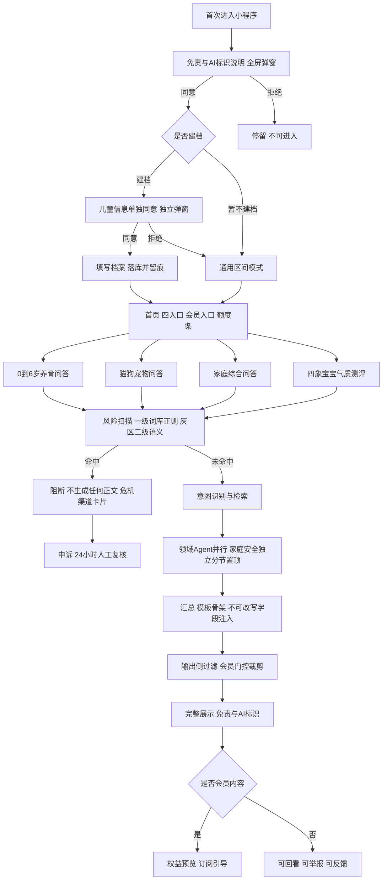

**四个计费 / 门控发生点**：档案无计费；问答计次（免费额度）；测评免费；会员与专题内容门控裁剪；报告长图免费。

## 4.2 四个不可跳过的节点

风险链路不是"一个功能"，而是四个必须按序执行的节点。任何实现不得调整顺序或合并。

| 节点 | 编号 | 执行内容 | 失败时 | 是否可绕过 |
|---|---|---|---|---|
| 同意节点 | N1 | 基础同意 / 儿童信息单独同意 / 监护声明 | 不落库、不进入 | **否** |
| 风险节点 | N2 | 一级词库 + 正则 → 灰区二级语义模型 | 服务不可用**按命中处理**，禁出正文 | **否** |
| 生成节点 | N3 | 意图识别 → 检索 → 领域 Agent 并行 → 汇总 | 按 6.6 降级矩阵处置 | 部分可分节降级 |
| 交付节点 | N4 | 输出侧过滤 → 会员门控裁剪 → 注入免责与 AI 标识 | 过滤不可用**禁出正文** | **否** |

**统一次节点规则**

| 编号 | 规则 |
|---|---|
| NR-1 | 任一节点判定为"拦截"时，**不得提供"继续提问"入口**（硬类别），只给渠道卡片 |
| NR-2 | 拦截后已渲染的正文必须由前端清空（`clearAll()`），不允许"灰掉但仍可读" |
| NR-3 | 节点执行顺序、耗时与判定结果全部写入调用日志，可逐请求还原 |
| NR-4 | 拦截与失败**均不计入免费额度**（判定在服务端） |
| NR-5 | 语音输入必须先转写为文本、再进 N2 风险节点；**音频本身不参与判定** |

## 4.3 全局业务规则

| 编号 | 规则 | 说明 |
|---|---|---|
| GR-1 | 风险扫描先于一切 | 收请求 → 鉴权与幂等 → **风险扫描** → 意图识别 → 检索 → Agent → 汇总 → 输出过滤。禁止先调度后扫描 |
| GR-2 | 命中即阻断 | 命中硬类别不生成任何正文，响应体正文为空（可断言），无绕过入口 |
| GR-3 | 安全不可降级 | 家庭安全 Agent 失败时**隐藏育儿 / 宠物全部正文**，只出静态安全模板；宁可不答，不可答错 |
| GR-4 | 安全置顶且不参与排序 | 安全分节 `pinned=true`，不可折叠、不可下移、**不参与权重加权与冲突排序** |
| GR-5 | 不可改写字段服务端注入 | 安全提示、冲突标注、免责声明、AI 标识、转介提示共 5 类，不经 LLM |
| GR-6 | 引用必须来自检索 | `evidence_ref` 只能填检索结果 ID；模型编造的来源一律剔除；无命中必须置 `professional_referral=true` |
| GR-7 | 无权限不下发 | 会员与专题包 block 由服务端裁剪，前端不做安全边界 |
| GR-8 | 三不边界 | 不诊断、不开方、不给剂量；药名 + 剂量模式由规则命中即拦截 |
| GR-9 | 幂等优先于重试 | 任何重试前先查 `client_request_id`，命中直接返回历史结果，不重复扣额度 |
| GR-10 | 一切可追溯 | 每次请求记录：命中意图、调度决策、各 Agent 输出、耗时、风险判定、引用 kb_id、模型与版本、权重版本 |
| GR-11 | 降级必留痕、必可回看 | 所有降级落库并可回看（含降级原因与当时状态）；"失效但不消失" |
| GR-12 | 口径统一 | 时间存 UTC、展示按用户时区（UTC+8）；额度按自然日 0 点重置；指标口径以 9.4 为唯一权威 |
| GR-13 | 分龄优先于通用 | 有档案时一律按档案月龄取区间；无档案时按 1–3 岁通用区间并显式声明 |
| GR-14 | 语音不改变链路 | 语音只替换输入方式，转写文本与手输文本走**完全相同**的校验、风险扫描、计次与门控 |
| GR-15 | 单活跃会话 | 同一用户同时只允许 1 个活跃流式会话，第二条返回 `409` 与 `retry_after` |

## 4.4 分龄与派生规则（开发落地基准）

### 4.4.1 儿童月龄与区间

`age_months` 由服务端按「自然月向下取整」计算，禁止客户端计算，禁止按 30 天折算。

| 内部区间码 | 月龄范围 | 对外展示名 | 主要适用内容 |
|---|---|---|---|
| `m0_6` | 0–6 月 | 0–6 个月 | 喂养、睡眠、黄疸观察、抬头翻身 |
| `m7_12` | 7–12 月 | 6–12 个月 | 辅食添加、爬行、分离焦虑初期 |
| `m13_24` | 13–24 月 | 1–2 岁 | 学步、语言爆发、饮食行为 |
| `m25_36` | 25–36 月 | 2–3 岁 | 自主意识、如厕训练、情绪爆发 |
| `m37_48` | 37–48 月 | 3–4 岁 | 社交、规则意识、入园准备 |
| `m49_60` | 49–60 月 | 4–5 岁 | 同伴冲突、想象游戏 |
| `m61_72` | 61–72 月 | 5–6 岁 | 入学准备、专注力、边界主题 |

> 需求说明使用「0-6 月 / 6-12 月 / 1-3 岁 / 3-6 岁」四段。本表在四段基础上细分，**对外文案仍按四段展示**，检索与提示词按七段取更精确上下文。

**边界规则**：`age_months > 72` 时档案可保存，但问答一律走超范围拒答（AC-F4-09-1）。

### 4.4.2 宠物年龄与阶段（V1.0 猫狗）

| 物种 | 幼年 | 成年 | 老年 | 备注 |
|---|---|---|---|---|
| 猫 | < 12 月 | 12–84 月 | > 84 月 | 老年猫肾病与关节问题高发，提示体检 |
| 狗（小型，成年体重 <10kg） | < 12 月 | 12–84 月 | > 84 月 | — |
| 狗（中型，10–25kg） | < 15 月 | 15–84 月 | > 84 月 | — |
| 狗（大型，>25kg） | < 18 月 | 18–72 月 | > 72 月 | 大型犬老年起点更早 |

> 宠物档案只采集「年龄」一个口径时，按 `age_months` 存储并派生阶段；未填体重时按中型犬口径并在正文声明。**V1.1 小宠阶段规则见 13.3.2。**

## 4.5 计次与额度总则

| 项 | 规则 |
|---|---|
| 计次对象 | 免费用户的**问答**（单领域与复合均计 1 次） |
| 不计次 | 失败、被风险拦截、重试（同一 `client_request_id`）、缓存命中、申诉提交与放行、测评、报告查看与存图、语音识别失败 |
| 额度上限 | 免费 3 次/日（配置化，Q-25 未定前按 3 次开发） |
| 会员 | 不限次，但受单活跃会话与限流约束 |
| 重置时点 | 自然日 0 点（UTC+8），由服务端裁决 |
| 超额表现 | 拒绝生成、不产生模型调用、展示恢复时间与升级入口 |
| 语音与额度 | 转写成功后用户**主动提交**才计次；仅录音不计次 |

---

# 第 5 章 功能需求（V1.0）

> **需求 ID 规范**：`US-F<域>-<序号>` 用户故事；`AC-F<域>-<序号>-<子号>` 验收标准；`EX-F<域>-<序号>` 边界异常。
> **验收标准格式**：全部采用 Given / When / Then 三段式，必须可通过测试判定；**正文不含任何未决编号**，未决内容统一见第 12 章。
> **优先级**：M＝MVP 必做；P1＝MVP 尽力；P2＝本版不做。
> **需求来源**：每个功能域标注对应的需求说明编号（如 `US-D1`），追溯关系见附录 B。

---

## F1 准入与个人信息权利

> 对应需求说明：US-A1、US-A2、US-C3-4、US-I1-4、NFR-1.4、NFR-1.5

### F1.1 目标

让用户在不被欺骗、不被过度索取的前提下进入产品；让儿童信息的每一次收集、使用、撤回、删除都可举证。

### F1.2 用户故事与验收标准

| ID | 用户故事 | 优先级 |
|---|---|---|
| US-F1-01 | 作为新用户，我希望先看清"这是什么工具、不替代谁"，再决定是否进入，以便不被误导 | M |
| US-F1-02 | 作为家长，我希望在填写孩子信息前单独看到一份说明并单独同意，以便我知道这些信息用来做什么 | M |
| US-F1-03 | 作为监护人，我希望系统记录我确实做过监护声明，以便后续可举证 | M |
| US-F1-04 | 作为用户，我希望每次看到结果都能看到免责提示，以便不过度依赖 | M |
| US-F1-05 | 作为用户，我希望随时查到隐私指引与第三方共享清单，以便知道数据流向 | M |
| US-F1-06 | 作为用户，我希望协议更新时被重新告知，以便我知情 | M |
| US-F1-07 | 作为用户，我希望可以分项撤回同意，而不必注销整个账号 | M |
| US-F1-08 | 作为用户，我希望在一个入口完成查阅、更正、导出、删除、注销，以便行使个人信息权利 | M |
| US-F1-09 | 作为用户，我希望注销账号时清楚知道后果与时限，以便做决定 | M |

**验收标准**

| ID | 验收标准（Given / When / Then） |
|---|---|
| AC-F1-01-1 | Given 用户首次进入且服务端无 `consent_type=base` 记录，When 页面加载完成，Then 展示全屏免责弹窗；「进入」按钮置灰不可点；勾选后按钮可点，点击写入一条同意记录（含协议版本、时间、设备标识摘要） |
| AC-F1-01-2 | Given 免责弹窗已展示，When 用户点击系统返回键或右上角关闭，Then 弹窗不关闭且不进入首页（合规弹窗不可被返回键绕过） |
| AC-F1-01-3 | Given 用户拒绝同意并离开，When 再次进入，Then 仍展示同一弹窗，且不产生任何档案或会话写入 |
| AC-F1-01-4 | Given 用户已完成首次同意，When 次日再次进入且协议版本未变，Then **不再弹全屏弹窗**，改为首页底部常驻免责小字。频次口径：首次强制 + 协议版本变更时重申（Q-17 默认方案） |
| AC-F1-02-1 | Given 用户点击「添加宝宝档案」，When 提交表单，Then 必须先经过儿童信息单独同意弹窗；未勾选时提交请求**不发出**（抓包可验证无写入） |
| AC-F1-02-2 | Given 单独同意弹窗已展示，When 用户阅读，Then 弹窗内必须列明五项：收集目的、字段清单、保存期限、第三方共享情况、撤回方式，缺一不可 |
| AC-F1-02-3 | Given 用户不同意儿童信息处理，When 关闭弹窗，Then 不落库，但可正常使用「通用区间模式」问答 |
| AC-F1-03-1 | Given 用户创建第一个儿童档案，When 提交，Then 必须勾选监护声明，落库写入 `guardian_verified=true` 并记录设备、IP 摘要与时间 |
| AC-F1-03-2 | Given 用户已有 1 个儿童档案，When 创建第 2 个，Then 不重复要求监护声明核验（同一监护人），但仍写入操作留痕 |
| AC-F1-03-3 | Given 用户修改档案中的出生日期或过敏项，When 保存，Then 写入字段级变更记录（字段名、前后值摘要、操作人、时间） |
| AC-F1-04-1 | Given 任一回答结果页或测评报告页，When 渲染完成，Then 页面底部必须展示免责声明，且不可被用户关闭 |
| AC-F1-04-2 | Given 用户生成长图或分享图，When 图片渲染，Then 免责声明在生成时即渲染进图，产品内**不提供删除入口**（实现规格见 AC-F7-06-1） |
| AC-F1-05-1 | Given 用户首次触发相册或麦克风权限，When 系统授权弹起前，Then 先展示场景化说明（为什么需要、用在哪、可否拒绝） |
| AC-F1-05-2 | Given 用户进入「关于与协议」，When 查看，Then 可读到《用户协议》《隐私保护指引》《第三方 SDK 与共享清单》《免责声明》，四者均可全文阅读 |
| AC-F1-06-1 | Given 协议或隐私指引版本号 +1，When 已同意用户再次进入，Then 重新弹出告知并要求确认，未确认前不可提问 |
| AC-F1-07-1 | Given 用户已同意儿童信息处理，When 在权利中心撤回该项，Then 档案 `status=disabled`、停止参与问答与测评，历史记录中昵称显示为「宝宝 A」 |
| AC-F1-07-2 | Given 用户撤回基础同意，When 撤回生效，Then 退出登录态，仅可访问协议页；再次进入需重新同意 |
| AC-F1-07-3 | Given 用户撤回同意，When 撤回完成，Then 页面必须展示后果说明（哪些数据保留、保留多久、能否恢复）并要求二次确认 |
| AC-F1-08-1 | Given 用户在权利中心，When 查看入口，Then 必须同时提供六类请求：查阅、更正、复制导出、分项撤回、删除、注销，且每项显示处理时限 |
| AC-F1-08-2 | Given 用户提交数据导出请求，When 受理，Then 在 15 个工作日内生成 JSON 与 CSV 两种格式的下载链接，链接有效期 24 小时【假设待验证】 |
| AC-F1-08-3 | Given 用户提交删除请求，When 执行，Then 按 F2 的级联规则处置；若依法不能删除（如交易记录），必须给出拒绝理由与保留依据 |
| AC-F1-09-1 | Given 用户提交注销，When 确认，Then 展示后果说明（档案删除、历史不可恢复、订单留存）与二次确认，确认后进入冷静期 7 天（Q-28） |
| AC-F1-09-2 | Given 注销完成，When 到期，Then 儿童档案 30 天内删除；交易与订单信息留存 ≥3 年；同意记录、权利请求记录留存 ≥3 年 |

### F1.3 详细流程

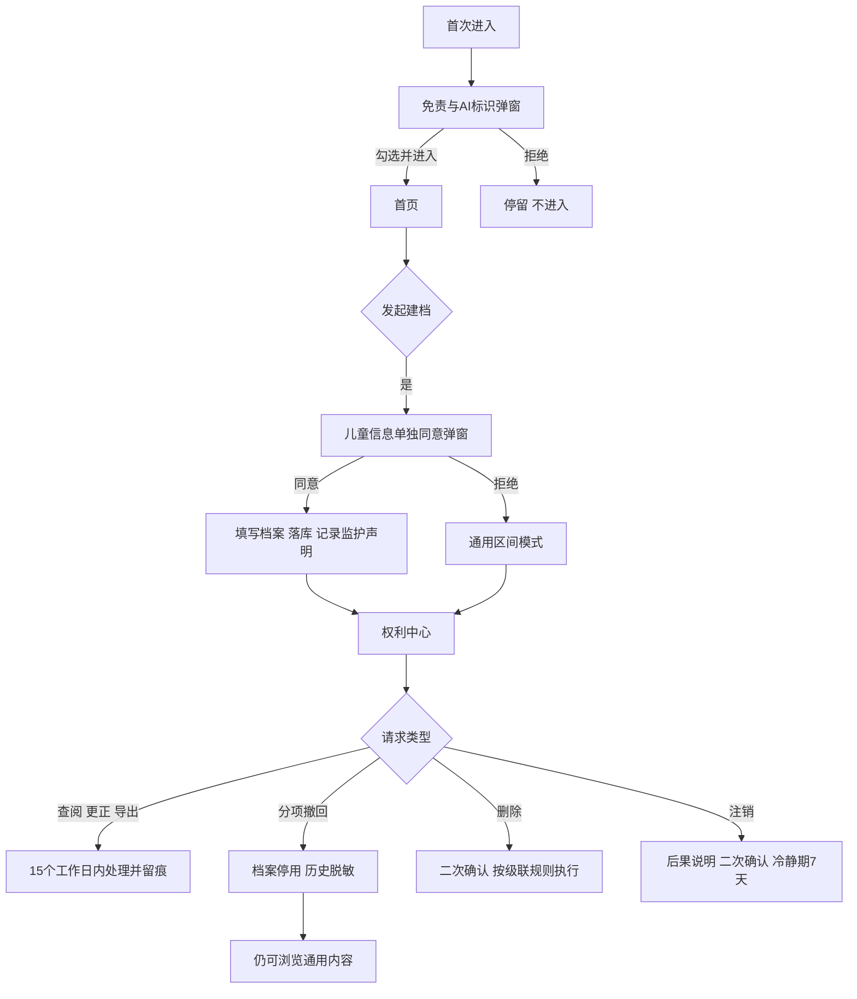

### F1.4 流程步骤

| 步骤 | 处理方 | 说明 |
|---|---|---|
| S1 | 前端 | 合规弹窗由服务端下发的文案 ID 渲染，不在客户端硬编码；不可用系统返回键关闭 |
| S2 | 前端 + 服务端 | 同意动作同步写入本地与服务端；服务端为唯一权威，本地仅用于首屏判断 |
| S3 | 服务端 | 同意记录以 `user_id + consent_type + consent_version` 唯一，重复同意不产生多条 |
| S4 | 服务端 | 建档前校验 `consent_type=child_personal_info` 是否存在且未撤回，否则拒绝写入并返回明确错误码 |
| S5 | 服务端 | 撤回同意触发级联任务（档案停用、历史脱敏、缓存失效），任务失败需告警并可重跑 |
| S6 | 服务端 | 权利请求进入工单队列，按类型计时；超时告警升级 |
| S7 | 审计 | 同意、撤回、删除、导出、注销全部写审计日志，保留 ≥3 年 |

### F1.5 状态机

**同意状态**

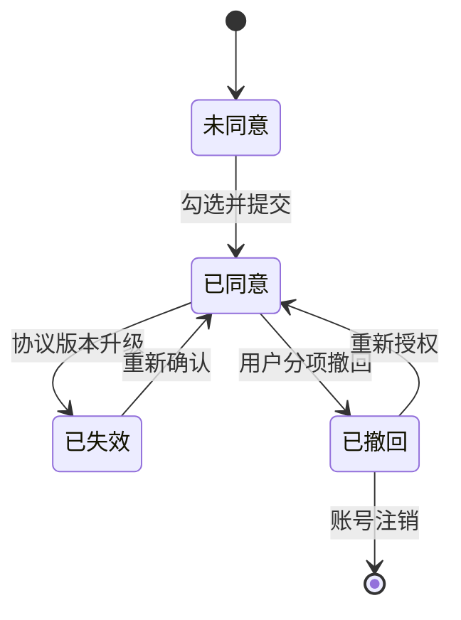

**权利请求状态**：`已提交 → 受理中 → 处理中 → 已完成`；分支 `处理中 → 已拒绝`（必须填理由）；`已拒绝 → 处理中`（用户补充材料后重提，同一请求最多 2 次）。

### F1.6 边界与异常六查

| 类别 | 场景 | 期望行为 |
|---|---|---|
| 空态 | 用户无任何同意记录（换设备、清缓存） | 以服务端记录为准；服务端无记录则重新走同意流程，不因本地有记录而跳过 |
| 极值 | 同一账号在多设备分别同意 | 以服务端最新一条为准，不重复弹窗，不产生多条有效记录 |
| 并发 | 同意提交与建档提交几乎同时到达 | 建档请求必须等待同意写入成功；服务端校验不到同意记录即拒绝，不允许「先写后校验」 |
| 失败 | 同意记录写入失败 | 阻断进入，提示「网络异常，请重试」，不降级放行 |
| 权限 | 用户 A 尝试读取用户 B 的权利请求 | 服务端校验归属，返回 `403` 并写审计 |
| 幂等 | 用户重复点击「提交导出」 | 同一请求类型 24 小时内复用已有工单，不重复生成 |
| 空态 | 用户提交删除但无任何数据 | 直接返回「无可删除数据」，不创建工单 |
| 失败 | 级联删除任务中途失败 | 任务可重跑且幂等；已删除部分不重复删除；失败项进入人工处理清单并告警 |

### F1.7 埋点

`app_launch`、`disclaimer_show` / `disclaimer_agree` / `disclaimer_decline`（含协议版本）、`consent_child_show` / `consent_child_agree` / `consent_child_decline`、`consent_withdraw`（含类型与后果确认状态）、`guardian_declare_done`、`privacy_doc_view`（含文档类型）、`right_request_submit`（含类型）、`right_request_done`（含耗时）、`account_delete_start` / `account_delete_done`。

---

## F2 档案管理

> 对应需求说明：US-C1、US-C2、US-C3

### F2.1 目标

用最少的字段换到「贴合自家孩子 / 宠物」的回答，同时保证这些字段是加密存储、可派生、可级联删除的。

### F2.2 用户故事与验收标准

| ID | 用户故事 | 优先级 |
|---|---|---|
| US-F2-01 | 作为家长，我希望用最少的信息建好孩子档案并自动按月龄判断适用区间，以便马上开始提问且不用自己换算 | M |
| US-F2-02 | 作为有多个孩子或宠物的用户，我希望提问前能明确「这次问的是谁」，以便问题和档案对得上 | M |
| US-F2-03 | 作为养宠家庭，我希望给猫或狗建独立档案，以便宠物问题不被当成育儿问题 | M |
| US-F2-04 | 作为用户，我希望删除档案时能选择「只删档案」或「全部删除」，以便不误删历史 | M |
| US-F2-05 | 作为用户，我希望我的孩子信息是加密存储的，以便不担心泄露 | M |
| US-F2-06 | 作为用户，我希望在两台设备上同时改档案时不会静默覆盖，以便不丢数据 | P1 |
| US-F2-07 | 作为用户，我希望档案能随时修改，且改动后回答跟着变，以便信息不过时 | M |

**验收标准**

| ID | 验收标准（Given / When / Then） |
|---|---|
| AC-F2-01-1 | Given 用户已单独同意儿童信息处理，When 提交档案，Then 必填项为昵称、出生日期；选填项为性别、身高、体重、是否早产、已知过敏项、辅食开始月龄；缺必填项时提交按钮置灰 |
| AC-F2-01-2 | Given 用户填写出生日期，When 保存，Then 服务端计算 `age_months`（整月向下取整）并派生 `age_band`（见 4.4.1 七档） |
| AC-F2-01-3 | Given 用户填写未来日期，When 提交，Then 拒绝并提示「出生日期不能晚于今天」 |
| AC-F2-01-4 | Given 孩子刚满 6 岁 1 天，When 保存档案，Then 允许保存，但问答链路按超范围口径拒答（AC-F4-09-1） |
| AC-F2-01-5 | Given 免费用户，When 创建第 4 个儿童档案，Then 拒绝并提示上限 3 个，同时给出会员上限说明；会员上限 10 个【假设待验证】 |
| AC-F2-01-6 | Given 用户只填昵称与出生日期，When 保存，Then 允许保存且标记字段完成度为「基础」，回答按已知字段生成并声明「未提供过敏项与生长情况」 |
| AC-F2-02-1 | Given 档案已保存，When 用户进入问答页，Then 顶部展示「这次问的是谁」选择器，并默认选中最近一次使用的档案 |
| AC-F2-02-2 | Given 用户切换问答对象，When 提交提问，Then 会话记录写入对应 `profile_id`，回答中的适用月龄与该档案一致 |
| AC-F2-02-3 | Given 用户同时有儿童与宠物档案，When 进入家庭综合问答，Then 选择器分别展示「孩子」与「宠物」两组，可各选 1 个 |
| AC-F2-03-1 | Given 用户创建宠物档案，When 提交，Then 必填类型（猫 / 狗）与年龄或生日，选填品种、绝育状态、体重、主要食物 |
| AC-F2-03-2 | Given 用户选择「其他动物」，When 提交，Then 选项置灰并提示「当前仅支持猫与狗，小宠将在后续版本支持」（V1.1 放开，见 13.3） |
| AC-F2-03-3 | Given 宠物档案未填体重，When 生成建议，Then 犬类按中型犬阶段口径处理并在正文声明「未提供体重，按中型犬通用口径给出」 |
| AC-F2-04-1 | Given 用户点击删除档案，When 弹出确认，Then 必须提供两个选项：「仅删档案（历史与报告脱敏保留）」与「一并删除全部相关数据」，且默认不选中任何一项 |
| AC-F2-04-2 | Given 用户选择「一并删除全部相关数据」，When 二次确认通过，Then 删除档案、问答会话、测评记录、报告，删除不可恢复，写审计日志 |
| AC-F2-04-3 | Given 用户选择「仅删档案」，When 执行完成，Then 历史记录中该档案标识替换为「宝宝 A」，正文保留，测评报告保留但标注「档案已删除」 |
| AC-F2-05-1 | Given 档案含敏感字段（出生日期、昵称、过敏项），When 落库，Then 这些字段以密文存储，且**查询与排序不得依赖密文字段**，只能使用派生列 |
| AC-F2-05-2 | Given 运维或开发直接查库，When 查看档案表，Then 敏感字段为密文；解密必须经 KMS 并有解密审计记录 |
| AC-F2-06-1 | Given 两个端同时编辑同一档案，When 后提交者保存，Then 返回 `409` 并提示「档案已被更新，请刷新」，不静默覆盖 |
| AC-F2-06-2 | Given 用户刷新后重新提交，When 保存成功，Then 版本号 +1，历史版本不保留正文（仅保留变更摘要） |
| AC-F2-07-1 | Given 用户修改出生日期或过敏项，When 保存成功，Then 该档案后续提问使用新派生区间，**历史会话不追溯改写**，但详情页提示「档案已更新」 |

### F2.3 详细流程

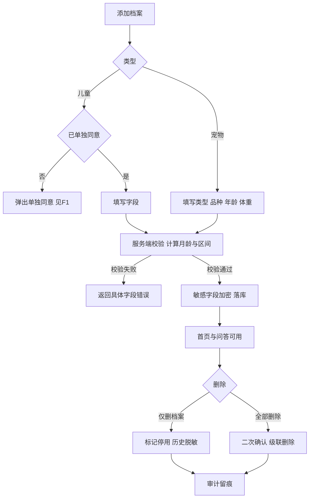

### F2.4 流程步骤

| 步骤 | 处理方 | 说明 |
|---|---|---|
| S1 | 前端 | 表单实时校验；必填项缺失或日期非法时按钮置灰，不发请求 |
| S2 | 服务端 | 校验同意状态；无有效同意则拒绝写入（不依赖前端拦截） |
| S3 | 服务端 | 计算 `age_months` 与 `age_band` 并作为派生列落库，同时记录 `age_months_updated_at` |
| S4 | 服务端 | 敏感字段加密后写入；密钥由 KMS 托管，与数据分离 |
| S5 | 服务端 | 删除走软删除 + 定时硬删除任务；级联范围按用户选择的选项执行 |
| S6 | 审计 | 建档、改档、删档、解密全部留痕 |

### F2.5 状态机

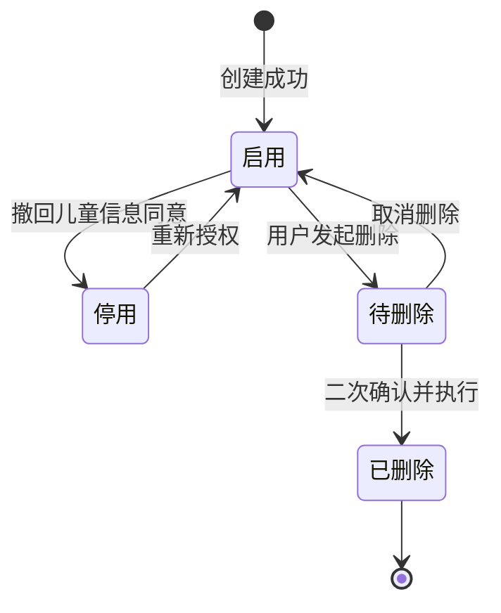

### F2.6 边界与异常六查

| 类别 | 场景 | 期望行为 |
|---|---|---|
| 空态 | 用户无任何档案 | 首页展示未建档提示条；问答走通用区间并声明适用范围 |
| 极值 | 昵称超长 / 体重极端值 / 过敏项超 20 条 | 昵称 ≤12 字、体重 0.5–150 kg、过敏项 ≤20 条；超限返回字段级错误 |
| 并发 | 同一档案并发编辑 | `version` 乐观锁，冲突返回 `409`，前端提示刷新 |
| 失败 | 加密服务不可用 | **拒绝写入**，提示稍后重试；不允许明文落库兜底 |
| 失败 | 级联删除部分失败 | 任务可重跑且幂等，失败项进人工清单并告警 |
| 权限 | 用户 A 用 B 的 `profile_id` 提问 | 服务端校验归属，返回 `403`，写审计，不产生会话 |
| 幂等 | 重复提交同一档案 | 前端防抖 + 服务端同用户同昵称同生日去重，返回已存在档案 |
| 空态 | 档案被删除后打开历史 | 历史可见、正文保留、档案标识显示「宝宝 A」，不可再次基于该档案提问 |

### F2.7 埋点

`profile_view`、`profile_create`（含类型、字段完成度）、`profile_update`（含变更字段数）、`profile_set_current`、`profile_delete_start` / `profile_delete_confirm`（含级联选项）、`profile_limit_blocked`（含当前数量）。

---

## F3 首页与入口

> 对应需求说明：US-B1

### F3.1 目标

让用户在 3 秒内知道「这里能问什么」，并在额度用尽、未建档、入口下线三种状态下都不困惑。

### F3.2 用户故事与验收标准

| ID | 用户故事 | 优先级 |
|---|---|---|
| US-F3-01 | 作为新用户，我希望首页直接告诉我四个能问的方向，以便不用摸索 | M |
| US-F3-02 | 作为用户，我希望看到今天还剩几次免费提问，以便安排使用 | M |
| US-F3-03 | 作为未建档用户，我希望知道补档案能让回答更贴合，但不被强制 | M |
| US-F3-04 | 作为做到一半离开的用户，我希望回来能直接续填测评 | M |
| US-F3-05 | 作为用户，我希望在首页就能看到会员能多得到什么，以便决定是否开通 | M |
| US-F3-06 | 作为用户，我希望某个板块临时不可用时被明确告知，而不是点了没反应 | M |

**验收标准**

| ID | 验收标准（Given / When / Then） |
|---|---|
| AC-F3-01-1 | Given 用户进入首页，When 页面渲染完成，Then 展示四个一级入口，固定顺序为：四象宝宝气质测评（置顶引流位）→ 0–6 岁宝宝养育 → 猫狗宠物饲养 → 家庭综合问答 |
| AC-F3-01-2 | Given 首页渲染完成，When 检查页面，Then 必须展示一句产品介绍：「家庭养育智能参考助手，养娃 + 养宠一站式养育科普工具」 |
| AC-F3-01-3 | Given 用户点击任一入口，When 跳转，Then 目标页正确加载，且埋点记录入口类型与是否已建档 |
| AC-F3-01-4 | Given 首页加载，When 4G 网络，Then 首屏 ≤2 s；超时展示骨架屏而非空白 |
| AC-F3-02-1 | Given 免费用户当日已用 1 次，When 进入首页，Then 额度条显示「今日剩余 2 次」（按 3 次/日） |
| AC-F3-02-2 | Given 免费额度用尽，When 进入首页，Then 额度条转橙色并置顶，文案包含恢复时间（次日 0 点）与升级入口 |
| AC-F3-02-3 | Given 会员用户，When 进入首页，Then 额度条显示「会员不限次」，不显示剩余次数 |
| AC-F3-03-1 | Given 用户无任何儿童档案，When 进入首页，Then 展示未建档提示条，点击进入建档流程；提示条可关闭且 7 天内不再出现【假设待验证】 |
| AC-F3-04-1 | Given 用户存在未完成的测评断点，When 进入首页，Then 测评卡显示「继续填写」，点击直达断点题而非第 1 题 |
| AC-F3-04-2 | Given 测评断点已超过 90 天，When 用户进入，Then 不显示「继续填写」，重新开始且旧断点数据清理 |
| AC-F3-05-1 | Given 用户为免费用户，When 进入首页，Then 展示会员入口条，文案须写明至少两项具体权益（不得只写「更多权益」），点击进入权益页 |
| AC-F3-05-2 | Given 用户已开通会员，When 进入首页，Then 会员入口条替换为「会员有效期至 X 月 X 日」，点击进入会员管理页 |
| AC-F3-06-1 | Given 运营在后台关闭「家庭综合问答」入口，When 用户进入首页，Then 该入口置灰并显示一行说明，不可点击，其他入口不受影响 |

### F3.3 详细流程

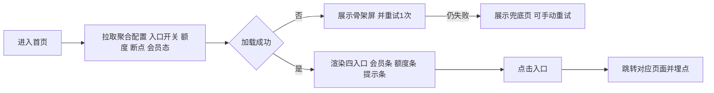

### F3.4 流程步骤

| 步骤 | 处理方 | 说明 |
|---|---|---|
| S1 | 前端 | 首页为聚合接口，一次返回入口开关、额度、断点状态、未建档标记、会员态，避免多次串行请求 |
| S2 | 服务端 | 入口开关从配置读取，支持按入口粒度远程下线，无需发版 |
| S3 | 前端 | 额度条状态由服务端返回值决定（剩余次数、是否会员、是否耗尽），前端不自行计算 |
| S4 | 前端 | 首屏优先渲染骨架，数据到达后替换；不使用全屏 loading 阻塞 |

### F3.5 边界与异常六查

| 类别 | 场景 | 期望行为 |
|---|---|---|
| 空态 | 首页聚合接口返回空配置 | 按默认四入口渲染，额度条显示「额度获取失败，稍后重试」 |
| 极值 | 剩余次数为 0 且为会员 | 显示「会员不限次」，不显示 0 |
| 并发 | 用户在两台设备同时进入 | 额度以服务端为准，两端显示可能短暂不一致，进入问答页时以服务端裁决 |
| 失败 | 配置服务不可用 | 使用本地缓存的最近一次配置，缓存超 24 h 则按默认配置渲染 |
| 权限 | 被封禁用户进入首页 | 展示封禁说明与申诉入口，不展示入口卡 |
| 幂等 | 重复点击同一入口 | 路由守卫拦截重复跳转，不产生重复埋点 |

### F3.6 埋点

`home_view`、`entry_click`（入口类型、是否已建档）、`quota_bar_view`（剩余次数、是否会员）、`quota_exhausted`、`member_entry_view` / `member_entry_click`、`profile_prompt_show` / `profile_prompt_click`、`assessment_resume_click`、`entry_offline_shown`。

---

## F4 0–6 岁儿童养育问答

> 对应需求说明：US-D1、US-D2、US-D3、NFR-2.1、NFR-3.1、Q-18、Q-21、Q-36

### F4.1 目标

让家长在 8 秒内拿到「能判断是否适用于自家孩子」的结构化建议——给前提、给禁忌、给观察指标、给就医阈值；并让抱娃单手操作的场景也能用语音提问。

### F4.2 用户故事与验收标准

| ID | 用户故事 | 优先级 |
|---|---|---|
| US-F4-01 | 作为家长，我希望用一句话提问就得到分节的建议，以便快速抓重点 | M |
| US-F4-02 | 作为家长，我希望每条建议都写明「适用于什么月龄、什么前提」，以便判断能不能照做 | M |
| US-F4-03 | 作为家长，我希望看到「不建议做什么以及为什么」，以便避开常见坑 | M |
| US-F4-04 | 作为家长，我希望知道「什么情况下必须去医院」，以便不耽误 | M |
| US-F4-05 | 作为家长，我希望可以追问，以便把一个问题问透 | M |
| US-F4-06 | 作为未建档用户，我希望不被拒之门外，但要知道答案的适用范围 | M |
| US-F4-07 | 作为用户，我希望超出范围的问题被明确告知，而不是硬编一个答案 | M |
| US-F4-08 | 作为免费用户，我希望知道哪些内容是会员专属，以便决定是否付费 | M |
| US-F4-09 | 作为家长，我希望用语音提问，以便单手抱娃时也能用 | M |
| US-F4-10 | 作为用户，我希望专业术语旁边有通俗解释，以便看得懂 | M |
| US-F4-11 | 作为付费用户，我希望拿到月度养育规划与场景化脚本，以便真正落地执行 | M |

**验收标准**

| ID | 验收标准（Given / When / Then） |
|---|---|
| AC-F4-01-1 | Given 用户输入问题并提交，When 长度在 5–2000 字之间，Then 允许提交；不足 5 字或超过 2000 字时按钮置灰并实时计数 |
| AC-F4-01-2 | Given 提问通过风险扫描，When 回答生成完成，Then 正文必须包含六个分节，顺序固定：建议要点 → 适用前提 → 不建议做法及原因 → 观察指标 → 何时需咨询专业人士 → 免责声明 |
| AC-F4-01-3 | Given 回答生成中，When 首个分节到达，Then 前端按分节渐进渲染，未到达的分节显示骨架屏，不空白整页 |
| AC-F4-02-1 | Given 用户已绑定 8 月龄档案，When 回答生成，Then 「适用前提」分节必须写明具体月龄区间与前提条件（如「适用于已添加辅食的 6–12 月龄」） |
| AC-F4-02-2 | Given 回答中的建议涉及月龄，When 与档案月龄不一致，Then 必须在「适用前提」中显式提示差异，不得默认套用 |
| AC-F4-03-1 | Given 回答生成完成，When 检查「不建议做法」分节，Then 每条不建议项必须给出原因，不允许只列禁令 |
| AC-F4-04-1 | Given 问题涉及疾病或急症信号，When 回答生成，Then 「何时需咨询专业人士」分节必须给出可判断的阈值（如体温数值、持续时长），不得只写「建议就医」 |
| AC-F4-05-1 | Given 同一会话内用户追问，When 提交，Then 复用会话上下文，不重复询问已知档案信息；追问计入二次提问率 |
| AC-F4-06-1 | Given 用户未绑定任何儿童档案，When 提问，Then **不拒答**，按通用区间 1–3 岁作答，并在正文首段声明「未绑定档案，本次按通用区间给出；如有档案可补充以获得更贴合建议」 |
| AC-F4-06-2 | Given 无档案回答生成，When 检查契约字段，Then `preconditions` 必须写明「未绑定档案，按通用区间给出」 |
| AC-F4-07-1 | Given 档案月龄 > 72 个月，When 提交任意育儿问题，Then 按固定话术 `REFUSAL_AGE_V1` 拒答，不生成正文，并给出替代方向（与学校沟通、专业机构），不推荐竞品 |
| AC-F4-07-2 | Given 档案 4 岁，When 提问「帮我写作业」，Then 按固定话术 `REFUSAL_TOPIC_V1` 拒答，理由是主题不在范围内 |
| AC-F4-07-3 | Given 档案 3 岁，When 问题提到「我 8 岁的哥哥」，Then 拒答该部分并提示切换问答对象，不静默按 3 岁作答 |
| AC-F4-07-4 | Given 问题属边界主题（如「5 岁要不要开始认字」），When 回答生成，Then 正常作答但必须标注「该主题处于本产品范围边缘，建议同时咨询幼儿园或专业机构」 |
| AC-F4-08-1 | Given 某分节为会员专属，When 免费用户查看，Then 服务端不下发该分节正文，仅返回权益预览与升级入口，前端不采用遮罩隐藏 |
| AC-F4-09-1 | Given 用户点击麦克风，When 首次使用，Then 先展示麦克风用途说明与示例问法，用户确认后才请求系统权限 |
| AC-F4-09-2 | Given 用户按住说话，When 录音达 60 s，Then 自动停止录音并进入转写，提示「单次最长 60 秒」 |
| AC-F4-09-3 | Given 转写完成，When 返回结果，Then 转写文本必须**回填到输入框并可编辑**，由用户主动点击提交后才发起提问；不得自动提交 |
| AC-F4-09-4 | Given 转写置信度过低或失败，When 返回，Then 提示「没听清，请重试或改用文字输入」，**不消耗额度、不产生会话** |
| AC-F4-09-5 | Given 转写成功，When 提交，Then 转写文本与手输文本走完全相同的校验、风险扫描、计次与门控（GR-14） |
| AC-F4-09-6 | Given 用户录音结束，When 转写完成，Then 原始音频在服务端**不落盘、不入日志、不下发后台**；仅保留转写文本 |
| AC-F4-10-1 | Given 回答中出现专业术语，When 展示，Then 术语后必须有括号通俗解释或可点开的释义，抽检合格率 ≥98% |
| AC-F4-11-1 | Given 会员用户进入「月度养育计划」，When 打开，Then 按月龄区间生成当月的分阶段引导清单与场景化应对脚本，形态为站内图文页 + 可保存长图 |
| AC-F4-11-2 | Given 用户过了生日导致月龄跨档，When 打开月度计划，Then 自动切换到新档位的当月计划，旧计划保留可查 |
| AC-F4-11-3 | Given 会员到期，When 打开已生成的深度方案，Then 内容保留只读、可看不可再生成，并提示续费（Q-24 默认方案） |

### F4.3 详细流程

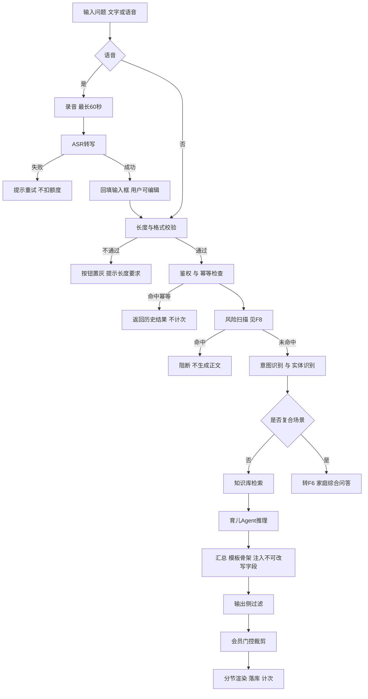

### F4.4 流程步骤

| 步骤 | 处理方 | 说明 |
|---|---|---|
| S1 | 前端 | 输入框实时计数，超限禁用；提交按钮防抖 800 ms |
| S2 | 前端 | 语音：按住录音、上滑取消、松手结束；录音中显示波形与剩余秒数 |
| S3 | ASR 服务 | 单次 ≤60 s、仅普通话；返回文本与置信度；**音频流式转写后立即释放，不落盘** |
| S4 | 服务端 | 鉴权 + `client_request_id` 幂等检查，命中直接返回历史结果 |
| S5 | 风险控制服务 | 见 F8；风险扫描**不读档案**，只看输入文本（含转写文本） |
| S6 | 编排器 | 意图分类 + 实体识别；识别到同时含儿童与宠物实体则转 F6 |
| S7 | 检索 | 按领域过滤；向量召回 top-8 → 重排取 5；领域不匹配条目不得进入上下文 |
| S8 | 育儿 Agent | 单次主力模型调用，输出结构化 JSON；输入只含最小必要档案字段（月龄区间、性别、过敏项） |
| S9 | 服务端汇总 | 模板骨架 + 字段填充，**不调用 LLM**；安全提示、免责、AI 标识、转介提示服务端注入 |
| S10 | 输出侧过滤 | 敏感词与药名剂量模式二次过滤；不可用则禁出正文 |
| S11 | 服务端 | 会员 block 裁剪后落库，返回前端；写入 token 用量与耗时 |

### F4.5 关键设计：回答分节与字段映射

| 分节 | 对应字段 | 是否可被改写 | 内容要求 |
|---|---|---|---|
| 建议要点 | `answer_blocks[type=advice]` | 可选连贯性改写 | 2–5 条，每条一个动作，可执行 |
| 适用前提 | `preconditions` | 否 | 月龄区间 + 前置条件；无档案时必须声明通用区间 |
| 不建议做法及原因 | `answer_blocks[type=avoid]` | 可选改写，但原因不得删除 | 每条必须带原因，禁止只列禁令 |
| 观察指标 | `answer_blocks[type=observe]` | 可选改写 | 可在家观察的具体表现与时间窗 |
| 何时需咨询专业人士 | `professional_referral` + `referral_threshold` | 否 | 必须给数值或时长阈值 |
| 免责声明 | `disclaimer_id` | 否 | 服务端按协议版本注入 |

### F4.6 关键设计：语音输入规格（V1.0 必做）

| 项 | 规格 |
|---|---|
| 触发方式 | 输入框右侧麦克风按钮；按住说话、松手结束、上滑取消 |
| 时长上限 | 单次 60 s，到点自动停止并转写，提示「单次最长 60 秒」 |
| 语言 | 仅普通话；不承诺方言支持（Q-18） |
| 转写结果 | 回填输入框、可编辑、不自动提交；用户可全删重录 |
| 置信度处理 | 整体置信度 <0.6 或文本为空 → 判定失败，提示改用文字，不计次 |
| 音频处置 | **不落盘**（含临时文件、日志、CDN）；转写完成即释放 |
| 权限 | 首次使用前展示用途说明；拒绝后保留文字输入，功能降级不阻断 |
| 与风险链路关系 | 转写文本进入 F8 一级扫描，与文字输入同一流水线（GR-14） |
| 失败兜底 | ASR 不可用 → 麦克风按钮置灰并提示「语音暂不可用」，文字链路不受影响 |

### F4.7 边界与异常六查

| 类别 | 场景 | 期望行为 |
|---|---|---|
| 空态 | 输入为空或仅空格 | 按钮置灰，不发请求，不产生埋点误读 |
| 极值 | 提问 2000 字满额 | 允许提交，服务端输入规范化时截断至 2000 字并记录截断标记 |
| 极值 | 语音转写结果超 2000 字 | 截断并提示「语音内容较长，已截取前 2000 字」 |
| 并发 | 同一用户同时发起 2 个流式会话 | 仅允许 1 个活跃会话，第二条返回 `409` 并给 `retry_after` |
| 失败 | 育儿 Agent 超时 | 重试 1 次；仍失败则该分节降级，其余分节正常返回（6.6） |
| 失败 | 检索无命中 | 仍生成正文，但必须置 `professional_referral=true` 并在正文标注「未检索到直接依据」 |
| 失败 | ASR 服务不可用 | 麦克风入口置灰 + 说明；文字输入正常；不计次 |
| 权限 | 用户 A 的会话被 B 的 token 请求 | 返回 `403`，写审计，不返回任何正文 |
| 幂等 | 同一 `client_request_id` 重复提交 | 返回首次结果，不重复计次、不重复扣成本 |
| 极值 | 档案已删除但会话仍在 | 会话可回看；再次追问时按无档案路径处理 |

### F4.8 埋点

`qa_submit`（入口、输入方式：文字 / 语音、是否绑定档案、字数区间）、`qa_voice_start` / `qa_voice_done`（时长档、置信度档）/ `qa_voice_fail`（原因：超时 / 无语音 / 置信度低 / 服务不可用）、`qa_result_view`（耗时、是否降级、是否含转介提示）、`qa_followup`、`qa_retry`（含原因）、`qa_degraded`（含原因）、`qa_refusal`（类型：年龄 / 主题 / 无档案声明）、`qa_member_block_shown`、`quota_exhausted`、`monthly_plan_view`。

---

## F5 伴侣宠物饲养问答

> 对应需求说明：US-F1、US-F2、US-F3、Q-23

### F5.1 目标

让养猫狗的家庭拿到「能照着做」的饲养与行为科普，同时在真正危险的时候**第一时间把人推向医院**，而不是给一个像诊断的答案。

### F5.2 用户故事与验收标准

| ID | 用户故事 | 优先级 |
|---|---|---|
| US-F5-01 | 作为养宠用户，我希望问喂养、护理、行为问题能得到分节回答，以便照着做 | M |
| US-F5-02 | 作为养宠用户，我希望看懂猫狗某个动作是什么意思，以便判断要不要干预 | M |
| US-F5-03 | 作为养宠用户，我希望出现危险信号时被明确告知立刻就医，以便不耽误 | M |
| US-F5-04 | 作为同时有孩子和宠物的家长，我希望问题涉及互动风险时自动收到安全提醒，以便防患 | M |
| US-F5-05 | 作为养宠用户，我希望基础清单免费、长期规划付费，以便按需选择 | M |
| US-F5-06 | 作为养宠用户，我希望系统明确告诉我「这不是诊断」，以便我知道边界 | M |
| US-F5-07 | 作为养宠用户，我希望知道哪些食物和物品对宠物有毒，以便提前避险 | M |
| US-F5-08 | 作为养宠用户，我希望问的不是猫狗时被明确告知范围，而不是拿到猜测答案 | M |

**验收标准**

| ID | 验收标准（Given / When / Then） |
|---|---|
| AC-F5-01-1 | Given 用户提交宠物问题，When 通过风险扫描，Then 回答必须覆盖「喂养 / 护理 / 行为科普」三类之一，并给出可执行步骤与观察指标 |
| AC-F5-01-2 | Given 回答涉及健康，When 展示，Then 正文必须包含「本内容为科普参考，不构成诊断，不替代执业兽医」声明 |
| AC-F5-01-3 | Given 回答生成完成，When 检查分节，Then 分节顺序为：行为/问题解读 → 建议做法 → 观察指标 → 何时需就医 → 免责声明（命中红旗时「何时需就医」上移至首位） |
| AC-F5-02-1 | Given 用户选择行为解读，When 提交行为关键词（甩尾 / 低吼 / 哈气 / 护食等），Then 输出三段结构：行为含义 → 可能情绪状态 → 建议应对 |
| AC-F5-02-2 | Given 行为解读结果，When 展示，Then 必须标注「行为解读基于常见模式，个体差异较大」，不得给出确定性情绪判定 |
| AC-F5-02-3 | Given 用户输入未在关键词表中的行为描述，When 生成，Then 仍按三段结构作答，但必须标注「该行为未在标准词表内，仅供参考」 |
| AC-F5-03-1 | Given 用户描述命中急症红旗清单任一条（见 F5.6），When 回答生成，Then 回答顶部**强制置顶**「建议尽快前往宠物医院」并给就近医院引导，其余内容不得弱化该提示 |
| AC-F5-03-2 | Given 命中红旗且同时命中风险软类别（如误食毒物），When 处置，Then 走 F8 高危拦截，不生成正文，只给渠道卡片 |
| AC-F5-03-3 | Given 用户询问「能不能喂 XX 药、喂多少」，When 识别到药名 + 剂量模式，Then **不给剂量、不给药名推荐**，返回固定话术并建议咨询执业兽医 |
| AC-F5-04-1 | Given 用户有儿童档案，When 宠物问题涉及儿童与宠物互动（共处、喂食、抓咬、卫生、睡眠），Then 自动附加「儿童—宠物互动安全」提醒；该提醒为**规则化附加**，不依赖安全 Agent 触发条件 |
| AC-F5-04-2 | Given 用户无儿童档案，When 提问互动类问题，Then 不附加该提醒，但可提示「如有孩子可建档获得互动安全提醒」 |
| AC-F5-05-1 | Given 免费用户，When 查看基础饲养清单，Then 可完整查看（如疫苗周期表、驱虫周期表、洗护频次表） |
| AC-F5-05-2 | Given 免费用户，When 查看 3 个月滚动长期规划，Then 仅展示预览，正文由服务端裁剪不下发，并给出会员入口 |
| AC-F5-06-1 | Given 任何宠物回答，When 检查正文，Then 不得出现「诊断」「确诊」「治疗方案」「处方」等确定性表述，抽检合格率 ≥98% |
| AC-F5-07-1 | Given 用户询问「XX 能不能吃」，When 命中毒物库，Then 明确给出「禁止 / 慎用 / 安全」三档结论 + 依据，并对禁止项同时触发红旗提示 |
| AC-F5-08-1 | Given 用户提问兔子、仓鼠、鹦鹉等非猫狗对象，When 识别物种，Then 明确告知「当前仅支持猫与狗」，不生成猜测性饲养内容（V1.1 放开兔与仓鼠，见 13.3） |

### F5.3 详细流程

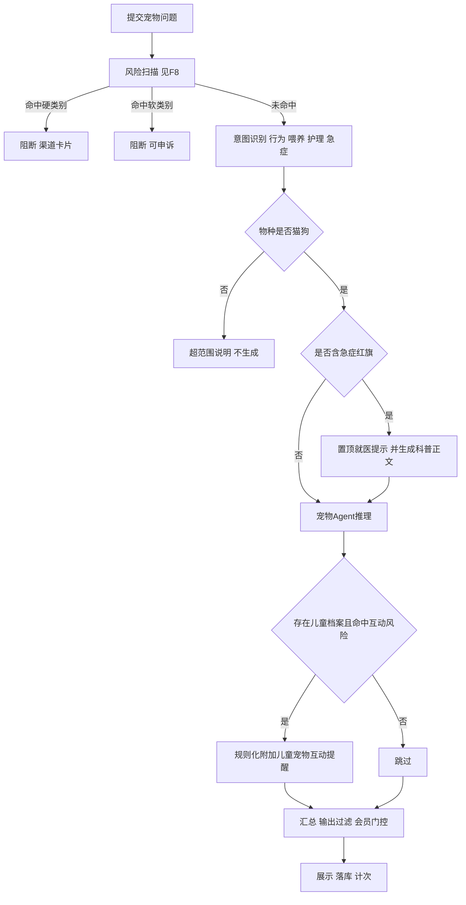

### F5.4 流程步骤

| 步骤 | 处理方 | 说明 |
|---|---|---|
| S1 | 风险控制服务 | 先于一切；宠物急症与毒物类输入可能同时命中软类别，以风险判定优先 |
| S2 | 编排器 | 识别物种（猫 / 狗）与意图；宠物档案缺失时按通用口径回答并声明 |
| S3 | 宠物 Agent | 单次主力模型调用；输入含物种、年龄段、绝育状态；输出结构化 JSON |
| S4 | 规则引擎 | 急症红旗为**确定性规则匹配**，不依赖模型判断；命中即强制置顶 |
| S5 | 规则引擎 | 儿童—宠物互动提醒条件为「存在儿童档案 + 问题命中互动关键词集」 |
| S6 | 服务端 | 汇总、输出侧过滤、会员裁剪后落库 |

### F5.5 关键设计：行为关键词表（V1.0 猫狗）

**用途**：把口语化描述映射到标准行为条目，保证同类问题回答结构一致。命中词表时按表内条目作答，未命中时按三段结构泛化作答并标注。

| # | 物种 | 关键词 | 常见含义（非确定性） | 建议应对方向 | 是否触发安全提醒 |
|---|---|---|---|---|---|
| 1 | 猫 | 甩尾 / 尾巴快速抽动 | 烦躁、过度刺激 | 停止抚摸、给退路空间 | 有幼儿时是 |
| 2 | 猫 | 哈气 / 嘶嘶 | 恐惧、警告 | 不强行抱、降低环境刺激 | 是 |
| 3 | 猫 | 躲藏不出 | 应激、不适 | 提供隐蔽处、观察进食饮水 | 否 |
| 4 | 猫 | 过度舔毛 / 秃斑 | 应激、皮肤问题 | 记录范围、建议就医评估 | 否 |
| 5 | 猫 | 蹭头 / 踩奶 | 放松、标记气味 | 正常互动即可 | 否 |
| 6 | 猫 | 拒食超 24 小时 | 可能疾病信号 | 建议尽快就医 | 是 |
| 7 | 狗 | 低吼 / 龇牙 | 警告、护食、恐惧 | 停止靠近、不夺食、脱敏训练 | 是 |
| 8 | 狗 | 护食 / 护玩具 | 资源守卫 | 分开喂食、避免幼儿接近进食区 | 是（重点） |
| 9 | 狗 | 扑人 / 追逐 | 兴奋、狩猎驱动 | 牵引、替代行为训练 | 是 |
| 10 | 狗 | 夹尾 / 发抖 | 恐惧、疼痛 | 排查环境与身体不适 | 否 |
| 11 | 狗 | 频繁舔爪 / 啃咬身体 | 瘙痒、焦虑 | 检查皮肤、建议就医 | 否 |
| 12 | 狗 | 转圈 / 追尾 | 兴奋、刻板行为、耳部不适 | 观察频率、必要时就医 | 否 |

> 表中「常见含义」一律为**倾向性描述**，回答中不得表述为「它就是……」。词表版本随知识库版本管理，可后台维护。

### F5.6 关键设计：宠物急症红旗清单

**用途**：判定「是否必须提示立刻就医」。**只做就医提示，不做分级诊断、不给用药与剂量。**

| # | 红旗征象 | 处置强度 | 是否同时走 F8 |
|---|---|---|---|
| 1 | 呼吸困难 / 张口呼吸 / 舌色发紫 | 立即就医 | 是（硬类别） |
| 2 | 抽搐、意识丧失、无法站立 | 立即就医 | 是（硬类别） |
| 3 | 大出血、外伤、疑似骨折 | 立即就医 | 是（软类别） |
| 4 | 误食可疑毒物（巧克力、木糖醇、百合、灭鼠药、人用药等） | 立即就医 | 是（软类别）；**不给催吐与剂量建议** |
| 5 | 持续呕吐 / 腹泻带血 | 尽快就医 | 否 |
| 6 | 排尿困难（尤其公猫）、腹胀发硬 | 尽快就医 | 否 |
| 7 | 与其他动物打斗被咬伤 | 尽快就医 | 否（含伤口处置与免疫咨询） |
| 8 | 体温 >40 ℃ 或 <37.5 ℃ | 尽快就医 | 否 |
| 9 | 母宠难产、持续努责 | 立即就医 | 否 |
| 10 | 误食异物、持续干呕 | 立即就医 | 否 |

> **与「儿童被抓咬伤」的区别（勿混用）**：**儿童**被动物抓咬伤走 F8 硬类别拦截（涉狂犬病暴露处置）；**宠物**被咬伤走本清单第 7 条（就医提示，不拦截）。

### F5.7 关键设计：儿童—宠物互动安全规则

| 触发条件 | 附加内容 |
|---|---|
| 有儿童档案 + 问题含「共处 / 一起 / 追 / 抱 / 喂 / 睡 / 亲 / 舔」 | 互动边界三条：进食与睡觉时不打扰；不单独留幼儿与宠物同处；教孩子「不直视、不尖叫、慢退开」 |
| 有儿童档案 + 命中「低吼 / 护食 / 哈气 / 龇牙」 | 追加「立即分隔 + 成人介入」提示，并强调不得惩罚宠物 |
| 有 0–12 月龄档案 + 任何宠物问题 | 追加「婴幼儿呼吸道与过敏风险」提示（毛发、皮屑、弓形虫注意事项，不夸大） |
| 无儿童档案 | 不附加，仅在互动类问题末尾提示可建档 |

### F5.8 边界与异常六查

| 类别 | 场景 | 期望行为 |
|---|---|---|
| 空态 | 用户无宠物档案 | 按通用口径回答并声明「未绑定宠物档案，建议补充物种与年龄段」 |
| 极值 | 用户描述 20 种症状叠加 | 允许提交；按红旗优先级取最高强度处置，不并列输出 |
| 并发 | 同一宠物并发两条提问 | 允许（各自独立会话），但同一用户活跃流式会话仍限 1 个 |
| 失败 | 宠物 Agent 超时 | 重试 1 次；仍失败则该分节降级，保留急症提示（若有） |
| 失败 | 红旗规则库加载失败 | **按命中处理**，直接置顶就医提示（保守） |
| 权限 | 用他人 `pet_id` 提问 | 返回 `403`，写审计 |
| 幂等 | 同一问题重复提交 | 幂等返回，不重复计次 |
| 极值 | 用户问非伴侣动物（兔子、仓鼠、鹦鹉） | 明确告知当前仅支持猫与狗，不生成猜测性内容 |

### F5.9 埋点

`qa_submit`（物种、意图）、`pet_redflag_hit`（红旗编号、处置强度）、`pet_behavior_interpret`（关键词类型、是否命中词表）、`pet_toxin_query`（结论档位）、`child_pet_safety_appended`、`pet_dosage_blocked`、`qa_refusal`（类型：非猫狗）、`qa_member_block_shown`、`pet_plan_view`。

---

## F6 家庭综合问答与中枢调度

> 对应需求说明：US-G1、US-G2、US-M1、US-M2、US-M3、Q-14、Q-16、Q-39

### F6.1 目标

让「孩子和猫一起生活」这类问题一次问清：安全提示永远在最上面，育儿侧与宠物侧各自成立，冲突时明确标注而不是糊成一个答案。

### F6.2 用户故事与验收标准

| ID | 用户故事 | 优先级 |
|---|---|---|
| US-F6-01 | 作为交叉家庭用户，我希望一个问题同时得到育儿、宠物、安全三部分回答，以便不用问三遍 | M |
| US-F6-02 | 作为家长，我希望安全提示永远在第一位，以便先看到风险 | M |
| US-F6-03 | 作为用户，我希望看到这次回答用了哪些 Agent、各花了多久，以便判断可信度 | P1 |
| US-F6-04 | 作为用户，我希望两个 Agent 说法不一致时被明确告知，以便自己判断 | M |
| US-F6-05 | 作为用户，我希望先出来的部分先看到，不用等全部生成完 | M |
| US-F6-06 | 作为用户，我希望某一部分生成失败时其余部分仍可看，但安全部分失败时不要给我残缺答案 | M |
| US-F6-07 | 作为用户，我希望系统能听懂我说的到底是育儿问题还是宠物问题，不用我自己选对入口 | M |
| US-F6-08 | 作为用户，我希望我明确选了入口时以我的选择为准，不被系统纠正 | M |
| US-F6-09 | 作为用户，我希望问题超出知识库范围时被明确说明，而不是被编造答案 | M |
| US-F6-10 | 作为家长，我希望测评结果能带进提问，也能关掉，以便我自己决定 | P1 |

**验收标准**

| ID | 验收标准（Given / When / Then） |
|---|---|
| AC-F6-01-1 | Given 问题同时含儿童与宠物实体（如「孩子追猫、猫哈气」），When 识别为复合场景，Then 并行调用育儿、宠物、家庭安全三个领域 Agent，输出三节 |
| AC-F6-01-2 | Given 复合场景回答，When 渲染，Then 三节标题固定为「家庭安全提示」「育儿侧建议」「宠物侧建议」，顺序由服务端 `render_order` 决定 |
| AC-F6-01-3 | Given 用户只选了一个档案（仅有儿童），When 提交复合问题，Then 仍调度三个 Agent，宠物侧按通用口径作答并声明「未绑定宠物档案」 |
| AC-F6-02-1 | Given 任一复合场景回答，When 渲染，Then 安全分节 `pinned=true`，不可折叠、不可下移、不参与冲突排序与权重加权 |
| AC-F6-02-2 | Given 安全分节内容为空，When 汇总，Then 不得输出空的安全分节，必须给出「本次未发现明确安全风险」的确定性结论或走降级 |
| AC-F6-03-1 | Given 回答完成，When 用户展开底部「参与 Agent」区，Then 展示每个 Agent 的 `agent_id`、耗时、状态（成功 / 降级），该区可折叠可关闭 |
| AC-F6-04-1 | Given 同一 `topic_key` 下两个 Agent 的 `stance` 极性相反（`support` vs `oppose`），When 汇总，Then 注入冲突标注「两个方向的观点存在差异，建议多方参考」，**不阻断生成** |
| AC-F6-04-2 | Given 一方的 `contraindications` 命中另一方的建议，When 汇总，Then 同样标注冲突，并在对应建议旁提示「与另一侧建议存在冲突」 |
| AC-F6-04-3 | Given 无冲突，When 汇总，Then 不展示冲突标注（不得默认展示「无冲突」字样） |
| AC-F6-05-1 | Given 复合场景生成中，When 宠物 Agent 先返回，Then 宠物分节立即渲染，其余分节显示骨架屏 |
| AC-F6-05-2 | Given 首包已返回，When 3 秒内无任何分节增量到达，Then 触发告警并展示「仍在生成，可稍后回来查看」 |
| AC-F6-06-1 | Given 育儿 Agent 失败、宠物 Agent 成功，When 返回，Then 育儿分节位置显示「本次部分内容未能生成」，其余分节正常可读，`status=degraded` |
| AC-F6-06-2 | Given 家庭安全 Agent 失败，When 返回，Then **隐藏育儿与宠物全部正文**，只展示静态安全模板与渠道入口，`status=degraded` 并使用安全专用文案 |
| AC-F6-07-1 | Given 用户从「0–6 岁养育」入口提问但内容明显是宠物问题，When 意图识别完成，Then 以识别结果调度，并在回答顶部提示「你从育儿入口提问，本次已按宠物问题作答」 |
| AC-F6-08-1 | Given 用户显式选择「家庭综合问答」入口，When 提交，Then 无论是否识别为复合场景，都执行三个 Agent（安全 Agent 始终执行） |
| AC-F6-09-1 | Given 检索无命中且意图置信度 <0.5，When 生成，Then 按兜底话术回复「该问题暂不在可参考资料范围内，建议咨询专业人员」，不硬编答案 |
| AC-F6-10-1 | Given 用户已完成测评且未关闭联动，When 提交复合问题，Then 测评类型可作为上下文参与提示词；用户关闭后调度层**不读取**测评字段，并在回答中不提及类型 |

### F6.3 关键设计：调度判定规则

调度结论必须可复现、可解释、可日志还原。判定顺序如下，前者命中即不再看后者。

| 序 | 判定项 | 规则 | 结论 |
|---|---|---|---|
| 1 | 用户显式入口 | 用户点了「家庭综合问答」 | 三 Agent 全调度（安全始终执行） |
| 2 | 儿童实体 + 宠物实体 | 问题中同时出现儿童指代（孩子 / 宝宝 / 娃 / 月龄）与宠物指代（猫 / 狗 / 宠物 / 主子） | 复合场景，三 Agent 并行 |
| 3 | 互动语义 | 出现「追 / 抓 / 咬 / 舔 / 一起 / 共处 / 喂 / 睡」且已识别到任一实体 | 升级为复合场景 |
| 4 | 单一儿童实体 | 仅出现儿童指代 | 育儿 Agent（附家庭安全规则化检查） |
| 5 | 单一宠物实体 | 仅出现宠物指代 | 宠物 Agent（若有儿童档案则附互动提醒） |
| 6 | 用户所选入口 | 以上均未命中 | 按入口默认领域处理 |
| 7 | 置信度过低 | 意图分类最高分 <0.5 | 兜底话术 + 建议换问法（AC-F6-09-1） |

**边界规则**

| 编号 | 规则 |
|---|---|
| JR-1 | 用户显式入口**优先于**自动识别，自动识别只用于「入口选错」的纠正提示 |
| JR-2 | 识别到复合场景但用户从单领域入口进入，仍执行三 Agent（不因入口而漏掉安全侧） |
| JR-3 | 单领域问题不引入无关 Agent；纯宠物问题不使用育儿权重（6.8） |
| JR-4 | 调度决策必须写日志：命中规则序号、意图、实体、最终 Agent 列表、是否覆盖用户入口 |
| JR-5 | 测评结果参与上下文时，仅在提示词中注入「类型 + 主导维度」，不注入原始作答 |

### F6.4 详细流程

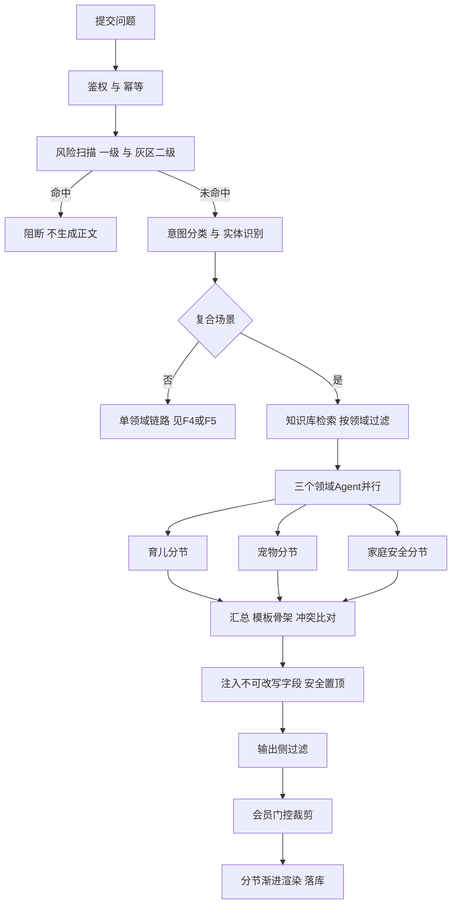

### F6.5 流程步骤

| 步骤 | 处理方 | 说明 |
|---|---|---|
| S1 | 确定性节点 | 鉴权、幂等、输入规范化（截断 2000 字、去混淆字符） |
| S2 | 风险控制服务 | 见 F8；纯输入侧，不读档案 |
| S3 | 编排器 | 意图分类（轻量模型）+ 实体识别；按 F6.3 规则表判定 |
| S4 | 编排器 | 检索：按领域过滤，向量召回 top-8 → 重排取 5；跨领域条目不得串用 |
| S5 | 三个领域 Agent | 并行执行，各自 1 次主力模型调用；超时 12 s；单侧失败不阻塞其余 |
| S6 | 服务端汇总 | 模板骨架 + 字段填充，**不调用 LLM**；按 `topic_key` 做冲突比对 |
| S7 | 服务端注入 | 安全提示、冲突标注、免责、AI 标识、转介提示共 5 类不可改写字段 |
| S8 | 输出侧过滤 | 敏感词 + 药名剂量模式；不可用则禁出正文 |
| S9 | 服务端 | 会员 block 裁剪、落库、写 token 用量与耗时 |

### F6.6 状态机（问答会话，唯一权威）

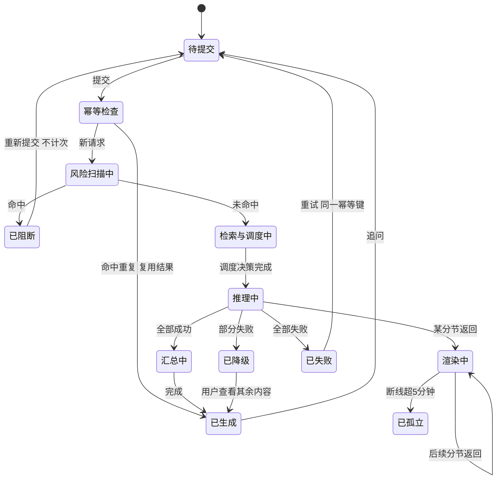

| 状态 | 含义 | 是否落库 | 是否计次 |
|---|---|---|---|
| 待提交 | 用户已输入未提交 | 否 | 否 |
| 幂等检查 | 校验 `client_request_id` | 否 | 否 |
| 风险扫描中 | 一级 + 灰区二级 | 否 | 否 |
| 已阻断 | 命中高危 | 是（脱敏） | **否** |
| 检索与调度中 | 意图 + 检索 | 否 | 否 |
| 推理中 / 渲染中 | Agent 并行与分节输出 | 是（增量） | 否 |
| 汇总中 | 模板填充 + 冲突比对 + 过滤 | 是 | 否 |
| 已生成 | 全部分节成功 | 是 | 是 |
| 已降级 | 任务结束但含失败分节 | 是 | 是（安全失败除外） |
| 已失败 | 全部失败或过滤不可用 | 是 | **否** |
| 已孤立 | 断线超 5 分钟未重连 | 是 | 否（不影响额度） |

### F6.7 边界与异常六查

| 类别 | 场景 | 期望行为 |
|---|---|---|
| 空态 | 用户进入综合问答但未输入 | 展示三个示例问题（育儿 / 宠物 / 交叉各一），不空屏 |
| 极值 | 问题同时涉及 5 个议题 | 仍只调度 3 个领域 Agent；超出部分在正文末尾提示「本次聚焦 3 个方向」 |
| 并发 | 同一用户第二个流式会话 | 返回 `409` 与 `retry_after`，不排队不创建 |
| 失败 | 两个领域 Agent 全部失败 | `status=failed`，兜底话术 + 稍后重试，不计次 |
| 失败 | 汇总节点失败 | 回退纯模板拼接，仍展示正文，不额外提示 |
| 权限 | 会话归属校验失败 | `403` + 审计，不返回任何分节 |
| 幂等 | 同一 `client_request_id` 重发 | 复用结果或接续未完成任务，不重复计次 |
| 极值 | 断线重连超过 5 分钟 | 标记 `orphaned`，仍落库可回看，不计入失败率 |

### F6.8 埋点

`qa_submit`（是否复合场景、入口类型）、`qa_orchestration_decision`（命中规则序号、意图、实体、决策依据）、`qa_section_render`（分节 key、到达顺序、耗时）、`qa_conflict_flagged`（topic_key、冲突类型）、`qa_agents_shown`（展开率）、`qa_degraded`（失败分节）、`qa_blocked_after_render`（已渲染后阻断）、`qa_orphaned`、`assessment_context_used`。

---

## F7 四象宝宝气质测评

> 对应需求说明：US-E1、US-E2、Q-06、Q-07、Q-08、Q-09、Q-39

### F7.1 目标

用一个**有趣但不宿命**的入口把用户带进来，用一套**可复现、可配置、可回滚**的计分规则给出四类倾向解读，并明确它不是心理测评。

### F7.2 用户故事与验收标准

| ID | 用户故事 | 优先级 |
|---|---|---|
| US-F7-01 | 作为家长，我希望测评入口说清「这不是心理测评」，以便我知道该怎么看结果 | M |
| US-F7-02 | 作为家长，我希望被打断后能接着填，不用重头再来 | M |
| US-F7-03 | 作为家长，我希望题目是具体生活场景，而不是抽象自评，以便答得准 | M |
| US-F7-04 | 作为家长，我希望报告告诉我「怎么养、怎么沟通」，而不只是一个类型标签 | M |
| US-F7-05 | 作为家长，我希望把报告存成图片分享给家人，但不要暴露孩子隐私 | M |
| US-F7-06 | 作为家长，我希望两次结果差异大时被提醒，而不是以为孩子变了 | P1 |
| US-F7-07 | 作为家长，我希望测评结果能帮到后续提问，也可以选择不让它参与 | P1 |
| US-F7-08 | 作为家长，我希望报告能归档到历史，以便以后对比 | M |

**验收标准**

| ID | 验收标准（Given / When / Then） |
|---|---|
| AC-F7-01-1 | Given 用户进入测评引导页，When 阅读，Then 必须同时展示三句声明：非心理测评、非宿命判定、不做科学测评宣称 |
| AC-F7-01-2 | Given 用户点击开始，When 首次作答，Then 展示预计题量与耗时（16 题，约 3–5 分钟） |
| AC-F7-02-1 | Given 用户作答到第 7 题退出，When 再次进入测评，Then 显示「继续填写」并直达第 7 题，已答内容保留 |
| AC-F7-02-2 | Given 断点数据已保存 90 天，When 用户进入，Then 保留有效；超过 90 天则清除并要求重新开始 |
| AC-F7-03-1 | Given 用户作答，When 展示题目，Then 单题单屏、5 点李克特式情境选择题、四个维度各 4 题，共 16 题 |
| AC-F7-03-2 | Given 用户选中某选项，When 切换下一题，Then 立即保存答案（不作答完再统一提交）；重复提交同一题不重复计分 |
| AC-F7-04-1 | Given 用户提交完成，When 计分，Then 维度均分 → 高 / 中 / 低三档（阈值 2.50 / 3.50），四象类型由 2 个主导维度交叉判定，**不输出唯一类型** |
| AC-F7-04-2 | Given 两个维度均分并列，When 判定，Then 按冻结的固定优先级取主导维度，结果可复现，不允许随机 |
| AC-F7-04-3 | Given 计分完成，When 生成报告，Then 报告必须包含六块：类型解读、4 维度分档、养育方式、沟通技巧、非宿命提示、免责与 AI 标识 |
| AC-F7-04-4 | Given 用户某维度全部漏答，When 计分，Then 该维度标记「数据不足」，报告不给出该维度分档，且不阻断其余维度出结论 |
| AC-F7-05-1 | Given 用户生成长图，When 渲染，Then 免责声明区占底部 ≥15% 且重复 ≥2 次，字号不低于下限，附短链或小程序码 |
| AC-F7-05-2 | Given 用户点击分享，When 预览，Then 默认使用插画头像替代孩子真实头像，并给出隐私提示 |
| AC-F7-05-3 | Given 长图生成完成，When 检查内容，Then 不得包含孩子昵称、出生日期、精确月龄、档案照片 |
| AC-F7-06-1 | Given 用户 30 天内重复测评且类型变化，When 生成报告，Then 报告顶部提示「结果仅反映近期行为倾向，短期波动属正常」 |
| AC-F7-06-2 | Given 两次结果一致，When 生成报告，Then 不展示波动提示（避免制造「确认感」） |
| AC-F7-07-1 | Given 用户已完成测评，When 进入问答，Then 测评结果可作为上下文；用户可在设置中关闭，关闭后调度层不读取测评字段 |
| AC-F7-08-1 | Given 报告已生成，When 用户进入历史，Then 可在「测评报告」分类下找到，且可再次查看与存图 |

### F7.3 详细流程

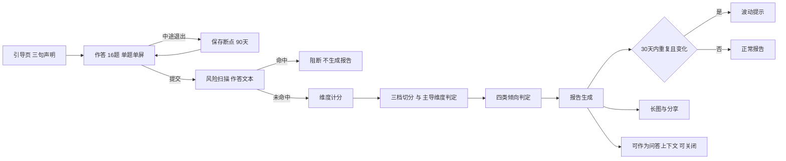

### F7.4 流程步骤

| 步骤 | 处理方 | 说明 |
|---|---|---|
| S1 | 前端 | 题目由服务端按题库版本下发，前端不硬编码题干与顺序 |
| S2 | 前端 + 服务端 | 作答即存（逐题上报），断点以服务端为准 |
| S3 | 风险控制服务 | 提交时对作答文本做一次风险扫描（开放题可能含自伤等表述） |
| S4 | 确定性计分服务 | 反向题反向计分；维度均分保留两位小数；阈值与并列规则从配置读取 |
| S5 | 服务端 | 四类判定按 6 格无序对映射，结果可复现；不引入随机 |
| S6 | 服务端 | 报告由模板 + 字段填充生成，不做 LLM 自由发挥；免责与 AI 标识固定注入 |
| S7 | 前端 | 长图在客户端渲染，渲染参数由服务端下发（占比、字号、二维码） |

### F7.5 状态机

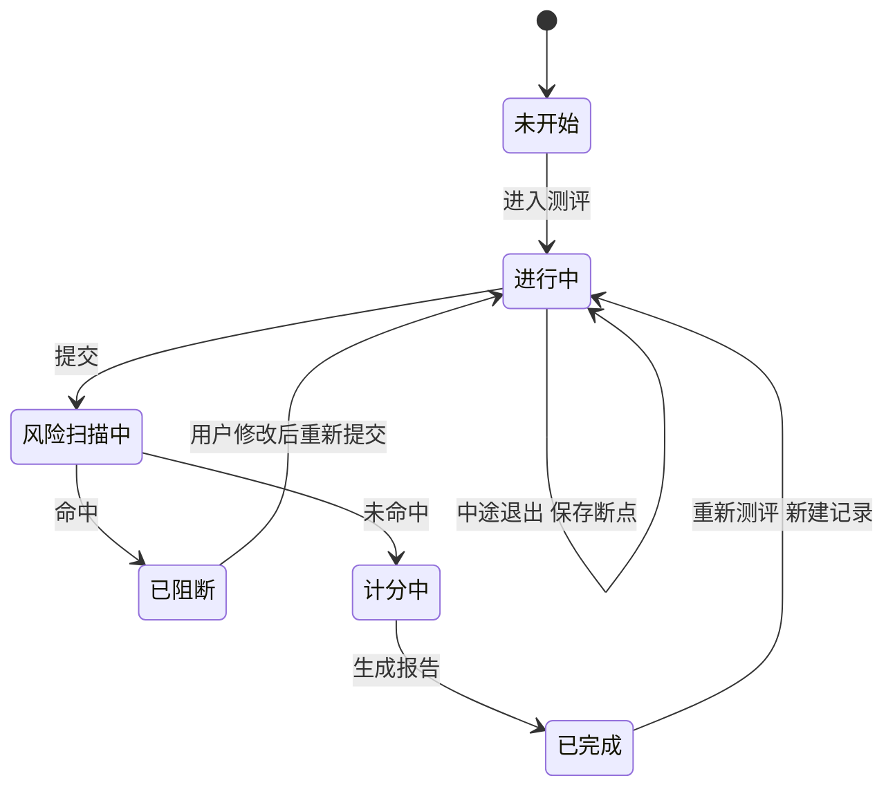

### F7.6 关键设计：计分与报告规格

| 项 | 规格 |
|---|---|
| 题量 | 16 题（4 维度 × 4 题），5 点李克特式情境选择题 |
| 维度 | 4 个（活动水平 / 规律性 / 趋近性 / 情绪强度），对外不使用心理学术语直译【待专家签字】 |
| 反向题 | 第 04 / 08 / 12 / 16 题反向计分 |
| 维度分 | 维度均分保留两位小数；缺答则该维度不计分并标记「数据不足」 |
| 三档阈值 | 低 < 2.50；中 2.50–3.50；高 > 3.50 |
| 主导维度 | 取均分最高者；并列按冻结优先级取，不随机 |
| 类型判定 | 两个主导维度交叉 → 四类倾向之一；**不输出唯一性格类型** |
| 报告区块 | 类型解读 / 4 维度分档 / 养育方式 / 沟通技巧 / 非宿命提示 / 免责与 AI 标识 |
| 长图规格 | 宽 750 px；免责区底部 ≥15% 且重复 ≥2 次；含小程序码；不含任何可识别儿童身份的信息 |
| 版本管理 | 题库带版本号；报告记录题目版本；支持回滚；版本升级不追溯改写历史报告 |

**报告六块的内容要求**

| 区块 | 必须写什么 | 禁止写什么 |
|---|---|---|
| 类型解读 | 该倾向的典型表现，用生活场景描述 | 「你的孩子就是……」「天生如此」 |
| 4 维度分档 | 每维度高 / 中 / 低 + 一句解释 | 精确分数排名、与其他孩子比较 |
| 养育方式 | 3–5 条可执行做法，含适用情境 | 训练课程推销、绝对化指令 |
| 沟通技巧 | 3–5 句可照说的示范话术 | 心理治疗建议 |
| 非宿命提示 | 明确说明会随成长变化 | 任何形式的终身判定 |
| 免责与 AI 标识 | 服务端注入，不可编辑 | — |

> **待专家签字**：维度名称、题目文本、并列优先级与四类命名以专家签署的《测评配置冻结表》为准（Q-08、Q-06b）。**机制可开发，内容与命名不得定稿。**

### F7.7 边界与异常六查

| 类别 | 场景 | 期望行为 |
|---|---|---|
| 空态 | 用户未答完就提交 | 不允许提交，定位到首个未答题并高亮 |
| 极值 | 全部选同一选项 | 允许提交，但报告需提示「作答高度一致，结果参考价值有限」【假设待验证】 |
| 并发 | 两台设备同时作答同一份测评 | 以服务端最后保存的答案为准，另一台提交时返回冲突提示 |
| 失败 | 计分服务异常 | 保留作答数据，提示「报告生成失败，可稍后重试」，不重复扣次数（测评不计次） |
| 失败 | 报告模板缺失 | 回退基础模板（类型 + 四维度分档），不返回空白页 |
| 权限 | 用他人 `assessment_id` 查看报告 | `403` + 审计 |
| 幂等 | 重复点击提交 | 同一测评记录只生成一份报告，重复提交返回已有报告 |
| 极值 | 题库版本升级后打开旧断点 | 旧断点作废，提示「题库已更新，请重新作答」，不混用版本计分 |

### F7.8 埋点

`assessment_start`、`assessment_answer`（题号、维度、耗时）、`assessment_exit_save`、`assessment_resume`、`assessment_complete`（耗时、类型、是否断点续填）、`assessment_blocked`、`report_view`、`report_save_image`、`report_share`（渠道）、`report_link_copy`、`assessment_retake`、`assessment_context_toggle`。

---

## F8 风险控制与危机干预

> 对应需求说明：US-L1、NFR-1.1、NFR-1.2、Q-12、Q-31、Q-43

### F8.1 目标

在生成任何内容之前拦住真正危险的问题，拦住之后**一个字都不生成**，只把人推向能救人的地方；同时给正常用户留一条「我被误拦了」的申诉通道。

### F8.2 用户故事与验收标准

| ID | 用户故事 | 优先级 |
|---|---|---|
| US-F8-01 | 作为用户，我希望真正危险的问题不要给我任何「看起来像建议」的内容，以便不被误导 | M |
| US-F8-02 | 作为情绪崩溃的家长，我希望立刻看到能打的电话，而不是一段安慰文字 | M |
| US-F8-03 | 作为正常用户，我希望被误拦时能申诉，以便不被一次误判堵死 | P1 |
| US-F8-04 | 作为运营，我希望能看到拦截了什么、误报多少，以便持续调优 | M |
| US-F8-05 | 作为合规负责人，我希望高危事件有登记、有复核、有留痕，以便应对检查 | M |
| US-F8-06 | 作为用户，我希望拦截页面不评价我、不说教，只告诉我下一步怎么办 | M |
| US-F8-07 | 作为用户，我希望申诉期间不能改问题原文，但可以补充说明 | P1 |
| US-F8-08 | 作为产品，我希望风险服务挂掉时宁可不出内容，以便不出事故 | M |
| US-F8-09 | 作为用户，我希望语音说出的高危内容也被同样拦住，以便没有绕过口子 | M |

**验收标准**

| ID | 验收标准（Given / When / Then） |
|---|---|
| AC-F8-01-1 | Given 用户输入命中一级词库或正则，When 判定，Then 立即阻断，**响应体正文为空**，只返回类别（脱敏）、引导文案 ID 与渠道卡片 |
| AC-F8-01-2 | Given 输入未命中一级规则，When 进入灰区，Then 调用二级语义模型；置信度 >0.8 直接拦截，0.5–0.8 拦截并给温和引导，<0.5 放行并打标 |
| AC-F8-01-3 | Given 二级语义模型超时，When 判定，Then **按命中处理**（保守），不放行 |
| AC-F8-02-1 | Given 命中硬类别，When 展示拦截页，Then 展示渠道卡片：渠道名 + 号码 + 一键拨号 / 复制 + 建议话术；儿童自伤或虐待类必须含紧急报警与未成年人保护渠道 |
| AC-F8-02-2 | Given 渠道卡片渲染，When 检查，Then 任一号码必须来自后台渠道清单；清单无内容时展示占位与「渠道信息维护中」，**不得编造号码** |
| AC-F8-02-3 | Given 命中硬类别，When 用户查看拦截页，Then 不提供「继续提问」入口，只提供渠道与申诉说明（申诉亦不放行硬类别） |
| AC-F8-03-1 | Given 用户认为被误拦，When 提交申诉，Then 生成受理编号，展示预计复核时限（24 小时）与状态 |
| AC-F8-03-2 | Given 申诉已提交，When 用户等待，Then 页面不显示「已放行」，直到复核结论返回 |
| AC-F8-03-3 | Given 复核判定为误报，When 结果返回，Then 提示「该问题已放行，请在 24 小时内重新提交」，重新提交仍会重新走风险扫描 |
| AC-F8-03-4 | Given 同一会话同一问题申诉 2 次，When 第 3 次提交，Then 不进入人工队列，只展示渠道清单 |
| AC-F8-04-1 | Given 风险服务运行，When 每次判定，Then 写入高风险事件表（命中类别、置信度、判定层级、处置结果、时间）与埋点 |
| AC-F8-05-1 | Given 命中硬类别，When 事件写入，Then 进入值班复核队列，复核结果与处理动作留痕 ≥3 年 |
| AC-F8-06-1 | Given 拦截页文案，When 展示，Then 不得出现评判性表述（如「你不应该」「这是错误的」），只陈述「这类问题本产品无法回答」并给下一步 |
| AC-F8-07-1 | Given 用户提交申诉，When 填写，Then 原问题不可编辑，可另填补充说明（≤500 字），补充说明同样过风险扫描 |
| AC-F8-08-1 | Given 风险扫描服务不可用，When 用户提交提问，Then **禁出正文**，展示静态故障页与渠道入口，不扣额度，`status=failed` |
| AC-F8-09-1 | Given 用户用语音输入高危内容，When 转写完成，Then 转写文本必须进入同一风险流水线；命中处置与文字输入完全一致 |

### F8.3 详细流程

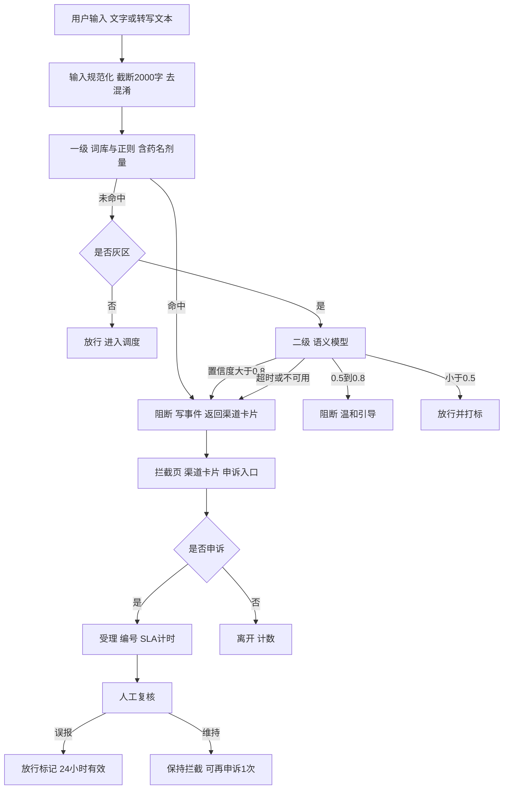

### F8.4 流程步骤

| 步骤 | 处理方 | 说明 |
|---|---|---|
| S1 | 确定性节点 | 输入规范化：长度截断 2000 字、去除混淆字符与变体字 |
| S2 | 一级规则引擎 | 词库 + 正则（含药名 + 剂量模式），毫秒级；预算 ≤300 ms |
| S3 | 二级语义模型 | **仅灰区触发**，输出置信度；预算 ≤800 ms；超时按命中 |
| S4 | 风险策略服务 | 阈值配置、放行打标、类别映射、误报回流 |
| S5 | 事件服务 | 写高风险事件表；硬类别进值班复核队列 |
| S6 | 申诉工单服务 | 受理、状态机、SLA 计时、回执 |
| S7 | 人工复核后台 | 值班复核、抽检、处置留痕（PA-09） |

### F8.5 关键设计：上线首批高危类别

| # | 高危类别 | 等级 | 处置 |
|---|---|---|---|
| 1 | 儿童虐待 | **硬类别** | 拦截 + 紧急报警与未成年人保护渠道；不提供继续提问出口 |
| 2 | 孩子自伤 / 自杀想法 | **硬类别** | 拦截 + 心理援助渠道；不提供继续提问出口 |
| 3 | 幼儿持续高烧惊厥 | **硬类别** | 拦截 + 就近儿科急诊引导 |
| 4 | 儿童被动物抓咬伤 / 皮肤破损出血 | **硬类别** | 拦截 + 就近犬伤处置门诊 / 疾控中心引导 |
| 5 | 严重抑郁 | 软类别 | 拦截 + 心理援助渠道；复核通过可放行 |
| 6 | 宠物中毒 / 大出血 | 软类别 | 拦截 + 就近宠物医院引导；复核通过可放行 |

> **为什么第 4 类必须是硬类别、且属「拦截 + 就医引导」而非「安全提示」**：动物致伤涉及狂犬病暴露后处置，狂犬病一旦发病致死率接近 100%，而暴露分级（I/II/III 级）与是否需要疫苗、免疫球蛋白**必须由专业门诊判断**。AI 不得替代，更不得给出「自行冲洗即可」这类可能延误处置的表述。

**已展示内容被阻断时的覆盖规则（合规关键）**

| 场景 | 规则 |
|---|---|
| 生成前命中 | 只有 `blocked` 帧，无任何增量；**实现一律执行 `clearAll()`，不做分支判断** |
| 流式中命中（输出侧过滤或二次判定） | 服务端发 `blocked`；前端**清空该会话已渲染的全部正文**，替换为拦截页，不保留复制入口 |
| 家庭安全 Agent 失败 | 服务端发 `degraded` 且 `failed_sections=["safety"]`；前端隐藏所有正文分节，只显示静态安全模板 |
| 用户已截图或复制 | 产品无法回收；因此在 `blocked` 文案中不引用已生成内容，并计入风险登记册（R-13） |

### F8.6 状态机（拦截与申诉，唯一权威）

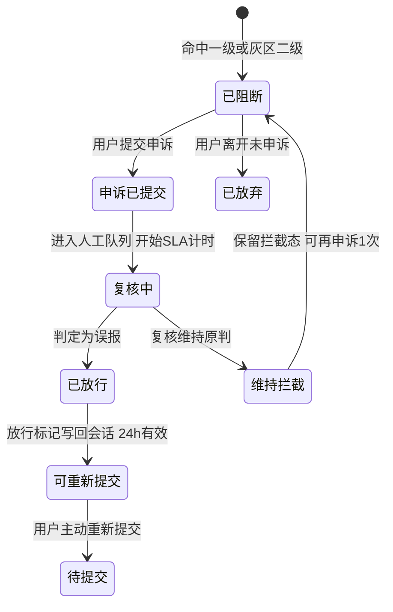

| 问题 | 结论 |
|---|---|
| 申诉后是否立即放行 | **否**。立即放行等于把风险判定的最终决定权交给用户 |
| 复核通过后是否自动重新生成 | **否**。由用户主动重提，避免消耗额度且用户可能已离开 |
| 复核期间能否改写问题 | 不能改原文，只能补充说明（≤500 字），补充说明不进问答链路 |
| 硬类别是否可能自动放行 | **不存在**。复核只能「维持拦截」或「转人工线下引导」 |
| 申诉文本是否再次扫描 | **是**，同一套流水线；命中硬类别则标记「不予受理」并升级高风险事件 |
| 申诉是否计次 | **否**。申诉与放行都不产生模型调用 |

### F8.7 边界与异常六查

| 类别 | 场景 | 期望行为 |
|---|---|---|
| 空态 | 渠道清单为空（新环境未配置） | 展示占位与「渠道信息维护中」，严禁前端硬编码号码 |
| 极值 | 输入 2000 字且含大量变体字 | 规范化后仍超限则截断；变体字归一化后再匹配词库 |
| 并发 | 同一用户连续提交 10 条高危输入 | 全部阻断并计数；同一设备 1 小时内超阈值触发风控与人工关注 |
| 失败 | 一级规则库加载失败 | **禁出正文**（比二级更保守），展示故障页 |
| 失败 | 事件表写入失败 | 不影响阻断结果，但必须重试并告警；不允许「因写日志失败而放行」 |
| 权限 | 后台非授权角色查看事件详情 | 拒绝并审计；客服仅可见软类别申诉 |
| 幂等 | 同一申诉重复提交 | 复用已有工单，不重复计时 |
| 极值 | 复核超 24 小时未处理 | 告警升级值班；用户侧显示「复核中，已超预计时限，正在加急」 |

### F8.8 埋点

`qa_risk_block`（类别脱敏、层级、置信度档）、`qa_risk_block_followup`（离开 / 转向其他问题 / 重复提交 / 点击渠道 / 提交申诉）、`risk_channel_click`（渠道类型）、`appeal_submit`、`appeal_result`（耗时、结论）、`risk_service_unavailable`、`risk_event_created`、`risk_review_done`（后台）。

---

## F9 会员、支付与权益

> 对应需求说明：US-J1、US-J2、Q-23、Q-24、Q-25

### F9.1 目标

让愿意付费的用户在三步内完成购买，让每一笔钱都能对上账，让「什么算一次、什么不算」只有一种解释。

### F9.2 用户故事与验收标准

| ID | 用户故事 | 优先级 |
|---|---|---|
| US-F9-01 | 作为用户，我希望清楚知道会员到底多给什么，以便决定买不买 | M |
| US-F9-02 | 作为 Android 用户，我希望直接在小程序内完成购买，以便不跳来跳去 | M |
| US-F9-03 | 作为 iOS 用户，我希望被告知为什么不能买，而不是点了没反应 | M |
| US-F9-04 | 作为用户，我希望知道这次提问算不算次数，以便不被莫名扣掉 | M |
| US-F9-05 | 作为用户，我希望支付出问题时能查到订单状态，而不是钱没了没记录 | M |
| US-F9-06 | 作为用户，我希望购买前就知道退款规则，以便不后悔 | M |
| US-F9-07 | 作为用户，我希望会员到期后内容还能看，只是不能再生成，以便不突然清空 | M |
| US-F9-08 | 作为用户，我希望只为需要的专题付费，以便不必买整月会员 | M |
| US-F9-09 | 作为用户，我希望知道会员是否包含专题包，以便不重复花钱 | M |

**验收标准**

| ID | 验收标准（Given / When / Then） |
|---|---|
| AC-F9-01-1 | Given 用户进入权益页，When 查看，Then 展示权益对照表（免费 vs 会员），每项权益必须写明具体内容与限制，不得只写「更多」 |
| AC-F9-01-2 | Given 权益页展示，When 检查，Then 必须包含四项会员权益：深度四象完整养育方案、月度养育计划、宠物长期饲养规划、家庭复合场景完整方案 |
| AC-F9-02-1 | Given Android 用户，When 点击购买，Then 拉起微信支付，价格从服务端商品配置读取（后台改价即生效，无需发版） |
| AC-F9-03-1 | Given iOS 用户，When 进入权益页，Then **不展示购买入口与价格**，展示「当前设备暂不支持购买，可在 Android 设备开通会员」 |
| AC-F9-04-1 | Given 用户正常生成一次问答，When 完成，Then 计 1 次；失败、被拦截、重试（同一 `client_request_id`）、缓存命中、申诉提交与放行、测评、语音识别失败，均**不计次** |
| AC-F9-04-2 | Given 免费用户当日第 4 次提问，When 提交，Then 拒绝并展示恢复时间（次日 0 点）与升级入口，不产生模型调用 |
| AC-F9-04-3 | Given 免费用户，When 查看某分节为会员内容，Then 展示该分节标题与一句摘要 + 升级入口，正文不下发 |
| AC-F9-05-1 | Given 支付回调成功，When 入账，Then 同一 `out_trade_no` 与 `transaction_id` 唯一索引生效，重复回调返回成功但不重复发放权益 |
| AC-F9-05-2 | Given 回调丢失，When T+1 对账任务执行，Then 拉取网关账单补单，补单幂等；用户侧订单显示「支付确认中，权益将自动生效」 |
| AC-F9-05-3 | Given 对账发现差异，When 任务完成，Then 生成差异单、告警并进入人工处理队列，不静默修单 |
| AC-F9-06-1 | Given 用户点击购买，When 未勾选「我已阅读并同意《虚拟内容服务说明》」，Then 购买按钮置灰；勾选后写入 `contract_confirm_at` |
| AC-F9-06-2 | Given 用户购买前，When 查看，Then 必须可见退款政策全文链接、本次解锁的具体内容类型、到期后转只读的说明 |
| AC-F9-07-1 | Given 会员到期，When 用户打开历史，Then 深度内容保留只读，不删除；不再生成新方案并提示续费 |
| AC-F9-08-1 | Given Android 用户，When 在专题列表点击购买某专题，Then 按单价（9.9–29.9 元/套）下单，支付成功后立即解锁该专题全部内容 |
| AC-F9-08-2 | Given 用户已购买某专题，When 再次进入该专题页，Then 显示「已解锁」并可直接阅读，不重复收费 |
| AC-F9-08-3 | Given 会员用户，When 浏览专题列表，Then 专题包**单独计费**，会员权益不含专题包（本版口径，Q-25）；页面必须明示这一点 |
| AC-F9-09-1 | Given 用户在权益页，When 查看权益表，Then 必须有一行明确说明「会员不包含专题内容包」，避免误解 |

### F9.3 详细流程

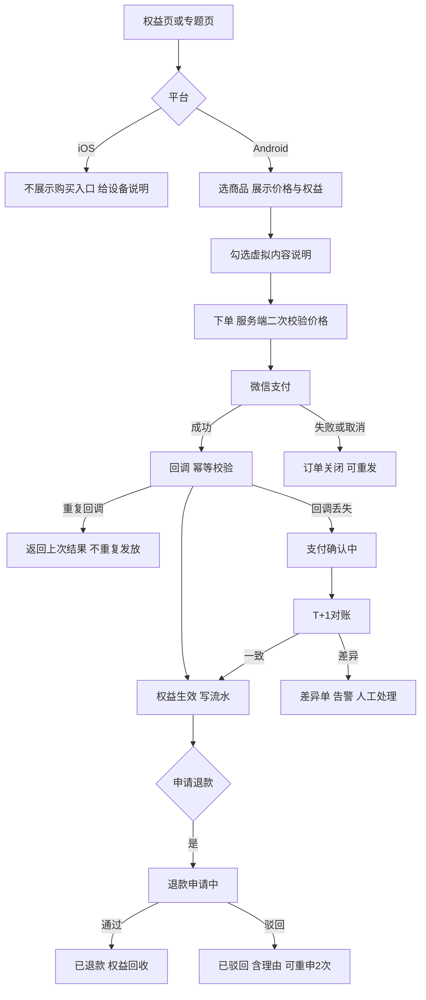

### F9.4 流程步骤

| 步骤 | 处理方 | 说明 |
|---|---|---|
| S1 | 前端 | 按平台分支渲染；iOS 端不渲染购买按钮与价格 |
| S2 | 服务端 | 下单前二次校验价格与商品状态，不一致则中止并提示 |
| S3 | 支付网关 | 拉起微信支付；`out_trade_no` 由服务端生成，全局唯一 |
| S4 | 回调服务 | 以 `out_trade_no` 幂等；验签失败直接拒绝并告警 |
| S5 | 权益服务 | 发放会员或专题权益（到期时间、权益位、专题 ID 集合），写流水；失败进入补发任务 |
| S6 | 对账服务 | T+1 拉取账单，差异单进入人工队列 |
| S7 | 售后 | 退款申请走工单，状态与理由对用户可见 |

### F9.5 状态机（订单）

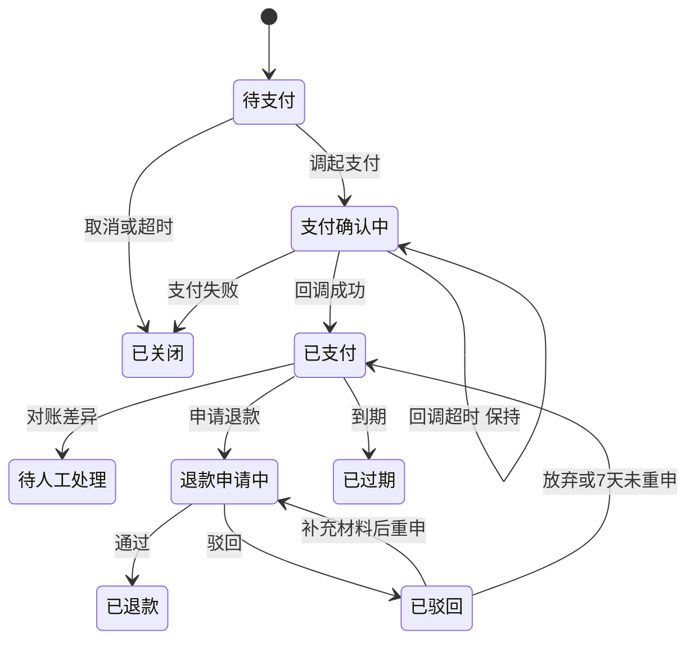

> 注：`已驳回` 必须有出边（重申 / 放弃），否则 UI 无法表达「被驳回后还能做什么」。同一订单最多重申 2 次，第 3 次起只显示客服入口。

### F9.6 关键设计：商品、权益与计次

**商品结构**

| 层级 | 内容 | 价格 | 商品 ID 规则 |
|---|---|---|---|
| 免费 | 基础问答（每日额度）、单次简易测评、基础饲养清单 | 免费 | — |
| 会员 | 深度四象完整养育方案、月度养育计划、宠物长期饲养规划、家庭复合场景完整方案 | 19.9 元/月（单次购买，不自动续费） | `SUB_MONTH_01` |
| 专题包 | 幼儿睡眠引导专题、猫狗行为矫正专题（首批 2 个） | 9.9–29.9 元/套 | `TOPIC_<领域>_<序号>` |
| 机构工作台 | 早教机构、宠物医院 | **不在本版**（NG-7） | — |

**权益矩阵**

| 能力 | 免费 | 会员 | 专题包 |
|---|---|---|---|
| 单领域问答 | 3 次/日 | 不限 | 不适用 |
| 家庭综合问答 | 3 次/日（共用额度） | 不限 | 不适用 |
| 气质测评 + 报告 | ✅ 完整 | ✅ 完整 | 不适用 |
| 报告长图与分享 | ✅ | ✅ | 不适用 |
| 深度四象完整养育方案 | 仅预览 | ✅ 全文 | 不含 |
| 月度养育计划 | 仅预览 | ✅ 按月滚动生成 | 不含 |
| 宠物长期饲养规划（3 个月滚动） | 仅基础清单 | ✅ 全文 | 不含 |
| 家庭复合场景完整方案 | 三节齐全，深度段落裁剪 | ✅ 全文 | 不含 |
| 专题内容包 | 仅试读首节 | 仅试读首节（不含） | ✅ 所购专题全文 |

**额度计次规则（唯一权威，其他章节一律引用本表）**

| 计次 | 不计次 |
|---|---|
| 正常生成的问答（单领域 / 复合）；误报申诉放行后**重新提交** | 失败、被风险拦截、重试（同一 `client_request_id`）、**缓存命中**、申诉提交与放行、测评、报告查看与存图、语音识别失败 |

> 缓存命中不计次（未产生模型成本），但仍需过风险扫描与内容门控。

### F9.7 边界与异常六查

| 类别 | 场景 | 期望行为 |
|---|---|---|
| 空态 | 用户无任何订单 | 订单页展示空态与「查看权益」入口，不展示空白列表 |
| 极值 | 同一用户 10 分钟内两笔相同商品成功支付 | 自动对第二笔发起退款，权益只发一次，用户可见「重复支付已自动退款」 |
| 并发 | 同一订单并发多次点击支付 | 服务端防重（订单状态 + 幂等键），只允许一个支付中请求 |
| 失败 | 支付成功但权益写入失败 | 补发任务（按 `transaction_id` 去重）；24 小时内未生效给客服入口 |
| 失败 | 服务故障导致付费内容不可用 | 不计次、不扣权益，模型成本由平台承担；展示可重试 |
| 权限 | 用户 A 查用户 B 的订单 | `403` + 审计 |
| 幂等 | 回调重复推送 10 次 | 权益仅发一次，流水仅一条，重复请求返回成功 |
| 极值 | 未成年人误购申诉 | 走人工售后，核实后全额退款并回收权益 |
| 极值 | 会员期内再买同一会员 | 到期时间顺延，不重复开通；页面展示顺延后的到期日 |

### F9.8 埋点

`paywall_view`（来源页）、`plan_select`、`topic_view`（专题 ID）、`order_create`（商品类型：会员 / 专题）、`pay_success`、`pay_fail`（原因、平台）、`pay_confirming`、`reconcile_diff`、`refund_apply`、`refund_result`、`quota_exhausted`、`quota_consume`（是否计次、是否缓存命中）、`membership_expired`、`topic_unlock`。

---

## F10 历史记录、报告与反馈

> 对应需求说明：US-H1、US-N1、US-K3、Q-26、Q-28

### F10.1 目标

让用户能找回过去的回答与报告、让问题能被反馈、让违规内容能被举报并看到处置结果。

### F10.2 用户故事与验收标准

| ID | 用户故事 | 优先级 |
|---|---|---|
| US-F10-01 | 作为用户，我希望按档案和类型筛选历史，以便快速找到那次回答 | M |
| US-F10-02 | 作为用户，我希望会员到期后历史还能看，以便不丢内容 | M |
| US-F10-03 | 作为用户，我希望回答有问题时能直接反馈，以便被修正 | M |
| US-F10-04 | 作为用户，我希望举报后能收到处置结果，以便知道有没有用 | M |
| US-F10-05 | 作为用户，我希望内容被更新时被告知，而不是被悄悄改掉 | M |
| US-F10-06 | 作为用户，我希望在换手机后还能看到历史，以便不丢记录 | P1 |
| US-F10-07 | 作为用户，我希望反馈时能附截图，以便说明问题 | M |

**验收标准**

| ID | 验收标准（Given / When / Then） |
|---|---|
| AC-F10-01-1 | Given 用户进入历史，When 加载，Then 按时间倒序、每页 20 条、支持按档案与类型（问答 / 测评报告）筛选 |
| AC-F10-01-2 | Given 用户无历史，When 进入，Then 展示空态与「去提问」入口 |
| AC-F10-01-3 | Given 用户切换筛选条件，When 条件变化，Then 列表刷新并重置分页，筛选条件在本次会话内保持 |
| AC-F10-02-1 | Given 会员已到期，When 打开历史详情，Then 内容只读可看，不再提供「重新生成」，并提示续费 |
| AC-F10-02-2 | Given 历史详情为降级态生成，When 打开，Then 保留当时的降级标记与缺失分节说明，不重新生成也不隐藏 |
| AC-F10-03-1 | Given 用户在回答页提交反馈，When 提交成功，Then 返回受理编号，可关联当前会话；文字 ≤500 字 |
| AC-F10-03-2 | Given 用户附图片反馈，When 提交，Then 最多 3 张，逐张走内容安全检测；检测中图片显示占位与「检测中」，不得直接展示 |
| AC-F10-03-3 | Given 反馈已受理，When 72 小时内，Then 至少给出一次状态回执（已受理 / 处理中 / 已处理） |
| AC-F10-04-1 | Given 用户举报内容，When 提交，Then 分类必选（违法违规 / 医疗误导 / 有害未成年人 / 其他），返回受理编号与处置时限 |
| AC-F10-04-2 | Given 举报涉及未成年人，When 受理，Then 单列标记并适用更短处置时限【待确认具体时效】 |
| AC-F10-04-3 | Given 举报已处置，When 用户查看，Then 可见结论（驳回 / 已下架 / 已上报）与简要理由，不暴露处置人信息 |
| AC-F10-05-1 | Given 某知识库条目已下架，When 用户回看引用它的历史回答，Then 顶部提示「该内容已更新 / 已下架，请以最新建议为准」，**不追溯改写历史正文** |
| AC-F10-06-1 | Given 用户更换设备并登录同一微信账号，When 进入历史，Then 历史记录完整可见（以账号为边界） |
| AC-F10-07-1 | Given 用户提交反馈，When 未填写文字但上传了图片，Then 允许提交（文字与图片至少一项） |

### F10.3 详细流程

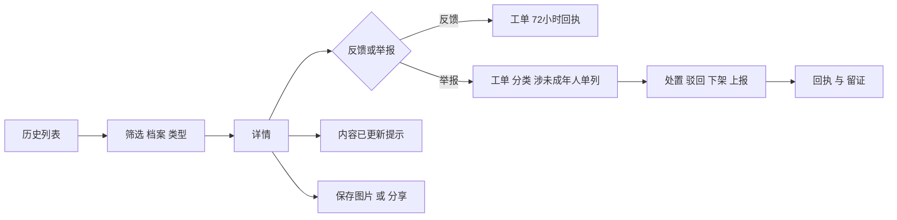

### F10.4 流程步骤

| 步骤 | 处理方 | 说明 |
|---|---|---|
| S1 | 前端 | 列表分页拉取，滚动加载；筛选条件作为查询参数，不做前端过滤 |
| S2 | 服务端 | 历史数据按 `user_id` 归属过滤，联表取档案脱敏标识与内容类型 |
| S3 | 服务端 | 报告存图由客户端渲染，参数由服务端下发（同 F7 长图规格） |
| S4 | 工单服务 | 反馈与举报分别建单，分类、SLA、处置动作独立记录 |
| S5 | 内容安全 | 反馈图片先送检，未通过不展示并提示重新上传 |
| S6 | 运营 | 处置后写回执，涉及内容下架的同时触发 F12.5 追溯 |

### F10.5 边界与异常六查

| 类别 | 场景 | 期望行为 |
|---|---|---|
| 空态 | 无历史 / 无反馈 / 无举报 | 均需独立空态文案与下一步入口 |
| 极值 | 单用户历史超 5,000 条 | 分页可翻，超过上限按时间归档，不影响最近记录 |
| 并发 | 同一会话同时提交反馈与举报 | 允许，生成两个独立工单 |
| 失败 | 图片送检服务不可用 | 反馈仍可提交，图片标记「检测中」，不得直接展示 |
| 权限 | 用户查看他人历史 | `403` + 审计 |
| 幂等 | 重复提交同一举报 | 5 分钟内相同对象相同分类去重，返回已有工单 |
| 极值 | 反馈内容含高危信息 | 走 F8 风险扫描，命中则转高风险事件 |

### F10.6 埋点

`history_view`（筛选条件）、`history_detail_view`、`content_updated_notice_shown`、`feedback_submit`（是否关联会话、图片数）、`feedback_receipt`（耗时）、`content_report`（分类、是否涉未成年人）、`report_result_view`、`report_save_image`、`report_share`。

---

## F11 个人中心与设置

> 对应需求说明：US-I1、Q-28

### F11.1 目标

让用户在一个地方管理「我的孩子和宠物、我的订阅、我的协议、我的账号」，不用在多个入口之间找。

### F11.2 用户故事与验收标准

| ID | 用户故事 | 优先级 |
|---|---|---|
| US-F11-01 | 作为用户，我希望在一个页面看到所有档案入口，以便集中管理 | M |
| US-F11-02 | 作为用户，我希望查看会员状态与订单记录，以便知道自己买了什么 | M |
| US-F11-03 | 作为用户，我希望在这里找到反馈入口，以便有问题能说 | M |
| US-F11-04 | 作为用户，我希望随时查看协议与隐私文件，以便知情 | M |
| US-F11-05 | 作为用户，我希望在这里注销账号，并清楚后果 | M |
| US-F11-06 | 作为用户，我希望控制测评结果是否参与问答，以便保护隐私 | P1 |

**验收标准**

| ID | 验收标准（Given / When / Then） |
|---|---|
| AC-F11-01-1 | Given 用户进入个人中心，When 渲染完成，Then 依次展示六个区块：档案管理、会员与订单、反馈与举报、协议与隐私、设置、账号与安全 |
| AC-F11-01-2 | Given 档案管理区块，When 查看，Then 分别列出儿童档案与宠物档案，含昵称 / 物种、月龄或年龄、当前选中标记，可进入编辑或新增 |
| AC-F11-02-1 | Given 会员与订单区块，When 查看，Then 展示会员状态（未开通 / 有效期至某日）、订单入口、已购专题列表 |
| AC-F11-02-2 | Given 用户未开通会员，When 查看该区块，Then 展示「开通会员」入口与一句权益说明，不展示空订单列表 |
| AC-F11-03-1 | Given 用户点击反馈入口，When 进入，Then 可直接提交文字与图片反馈，并默认不关联任何会话（可选择关联） |
| AC-F11-04-1 | Given 协议与隐私区块，When 查看，Then 可打开《用户协议》《隐私保护指引》《第三方 SDK 与共享清单》《免责声明》，并可查看当前协议版本号 |
| AC-F11-05-1 | Given 用户点击「注销账号」，When 进入，Then 必须依次展示：后果说明 → 二次确认 → 7 天冷静期；冷静期内可撤销 |
| AC-F11-06-1 | Given 用户关闭「测评结果参与问答」，When 再次提问，Then 调度层不读取测评字段，回答中不出现类型名称 |
| AC-F11-06-2 | Given 用户重启小程序，When 进入设置页，Then 该开关状态与服务端一致，不因本地缓存丢失而重置 |

### F11.3 详细流程

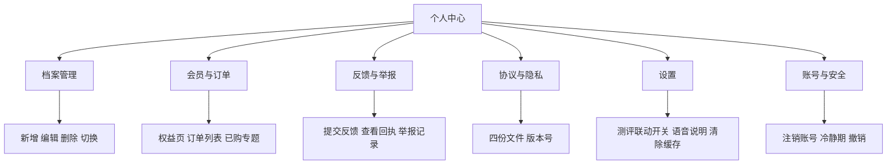

### F11.4 流程步骤

| 步骤 | 处理方 | 说明 |
|---|---|---|
| S1 | 前端 | 个人中心为聚合页，一次拉取档案数量、会员态、待处理工单数 |
| S2 | 服务端 | 所有子入口均做归属校验；未登录态仅展示协议入口 |
| S3 | 服务端 | 设置项（测评联动）落库到用户偏好表，不依赖本地存储 |
| S4 | 服务端 | 注销走独立工单，冷静期内账号可登录但不可提问 |

### F11.5 边界与异常六查

| 类别 | 场景 | 期望行为 |
|---|---|---|
| 空态 | 无档案 / 无订单 / 无工单 | 各区块独立空态 + 下一步入口，不隐藏区块 |
| 极值 | 档案数量达上限 | 新增按钮置灰并提示上限与会员权益 |
| 并发 | 两端同时切换当前档案 | 以服务端最后一次写入为准，另一端下次进入时同步 |
| 失败 | 会员态接口失败 | 展示「状态获取失败，点击重试」，不默认展示未开通 |
| 权限 | 未登录访问个人中心 | 跳转登录，不展示任何用户数据 |
| 幂等 | 重复点击注销 | 复用已有注销工单，不重复进入冷静期 |

### F11.6 埋点

`profile_center_view`、`settings_view`、`assessment_context_toggle`（开 / 关）、`agreement_view`（文档类型、版本）、`account_delete_start` / `account_delete_cancel` / `account_delete_done`、`my_orders_view`、`my_topics_view`。

---

## F12 后台管理与运营

> 对应需求说明：US-K1、US-K2、US-K3、US-K4、Q-10、Q-13、Q-14、Q-27、Q-34

### F12.1 目标

让内容团队能在不写代码的前提下维护知识库、题库、词库、渠道清单与开关；让运营能看清每一次多 Agent 调用；让权重调整这件事有定义、有留痕、可回滚。

### F12.2 用户故事与验收标准

| ID | 用户故事 | 优先级 |
|---|---|---|
| US-F12-01 | 作为内容运营，我希望五类知识资产都能维护，以便覆盖全部内容形态 | M |
| US-F12-02 | 作为内容运营，我希望条目能走「提交—审核—上架」的工单，以便质量可控 | M |
| US-F12-03 | 作为内容运营，我希望条目能版本回滚，以便改错能退回去 | M |
| US-F12-04 | 作为运营，我希望下架条目后能看到影响了哪些历史回答，以便决定怎么处置 | M |
| US-F12-05 | 作为运营，我希望维护高危词库与阈值，以便拦截能持续调优 | M |
| US-F12-06 | 作为运营，我希望查看每一次多 Agent 调用的输入、输出与耗时，以便定位问题 | M |
| US-F12-07 | 作为运营，我希望调整 Agent 权重，以便优化协同结果质量 | M |
| US-F12-08 | 作为客服，我希望处理反馈与举报时有完整上下文，以便判断 | M |
| US-F12-09 | 作为超管，我希望紧急下线某个入口，以便出事时能立刻止血 | M |
| US-F12-10 | 作为法务，我希望所有敏感操作都有审计，以便应对检查 | M |

**验收标准**

| ID | 验收标准（Given / When / Then） |
|---|---|
| AC-F12-01-1 | Given 运营进入知识库，When 查看分类，Then 必须包含五类：育儿知识库、宠物知识库、气质测评题库、高危风险词库、敏感词库；每类独立列表与检索 |
| AC-F12-01-2 | Given 运营编辑测评题库，When 保存，Then 可维护题目、选项、所属维度、是否反向题、排序；题库带版本号，发布需专家审核 |
| AC-F12-02-1 | Given 运营提交条目，When 提交，Then 生成审核工单，状态为「待审核」，条目不可上架 |
| AC-F12-02-2 | Given 专家审核，When 通过，Then 条目上架、版本号 +1、相关缓存失效；驳回则记录理由且条目不可上架 |
| AC-F12-03-1 | Given 条目已上架且存在历史版本，When 运营回滚，Then 内容恢复到指定版本并生成新版本记录（不删除历史），操作留痕 |
| AC-F12-04-1 | Given 条目被下架，When 触发追溯，Then 1 个工作日内按 `kb_id` 反查引用的问答与报告，产出受影响清单 |
| AC-F12-04-2 | Given 受影响清单产出，When 分级处置，Then 按 A（无实质影响，不改）/ B（追加「内容已更新」提示）/ C（标记「该内容已下架」）执行，7 个工作日内闭环 |
| AC-F12-05-1 | Given 运营修改词库或阈值，When 保存，Then 必须填写原因并展示影响面（涉及条目数），变更前后值写入审计 |
| AC-F12-06-1 | Given 运营打开 Agent 调用日志，When 查看详情，Then 可还原：输入摘要、参与 Agent、各 Agent 输出、汇总结果、耗时、是否命中风险词、是否冲突标注、命中意图、引用 kb_id、权重版本 |
| AC-F12-06-2 | Given 日志列表，When 筛选，Then 支持按时间范围、Agent、是否命中风险、是否冲突、是否降级组合筛选，分页 ≤100 条/页 |
| AC-F12-06-3 | Given 日志展示，When 检查，Then 用户问题原文与档案敏感字段必须脱敏；无「查看明文」入口（明文需独立授权并留痕） |
| AC-F12-07-1 | Given 超管调整权重，When 保存，Then 展示新旧值 diff 并要求填写原因；**新权重在下一轮请求生效，当轮不生效** |
| AC-F12-07-2 | Given 权重已变更，When 查看历史，Then 可见变更记录与一键回滚；回滚同样下一轮生效 |
| AC-F12-07-3 | Given 权重配置，When 校验，Then 仅对 `advice` 类内容生效；**家庭安全分节不受权重影响，始终置顶**；单领域问题只使用该领域 Agent 的权重 |
| AC-F12-08-1 | Given 客服打开举报工单，When 查看，Then 可见对象内容、分类、举报人描述、历史处置记录；**不可见用户儿童档案明文** |
| AC-F12-09-1 | Given 超管执行紧急下线，When 确认，Then 目标入口在 1 分钟内对全部用户置灰，操作留痕并可一键恢复 |
| AC-F12-10-1 | Given 任一敏感操作，When 完成，Then 审计日志包含操作人、角色、时间、对象、前后值摘要、原因、IP、请求 ID |
| AC-F12-10-2 | Given 后台账号登录，When 首次登录或异地登录，Then 必须启用 MFA；连续失败 5 次锁定 30 分钟 |
| AC-F12-10-3 | Given 客服或运营查看用户数据，When 渲染，Then 敏感字段（出生日期、过敏项、昵称）默认脱敏，明文查看需单独授权并留痕 |

### F12.3 关键设计：五类知识资产

| 类别 | 内容形态 | 维护角色 | 审核角色 | 是否参与问答检索 |
|---|---|---|---|---|
| 育儿知识库 | 结构化条目：标题、正文、适用月龄、来源、来源等级 | 内容运营 | 育儿专家 | 是 |
| 宠物知识库 | 结构化条目：标题、正文、适用物种与年龄段、来源、来源等级；含毒物子库 | 内容运营 | 宠物专家 | 是 |
| 气质测评题库 | 题目、选项、维度、反向题、排序、版本 | 内容运营 | 育儿专家 | **否**（仅供 F7 使用） |
| 高危风险词库 | 类别、词条、正则、等级（硬 / 软）、处置策略 | 内容运营 | 法务 + 专家 | **否**（供 F8 一级扫描） |
| 敏感词库 | 词条、处理策略（阻断 / 改写 / 降级）、生效状态 | 内容运营 | 法务 | **否**（供输入输出双侧过滤） |

> 需求说明要求「可维护五类」，其中测评题库与两类词库**不进入问答检索**，避免把词条当知识检索出来。

### F12.4 详细流程（知识库条目）

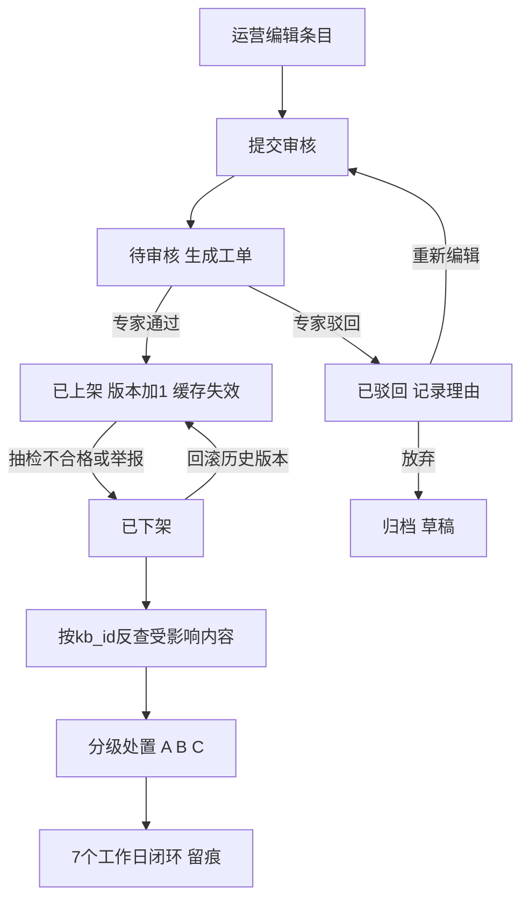

### F12.5 流程步骤

| 步骤 | 处理方 | 说明 |
|---|---|---|
| S1 | 后台 | 条目编辑（结构化字段 + 来源 + 来源等级 + 适用月龄 / 物种） |
| S2 | 工单服务 | 生成审核工单，状态机见 F12.6；同一版本重复提交复用工单 |
| S3 | 专家端 | 通过 / 驳回（必填理由）；专家只能审本人领域 |
| S4 | 服务端 | 上架时版本号 +1，按知识库版本失效相关缓存 |
| S5 | 追溯任务 | 按 `kb_id` 反查会话与报告的 `kb_refs`，产出清单 |
| S6 | 运营 | 分级处置 A/B/C，执行与留痕；异常量级触发告警 |
| S7 | 审计 | 全部操作留痕；导出需双人审批（Q-47） |

### F12.6 状态机

**知识库条目**

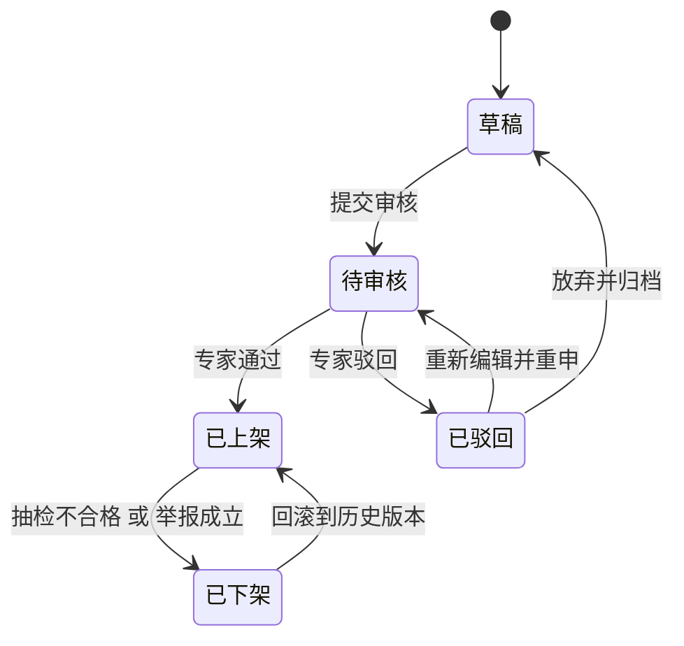

**测评题库版本**：`草稿 → 待审核 → 已发布 → 已下线`；`已发布 → 已下线` 后旧版本仍可读取历史报告，但不可用于新作答。

### F12.7 关键设计：权重机制（定死口径，不留歧义）

需求说明 4.3 节指出：原文只给了「0-6 育儿 0.5 / 宠物 0.3 / 家庭安全 0.2」三个数，但没定义权重作用在什么上，且与「安全置顶」冲突。本节一次性定死，避免开发自行解释。

| 问题 | 本版结论 |
|---|---|
| 权重作用于什么 | **仅作用于 `advice` 类建议内容的排序与篇幅配比**；不作用于安全提示、观察指标、转介提示、免责声明 |
| 是否影响冲突采信 | V1.0 **不影响**。冲突只按 `stance` 极性与 `contraindications` 规则标注，不按权重压制某一侧（避免"权重高的 Agent 说得对"的错觉） |
| 家庭安全 Agent 是否参与加权 | **否**。安全分节固定 `pinned=true`，且不属于 `advice` 类，不参与加权（GR-4） |
| 单领域问题是否生效 | **不生效**。纯宠物问题只使用宠物 Agent 的权重位，不引入育儿权重；三项权重只在复合场景同时生效 |
| 权重取值与校验 | 0.10–0.90，保留两位小数；三项之和必须归一化为 1.00，不满足则拒绝保存并提示 |
| 生效时机 | 变更后**下一轮请求**生效，当轮不生效；配置带 `version` 与 `effective_at` |
| 变更权限 | 仅超级管理员（Q-27 默认）；专家只读 |
| 留痕与回滚 | 记录变更前后值、原因、操作人、时间；支持一键回滚，回滚同样下一轮生效 |
| 是否需 A/B | V1.0 不做 A/B；V1.1 可对权重方案做灰度（13.2.4） |

> **一句话**：权重是"建议的排版权重"，不是"谁更可信的投票权"。安全永远置顶，冲突永远标注，二者都不受权重影响。

### F12.8 边界与异常六查

| 类别 | 场景 | 期望行为 |
|---|---|---|
| 空态 | 无待审工单 / 无事件 / 无请求 / 无日志 | 各页独立空态，不含误导性「0 条」占位 |
| 极值 | 单条目 5 万字 | 单条上限 2 万字，超出要求拆分；拆分后仍按同一知识域检索 |
| 极值 | 权重三项之和不为 1 | 拒绝保存并提示「三项之和必须为 1.00」 |
| 并发 | 两个运营同时编辑同一条目 | `version` 乐观锁，后提交返回冲突并展示差异 |
| 并发 | 两人同时改权重 | 以 `version` 乐观锁拒绝后提交者，提示刷新后重试 |
| 失败 | 缓存失效失败 | 上架成功但缓存未失效时，记录补偿任务并告警；不允许静默 |
| 权限 | 运营尝试导出日志 | 拒绝并审计（导出仅超管且需双人审批） |
| 幂等 | 重复提交同一版本审核 | 复用已有工单，不重复占用专家工时 |
| 极值 | 追溯清单超过 10 万条 | 分批处置，按影响等级排序，产出汇总报告而非逐条人工 |

### F12.9 埋点（后台）

`kb_edit`、`kb_review`（结果、耗时）、`kb_publish`、`kb_offline`、`content_removal`（影响面分级）、`kb_trace_generated`（影响条目数）、`lexicon_change`（类型、影响面）、`topic_bank_publish`（版本）、`agent_weight_change`（新旧值、原因）、`agent_log_query`（筛选条件）、`config_change`（配置类型）、`admin_login`（是否 MFA）、`export_request`（审批人）、`risk_event_review`、`feedback_handle`。

---

# 第 6 章 多智能体架构需求（实现约束）

> 本章不是架构设计，而是**产品对实现的硬约束**：什么样的输出算合格、什么顺序不能改、失败时允许退到哪一步。架构细节见 `04-工程/宝伴-架构设计文档_V1.1.md`。

## 6.1 分层与命名（全文强制）

| 层 | 组成 | 是否调用 LLM | 成本口径 |
|---|---|---|---|
| **编排层** | 中枢调度器：意图识别、检索、并行分发、汇总、冲突比对、门控裁剪 | 意图分类用轻量模型；**汇总不调用 LLM** | 1 次轻量调用 |
| **领域 Agent 层**（3 个） | 0–6 岁育儿 Agent、宠物 Agent、家庭安全 Agent | 各自 1 次主力模型调用 | 单领域 1 次；复合 3 次 |
| **风险控制服务**（1 个服务、5 个组件） | 一级规则引擎、二级风险分类模型、风险策略服务、申诉工单服务、人工复核后台 | 仅灰区调用 1 次语义模型 | 非灰区 0 次；灰区 1 次 |
| **输入转写层** | ASR 转写（语音 → 文本），非 Agent | 不调用 LLM | 按音频时长计费，不计入问答成本口径 |

**术语替换表（禁止再用旧表述）**

| 废弃表述 | 替换为 |
|---|---|
| 「风险预警 Agent」 | **风险控制服务** |
| 「5 个 Agent」 | **3 个领域 Agent + 1 个编排器 + 1 个风险控制服务** |
| 「所有 Agent 并行」 | 领域 Agent 并行；编排器与风险控制服务按固定顺序执行 |
| 「各 Agent 权重」 | **建议内容的排版权重**（仅 `advice` 类，见 6.8） |

**调用次数（成本口径的唯一来源）**

| 场景 | 轻量模型 | 主力模型 | 语义模型 | 合计 |
|---|---|---|---|---|
| 单领域标准 | 1 | 1 | 0 | **2** |
| 单领域灰区 | 1 | 1 | 1 | **3** |
| 复合场景标准 | 1 | 3 | 0 | **4** |
| 复合场景灰区 | 1 | 3 | 1 | **5** |
| 语音输入（任意场景） | 额外 ASR 1 次 | — | — | 不计入模型调用数 |

## 6.2 Agent 职责矩阵

| # | Agent | 触发条件 | 输入 | 输出 | 硬约束 |
|---|---|---|---|---|---|
| 1 | 风险控制服务 | **所有输入，先于任何 Agent**（纯输入侧） | 提问文本、语音转写文本（V1.0）、测评作答 | 是否命中 / 类别 / 置信度 / 引导文案 ID | 命中即阻断生成；不读档案；不受其他 Agent 影响 |
| 2 | 中枢调度器 | 风险扫描通过后 | 问题、用户显式入口、档案区间、测评类型（可关闭） | 调度决策 + 汇总结果 | 模板骨架 + 字段填充；不可改写字段服务端注入 |
| 3 | 0–6 岁育儿 Agent | 育儿类问题、测评解读、月度计划生成 | 最小必要档案字段、提问 | 结构化养育建议 | 仅科普；不诊断；不判定终身性格 |
| 4 | 宠物 Agent | 宠物类问题 | 宠物档案最小字段、提问 | 饲养 / 行为解读结构化内容 | 只做科普；急症提示就医；不给剂量 |
| 5 | 家庭安全 Agent | **三态触发**（见下） | 复合问题、儿童与宠物档案 | 安全注意事项、行为引导 | 内容置顶且不参与排序；失败时禁出正文 |
| — | ~~学龄育儿 / 学科辅导 / 亲子情绪 Agent~~ | **不在当前规划**（NG-1） | — | — | — |

**家庭安全 Agent 三态触发（明确区分，勿混用）**

| 态 | 条件 | 呈现方式 |
|---|---|---|
| ① 独立分节 | 同时涉及儿童 + 宠物的复合问题 | 独立分节并置顶 |
| ② 规则化附加 | 仅宠物问题，但存在儿童档案且识别到互动风险 | 追加一段提醒，**不视为独立分节**（对应 AC-F5-04-1） |
| ③ 始终执行 | 用户显式进入「家庭综合问答」 | 始终执行并独立分节 |

## 6.3 结构化输出契约（领域 Agent → 编排器）

```json
{
  "agent_id": "child_care_0_6",
  "agent_version": "1.0.0",
  "intent": "sleep_guidance",
  "topic_key": "sleep_training",
  "confidence": 0.86,
  "answer_blocks": [
    {
      "block_id": "b1",
      "type": "advice",
      "title": "建议要点",
      "content": "……",
      "access_tier": "free",
      "preconditions": "适用于 6-12 月龄、已添加辅食的宝宝",
      "evidence_ref": ["kb_child_sleep_03"],
      "stance": "support",
      "contraindications": [],
      "immutable": false
    }
  ],
  "risk_flags": [],
  "professional_referral": false,
  "referral_threshold": "体温 ≥38.5℃ 持续 24 小时以上",
  "medical_advice_blocked": false,
  "ai_generated_label": "AI_GEN_LABEL_V1",
  "disclaimer_id": "DISCLAIMER_V1",
  "retrieval": { "kb_ids": ["kb_child_sleep_03"], "hit": true, "kb_version": "2026-10-01" },
  "tokens_used": 812,
  "latency_ms": 3200
}
```

| 字段 | 必需 | 说明 |
|---|---|---|
| `topic_key` | 是 | 冲突比对的归组键（如 `sleep_training`） |
| `access_tier` | 是 | `free` / `member` / `topic:<id>`；无权限 block 不下发正文 |
| `stance` | 是 | `support` / `oppose` / `conditional` / `neutral` |
| `contraindications` | 是 | 禁忌项列表，无则为空数组 |
| `evidence_ref` | 是 | **必须来自检索结果 ID**，禁止编造；无命中为空数组 |
| `referral_threshold` | 条件 | `professional_referral=true` 时必须给出可判断阈值 |
| `ai_generated_label` | 是 | AI 生成内容标识 ID，服务端固定注入 |
| `medical_advice_blocked` | 是 | 是否触发医疗 / 兽药边界规则（药名 + 剂量模式） |
| `immutable` | 是 | 是否不可被汇总改写（`true` 时只能原样透传） |
| `preconditions` | 是 | 适用前提；无档案时必须写明「未绑定档案，按通用区间给出」 |

**不可改写字段（服务端注入，不经 LLM）**：安全提示分节、冲突标注、免责声明、AI 生成标识、转介提示。

## 6.4 中枢 → 前端输出契约与响应协议

```json
{
  "request_id": "req_…",
  "session_id": "sess_…",
  "status": "streaming | done | blocked | degraded | failed | orphaned",
  "render_order": ["safety", "child", "pet"],
  "sections": [
    { "key": "safety", "title": "家庭安全提示", "blocks": ["…"], "immutable": true, "pinned": true },
    { "key": "child",  "title": "育儿侧建议",   "blocks": ["…"] }
  ],
  "conflict_note": null,
  "agents_involved": [{ "agent_id": "child_care_0_6", "latency_ms": 3200, "status": "ok" }],
  "degraded_reason": null,
  "disclaimer_id": "DISCLAIMER_V1",
  "ai_generated_label": "AI_GEN_LABEL_V1"
}
```

| 规则 | 内容 |
|---|---|
| 渲染顺序 | 由服务端 `render_order` 决定，前端不得重排；`pinned: true` 的分节不可折叠、不可下移 |
| 传输方式 | 小程序端用 `wx.request` + `enableChunked: true` 分块接收，按 `\n\n` 切帧；**不使用 `EventSource`**（小程序不支持） |
| 分节渐进 | 每个 Agent 返回即渲染该节；未返回节显示骨架屏；首包＝进度占位包 |
| 覆盖与撤回 | 同名 `section.key` 新分片覆盖旧分片；某节变为 `blocked` 时前端必须清空全部已渲染正文（见 F8.5） |
| 门控 | 会员与专题 block 由服务端裁剪，前端不做安全边界 |
| 一致性 | `status=done` 时为最终态，必须含免责与 AI 标识 |

**流式事件类型**

| 事件 | 触发时机 | 必带字段 | 前端动作 |
|---|---|---|---|
| `started` | 风险扫描通过、调度完成 | `request_id`、`render_order`、`quota_remaining`、`cancel_token` | 渲染骨架与分节顺序 |
| `section_delta` | 分节增量文本 | `section_key`、`section_version`、`sequence`、`delta` | 追加到对应分节 |
| `section_done` | 分节完成 | `section_key`、`section_version`、`blocks` | 用完整块替换该节 |
| `blocked` | 风险命中 | `request_id`、`category`（脱敏）、`guidance_id` | **清空已渲染正文**，转拦截页 |
| `degraded` | 部分 Agent 失败 | `reason`、`failed_sections[]` | 对应分节替换为降级条 |
| `completed` | 全部完成 | `status`、`disclaimer_id`、`ai_generated_label`、`agents_involved[]` | 注入不可改写字段并落库 |
| `error` | 不可恢复错误 | `code`、`message`、`retry_after` | 兜底话术 + 重试（幂等键不变） |
| `ping` | 15 s 无数据 | `ts` | 仅刷新「仍在生成」提示 |

**公共字段**：每帧必带 `request_id`、`sequence`（单调递增，从 1 开始）、`ts`（毫秒）。`sequence` 跳号 → 前端必须用最近的 `section_done` 覆盖渲染。

**取消、离开与幂等**

| 问题 | 规则 |
|---|---|
| 取消生成 | `POST /cancel` 带 `cancel_token`；已产生费用不退回，但**不计入免费额度** |
| 页面离开 | 默认 `keep_alive=true`，服务端继续生成并落库，回来可见完整结果 |
| 断线重连 | `?from_sequence=N` 续发；超 5 分钟未重连标记 `orphaned`，仍落库可回看 |
| 重试 | 同一 `client_request_id` 重发 → 幂等表命中，复用结果或接续，不重复计次 |
| `done` 的定义 | `done`＝全部分节成功；`degraded`＝任务结束但含失败分节。**性能样本只统计 `done`** |
| 并发会话 | 同一用户同时只允许 1 个活跃流式会话，第二条返回 `409` |

## 6.5 延迟预算（唯一口径）

**阶段构成**：① 鉴权 + 幂等 ② 语音转写（仅语音输入）③ 一级风险扫描 ④ 二级语义模型（仅灰区）⑤ 意图分类 + 实体识别 ⑥ 检索 ⑦ 领域 Agent 并行 ⑧ 汇总（模板填充）⑨ 输出侧过滤。

**单领域标准场景（文字输入，含全部串行阶段）**

| 阶段 | P50 (ms) | P95 (ms) | 告警 | 超时 | 降级触发 |
|---|---|---|---|---|---|
| ① 鉴权 + 幂等 | 80 | 150 | — | 500 | 幂等表不可用 → 放行并告警 |
| ② 语音转写（文字输入为 0） | 0 | 0 | — | — | — |
| ③ 一级风险扫描 | 120 | 300 | 450 | 800 | 不可用 → **禁出正文** |
| ④ 二级语义（不触发） | 0 | 0 | — | — | — |
| ⑤ 意图 + 实体 | 200 | 400 | 600 | 1000 | 失败 → 回退用户显式入口 |
| ⑥ 知识库检索 | 300 | 600 | 900 | 1500 | 无命中 → `professional_referral=true` |
| ⑦ 领域 Agent（1 个） | 2400 | 6000 | 9000 | **12000** | 失败 → 该节降级 |
| ⑧ 汇总 | 150 | 300 | 450 | 800 | 失败 → 回退纯模板拼接 |
| ⑨ 输出侧过滤 | 80 | 200 | 300 | 600 | 不可用 → **禁出正文** |
| **整请求** | **3330** | **7950** | **11925** | **15000** | — |

**四场景汇总**

| 场景 | P50 | P95 | 告警 | 超时 |
|---|---|---|---|---|
| 单领域标准（文字） | 3330 | 7950 | 11925 | 15000 |
| 单领域灰区（文字） | 3930 | 9450 | 14175 | 18000 |
| 复合场景标准（3 Agent 并行） | 4030 | 8550 | 12825 | 16000 |
| 复合场景灰区 | 4630 | 10050 | 15075 | 19000 |

**语音输入的独立时限（不占用问答 8 s 预算）**

| 项 | 阈值 | 说明 |
|---|---|---|
| 录音上传 + 转写 | P95 ≤2.5 s（60 s 音频） | 转写在用户确认提交**之前**完成，不计入问答响应时间 |
| 转写失败判定 | 8 s 无结果即判失败 | 提示改用文字，不计次 |
| 与问答的关系 | 转写完成 → 用户点提交 → 才开始 8 s 计时 | 用户可长时间编辑，不产生超时 |

**三条冻结口径**

| # | 口径 | 结论 |
|---|---|---|
| 1 | 家庭安全 Agent 是否计入复合场景 Agent 数 | **计入**。复合场景固定 3 个领域 Agent 并行，不存在「3 个之后再追加一个」 |
| 2 | 12 s 是单 Agent 超时还是整请求超时 | **单 Agent 超时**（`agent_timeout=12s`）；整请求超时单列，且必须大于「串行阶段之和 + 单 Agent 超时」 |
| 3 | `done` 的定义 | `done`＝全部分节成功；`degraded`＝结束但含失败分节。**性能达标只统计 `done`** |

**首包**：P95 ≤1.5 s，纳入上线验收；另设「首包后 3 s 内无任何 `section_delta`」为告警项。

## 6.6 降级矩阵

| 失败组件 | 是否出正文 | 展示什么 | 扣额度 | 存历史 | 允许重试 |
|---|---|---|---|---|---|
| 风险扫描不可用 | **否** | 静态故障页 + 渠道入口 | 不扣 | 存（`risk_unavailable`） | 是 |
| ASR 不可用 | 不适用 | 麦克风置灰 + 说明，文字链路正常 | 不扣 | 不存会话 | 是 |
| 家庭安全 Agent 失败 | **否** | **仅静态安全模板**（隐藏育儿 / 宠物全部正文） | 不扣 | 存（`safety_failed`） | 是 |
| 育儿或宠物单侧失败 | 是（其余节） | 失败节显示「本次部分内容未能生成」 | 扣 | 存 | 是（可仅重生成该节） |
| 两个领域 Agent 全部失败 | 否 | 兜底话术 + 稍后重试 | 不扣 | 存（`all_agents_failed`） | 是 |
| 检索无命中 | 是 | 正文 + 转介标注 | 扣 | 存 | 是 |
| 汇总失败 | 是（回退模板） | 正常展示 | 扣 | 存 | 否 |
| 输出侧过滤不可用 | **否** | 静态故障页 | 不扣 | 存 | 是 |
| 知识库不可用（有缓存） | 是 | 正文 + 「内容可能不是最新」 | 扣 | 存 | 否 |
| 知识库不可用（无缓存） | 否 | 兜底话术 | 不扣 | 存 | 是 |
| 一级词库加载失败 | **否** | 静态故障页 | 不扣 | 存 | 是 |

**五条统一规则**：① 安全不可降级；② 不扣额度的判定在服务端；③ 一律存历史并可回看；④ 重试复用 `client_request_id`，可仅重生成失败节；⑤ `failed` 与 `degraded` 是两种视觉，不得混用。

## 6.7 冲突判定与汇总规格

| 项 | 规格 |
|---|---|
| 判定方式 | **结构化字段规则比对**，不用 LLM 自由判断 |
| 归组 | 按 `topic_key` 归组不同 Agent 的同一议题 block |
| 冲突条件 | 同一 `topic_key` 下 `stance` 极性相反（`support` vs `oppose`），或一方 `contraindications` 命中另一方建议 |
| 输出 | 注入「两个方向的观点存在差异，建议多方参考」（不可改写）；**不阻断生成** |
| 汇总主体 | 模板骨架 + 字段填充，服务端完成，**不调用 LLM** |
| 连贯性改写（可选） | 只能改写 `immutable=false` 的 `advice` 类 block；超 500 ms 或失败立即回退模板；改写后必须再跑一次输出侧过滤 |
| 禁止 | 模型重排分节、改写安全提示、改写冲突标注、删除免责或 AI 标识 |

## 6.8 权重与排序规格

权重是**建议内容的排版权重**，不是可信度投票。以下为实现口径，与 F12.7 一致。

| 项 | 规格 |
|---|---|
| 作用对象 | 仅 `answer_blocks[type=advice]`；不影响安全提示、观察指标、转介提示、免责声明 |
| 复合场景 | 三个领域 Agent 的权重按配置加权后决定**呈现顺序与篇幅配比**；安全分节始终 `pinned` |
| 单领域场景 | 只使用对应领域权重，不引入其他领域权重 |
| 冲突场景 | 权重**不参与**采信决策；冲突一律标注，不压制任一侧 |
| 默认值 | 育儿 0.50 / 宠物 0.30 / 家庭安全 0.20（V1.0 基线）。**家庭安全的 0.20 只影响安全提示文案的详略程度，不影响其位置与是否输出**；安全分节恒置顶、恒输出 |
| 校验 | 0.10–0.90，两位小数，三项之和 = 1.00 |
| 生效 | 下一轮请求生效，配置带 `version` 与 `effective_at` |
| 观测 | 每次请求记录所用权重版本，便于回溯 |

**排序算法（唯一口径）**

1. 先按 `pinned` 降序（安全分节恒为第一位）；
2. 再按 `access_tier` 分组（free 在前，member 在后由门控裁剪，不参与排序）；
3. 再按「Agent 权重 × 该 Agent 内 block 顺序」生成稳定排序；
4. 冲突标注作用于具体 block，不改变分节顺序；
5. 排序结果写入日志，便于复现。

## 6.9 检索与知识库规格

| 项 | 规格 |
|---|---|
| 检索源 | 育儿库、宠物库分别按领域过滤；**测评题库、高危词库、敏感词库不参与问答检索** |
| 召回 | 向量召回 top-8 → 重排取 5；领域不匹配条目不得进入上下文 |
| 物种过滤 | V1.0 仅猫 / 狗条目可命中；V1.1 增加兔 / 仓鼠库（13.3） |
| 引用约束 | `evidence_ref` 必须来自检索结果 ID；模型输出的其他来源一律剔除 |
| 无命中 | `hit=false` → `professional_referral=true`，正文标注「未检索到直接依据」 |
| 版本绑定 | 检索结果携带知识库版本号；缓存 key 绑定版本号，知识库更新即失效 |
| 前端展示 | 引用来源**后台可见、前端不展示**（Q-33） |
| 来源等级 | 每条知识库条目必须标注来源等级（权威指南 / 学术 / 机构 / 媒体），低等级来源不得单独支撑建议 |

## 6.10 成本、缓存与模型分级

| 项 | 策略 |
|---|---|
| 模型分级 | 一级筛选与意图分类用轻量模型；领域推理用主力模型；汇总**不用模型** |
| token 上限 | 单 Agent 输入 ≤8k（含检索上下文与档案，超出即裁剪）；输出 ≤2k |
| 上下文裁剪 | 只传最小必要档案字段：儿童＝月龄区间、性别、过敏项；宠物＝物种、年龄段 |
| 缓存 | key = hash(规范化问题 + 档案区间 + 知识库版本 + `agent_version` + 权重版本)；命中缓存必须标注「内容来自缓存，可能不是最新」；**风险扫描与会员门控仍逐次执行** |
| 模型白名单 | 仅接入境内已备案模型；未登记 provider / model **一律拒绝启动**；供应商变更走审批 |
| 成本观测 | 每次请求记录 token 用量、模型调用次数、是否缓存命中、ASR 时长 |

## 6.11 Agent 注册协议与扩展约束

每个 Agent 必须声明：`agent_id`、版本、领域、必需档案字段、输出 block 类型集合、超时阈值、降级策略。

**可验收的扩展约束**：新增一个 mock Agent，**在不改动既有 Agent 逻辑与编排器主流程代码的前提下**可被调度成功（NFR-M1）。新增 Agent 不得要求修改主流程图、不得新增不可改写字段、不得绕过风险扫描。

> **V1.1 小宠接入的验证方式**：以「兔」为新物种跑通一次（不是新增 Agent，而是扩展现有宠物 Agent 的物种枚举 + 知识库分区 + 红旗分表），验证扩展不触碰主流程（13.5）。

---

# 第 7 章 非功能需求

## 7.1 性能

| ID | 要求 | 验收标准 |
|---|---|---|
| NFR-P1 | 单领域问答响应 | 整请求 P95 ≤8 s（6.5）；首包 P95 ≤1.5 s，>3 s 告警 |
| NFR-P2 | 复合场景响应 | P95 ≤15 s；告警与超时按 6.5 表 |
| NFR-P3 | 首页加载 | ≤2 s（4G），超时展示骨架屏 |
| NFR-P4 | 测评断点续填 | 断点保留 90 天，重新进入直达断点题 |
| NFR-P5 | 语音转写 | 60 s 音频 P95 ≤2.5 s；8 s 无结果判失败 |
| NFR-P6 | 并发承载 | 待业务方给目标 DAU / 峰值并发（12.4）；压测报告为上线前置项 |

## 7.2 可用性与可靠性

| ID | 要求 | 验收标准 |
|---|---|---|
| NFR-A1 | 核心问答链路可用性 | 月度 ≥99.5%【待业务确认】 |
| NFR-A2 | 备份与恢复 | 数据库每日备份；RTO ≤4 h、RPO ≤1 h【待技术确认】 |
| NFR-A3 | 三方故障降级 | 大模型 / ASR / 微信支付 / 内容安全故障均有降级路径（6.6） |
| NFR-A4 | 熔断与重试 | 超阈值熔断；重试使用 `client_request_id` 幂等 |
| NFR-A5 | 故障演练 | 上线前至少完成 1 次三方故障降级演练并留记录 |

## 7.3 安全

| ID | 要求 | 验收标准 |
|---|---|---|
| NFR-S1 | 鉴权与越权防护 | 用户 A 不可访问用户 B 的档案、会话、报告、订单（横向越权自动化用例全绿） |
| NFR-S2 | 限流与防刷 | 按用户与 IP 限流；异常刷量可拦截并告警 |
| NFR-S3 | 密钥管理 | KMS 托管；密钥轮换；解密审计 |
| NFR-S4 | 后台权限分级与审计 | 四角色最小权限；敏感操作全部留痕；后台登录 MFA |
| NFR-S5 | 数据脱敏 | 后台默认脱敏；明文查看需单独授权并留痕 |
| NFR-S6 | 语音隐私 | 音频不落盘、不入日志、不下发后台；仅保留转写文本 |

## 7.4 合规与内容安全

| ID | 要求 | 验收标准 |
|---|---|---|
| NFR-C1 | 全链路敏感词过滤 | 输入侧 + 输出侧均拦截；平台内容安全能力文本与图片送检，**超配额不得放行** |
| NFR-C2 | 免责声明强制附着 | 所有回答与报告 100% 附带；可自动化抽检 |
| NFR-C3 | 档案加密存储 | 加密字段清单可枚举；密钥与数据分离；解密有审计 |
| NFR-C4 | 儿童信息特殊保护 | 单独同意 + 监护声明留痕 + 可撤回（F1） |
| NFR-C5 | AI 生成内容标识 | 显式标识（页面固定位 + 分享图渲染）+ 隐式标识（导出文件元数据）；抽检项 |
| NFR-C6 | 生成式 AI 服务备案 | 完成备案并展示备案号；未完成不得正式发布 |
| NFR-C7 | 个人信息保护影响评估（PIA） | 上线前完成并留档 ≥3 年 |
| NFR-C8 | 留存期与自动清理 | 按 8.1 留存期执行；到期自动清理任务与执行日志可查 |
| NFR-C9 | 禁止境外模型与数据出境 | 模型白名单仅含境内已备案服务；CI 与评审双重检查 |
| NFR-C10 | 第三方清单与权限声明 | 《隐私保护指引》+ SDK 清单；相机 / 相册 / 麦克风前置说明 |
| NFR-C11 | 内容安全能力超配额 | 拒绝放行并转人工，不得静默通过 |
| NFR-C12 | 强制用词规范 | 禁止词清单落到知识库、System Prompt、前端固定文案、分享图；抽检执行 |

## 7.5 成本与配额

| ID | 要求 | 验收标准 |
|---|---|---|
| NFR-K1 | 单请求成本上限 | 调用次数与 token 上限可配置、可观测 |
| NFR-K2 | 额度闸门 | 额度裁决统一在服务端，客户端不可绕过；超额请求不产生模型调用 |
| NFR-K3 | 成本告警 | 单位问答成本超目标值 1.5 倍告警，日报可见 |
| NFR-K4 | 毛利测算 | 上线前给出定价与单位成本的敏感性分析（问答次数、缓存命中率、模型单价三个变量） |

## 7.6 内容质量

| ID | 要求 | 验收标准 |
|---|---|---|
| NFR-Q1 | 知识库上线前审核 | 100% 经专家审核方可上架 |
| NFR-Q2 | 上线后抽检 | 每月抽检 30 条 + 高危类目 100%；合格线 ≥98% |
| NFR-Q3 | 表达通俗 | 专业词必须旁注解释；抽检合格率 ≥98% |
| NFR-Q4 | 边界表述 | 不得出现诊断、处方、剂量、确定性性格判定；抽检合格率 ≥98% |
| NFR-Q5 | 风险覆盖 | 误报有申诉入口与 24 h 复核；漏报有举报入口与每周抽检 200 条 |

## 7.7 可维护性与可观测性

| ID | 要求 | 验收标准 |
|---|---|---|
| NFR-M1 | Agent 解耦 | 新增 mock Agent 不改主流程即可被调度（6.11） |
| NFR-M2 | 调用链路可追溯 | 每次请求可还原：输入、调度决策、各 Agent 输出、耗时、风险判定、引用 kb_id、权重版本 |
| NFR-M3 | 异常告警 | Agent 失败率 >3%、超时率 >5%、拦截量日环比 >3σ、对账差异 >0 均告警；阈值可配置 |
| NFR-M4 | 配置化 | 阈值、词库、价格、渠道清单、开关、权重均后台可配，改配置不发版 |

## 7.8 兼容性与无障碍

| ID | 要求 |
|---|---|
| NFR-I1 | 微信小程序基础库 ≥2.20.2；iOS 与 Android 均可用 |
| NFR-I2 | 后台支持 Chrome / Edge ≥120，最小分辨率 1280×800 |
| NFR-I3 | 无障碍底线：正文 ≥32 rpx、说明 ≥24 rpx、对比度 ≥4.5:1、热区 ≥88 rpx；不做独立专项 |

## 7.9 可扩展性

| ID | 要求 | 验收标准 |
|---|---|---|
| NFR-E1 | Agent 可扩展 | 新增领域 Agent 不需改动既有 Agent 与主流程（6.11） |
| NFR-E2 | 物种可扩展 | 新增小宠只需扩枚举 + 新增知识库分区 + 红旗分表，不改问答主链路（13.3.5） |
| NFR-E3 | 端可扩展 | 后端接口与前端解耦，后续可扩展 Web 端 |
| NFR-E4 | 题库可配置 | 题量、维度、阈值、文案均可配置，不硬编码 |

---

# 第 8 章 数据需求概要

完整表结构与字段字典见 `04-工程/宝伴-数据模型文档_V1.1.md`，本章只列需求侧约束。

## 8.1 核心实体与留存期

| 实体 | 关键字段 | 脱敏级别 | 留存期 |
|---|---|---|---|
| 用户 | `user_id`、微信 openid、会员状态、注册时间、手机号（可选且最小化） | P1 | 账号存续期 |
| 同意记录 | 记录 ID、`user_id`、`consent_type`（base / child_personal_info）、`consent_version`、同意时间、`guardian_verified`、设备标识、`withdraw_at` | P1 | ≥3 年 |
| 儿童档案 | `profile_id`、`user_id`、昵称、出生日期、性别、身高、体重、早产标记、过敏项、辅食月龄、`version`、`age_months`、`age_band`、`status` | **P0**（出生日期 / 昵称 / 过敏项加密） | 账号存续期 + 30 天 |
| 宠物档案 | `pet_id`、`user_id`、物种、品种、生日或年龄、绝育状态、体重、`version`、`age_band` | P2 | 账号存续期 |
| 问答会话 | `session_id`、`user_id`、`profile_id`、`pet_id`、问题文本、`input_mode`（text / voice）、`client_request_id`、风险标记、参与 Agent、回答内容、耗时、`is_member_content`、`is_retry`、`kb_refs`、`weight_version` | **P0**（问题文本） | ≥6 个月 |
| 语音转写记录 | `transcript_id`、`session_id`、转写文本、置信度、时长、ASR 版本 | P0 | 随会话（**不含音频**） |
| Agent 调用日志 | `log_id`、`session_id`、`agent_id`、输入摘要（脱敏）、输出 JSON、耗时、置信度、是否冲突、`evidence_ref` | P0 | ≥6 个月 |
| 测评记录 | `assessment_id`、`user_id`、`profile_id`、题目版本、作答明细、各维度得分、类型、状态、断点数据 | P1 | 断点 90 天；报告随账号 |
| 报告 | `report_id`、`user_id`、类型、内容、图片生成记录、分享次数 | P1 | 账号存续期 |
| 订单 | `order_id`、`user_id`、商品 ID、商品类型（会员 / 专题）、金额、状态、`out_trade_no`（唯一）、`transaction_id`（唯一）、`notify_status`、`reconcile_status`、`refund_*`、`contract_confirm_at` | P0 | ≥3 年 |
| 会员订阅 | `subscription_id`、`user_id`、开始时间、到期时间、状态、来源订单 | P2 | ≥3 年 |
| 专题权益 | `entitlement_id`、`user_id`、`topic_id`、来源订单、解锁时间、状态 | P2 | ≥3 年 |
| 额度用量 | `user_id`、日期、已用次数、上限快照、是否会员 | P2 | ≥1 年 |
| 知识库条目 | `kb_id`、领域、标题、内容、版本、来源、**来源等级**、审核状态、审核人、上架时间、适用月龄 / 物种 | P2 | 长期（含历史版本） |
| 测评题库 | 题库 ID、版本、题目、选项、维度、反向题标记、状态、生效时间 | P2 | 长期（含历史版本） |
| 词库条目 | `term_id`、类型（高危 / 敏感）、词条、处理策略、阈值档、生效状态、更新人 | P2 | 长期 |
| Agent 权重配置 | 配置 ID、`agent_id`、权重值、`version`、`effective_at`、操作人、原因 | P2 | 长期 |
| 内容安全审核记录 | 记录 ID、对象类型、对象 ID、送检时间、结果、处置动作、回调日志 | P1 | ≥6 个月 |
| 高风险事件 | 事件号、`user_id`（脱敏）、命中类别、置信度、判定层级、处置结果、值班人、复核 SLA、是否上报 | **P0** | ≥3 年 |
| 权利请求记录 | 请求号、`user_id`、类型、受理时间、SLA、状态、拒绝理由、处理人 | P1 | ≥3 年 |
| 投诉举报处置记录 | 举报号、对象、分类、是否涉未成年人、SLA、处置动作、留证、上报、回执 | P1 | ≥3 年 |
| 配置版本 | 配置 ID、类型（开关 / 价格 / 文案 / 渠道 / 阈值）、快照 JSON、状态、生效时间、操作人、`version` | P2 | 长期 |

## 8.2 关键数据约束

| ID | 要求 |
|---|---|
| DR-1 | 加密字段清单必须可枚举：儿童档案的出生日期、昵称、过敏项；会话的问题文本；订单支付标识 |
| DR-2 | 派生列 `age_months` / `age_band` 由服务端写入时计算；**查询与排序列不得依赖加密字段** |
| DR-3 | 可变实体（档案、知识库条目、题库、权重、配置）均带 `version` 乐观锁，冲突返回 409 |
| DR-4 | 唯一索引：订单 `out_trade_no`、`transaction_id`；幂等表 `client_request_id`；同意记录 `user_id + consent_type + consent_version`；专题权益 `user_id + topic_id` |
| DR-5 | 幂等表含请求指纹、结果引用、过期时间；命中直接返回上次结果 |
| DR-6 | 所有表具备 `created_at` / `updated_at`，支持软删除，满足审计与追溯 |
| DR-7 | 会话必须记录 `kb_refs`（引用条目 ID + 版本），支撑内容下架后的追溯处置 |
| DR-8 | 高风险事件必须可直接导出为合规台账（字段固定，格式稳定） |
| DR-9 | 额度用量按自然日聚合，跨日以服务端时区（UTC+8）为准 |
| DR-10 | 知识库条目必须带「来源等级」字段；低等级来源不得单独支撑建议 |
| DR-11 | 测评题库、作答、报告均带版本号；版本升级不追溯改写历史报告 |
| DR-12 | 删除请求必须可执行到「派生数据」（缓存、分享图、备份），并记录执行结果 |
| DR-13 | **音频不落库**：语音链路只存转写文本、置信度、时长；不存原始音频、不存音频 URL |
| DR-14 | 专题权益必须独立于会员权益存储，避免会员到期误回收已购专题 |

## 8.3 接口需求概要

全量接口清单与字段定义见 `docs/API.md`，本章只列**跨接口的统一约束**（任何接口不得例外）。

| ID | 约束 |
|---|---|
| DR-15 | 统一响应包络：`{ code, message, data, request_id }`；`code=0` 为成功，非 0 为业务错误；HTTP 状态码不承载业务语义 |
| DR-16 | 错误码 4 位整数分段：`1xxx` 参数与频控、`2xxx` 权限与归属、`3xxx` 额度与计费、`4xxx` 状态与幂等、`5xxx` 三方服务与内容安全；**同一含义只允许一个错误码** |
| DR-17 | 分页统一 `page` / `page_size`（默认 20，上限 100）+ `total`；排序字段白名单校验，禁止透传任意字段名 |
| DR-18 | 时间统一 ISO 8601 UTC 存储、按用户时区展示；金额与额度为整数最小单位，**禁止浮点** |
| DR-19 | 限流按用户与 IP 双维度；超限返回 `429` 并带 `Retry-After` |
| DR-20 | 鉴权两套 token：C 端用户 token 与后台管理 token 分离，**不得互相通用**；后台角色在服务端解析，不信任前端传参 |
| DR-21 | 所有涉及资源归属的接口必须校验 `user_id` 归属（档案、会话、报告、订单、权益、权利请求），越权统一返回 `403` 且不泄露资源是否存在 |
| DR-22 | 写接口必须支持幂等键：`client_request_id`（问答）、`out_trade_no`（订单）、`kb_id + version`（知识库审核）、`request_id`（权利请求）；重复请求返回首次结果 |
| DR-23 | 流式问答只暴露一个接口（`POST /qa/sessions/{id}/stream`），事件字段以 6.4 为唯一权威，**不得在接口文档中重新定义事件** |
| DR-24 | 所有接口必须返回 `request_id`，与调用日志、埋点可关联定位 |
| DR-25 | 语音接口只接收音频流并同步返回转写文本，**服务端不得持久化音频**；接口需声明单次时长上限 60 s |

---

# 第 9 章 埋点与数据分析需求

## 9.1 埋点规范

| 项 | 规范 |
|---|---|
| 命名 | 全小写 `snake_case`，名词 + 过去式动词，如 `qa_risk_block` |
| 必带属性 | `user_id`（或匿名 ID）、`session_id`（如适用）、`ts`、`client_version`、`page_id` |
| 采集层 | 前端行为 + 服务端事件双写，**以服务端为准**（防丢失、防篡改） |
| 隐私 | **不上报问题原文、档案明文、图片内容、音频**；只上报长度区间、类型枚举、状态值 |
| 归因 | 分享类事件需带 `share_trace_id`，支持分享者归因 |

## 9.2 事件字典（按域分组）

| 域 | 主要事件 | 详见 |
|---|---|---|
| 准入与同意 | `disclaimer_agree`、`consent_child_agree`、`consent_withdraw`、`right_request_submit`、`account_delete_done` | F1.7 |
| 档案 | `profile_create`、`profile_set_current`、`profile_delete_confirm`、`profile_limit_blocked` | F2.7 |
| 首页 | `home_view`、`entry_click`、`quota_bar_view`、`quota_exhausted`、`member_entry_click`、`entry_offline_shown` | F3.6 |
| 问答与风险 | `qa_submit`、`qa_result_view`、`qa_followup`、`qa_risk_block`、`qa_risk_block_followup`、`qa_degraded`、`qa_refusal` | F4.8 / F6.8 / F8.8 |
| 语音 | `qa_voice_start`、`qa_voice_done`、`qa_voice_fail` | F4.8 |
| 宠物专项 | `pet_redflag_hit`、`pet_dosage_blocked`、`pet_toxin_query`、`child_pet_safety_appended` | F5.9 |
| 测评与报告 | `assessment_complete`、`assessment_exit_save`、`report_view`、`report_share` | F7.8 |
| 会员与支付 | `order_create`、`pay_success`、`pay_confirming`、`reconcile_diff`、`refund_result`、`topic_unlock` | F9.8 |
| 历史与反馈 | `history_view`、`feedback_submit`、`content_report`、`report_result_view` | F10.6 |
| 个人中心 | `profile_center_view`、`assessment_context_toggle`、`agreement_view` | F11.6 |
| 后台与配置 | `kb_review`、`content_removal`、`lexicon_change`、`agent_weight_change`、`agent_log_query`、`config_change`、`risk_event_review` | F12.9 |

> 完整事件字典（含字段级定义、公共字段、时区规则、批量上报策略）见第 5 章各 `Fn.x 埋点`；本章只做汇总与口径约束。

## 9.3 关键漏斗

```mermaid
flowchart LR
    A[进入小程序] --> B[同意免责]
    B --> C[首页]
    C --> D[首次提问]
    D --> E[风险扫描]
    E -->|未命中| F[获得回答]
    E -->|命中| X[拦截]
    F --> G[二次提问]
    C --> H[测评开始]
    H --> I[测评完成]
    I --> J[查看报告]
    F --> K[触达会员内容]
    K --> L[支付成功]
    C --> M[会员入口]
    M --> L
```

对应关系：M1 留存（A→G 的 7 日回访）、M2 测评完成率（H→I）、M3 二次提问率（D→G）、M4 付费转化（A→L）、M5 拦截后离开率（X→离开）。

## 9.4 指标口径（全文唯一权威）

**线上指标**

| 指标 | 分子 | 分母 | 去重维度 | 排除规则 |
|---|---|---|---|---|
| 7 日留存 | 第 7 日回访用户数 | 当日新增用户数 | `user_id` | cohort 窗口 = 自然日 |
| 测评完成率 | `assessment_complete` 用户数 | `assessment_start` 用户数 | `user_id` | 排除 7 日内重复计算 |
| 二次提问率 | 有 `qa_followup` 的会话数 | 有 `qa_submit` 的会话数 | `session_id` | **排除 `is_retry=true`、排除被拦截会话** |
| 付费转化率 | 首次 `pay_success` 用户数 | 同期新增用户数 | `user_id` | 排除退款用户 |
| 拦截后离开率 | 拦截后无继续追问的会话数 | 拦截会话数 | `session_id` | 只计 `qa_risk_block` 命中会话 |
| 冲突标注率 | 含冲突标注的回答数 | 多 Agent 回答数 | `session_id` | — |
| 语音转写可用率 | `qa_voice_done` 次数 | `qa_voice_start` 次数 | `session_id` | 排除用户主动取消 |
| 单位问答成本 | 周期模型费用 + ASR 费用 | 周期问答数 | — | 含缓存命中（成本为 0）的请求 |
| 降级率 | `degraded` 请求数 | 总请求数 | `request_id` | 排除 `blocked` |
| P95 响应 | — | — | — | 按四场景分别统计（6.5），只统计 `done` |

**离线（安全）指标**

| 指标 | 口径 | 目标 |
|---|---|---|
| 召回率 | 冻结标注集中被命中高危样本 ÷ 高危样本总数 | ≥95% |
| 误报率 | 冻结标注集中被误拦正常样本 ÷ 正常样本总数 | ≤5% |
| 命中后正文为空率 | 命中且正文为空的请求 ÷ 命中请求 | 100% |
| 申诉闭环率 | 24 h 内完成复核的申诉数 ÷ 申诉总数 | 100% |
| 抽检合格率 | 抽检合格条目数 ÷ 抽检条目数 | ≥98% |

## 9.5 禁止采集清单

| 禁止项 | 原因 |
|---|---|
| 问题原文与回答原文 | 可能含儿童信息与高危表述，只上报长度、类型、状态 |
| 儿童真实姓名、精确出生日期 | 敏感个人信息，仅存密文，不进埋点 |
| 图片内容与图片 URL | 仅上报是否含图片、图片数量、送检结果 |
| **语音音频与音频 URL** | 只上报时长档与转写是否成功，不上报音频本身 |
| 通讯录、位置、剪贴板 | 无业务必要，一律不采集 |
| 设备唯一标识明文 | 仅存哈希摘要，用于风控与去重 |

---

# 第 10 章 验收要点与端到端测试场景

## 10.1 阶段门槛

| 阶段 | 进入条件 |
|---|---|
| 开发启动 | 全部 B1 项已有结论或已写明可开发边界（12.1）；知识库「来源与版权」未出前**代码可开发、内容不得上架** |
| 提测 | 契约（6.3 / 6.4）冻结；延迟预算（6.5）经技术确认；降级矩阵（6.6）实现完毕；权重口径（6.8）确认 |
| 内测 | 上线前置合规检查表 ≥8 项通过；冻结标注集安全验收通过；支付幂等与对账用例通过 |
| 正式发布 | 合规检查表全部通过；10.3 验收清单全绿（按平台拆分）；10.4 门禁全部达标 |

## 10.2 端到端测试场景（V1.0）

每个场景必须可在预发环境复现。

| ID | 场景 | 步骤概要 | 通过标准 |
|---|---|---|---|
| E2E-01 | 高危拦截全链路 | 提交儿童虐待 / 自伤 / 惊厥 / 动物致伤四类输入 | 四类均阻断，响应正文为空，展示对应渠道卡片，无「继续提问」入口 |
| E2E-02 | 流式中途阻断 | 构造输出侧过滤命中，在已渲染 2 个分节后触发 | 前端清空全部已渲染正文，转拦截页，无残留可复制文本 |
| E2E-03 | 安全 Agent 失败 | 注入家庭安全 Agent 超时 | 育儿与宠物正文全部隐藏，只显示静态安全模板，不计次 |
| E2E-04 | 复合场景调度 | 提交「孩子追猫被挠」 | 调度 3 个 Agent，安全分节置顶，P95 ≤15 s，三节齐全 |
| E2E-05 | 幂等重跑 | 同一 `client_request_id` 重复提交 5 次 | 仅 1 次生成、1 次计次、1 份记录 |
| E2E-06 | 支付幂等 | 回调重复推送 10 次 | 权益仅发一次，流水仅一条，重复请求返回成功 |
| E2E-07 | 对账兜底 | 模拟回调丢失 | T+1 对账自动补单，用户侧状态可解释 |
| E2E-08 | 同意与级联删除 | 撤回儿童信息同意 → 删除档案 | 档案停用、历史脱敏为「宝宝 A」；选择「全部删除」后数据不可恢复 |
| E2E-09 | 越权访问 | 用 A 的 token 访问 B 的档案 / 会话 / 报告 / 订单 / 专题权益 | 全部 `403`，写审计，不泄露任何字段 |
| E2E-10 | 无档案与超范围 | 无档案提问；7 岁档案提问；4 岁问作业 | 无档案有正文 + 声明；两种超范围分别命中固定话术 |
| E2E-11 | 断线恢复 | 生成中断网 3 分钟再重连；另一例断网 10 分钟 | 3 分钟内续发补齐；超 5 分钟标记 `orphaned` 仍可回看 |
| E2E-12 | 内容追溯处置 | 下架某高频引用条目 | 1 个工作日内产出受影响清单，分级处置，7 个工作日闭环留痕 |
| E2E-13 | 语音全链路 | 录音 30 s → 转写 → 编辑 → 提交 | 转写文本可编辑；提交前不计次；音频不可在任何存储中查到 |
| E2E-14 | 语音高危拦截 | 语音说出虐待 / 自伤表述 | 转写后同样阻断，正文为空，处置与文字一致 |
| E2E-15 | 会员与专题门控 | 免费用户看深度方案；购买专题后重进 | 免费用户无正文；购买后立即解锁；会员不含专题 |
| E2E-16 | 权重变更生效 | 改权重 → 同一问题连发两次 | 当轮不变，下一轮生效；安全分节位置不变；日志记录权重版本 |
| E2E-17 | 后台五类资产 | 分别提交五类条目各 1 条并审核上架 | 五类均可走工单；题库与词库不进入问答检索 |
| E2E-18 | Agent 日志还原 | 抽一条复合场景请求 | 可还原输入摘要、参与 Agent、各输出、耗时、冲突、引用、权重版本，且隐私字段已脱敏 |

## 10.3 验收清单（按类别）

**功能（逐条对应 AC）**

| # | 验收项 | 来源 |
|---|---|---|
| 1 | 免责弹窗阻断生效，同意记录可追溯；次日不再弹全屏 | AC-F1-01-1 / AC-F1-01-4 |
| 2 | 儿童信息单独同意生效，未同意不落库 | AC-F1-02-1 |
| 3 | 档案增删改查 + 加密落库 + 月龄派生正确 | AC-F2-01-2 / AC-F2-05-1 |
| 4 | 删除支持两种级联选择且不可恢复 | AC-F2-04-2 |
| 5 | 首页四入口 + 会员入口 + 额度条状态正确 | AC-F3-01-1 / AC-F3-05-1 |
| 6 | 单领域问答六分节齐全，含适用前提与就医阈值 | AC-F4-01-2 / AC-F4-04-1 |
| 7 | 无档案路径有正文且带声明 | AC-F4-06-1 |
| 8 | 语音转写可编辑、不自动提交、失败不计次、音频不落盘 | AC-F4-09-3 / AC-F4-09-4 / AC-F4-09-6 |
| 9 | 月度养育计划按月龄生成并可存长图 | AC-F4-11-1 |
| 10 | 宠物行为解读三段结构 + 红旗强制置顶 | AC-F5-02-1 / AC-F5-03-1 |
| 11 | 儿童—宠物互动提醒规则化附加 | AC-F5-04-1 |
| 12 | 复合问答调度 3 Agent，安全置顶，P95 ≤15 s | AC-F6-01-1 / AC-F6-02-1 |
| 13 | 部分失败按降级矩阵展示；安全失败禁出正文 | AC-F6-06-2 |
| 14 | 冲突标注按规则判定且可复现 | AC-F6-04-1 |
| 15 | 测评可完成、可断点续填、报告六块齐全 | AC-F7-02-1 / AC-F7-04-3 |
| 16 | 长图免责区占比 ≥15% 且重复 ≥2 次 | AC-F7-05-1 |
| 17 | 会员 block 服务端裁剪，前端无正文 | AC-F4-08-1 |
| 18 | 会员权益四项齐全，且明示不含专题 | AC-F9-01-2 / AC-F9-09-1 |
| 19 | 专题包可购买、可解锁、不重复收费 | AC-F9-08-1 / AC-F9-08-2 |
| 20 | 额度计次规则与不计次项一致 | AC-F9-04-1 |
| 21 | iOS 无购买入口、有说明文案 | AC-F9-03-1 |
| 22 | 历史筛选、报告存图、内容更新提示 | AC-F10-01-1 / AC-F10-05-1 |
| 23 | 个人中心六区块齐全，注销走冷静期 | AC-F11-01-1 / AC-F11-05-1 |
| 24 | 后台五类资产均可维护，条目工单、回滚、追溯可运行 | AC-F12-01-1 / AC-F12-03-1 |
| 25 | Agent 日志可筛选、可还原、已脱敏 | AC-F12-06-1 / AC-F12-06-3 |
| 26 | 权重变更当轮不生效、安全不受影响、可回滚 | AC-F12-07-1 / AC-F12-07-3 |
| 27 | 敏感操作审计字段完整 | AC-F12-10-1 |

**合规（上线前置检查表）**

| # | 检查项 | 责任 |
|---|---|---|
| 1 | 生成式 AI 服务备案完成并展示备案号 | 业务 / 法务 |
| 2 | 小程序主体与服务类目资质核对完成 | 业务 |
| 3 | 《隐私保护指引》与 SDK 清单发布 | 技术 |
| 4 | 分层同意 + 监护声明流程上线并留痕可查 | 产品 / 法务 |
| 5 | PIA 完成并留档 | 法务 |
| 6 | AI 生成内容标识（显式 + 隐式）全链路生效 | 技术 |
| 7 | 内容安全能力接入并验证超配额拒绝 | 技术 |
| 8 | 留存期与自动清理任务上线 | 技术 / 法务 |
| 9 | 举报与危险内容处置 SLA 工单可运行 | 产品 / 运营 |
| 10 | 危机干预渠道清单已复核且系统有到期提醒 | 法务 / 运营 |
| 11 | 「科普 vs 诊疗建议」判定规则 + 药名剂量模式规则上线 | 法务 / 专家 |
| 12 | 冻结标注集安全验收通过（召回 ≥95%、误报 ≤5%） | 算法 / 测试 |
| 13 | 麦克风权限前置说明与音频不留存的技术验证 | 技术 / 法务 |
| 14 | 强制用词规范抽检通过 | 内容运营 |

## 10.4 发布门禁

| 门禁项 | 门槛 | 不达标处理 |
|---|---|---|
| 命中后正文为空率 | 100% | **阻塞发布** |
| 召回率 / 误报率 | ≥95% / ≤5% | **阻塞发布** |
| E2E-01 / E2E-02 / E2E-03 / E2E-14 | 全绿 | **阻塞发布** |
| E2E-05 / E2E-06 / E2E-09 / E2E-13 | 全绿 | **阻塞发布** |
| 合规检查表 | ≥12 项通过 | **阻塞发布** |
| 单领域 P95 | ≤8 s | 可带风险灰度，列入性能优化 |
| 语音转写 P95 | ≤2.5 s | 可带风险灰度，先关语音入口 |
| 降级率 | ≤3% | 可带风险灰度，定位失败分节 |
| 抽检合格率 | ≥98% | 可带风险灰度，追加抽检 |

---

# 第 11 章 风险与依赖

## 11.1 风险登记册

| ID | 风险 | 类别 | 概率 | 影响 | 缓解措施 | 触发信号 |
|---|---|---|---|---|---|---|
| R-1 | 用户提问含高危内容 | 合规 | 高 | 高 | 两级筛选 + 硬类别永不自动放行 + 渠道卡片 | 拦截量异常波动 |
| R-2 | 多 Agent 结论冲突 | 产品 | 中 | 中 | 结构化字段规则比对 + 冲突标注 | 冲突标注率异常升高 |
| R-3 | 问题超出知识库范围 | 内容 | 高 | 中 | 无命中强制转介标注 + 不硬编答案 | 无命中率持续上升 |
| R-4 | 反复测评结果波动 | 产品 | 中 | 中 | 三档 + 四类交叉（不给唯一类型）+ 波动提示 | 30 天内类型变更率偏高 |
| R-5 | 知识库条目被专家判定不通过 | 内容 | 高 | 高 | 版本回滚 + 内容追溯处置 | 抽检不合格率 >2% |
| R-6 | 专家资源未到位 | 资源 | 高 | **高（上线阻塞）** | 提前签约；未签约则内容无法上架 | 签约状态仍为未确认 |
| R-7 | 四象命名 / 量表版权争议 | 法务 | 中 | **高（开工阻塞）** | 商标与在先使用检索；不引用既有量表题目文本 | 检索结论未出 |
| R-8 | iOS 虚拟支付受限 | 商业 | 高 | 高 | iOS 不开放支付 + 平台拆分验收 | 审核被拒 |
| R-9 | 生成式 AI 备案未完成 | 合规 | 中 | **高（上线阻塞）** | 开发第 1 周启动，预留 1–2 个月 | 备案状态未回填 |
| R-10 | 危机热线失效 | 合规 | 中 | 高 | 渠道清单季度复核 + 到期提醒（PA-10） | 拨测失败 |
| R-11 | 模型成本失控 | 商业 | 中 | 中 | 额度闸门 + 缓存 + 模型分级 + 成本告警 | 单位成本超目标 1.5 倍 |
| R-12 | 误报伤害体验 | 产品 | 中 | 中 | 双阈值 + 申诉 24 h 复核 + 抽检 | 申诉量占比 >3% |
| R-13 | 用户已截图传播被拦截内容 | 合规 | 中 | 高 | 阻断页不引用已生成内容；风险留档；用户教育 | 舆情或投诉 |
| R-14 | 儿童信息泄露 | 合规 | 低 | **高** | 加密 + 最小必要 + 权限分级 + 审计 + 泄露应急预案 | 异常解密行为 |
| R-15 | 内容安全能力超配额 | 技术 | 中 | 中 | 超配额拒绝放行 + 转人工，不得静默通过 | 配额告警 |
| R-16 | 排期不可行 | 资源 | 高 | 高 | 见附录 A 方案 A / B | 里程碑连续两周延期 |
| R-17 | 无档案用户答案不贴合 | 产品 | 中 | 中 | 通用区间 + 补档案引导 + 文案声明适用范围 | 无档案会话二次提问率偏低 |
| R-18 | **语音转写错误导致误答** | 产品 | 中 | 高 | 转写结果必须回填可编辑、不自动提交；置信度低判失败 | 用户提交前大量修改转写文本 |
| R-19 | **权重被当成可信度投票** | 产品 | 中 | 中 | 6.8 与 F12.7 双重定死口径；权重不影响冲突采信 | 出现「按权重压制冲突」的实现 |
| R-20 | **专题包与会员权益边界被误解** | 商业 | 中 | 中 | 权益页必须明示「会员不含专题」；客服话术统一 | 专题购买页咨询量升高 |

## 11.2 外部依赖

| 依赖 | 用途 | 门槛与状态 |
|---|---|---|
| 大模型服务 | 全部 Agent 推理 | **仅境内已备案模型**；未登记一律拒绝启动 |
| ASR 服务 | 语音转写 | 待定供应商（Q-18）；须支持 60 s 单次、不持久化音频 |
| 微信登录 | 账号体系 | 可用；换机与迁移规则待定（Q-28） |
| 微信支付 | 会员与专题购买 | Android 可用；iOS 受限 |
| 微信内容安全能力 | 文本 / 图片送检 | 配额规则待核对 |
| 专家资源（育儿 1 + 宠物 1） | 知识库与题库审核 | **是否已签约未知（R-6）** |
| 可备案的小程序主体 | 上线前提 | 待确认（Q-04） |
| 危机干预渠道清单 | 拦截后的转介出口 | 内容待法务确认；系统留占位，不编造号码 |

---

# 第 12 章 待业务方拍板的问题

> **三态定义**：🟢 已决策可开发；🟡 有默认方案，可开发但需登记风险；🔴 未决策，不得开发（若已写明可开发边界，边界内仍可开发）。
> 正文验收标准不含未决编号；本章是未决内容的唯一出口。

## 12.1 阻塞级（B1，不拍板将阻塞开发）

| ID | 问题 | 影响范围 | 建议默认值 | 责任方 | 状态 |
|---|---|---|---|---|---|
| Q-03 | 项目周期起止日期与对外发布时间 | 全部排期 | 见附录 A.2 | 业务 | 🔴 |
| Q-06 | 四象四类的具体命名、与气质理论的映射、商标风险 | F7、对外发布 | 中性占位名（慢热 / 活跃 / 敏感 / 随和） | 业务 + 法务 | 🔴 |
| Q-07 | 测评量表来源：自研还是采用既有量表；是否做过信效度检验 | F7、对外宣称 | 自研情境题，不引用既有量表，不宣称「科学测评」 | 专家 + 法务 | 🔴 |
| Q-08 | 题量 / 题型 / 计分 / 维度 / 阈值 / 并列规则的唯一配置 | F7 | 16 题 / 4 维 / 2.50–3.50 / 固定优先级 | 专家 | 🟡 |
| Q-10 | 知识库来源与版权归属 | F12、内容上架 | 代码可开发，内容不上架 | 法务 | 🔴 |
| Q-11 | 专家审核对象（知识库还是每次输出）、频次、SLA、回滚流程、是否已签约 | F12、内容上架 | 只审知识库与题库，不审每次输出；月度审核 | 业务 | 🔴 |
| Q-12 | 高危清单完整口径、判定方式、误报申诉路径 | F8 | 6 类首批清单 + 两级判定（见 F8.5） | 业务 + 法务 + 专家 | 🔴 |
| Q-35 | 「科普 vs 诊疗建议」判定规则 | F4 / F5 / F8、抽检 | 药名 + 剂量模式命中即拦；确定性表述禁用 | 法务 + 专家 | 🔴 |

## 12.2 上线阻塞（B2，可开发但不得上线）

| ID | 问题 | 影响范围 | 建议默认值 | 责任方 | 状态 |
|---|---|---|---|---|---|
| Q-04 | 小程序主体是否可备案 | 正式发布 | 体验版内测不受影响 | 业务 | 🔴 |
| Q-25 | iOS 支付策略 / 自动续费 / 退款 / 发票 / 价格 / 会员是否含专题 / 免费额度次数 | F9 | iOS 不展示购买入口；不做自动续费；会员不含专题；3 次/日 | 业务 + 财务 + 法务 | 🟡 |
| Q-28 | 账号体系 / 换机迁移 / 注销冷静期 / 是否采集手机号 | F1、F11 | 微信账号为边界；冷静期 7 天；不采集手机号 | 技术 + 法务 | 🟡 |
| Q-31 | 监护人同意流程的核验强度 | F1 | 监护声明勾选 + 操作留痕 | 法务 | 🟡 |
| Q-32 | 生成式 AI 服务备案排期 | 正式发布 | 第 1 周启动 | 业务 + 法务 | 🔴 |
| Q-43 | 是否负有强制报告义务与上报流程 | F8、F12 | 事件登记与留痕可开发，**上报按钮置灰** | 法务 | 🔴 |
| Q-46 | 客服可见儿童档案明文的字段范围 | F12、NFR-S5 | 默认全脱敏，仅见昵称与月龄 | 法务 | 🟡 |
| Q-47 | 日志导出是否需第二人审批 | F12 | 默认需要，双人审批 | 法务 / 合规 | 🟡 |

## 12.3 运营参数与技术口径（B3，有默认方案，灰度期可调）

| ID | 问题 | 影响范围 | 建议默认值 | 责任方 | 状态 |
|---|---|---|---|---|---|
| Q-01 | MVP 是否允许回答 6 岁以上问题；不允许时的拒答话术 | F4 | 不允许；固定话术 `REFUSAL_AGE_V1` | 业务 | 🟢 |
| Q-02 | 量化成功指标目标值 | 第 1 章 | 已给默认值（M1–M10），上线后校准 | 业务 | 🟡 |
| Q-09 | 「气质测评」如何与「心理测评 / 诊断」划清界限 | F7 | 引导页三声明 + 全链路禁用词 | 法务 | 🟢 |
| Q-13 | 敏感词库来源 / 责任人 / 命中策略 | F8 | 自建 + 采购合规词库；责任人＝内容运营 | 内容运营 | 🟡 |
| Q-14 | 权重作用机制 / 对单领域是否生效 / 与安全优先如何对齐 | F12.7、6.8 | 仅作用于 advice 排序；单领域不生效；安全不参与 | 业务 + 算法 | 🟢 |
| Q-15 | 家庭安全 Agent 是否有一票否决权 | F6 | 有「置顶 + 失败即禁出正文」的实际否决力 | 业务 | 🟢 |
| Q-16 | 「冲突」的判定标准 | F6.7 | `topic_key` + `stance` 极性 + 禁忌交叉，规则判定 | 算法 | 🟢 |
| Q-17 | 免责声明勾选频次 | F1 | 首次强制 + 版本变更重申 + 底部常驻 | 业务 + 法务 | 🟢 |
| Q-18 | 语音方案：ASR 服务商、方言、时长、落盘、可编辑 | F4.6 | 普通话 / 60 s / 不落盘 / 可编辑不自动提交 | 技术 | 🟡 |
| Q-19 | 「简单生长情况」字段穷举 | F2 | 身高、体重、是否早产、过敏项、辅食月龄 | 业务 + 专家 | 🟢 |
| Q-20 | 档案数量上限与删除级联 | F2 | 免费 3 / 会员 10；默认「仅删档案 + 脱敏」 | 业务 | 🟡 |
| Q-21 | 提问是否强制绑定档案 | F4 | 不强制；无档案走通用区间并声明 | 业务 | 🟢 |
| Q-22 | 分享图免责「不可删除」的可接受程度 | F7 | 改为渲染规格：占比 ≥15% + 重复 ≥2 次 + 二维码 | 法务 | 🟡 |
| Q-23 | 会员交付物形态 / 更新频率 / 宠物长期规划周期 | F4、F5 | 站内图文页 + 可存长图；月度滚动；宠物 3 个月滚动 | 业务 | 🟡 |
| Q-24 | 会员到期后深度内容是否可访问 | F9 | 保留只读，不再生成 | 业务 | 🟢 |
| Q-26 | 反馈响应时效 / 回执 / 图片 / 责任人 | F10 | 72 小时回执；图片 ≤3 张；责任人＝客服 | 运营 | 🟡 |
| Q-27 | 后台权限分级 | F12、3.3 | 四角色矩阵；权重仅超管可改 | 业务 | 🟢 |
| Q-29 | 无障碍 / 字号调节要求 | 7.8 | 只做底线（字号 / 对比度 / 热区），不做专项 | 业务 | 🟢 |
| Q-30 | 灰度策略、入口排序、新手引导 | F3、12.3 | 入口顺序固定（见 AC-F3-01-1）；首版不做新手引导 | 业务 | 🟡 |
| Q-33 | 是否调用境外模型 / 数据出境 / 引用来源是否前端展示 | 7.4、6.9 | 仅境内模型；引用后台可见、前端不展示 | 法务 + 技术 | 🟢 |
| Q-34 | Agent 日志脱敏与留存期 | F12.6 | 输入摘要脱敏；留存 ≥6 个月 | 法务 + 技术 | 🟡 |
| Q-36 | ≤8 s / ≤15 s 的口径 | 6.5 | 首包 P95 ≤1.5 s，完整响应 P95 ≤8 s，流式输出 | 技术 | 🟢 |
| Q-37 | 各 Agent 超时、失败降级、告警阈值 | 6.5、6.6 | 单 Agent 12 s；告警阈值见 6.5 | 技术 | 🟢 |
| Q-38 | LangGraph 与 LlamaIndex 选型 / 大模型厂商 | 6.10 | 待技术定；只约束「境内已备案」 | 技术 | 🟡 |
| Q-39 | 测评结果是否作为问答上下文、能否关闭 | F7 | 默认作为上下文，用户可关闭 | 产品 | 🟢 |

## 12.4 需要业务方补充的数据与信息（非决策，属事实填空）

| # | 需要补充 | 用途 | 当前处理 |
|---|---|---|---|
| 1 | 模型单价（输入 / 输出，按供应商与版本） | 单位成本、毛利测算 | 留空，成本报表结构先建；上线前必须回填 |
| 2 | 单位问答成本目标值 | 护栏指标 M18 | 暂按「待定」，仅监控不考核 |
| 3 | 目标 DAU 与峰值并发 | 压测与容量设计 | 暂按 DAU 5,000 / 峰值 300 QPS 预留【假设待验证】 |
| 4 | 危机干预渠道清单（名称、号码、适用场景、复核周期） | 拦截页渠道卡片 | 系统留占位，**严禁编造号码** |
| 5 | 五类知识库的准确划分口径与首批条目数量 | F12、内容排期 | 按 F12.3 五类实现；数量目标由内容运营补 |
| 6 | 举报处置的具体时效（尤其涉未成年人） | F10、F12 SLA | 暂按普通 7 个工作日、涉未成年人 24 小时实现【假设待验证】 |
| 7 | 专题包首批内容（睡眠引导、行为矫正）的完成时间 | F9 上架 | 能力先交付，内容未就绪时用开关关闭售卖入口 |
| 8 | 免费额度在 3–5 次/日区间内取哪个值 | F9 额度闸门、单位成本 | 按 3 次/日开发，配置化可调 |
| 9 | ASR 服务商与计费方式 | F4 成本口径、语音预算 | 按「时长计费」建成本项，单价留空 |
| 10 | 竞品月活与 AI 能力的端内实测复核 | 1.8 结论 | 现有数据为公开报道口径，只用于量级判断 |

---

# 第 13 章 V1.1 增量需求

> **前置声明**：本章需求**只在 V1.0 全量上线后启动**，不占用 V1.0 排期，不改变 V1.0 任何验收标准。V1.1 **不含**年龄段扩张、学科辅导、亲子情绪 Agent、B 端能力。

## 13.1 版本目标与出口标准

| 项 | 内容 |
|---|---|
| 目标 | 在既有两个板块内做到更准（冲突处理）、更广（小宠）、更好用（测评） |
| 出口标准 | 13.2 / 13.3 / 13.4 的验收标准全绿；M9 小宠闭环率 ≥95%；M10 冲突标注准确率 ≥90%；V1.0 全部回归用例不退化 |
| 兼容要求 | 存量档案、历史会话、历史报告、旧断点全部可读；不得要求用户重新建档 |

## 13.2 V11-1 多 Agent 协同冲突处理优化

> 对应需求说明 V1.1 第 1 条「优化多 Agent 协同冲突处理逻辑」。V1.0 的冲突处理是「能标出来」，V1.1 要做到「标得准、看得懂、能回流」。

### 13.2.1 用户故事与验收标准

| ID | 用户故事 | 优先级 |
|---|---|---|
| US-V11-01 | 作为家长，我希望冲突提示告诉我「分歧在哪一点」，而不只是「有差异」 | M |
| US-V11-02 | 作为家长，我希望看到「两种说法各自在什么条件下成立」，以便自己判断 | M |
| US-V11-03 | 作为运营，我希望高冲突样本能自动进入复核队列，以便修知识库 | M |
| US-V11-04 | 作为算法，我希望冲突判定可复现、可回归，以便调阈值不拍脑袋 | M |

| ID | 验收标准（Given / When / Then） |
|---|---|
| AC-V11-01-1 | Given 同一 `topic_key` 下两个 Agent 立场相反，When 汇总，Then 冲突提示必须包含三项：分歧点（一句话）、各自适用条件、建议参考方向 |
| AC-V11-01-2 | Given 冲突已标注，When 渲染，Then 冲突区块紧邻争议内容展示（不放在页尾），且不遮挡安全分节 |
| AC-V11-02-1 | Given 一方为 `conditional` 另一方为 `support`，When 判定，Then 仅在条件相互排斥时标注冲突；条件可共存时不标注 |
| AC-V11-02-2 | Given 双方条件可共存，When 渲染，Then 展示「两种做法分别适用于不同情况」的合并说明，而非冲突警告 |
| AC-V11-03-1 | Given 某 `topic_key` 30 天内冲突率 >10%，When 日任务执行，Then 自动生成复核工单，附冲突样本 20 条 |
| AC-V11-04-1 | Given 冻结的冲突回归集，When 跑评测，Then 冲突判定准确率 ≥90%，且结果与规则版本一一对应 |

### 13.2.2 规则升级

| 项 | V1.0 | V1.1 |
|---|---|---|
| 归组 | 依赖模型输出的 `topic_key` 字符串 | **标准议题词表**（人工维护，含同义词归一），未命中词表时不标注冲突 |
| 极性判定 | `stance` 字段直接比对 | `stance` + 条件互斥判断（13.2.1 AC-V11-02-1） |
| 禁忌交叉 | 字符串包含匹配 | 同义词归一后匹配，支持「禁忌项 → 建议项」双向命中 |
| 呈现 | 单行提示 | 分歧点 + 适用条件 + 参考方向三段式 |
| 反馈 | 无 | 冲突样本进复核队列，结论回流知识库或词表 |

### 13.2.3 数据与埋点

新增 `conflict_topic_matched`（词表命中）、`conflict_condition_exclusive`（条件互斥判定结果）、`conflict_review_created`、`conflict_rule_version`。日志需记录规则版本，支持按版本回溯。

### 13.2.4 灰度

冲突规则版本与阈值支持灰度：按 `user_id` 哈希分桶，默认 10% → 50% → 100%；灰度期对比冲突标注率与二次提问率，冲突标注率异常升高立即回滚。

## 13.3 V11-2 宠物种类扩充（小宠）

> 对应需求说明 V1.1 第 2 条「扩充宠物种类（兔子、仓鼠等小宠）」。原文已提示：**新增种类需同步扩充宠物档案字段与知识库**。本节把「同步扩充」拆成可执行项。

### 13.3.1 范围与边界

| 项 | 内容 |
|---|---|
| 新增物种 | 兔、仓鼠（首批）；不含鸟类、爬宠、鱼类、异宠 |
| 不做 | 小宠疾病诊断、用药与剂量、手术建议、繁育指导 |
| 仍适用的红线 | 不诊断、不开方、不给剂量；急症只做就医引导（同 F5.6） |
| 超范围话术 | 由「当前仅支持猫与狗」改为「当前支持猫、狗、兔、仓鼠」，其余物种仍拒答 |

### 13.3.2 档案字段扩展

| 字段 | 猫狗（V1.0） | 兔 / 仓鼠（V1.1） | 说明 |
|---|---|---|---|
| 物种 | 猫 / 狗 | 增加 兔 / 仓鼠 | 必填，枚举扩展 |
| 品种 | 选填 | 选填（如垂耳兔、侏儒仓鼠） | 影响建议但非必填 |
| 生日或年龄 | 必填其一 | 必填其一 | 派生 `age_band` |
| 绝育状态 | 选填 | 选填 | 小宠建议口径不同，需专家确认 |
| 体重 | 选填 | **建议必填** | 小宠体重变化是重要观察指标 |
| 饲养方式 | 无 | 新增：笼养 / 半散养 / 散养 | 影响环境与安全建议 |
| 体型 | 仅犬（小 / 中 / 大型） | 无 | 用于犬老年起点判定 |

**阶段派生（小宠）**

| 物种 | 幼年 | 成年 | 老年 | 备注 |
|---|---|---|---|---|
| 兔 | < 6 月 | 6–48 月 | > 48 月 | 【待专家确认】 |
| 仓鼠 | < 3 月 | 3–18 月 | > 18 月 | 【待专家确认】 |

> 阈值以专家签署的《小宠阶段配置表》为准；未签署前按上表开发，配置化可改。

### 13.3.3 知识库与规则扩展

| 扩展项 | 要求 |
|---|---|
| 知识库分区 | 宠物库拆为 `pet_cat_dog` / `pet_rabbit` / `pet_hamster` 三个分区，检索按物种过滤，禁止跨物种串用 |
| 毒物子库 | 按物种分表；兔与仓鼠的高风险食物、植物、人用药条目需专家逐条审核 |
| 急症红旗 | 按物种分表，兔与仓鼠新增：停止进食 / 停止排便、腹部胀大、呼吸急促、体温过低、脱毛伴皮肤破损、外伤出血。**该清单须专家签字后方可上线**，未签字前只跑内部测试 |
| 行为词表 | 新增兔（跺脚、咬笼、绕圈、拔毛）与仓鼠（颊囊鼓起、啃笼、夜间狂奔、假死僵直）条目 |
| 互动安全 | 「小宠与幼儿」规则：笼子放置高度、禁止幼儿单独开笼、接触后洗手、禁止亲吻小宠 |
| 会员权益 | 宠物长期饲养规划扩展到小宠，权益文案同步更新 |

### 13.3.4 用户故事与验收标准

| ID | 用户故事 | 优先级 |
|---|---|---|
| US-V11-05 | 作为养兔 / 仓鼠的用户，我希望建独立档案并获得针对性建议 | M |
| US-V11-06 | 作为小宠用户，我希望急症信号被明确识别并提示就医 | M |
| US-V11-07 | 作为有幼儿的小宠家庭，我希望得到互动安全提醒 | M |
| US-V11-08 | 作为用户，我希望猫狗档案不受影响，历史记录仍可读 | M |

| ID | 验收标准（Given / When / Then） |
|---|---|
| AC-V11-05-1 | Given 用户创建宠物档案，When 选择物种，Then 可选猫 / 狗 / 兔 / 仓鼠；选择兔或仓鼠时展示饲养方式字段 |
| AC-V11-05-2 | Given 用户提交兔档案，When 提问，Then 检索仅在 `pet_rabbit` 分区进行，回答中的适用阶段与档案一致 |
| AC-V11-05-3 | Given 用户提问「兔子能不能吃 XX」，When 命中毒物子库，Then 给出禁止 / 慎用 / 安全三档结论 + 依据，并对禁止项触发就医提示 |
| AC-V11-06-1 | Given 兔出现「停止进食 + 停止排便」，When 识别，Then 置顶「立即就医」并标注「小宠病情变化快」 |
| AC-V11-06-2 | Given 仓鼠出现「湿尾 / 严重腹泻」，When 识别，Then 置顶「立即就医」，不给任何药物与剂量建议 |
| AC-V11-07-1 | Given 用户有 0–6 岁儿童档案且养兔 / 仓鼠，When 提问涉及互动，Then 附加「小宠与幼儿」安全提醒 |
| AC-V11-08-1 | Given 存量猫狗档案，When V1.1 上线后打开，Then 字段完整、阶段派生不变、历史会话可读，无需用户任何操作 |
| AC-V11-08-2 | Given 用户提问鸟类或爬宠，When 识别物种，Then 拒答并说明当前支持范围，不生成猜测内容 |

### 13.3.5 迁移与兼容约束

| 约束 | 要求 |
|---|---|
| 数据迁移 | 宠物档案表 `species` 枚举扩展，存量数据不改写；新增字段允许为空 |
| 检索隔离 | 三个分区独立索引；V1.1 上线不做全量重建以外的影响 |
| 主链路 | 不修改问答主流程、不新增 Agent、不改编排器；仅在物种路由与检索过滤处扩展（NFR-E2 验收） |
| 回滚 | 可通过开关关闭兔 / 仓鼠建档入口，已建档案转为只读，不删除数据 |

## 13.4 V11-3 测评问卷与气质解读文案优化

> 对应需求说明 V1.1 第 3 条「优化测评问卷，优化气质解读文案」。目标是提完成率与分享率，不是改判定逻辑的性质。

### 13.4.1 用户故事与验收标准

| ID | 用户故事 | 优先级 |
|---|---|---|
| US-V11-09 | 作为家长，我希望题目更像日常场景，以便答得快、答得准 | M |
| US-V11-10 | 作为家长，我希望解读告诉我「我家这种情况怎么办」，而不只是类型描述 | M |
| US-V11-11 | 作为运营，我希望题量与文案可配置并做 A/B，以便持续优化 | M |

| ID | 验收标准（Given / When / Then） |
|---|---|
| AC-V11-09-1 | Given 新版题库，When 用户作答，Then 题量可按配置为 12 / 16 / 20 题，维度权重可配，题干为具体生活场景 |
| AC-V11-09-2 | Given 题库版本切换，When 用户有旧断点，Then 旧断点作废并提示重新作答，不混用版本计分 |
| AC-V11-10-1 | Given 用户提交，When 生成报告，Then 除类型解读外，必须包含「典型场景应对」3 条（如出门陌生环境、入睡、与同伴冲突） |
| AC-V11-10-2 | Given 报告生成，When 检查，Then 不得出现诊断性、宿命性表述；抽检合格率 ≥98% |
| AC-V11-11-1 | Given 运营配置 A/B，When 用户进入测评，Then 按 `user_id` 哈希分桶进入 A 或 B 版本，同一用户始终一致 |
| AC-V11-11-2 | Given A/B 运行中，When 查看看板，Then 可按版本对比完成率、平均耗时、分享率、7 日回访 |

### 13.4.2 优化项清单

| 项 | 优化方向 | 判定方式 |
|---|---|---|
| 题干 | 从抽象自评改为具体场景（「带孩子去陌生公园，他通常……」） | 专家评审 + 完成率对比 |
| 题量 | 支持 12 / 16 / 20 三档配置 | A/B 完成率 |
| 维度 | 维度名称与解释通俗化，回避心理学术语直译 | 专家签字 + 用户访谈 |
| 计分 | 阈值、并列优先级可配置，变更留版本 | 回归集结果一致性 |
| 解读 | 增加「典型场景应对」与「沟通话术示例」 | 分享率、二次提问率 |
| 文案 | 按四类 + 维度组合分层，避免模板化 | 抽检 + 用户反馈 |

### 13.4.3 兼容与追溯

| 约束 | 要求 |
|---|---|
| 历史报告 | 不追溯改写；旧报告标注所用题库版本 |
| 波动提示 | 跨版本对比时不触发「结果变化」提示（版本不同不可比） |
| 回滚 | 题库支持一键回滚到上一发布版本 |

## 13.5 V1.1 验收与门禁

**端到端场景**

| ID | 场景 | 通过标准 |
|---|---|---|
| E2E-V11-01 | 兔档案全链路 | 建档 → 提问 → 分区分检索 → 危险信号置顶 → 计入历史，全程无跨物种内容 |
| E2E-V11-02 | 仓鼠急症 | 「湿尾」输入 → 置顶就医 → 不给药名与剂量 |
| E2E-V11-03 | 幼儿 + 小宠互动 | 有 0–3 岁档案 → 附加小宠互动安全提醒 |
| E2E-V11-04 | 冲突呈现升级 | 构造条件互斥样本 → 三段式冲突提示；构造条件共存样本 → 合并说明不报警 |
| E2E-V11-05 | 测评 A/B | 同用户多次进入始终同桶；看板可按版本对比四项指标 |
| E2E-V11-06 | 存量兼容 | V1.0 的档案、会话、报告、断点全部可读可用 |

**门禁**

| 门禁项 | 门槛 | 不达标处理 |
|---|---|---|
| V1.0 回归用例 | 100% 通过 | **阻塞发布** |
| 小宠问答闭环率 M9 | ≥95% | 阻塞发布 |
| 冲突标注准确率 M10 | ≥90% | 阻塞发布 |
| 跨物种串用 | 0 例 | **阻塞发布** |
| 存量数据兼容 | E2E-V11-06 全绿 | **阻塞发布** |

---

# 附录 A：里程碑与人日基线

## A.1 人日估算（供排期，非承诺）

| 模块 | 优先级 | 人日（开发含联调） | 备注 |
|---|---|---|---|
| 准入与同意（含分层同意、版本管理） | P0 | 3–5 | 合规硬需求 |
| 档案（CRUD + 加密 + 派生 + 级联删除） | P0 | 5–7 | 含密钥与派生列方案 |
| 首页与个人中心 | P0 | 4–6 | 聚合页 + 六区块 |
| 问答链路（前端 + 会话状态 + 分节渲染） | P0 | 8–12 | 含降级态与额度 |
| 语音输入（录音 + ASR + 回填编辑） | P0 | 3–5 | 依赖 ASR 选型 |
| 测评（问卷引擎 + 计分 + 报告 + 长图） | P0 | 10–14 | 依赖题量与命名定稿 |
| 风险控制（两级筛选 + 渠道卡片 + 申诉） | P0 | 5–8 | 依赖高危清单 |
| 多 Agent 编排（编排器 + 3 领域 Agent + 检索 + 汇总） | P0 | 12–18 | 含延迟预算调优 |
| 会员与支付（会员 + 专题包 + 幂等 + 对账） | P0 | 7–10 | iOS 分支另行处理 |
| 历史、报告、反馈与举报 | P0 | 4–6 | 含图片送检 |
| 后台（10 个功能页 + 权限 + 审计 + 权重） | P0 | 12–17 | 含内容追溯处置 |
| 个人信息权利中心 + 导出 | P0 | 4–6 | 合规硬需求 |
| 合规链路（内容安全、标识、留存、投诉） | P0 | 6–10 | 依赖法务清单 |
| 埋点与数据看板 | P0 | 4–6 | 口径见 9.4 |
| **V1.0 合计** | — | **87–130 人日** | 未含测试、专家审核与合规申报周期 |
| V1.1 冲突优化 | P1 | 4–6 | 规则 + 呈现 + 复核回流 |
| V1.1 小宠扩充 | P1 | 8–12 | 含知识库与红旗分表 |
| V1.1 测评优化 | P1 | 5–8 | 含 A/B 与看板 |
| **V1.1 合计** | — | **17–26 人日** | 不含内容生产 |

## A.2 周粒度里程碑（按 14 周估算 V1.0）

| 周 | 里程碑 | 产出与门槛 |
|---|---|---|
| W1 | 立项与合规启动 | 备案启动、主体与类目核对、专家签约推进、契约冻结 |
| W2 | 架构与契约 | Agent 注册协议、延迟预算确认、数据模型与加密方案评审 |
| W3–W4 | 基础能力 | 准入与同意、档案（含派生列与级联删除）、首页 |
| W5–W6 | 问答链路 | 两级风险筛选、调度与检索、单领域问答、降级矩阵 |
| W7 | 语音与综合问答 | 语音转写链路、多 Agent 协同、安全置顶、冲突比对 |
| W8–W9 | 测评 | 题库与计分、报告、长图渲染规格 |
| W10 | 会员与支付 | 商品配置（会员 + 专题）、下单支付、幂等与对账、iOS 分支 |
| W11 | 个人中心与历史 | 六区块聚合、历史筛选、反馈与举报 |
| W12 | 后台与合规链路 | 五类资产、日志、权重、事件、权利请求、开关；内容安全接入 |
| W13 | 联调与内测 | 冻结标注集安全验收、压测、三方故障演练、合规检查表 |
| W14 | 灰度与发布 | 体验版内测 → 正式发布 |

**排期结论**：需求说明的「2 个月」包含 3 个领域 Agent + 编排器 + 风险控制服务 + 完整后台 + 支付 + 语音 + 合规链路，按本版范围**不成立**。建议二选一：

- **方案 A（推荐）**：14 周，保留当前范围；
- **方案 B**：仍 8 周，但**会员与支付、专题包、语音输入移出 MVP**（先验证留存与内容质量，商业化与语音顺延到 V1.1）。

## A.3 V1.1 里程碑（V1.0 上线后 6 周）

| 周 | 里程碑 | 产出与门槛 |
|---|---|---|
| W1 | 方案冻结 | 小宠阶段配置表、冲突规则版本、题库 v2 评审通过 |
| W2–W3 | 小宠扩充 | 档案枚举、知识库分区、红旗分表、行为词表 |
| W4 | 冲突优化 | 议题词表、条件互斥判定、三段式呈现 |
| W5 | 测评优化 | 题量配置、文案分层、A/B 分桶 |
| W6 | 回归与灰度 | V1.0 回归全绿、E2E-V11 全绿、灰度 10% → 100% |

---

# 附录 B：需求追溯矩阵

## B.1 需求说明模块 → 本版章节

| 需求说明 | 模块 | 本版落点 | 说明 |
|---|---|---|---|
| 3.1 | A 准入与免责声明 | F1 | 拆出儿童信息单独同意、监护声明、权利中心 |
| 3.2 | B 首页 | F3 | 补会员入口、远程开关、断点入口 |
| 3.3 | C 档案管理 | F2 | 补字段完成度、宠物阶段派生、修改后不追溯 |
| 3.4 | D 0–6 岁儿童养育 | F4 | 补语音规格、分节字段映射、月度计划规格 |
| 3.5 | E 四象气质测评 | F7 | 补计分规格、报告六块、长图规格 |
| 3.6 | F 宠物饲养 | F5 | 补行为词表、急症红旗、互动安全规则 |
| 3.7 | G 家庭综合问答 | F6 | 补调度判定规则表、状态机、冲突规格 |
| 3.8 | H 报告与历史 | F10 | 与反馈举报合并 |
| 3.9 | I 个人中心 | **F11（新）** | 独立成域，六区块 |
| 3.10 | J 会员与支付 | F9 | 补权益矩阵、专题包、额度唯一口径 |
| 3.11 | K 后台管理端 | F12 | 补五类资产、日志筛选字段、权重机制 |
| 3.12 | L 风险预警 Agent | F8 | 术语改为风险控制服务，补申诉状态机 |
| 3.13 | M 中枢调度 Agent | F6 + 第 6 章 | 契约与协议上移到架构约束章 |
| 3.14 | N 用户反馈 | F10 | 与历史合并 |
| 4 | Agent 规格 | 第 6 章 | 补权重与排序、检索、降级 |
| 5 | 流程与状态 | 第 4 章 + 各 Fn 状态机 | — |
| 6 | 非功能需求 | 第 7 章 | 补语音与可扩展性 |
| 7 | 数据与埋点 | 第 8、9 章 | 补语音转写记录、专题权益、权重配置 |
| 8 | 约束条件 | 1.9 + 第 7 章 | — |
| 9 | 边界与异常 | 各 Fn 六查 | 逐域落地 |
| 10 | 风险处理 | 第 11 章 | — |
| 11 | 验收与上线 | 第 10 章 | 补 E2E 与门禁 |
| 12 | 商业化 | F9.6 | 补专题包与权益矩阵 |
| 13 | 版本规划 | 第 2 章 + 第 13 章 | 只保留 V1.0 / V1.1 |
| 14 | 待确认清单 | 第 12 章 | 39 项逐条落点见 B.2 |

## B.2 需求说明 39 项问题的落点

| 编号 | 本版结论或落点 | 状态 |
|---|---|---|
| Q-01 | 12.3：不允许回答 6 岁以上，固定话术 | 🟢 |
| Q-02 | 1.7：已给 M1–M10 默认目标值，上线后校准 | 🟡 |
| Q-03 | 12.1 + 附录 A.2 | 🔴 |
| Q-04 | 12.2 | 🔴 |
| Q-05 | 12.4 第 3 项：按 DAU 5,000 / 300 QPS 预留 | 🟡 |
| Q-06 | 12.1（命名与映射）+ F7.6 | 🔴 |
| Q-07 | 12.1（量表来源） | 🔴 |
| Q-08 | 12.1 + F7.6 计分规格 | 🟡 |
| Q-09 | 12.3：三声明 + 禁用词 | 🟢 |
| Q-10 | 12.1 | 🔴 |
| Q-11 | 12.1：只审知识库与题库 | 🔴 |
| Q-12 | 12.1 + F8.5 六类清单 | 🔴 |
| Q-13 | 12.3：自建 + 采购，责任人内容运营 | 🟡 |
| Q-14 | **6.8 + F12.7 已定死** | 🟢 |
| Q-15 | 12.3：安全有实际否决力 | 🟢 |
| Q-16 | 6.7：规则判定（topic_key + stance + 禁忌交叉） | 🟢 |
| Q-17 | 12.3 + AC-F1-01-4：首次 + 版本变更 | 🟢 |
| Q-18 | 12.3 + F4.6 语音规格 | 🟡 |
| Q-19 | 12.3 + AC-F2-01-1 字段清单 | 🟢 |
| Q-20 | 12.3：免费 3 / 会员 10；默认仅删档案 | 🟡 |
| Q-21 | 12.3：不强制绑定 | 🟢 |
| Q-22 | 12.3 + AC-F7-05-1 渲染规格 | 🟡 |
| Q-23 | 12.3 + F4.5 / F9.6 | 🟡 |
| Q-24 | 12.3：保留只读 | 🟢 |
| Q-25 | 12.2：iOS 不展示入口；不做自动续费；会员不含专题；3 次/日 | 🟡 |
| Q-26 | 12.3：72 h 回执；图片 ≤3 张 | 🟡 |
| Q-27 | 12.3 + 3.3 权限矩阵 | 🟢 |
| Q-28 | 12.2：微信账号为边界；7 天冷静期 | 🟡 |
| Q-29 | 12.3 + 7.8 底线 | 🟢 |
| Q-30 | 12.3 + AC-F3-01-1 固定顺序 | 🟡 |
| Q-31 | 12.2：监护声明 + 留痕 | 🟡 |
| Q-32 | 12.2 | 🔴 |
| Q-33 | 12.3 + 6.9：仅境内模型；引用不前端展示 | 🟢 |
| Q-34 | 12.3 + AC-F12-06-3：脱敏；≥6 个月 | 🟡 |
| Q-35 | 12.1 | 🔴 |
| Q-36 | 6.5：首包 1.5 s / 完整 8 s / 流式 | 🟢 |
| Q-37 | 6.5 + 6.6：单 Agent 12 s；告警阈值 | 🟢 |
| Q-38 | 12.3：待技术定，只约束境内已备案 | 🟡 |
| Q-39 | 12.3 + AC-F7-07-1：默认参与，可关闭 | 🟢 |

> 统计：🟢 15 项、🟡 15 项、🔴 9 项，合计 39 项。9 项红色为开工 / 上线阻塞项，见 12.1 与 12.2。
> **补充说明**：第 12 章另有 `Q-43`（强制报告义务）、`Q-46`（客服可见字段范围）、`Q-47`（日志导出审批）三项，来自后续评审补充，不在需求说明 39 项之列，故未计入上表。

## B.3 目标 → 验收 → 测试

| 功能 | 支撑目标 | 关键验收 | 对应测试 |
|---|---|---|---|
| F1 准入与权利 | G-6、问题 6 | AC-F1-01-1、AC-F1-02-1、AC-F1-07-1 | E2E-08 |
| F2 档案 | G-1、问题 1 | AC-F2-01-2、AC-F2-05-1、AC-F2-04-2 | E2E-08、E2E-09 |
| F3 首页 | G-1 | AC-F3-01-1、AC-F3-05-1 | — |
| F4 育儿问答 | G-1、G-2 | AC-F4-01-2、AC-F4-04-1、AC-F4-09-3 | E2E-10、E2E-13 |
| F5 宠物问答 | G-1、G-4 | AC-F5-03-1、AC-F5-05-2 | E2E-15 |
| F6 家庭综合问答 | G-3 | AC-F6-01-1、AC-F6-02-1、AC-F6-06-2 | E2E-04、E2E-11 |
| F7 气质测评 | G-2 | AC-F7-02-1、AC-F7-04-3、AC-F7-05-1 | — |
| F8 风险控制 | G-4 | AC-F8-01-1、AC-F8-02-3、AC-F8-08-1 | E2E-01、E2E-02、E2E-14 |
| F9 会员与支付 | G-5 | AC-F9-04-1、AC-F9-08-1、AC-F9-03-1 | E2E-06、E2E-07、E2E-15 |
| F10 历史与反馈 | G-6 | AC-F10-03-1、AC-F10-05-1 | — |
| F11 个人中心 | G-5、G-6 | AC-F11-01-1、AC-F11-05-1 | E2E-08 |
| F12 后台 | G-6、问题 5 | AC-F12-01-1、AC-F12-06-1、AC-F12-07-3 | E2E-12、E2E-17、E2E-18 |
| 第 6 章 架构约束 | G-3、G-4 | 6.3 / 6.4 / 6.5 / 6.6 / 6.8 各条 | E2E-02～E2E-05、E2E-16 |
| 第 13 章 V1.1 | G-7 | 13.2.1 / 13.3.4 / 13.4.1 | E2E-V11-01～06 |

---

# 附录 C：术语表与废弃表述

## C.1 术语表

| 术语 | 定义 |
|---|---|
| 风险控制服务 | 由规则引擎、语义模型、策略服务、申诉工单、人工复核组成的**服务**，不是 Agent |
| 编排器 / 中枢调度器 | 负责意图识别、检索、并行分发、汇总、冲突比对、门控裁剪的编排层组件 |
| 领域 Agent | 0–6 岁育儿 Agent、宠物 Agent、家庭安全 Agent 三者的统称 |
| 档位化输出 | 以高 / 中 / 低、区间、置信度表达结论，不给确定性判定 |
| 硬类别 | 复核只能「维持拦截」或「转线下引导」、**永不自动放行**的高危类别 |
| 软类别 | 复核通过后可放行的高危类别 |
| `access_tier` | 内容权限档（free / member / topic），决定服务端是否下发正文 |
| `evidence_ref` | 引用来源 ID 数组，必须来自检索结果 |
| 不可改写字段 | 安全提示、冲突标注、免责声明、AI 标识、转介提示五类，服务端注入 |
| 已孤立（`orphaned`） | 断线超 5 分钟未重连的会话状态，仍落库可回看 |
| 冻结标注集 | 用于安全验收的固定标注样本集，召回与误报均以其为准 |
| 通用区间模式 | 未绑定档案时按 1–3 岁作答并声明适用范围 |
| 议题词表 | V1.1 引入的 `topic_key` 标准词表，用于冲突归组与同义归一 |
| 专题包 | 单独售卖的单一主题内容包，与会员权益相互独立 |

## C.2 废弃表述（禁止再用）

| 废弃 | 替换 |
|---|---|
| 风险预警 Agent / 风险 Agent | 风险控制服务 |
| 5 个 Agent | 3 个领域 Agent + 1 个编排器 + 1 个风险控制服务 |
| 高危拦截率 100% | 召回率 ≥95% + 误报率 ≤5% + 命中后正文为空 100% |
| Agent 权重 = 可信度 | 建议内容的排版权重（仅 advice 类，不影响安全与冲突） |
| 「待确认」 | 三态：🟢 已决策 / 🟡 有默认方案 / 🔴 未决策 |
| 学龄 Agent / 亲子情绪 Agent / 学科辅导 | 不在当前规划（NG-1） |
| 对外产品名 | **Babe宝伴**（副标题「AI 多智能体，家庭养育伙伴」） |
| 「AI 诊断宠物疾病」 | 宠物行为与饲养科普（NG-4） |

---

# 附录 D：修订记录

| 版本 | 日期 | 编制 | 修订内容 |
|---|---|---|---|
| V1.0 | 2026-10-01 | 产品 | 需求说明文档草案，识别 39 项待确认 |
| V1.1 | 2026-10-02 | 产品 | 采纳评审推荐决策为假定基线；修正技术冲突；补齐缺失需求域 |
| V1.2 | 2026-10-03 | 产品 | 冻结唯一基线；引入三态门槛；重写风险拦截与申诉状态机；新增响应协议、延迟预算、降级矩阵、权限矩阵、埋点字典 |
| V1.3 | 2026-10-08 | 产品 | 垂直定位收敛；新增开源竞品分析；取消后续版本路线 |
| V1.4 | 2026-10-08 | 产品 | 开工就绪版：修复全部 S1；台账重算；新增开工声明与技术选型 |
| V1.5 | 2026-10-08 | 产品 | 最终交付版：处理 S2/S3；品牌名更新为Babe宝伴 |
| V2.0 | 2026-10-19 | 产品 | 结构重构版：15 模块重组为 11 个功能域并统一七段式；补用户故事与 Given/When/Then；新增全局规则、架构约束、E2E 与门禁、追溯矩阵与术语表 |
| **V3.0** | **2026-10-19** | **产品** | **范围对齐版**：① 以需求说明为依据回补 V1.0 被降级的 6 项能力（语音输入、专题内容包、个人中心、Agent 日志、测评题库维护、Agent 权重配置）；② 新增第 13 章 V1.1 三项增量的可开发规格与迁移约束；③ 移除后续版本方向，只在非目标保留边界；④ 新增 4.4 分龄派生、4.5 计次总则、F5.5 行为词表、F7.6 报告结构、F9.6 权益矩阵、F12.7 权重口径；⑤ 追溯矩阵改为对需求说明 39 项逐条落点 |

