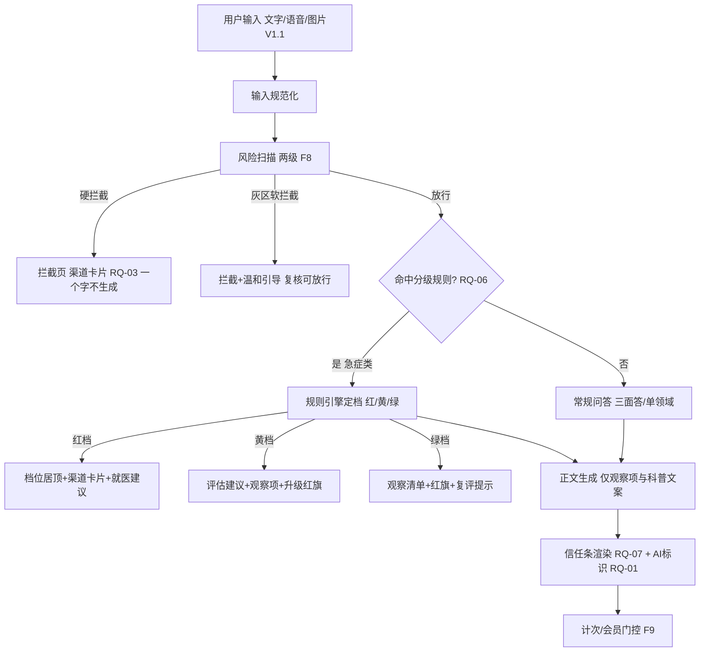
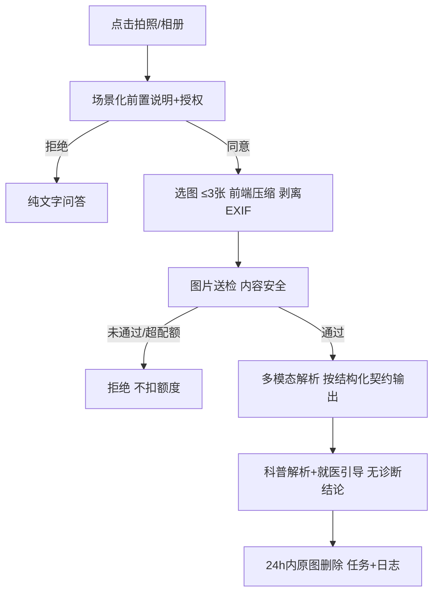

# 04 · Babe宝伴 产品需求说明书 V3.1（合规加固与留存补全版）

| 项目 | 内容 |
|---|---|
| 产品名称 | Babe宝伴｜AI 多智能体，家庭养育科普参考工具（仓库内部代号：jiaban） |
| 产品形态 | 微信小程序（C 端，首发唯一端）+ 后台管理 Web（内部） |
| 文档版本 | V3.1（合规加固与留存补全版） |
| 上一版本 | V3.0（V1.0 / V1.1 范围对齐版，2026-10-19） |
| 需求依据 | `01-需求来源/宝伴-家庭养育多智能体助手_需求说明文档_V1.0.md`（下称「需求说明」）；`待补充功能需求清单`（下称「补充清单」，R-01～R-14） |
| 覆盖版本 | **仅 V1.0 与 V1.1**；V2.0 及以后的方向不在本文档范围内 |
| 文档状态 | 待业务方评审 |
| 编制 | 产品经理 |
| 评审方 | 业务负责人、技术负责人、法务/合规、育儿与宠物内容专家、财务 |
| 契约依赖 | `宝伴-UI原型描述_V1.3.md`（界面基线）、`DESIGN.md`（视觉 token 真源）、`宝伴-数据模型文档_V1.1.md`、`宝伴-架构设计文档_V1.1.md`、`docs/API.md` |
| 最近更新 | 2026-10-20 |

> **本文档的效力**：V3.1 与 V3.0 共同构成研发、测试、设计、验收的**唯一需求基线**。V3.1 在 V3.0 全部章节之上做「增补与修订」；凡本文档未触及的章节（第 3 章角色权限、第 4 章全局规则、第 6 章架构约束等），**以 V3.0 为准继续生效**。两者冲突时，**以 V3.1 为准**。
> **范围效力**：本文档只覆盖 **V1.0（MVP）** 与 **V1.1（增量优化）** 两个版本。任何未列入第 2 章范围表的能力，一律视为范围外，不得据本文档展开开发。
> **编号规则（重要）**：本文档新增需求编号为 **RQ-01～RQ-14**（对应补充清单 R-01～R-14）。**不沿用清单中的「R-」前缀**，因为 V3.0 第 11 章风险登记册已占用 R-1～R-20 表示风险项；混用会在评审与排期中造成歧义。追溯关系见附录 A。

## V3.1 相对 V3.0 的修订说明

V3.0 完成「需求归位」，V3.1 做的是「**合规加固 + 留存补全 + 信任前置**」：把补充清单 14 项需求逐条落位到可开发粒度，并据此修订背景、目标、指标、验收与门禁。

| 编号 | 修订项 | 说明 |
|---|---|---|
| MR1 | **新增合规三条硬约束（RQ-01～RQ-03）** | ① AI 生成标识从「抽检项」升级为「上线阻塞门禁」（显式 + 隐式全链路，含分享长图与导出元数据）；② 新增《人工智能拟人化互动服务管理暂行办法》（2026-07-15 施行）适配：全局文案去拟人化、建立文案合规检查清单；③ 危机渠道清单从「事实填空」升级为「必须项需求」，补人工核验与定期更新机制 |
| MR2 | **新增问答核心三项（RQ-05～RQ-07）** | ① 图片输入定为 V1.1 必做、V1.0 预留多模态接口；② 新增「高频低危分级决策」模板，把「先拦后答」升级为「先拦、再分档、后回答」；③ 新增「信任叙事前置首答」规格与首答信任检查单 |
| MR3 | **新增留存与增长两项（RQ-08～RQ-09）** | ① 留存触达基础版（里程碑提醒、成长周报、每周一问）入 V1.0，数据模型预留订阅偏好结构；② 问答分享长图定入 V1.1，与 RQ-01 标识联动 |
| MR4 | **新增账号隐私与内容商业化五项（RQ-10～RQ-14）** | 家庭共享（V1.0 预留协作者结构）、隐私承诺产品化、轻工具前台化、育儿×宠物交叉主题包、宠物行为内容线，全部入 V1.1 |
| MR5 | **产品定位表述修订** | 全文将「AI 多智能体，家庭养育伙伴」统一修订为「AI 多智能体，家庭养育**科普参考工具**」，删除拟人化情感表述（详见 RQ-02 与 Q-54） |
| MR6 | **背景、目标、指标同步增补** | 第 1 章新增 PB-7～PB-9、G-8～G-11、SC-8～SC-11、UV-6～UV-7、M19～M25；第 2 章范围表与依赖表同步扩充 |
| MR7 | **非功能、数据、埋点、验收同步扩充** | 新增 NFR-C13/C14、NFR-S7/S8、NFR-P7、NFR-A6、NFR-Q6、NFR-I4；DR-26～DR-31；新事件字典；E2E-19～E2E-24；发布门禁新增 3 项阻塞项 |
| MR8 | **待拍板问题新增 Q-48～Q-54** | 渠道清单责任人、分级决策专家口径、儿童影像合规、提醒频次、LBS 合作范围、家庭共享法律形态、产品名拟人化风险 |

> **一句话结论**：V3.1 = V3.0 的全部基线 + 14 项补充需求落位到可开发粒度 + 合规从「设计到位」升级为「门禁到位」+ 留存从「零抓手」升级为「基础版有抓手」。

---

## 需要业务方补充或确认的清单（V3.1 增量速览）

V3.0 的 12 项仍然有效（见 V3.0 速览表）。V3.1 新增 7 项：

| # | 待确认内容 | 为什么必须由你定 | 未定前的默认处理 | 详见 |
|---|---|---|---|---|
| 13 | 危机渠道清单责任人、来源与复核周期 | RQ-03 硬前提，严禁编造号码 | 系统留占位，渠道卡片显示「维护中」；上线前必须回填并核验 | Q-48 / §3.3 |
| 14 | 分级决策档位口径与首批规则清单 | RQ-06 涉及「让不让人去医院」，需育儿专家逐条确认 | 已给 5 类首批模板（发烧 / 呕吐 / 外伤 / 误食低危 / 宠物急症观察），按「保守从严」实现 | Q-49 / §3.6 |
| 15 | 儿童影像（图片提问）的存储与最小化口径 | RQ-05（V1.1）合规硬前提 | 前端压缩 → 送检 → 推理后 24 h 内删除原图；不用于训练 | Q-50 / §3.5 |
| 16 | 订阅消息频次与模板报备 | RQ-08 触达节奏，超频会被微信限制或引发投诉 | 默认每周 ≤2 条订阅消息 + 月报 1 条；模板按微信规范报备 | Q-51 / §3.8 |
| 17 | LBS 合作医院范围与 POI 数据来源合规 | RQ-04（V1.1）「就近转介」的数据源 | 仅推荐官方与持牌机构 POI；不排名、不挂导流链接 | Q-52 / §3.4 |
| 18 | 家庭共享的监护同意法律形态 | RQ-10（V1.1）多人访问儿童档案的授权主体问题 | V1.0 只做数据结构预留，不开放功能 | Q-53 / §3.10 |
| 19 | 产品名「宝伴」与「家庭养育伙伴」表述是否构成拟人化风险 | RQ-02 定性：拟人化互动服务 vs 知识问答工具的边界 | 全文按「科普参考工具」定位执行；名称是否保留待法务出结论 | Q-54 / §3.2 |

---

# 第 1 章 产品概述（V3.1 增补与修订）

## 1.1 一句话定位（修订）

**Babe宝伴是面向「家庭养育」垂直领域的科普参考工具：不做通用 AI 助手，不做情感陪伴，只做两件事——0–6 岁分龄怎么养孩子，猫狗怎么科学养，并把「孩子和宠物一起生活」这类单一工具答不全的复合问题一次答清。**

> **修订说明（MR5）**：删除 V3.0 中「家庭养育伙伴」的表述。原因与完整口径见 RQ-02：按《人工智能拟人化互动服务管理暂行办法》（2026-07-15 施行），「智能客服、知识问答、工作助手等不涉及持续性情感互动的服务」不属于拟人化互动服务监管对象；产品必须以「科普工具」而非「陪伴伙伴」的定位对外，主动远离监管射程。产品名「宝伴」是否保留为风险项，见 Q-54。

三条边界同时成立才算范围内（继承 V3.0 §1.1，不变）：

| 维度 | 范围内 | 范围外（一律拒答或不做） |
|---|---|---|
| 对象 | 0–6 岁儿童；伴侣宠物（V1.0：猫 / 狗；V1.1：增加兔、仓鼠等小宠） | 6 岁以上儿童、中小学生、非伴侣动物、野生动物 |
| 主题 | 养育、行为引导、安全与家庭互动 | 学科辅导、作业代做、疾病诊断、心理治疗、算命 |
| 输出 | 科普参考，档位化、可追溯、带适用前提 | 诊疗结论、确定性判定、终身性格结论 |

**战略边界**：只做纵深（把这两块做准、做安全、做快），不做横向（更多年龄段、更多端、更多业务形态）。

## 1.2 背景与问题（增补）

继承 V3.0 §1.2 的 PB-1～PB-6，V3.1 增补三项外部事实。**其中 PB-7、PB-8 为监管事实（已核实法规原文口径），PB-9 为研究口径数据（标注待复核）。**

| 编号 | 痛点 | 谁受影响 | 现状替代方案 | 为什么不够好 |
|---|---|---|---|---|
| PB-7 | **同类产品因 AI 标识违规被责令下线** | 产品与研发 | 部分小程序把 AI 标识当文案装饰或仅在角落展示 | 四川某同构小程序（AI 对话 + 图片生成）因四项标识违规叠加被责令下线。标识缺失不再是「扣分项」而是「下线项」；V3.0 NFR-C5 有设计但未列入发布门禁，验收强度不足 |
| PB-8 | **拟人化互动服务新规施行** | 产品、文案、运营 | 多数产品用「AI 伙伴 / 智能陪伴」话术拉近距离 | 《人工智能拟人化互动服务管理暂行办法》五部门 2026-04-10 公布、**2026-07-15 施行**：严禁向未成年人提供虚拟亲属、虚拟伴侣等虚拟亲密关系服务。儿童产品沾「陪伴 / 伙伴 / 聊天朋友」话术即触碰敏感区；而知识问答类服务明确不在该办法射程内——**定位表述本身就是合规动作**，改动成本极低 |
| PB-9 | **家长信任与 AI 准确性存在缺口（trust-accuracy gap）** | 全部家长用户 | 直接信任 AI 的流畅回答 | 研究口径：通用模型儿科问答超 25% 存在错误，但约 73.1% 的家长仍照单全收【数据来源待补充：引用研究报告原文与口径后定稿】。「哭声识别翻车」「60ml 喂养量」等公开事故已透支家长信任；**首答决定留存**，首次回答若不能自证可信，用户不会给第二次机会 |

> PB-7 / PB-8 的事实口径已按公开报道与法规原文核实（法规名称与施行日期经联网核实，2026-10-20）；PB-9 的具体百分比为补充清单引用口径，**列为待验证假设**，评审时由法务与内容专家确认是否落入对外文案（默认不对外引用，仅作内部决策依据）。

## 1.3 产品目标（增补）

继承 V3.0 §1.3 的 G-1～G-7 及其验收口径，V3.1 增补：

| 编号 | 目标 | 类型 | 可验收口径 | 归属版本 |
|---|---|---|---|---|
| G-8 | **AI 生成标识全链路零违规**：显式标识 + 隐式标识覆盖页面、分享长图、导出文件三条链路 | 合规 | 标识抽检合格率 100%；列入发布门禁（§7.3）；上线前完成安全评估并留档 | V1.0 |
| G-9 | **高频低危场景给出「要不要马上去医院」的分级引导**：让「先拦后答」从拒绝升级为有出路的引导 | 能力 | 5 类首批分级模板上线；分级输出命中后「未就医却无观察项」的抽检为 0；分级采纳率 M19 ≥40% | V1.0 |
| G-10 | **留存有基础抓手**：里程碑提醒、成长周报、每周一问上线 | 增长 | 触达开启率 ≥30%；提醒回流率 M21 ≥15%（北极星 M1 7 日留存 ≥25% 的直接支撑） | V1.0（基础版） |
| G-11 | **首答即建立信任**：来源等级、月龄适配、档位与禁忌、AI 标识在首次回答同屏可见 | 信任 | 首答信任检查单（§3.7）10 项全绿；问答 7 日留存与首答完整度的正相关在灰度期校验 | V1.0 |

**目标之间的取舍原则（修订）**：G-4（安全）> G-8/G-6（合规）> G-1/G-3（能力）> G-9（分级引导）> G-2（增长）> G-10/G-5（留存与商业）> G-11（信任体验）。冲突时按此顺序让步。

> 修订说明：G-8 与 G-6 并列第二——标识违规与内容违规同等致命（PB-7 为实证）；G-11 排在最后是因为它是体验增强项，可以在灰度期迭代，但**不得反向挤占 G-9 的开发资源**（分级决策直接关系急症场景的用户安全）。

## 1.4 目标用户与使用场景（增补）

### 1.4.1 用户画像

继承 V3.0 §1.4.1 的五类画像（P-婴儿 / P-幼儿 / P-学前 / P-宠物 / P-交叉）及其「待验证假设」声明，V3.1 对其中两类补充**细分场景画像**，不新增画像类目：

| 归属画像 | 细分场景 | 特征 | 对 V3.1 新需求的指向 |
|---|---|---|---|
| P-婴儿 / P-幼儿 | **夜间急症焦虑型**：孩子发烧 / 呕吐发生在 22:00–6:00，家长第一反应是「要不要现在去医院」 | 焦虑度极高、决策时间窗极短、单人决策 | RQ-06 分级决策；RQ-03 危机渠道卡片；RQ-07 首答信任 |
| P-宠物 | **行为问题困扰型**：狗拆家 / 乱尿 / 护食 / 分离焦虑，非疾病但高频消耗耐心 | 求解意愿强、问诊平台不愿接（不产生医疗收入） | RQ-14 行为内容线；RQ-12 轻工具 |

**非目标用户（不变）**：6 岁以上儿童家庭、需要学科辅导的家庭、机构客户、需要诊疗结论的用户。

### 1.4.2 典型场景卡（增补）

继承 V3.0 SC-1～SC-7，V3.1 增补四张，同时作为第 7 章 E2E 用例的业务来源：

| 编号 | 场景 | 角色与触发 | 期望结果 | 成功标准 | 对应需求 |
|---|---|---|---|---|---|
| SC-8 | **深夜 3 月龄宝宝发烧 37.8℃** | 新手爸爸，23:40，情绪紧张 | 信号灯式分级输出：档位判断 + 观察项清单 + 明确就医建议，页首带 AI 标识与月龄适配标识 | 8 s 内得到「档位 + 下一步」；无任何诊疗结论；育儿侧禁忌项可见 | RQ-06 / RQ-07 |
| SC-9 | **拍下宠粮配料表问「能不能喂」** | 养猫家庭，V1.1 | 拍照 → 图片安全扫描 → 配料解析（科普定位） | 图片 24 h 内删除、不用于训练；解析带「参考配料表标注」前提 | RQ-05（V1.1） |
| SC-10 | **疫苗提醒把用户拉回来** | 宝宝 6 月龄，用户 3 天未打开小程序 | 订阅消息提醒接种节点 → 点击直达问答 / 档案 | 触达开启率 ≥30%；提醒打开→提问转化可归因 | RQ-08 |
| SC-11 | **把「三面答」安全提醒分享到家长群** | 交叉家庭，V1.1 | 问答结果生成长图，图内含完整免责与「内容由 AI 生成」显式标识 | 长图标识抽检合格率 100%；分享带 `share_trace_id` 可归因 | RQ-09（V1.1）/ RQ-01 |

## 1.5 要解决的核心问题（增补）

继承 V3.0 §1.5 的 6 个问题，V3.1 增补：

7. 能否在「不构成诊疗建议」的前提下，回答家长**最高频最焦虑**的那个问题——「现在要不要去医院」？（→ RQ-06 分级决策）
8. 能否让「儿童信息最小化、单独同意、不用于训练」这些**本来就要求做的合规动作**，变成用户**可感知、可信任**的产品资产？（→ RQ-11 隐私承诺；RQ-07 信任叙事）

> 解法映射（增量）：问题 7 → RQ-06 信号灯档位 + 就医建议 + 禁忌可视化；问题 8 → RQ-11 首启隐私承诺流程 + RQ-07 来源等级徽标。

## 1.6 价值主张与差异化（增补）

继承 V3.0 §1.6 的 UV-1～UV-5 及「关于差异化的诚实说明」，V3.1 增补：

| 编号 | 主张 | 支撑能力 | 能否立住 |
|---|---|---|---|
| UV-6 | **「不止拦住，还给档位」**：高危拦截之外，对高频低危场景给出信号灯式分级与观察项清单 | RQ-06 分级模板 + 专家口径（Q-49） | ✅ 能立住（通用模型与竞品均不重投入此环节；夜间急症是最高频真实路径，蚂蚁 AQ 深夜咨询暴涨 28 倍、医院系小乙靠分诊起量为公开报道口径【待端内实测复核】） |
| UV-7 | **「合规即信任」**：隐私承诺页 + 首答信任版式，把合规动作产品化 | RQ-07 / RQ-11 | ⚠️ 部分立住（前提是文案与交互诚实：不夸大、不把承诺写成营销话术；抽检监督） |

## 1.7 成功衡量指标（增补）

北极星指标不变（M1：7 日留存 ≥25%）。一级 / 二级指标增补：

| 编号 | 指标 | 定义 | 目标值 | 观测方式 | 版本 |
|---|---|---|---|---|---|
| M19 | 分级决策采纳率 | 分级输出后 24 h 内点击「就医建议」或回访说明「已按观察项执行」的会话数 ÷ 分级输出会话数 | ≥40% | 埋点 `triage_action_click` + 回访问卷 | V1.0 |
| M20 | 渠道卡片点击率 | `risk_channel_click` 次数 ÷ 渠道卡片展示次数 | ≥25% | 埋点 | V1.0 |
| M21 | 提醒回流率 | 从订阅消息 / 周报进入并产生行为的用户数 ÷ 触达用户数 | ≥15% | 埋点 `reminder_open` → `qa_submit` 归因 | V1.0 |
| M22 | 触达开启率 | 开启提醒授权的用户数 ÷ 建档用户数 | ≥30% | 埋点 `reminder_optin` | V1.0 |
| M23 | 分享长图标识合格率 | 抽检中带完整显式标识的长图数 ÷ 抽检长图数 | **100%** | 服务端渲染模板断言 + 人工抽检 | V1.0（模板）/ V1.1（问答长图） |
| M24 | 图片问答合规合格率 | 图片送检执行且原图按期删除的请求数 ÷ 图片请求数 | **100%** | 服务端断言 | **V1.1** |
| M25 | 首答信任检查单通过率 | 新版本灰度期首答检查单全绿的抽样会话比例 | ≥95% | 人工抽检（每版本 ≥50 条） | V1.0 |

> M19 依赖用户回访自报，存在低估；灰度期先观测 M19′（`triage_action_click` 率）作为代理指标，目标 ≥15%。M20 / M21 的目标值为**内部假设**，上线后 4 周用真实基线校准一次。

## 1.8 竞争格局（增补）

继承 V3.0 §1.8 的五类对照与三个结论，V3.1 补一张「分诊与多模态能力对照表」：

| 能力 | 通用大模型 | 育儿垂类 App（米卡 AI 等） | 宠物问诊平台（宠智灵等） | Babe宝伴 |
|---|---|---|---|---|
| 高危输入拦截 + 一个字不生成 | ❌ | 未见 | 未见 | ✅ F8 |
| 「要不要去医院」分级引导 | 无档位、不稳定 | 未见公开能力 | 未见 | ✅ RQ-06 |
| 图片识别（皮疹 / B 超 / 药品 / 配料表） | 有 | 米卡 AI B 超解读、妈妈网皮肤识别 | 宠智灵药品识别 | ⏳ RQ-05（V1.1） |
| 育儿 × 宠物交叉三面答 | ❌ | ❌（只答育儿） | ❌（只答宠物） | ✅ F6 |
| 危机转介 + 就近就医 LBS | 无 | 未见 | 有真人问诊网络（新瑞鹏 / 微宠医 / 京东健康，5000+ 医院，可合作） | ⏳ RQ-03（V1.0）/ RQ-04（V1.1） |

> 竞品能力为公开报道口径（V3.0 §12.4 第 10 项已列「端内实测复核」为待办），只用于量级判断与评审讨论，不作为对外宣传依据。

## 1.9 合规地位声明（增补）

继承 V3.0 §1.9 全部条目，V3.1 增补：

- 本产品定位为**知识问答类科普工具**，不提供持续性情感互动，不属于《人工智能拟人化互动服务管理暂行办法》定义的拟人化互动服务；产品以此定位自查全部文案。
- 全局禁用拟人化情感表述清单见 RQ-02；产品名「宝伴」的最终去留由法务出结论（Q-54）。
- 分享长图、导出文件必须带 AI 显式标识；页面固定位常显 AI 标识（RQ-01）。

---

# 第 2 章 版本范围与路线（V3.1 增补）

## 2.1 版本定义（修订）

| 版本 | 定位 | 交付目标 | 出口标准 |
|---|---|---|---|
| **V1.0（MVP）** | 从 0 到 1，跑通「问—答—拦—分档—付费—召回」闭环 | 验证产品差异化，测留存与付费转化 | V3.0 第 10 章上线门槛全绿 + V3.1 §7.3 门禁全绿；M1/M6/M7/M8/M19′/M20/M22/M23 达标 |
| **V1.1（增量）** | 在既有两个板块内做得更准、更安全、更快、更可见 | 提升协同质量、扩充宠物覆盖、优化测评转化、补图片输入与增长工具 | 第 13 章出口标准全绿 + V3.1 §3 各 V1.1 节验收；M9/M10/M24 达标 |

> 版本关系不变：V1.1 不含任何新业务形态与年龄段扩张，不得反向影响 V1.0 上线节奏。**但 RQ-01～RQ-03、RQ-06～RQ-08 属于 V1.0 上线阻塞项，缺失即不得发布。**

## 2.2 V1.0 范围清单（增补）

在 V3.0 §2.2 的 F1～F12 基础上，V1.0 新增以下必须项：

| 域 | 编号 | 能力 | 优先级 | 需求来源 |
|---|---|---|---|---|
| 风险控制 / 合规 | **RQ-01** | AI 生成标识全链路合规（显式 + 隐式 + 安全评估 + 发布门禁） | **M（上线阻塞）** | 补充清单 R-01 / PB-7 |
| 合规 / 后台 | **RQ-02** | 拟人化合规适配（全局文案审查 + 检查清单 + 禁用词入库 F12 词库） | **M（上线前置检查）** | 补充清单 R-02 / PB-8 |
| 风险控制 | **RQ-03** | 危机渠道清单落地（真实渠道 + 人工核验 + 定期更新机制） | **M** | 补充清单 R-03 / V3.0 §12.4 第 4 项 |
| 育儿问答 / 宠物问答 | **RQ-06** | 高频低危「分级决策」模板（信号灯档位 + 观察项 + 就医建议） | **M** | 补充清单 R-06 |
| 育儿问答 / 宠物问答 | **RQ-07** | 信任叙事前置首答（来源徽标 + 月龄 / 宠龄适配 + 档位与禁忌可视化 + 首答信任检查单） | **M** | 补充清单 R-07 / PB-9 |
| 首页与入口 / 个人中心 | **RQ-08（基础版）** | 留存与主动触达：里程碑提醒、成长周报、每周一问；数据模型预留订阅偏好与协作者结构 | **M** | 补充清单 R-08 |

同时 **V1.0 数据模型预留**（只建结构、不做功能）：图片提问字段（RQ-05）、分享记录（RQ-09）、协作者（RQ-10）、LBS 转介记录（RQ-04）——预留约束见 §6.1。

## 2.3 V1.1 范围清单（增补）

在 V3.0 §2.3 的 V11-1～V11-3 基础上增补：

| 编号 | 增量项 | 对应需求 | 交付目标 | 详见 |
|---|---|---|---|---|
| V11-4 | 图片提问能力 | RQ-05 | 拍照 / 相册提问（皮疹、便便、呕吐物、宠粮配料表、药品包装），图片安全扫描与儿童影像隐私合规全链路 | §3.5 |
| V11-5 | LBS 就近就医转介 | RQ-04 | 宠物 / 儿童急症场景按用户位置推荐合规医院 / 宠物医院 | §3.4 |
| V11-6 | 问答分享卡片 | RQ-09 | 问答（尤其三面答安全提醒）可生成长图分享，标识全链路 | §3.9 |
| V11-7 | 家庭共享与协作者角色 | RQ-10 | 家庭成员以自己微信授权访问同一档案，角色权限与监护同意留痕 | §3.10 |
| V11-8 | 隐私承诺产品化 | RQ-11 | 「隐私承诺」页面 + 首启流程 | §3.11 |
| V11-9 | 轻工具前台化 | RQ-12 | 发烧自查清单、宠物行为自查、宠粮配料表解析等前台轻工具 | §3.12 |
| V11-10 | 育儿 × 宠物交叉主题包 | RQ-13 | 孕期 + 宠物共存、抓咬伤事后安抚、过敏共居等主题内容包（并入专题包商业化） | §3.13 |
| V11-11 | 宠物行为内容线强化 | RQ-14 | 拆家 / 乱尿 / 护食 / 分离焦虑主题包加深，红旗前置；可作独立付费内容线 | §3.14 |

## 2.4 明确非目标（增补）

继承 V3.0 §2.4 的 NG-1～NG-9，V3.1 增补：

| 编号 | 非目标 | 原因 | 是否会重新评估 |
|---|---|---|---|
| NG-10 | LBS 导航接续、挂号预约、在线问诊撮合、医院导流佣金 | RQ-04 只做「合规机构推荐」，交易与导流涉及医疗广告合规与利益冲突，超出科普工具定位 | 本规划期内不评估 |
| NG-11 | 图片直接输出诊断结论（皮疹定性、B 超判读结论、药品剂量推荐） | 合规红线（NG-4 同源）；图片输入只做「科普解析 + 就医引导」 | 不评估 |
| NG-12 | 向未成年人提供虚拟亲属 / 虚拟伴侣等虚拟亲密关系服务 | 法规红线（PB-8） | 不评估 |

## 2.5 优先级定义（修订）

在 V3.0 §2.5 的 M / P1 / P2 基础上，V3.1 引入**上线阻塞**标记：

| 级别 | 含义 | 处理规则 |
|---|---|---|
| M | MVP 必须上线 | 缺失则不得发布 |
| **M（上线阻塞）** | M 中的最高档：缺失则**发布门禁直接失败** | 与发布门禁绑定（§7.3）；排期上不得让位于任何 M / P1 项 |
| P1 | MVP 尽力上线 | 可延至 V1.1，但需在 V3.0 §12.3 登记 |
| P2 | 本版不做 | 不进入排期 |

**RQ-01～RQ-03、RQ-06～RQ-08 全部为 M（上线阻塞）或 M（上线前置检查）**；RQ-04～RQ-05、RQ-09～RQ-14 为 V1.1 交付项（对应 P1/P2 语义在 V1.0 内均为 P2，但已在 V1.1 立项，不再是「不排期」状态）。

## 2.6 前置依赖与假设（增补）

继承 V3.0 §2.6 的 D1～D9，V3.1 增补：

| 编号 | 依赖项 | 类型 | 影响 | 状态 |
|---|---|---|---|---|
| D10 | 真人问诊网络合作意向（新瑞鹏 / 微宠医 / 京东健康等） | 外部 | 支撑 RQ-04 的机构推荐口径与后续合作 | V1.0 仅需「口径确认」；合作签约为 V1.1 事项 |
| D11 | 位置能力（`wx.getLocation` 类目资质 + POI 数据源） | 外部 | 阻塞 RQ-04 | V1.1 前确认；POI 仅采用官方与持牌机构数据 |
| D12 | 微信内容安全能力**图片**送检配额（区分儿童影像场景） | 外部 | 阻塞 RQ-05 | 待核对配额规则（D6 的图片部分单列） |
| D13 | 危机渠道清单责任人与复核机制 | 内部 | 阻塞 RQ-03 上线 | 待业务方指定（Q-48）；默认由内容运营维护、法务核验 |
| D14 | 订阅消息模板报备（提醒 / 周报 / 每周一问三类） | 外部 | 阻塞 RQ-08 触达 | 模板报备与开发并行，第 1 周提交 |

## 2.7 平台与兼容性范围（增补）

继承 V3.0 §2.7，增补：

| 项 | 范围 |
|---|---|
| 敏感权限 | 相机 / 相册（RQ-05）与位置（RQ-04）均为**场景化前置说明**授权：仅在用户主动触发对应功能时申请，拒绝授权提供文字问答降级路径，不阻塞主流程 |
| 订阅消息 | 基础库 ≥2.20.2 的订阅消息能力；模板与频控见 RQ-08 |

---

# 第 3 章 功能需求增补（RQ-01 ～ RQ-14 完整规格）

> 本章是 V3.1 的主体。每项需求按「归属域 / 优先级 / 版本 → 目标 → 用户故事与验收标准 → 详细规格 → 边界与异常六查 → 埋点」展开，粒度对齐 V3.0 第 5 章。AC 编号规则：`AC-RQxx-nn`。
> **追溯总表**：

| RQ | 名称 | 归属域 | 优先级 | 版本 | 关联章节 | 关联指标 |
|---|---|---|---|---|---|---|
| RQ-01 | AI 生成标识全链路合规 | F8 / F7 / F10 / NFR-C5 | M（上线阻塞） | V1.0 | §3.1 | M23 |
| RQ-02 | 拟人化合规适配 | F12 / 全局文案 | M（上线前置检查） | V1.0 | §3.2 | 抽检 |
| RQ-03 | 危机渠道清单落地 | F8 | M | V1.0 | §3.3 | M20 |
| RQ-04 | LBS 就近就医转介 | F8 / F5 / F4 | 中 / 可选 | V1.1 | §3.4 | M24 邻项 |
| RQ-05 | 图片输入能力 | F4 / F5 / F2 | 高（V1.1 必做） | V1.1 | §3.5 | M24 |
| RQ-06 | 高频低危分级决策 | F4 / F5 / F6 / 6.3 | M（上线阻塞） | V1.0 | §3.6 | M19 |
| RQ-07 | 信任叙事前置首答 | F4 / F5 / F6 | M | V1.0 | §3.7 | M25 |
| RQ-08 | 留存与主动触达（基础版） | F3 / F11 / F2 | M | V1.0 | §3.8 | M21/M22 |
| RQ-09 | 问答结果分享卡片 | F10 / F4 / F6 | 中 / 可选 | V1.1 | §3.9 | M23 |
| RQ-10 | 家庭共享与协作者角色 | F1 / F2 | 中 / 可选 | V1.1 | §3.10 | — |
| RQ-11 | 隐私信任卖点产品化 | F1 / F11 | 中 / 可选 | V1.1 | §3.11 | — |
| RQ-12 | 轻工具前台化 | F12 / F3 / F9 | 中 / 可选 | V1.1 | §3.12 | — |
| RQ-13 | 育儿 × 宠物交叉主题包 | F9 / F12 | 中 / 可选 | V1.1 | §3.13 | — |
| RQ-14 | 宠物行为问题内容线强化 | F5 / F12 / F9 | 低 / 可选 | V1.1 | §3.14 | — |

---

## 3.1 RQ-01 AI 生成标识全链路合规

> **归属**：F8（拦截页与渠道卡片）、F4/F5/F6（回答页）、F7（测评报告）、F10（历史与分享）、§7.4 NFR-C5（强化）｜**优先级**：M（上线阻塞）｜**版本**：V1.0

### 3.1.1 目标

把 V3.0 NFR-C5 从「有设计、抽检项」升级为「全链路可验证、发布门禁阻塞项」：任何可能离开产品的内容载体（页面、分享长图、导出文件）都必须同时带显式与隐式 AI 标识，任何一处缺失即阻塞发布。依据 PB-7：同类产品因标识违规被责令下线。

### 3.1.2 用户故事与验收标准

| ID | 用户故事 | 优先级 |
|---|---|---|
| US-RQ01-01 | 作为家长用户，我希望一眼知道这段内容是 AI 生成的，以便自行斟酌采纳程度 | M |
| US-RQ01-02 | 作为群成员，我希望收到的分享长图自带 AI 标识，以便不误以为真人撰写的权威建议 | M |
| US-RQ01-03 | 作为合规负责人，我希望上线前有安全评估结论与标识抽检报告，以便应对监管检查 | M |
| US-RQ01-04 | 作为研发，我希望标识由服务端模板强制渲染而非前端拼装，以便不存在「忘加」的可能 | M |

**验收标准**

| ID | 验收标准（Given / When / Then） |
|---|---|
| AC-RQ01-1 | Given 任一回答页 / 报告页 / 拦截页，When 渲染，Then 页面**固定位**展示「内容由 AI 生成，仅供参考，不构成诊疗建议」标识组件；标识组件由服务端在响应契约（6.4）中以下发，不由前端文案拼装 |
| AC-RQ01-2 | Given 任一分享长图（测评报告图、问答长图），When 生成，Then 图内显式标识**占比 ≥15%、出现 ≥2 次**（对齐 V3.0 Q-22 渲染规格）；缺任一项即生成失败并告警 |
| AC-RQ01-3 | Given 任一导出文件（长图 PNG、后续 PDF），When 生成，Then 文件元数据写入隐式标识字段（生成工具标识、内容类型、`ai_generated=true`、时间戳）；元数据可被程序化校验 |
| AC-RQ01-4 | Given 发布门禁执行，When 抽检，Then 覆盖「页面固定位 / 分享长图 / 导出元数据」三条链路各 ≥20 个样本，合格率 100%；任一条链路不合格即**阻塞发布** |
| AC-RQ01-5 | Given 上线前，When 合规检查，Then 已完成生成式 AI 内容安全评估并留档 ≥3 年（与 NFR-C7 PIA 同档管理） |
| AC-RQ01-6 | Given 用户尝试遮挡或裁剪长图，When 分享，Then 显式标识位于**不易被单次裁剪完整去除**的位置（图内两处对角分布），且产品不做「纯净版」选项 |

### 3.1.3 详细规格

| 项 | 规格 |
|---|---|
| 标识组件 | 服务端下发字段 `ai_label = { visible: true, text_id, position }`；前端只负责渲染 `text_id` 对应文案，**禁止前端自定义标识文案** |
| 覆盖页面 | F3 首页底部说明位、F4/F5/F6 回答页、F7 测评报告页、F8 拦截页（拦截页仅输出渠道卡片，同样带标识）、F10 历史详情 |
| 覆盖载体 | 长图（测评图 / 问答图）、导出文件元数据、（V1.1 起含）分享卡片 |
| 隐式标识 | 统一写入 PNG `tEXt`/`eXIf` chunk：`software=BabeJiabanAI`、`ai_generated=1`、`content_type`、`generated_at`；服务端生成端统一实现，格式常量化 |
| 监管衔接 | 与「生成式 AI 服务备案」（NFR-C6）联动：备案号随显式标识文案一并展示 |

### 3.1.4 边界与异常六查

| 类别 | 场景 | 期望行为 |
|---|---|---|
| 空态 | 标识文案配置缺失 | 前端回退到**内置兜底文案**并上报 `ai_label_fallback`；绝不出现无标识页面 |
| 极值 | 长图内容超长被截断 | 标识区独立于内容区渲染，截断只影响正文不影响标识 |
| 并发 | 同一会话连续生成多张长图 | 每张均带标识与唯一 `render_id`，可追溯 |
| 失败 | 元数据写入失败 | 生成流程判失败，不产出无隐式标识的导出文件 |
| 权限 | 后台人员尝试关闭标识配置 | 该配置**不开放后台开关**；唯一变更途径为代码发布 + 合规评审 |
| 幂等 | 同一长图重复导出 | 元数据一致，`render_id` 可关联 |

### 3.1.5 埋点

`ai_label_view`（页面类型）、`ai_label_fallback`（兜底触发）、`share_render_fail`（标识校验失败）。

---

## 3.2 RQ-02 拟人化合规适配

> **归属**：全局文案 / F12（词库与抽检）/ §7.4 NFR-C12（强化）｜**优先级**：M（上线前置检查）｜**版本**：V1.0

### 3.2.1 目标

按《人工智能拟人化互动服务管理暂行办法》（2026-07-15 施行）与「科普工具」定位，完成全量文案的拟人化清洗，并建立**可持续执行的**文案合规检查清单，使产品稳定处于「知识问答服务」而非「拟人化互动服务」的监管射程之外。

### 3.2.2 用户故事与验收标准

| ID | 用户故事 | 优先级 |
|---|---|---|
| US-RQ02-01 | 作为家长，我希望清楚这是查询工具而不是「AI 朋友」，以便对输出保持正确预期 | M |
| US-RQ02-02 | 作为合规负责人，我希望上线前每一句对外文案都过检查清单，以便不触碰拟人化红线 | M |
| US-RQ02-03 | 作为运营，我希望后续新增文案有清单可依，以便不靠个人经验把关 | M |

**验收标准**

| ID | 验收标准（Given / When / Then） |
|---|---|
| AC-RQ02-1 | Given 全量对外文案（页面文案、System Prompt、知识库条目、测评题干与解读、分享图文案、订阅消息模板、客服话术），When 发布前扫描，Then **拟人化禁用表述零命中**（清单见 3.2.3） |
| AC-RQ02-2 | Given 测评功能与四象命名，When 审查，Then 命名与解读文案呈「科普工具」定位：无情感陪伴暗示、无「了解你家宝宝是个怎样的孩子」式人格断言，保留 V3.0 §1.9「趣味命名、非宿命判定」三声明 |
| AC-RQ02-3 | Given 产品首启与免责弹窗，When 展示，Then 定位表述为「养育科普参考工具」；不存在「陪伴」「伙伴」「懂你」「贴心朋友」类表述（产品名 Q-54 单列） |
| AC-RQ02-4 | Given 拟人化禁用词清单，When 入库，Then 并入 F12 词库域（类型=`anthropomorphic`），扫描覆盖 System Prompt 与固定文案的 CI 检查 |
| AC-RQ02-5 | Given 上线后新增或修改文案，When 走发布流程，Then 必须附「文案合规检查清单」勾选记录；未附不合并 |
| AC-RQ02-6 | Given 产品为未成年人场景（家长代儿童使用），When 服务设计，Then 不存在任何模拟人格、持续情感互动、记忆式亲密对话机制（与 V3.0 §6 架构一致，无此类设计） |

### 3.2.3 详细规格

| 项 | 规格 |
|---|---|
| 禁用表述清单（首批） | 「AI 育儿伙伴 / 智能陪伴 / 贴心小助手 / 懂你的 AI / AI 朋友 / 像家人一样 / 一直陪着你 / 宝宝的好朋友」及同义变体；「聊聊天」「说说话」类情感互动邀请语 |
| 替代表述库 | 「养育科普参考工具 / 分龄养育查询 / 养育参考建议」；交互话术用「查询 / 查看 / 参考」替代「聊 / 陪伴」 |
| 定性依据 | 《办法》适用对象为「模拟自然人人格特征…且能开展**持续性情感互动**的服务」；智能客服、知识问答、工作助手明确不适用（2026-04-10 五部门发布，2026-07-15 施行）。产品无需按《办法》建未成年人模式，但**一旦文案滑向陪伴定位即落入射程**——清单是防线 |
| 检查清单（随 MR 执行） | ① 是否含禁用表述；② 是否暗示情感关系或人格；③ 是否承诺「随时都在 / 秒回」类陪伴能力；④ 是否可能被理解为向儿童直接提供服务；⑤ 免责与 AI 标识是否完整 |
| 产品名风险 | 「宝伴」含「伴」字，是否构成拟人化暗示由法务评估（Q-54）；未出结论前，对外物料中产品名旁必须紧跟「养育科普参考工具」副标 |

### 3.2.4 边界与异常六查

| 类别 | 场景 | 期望行为 |
|---|---|---|
| 空态 | 替代表述库未配置 | CI 扫描直接失败，禁止发布 |
| 极值 | 运营用谐音 / 变体绕过扫描 | 词库含常见变体映射；月度抽检兜底 |
| 失败 | 扫描工具不可用 | 发布流程阻断（fail-closed） |
| 权限 | 词库类型 `anthropomorphic` 的编辑权 | 内容运营编辑、超管发布（对齐 PA-05） |
| 并发 | 多分支同时改文案 | CI 在合并时统一扫描最新全量 |
| 幂等 | 重复扫描 | 以 MR 合并号为幂等键 |

### 3.2.5 埋点

`copy_scan_result`（后台 CI 事件：扫描对象、命中数）、`copy_scan_block`（阻断发布）。

---

## 3.3 RQ-03 危机渠道清单落地

> **归属**：F8.5 渠道卡片 / F12 后台（PA-10 渠道清单维护）｜**优先级**：M｜**版本**：V1.0

### 3.3.1 目标

把 V3.0 §12.4 第 4 项「事实填空」升级为可执行需求：补齐 F8 渠道卡片依赖的**真实**求助渠道清单（心理援助 / 儿保急诊 / 宠物急诊），建立人工核验与定期更新机制，让「严禁编造号码」从红线变成**可验收的机制**。

### 3.3.2 用户故事与验收标准

| ID | 用户故事 | 优先级 |
|---|---|---|
| US-RQ03-01 | 作为情绪崩溃的家长，我希望渠道卡片上的电话真的打得通，以便在最需要的时候得到帮助 | M |
| US-RQ03-02 | 作为养宠家庭，我希望宠物急症场景也有可拨打的渠道，而不是只有儿童渠道 | M |
| US-RQ03-03 | 作为内容运营，我希望渠道清单有责任人、有复核周期、有过期提醒，以便号码失效时能及时更新 | M |
| US-RQ03-04 | 作为合规负责人，我希望每次核验有留痕，以便监管检查时能证明渠道信息经过人工核验 | M |

**验收标准**

| ID | 验收标准（Given / When / Then） |
|---|---|
| AC-RQ03-1 | Given 上线前，When 检查清单，Then 三类渠道各 ≥1 条**经人工拨测核验**的真实渠道：心理援助（含全国统一心理援助热线与未成年人专线）、儿保 / 儿科急诊指引、宠物 24h 急诊指引；渠道字段含名称、号码、适用场景、服务时段、覆盖地域、核验人与核验时间 |
| AC-RQ03-2 | Given 任一渠道条目，When 展示，Then 「号码」与「名称」来自后台渠道清单表；**前端与常量文件中不存在任何硬编码号码**（CI 断言） |
| AC-RQ03-3 | Given 渠道清单为空或某类无可用条目，When 触发拦截页，Then 展示占位与「渠道信息维护中」，同时触发后台告警；**不得编造或使用过期号码** |
| AC-RQ03-4 | Given 清单条目设置复核周期（默认 ≤90 天），When 到期，Then 进入内容运营待办并提醒；**超期未复核的条目自动转为「待复核」态，前端不再展示其号码**，仅展示渠道名称与「信息更新中」 |
| AC-RQ03-5 | Given 每次核验，When 完成，Then 写入核验记录（核验人、方式、时间、结论、`version`）；记录留存 ≥3 年 |
| AC-RQ03-6 | Given 高危类别命中（F8.5 六类），When 渲染渠道卡片，Then 按类别映射展示对应渠道；儿童自伤 / 虐待类必须同时含紧急报警（110）与未成年人保护渠道（12345 未成年人保护热线转接口径）——**以上号码亦须来自清单表，不得硬编码** |
| AC-RQ03-7 | Given 重大节假日 / 突发公共卫生事件，When 运营调整，Then 清单支持临时置顶与场景化排序（PA-10 配置化，改配置不发版，对齐 NFR-M4） |

### 3.3.3 详细规格

| 项 | 规格 |
|---|---|
| 数据结构 | `channel_id`、`category`（psychological / pediatric_emergency / pet_emergency / police / minor_protection）、`name`、`phone`、`region`、`service_hours`、`applicable_categories[]`（映射 F8.5 六类高危）、`status`（active / pending_review / retired）、`review_due_at`、`verified_by`、`verified_at`、`version` |
| 维护入口 | PA-10（渠道清单维护，内容运营编辑；二次确认：修改号码需输入渠道 ID 后 4 位 + 原因，对齐 V3.0 §3.4） |
| 拨测机制 | 上线前全量人工拨测；上线后每季度全量复核 + 每月抽测 ≥30%；拨测结果写核验记录 |
| 责任人 | 内容运营维护、法务核验合规性（D13 / Q-48） |

### 3.3.4 边界与异常六查

| 类别 | 场景 | 期望行为 |
|---|---|---|
| 空态 | 某类别无 active 条目 | 占位 +「维护中」+ 告警；不影响其他类别展示 |
| 极值 | 同类渠道 >10 条 | 卡片默认展示 ≤3 条，其余收进「更多渠道」 |
| 并发 | 运营改号与用户命中同时发生 | 命中请求读取当刻 active 版本；`version` 乐观锁防编辑冲突 |
| 失败 | 清单接口失败 | 前端展示静态兜底说明（不含号码）与「请拨打 120 / 110」级**通用指引文案**（该句为话术非号码清单，仍经合规评审） |
| 权限 | 客服角色查看 | 只读；号码字段对无权限角色脱敏 |
| 幂等 | 重复提交核验 | 复用同 `version` 记录 |

### 3.3.5 埋点

`risk_channel_click`（继承 V3.0 F8.8，新增属性 `channel_id`、`category`）、`risk_channel_call_click`（一键拨号）、`risk_channel_missing`（占位展示）、`channel_review_done`（后台）。

---

## 3.4 RQ-04 LBS 就近就医转介（V1.1）

> **归属**：F8（拦截页延伸）/ F4 / F5（急症红旗场景）｜**优先级**：中（可选优化项）｜**版本**：V1.1（V11-5）

### 3.4.1 目标

在宠物 / 儿童急症场景，把「先拦后答」的出口从「一段渠道文字」升级为「按用户位置推荐的合规医院 / 宠物医院」，让拦截与红旗引导**有出路**。依托真人问诊网络（新瑞鹏 / 微宠医 / 京东健康等，公开口径 5000+ 医院）与官方 POI 数据。

### 3.4.2 用户故事与验收标准

| ID | 用户故事 | 优先级 |
|---|---|---|
| US-RQ04-01 | 作为深夜遭遇宠物急症的主人，我希望直接看到离我最近的 24h 宠物医院，而不是自己再开地图搜 | 中 |
| US-RQ04-02 | 作为家长，我希望孩子急症拦截页也能给就近儿科急诊指引 | 中 |
| US-RQ04-03 | 作为注重隐私的用户，我希望定位只在功能触发时读取，且不留下我的精确位置记录 | 中 |

**验收标准**

| ID | 验收标准（Given / When / Then） |
|---|---|
| AC-RQ04-1 | Given 急症场景（F8.5 第 3/4/6 类或 F5.6 红旗命中），When 展示引导，Then 提供「查看附近医院」入口；点击后**场景化申请**位置授权 |
| AC-RQ04-2 | Given 用户授权位置，When 查询，Then 返回 ≤5 家合规机构（名称、距离档、地址、服务时段、来源标注）；**不排序为「推荐排名」**、不展示广告位、不挂导流佣金链接（NG-10） |
| AC-RQ04-3 | Given 用户拒绝授权，When 降级，Then 展示按城市级的急诊指引 + 渠道卡片，不重复弹授权 |
| AC-RQ04-4 | Given 位置数据，When 处理，Then **精确坐标不落库、不进埋点**；仅保留「城市 / 区级」统计字段（对齐 §6.5 禁止采集） |
| AC-RQ04-5 | Given POI 数据，When 使用，Then 仅来自官方渠道与持牌机构公开数据；每条带 `data_source` 与更新时间；失效 POI 展示「信息更新中」 |
| AC-RQ04-6 | Given 医疗机构展示，When 文案，Then 不出现「推荐 / 最佳 / 官方合作」表述（除非合作协议明示且法务通过），统一用「附近机构信息，请自行核实接诊状态」 |

### 3.4.3 详细规格

| 项 | 规格 |
|---|---|
| 触发点 | F8 拦截页（第 3/4/6 类）、F5.6 红旗提示、RQ-06 分级输出的「立即就医」档 |
| 数据源 | 微信 POI / 官方机构名录 + D10 合作网络口径；V1.1 上线前完成 POI 合规评估（Q-52） |
| 数据结构预留（V1.0） | `referral_log`：`referral_id`、`session_id`、`scene`、`region`（市/区）、`poi_count`、`clicked`、`ts`——V1.0 建表不写业务 |

### 3.4.4 边界与异常六查

| 类别 | 场景 | 期望行为 |
|---|---|---|
| 空态 | 附近无合规机构 | 展示城市级急诊指引与「扩大范围」选项 |
| 极值 | 用户在境外 / 海外 | 功能不可用提示，回退渠道卡片 |
| 并发 | 授权弹窗重复触发 | 同会话 24 h 内仅弹 1 次，其余走降级 |
| 失败 | POI 服务超时 | 回退渠道卡片，埋点 `lbs_referral_fail` |
| 权限 | 位置权限被系统级关闭 | 引导文案 + 降级，不阻塞 |
| 幂等 | 同会话重复查看 | 复用 10 分钟缓存结果 |

### 3.4.5 埋点

`lbs_referral_show`（scene、region 级）、`lbs_referral_poi_click`、`lbs_auth_result`、`lbs_referral_fail`。

---

## 3.5 RQ-05 图片输入能力（V1.1；V1.0 预留多模态接口）

> **归属**：F4 育儿问答 / F5 宠物问答 / F2 档案 / §7.3-7.4｜**优先级**：高（V1.1 必做；V1.0 仅做契约预留）｜**版本**：V1.1（V11-4）

### 3.5.1 目标

支持「拍照提问」：皮疹、便便、呕吐物、宠粮配料表、药品包装五类高频视觉场景。图片能力是竞品普遍项（米卡 AI B 超解读、妈妈网皮肤识别、宠智灵药品识别），「竞品有图我方只有字」会显著拉低首答体验与留存。**红线**：图片只做科普解析与就医引导，不做诊断结论（NG-11）；儿童影像按敏感个人信息最高标准处理。

### 3.5.2 用户故事与验收标准

| ID | 用户故事 | 优先级 |
|---|---|---|
| US-RQ05-01 | 作为家长，我希望拍下孩子的皮疹直接问，而不是笨拙地文字描述 | 中（V1.1 内为高） |
| US-RQ05-02 | 作为养宠人，我希望拍宠粮配料表让 AI 解析能不能喂 | 中 |
| US-RQ05-03 | 作为家长，我希望上传的孩子照片不会被拿去训练模型，也不会留在服务器里 | 中 |
| US-RQ05-04 | 作为合规负责人，我希望每张上传图片都过内容安全送检，且可证明「用完即删」 | 中 |

**验收标准**

| ID | 验收标准（Given / When / Then） |
|---|---|
| AC-RQ05-1 | Given 用户在问答页，When 点击拍照 / 相册入口，Then 场景化前置说明（拍什么、照片如何被处理、何时删除）+ 授权申请；拒绝授权可返回纯文字问答 |
| AC-RQ05-2 | Given 图片提交，When 处理，Then 顺序执行：前端压缩（长边 ≤1280px）→ 微信图片送检 → 通过后进入多模态解析；**送检未通过或超配额即拒绝，不进入推理**（对齐 NFR-C1/C11） |
| AC-RQ05-3 | Given 解析完成，When 生命周期，Then 原图与中间帧在**24 h 内自动删除**（服务端定时任务 + 删除日志）；仅保留「是否含图 / 图片类型枚举 / 送检结果 / 删除时间」元数据 |
| AC-RQ05-4 | Given 任何链路（推理、日志、埋点、后台），When 检查，Then 图片**不用于模型训练、不进日志、不进埋点**、后台不可查看原图（对齐 §9.5 与《办法》「严格限制敏感个人信息用于模型训练」要求） |
| AC-RQ05-5 | Given 五类场景（皮疹 / 便便 / 呕吐物 / 宠粮配料表 / 药品包装），When 输出，Then 统一按 V3.0 §6.3 结构化契约输出；涉健康判断一律为「档位 + 就医建议」，涉药品一律不给出剂量（命中即拦，对齐 Q-35 口径） |
| AC-RQ05-6 | Given 图片为儿童影像，When 处理，Then 按敏感个人信息执行：处理目的仅为本次问答解析、单独同意已覆盖（F1）+ 本次场景二次确认、处理后即删；服务链路完成未成年人个人信息处理合规审计准备（对齐《办法》合规审计要求） |
| AC-RQ05-7 | Given V1.0 开发期，When 设计接口，Then 会话契约（6.3/6.4）预留 `input_mode=photo` 与图片附件结构；**V1.0 不开放入口，不实现解析** |
| AC-RQ05-8 | Given 多图上传，When 提交，Then 单次 ≤3 张；超出提示上限 |

### 3.5.3 详细规格

| 项 | 规格 |
|---|---|
| 入口 | F4 / F5 输入区相机 + 相册按钮（V1.0 隐藏，配置开关控制） |
| 场景模板 | 五类场景各配引导文案 + 「拍摄要点」（如配料表拍全、光线充足）；不强制选场景 |
| 延迟预算 | 图片上传 + 送检 P95 ≤3 s（新增 NFR-P7）；总响应 ≤15 s（按复合场景口径） |
| 失败语义 | 送检失败 / 解析失败不扣额度（对齐 AC-F9-04-1 口径扩展） |
| 数据结构预留（V1.0） | 会话表增列 `input_mode`（text/voice/photo）、`photo_meta`（枚举型，见上） |

### 3.5.4 边界与异常六查

| 类别 | 场景 | 期望行为 |
|---|---|---|
| 空态 | 未选照片直接提交 | 提示选择照片 |
| 极值 | 用户上传无关图片（自拍 / 风景） | 正常送检；解析按「无法从图片识别相关内容」回复 + 建议拍摄要点；不扣额度 |
| 极值 | 图片含其他未成年人肖像 | 送检 + 场景提示「请仅拍摄自家孩子 / 自家宠物」；命中他人肖像特征即拒绝并提示 |
| 并发 | 图片与文字同时提交 | 支持图文组合，同一 `client_request_id` 幂等 |
| 失败 | 压缩失败 / 上传中断 | 可重试；不扣额度 |
| 权限 | 后台尝试查看原图 | 无入口无接口；仅可看元数据 |

### 3.5.5 埋点

`photo_qa_submit`（场景枚举、张数档）、`photo_moderate_result`、`photo_parse_fail`、`photo_deleted_done`（服务端断言事件）。

---

## 3.6 RQ-06 高频低危「分级决策」模板

> **归属**：F4 / F5 / F6 / §6.3 输出契约扩展｜**优先级**：M（上线阻塞）｜**版本**：V1.0

### 3.6.1 目标

在 F8「高危拦截」之外，为**高频低危但家长最焦虑**的场景提供「要不要马上去医院」的分级引导：信号灯式档位输出 + 观察项清单 + 明确就医建议。把「先拦后答」升级为「**先拦、再分档、后回答**」。依据：紧急 / 夜间是最高频真实路径（蚂蚁 AQ 深夜咨询暴涨 28 倍、医院系小乙靠分诊起量，公开报道口径）；通用模型与竞品均不重投入此环节——这是 UV-6 的差异化阵地。

### 3.6.2 用户故事与验收标准

| ID | 用户故事 | 优先级 |
|---|---|---|
| US-RQ06-01 | 作为深夜孩子发烧的家长，我希望 8 秒内知道「现在去、天亮去、还是在家观察」，而不是读一篇长文 | M |
| US-RQ06-02 | 作为在家观察的家长，我希望有一份可勾选的观察项清单和「出现这些情况立刻就医」的红旗，以便不漏掉恶化信号 | M |
| US-RQ06-03 | 作为内容专家，我希望每条分级规则都有来源与月龄适配，以便为「让不让人去医院」的口径负责 | M |
| US-RQ06-04 | 作为合规负责人，我希望分级输出绝不出现「不用去医院」这类确定性结论，以便不构成诊疗替代 | M |

**验收标准**

| ID | 验收标准（Given / When / Then） |
|---|---|
| AC-RQ06-1 | Given 用户提交急症类问题（发烧 / 呕吐 / 外伤 / 误食低危 / 宠物急症观察五类首批），When 风险扫描通过，Then 输出**信号灯三档**：🔴 建议立即就医 / 🟡 建议尽快评估（附条件）/ 🟢 可居家观察（附观察项与红旗）；档位由**规则引擎按月龄 / 宠龄 + 症状关键词判定**，不由模型自由发挥 |
| AC-RQ06-2 | Given 3 月龄以下婴儿体温 ≥37.5℃，When 判定，Then **必须输出 🔴 档**（硬规则，月龄越小越保守）；Given 同症状 2 岁儿童低热且精神状态正常，When 判定，Then 输出 🟢 档 + 观察项清单 |
| AC-RQ06-3 | Given 任一档位，When 渲染，Then 同屏展示：档位判定依据（命中规则摘要）、观察项清单（可勾选）、**升级红旗**（出现即转 🔴 的条件）、禁忌项（不要做什么）；红旗区样式优先级高于正文 |
| AC-RQ06-4 | Given 输出文本，When 抽检，Then **不存在「不用去医院 / 肯定没事 / 放心」类确定性结论**；🟢 档必须附「观察期间随时可再次提问；本工具不能替代面诊」声明 |
| AC-RQ06-5 | Given 档位判定，When 用户追问或补充症状，Then 重新判定并展示「档位变化」提示（🟢→🔴 时置顶强提醒） |
| AC-RQ06-6 | Given 首批规则清单（Q-49），When 配置，Then 规则条目化存于后台（可配置、可灰度、带来源与专家审核记录，对齐 F12 资产五类中「分级规则」归入知识库特殊类） |
| AC-RQ06-7 | Given 夜间时段（22:00–6:00）输出 🟡 / 🔴 档，When 渲染，Then 附「夜间就医提示」（就近急诊指引 + RQ-04 入口预留）；🟢 档附「如无法安抚或症状变化，仍建议就医」 |
| AC-RQ06-8 | Given 输出，When 检查信任要素，Then 同时满足 RQ-07 首答信任检查单相关项（来源徽标、月龄适配、AI 标识） |

### 3.6.3 详细规格

| 项 | 规格 |
|---|---|
| 首批分级模板（5 类，规则条目化，专家口径 Q-49 待确认，默认「保守从严」） | ① 婴幼儿发热（分月龄档：<3 月 / 3–6 月 / 6 月+，阈值与热程组合判定）；② 呕吐腹泻（脱水观察项清单 + 血便 / 胆汁样呕吐直 🔴）；③ 外伤（动物致伤直接走 F8.5 第 4 类硬拦截，不入分级；跌落碰撞按部位与意识状态）；④ 误食（低危物品观察 vs 有毒即刻走 F8.5 第 6 类拦截）；⑤ 宠物急症观察（食欲 / 精神 / 排泄观察项 + 红旗） |
| 输出契约扩展（§6.3） | 领域 Agent 输出新增 `triage` 对象：`{ level: red|yellow|green, rule_hits[], observations[], escalation_flags[], disclaimers[] }`；编排器透传前端；`triage` 不参与权重排序（对齐 6.8 安全不参与口径） |
| 判定位置 | 规则引擎（服务端，毫秒级）；模型仅负责观察项文案生成与追问理解，**不得改写档位** |
| 档位映射 | 🔴 档同时触发渠道卡片（RQ-03）与 F8.5 第 3/6 类的就近引导文案；🟡 档触发 RQ-08 提醒询问（「需要我 2 小时后提醒你复评吗」——仅提示，不自动创建） |

### 3.6.4 边界与异常六查

| 类别 | 场景 | 期望行为 |
|---|---|---|
| 空态 | 症状描述不足以判定 | 输出「信息不足」态：不给档位，给「需要补充的关键信息」清单（体温读数、持续时长、精神状态）；**不得默认 🟢** |
| 极值 | 用户反复追问试图「求一个不去医院的确认」 | 任何轮次都不输出确定性安抚结论；3 次追问后展示就医指引置顶 |
| 并发 | 多档案切换后同题重问 | 档位按当前档案月龄 / 宠龄重算 |
| 失败 | 规则引擎不可用 | 输出「分级服务暂不可用」+ 通用就医建议 + 渠道卡片；**不得静默降级为纯模型回答** |
| 权限 | 运营调低 🔴 阈值 | 阈值类配置变更需专家复核留痕（对齐 §3.4 二次确认） |
| 幂等 | 同 `client_request_id` 重试 | 档位一致 |

### 3.6.5 埋点

`qa_triage_shown`（level、scene、age_band）、`triage_action_click`（level）、`triage_escalate`（🟢→🔴）、`triage_insufficient`、`triage_rule_change`（后台）。

---

## 3.7 RQ-07 信任叙事前置首答

> **归属**：F4 / F5 / F6 回答页版式｜**优先级**：M｜**版本**：V1.0

### 3.7.1 目标

把「这条回答凭什么可信」做成**首答即见**的版式要素：来源等级徽标、月龄 / 宠龄适配标识、档位与禁忌可视化、AI 生成标识。依据 PB-9：通用模型儿科回答超 25% 有误但 73.1% 家长照信（口径待复核）——必须让用户**带着判断力**消费回答；首答决定留存。

### 3.7.2 用户故事与验收标准

| ID | 用户故事 | 优先级 |
|---|---|---|
| US-RQ07-01 | 作为新手家长，我希望一眼看到这条建议适用于多大孩子、来源是什么级别，以便判断是否适用于我家 | M |
| US-RQ07-02 | 作为被「哭声识别」「60ml 事件」新闻吓到的家长，我希望产品主动展示禁忌与边界，以便建立「它知道自己边界」的信任 | M |
| US-RQ07-03 | 作为产品负责人，我希望「首答是否完整呈现信任要素」可被制度化抽检，而不是靠人眼记忆 | M |

**验收标准**

| ID | 验收标准（Given / When / Then） |
|---|---|
| AC-RQ07-1 | Given 首次回答渲染，When 检查版式，Then **页首信任条**依次可见：① AI 生成标识（RQ-01）；② 适用月龄 / 宠龄标识（如「适用：6–12 月龄」，来自档案派生字段 4.4）；③ 来源等级徽标（知识库 `来源等级` 字段渲染，等级规则见 V3.0 DR-10）；④ 档位徽标（RQ-06 `triage.level`，无分级场景不展示） |
| AC-RQ07-2 | Given 回答含禁忌项（`contraindications`），When 渲染，Then 禁忌区**置顶于建议正文之前**，样式权重高于正文（与 F6 安全置顶同层级语义） |
| AC-RQ07-3 | Given 回答引用知识库（`evidence_ref`），When 用户点击来源徽标，Then 展示来源摘要（条目标题、来源等级、适用范围说明）；**不展示原始链接**（对齐 Q-33：引用前端不展示原文） |
| AC-RQ07-4 | Given 无档案提问（通用区间模式），When 渲染，Then 月龄标识显示「通用区间」并附「建档后可按月龄适配」引导（不阻断阅读） |
| AC-RQ07-5 | Given 首答信任检查单（10 项，见 3.7.3），When 版本灰度，Then 每版本人工抽检 ≥50 条首答，通过率 M25 ≥95%；不达标阻断该版本全量 |
| AC-RQ07-6 | Given 信任条任一要素数据缺失（如知识库条目缺来源等级），When 渲染，Then 该要素显示「信息待补」态并上报；**不得静默隐藏要素伪装完整** |

### 3.7.3 详细规格

**首答信任检查单（10 项，验收与抽检的唯一清单）**：

| # | 检查项 | 数据来源 |
|---|---|---|
| 1 | AI 生成标识可见 | RQ-01 |
| 2 | 免责声明附着 | NFR-C2 |
| 3 | 适用月龄 / 宠龄标识与档案一致 | 4.4 派生规则 |
| 4 | 来源等级徽标可见且非空 | DR-10 |
| 5 | 档位徽标（急症场景）与规则命中一致 | RQ-06 |
| 6 | 禁忌项置顶 | §6.3 契约 |
| 7 | 无确定性结论表述 | Q-35 口径 |
| 8 | 无拟人化表述 | RQ-02 |
| 9 | 危机场景（如有）渠道卡片来自清单 | RQ-03 |
| 10 | 分享 / 导出载体标识完整 | RQ-01 |

版式规格归入 `宝伴-UI原型描述` 增补（设计侧承接）；本 PRD 只约束要素、层级与数据来源。

### 3.7.4 边界与异常六查

| 类别 | 场景 | 期望行为 |
|---|---|---|
| 空态 | 知识库条目无来源等级 | 「信息待补」态 + 上报；该条目应被 F12 抽检捕获 |
| 极值 | 信任条过长挤压正文 | 信任条两行折叠，禁忌区不折叠 |
| 并发 | 档案切换后回看历史 | 历史会话展示**回答时**的月龄快照，不重算 |
| 失败 | 徽标组件渲染失败 | 降级为文字标识，不整页失败 |
| 权限 | — | 信任条为纯展示，无权限分支 |
| 幂等 | — | 同会话重进渲染一致 |

### 3.7.5 埋点

`trust_bar_view`（要素完整性枚举）、`trust_source_click`、`trust_bar_missing`（要素缺失）。

---

## 3.8 RQ-08 留存与主动触达机制（V1.0 基础版）

> **归属**：F3 首页 / F11 个人中心 / F2 档案 / 微信订阅消息｜**优先级**：M｜**版本**：V1.0（基础版）

### 3.8.1 目标

给北极星指标 M1（7 日留存 ≥25%）装上第一个抓手：里程碑提醒、成长周报、每周一问。V3.0 现状是「免费 3 次/日用完即走、零触达」；竞品留存核心 = 记录绑定 + 提醒 + 周报（亲宝宝、米卡 AI 日程管家，公开口径）。**V1.0 数据模型必须预留订阅偏好结构与协作者结构（RQ-10）。**

### 3.8.2 用户故事与验收标准

| ID | 用户故事 | 优先级 |
|---|---|---|
| US-RQ08-01 | 作为家长，我希望疫苗 / 体检节点快到时有提醒，以便不靠小本本记 | M |
| US-RQ08-02 | 作为养宠人，我希望驱虫 / 疫苗节点也有提醒 | M |
| US-RQ08-03 | 作为用户，我希望每周收到一份孩子的成长周报，以便感到「它在帮我养」而不是「我问它答」 | M |
| US-RQ08-04 | 作为被打扰过的用户，我希望提醒频次可控、可关，以便不被骚扰 | M |
| US-RQ08-05 | 作为产品负责人，我希望触达有归因，以便知道 M21 到底是不是触达带来的 | M |

**验收标准**

| ID | 验收标准（Given / When / Then） |
|---|---|
| AC-RQ08-1 | Given 用户建档完成（儿童 / 宠物），When 引导，Then 一次性展示提醒价值说明 + 订阅授权引导；**可跳过、可随时在 F11 关闭**；开启率 M22 ≥30%（观测目标） |
| AC-RQ08-2 | Given 儿童档案（含月龄），When 到达提醒节点，Then 生成提醒任务：国家免疫规划疫苗接种节点（按 4.4 月龄派生）、半岁 / 1 岁 / 2 岁 / 3 岁体检节点、（可选）辅食添加节点 |
| AC-RQ08-3 | Given 宠物档案（猫 / 狗），When 到达节点，Then 生成提醒：疫苗年免、体内外驱虫周期（按档案字段推算）、（绝育档案）术后观察提醒 |
| AC-RQ08-4 | Given 提醒触发，When 发送，Then 走微信**订阅消息**（一次性订阅，按次授权回收集）；单用户频控：**每周 ≤2 条订阅消息**；同一天不叠加多条（合并为摘要） |
| AC-RQ08-5 | Given 每周日 20:00，When 用户开启周报，Then 发送成长周报：本周档案月龄变化、可问主题推荐（2 条，来自知识库分龄内容）、上周问答摘要（**不含问答原文，只含主题标签**，隐私对齐 §9.5）；周报为站内页 + 订阅消息提醒二段式 |
| AC-RQ08-6 | Given 「每周一问」内容位，When 用户开启，Then 每周推送 1 条分龄「本周值得问」话题卡，点击直达预置问题输入态；**频次计入每周 ≤2 条总控** |
| AC-RQ08-7 | Given 用户关闭全部触达，When 处理，Then 立即生效且不再发送任何订阅消息；关闭操作留痕；**周报站内页保留可回看** |
| AC-RQ08-8 | Given 用户从提醒 / 周报 / 每周一问进入并产生问答，When 归因，Then `reminder_open → qa_submit` 带 `reminder_trace_id`，支撑 M21 口径 |
| AC-RQ08-9 | Given 数据模型，When V1.0 建表，Then 包含 `notification_pref`（订阅偏好：类型、开关、频控上限快照）与 `collaborator`（协作者：`collaborator_id`、`owner_user_id`、`role`、`consent_status`——V1.0 只建表不开放功能，RQ-10 预留） |

### 3.8.3 详细规格

| 项 | 规格 |
|---|---|
| 提醒任务模型 | `reminder_task`：`task_id`、`user_id`、`profile_ref`、`type`（vaccine / checkup / deworm / report / weekly_q）、`planned_at`、`status`（pending / sent / opened / skipped / canceled）、`template_id`、`sent_at`、`trace_id` |
| 订阅偏好模型 | `notification_pref`：`user_id`、`type`、`enabled`、`frequency_cap_snapshot`、`updated_at`、`version` |
| 模板报备 | 三类订阅消息模板（提醒 / 周报提醒 / 每周一问）第 1 周提交报备（D14） |
| 频控裁决 | 服务端统一裁决（对齐 NFR-K2 思路）；超频任务顺延不丢弃 |
| 提醒内容红线 | 提醒文案不构成医疗建议（「建议咨询接种门诊」口径）；含 AI 标识位（分享载体不适用） |

### 3.8.4 边界与异常六查

| 类别 | 场景 | 期望行为 |
|---|---|---|
| 空态 | 用户未订阅任何类型 | 全部任务 skipped，不发送 |
| 极值 | 用户建 10 个档案 | 任务按档案独立生成，发送时按用户合并摘要 |
| 极值 | 订阅授权次数用尽（微信一次性订阅机制） | 任务转 pending；下次用户打开小程序时站内补达（首页轻提示） |
| 并发 | 档案删除 | 关联 pending 任务自动 canceled（级联，对齐 F2 级联删除） |
| 失败 | 模板发送失败 | 重试 1 次；仍失败转站内补达；埋点 `reminder_send_fail` |
| 权限 | 后台查看触达明细 | 仅见统计与状态，**不展示问答原文**；导出走双人审批（Q-47） |

### 3.8.5 埋点

`reminder_optin` / `reminder_optout`（类型）、`reminder_sent` / `reminder_open` / `reminder_action`（带 `reminder_trace_id`）、`weekly_report_view` / `weekly_report_q_click`、`weekly_q_click`、`reminder_send_fail`。

---

## 3.9 RQ-09 问答结果分享卡片（V1.1）

> **归属**：F10 历史与报告 / F4 / F6｜**优先级**：中（可选优化项）｜**版本**：V1.1（V11-6）

### 3.9.1 目标

让问答（尤其「三面答」的家庭安全提醒）拥有传播载体：可保存、可分享的长图。小程序冷启动最便宜的拉新手段（分享归因走 `share_trace_id`，对齐 §9.1）。**硬约束**：长图标识全链路合规（RQ-01 AC-RQ01-2/3）；被拦截内容不可分享（V3.0 F8.5 覆盖规则）。

### 3.9.2 用户故事与验收标准

| ID | 用户故事 | 优先级 |
|---|---|---|
| US-RQ09-01 | 作为得到有用回答的家长，我希望生成一张干净的长图发到家长群 | 中 |
| US-RQ09-02 | 作为收到分享的家长，我希望图上有「内容由 AI 生成」与免责，以便不误信 | 中 |
| US-RQ09-03 | 作为产品负责人，我希望分享带归因，以便评估拉新效果 | 中 |

**验收标准**

| ID | 验收标准（Given / When / Then） |
|---|---|
| AC-RQ09-1 | Given 已完成且未被拦截的会话，When 用户点击「生成长图」，Then 服务端模板渲染：信任条（RQ-07 要素）+ 三节内容 + 免责与显式标识（占比 ≥15%、≥2 处）；前端不可改模板 |
| AC-RQ09-2 | Given 被拦截或已 `clearAll()` 的会话，When 尝试分享，Then 无入口（服务端同样拒绝，`403`） |
| AC-RQ09-3 | Given 长图含儿童档案信息，When 渲染，Then 仅含昵称与月龄档，**不含出生日期、体重、过敏项**等敏感字段（默认脱敏，对齐 PR-5） |
| AC-RQ09-4 | Given 分享行为，When 被打开，Then 落地页为小程序测评或首页（合规类目内），带 `share_trace_id`；新用户进入按合规流程走 F1 同意 |
| AC-RQ09-5 | Given 长图生成，When 存储，Then 生成物按报告留存期管理（V3.0 §8.1），用户删除会话时联动删除（DR-12） |

### 3.9.3 边界与异常六查

| 类别 | 场景 | 期望行为 |
|---|---|---|
| 空态 | 会话仍在生成中 | 入口置灰，完成后开放 |
| 极值 | 回答超长 | 长图分页 ≤3 屏，尾部固定免责区 |
| 并发 | 同会话重复生成 | 复用 24 h 缓存渲染物，`render_id` 一致 |
| 失败 | 渲染失败 | 提示重试；不产出半成品图 |
| 权限 | 非归属用户请求渲染 | `403`（DR-21） |
| 幂等 | — | 同 `session_id + version` 幂等 |

### 3.9.4 埋点

`share_card_create` / `share_card_open`（带 `share_trace_id`）/ `share_render_fail`。

---

## 3.10 RQ-10 家庭共享与协作者角色（V1.1；V1.0 数据预留）

> **归属**：F1 准入与权利 / F2 档案｜**优先级**：中（可选优化项）｜**版本**：V1.1（V11-7）

### 3.10.1 目标

让家庭成员（爸爸 / 奶奶等）以**自己的微信**授权访问同一孩子 / 宠物档案，含角色权限与监护同意留痕。依据：亲宝宝留存基石 = 家庭共享相册，家庭绑定 → 关系留存。**难点在授权主体**：儿童敏感信息的共享同意只能由监护人（档案创建者）发起，且每个协作者需单独留痕。

### 3.10.2 用户故事与验收标准

| ID | 用户故事 | 优先级 |
|---|---|---|
| US-RQ10-01 | 作为建档妈妈，我希望邀请爸爸看同一份档案，以便他不来问我「今天喂了几次」 | 中 |
| US-RQ10-02 | 作为被邀请的奶奶，我希望用自己微信打开就能看，而不是共用女儿账号 | 中 |
| US-RQ10-03 | 作为监护人，我希望随时可以移除某个协作者，以便控制谁能看孩子信息 | 中 |
| US-RQ10-04 | 作为合规负责人，我希望每个协作者的访问授权单独留痕、可撤回 | 中 |

**验收标准**

| ID | 验收标准（Given / When / Then） |
|---|---|
| AC-RQ10-1 | Given 监护人（档案创建者），When 邀请，Then 生成 ≤7 天有效的邀请（小程序卡片），协作者以自己微信接受并完成 F1 基础同意 + （如适用）儿童信息访问告知确认，**留痕独立于创建者** |
| AC-RQ10-2 | Given 协作者角色，When 定义，Then 首批仅两档：`viewer`（只读档案 + 提问，历史独立）与 `editor`（可编辑档案非敏感字段）；**敏感字段（出生日期、过敏项）仅监护人可见**（PR-5 延伸） |
| AC-RQ10-3 | Given 协作者提问，When 计费与计次，Then **消耗协作者本人额度**；会话归属协作者，档案引用带授权校验（PR-2 延伸） |
| AC-RQ10-4 | Given 监护人移除协作者，When 执行，Then 即时失效（服务端鉴权即时生效）；协作者历史会话保留在其账号下但档案引用置为「已移除」；操作留痕 |
| AC-RQ10-5 | Given 协作者上限，When 配置，Then 默认每档案 ≤4 名协作者（可配置） |
| AC-RQ10-6 | Given V1.0 建表，When 执行，Then `collaborator` 表已建（RQ-08 AC-RQ08-9），含 `role`、`consent_record_id`、`invited_by`、`status`、`expires_at`；V1.0 无任何功能入口 |

### 3.10.3 边界与异常六查

| 类别 | 场景 | 期望行为 |
|---|---|---|
| 空态 | 邀请过期 | 提示重新邀请 |
| 极值 | 协作者尝试越权改敏感字段 | `403` + 审计 |
| 并发 | 监护人与协作者同时编辑 | `version` 乐观锁，冲突 409 |
| 失败 | 接受邀请时同意流程中断 | 授权不生效，可重来 |
| 权限 | 协作者访问其他档案 | `403`（DR-21） |
| 幂等 | 重复接受同一邀请 | 复用已有协作者记录 |

### 3.10.4 埋点

`collab_invite_sent` / `collab_accept` / `collab_remove` / `collab_access_denied`。

> 法律形态待确认（Q-53）：奶奶等协作者是否构成「监护人同意」的合法接收主体，需法务给出授权链口径；未定前本需求不进入开发。

---

## 3.11 RQ-11 隐私信任卖点产品化（V1.1）

> **归属**：F1 / F11｜**优先级**：中（可选优化项）｜**版本**：V1.1（V11-8）

### 3.11.1 目标

把「儿童信息最小化、单独同意、不用于训练、可删除导出」这些**本来就必须做**的合规动作（F1 / NFR-C4 / DR-13 / 《办法》训练限制），做成用户**可感知、可理解、可验证**的「隐私承诺」页面与首启流程，把合规成本转化为信任资产。**红线**：承诺只写已实现的，写成营销话术即反噬（UV-7 风险）。

### 3.11.2 用户故事与验收标准

| ID | 用户故事 | 优先级 |
|---|---|---|
| US-RQ11-01 | 作为担心孩子照片流入训练数据的家长，我希望在首启就看到「不用于训练」的明确承诺与依据 | 中 |
| US-RQ11-02 | 作为用户，我希望每条承诺都指向我实际能操作的功能（撤回、删除、导出） | 中 |

**验收标准**

| ID | 验收标准（Given / When / Then） |
|---|---|
| AC-RQ11-1 | Given 「隐私承诺」页，When 渲染，Then 四条承诺逐条列出且**每条附可操作的跳转**：最小化（→档案字段说明）、单独同意（→同意记录查看）、不用于训练（→训练使用说明 + 技术说明）、可删除导出（→权利中心 F1） |
| AC-RQ11-2 | Given 首启流程，When 用户完成 F1 同意，Then 展示一屏式「我们如何保护孩子信息」确认页（可跳过，不新增阻断节点） |
| AC-RQ11-3 | Given 承诺文案，When 合规审查，Then 逐条与实现对照核验（法务签字）；**任何未实现能力不得写入承诺**；承诺页版本与协议版本联动（F1 `consent_version`） |
| AC-RQ11-4 | Given 「不用于训练」承诺，When 技术核验，Then 与 NFR-C9 / DR-13 / RQ-05 AC-RQ05-4 的技术事实一致（含第三方模型供应商的零训练数据条款——**该条款是否已写入供应商合同需法务确认，未确认前承诺文案降级为「本产品不使用你的信息训练自有模型」**） |

### 3.11.3 边界与异常六查

| 类别 | 场景 | 期望行为 |
|---|---|---|
| 空态 | 权利中心无记录 | 引导至对应功能入口，不展示空承诺 |
| 极值 | 用户反复进出首启确认页 | 仅首次展示，可从 F11 重看 |
| 失败 | 承诺页加载失败 | 首启流程继续，不阻塞 |
| 权限 | — | 全员可见 |
| 幂等 | — | 版本化，重申机制同免责（Q-17 口径） |
| 并发 | 协议版本升级 | 承诺页随版本重申 |

### 3.11.4 埋点

`privacy_pledge_view` / `privacy_pledge_action`（跳转目标）、`privacy_pledge_firstboot_confirm`。

---

## 3.12 RQ-12 轻工具前台化（V1.1）

> **归属**：F12 知识资产 / F3 首页 / F9 商业化承接｜**优先级**：中（可选优化项）｜**版本**：V1.1（V11-9）

### 3.12.1 目标

把 F12 五类知识资产转成前台**轻工具**：发烧自查清单、宠物行为自查、宠粮配料表解析等。定位：问答之外的留存承接与专题包转化入口（莫莫宠医配料表解析已验证需求，公开口径）。**边界**：轻工具是「结构化内容 + 简单交互」，不是新问答形态，不走多 Agent 调度（成本约束）。

### 3.12.2 用户故事与验收标准

| ID | 用户故事 | 优先级 |
|---|---|---|
| US-RQ12-01 | 作为家长，我希望不消耗问答额度也能查「发烧了第一步做什么」的清单 | 中 |
| US-RQ12-02 | 作为产品负责人，我希望轻工具能把用户引向问答与专题包 | 中 |

**验收标准**

| ID | 验收标准（Given / When / Then） |
|---|---|
| AC-RQ12-1 | Given 首批轻工具（≥3 个：发烧自查清单、宠物行为自查、宠粮配料表解析），When 上架，Then 内容来自 F12 知识资产（专家审核流程复用，100% 审核后上架 NFR-Q1）；工具页带 AI 标识与免责（RQ-01 覆盖页扩展） |
| AC-RQ12-2 | Given 轻工具使用，When 计次，Then **不消耗问答额度**（额度总则 4.5 扩展口径） |
| AC-RQ12-3 | Given 工具结果页，When 展示，Then 附「深入问问」按钮直达问答预置输入；免费用户达额度上限时展示专题包 / 会员入口（转化承接） |
| AC-RQ12-4 | Given 配料表解析，When 输出，Then 仅做成分科普（成分说明、常见禁忌），**不输出「能吃 / 不能吃」的确定性结论**，附「以兽医师意见为准」 |
| AC-RQ12-5 | Given 工具入口，When 展示，Then 首页四入口布局不变（V3.0 AC-F3-01-1），轻工具收纳于「工具」次级入口，避免首页信息架构变动 |

### 3.12.3 埋点

`tool_view` / `tool_complete` / `tool_to_qa_click` / `tool_to_topic_click`。

---

## 3.13 RQ-13 育儿 × 宠物交叉主题包（V1.1）

> **归属**：F9 专题包 / F12 内容｜**优先级**：中（可选优化项）｜**版本**：V1.1（V11-10）

### 3.13.1 目标

把差异化壁垒（UV-2 育儿 × 宠物交叉空白）产品化为付费内容：孕期 + 宠物共存、抓咬伤事后安抚、过敏共居等主题包，并入 F9 专题包商业化（价格带 9.9–29.9 元/套，权益口径沿用 AC-F9-08）。依据：交叉空白被育儿、宠物、通用三个工作包共同证实——**这是最直接的差异化变现形态**。

### 3.13.2 验收标准

| ID | 验收标准（Given / When / Then） |
|---|---|
| AC-RQ13-1 | Given 首批交叉主题包（≥3 套），When 上架，Then 内容 100% 过专家双审（育儿 + 宠物专家会签，交叉内容必须双签）；购买与权益复用 F9（专题独立计费、会员不含专题口径不变） |
| AC-RQ13-2 | Given 抓咬伤主题包，When 审查，Then 红旗前置：开篇即狂犬病暴露分级科普与「24 小时内就诊犬伤门诊」引导（与 F8.5 第 4 类口径一致），安抚内容置于就医引导之后 |
| AC-RQ13-3 | Given 主题包推广位，When 展示，Then 挂接在 F6 三面答结果页与相关问答尾部（场景化推荐，不做弹窗打扰） |

### 3.13.3 埋点

`topic_cross_view` / `topic_cross_buy` / `topic_cross_unlock`（复用 F9.8 事件族 + `source=qa_append`）。

---

## 3.14 RQ-14 宠物行为问题内容线强化（V1.1）

> **归属**：F5 宠物问答 / F12 内容 / F9｜**优先级**：低（可选优化项）｜**版本**：V1.1（V11-11）

### 3.14.1 目标

对城市养宠最高频痛点（拆家 / 乱尿 / 护食 / 分离焦虑）做内容线加深，可作独立付费内容线。依据：行为问题不产生医疗收入，问诊平台普遍忽视——需求强烈而优质供给稀缺。**硬约束**：红旗前置（先排查生理疾病 / 发情），防「把病当行为问题训」。

### 3.14.2 验收标准

| ID | 验收标准（Given / When / Then） |
|---|---|
| AC-RQ14-1 | Given 四大行为主题（拆家 / 乱尿 / 护食 / 分离焦虑），When 内容上线，Then 每主题内容结构固定：① 生理原因排查清单（疼痛、泌尿疾病、发情、认知衰退）→ ② 行为成因科普 → ③ 分龄 / 分场景可执行方案 → ④ 红旗（何时需要就医而非训练）；① 与 ④ 位置固定在结构前部 |
| AC-RQ14-2 | Given F5 行为关键词命中（V3.0 F5.5 表），When 输出，Then 优先召回本内容线知识库条目（检索规格 6.9 内按 `topic_line` 加权，不改动权重机制 6.8） |
| AC-RQ14-3 | Given 商业化，When 定价，Then 与 RQ-13 同属专题包体系（独立计费、会员不含）；是否拆「行为专线」独立定价由业务拍板（Q-25 延伸项） |

### 3.14.3 埋点

`behavior_content_view` / `behavior_redflag_shown` / `behavior_topic_buy`。

---

# 第 4 章 非功能性需求增补

> 以下编号顺延 V3.0 第 7 章。未列出者以 V3.0 为准。

| ID | 要求 | 验收标准 |
|---|---|---|
| **NFR-C13** | **AI 生成标识全链路**（强化 NFR-C5） | 显式标识（页面固定位 + 分享长图渲染，占比 ≥15% / ≥2 处）+ 隐式标识（导出文件元数据）三条链路全覆盖；服务端模板强制渲染；抽检合格率 **100%**；**列入发布门禁（阻塞项）**；上线前完成安全评估并留档 ≥3 年（§3.1） |
| **NFR-C14** | **拟人化互动合规** | 拟人化禁用词库并入 F12 词库（类型 `anthropomorphic`）；全量对外文案扫描零命中（CI + 抽检双保险）；发布流程附文案合规检查清单；扫描失败即阻断发布（fail-closed）（§3.2） |
| **NFR-S7** | **图片与儿童影像隐私**（V1.1 生效） | 图片不落长期存储（24 h 内删除）、不进日志、不进埋点、不用于训练；儿童影像按敏感个人信息处理并留删除日志；EXIF 元数据在上传时剥离（§3.5） |
| **NFR-S8** | **位置信息隐私**（V1.1 生效） | 精确坐标不落库、不进埋点；仅保留城市 / 区级统计字段；位置能力场景化授权、拒绝可用（§3.4） |
| **NFR-P7** | **图片链路延迟预算**（V1.1 生效） | 上传 + 压缩 + 送检 P95 ≤3 s；图片问答总响应 P95 ≤15 s（按复合场景口径） |
| **NFR-A6** | **触达服务可靠性** | 提醒任务不丢：发送失败重试 1 次 → 站内补达兜底；任务积压 >1 h 告警；触达日志（发送 / 打开 / 补达）留存 ≥6 个月（§3.8） |
| **NFR-Q6** | **文案合规抽检** | 拟人化禁用表述抽检**零容忍**（命中即整改 + 复盘）；分级输出确定性结论表述抽检零容忍；月度抽检并入 NFR-Q2 流程 |
| **NFR-I4** | **敏感权限兼容性** | 相机 / 相册（RQ-05）与位置（RQ-04）为场景化前置说明授权；iOS 与 Android 拒绝授权均不阻塞主流程；订阅消息在 iOS / Android 行为一致（均遵循微信订阅消息规范，与虚拟支付限制无关） |

> **NFR-C5 措辞修订**：原「抽检项」升级为「发布门禁阻塞项」，正文见 NFR-C13；NFR-C5 保留编号不变，避免全文引用断链。

---

# 第 5 章 业务流程与交互逻辑增补

> 本章为 V3.0 第 4 章（旅程与规则）的增量流程。V3.0 §4.1 端到端旅程、§4.2 四个不可跳过节点、§4.3 全局业务规则、§4.4 分龄派生规则、§4.5 计次额度总则继续生效。

## 5.1 全局问答三态路由（修订：先拦、再分档、后回答）

V3.0 的问答路由是「风险扫描 → 放行 / 拦截」二态。V3.1 升级为三态：



**路由裁决规则**：风险拦截（F8）优先级最高，命中即终态，不进入分级；分级判定（RQ-06）在风险放行后、正文生成前执行；分级规则命中的 🔴 档**不等于** F8 拦截——🔴 档仍有科普正文（观察项与就医建议），F8 硬类别则一个字不生成。两者的边界：**有明确就医指征但可科普** → 分级；**科普本身即构成风险**（如虐待、自伤、已中毒）→ F8。

## 5.2 分级决策交互规格（RQ-06）

| 要素 | 规格 |
|---|---|
| 档位卡 | 页首通栏卡片：色块（🔴🟡🟢，遵循 DESIGN.md 语义色）+ 档位标题（「建议立即就医 / 建议尽快评估 / 可居家观察」）+ 一句话判定依据 |
| 观察项清单 | 可勾选 checklist，勾选状态仅本地保存（不落库，避免额外敏感数据）；提供「复制清单」 |
| 升级红旗 | 独立区块，样式权重 ≥ 档位卡；含「出现任一情况，按 🔴 处理」 |
| 档位变化 | 追问后重判：🟢→🟡/🔴 时页首插入强提醒条（不可关闭一次，可收起） |
| 夜间态 | 22:00–6:00 且非 🟢 档：追加「夜间就医提示」+ 就近指引入口（RQ-04 预留） |
| 免责附着 | 🟢 档强制附「本工具不能替代面诊」；三档均附着 NFR-C2 免责 |

## 5.3 首答信任版式（RQ-07）

回答页自上而下层级（设计规格归 UI 原型描述增补）：

1. **信任条**：AI 标识 ｜ 适用月龄 / 宠龄 ｜ 来源等级徽标 ｜ 档位徽标（如有）
2. **禁忌 / 升级红旗区**（如有，置顶）
3. 分节正文（单领域两节 / 复合三节，安全分节置顶——V3.0 F6 口径不变）
4. 来源摘要入口（点击徽标展开）
5. 免责声明（常驻底部）

## 5.4 图片提问流程（RQ-05，V1.1）



## 5.5 危机转介流程（RQ-03 + RQ-04）

F8 拦截后的出口顺序：**渠道卡片（V1.0）→ 拨号 / 复制 →（V1.1）就近机构指引**。渠道卡片数据源 = RQ-03 清单表；卡片交互不评价、不说教（V3.0 US-F8-06 不变）；LBS 指引仅在 🟡/🔴 档与 F8.5 第 3/4/6 类场景出现。

## 5.6 留存触达节奏（RQ-08）

| 触点 | 时机 | 频控 | 内容红线 |
|---|---|---|---|
| 里程碑提醒 | 疫苗 / 体检 / 驱虫节点前 3 天 | 计入周频控 | 「建议咨询接种门诊」口径，不构成医疗建议 |
| 成长周报 | 每周日 20:00 | 每周 1 条 | 不含问答原文，仅主题标签 |
| 每周一问 | 每周三 10:00（默认，可配） | 计入周频控 | 话题卡来自知识库分龄内容 |
| 总控 | — | 每用户每周 ≤2 条订阅消息 | 同日多任务合并摘要 |

## 5.7 分享卡片生成流程（RQ-09，V1.1）

用户点击「生成长图」→ 服务端模板渲染（信任条 + 正文 + 免责区 + 双标识）→ 标识校验（占比 / 次数断言）→ 交付 PNG（含隐式元数据）→ 分享带 `share_trace_id`。被拦截会话无入口；生成失败不出半成品。

---

# 第 6 章 数据需求与埋点增补

> V3.0 第 8 章（数据概要）与第 9 章（埋点）继续生效；本章为增量。

## 6.1 新增实体与 V1.0 预留结构

| 实体 | 关键字段 | 脱敏级别 | 留存期 | 版本 |
|---|---|---|---|---|
| 危机渠道清单 | `channel_id`、`category`、`name`、`phone`、`region`、`service_hours`、`applicable_categories[]`、`status`、`review_due_at`、`verified_by/at`、`version` | 后台按角色脱敏（3.3.4） | 长期（含历史版本） | V1.0 |
| 渠道核验记录 | 核验 ID、`channel_id`、方式、结论、核验人、时间 | P2 | ≥3 年 | V1.0 |
| 提醒任务 | `reminder_task`（§3.8.3） | P2 | ≥1 年（已发送） | V1.0 |
| 订阅偏好 | `notification_pref`（§3.8.3） | P2 | 账号存续期 | V1.0 |
| 协作者（预留） | `collaborator`（§3.8.3 / §3.10） | P1（关联儿童档案） | 账号存续期 | V1.0 建表 |
| 分享渲染记录（预留） | `render_id`、`session_id`、类型、标识校验结果、`share_trace_id`、生成时间 | P2 | 随报告留存期 | V1.0 建表 |
| LBS 转介记录（预留） | `referral_log`（§3.4.3） | P2（仅城市/区级） | ≥6 个月 | V1.0 建表 |
| 图片问答元数据（V1.1） | `photo_meta`：张数、场景枚举、送检结果、删除时间（**无 URL、无原图**） | P1 | 随会话（≥6 个月，仅元数据） | V1.1 |
| 分级规则条目 | 规则 ID、场景、月龄 / 宠龄条件、阈值、档位、来源、专家审核记录、`version`、状态 | P2 | 长期（含历史版本） | V1.0 |

## 6.2 数据约束增补

| ID | 要求 |
|---|---|
| DR-26 | 渠道号码仅存于渠道清单表；**任何前端代码、常量文件、配置快照中不得出现硬编码号码**（CI 断言 + 抽检） |
| DR-27 | 图片原图（含压缩中间产物）留存 ≤24 h；删除任务必须可出具执行日志（时间、对象数、结果）；原图不进入备份与缓存（DR-12 延伸） |
| DR-28 | 图片与位置的原始数据（原图、精确坐标）**禁止进入埋点、日志、消息队列、备份系统**；仅允许枚举与区级聚合字段 |
| DR-29 | 分级规则条目带 `version` 与专家审核记录；线上判定必须可还原「命中的规则版本」（并入 NFR-M2 调用链路还原范围） |
| DR-30 | 触达任务带 `frequency_cap_snapshot`，频控裁决可审计（防「多渠道绕过频控」类缺陷无法追责） |
| DR-31 | `collaborator` 表的每条授权必须关联独立同意记录 `consent_record_id`；监护人移除协作者必须写审计（对齐 §3.4 审计字段） |

## 6.3 埋点事件字典增补

| 域 | 主要事件 | 详见 |
|---|---|---|
| 合规标识 | `ai_label_view`、`ai_label_fallback`、`share_render_fail` | §3.1.5 |
| 文案合规 | `copy_scan_result`、`copy_scan_block`（后台） | §3.2.5 |
| 渠道与转介 | `risk_channel_click`（扩展 `channel_id`）、`risk_channel_call_click`、`risk_channel_missing`、`lbs_referral_show`、`lbs_referral_poi_click`、`lbs_auth_result`、`lbs_referral_fail`、`channel_review_done` | §3.3.5 / §3.4.5 |
| 分级决策 | `qa_triage_shown`、`triage_action_click`、`triage_escalate`、`triage_insufficient`、`triage_rule_change` | §3.6.5 |
| 信任版式 | `trust_bar_view`、`trust_source_click`、`trust_bar_missing` | §3.7.5 |
| 触达 | `reminder_optin` / `reminder_optout`、`reminder_sent` / `reminder_open` / `reminder_action`、`reminder_send_fail`、`weekly_report_view`、`weekly_q_click` | §3.8.5 |
| 分享卡片 | `share_card_create`、`share_card_open`、`share_render_fail` | §3.9.4 |
| 图片（V1.1） | `photo_qa_submit`、`photo_moderate_result`、`photo_parse_fail`、`photo_deleted_done` | §3.5.5 |
| 家庭共享（V1.1） | `collab_invite_sent`、`collab_accept`、`collab_remove`、`collab_access_denied` | §3.10.4 |
| 隐私承诺（V1.1） | `privacy_pledge_view`、`privacy_pledge_action`、`privacy_pledge_firstboot_confirm` | §3.11.4 |
| 轻工具（V1.1） | `tool_view`、`tool_complete`、`tool_to_qa_click`、`tool_to_topic_click` | §3.12.3 |

埋点规范（命名、公共字段、双写、隐私）不变（V3.0 §9.1）。**隐私补充**：位置仅上报「城市 / 区级」与功能结果枚举；图片仅上报张数档、场景枚举、送检结果（§9.5 禁止采集清单对应项强化）。

## 6.4 指标口径增补

M19～M25 定义见 §1.7；口径要点：M19 分子含 24 h 内回访自报，分母为 `qa_triage_shown` 会话（去重 `session_id`）；M21 归因窗口 24 h，链路 `reminder_open → qa_submit` 带 `reminder_trace_id`；M23 / M24 为服务端断言 + 人工抽检双口径；M25 抽检样本 ≥50 条 / 版本。

## 6.5 禁止采集清单增补

| 禁止项 | 原因 |
|---|---|
| 图片原图 / 压缩产物 / 图片 URL | 儿童影像敏感个人信息；仅报张数与结果枚举（对齐 RQ-05 / NFR-S7） |
| 精确地理位置坐标 | 仅允许城市 / 区级（对齐 RQ-04 / NFR-S8） |
| 观察项清单勾选状态 | 本地保存即可，落库无业务必要（数据最小化） |

---

# 第 7 章 验收与发布门禁增补

> V3.0 第 10 章继续生效；本章为增量。

## 7.1 新增端到端测试场景

| ID | 场景 | 步骤概要 | 通过标准 |
|---|---|---|---|
| E2E-19 | **分级决策全链路** | 分别提交：3 月龄 ≥37.5℃ 发热、2 岁低热精神正常、夜间呕吐、宠物误食低危物品 | 四例档位符合首批规则（Q-49 默认口径）；红档含渠道卡片与就医建议；绿档含观察清单与红旗；全链路无确定性结论表述；P95 ≤8 s |
| E2E-20 | **AI 标识三链路抽检** | 检查回答页固定位、生成测评长图与问答长图、导出文件元数据 | 三链路标识齐全；长图标识占比 ≥15% 且 ≥2 处；元数据可程序化读出 `ai_generated=1`；任一缺失判失败 |
| E2E-21 | **拟人化文案扫描** | 对全量文案与 System Prompt 执行禁用词扫描；人为注入一条变体表述 | 合法文案零命中；注入变体被扫描捕获并阻断发布（fail-closed 验证） |
| E2E-22 | **渠道清单空态与超期** | 清空某类渠道；将一条渠道置为超期未复核 | 空类展示占位 +「维护中」+ 告警；超期条目号码不再展示；无任何硬编码号码（源码扫描为零） |
| E2E-23 | **触达全链路** | 建档 → 开启提醒 → 模拟疫苗节点 → 接收订阅消息 → 点击进入 → 提问 | 任务生成正确、频控生效（单周 ≤2 条）、归因链 `reminder_trace_id` 完整、关闭后即停 |
| E2E-24 | **图片提问安全链路**（V1.1） | 拍摄配料表提交；再提交一张送检不通过的图片 | 正常图按契约输出且 24 h 内删除日志可查；违规图被拒且不扣额度；全程无原图落长期存储证据 |

## 7.2 发布门禁增补

在 V3.0 §10.4 基础上新增（同为**阻塞发布**级）：

| 门禁项 | 门槛 | 不达标处理 |
|---|---|---|
| AI 标识三链路抽检（E2E-20） | 合格率 **100%** | **阻塞发布** |
| 拟人化禁用词全量扫描（E2E-21） | 零命中 | **阻塞发布** |
| 渠道清单核验（E2E-22） | 三类渠道各 ≥1 条经人工拨测核验且在有效期内 | **阻塞发布** |
| 分级决策规则上线评审（E2E-19） | 首批规则经育儿 / 宠物专家书面确认（Q-49 有结论） | **阻塞发布** |

> 安全门禁（V3.0：正文为空率 100%、召回 / 误报、E2E-01/02/03/14）优先级不变，继续列首位。

## 7.3 验收清单增补（按类别）

| 类别 | 增补验收项 | 来源 |
|---|---|---|
| 合规 | 三链路标识；拟人化零命中；渠道清单核验记录 ≥3 年可查 | RQ-01 / RQ-02 / RQ-03 |
| 安全 | 分级输出无确定性结论；🔴 档硬规则不可被运营配置绕过 | RQ-06 |
| 隐私 | 图片 24 h 删除日志；位置仅区级落库；观察项勾选不落库 | NFR-S7 / NFR-S8 |
| 增长 | 触达频控、归因链路、退订即停 | RQ-08 |
| 性能 | 图片链路 ≤3 s（V1.1）；分级判定不增加 >300 ms 延迟（规则引擎毫秒级 + 预算内） | NFR-P7 |
| 兼容 | 拒绝相机 / 位置授权的降级路径（iOS + Android） | NFR-I4 |

---

# 第 8 章 待业务方拍板问题增补

> 三态定义沿用 V3.0 §12：🟢 已决策可开发；🟡 有默认方案可开发但需登记；🔴 未决策不得开发。

| ID | 问题 | 影响范围 | 建议默认值 | 责任方 | 状态 |
|---|---|---|---|---|---|
| Q-48 | 危机渠道清单：责任人、来源、复核周期、拨测机制 | RQ-03 | 内容运营维护、法务合规核验、复核 ≤90 天、季度全量拨测 | 业务 + 法务 + 运营 | 🔴（B2：可开发，上线前必须回填并核验） |
| Q-49 | 分级决策首批规则口径与阈值（5 类模板逐条确认）、🔴 档硬规则清单 | RQ-06 / E2E-19 | 已给默认模板（保守从严）；<3 月龄发热必 🔴 | 专家（育儿 + 宠物） | 🔴（B1：不确认不得上线分级功能） |
| Q-50 | 儿童影像（图片提问）处理口径：同意粒度、24 h 删除是否满足法务要求、供应商零训练条款 | RQ-05 / NFR-S7 | 前端压缩→送检→推理→24 h 删除；不用于训练 | 法务 + 技术 | 🟡（V1.1 前必须定稿） |
| Q-51 | 订阅消息频次上限、模板文案、每周一问时间位 | RQ-08 | 每周 ≤2 条 + 月报；模板第 1 周报备 | 业务 + 运营 | 🟡 |
| Q-52 | LBS 机构数据源与展示口径（是否可标注合作机构） | RQ-04 | 仅官方与持牌 POI；不排名不导流；「合作」表述需协议支撑 | 法务 + 业务 | 🟡（V1.1 前定稿） |
| Q-53 | 家庭共享的授权链法律形态（协作者是否需监护人身份声明、同意留痕格式） | RQ-10 | V1.0 仅建表；法律结论未出前不开发功能 | 法务 | 🔴（B1：结论前 V11-7 不立项开发） |
| Q-54 | 产品名「宝伴」与历史物料中「养育伙伴」表述的拟人化风险定性 | RQ-02 / 全局 | 名字保留 + 副标「养育科普参考工具」强制伴随；物料全量替换 | 法务 + 业务 | 🟡 |

---

# 附录 A：RQ-01 ～ RQ-14 追溯矩阵

| RQ | 补充清单编号 | 名称 | 版本 | 优先级 | 规格章节 | 关键 AC | 新增指标 | 新增门禁 | 新增依赖 |
|---|---|---|---|---|---|---|---|---|---|
| RQ-01 | R-01 | AI 生成标识全链路合规 | V1.0 | M（上线阻塞） | §3.1 | AC-RQ01-1～6 | M23 | 标识三链路 100% | — |
| RQ-02 | R-02 | 拟人化合规适配 | V1.0 | M（上线前置检查） | §3.2 | AC-RQ02-1～6 | 抽检 | 禁用词零命中 | — |
| RQ-03 | R-03 | 危机渠道清单落地 | V1.0 | M | §3.3 | AC-RQ03-1～7 | M20 | 渠道核验 | D13 |
| RQ-04 | R-04 | LBS 就近就医转介 | V1.1 | 中（可选） | §3.4 | AC-RQ04-1～6 | — | — | D10 / D11 |
| RQ-05 | R-05 | 图片输入能力 | V1.1（V1.0 预留接口） | 高 | §3.5 | AC-RQ05-1～8 | M24 | — | D12 |
| RQ-06 | R-06 | 高频低危分级决策 | V1.0 | M（上线阻塞） | §3.6 | AC-RQ06-1～8 | M19（代理 M19′） | 规则专家确认 | — |
| RQ-07 | R-07 | 信任叙事前置首答 | V1.0 | M | §3.7 | AC-RQ07-1～6 | M25 | — | — |
| RQ-08 | R-08 | 留存与主动触达（基础版） | V1.0 | M | §3.8 | AC-RQ08-1～9 | M21 / M22 | — | D14 |
| RQ-09 | R-09 | 问答结果分享卡片 | V1.1 | 中（可选） | §3.9 | AC-RQ09-1～5 | — | — | — |
| RQ-10 | R-10 | 家庭共享与协作者角色 | V1.1（V1.0 预留结构） | 中（可选） | §3.10 | AC-RQ10-1～6 | — | — | Q-53 |
| RQ-11 | R-11 | 隐私信任卖点产品化 | V1.1 | 中（可选） | §3.11 | AC-RQ11-1～4 | — | — | — |
| RQ-12 | R-12 | 轻工具前台化 | V1.1 | 中（可选） | §3.12 | AC-RQ12-1～5 | — | — | — |
| RQ-13 | R-13 | 育儿 × 宠物交叉主题包 | V1.1 | 中（可选） | §3.13 | AC-RQ13-1～3 | — | — | — |
| RQ-14 | R-14 | 宠物行为内容线强化 | V1.1 | 低（可选） | §3.14 | AC-RQ14-1～3 | — | — | — |

# 附录 B：V3.1 修订对既有文档的影响

| 文档 | 影响 | 动作 |
|---|---|---|
| `宝伴-数据模型文档_V1.1.md` | 新增 9 实体 / 预留结构（§6.1）与 DR-26～DR-31 | 数据侧按 §6.1 增补表结构评审 |
| `docs/API.md` | 新增渠道清单、触达、分级规则后台接口；会话契约扩展 `triage`、`input_mode`、`ai_label` | 接口评审后增补，遵守 DR-15～DR-25 统一约束 |
| `宝伴-UI原型描述_V1.3.md` | 新增信任条、档位卡、渠道卡片扩展、提醒设置、隐私承诺页（V1.1） | 设计侧出增补稿，层级按 §5.3 |
| `DESIGN.md` | 新增信号灯语义色（红 / 黄 / 绿档位） | 视觉 token 增补 |
| `宝伴-架构设计文档_V1.1.md` | 新增触达服务、分级规则引擎、图片链路（V1.1） | 技术评审确认，不改 Agent 拓扑 |

---

> **评审提示**：请评审方优先处理 🔴 项（Q-48 / Q-49 / Q-53）与 V3.0 遗留的 12 项拍板清单；RQ-01～RQ-03 与 RQ-06～RQ-08 为上线阻塞项，其排期不得让位于任何非阻塞需求。

---

# 附录 C：实现与验证追溯（2026-10-20 开发落地记录）

> 本附录为**实现侧追溯**，不改变第 1–8 章的验收口径。作用是把每条 RQ 映射到
> 代码位置与测试用例，便于评审与验收时逐条核对。

| RQ | 实现位置（后端 / 前端 / 后台） | 自动化验证 |
|---|---|---|
| RQ-01 AI 标识全链路 | `app/compliance/ai_label.py`；`app/services/png_meta.py`（PNG `tEXt` 读写 + 回读断言）；`app/services/report_image.py`（长图显式标识 ≥15% / ≥2 处）；`api/v1/share_api.py`（`/qa/sessions/{uid}/share-card.png`、`/history/report/{uid}/image.png`）；`api/v1/compliance_api.py`（`/compliance/ai-label`、`/compliance/png-metadata`）；客户端问答页信任条 + 「生成长图」 | `tests/test_v31_ai_label.py`（13 例，含 `strip_text_metadata` fail-closed 断言） |
| RQ-02 拟人化合规 | `app/compliance/copy_scan.py`（词表 + 变体归一 + fail-closed）；`scripts/copy_compliance_check.py`（CI 门禁，含注入自检）；词库类型 `anthropomorphic`（**不参与**输入拦截） | `tests/test_v31_compliance.py`；`copy_compliance_check.py` PASS |
| RQ-03 危机渠道清单 | `app/services/channel_service.py`（单一数据源、超期降级、核验留痕、角色脱敏）；`api/v1/admin_v31_api.py`（清单 CRUD + 核验 + 记录）；`scripts/check_hardcoded_phones.py`（DR-26 CI 断言） | `tests/test_v31_channels.py`（9 例，含缺陷 N3 回归与 E2E-22 口径） |
| RQ-04 LBS 转介 | `app/services/referral_service.py`；`POST /api/v1/risk/referral`；`referral_log` 仅市/区级 | 接口存在但 `referral_enabled=false`（D11/Q-52 未定稿），用例覆盖降级口径 |
| RQ-05 图片提问 | `app/services/photo_service.py`（送检 → 拒绝不扣额度 → 24h 删除 + 日志）；`api/v1/photo_api.py`（guide / upload / metadata，**无原图查看接口**）；`jobs` 的 `photo_purge`；会话列 `input_mode` / `photo_meta` | `tests/test_v31_content.py::TestPhotoPipeline`（5 例） |
| RQ-06 分级决策 | `app/triage/engine.py` + `templates.py`（5 类首批模板、硬规则、夜间态、确定性结论扫描）；编排图 `triage` 节点；`api/v1/triage_api.py`（decide / recheck）；后台 `TriageRulePage` | `tests/test_v31_triage.py`（28 例，含 AC-RQ06-2 两例、夜间态、性能 P95<300ms） |
| RQ-07 信任叙事 | `app/services/trust_service.py`（四要素 + 检查单 10 项 + 缺失态）；`answer_contract.py`（SSE / 轮询 / 续发 / 历史四处同口径） | `tests/test_v31_triage.py::TestTrustBar` + 三个下游接口用例 |
| RQ-08 留存触达 | `app/services/reminder_service.py`（任务生成 / 周频控 / 同日合并 / 退订即停 / 周报 / 每周一问 / 归因）；`api/v1/reminders_api.py`；`jobs` 的 `reminder_sweep` | `tests/test_v31_reminders.py`（12 例，含超频顺延不丢弃） |
| RQ-09 分享长图 | `app/services/share_service.py`（模板渲染 + `render_record` + 24h 复用 + 被拦截 403 + 脱敏） | `tests/test_v31_ai_label.py` 分享长图 2 例 |
| RQ-10 家庭共享 | 仅建 `collaborator` 表（含 `consent_record_id`），**不开放功能**（Q-53 未定） | — |
| RQ-11 隐私承诺 | `app/services/privacy_service.py`（只列已实现、每条可操作跳转、训练口径限定）；客户端 `pages/privacy-pledge` | `tests/test_v31_compliance.py::TestPrivacyPledge` |
| RQ-12 轻工具 | `app/services/tool_service.py`；`api/v1/tools_api.py`；后台内容运营页轻工具 tab | `tests/test_v31_content.py::TestTools` |
| RQ-13 / RQ-14 专题包 | `app/services/topic_service.py`（双签、红旗前置、结构校验）；`api/v1/topics_api.py`；后台内容运营页专题包 tab；`topic_pack` 表 | `tests/test_v31_content.py::TestTopicPacks` |

**验证命令**：

```powershell
powershell -ExecutionPolicy Bypass -File scripts\ci_gate.ps1 -WithBuild
```

**附：环境与数据事实**

- 存量库升级需执行 `python scripts/migrate_v31.py`（幂等补表补列），再执行
  `python scripts/seed_data.py`（分级规则 / 轻工具 / 专题包 / 渠道列 / 来源等级）；
- 当前仍为空的事实数据：渠道号码（Q-48）、规则专家会签（Q-49）、订阅消息模板（D14）；
  `GET /api/v1/admin/gates/summary` 会如实返回这四项门禁的通过状态。
