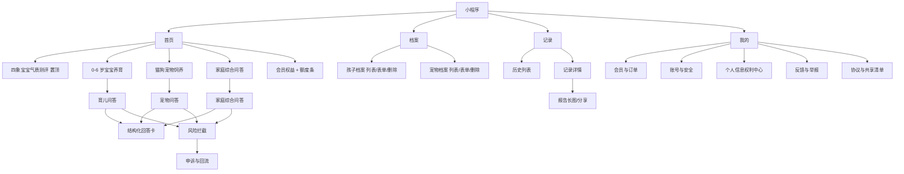
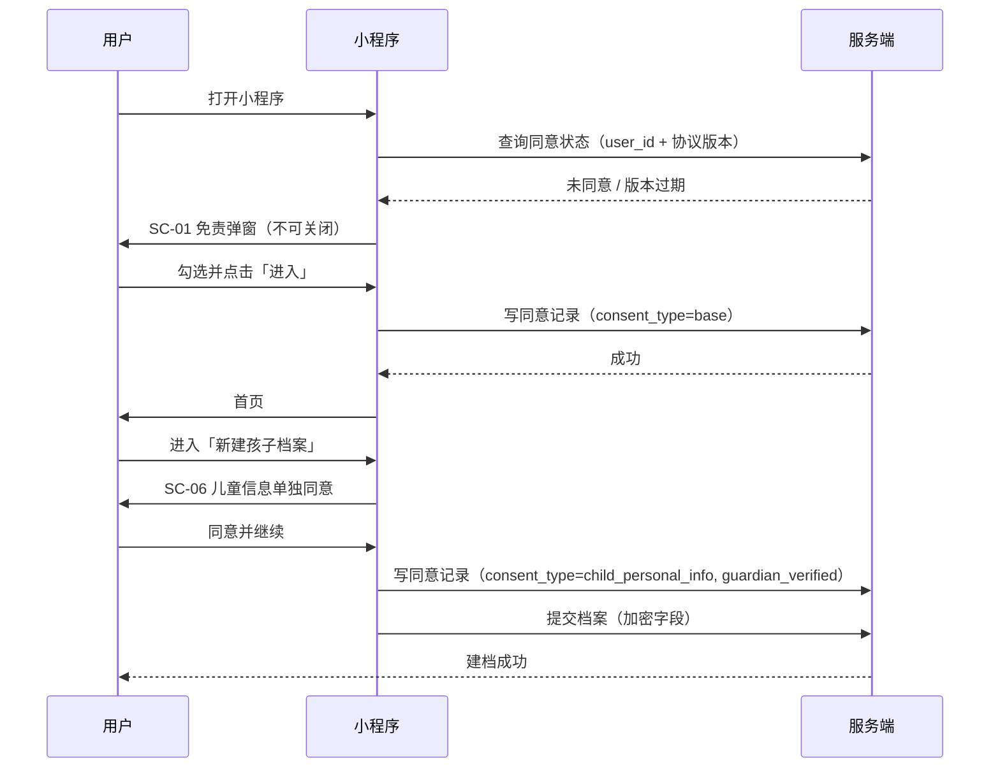
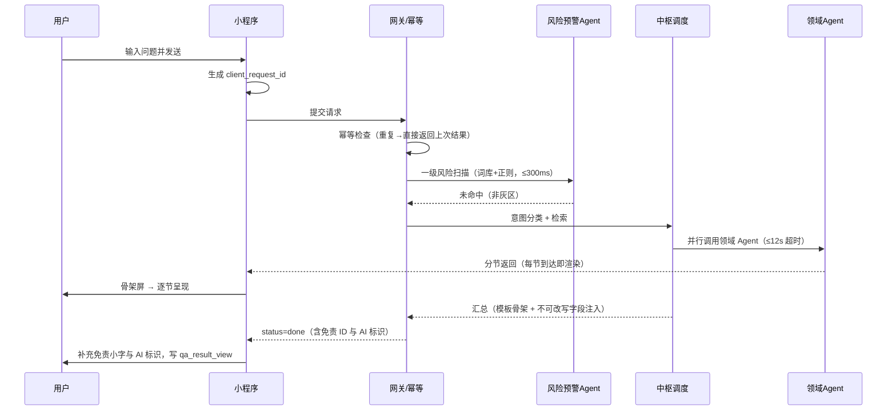
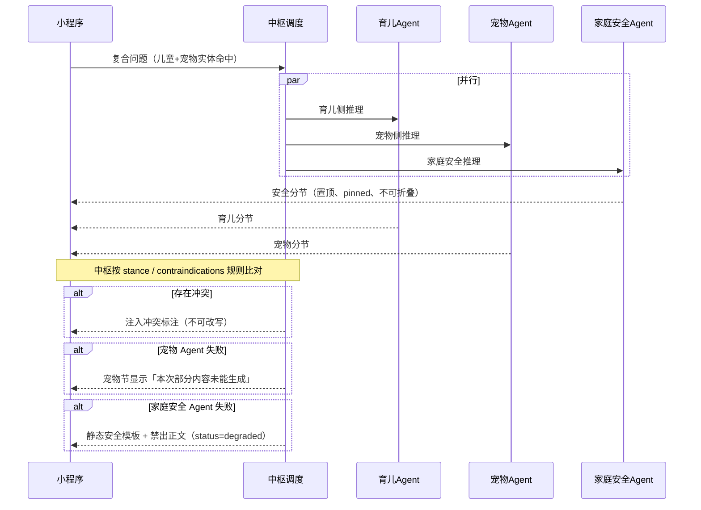
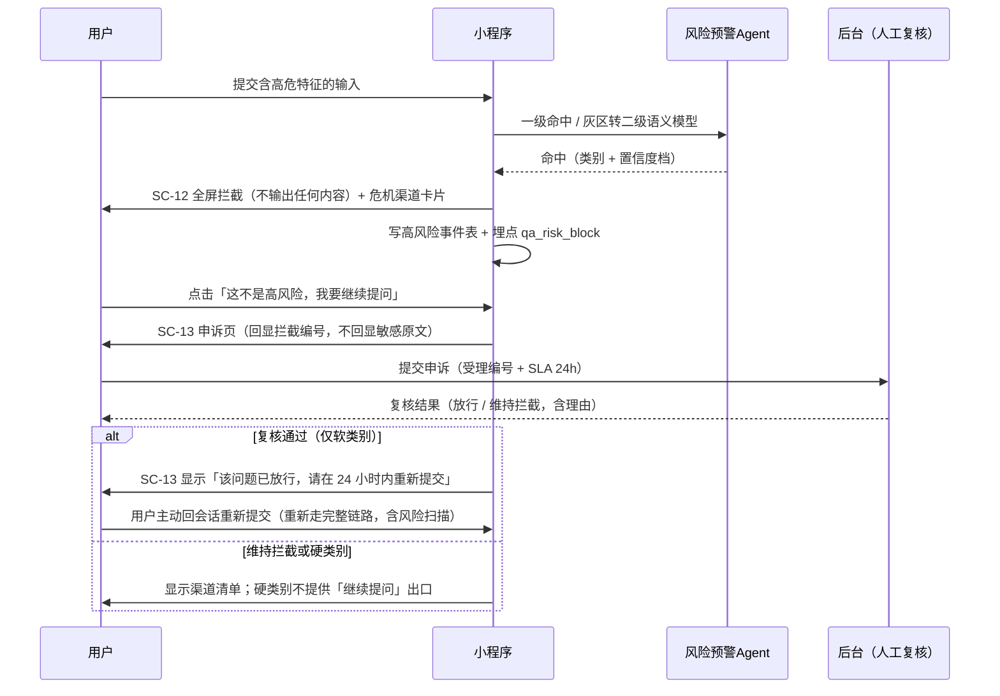
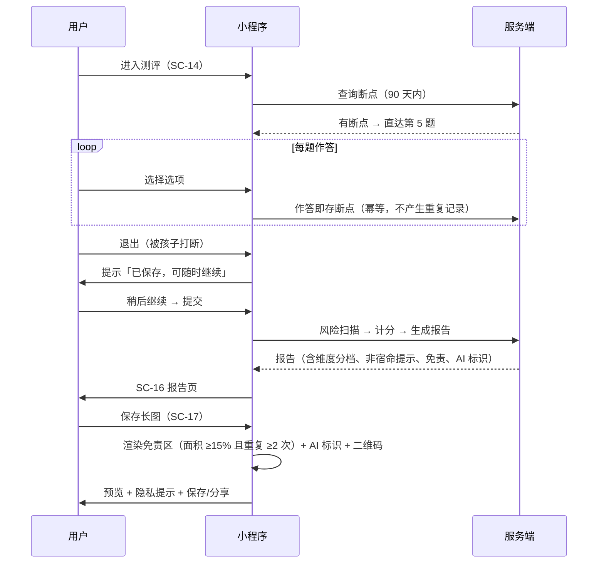
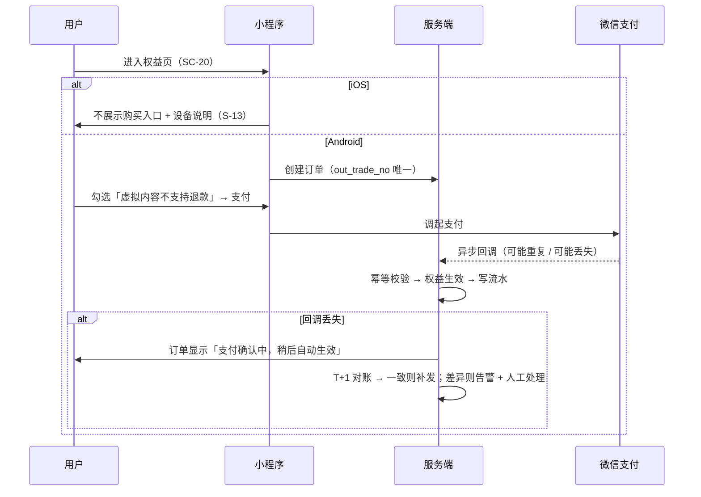
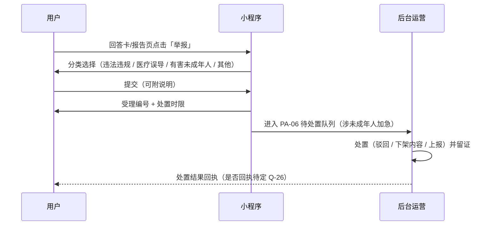
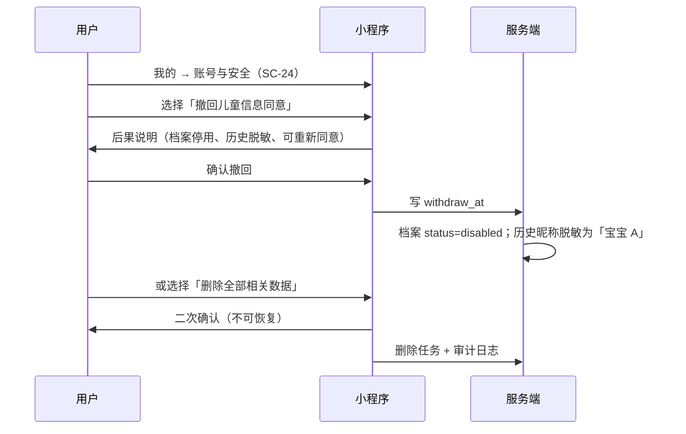

# 小光景・一家人的养育参考 —— UI 界面原型描述文档

> **文档版本**：V1.3（**与 PRD V1.5 配套**；页面结构、状态与编号**未改动**，仅同步受 S1 修复影响的界面口径：首包阈值、`blocked` 幂等语义、测评题量、会员交付物、**抓咬伤犬伤渠道（D18）**、决策依赖索引状态）
> **品牌名更新（2026-10-13）**：对外主名由「家伴」调整为「**小光景**」、副标题调整为「**一家人的养育参考**」；§5 线框内标题已同步替换，**页面结构、状态、交互、编号与组件规格均未改动**（非界面变更，PRD 侧登记见其 §0.5 末行）。
> **文档状态**：待评审。**唯一界面基线**
> **编制日期**：2026-10-03
> **效力**：本文档是页面结构、状态、交互与组件的**唯一界面基线**；`家伴-UI原型描述_V1.0.md` / `_V1.1.md` 已被取代，仅作归档。
> **配套文档**：`家伴-PRD_V1.5.md`（唯一需求基线；三态决策词汇见其 §0.3、FR 决策状态见 §6.16）｜`DESIGN.md`（唯一视觉 token 真源）｜`家伴-设计系统样式瓦片.html`（token 与组件的可视证据）
> **上游文档**：`家伴-家庭养育多智能体助手_需求说明文档_V1.0.md`（**历史来源，不具规范效力**）
> **范围**：微信小程序（C 端）26 页 + 后台管理 Web（PA）8 页 = **34 页线框图**；另含设计方向与裁决、token 级设计系统、跨页状态矩阵、关键交互时序、文案与合规呈现规范、组件规格、决策依赖索引、一致性检查清单
> **本文档不含**：高保真视觉稿（按本文档 token 制作）、交互动效原型、前端代码

---

## 0. 文档信息与阅读指引

### 0.1 本文档的职责

PRD 决定"做什么、做到什么算成功"，本文档决定"**长什么样、怎么点、异常时显示什么**"。两者通过页面编号 `SC-xx` / `PA-xx` 与需求编号 `FR-x.x` 双向绑定（追溯矩阵见 PRD §17.1）。

### 0.2 编号约定

| 标记 | 含义 |
| --- | --- |
| `SC-xx` | 小程序页面（Screen） |
| `PA-xx` | 后台管理端页面（Panel） |
| `C-x` | 组件编号（第 9 章组件规格库） |
| `S-x` | 跨页状态编号（第 6 章状态矩阵） |
| ①②③… | 线框内元素标注，与每页"元素说明"表逐行对应 |
| `FR-x.x` / `AS-xx` / `Q-xx` / `CG-x` | 与 PRD 完全一致的编号体系 |

### 0.3 线框图怎么读

1. 线框按**等宽字体**绘制，中文按 2 显示列、制表符与拉丁字符按 1 显示列计算宽度；**若查看字体不是等宽，可能出现视觉错位，此时以"元素说明"表为准**。
2. **线框内的元素标号写作 `(1) (2) (3)`**，对应的"元素说明"表格中写作 `①②③`——这是刻意的：圆括号数字是纯 ASCII，在任意等宽字体下宽度确定，能保证线框对齐；表格中的圈码不影响对齐。
3. 小程序画布按 375×812 的比例绘制（外框 46 显示列），后台按 1440×900（外框 76 显示列）。
4. 线框是**结构稿**：只表达信息层级、元素位置、状态与分支，不表达色彩与质感；视觉规格见 §2 与 `DESIGN.md`，可视证据见 `家伴-设计系统样式瓦片.html`。
5. 每个页面后附三类说明：**元素说明**（编号对应的元素、类型、交互、数据来源、状态/异常）、**状态与分支**、**埋点**。
6. `<20>` 段落为**决策依赖**：只说明该页依赖哪些未决策项与默认方案，**不阻塞页面结构开发**；完整清单集中在 §11 决策依赖索引，状态词汇与 PRD §0.3 一致。

### 0.4 阅读指引

| 读者 | 建议路径 |
| --- | --- |
| 设计 | §1 设计方向与裁决 → §2 设计系统规范 → §5 逐页线框 → §9 组件规格 → `DESIGN.md` |
| 前端 | §2 设计系统规范（token 可直接取用） → `家伴-设计系统样式瓦片.html` → §5 逐页线框 → §6 状态矩阵 → §7 时序 → §9 组件规格 |
| 产品 | §1 方向裁决 → §3 信息架构 → §4 页面清单 → §5 逐页线框（重点看状态与分支） |
| 测试 | §5 逐页线框 → §6 状态矩阵 → §10 交付与验收清单 |
| 法务 / 合规 | §2.2 色彩命名规则 与 §8 文案与合规呈现规范 → §5 中 SC-01/06/12/13/24/25/26、PA-06/07/08 |

---

## 1. 设计方向与原则

### 1.1 本次升级（V1.1 → V1.2）改了什么

V1.0 只给了语义命名的色彩（`--c-brand` 之类）与原则声明，前端拿不到能直接落地的值，视觉方向也没有定论。V1.1 用三支设计技能（`frontend-design`、`impeccable`、`design-taste-frontend`）重做视觉章节，**不动 34 页线框的结构与状态**。

| 变更 | 说明 |
| --- | --- |
| 新增设计读法与三档拨盘 | 明确本产品是 Operate 表面，并给出变化度/动效/密度的取值与理由 |
| 新增方向掷骰与裁决记录 | 避免落进品类默认；记录被指定方向与被否决的挑战者及其保留条款 |
| 色彩升级到 token 级 | 给出 hex、用途与实测对比度；确立"安全即主色""会员没有颜色"两条命名规则 |
| 字体方案落地 | 说明为什么是系统中文字体栈（小程序不加载远程字体），并给出 px / rpx 双标 |
| 新增签名组件 | 刻度带（`GraduatedBand`），把"给区间不给定论"变成可复用结构 |
| 新增状态的可视手法 | 空/加载/渐进/降级/门控/拦截/冲突逐条给视觉做法，而不只是"要有这个状态" |
| 新增浏览器表面与暗色规则 | 选中、光标、滚动条、焦点环；夜间按独立约束取值而非反相 |
| 交付物 | 新增 `DESIGN.md` 与样式瓦片，作为 token 的单一真源与可视证据 |
| **V1.2 同步** | 与 PRD V1.2 对齐：① SC-13 按 §7.9 改写（申诉不即放行、硬类别无「继续提问」出口）；② SC-11 区分两种降级视觉（单侧失败 vs 安全失败）；③ 三类问答页补 `blocked` 清空规则；④ 页面内「待确认」占位全部移入 **§11 决策依赖索引**；⑤ 新增 **§12 与 PRD V1.2 的一致性检查清单**；⑥ 阻塞级别改用 B1/B2/B3 |

### 1.2 设计读法（Design Read）

**Reading this as**：面向"一手抱娃、碎片时间、深夜低光"的中国家长（次受众为长时间密集操作的管理员）的 **Operate 表面**，采用**可信优先**的语言，落到"向主色偏移的冷中性 + 单一墨青强调色 + 刻度带签名 + 系统中文字体栈"的克制系统上。

### 1.3 三档拨盘（取值与理由）

| 拨盘 | 取值 | 理由 |
| --- | --- | --- |
| 变化度 `DESIGN_VARIANCE` | 3 | Operate 表面：用户在完成任务，熟悉度是特性而不是缺点 |
| 动效强度 `MOTION_INTENSITY` | 2 | 冲突、拦截与合规提示必须一次看清；动效只承担状态变化 |
| 信息密度 `VISUAL_DENSITY` | 6 | 产品要展示分节建议、档位与状态；后台更需要密度 |

### 1.4 方向裁决（记录来源，便于复核）

品类默认（粉与奶油底 + 糖果圆角卡片 + 大幅插画 + emoji + 三张等大功能卡）与它的反面（冷灰金融后台 + 纯表格 + 无温度）**都被拒绝**，不入候选。

按受众自身的世界（预防接种证与儿保手册、家庭挂历与冰箱磁贴、奶瓶与量具刻度、生长曲线图、监护器面板、急诊分诊牌、宜家式无字组装图，跨 4 个材料家族）列出 7 个 grounded 方向后，由掷骰指定**第 3 位：量具刻度系统**（seed key `ea6061e3`，code-led 构建）。

| 挑战者 | 裁决 | 保留下来的那一条纪律 |
| --- | --- | --- |
| 19 世纪词典页（页头导引词、页边索引、颜色封在图版内） | competitive | **范围指示行**：页头一行字说明"你现在在哪个范围里" |
| 拉班舞谱（垂直谱线、时间向上、块长＝时长） | declined | **长度即数值**：时限与耗时按比例呈现，不做装饰性进度条 |
| 动物园导览图（平涂色块、中间开口透出底色） | declined | **门控表现为"露出下沉地面"**，而不是盖一层灰罩 |
| 喷气时代机票夹（券联、VOID 章、"没有东西消失，它只是被作废"） | competitive | **失效但不消失**：到期 / 退款 / 下架 / 撤回都是"保留可见 + 明确标记" |
| Wim Crouwel 栅格字样（可见构造栅格） | declined | **刻度与布局同源**：刻度周期与内边距共用一套间距基数 |
| 可变字体样本（拖动即重算、实时读数） | declined | **`prefers-reduced-motion` 下在命名档位间跳变**，不做插值 |

另有两条对照方向供复核：**儿保手册 / 预防接种证**（本项目最容易被复制的方向；诚实风险是极易滑向通用政府表单，故不构建）与**品类标准做法**（永远可用；若选择则按其满配执行，不加私货，本系统不推荐也不比较）。

### 1.5 方向契约

| 块 | 内容 |
| --- | --- |
| THESIS | 界面是一支量具：每一次判断都落在一条有刻度的带上，并标出它落在哪一档。拒绝母婴品类的糖果卡片、粉彩色与"科学测评"话术 |
| OWN-WORLD | 器械白与青灰的冷中性底；单一墨青强调色；**安全提示就用主色**；刻度线为细墨线、数字等宽；语义色只在刻度与状态内；圆角只有两档；无渐变、无玻璃、无 emoji、无 Unicode 图标 |
| STORY | 家长看懂"我在哪一档、还剩多少、什么时候必须停下去找医生"；管理员看懂"这条内容处在什么状态、影响面多大" |
| FIRST VIEWPORT | 一张回答卡：安全分节以实底铺满整宽且不可折叠，其下是刻度带与分节正文，卡脚固定免责声明与 AI 标识；主操作落在下半屏热区 |
| FORM | 量具刻度系统（grounded 列表第 3 位），seed key `ea6061e3` |

### 1.6 设计上下文

| 项 | 内容 |
| --- | --- |
| 用户 | 25–40 岁父母，常在**抱孩子、单手操作、碎片时间**下使用；情绪状态可能焦虑甚至崩溃 |
| 设备 | 微信小程序，主流 375–430 宽度手机；需考虑 iPhone 安全区 |
| 使用姿势 | 单手可达区在下半屏 → 主操作按钮靠下，顶部只放导航与状态 |
| **光线** | **夜间低光是真实高频场景（夜醒）** → 深色模式是一等公民，按独立约束取值 |
| 内容特性 | 输出较长（多分节建议），可信度与合规提示必须显性可见 |
| 风险场景 | 高危输入、误报、会员墙、部分失败降级 —— **这些不是边缘情况，必须有专门设计** |

### 1.7 六条设计原则

| # | 原则 | 视觉落点 |
| --- | --- | --- |
| 1 | **安全可见** | 安全分节实底置顶、不可折叠；拦截页是独立全屏（`danger` 描边 + `danger-soft` 顶面），不与普通错误页共用样式 |
| 2 | **合规显性** | 免责小字与 AI 标识是固定位元素（§8.2 / §8.3），不是可关闭的提示；分层同意是两个独立勾选（§2.6 与 SC-06） |
| 3 | **给区间不给定论** | 一切判断用刻度带表达档位与区间；不出现精确分数与绝对类型（§2.6） |
| 4 | **可扫描** | 长回答用分节 + 小节标题 + 图标；正文 16px/1.6；测度 65–75 字符 |
| 5 | **单手可达** | 主操作位于下半屏热区（≥88rpx）；危险操作二次确认且避开拇指惯性点击区 |
| 6 | **状态完备** | 每一页都定义空、加载、失败、无权限、降级、断网、只读、并发冲突；每类状态都有具体视觉手法（§2.7） |

### 1.8 合规呈现四条硬规则（与 PRD §11 对应）

1. **免责声明**：所有内容页底部常驻小字（`caption` + `ink-3`，仍须 4.5:1）；弹窗正文不可通过系统返回键跳过（SC-01 / SC-06）。
2. **AI 标识**：回答卡、报告页、分享长图固定位展示；长图在生成时渲染，产品内不可去除（CG1）。
3. **分层同意**：基础同意（SC-01）与儿童信息单独同意（SC-06）**不得合并**；撤回入口在 SC-24 与 SC-25 可见。
4. **危机引导**：拦截页必须给出可拨打/可复制的渠道清单，且**不展示任何可能被误读为诊断或建议的文本**（FR-L2 / FR-L3）。

---

## 2. 设计系统规范

> **单一真源**：本章的 token 与 `DESIGN.md` 的 YAML frontmatter 一致；`DESIGN.md` 是机器可读层（本 PRD 系列工具与前端可直接读取），本章是给人读的规范层。两者冲突时以 `DESIGN.md` 为准，并同步修订本章。

### 2.1 画布与栅格

| 项 | 规格 |
| --- | --- |
| 设计基准 | 375 × 812（iPhone 标准），向上适配到 430 宽度 |
| 单位 | 使用 `rpx`（750rpx = 屏宽；**1px = 2rpx**）；输出尺寸按 2 倍图 |
| 栅格 | 4 列流式；页边距 32rpx；卡片间距 48rpx；卡片内边距 48rpx |
| 安全区 | 顶部状态栏 88rpx（含胶囊按钮避让区）；底部安全区 + 底部 Tab 112rpx |
| 后台画布 | 1440 × 900；侧边导航 240px；内容区最大宽度 1200px，超出居中 |
| 响应式 | **结构性**：折叠侧栏、表格降列、断点驱动列数；不用流体字号去解决 |

### 2.2 色彩（色值 / 用途 / 实测对比度）

**策略：克制。** 一套向主色偏移的冷中性 + 一个强调色 + 一组只服务于状态的语义色。

**浅色（默认）**

| token | hex | 用途 | 对白对比度 |
| --- | --- | --- | --- |
| `accent` | `#0A6B60` | 主操作、当前选中、**安全提示** | 6.4:1 |
| `accent-press` | `#074E46` | 主操作按下 / 悬停 | 9.0:1 |
| `accent-soft` | `#E1EFEC` | 安全分节实底 | — |
| `accent-line` | `#8FBFB7` | 次级按钮描边 | — |
| `on-accent` | `#FFFFFF` | 主操作文字 | 6.4:1 |
| `ink-1` | `#0F1E1C` | 标题与正文 | 17.2:1 |
| `ink-2` | `#455754` | 次级文本、区间说明 | 7.5:1 |
| `ink-3` | `#5F6F6C` | 免责小字、时间戳 | 5.3:1 |
| `bg` | `#F2F5F4` | 页面底 | — |
| `surface` | `#FFFFFF` | 内容面 | — |
| `surface-2` | `#E9EFED` | 第二中性层：刻度槽、工具栏、表格悬停、下沉地面 | — |
| `line` | `#D5DEDB` | 发丝线 | — |
| `line-strong` | `#B4C3BF` | 输入框描边、刻度标尺、滚动条 | — |
| `danger` | `#A8231B` | 风险拦截、危险操作、越过安全线 | 7.2:1 |
| `danger-soft` | `#F7E4E2` | 阻断面顶部实底 | — |
| `warn` | `#7A5600` | 降级、额度用尽、审核中、占位 | 6.6:1 |
| `warn-soft` | `#F6EDD8` | 冲突标注、降级条实底 | — |

**夜间（独立取值，不是反相）**

| token | hex | 取值理由 |
| --- | --- | --- |
| `bg` / `surface` | `#0C1614` / `#13201E` | 低光环境的底色，不用纯黑（纯黑会在 OLED 上产生拖影感） |
| `ink-1` / `ink-2` / `ink-3` | `#E8EFEC` / `#AEBFBB` / `#93A5A1` | 正文对比高于浅色模式（15.6:1），补偿低光下瞳孔放大带来的失焦 |
| `accent` / `accent-soft` | `#4FB3A4` / `#16332E` | 强调色提亮一档；但安全分节是**大面积实底**，故底色饱和度被显著压低 |
| `danger` / `warn` | `#E8776D` / `#DCB25C` | 语义色在深底上重新取值；浅色的朱红与陈黄在深底上会糊成一团 |

**命名规则（四条，都是产品判断不是审美偏好）**

1. **安全即主色。** 安全提示使用 `accent`，不另设"安全色"。安全是这个产品的身份，而不是又一个警告色。
2. **会员没有颜色。** 付费门控靠"正文被裁掉"与下沉地面表达；任何给会员配专属色（金、紫）的做法都会与安全、合规元素争夺颜色语义。
3. **免责小字也是正文。** `ink-3` 仍须 ≥4.5:1（实测 5.3:1），因为它承担合规作用，不是可以打折的装饰文字。
4. **语义色不上装饰。** `danger` / `warn` 只允许出现在刻度、状态标签与实底提示面内部；不得用于边框装饰、图标点缀或强调标题。

### 2.3 字体与字号

**一套字就够。** 产品界面不需要标题字体与正文字体的配对。这里是中文产品且运行在微信小程序中，而**小程序不加载远程字体**（CJK 字体体积与平台限制），因此正确做法是系统中文字体栈，而不是硬塞网络字体。

```
--f-ui: -apple-system, BlinkMacSystemFont, "PingFang SC", "HarmonyOS Sans SC",
        "Source Han Sans SC", "Noto Sans CJK SC", "Microsoft YaHei", system-ui, sans-serif;
--f-num: ui-monospace, "SF Mono", "Cascadia Mono", Consolas, monospace;
```

| 角色 | px | rpx | 字重 | 行高 | 用途 |
| --- | --- | --- | --- | --- | --- |
| display | 23 | 46 | 600 | 1.3 | 页面主标题、问题原文 |
| title | 19 | 38 | 600 | 1.3 | 卡片标题、分节标题 |
| body | 16 | 32 | 400 | 1.6 | 回答正文（**下限，不得更小**，AS-33） |
| sub | 14 | 28 | 400 | 1.6 | 次级说明、字段名 |
| caption | 12 | 24 | 400 | 1.5 | 免责小字、时间戳（仅此两处可用 12px） |
| numeric | 16 | 32 | 400 | 1.6 | 刻度读数、金额、耗时 |

- 字号比值 1.2，**固定 rem，不用流体缩放**：产品在固定 DPI 下使用，会缩放的标题在侧栏里只会更糟。
- 正文测度 65–75 字符（约 30–36 汉字）。
- **数字一律 tabular**（`font-variant-numeric: tabular-nums`）：刻度读数必须纵向对齐才能被扫读。
- **等宽字体只用于真正的代码与标识**：知识库 ID、会话 ID、文案 ID、正则规则。不拿它当"技术感"的装饰。

### 2.4 间距、半径与高度

**间距用 4 的倍数**（`--s0:6px / --s1:8px / --s1b:10px / --s2:16px / --s3:24px / --s4:32px / --s5:48px`，即 12/16/20/32/48/64/96rpx）。刻度周期固定 8px 且不随容器拉伸，因此**刻度、内边距与栅格同源**，而不是一张装饰纹理。

| token | 值（px / rpx） | 用途 |
| --- | --- | --- |
| `s0` | 6 / 12 | 图标与文字、行内紧凑节奏 |
| `s1` | 8 / 16 | 按钮内图标与文案 |
| `s1b` | 10 / 20 | 卡片头、工具栏 |
| `s2` | 16 / 32 | 页边距、行内元素组 |
| `s3` | 24 / 48 | 卡片间距、卡片内边距、分节内边距 |
| `s4` | 32 / 64 | 标本容器、区块内边距 |
| `s5` | 48 / 96 | 区块之间 |

**圆角：两档 + 一个语义例外**（这是一套有文档的混合系统，不是一个随手集合）

| token | 值（px / rpx） | 适用范围 |
| --- | --- | --- |
| `rounded/surface` | 12 / 24 | 卡片、弹层、面板、手机标本框 |
| `rounded/control` | 8 / 16 | 按钮、输入框、标签、色块、焦点环 |
| `rounded/full` | 999 | **仅**头像、图标按钮、刻度槽与填充段 |

禁止第三个圆角值出现在面或控件上；按钮不再使用胶囊形（V1.0 的 `radius-full` 按钮已废止）。

**高度：平面优先，只有两个层级**

| token | 值 | 用途 |
| --- | --- | --- |
| `e1` | `0 1px 3px rgba(15,30,28,.07)` | 吸顶栏、需要脱离页面的卡片 |
| `e2` | `0 10px 28px rgba(15,30,28,.12)` | 弹层、底部面板、抽屉 |

- 卡片由**面 + 发丝线**定义，不由阴影定义；阴影只给真正浮起的东西。
- 阴影必须带偏移与柔和模糊，并**向背景色相偏移**（用青灰而非纯黑）。零偏移的彩色光晕是装饰，不是高度。
- 同一张卡片同时有阴影与发丝线是重复表达，二选一。

### 2.5 图标与插画

| 项 | 规格 |
| --- | --- |
| 图标 | **绘制的 SVG**，24×24 网格，单一描边 **1.75**，`stroke-linecap/linejoin: round`，`fill: none`，颜色随 `currentColor` |
| 图标禁忌 | **不得用 emoji 或 Unicode 字符充当图标**（线框图里的 emoji 只是占位示意，落地一律替换为绘制图标）；安全类与危险类图标不得与普通图标共用同一形状 |
| 图标库 | 若引入图标库，全站只用一个家族、统一 `strokeWidth`；缺失字形用组合方式补齐，不手绘路径 |
| 插画 | 空态使用轻插画（单色 + 主色点缀）；**不使用真实儿童照片** |
| 头像 | 孩子/宠物默认头像为**插画**（隐私最小化，CG16）；MVP 不提供真实头像上传 |
| 分享图 | 底部固定免责区 + 二维码/短链 + AI 标识；家长可选用插画头像或打码 |

### 2.6 签名组件：刻度带（`GraduatedBand`）

这是全系统的签名：把"给区间不给定论"从一句原则变成可复用结构。

```text
   月龄区间                          24 个月 · 1-3 岁     ← 抬头：名称 + 等宽读数
   |    |    |    |    |    |    |    |    |    |         ← 标尺：小刻度 5px 高、周期 8px
   ████████████████████████░░░░░░░░░░░░░░░░░░░░░░        ← 槽：10px 高、全圆角；填充=主色
                    ┃        ┃        ┃                  ← 档位分隔：槽内 1px 竖线
                          ┃                              ← 游标：2px 实心竖线，越出槽体 ±5px
   0-6 月      6-12 月      1-3 岁        3-6 岁          ← 档位标签
```

| 用途 | 档位 | 读数示例 |
| --- | --- | --- |
| 月龄区间 | 0–6 月 / 6–12 月 / 1–3 岁 / 3–6 岁 | 24 个月 · **1–3 岁** |
| 维度分档 | 低 / 中 / 高（每维三档） | 不给精确分数 |
| 风险置信度 | <0.5 放行打标 / 0.5–0.8 拦截 + 引导 / >0.8 直接拦截 | **0.61** · 灰区 |
| 免费额度 | 5 段，已用段实底 | 剩余 **3** / 5 次 |
| 时限（SLA / 耗时） | 按比例填充 | 已过 **7h** / 24h |

**五条组件规则**

1. **长度即数值**：时限与耗时按比例呈现，不做装饰性进度条。
2. **不给精确分数**：不出现绝对类型与"你就是 X 型"的判定。
3. **语义色只在刻度内部**：越过安全线的档位才用 `danger`。
4. **`prefers-reduced-motion` 下在命名档位间跳变**，不做插值动画。
5. **必须带可读数值与 `aria-label`**，不靠颜色单独表意（无障碍底线）。

**实现注意**：槽**不得** `overflow:hidden`（否则游标被裁掉），圆角由填充段自己承担；标尺周期固定 8px，不随容器宽度拉伸。

### 2.7 状态的可视手法

状态矩阵（§6）只规定"必须有哪些状态"。这里规定**每类状态长什么样**，避免落地成"暂无数据"。

| 状态 | 视觉手法 | 反面（禁止） |
| --- | --- | --- |
| 空态 | 轻插画 + 一句价值说明 + 一个主操作（例："还没有宝宝档案 / 建档后，回答会按孩子月龄给出，而不是通用模板"） | 只显示"暂无数据" |
| 加载态 | **骨架屏**，形状与最终布局一致（含刻度槽占位） | 屏幕中央的转圈 |
| 渐进渲染 | 已返回分节直接呈现；未返回分节占位 + 呼吸动画；节标题右侧标注"生成中" | 白屏等到全部返回 |
| 降级 | `warn-soft` 实底条 + 图标 + "本次部分内容未能生成（原因）"；保留免责与 AI 标识 | 悄悄少一块内容 |
| 门控（无权限） | **下沉地面露出**（`surface-2` 底）+ 标题 + 淡出的预览摘要 + 解锁入口 | 灰罩遮住完整内容（可被抓包绕过） |
| 风险阻断 | 独立全屏：`danger` 描边 + `danger-soft` 顶面 + 渠道卡片；**无任何建议性文本** | 与普通错误页共用样式 |
| 冲突标注 | `warn-soft` 实底条 + 图标 + "观点存在差异，建议多方参考" | 用彩色边框表达 |
| 只读（会员到期） | 内容上方 `warn-soft` 状态条 + "会员已到期，内容只读"；不在内容中途弹续费窗 | 直接隐藏历史内容 |
| 审核中 | 内容置灰 + "审核中"标签；不通过则退回并说明原因 | 静默丢弃 |
| 并发冲突 | `warn-soft` 状态条 + "内容已被更新，请刷新" + 重新加载 | 静默覆盖 |
| 失效但不消失 | 到期 / 退款 / 下架 / 撤回统一为"保留可见 + 明确标记" | 隐藏或删除记录 |

### 2.8 动效

| 场景 | 规格 |
| --- | --- |
| 状态切换（悬停 / 按下 / 展开） | 160ms，`cubic-bezier(.2,.8,.2,1)`（指数缓出，从已可见的默认态出发） |
| 卡片按压 | `translateY(1px)`，不缩放（避免长列表抖动） |
| 分节渐进渲染 | 新分节淡入 200ms；未返回分节骨架呼吸 |
| 页面切换 | 200–260ms |
| 风险拦截 | **无编排动效**（直接呈现，避免情绪刺激） |
| 加载 | 骨架屏扫光 1.4s 线性循环；`prefers-reduced-motion` 下停止 |
| 禁止 | 庆祝类动效（撒花、闪光）、滚动视差、逐节统一的入场动画 |

### 2.9 无障碍底线（AS-33）

- 正文 ≥32rpx（16px）、说明 ≥24rpx（12px）；**所有文字对比度 ≥4.5:1**（含免责小字，实测 5.3:1）。
- 可点热区 ≥88×88rpx；关键状态（拦截、额度用尽、会员墙、降级）**不得只用颜色区分**，必须同时有图标与文字。
- 焦点环：2px 主色、偏移 2px、圆角与控件同族；不得移除而只留浏览器默认或完全不设。
- 系统字号放大到 1.2 倍时布局不破（换行、卡片自适应高度）。
- `prefers-reduced-motion` 必须被尊重：骨架停止扫光、档位跳变而非插值。

### 2.10 浏览器表面（自带的那一层）

浏览器默认样式不属于任何设计系统，却是"这一页是被建造的"最便宜的信号。全部从本系统调色板取值：

| 表面 | 规格 |
| --- | --- |
| 文本选中 | 底 `accent-soft`，文字保持 `ink-1`（不用浏览器默认蓝） |
| 光标 | `caret-color: accent` |
| 滚动条 | 8–10px 宽，拇指 `line-strong`、轨道透明、全圆角；不出现系统白色方块 |
| 焦点环 | 见 §2.9 |
| 下划线偏移 | `text-underline-offset: 3px` |
| 表格数字 | tabular figures，右对齐 |

### 2.11 文案语气

| 场景 | 语气 | 示例 |
| --- | --- | --- |
| 普通回答 | 中性、可执行、给前提 | 「适用于 6–12 月龄、已添加辅食的宝宝」 |
| 安全提示 | 明确但不安抚性承诺 | 「以下做法可降低风险，但不能完全避免」 |
| 风险拦截 | **不评判、不追问细节、只给出口** | 「我们无法就此问题提供参考内容。请立即联系以下机构」 |
| 会员墙 | 诚实、不制造焦虑 | 「这部分内容需要会员权限，免费部分仍可查看」 |
| 空态 | 教界面，说明能得到什么 | 「建档后，回答会按孩子月龄给出，而不是通用模板」 |
| 错误 | 说清问题与恢复方式 | 「身高应在 40–140 cm 之间。请检查是否多输了 0。」 |
| 合规提示 | 直接、不绕弯 | 「AI 生成内容，仅供参考，不替代医生诊断」 |

**动作命名一致性**：一个动作从按钮到结果用同一个词。按钮叫「保存」→ 提示就叫「已保存」；按钮叫「提交审核」→ 状态就叫「待审核」。控件命名其动作，错误命名问题与恢复方式。

---

## 3. 信息架构与导航

### 3.1 信息架构图



### 3.2 底部 Tab 与一级入口

| Tab | 承载 | 说明 |
| --- | --- | --- |
| 首页 | 四入口 + 额度 + 会员入口 | 唯一有多个二级入口的 Tab，需控制首屏信息密度 |
| 档案 | 孩子 / 宠物档案 | 建档是问答质量的前置，故提升为一级 Tab |
| 记录 | 历史问答与报告 | 报告是分享与留存的核心资产 |
| 我的 | 会员、权利中心、反馈与举报、协议 | 合规入口集中于此 |

**入口排序（AS-07）**：测评置顶（引流位）→ 育儿 → 宠物 → 综合问答；不做强制新手引导，仅每日首次一次性气泡。

### 3.3 全局常驻元素（出现在多个页面的固定元素）

| 元素 | 出现页面 | 行为 |
| --- | --- | --- |
| 免责小字 | 首页、回答页、报告页、详情页 | 点击展开完整声明；不可关闭 |
| AI 生成标识 | 回答卡、报告、长图、详情 | 固定位；长图内渲染不可删 |
| 额度条 | 首页、问答页（顶部） | 会员隐藏；用尽转橙并置顶 |
| 当前问答对象选择器 | 问答页顶部 | 多孩/多宠时可切换，决定档案上下文 |
| 返回与中断 | 所有二级页 | 生成中离开保留会话状态，可回看 |
| 举报入口 | 回答卡底、报告页、详情页 | 进入 SC-26 举报通道 |

---

## 4. 页面清单

### 4.1 小程序（26 页）

| 编号 | 页面 | 优先级 | 主要需求 | 关键状态 |
| --- | --- | --- | --- | --- |
| SC-01 | 启动与免责声明（首次强制） | P0 | FR-A1 | 首次/非首次/版本升级/网络失败 |
| SC-02 | 首页 | P0 | FR-B1~B4 | 空档案、额度用尽、加载 |
| SC-03 | 档案列表（孩子/宠物） | P0 | FR-C1/C2/C5 | 空态、达上限、并发冲突 |
| SC-04 | 新建/编辑儿童档案 | P0 | FR-C1/C3 | 校验失败、未单独同意 |
| SC-05 | 新建/编辑宠物档案 | P0 | FR-C2 | 编辑态、类型联动 |
| SC-06 | 儿童个人信息单独同意弹窗 | P0 | FR-A2/A3 | 同意/暂不同意/版本升级 |
| SC-07 | 档案删除确认与级联选择 | P0 | FR-C4 | 两种级联、二次确认 |
| SC-08 | 育儿问答会话页 | P0 | FR-D1/D3/D5 | 扫描中、分节渲染、降级、无档案 |
| SC-09 | 宠物问答会话页 | P0 | FR-F1~F4 | 安全附加提醒、急症提示 |
| SC-10 | 家庭综合问答页 | P0 | FR-G1~G6 | 三节渲染、冲突标注、安全置顶、降级 |
| SC-11 | 结构化回答卡（通用分节） | P0 | FR-M3、AS-20 | 会员门控 block、引用隐藏 |
| SC-12 | 风险拦截弹窗 | P0 | FR-L2/L3 | 命中阻断、渠道卡片 |
| SC-13 | 拦截后回流与误报申诉 | P1 | FR-L4/L5 | 申诉中、已放行、复核结果 |
| SC-14 | 测评引导页 | P0 | FR-E1 | 首次/断点续填 |
| SC-15 | 测评作答页 | P0 | FR-E2 | 作答即存、退出保存、提交中 |
| SC-16 | 测评报告页 | P0 | FR-E3/E4/E6 | 波动提示、非宿命提示 |
| SC-17 | 报告长图预览与保存 | P0 | FR-E5、FR-H3 | 生成中、隐私开关 |
| SC-18 | 历史记录列表 | P0 | FR-H1 | 空态、筛选、分页 |
| SC-19 | 记录详情 | P0 | FR-H2/H4 | 只读（到期）、内容已更新 |
| SC-20 | 会员权益页（Android 可购） | P0 | FR-J1/J2 | 未登录/已会员/退款明示勾选 |
| SC-21 | 会员权益页（iOS + 额度用尽） | P0 | FR-J1/J3 | iOS 不可购、额度用尽弹窗 |
| SC-22 | 下单与支付结果页 | P0 | FR-J2/J4 | 支付中/成功/失败/支付确认中 |
| SC-23 | 个人中心 | P0 | FR-I1 | 未登录、会员/非会员 |
| SC-24 | 账号与安全 | P0 | FR-I2、FR-A6 | 注销确认、分项撤回、权限管理 |
| SC-25 | 个人信息权利中心 | P0 | FR-I3 | 六类请求状态、处理中/已拒绝 |
| SC-26 | 反馈提交与一键举报 | P0 | FR-N1、FR-O1 | 图片送检、审核中、涉未成年人 |

### 4.2 后台管理端（8 页）

| 编号 | 页面 | 优先级 | 主要需求 | 关键状态 |
| --- | --- | --- | --- | --- |
| PA-01 | 后台登录与 MFA | P0 | NFR-7.1/7.4、Q-27 | 失败锁定、MFA 校验 |
| PA-02 | 知识库管理列表 | P0 | FR-K1、NFR-9.10 | 空态、审核工单、批量操作 |
| PA-03 | 知识库条目编辑与版本回滚 | P0 | FR-K1、CG14 | 校验不通过、并发编辑、回滚 |
| PA-04 | 词库维护（高危/敏感） | P0 | FR-K2、FR-L1 | 导入导出、阈值配置 |
| PA-05 | Agent 调用日志 | P0 | FR-K3、NFR-5.1 | 脱敏、筛选、抽屉详情 |
| PA-06 | 用户反馈与投诉举报处置 | P0 | FR-K4/K5、FR-O2 | 涉未成年人加急、处置留痕 |
| PA-07 | 高风险事件与内容追溯处置 | P0 | FR-K6、FR-L6 | 复核 SLA、分级处置、上报 |
| PA-08 | 权利请求处理与系统开关 | P0 | FR-K7/K8、FR-B4 | 导出处理中、开关回滚 |

---

## 5. 逐页线框图

> **读法**：线框为结构稿（等宽字体绘制，中文按 2 显示列）；`(1)(2)(3)` 与紧随其后的「元素说明」表逐行对应（表格内写作 `①②③`）；`<20>` 为决策依赖（见 §11 决策依赖索引）。

### 5.1 反向映射补全（未逐页标注 `fr` 的需求落在哪里）

逐页页头的「对应需求」只列该页**最主要**的需求；下表补全其余需求在设计层的落点，避免出现"需求无界面"。

| 需求 | 设计落点 | 说明 |
| --- | --- | --- |
| FR-A3 监护人身份核验与留痕 | SC-06 | 监护声明勾选 + 操作留痕；核验强度待法务定 |
| FR-A4 隐私保护指引与权限前置说明 | SC-01（协议入口）、SC-24（权限管理）、SC-23（入口） | 麦克风/相册首次使用前的场景化说明 |
| FR-A5 协议与文案版本管理 | SC-01、SC-23 | 文案 ID 化；版本变更触发重新同意 |
| FR-A7 超范围拒答话术 | SC-08 / SC-09 / SC-10（回答卡内拒答态）、SC-11 | 拒答态复用回答卡结构，但正文由服务端下发固定话术 |
| FR-B2 未建档引导与测评断点入口 | SC-02、SC-14 | 首页提示条 + 测评卡「继续填写」 |
| FR-B3 一次性引导气泡 | SC-02 | 每日首次进入展示 1 次 |
| FR-C3 加密字段与派生列 | SC-03（脱敏显示）、SC-04（月龄派生只读展示） | 派生列不在前端计算，仅展示 |
| FR-C5 多档案与当前问答对象 | SC-03、SC-08、SC-09 | 问答页顶部对象选择器 |
| FR-C6 并发编辑冲突 | SC-03 / SC-04 / SC-05、PA-03、PA-08 | 统一使用 C-17 状态条 |
| FR-E3 计分与四类判定 | SC-16 | 只展示维度分档与类型，不展示精确分数 |
| FR-E6 波动提示 | SC-16 | 30 天内重复测评且类型变化时条件触发 |
| FR-E7 测评结果作为问答上下文 | SC-16（联动开关，**待补设计位**）、SC-08/09/10（上下文来源提示） | 用户可关闭；开关位置需在视觉稿中补 |
| FR-F2 宠物行为解读 | SC-09 | 行为关键词快捷查询 |
| FR-G2 安全提示置顶 | SC-10、SC-11 | 置顶分节、pinned、不可折叠 |
| FR-H3 报告保存图片与分享 | SC-17 | 渲染规格见 §8.5 |
| FR-H4 跨设备查看 | SC-23（账号与安全中说明）、SC-24 | 依赖账号体系（Q-28），无独立页面 |
| FR-J4 退款与售后 | SC-20（购买前明示）、SC-22（订单状态与理由） | 退款政策文案待财务与法务确认 |
| FR-J5 专题付费内容包 | **无页面（已移出 MVP）** | 入口不展示，需求降为 P2 |
| FR-K9 Agent 权重配置 | **无页面（已删除）** | 见 PRD AS-17 / NG-9 |
| FR-M1 意图识别与调度决策 | 无独立界面，可在 PA-05 查看决策记录 | 后端能力 |
| FR-M5 成本控制 | 无独立界面，可在 PA-05 观察 token 与调用次数 | 护栏指标见 PRD §2.3 |

### SC-01 · 启动与免责声明（首次强制）

> **画布** 375×812　**优先级** P0　**对应需求** FR-A1｜US-A1｜D2、D12｜AS-05、AS-06、AS-26

**页面目标**：首次进入小程序完成合规告知与同意采集；未勾选时「进入」保持置灰，无法绕过。

```text
┌────────────────────────────────────────────┐
│SC-01 - 启动与免责声明（首次强制） - 375x812│
└────────────────────────────────────────────┘
┌────────────────────────────────────────────┐
│ ▍系统状态栏 9:41                     *** # │
├────────────────────────────────────────────┤
│                                            │
│                   小光景                   │
│              一家人的养育参考              │
│                                            │
│  ┌──────────────────────────────────────┐  │
│  │            免责与使用说明            │  │
│  ├──────────────────────────────────────┤  │
│  │ 本产品为养育科普参考工具，不替代     │  │
│  │ 医生、心理咨询师、教师、执业兽医。   │  │
│  │ 紧急情况请立即联系线下专业机构。     │  │
│  │                                      │  │
│  │ 《用户协议》《隐私政策》《免责声明》 │  │
│  │ 《儿童个人信息处理规则》（易懂版）   │  │
│  │                                      │  │
│  │ ☐ 我已阅读并同意上述全部协议         │  │
│  │                                      │  │
│  │              [ 进 入 ]               │  │
│  │        未勾选：置灰，不可点击        │  │
│  └──────────────────────────────────────┘  │
│                                            │
│ 同意记录：类型 / 版本 / 时间 / 设备        │
└────────────────────────────────────────────┘
```

**元素说明**

| 编号 | 元素 | 类型 | 交互 | 数据来源 | 状态 / 异常 |
| --- | --- | --- | --- | --- | --- |
| ① | 协议入口 ×4 | 文字链 | 打开协议阅读页，返回后保留勾选态 | 协议版本服务 | 加载失败：提示重试 |
| ② | 同意勾选框 | Checkbox | 勾选后主按钮可用 | 本地态 + consent API | 未勾选：置灰 |
| ③ | 「进入」按钮 | 主按钮 | 提交同意记录 → 首页 | consent API | 失败：不进入，提示重试 |
| ④ | 免责正文 | 静态文本 | 不可关闭、不可跳过 | 文案 ID `DISCLAIMER_V1` | 随版本号热更新 |

**状态与分支**

- **首次进入**：强制弹窗，无关闭按钮，系统返回键不生效。
- **非首次**：不弹窗，改为底部常驻小字 + 首页一次性提示气泡。
- **协议版本升级**：版本号变化即重新强制弹窗（AS-05）。
- **网络失败**：正文用本地兜底文案渲染；同意提交失败不得进入。

**埋点**：`disclaimer_show`、`disclaimer_agree`、`disclaimer_decline`

> **实现说明**：本页只承担「基础同意」；儿童档案另需 SC-06 的单独同意，两者不可合并为一个勾选框（合规缺口 CG2）。

- **决策依赖**：见 UI 文档 §11 决策依赖索引（编号：无未决项（FR-A1 / FR-A4 / FR-A5 已决策，AS-05、AS-26 可直接执行））

### SC-02 · 首页

> **画布** 375×812　**优先级** P0　**对应需求** FR-B1｜US-B1｜D9、D11｜AS-07、AS-08、AS-24

**页面目标**：一屏暴露四大入口 + 会员入口 + 额度状态，并承担「未建档」「测评断点」「额度用尽」三种提示。

```text
┌────────────────────────────────────────────┐
│           SC-02 - 首页 - 375x812           │
└────────────────────────────────────────────┘
┌────────────────────────────────────────────┐
│ ▍系统状态栏 12:30                    *** # │
├────────────────────────────────────────────┤
│ 小光景                       [头像 ▸ 我的] │
│ 养娃 + 养宠，一站式养育参考                │
│  ┌──────────────────────────────────────┐  │
│  │ 今日免费额度           剩余 3 / 5 次 │  │
│  │ 用尽后引导开通会员或次日再来         │  │
│  └──────────────────────────────────────┘  │
│                                            │
│  ┌──────────────────────────────────────┐  │
│  │ 🔥 四象宝宝气质测评       [继续填写] │  │
│  │ 3 分钟 - 12 题 - 了解气质倾向        │  │
│  │ 断点：上次答到第 5 题                │  │
│  └──────────────────────────────────────┘  │
│                                            │
│  ┌──────────────────────────────────────┐  │
│  │ (1) 0-6 岁宝宝养育                   │  │
│  │   喂养 / 睡眠 / 敏感期 / 行为引导    │  │
│  │                                      │  │
│  │ (2) 猫狗宠物饲养                     │  │
│  │   喂养 / 护理 / 行为解读 / 应激      │  │
│  │                                      │  │
│  │ (3) 家庭综合问答 - 多 Agent 协同     │  │
│  │   孩子 + 宠物同场景，一次答全        │  │
│  └──────────────────────────────────────┘  │
│                                            │
│  ┌──────────────────────────────────────┐  │
│  │ 会员权益                  [了解会员] │  │
│  │ 深度方案 - 月度计划 - 专属档案       │  │
│  └──────────────────────────────────────┘  │
│                                            │
│ 未建档黄条：补充档案，建议更贴合           │
├────────────────────────────────────────────┤
│        Tab：首页｜档案｜记录｜我的         │
│     免责小字 + AI 生成内容标识（常驻）     │
└────────────────────────────────────────────┘
```

**元素说明**

| 编号 | 元素 | 类型 | 交互 | 数据来源 | 状态 / 异常 |
| --- | --- | --- | --- | --- | --- |
| ① | 额度条 | 状态条 | 点击进入会员权益页 | 额度服务 | 会员隐藏；用尽转橙并置顶 |
| ② | 测评入口卡 | 卡片 | 新用户→引导页；有断点→第 5 题 | 测评服务 | 已完成：显示「查看报告」 |
| ③ | 三大问答入口 | 卡片 | 进入对应会话页 | 静态配置 | 无档案：进入后提示补档案 |
| ④ | 会员入口 | 卡片 | 进入会员权益页 | 商品配置 | iOS：点击提示暂不支持 |
| ⑤ | 未建档提示条 | 提示条 | 进入建档 | 档案服务 | 有档案：不展示 |
| ⑥ | 免责小字 + AI 标识 | 常驻文本 | 点击展开完整声明 | 文案 ID | 不可关闭 |

**状态与分支**

- **空态**：无档案 → 顶部提示条 + 入口卡副文案改「先建档，建议更贴合」。
- **加载态**：入口卡骨架屏，≤2s（NFR-2.4）。
- **每日首次**：一次性气泡提示免责与 AI 标识，仅展示 1 次。
- **断网**：用本地缓存渲染入口结构，点击问答提示网络异常。

**埋点**：`home_view`、`entry_click`（`entry_type`、`with_profile`）、`paywall_view`

- **决策依赖**：见 UI 文档 §11 决策依赖索引（编号：无未决项（FR-B1~B4 已决策，AS-07 / AS-08 可直接执行））

### SC-03 · 档案列表（孩子 / 宠物）

> **画布** 375×812　**优先级** P0　**对应需求** FR-C1、C2、C4｜US-C1、C2｜AS-09、AS-10、AS-23

**页面目标**：集中管理孩子与宠物档案，展示数量上限与「当前问答对象」标记。

```text
┌────────────────────────────────────────────┐
│ SC-03 - 档案列表（孩子 / 宠物） - 375x812  │
└────────────────────────────────────────────┘
┌────────────────────────────────────────────┐
│ ▍状态栏                              *** # │
├────────────────────────────────────────────┤
│ ◂ 返回                            档案管理 │
│[ 孩子 2/3 ]    [ 宠物 1/3 ]                │
├────────────────────────────────────────────┤
│  ┌──────────────────────────────────────┐  │
│  │ 👶 宝宝 A                     [当前] │  │
│  │ 2 岁 3 月 - 女 - 2024-07-12          │  │
│  │ 92cm - 13kg - 无过敏                 │  │
│  │[ 编辑 ]   [ 删除 ]                   │  │
│  └──────────────────────────────────────┘  │
│                                            │
│  ┌──────────────────────────────────────┐  │
│  │ 👶 宝宝 B                 [设为当前] │  │
│  │ 8 月 - 男 - 2026-02-03               │  │
│  │ 早产 - 辅食 6 月龄开始               │  │
│  │[ 编辑 ]   [ 删除 ]                   │  │
│  └──────────────────────────────────────┘  │
│                                            │
│             [ + 新建孩子档案 ]             │
├────────────────────────────────────────────┤
│ 宠物 Tab 同构：                            │
│   🐱 咪咪 - 英短 - 3 岁 - 已绝育 [当前]    │
│   🐶 旺财 - 柯基 - 1 岁 - 未绝育           │
│             [ + 新建宠物档案 ]             │
├────────────────────────────────────────────┤
│        免费 3 个/类 - 会员 10 个/类        │
└────────────────────────────────────────────┘
```

**元素说明**

| 编号 | 元素 | 类型 | 交互 | 数据来源 | 状态 / 异常 |
| --- | --- | --- | --- | --- | --- |
| ① | 孩子 / 宠物 Tab | 分段控件 | 切换列表，保持滚动位置 | 档案服务 | 空：展示空态 |
| ② | 档案卡 | 卡片 | 卡体进详情；[当前] 标记问答对象 | 档案服务 | 删除中置灰 |
| ③ | 「设为当前」 | 次按钮 | 切换全局问答对象 | 档案服务 | 全局仅一个为当前 |
| ④ | 新建按钮 | 主按钮 | 达上限置灰并提示升级 | 档案 + 会员态 | 上限：弹升级引导 |
| ⑤ | 删除 | 危险操作 | 进入 SC-07 二次确认与级联选择 | — | 必须二次确认 |

**状态与分支**

- **空态**：插画 +「还没有宝宝档案」+ 新建按钮 + 一句价值说明。
- **达上限**：新建按钮置灰，附「会员可建 10 个」。
- **敏感字段**：出生日期默认脱敏为 `2024-**-**`，点击眼睛图标临时显示。
- **并发冲突**：他端已修改时提示「档案已被更新，请刷新」。

**埋点**：`profile_view`、`profile_set_current`、`profile_create`、`profile_delete_start`

- **决策依赖**：见 UI 文档 §11 决策依赖索引（编号：Q-20、FR-C1、FR-C3、FR-C5、FR-C6、AS-09、AS-12、AS-23）

### SC-04 · 新建 / 编辑儿童档案

> **画布** 375×812　**优先级** P0　**对应需求** FR-C1｜US-C1｜Q-19｜AS-09、AS-11

**页面目标**：采集分龄建议所需的最小字段集；提交前校验必填项，敏感字段加密存储。

```text
┌────────────────────────────────────────────┐
│   SC-04 - 新建 / 编辑儿童档案 - 375x812    │
└────────────────────────────────────────────┘
┌────────────────────────────────────────────┐
│ ▍状态栏                              *** # │
├────────────────────────────────────────────┤
│ ◂ 返回                        新建孩子档案 │
│ 信息用于生成贴合月龄的养育参考             │
├────────────────────────────────────────────┤
│ 昵称 * ................[ 宝宝 A        ▸ ] │
│ 出生日期 * ............[ 2024-07-12    ▸ ] │
│ 性别 * ...........................[ 女 ▾ ] │
├────────────────────────────────────────────┤
│ 生长情况（选填，越全越贴合）               │
│ 身高 (cm) .............[ 92            ▸ ] │
│ 体重 (kg) .............[ 13.0          ▸ ] │
│ 是否早产 .........................[ 否 ▾ ] │
│ 已知过敏项 ............[ 无            ▸ ] │
│ 辅食开始月龄 .................[ 6 月龄 ▾ ] │
├────────────────────────────────────────────┤
│自动计算：月龄 24 月 - 区间 1-3 岁          │
│ （只读，服务端派生）                       │
├────────────────────────────────────────────┤
│                 [ 保 存 ]                  │
│              敏感字段加密存储              │
└────────────────────────────────────────────┘
```

**元素说明**

| 编号 | 元素 | 类型 | 交互 | 数据来源 | 状态 / 异常 |
| --- | --- | --- | --- | --- | --- |
| ① | 必填项 | 表单 | 空值提交 → 定位首个错误项 | 用户输入 | 未来日期：拒绝 |
| ② | 月龄派生展示 | 只读 | 随出生日期实时计算 | 派生列 `age_months` | 决定调度分龄区间 |
| ③ | 过敏项 | 输入 + 标签 | 支持多选标签 | 词表 | 空记「无」 |
| ④ | 保存 | 主按钮 | 校验 → 加密落库 → 返回列表 | profile API | 失败保留已填内容 |
| ⑤ | 撤回同意入口 | 文字链 | 撤回后档案停用（不删历史） | 同意服务 | 见 SC-24 |

**状态与分支**

- **编辑态**：标题改「编辑孩子档案」，字段预填，按钮改「保存修改」。
- **未单独同意**：保存时弹出 SC-06；拒绝则不落库，仍可浏览通用内容。
- **校验失败**：字段下方红字 + 顶部 Toast。
- **预填**：昵称空时提示可用「宝宝 A」，不强制真实姓名（最小化采集）。

**埋点**：`profile_form_view`、`profile_save`、`consent_child_decline`

- **决策依赖**：见 UI 文档 §11 决策依赖索引（编号：Q-20、Q-31、FR-A3、FR-C1、FR-C3、AS-12、CG3）

### SC-05 · 新建 / 编辑宠物档案

> **画布** 375×812　**优先级** P0　**对应需求** FR-C2｜US-C2｜AS-10

**页面目标**：采集饲养建议所需字段；家中有幼儿档案时用于自动附加互动安全提醒。

```text
┌────────────────────────────────────────────┐
│   SC-05 - 新建 / 编辑宠物档案 - 375x812    │
└────────────────────────────────────────────┘
┌────────────────────────────────────────────┐
│ ▍状态栏                              *** # │
├────────────────────────────────────────────┤
│ ◂ 返回                        新建宠物档案 │
├────────────────────────────────────────────┤
│ 类型 * ...........................[ 猫 ▾ ] │
│ 品种 .....................[ 英国短毛猫 ▾ ] │
│ 年龄 * .........................[ 3 岁 ▾ ] │
│ 绝育状态 .....................[ 已绝育 ▾ ] │
├────────────────────────────────────────────┤
│ 状态（选填，用于饲养规划）                 │
│ 体重 ..................[ 4.2 kg        ▸ ] │
│ 主要食物 .......................[ 干粮 ▾ ] │
├────────────────────────────────────────────┤
│ 有孩子档案时，相关回答自动附加             │
│ "儿童--宠物互动安全"提醒。                 │
├────────────────────────────────────────────┤
│                 [ 保 存 ]                  │
│             MVP 仅支持猫 / 狗              │
└────────────────────────────────────────────┘
```

**元素说明**

| 编号 | 元素 | 类型 | 交互 | 数据来源 | 状态 / 异常 |
| --- | --- | --- | --- | --- | --- |
| ① | 类型 | 单选 | 猫/狗切换品种库 | 词表 | MVP 仅猫狗 |
| ② | 品种 | 可搜索下拉 | 支持「不确定 / 混种」 | 词表 | 无匹配可手填 |
| ③ | 年龄 | 选择器 | 支持「不确定」按成年估算 | — | 决定幼年/成年/老年 |
| ④ | 保存 | 主按钮 | 加密落库 → 返回列表 | pet API | 校验同 SC-04 |

**状态与分支**

- **编辑态**：字段预填。
- **类型切换**：品种与食物选项联动刷新，已填值保留。
- **空态**：宠物 Tab 无数据时此页为默认落地页。

**埋点**：`pet_form_view`、`pet_save`

- **决策依赖**：见 UI 文档 §11 决策依赖索引（编号：无未决项（FR-C2 已决策，AS-10：MVP 仅猫狗））

### SC-06 · 儿童个人信息单独同意弹窗

> **画布** 375×812　**优先级** P0　**对应需求** FR-A2｜D2、D3、D7｜CG2、CG3、CG7｜AS-06

**页面目标**：建档前采集「单独同意」，与基础同意分离；写清目的、字段、期限、撤回方式与共享清单。

```text
┌────────────────────────────────────────────┐
│ SC-06 - 儿童个人信息单独同意弹窗 - 375x812 │
└────────────────────────────────────────────┘
┌────────────────────────────────────────────┐
│ ▍状态栏                              *** # │
├────────────────────────────────────────────┤
│ （底层页面：建儿童档案，置灰不可操作）     │
│                                            │
│  ┌──────────────────────────────────────┐  │
│  │      儿童信息处理告知与单独同意      │  │
│  ├──────────────────────────────────────┤  │
│  │ (1) 目的：生成贴合月龄的养育参考     │  │
│  │ (2) 字段：昵称、出生日期、性别、身高 │  │
│  │      体重、早产标记、过敏项、辅食月龄│  │
│  │ (3) 期限：账号存续期 + 30 天         │  │
│  │ (4) 共享：仅本产品推理，不用于训练； │  │
│  │      详见《第三方共享清单》          │  │
│  │ (5) 权利：查阅 / 更正 / 导出 / 撤回 /│  │
│  │      删除（我的 -> 个人信息权利中心）│  │
│  │                                      │  │
│  │ 监护声明：本人为法定监护人           │  │
│  │                                      │  │
│  │ ☐ 已阅读并单独同意处理上述儿童信息   │  │
│  │                                      │  │
│  │[ 同意并继续 ]  [ 暂不同意 ]          │  │
│  └──────────────────────────────────────┘  │
│                                            │
│ "暂不同意"：不落库，可继续浏览             │
└────────────────────────────────────────────┘
```

**元素说明**

| 编号 | 元素 | 类型 | 交互 | 数据来源 | 状态 / 异常 |
| --- | --- | --- | --- | --- | --- |
| ① | 告知正文 | 可滚动文本 | 不设滚动到底才能勾选 | 文案 ID `CHILD_CONSENT_V1` | 版本升级重新同意 |
| ② | 单独同意勾选 | Checkbox | 独立于 SC-01 的基础同意 | consent API | 未勾选：主按钮置灰 |
| ③ | 同意并继续 | 主按钮 | 写 `consent_type=child_personal_info` | consent API | 记录 guardian_verified |
| ④ | 暂不同意 | 次按钮 | 关闭弹窗，不落库 | — | 不阻断浏览 |
| ⑤ | 共享清单 | 文字链 | 打开清单页 | 静态 | — |

**状态与分支**

- **重复弹出**：同一版本号只弹一次；撤回后再次建档需重新同意。
- **监护人核验**：MVP 采用「监护声明勾选 + 操作留痕」，并预留 `guardian_verified_method`（`declaration` / `phone_otp` / `face`）；核验强度的决策状态见 §11 决策依赖索引（FR-A3 / Q-31 / CG3）。
- **多孩建档**：同一账号第 2 个及以后儿童档案**不重复核验**，沿用首次单独同意，但每次新建写一条同意记录（`scope=profile:{id}`），撤回按档案粒度生效（§11.9.2）。
- **撤回后**：档案停用（`status=disabled`），历史问答保留但脱敏显示「宝宝 A」，撤回不阻断浏览通用内容与宠物模块（§11.9.3 / §11.9.4）。

**埋点**：`consent_child_show`、`consent_child_agree`、`consent_child_decline`

> **实现说明**：合规硬需求，不可与 SC-01 合并；文案与核验方式以可替换的文案 ID 与 `guardian_verified_method` 字段承接，使外部结论后置不阻塞前端开发（§11.9.1）。

- **决策依赖**：见 UI 文档 §11 决策依赖索引（编号：FR-A2、FR-A3、FR-A6、Q-31、D-12、AS-06、CG2、CG3、CG7）

### SC-07 · 档案删除确认与级联选择

> **画布** 375×812　**优先级** P0　**对应需求** FR-C4｜US-C3｜Q-20｜AS-13｜NFR-1.4｜CG7

**页面目标**：删除单个孩子 / 宠物档案前的二次确认页；同时让用户选择级联范围，并说明「历史问答与报告默认保留但脱敏」。

```text
┌────────────────────────────────────────────┐
│  SC-07 - 档案删除确认与级联选择 - 375x812  │
└────────────────────────────────────────────┘
┌────────────────────────────────────────────┐
│ ▍状态栏 10:02                        *** # │
├────────────────────────────────────────────┤
│ ◂ 返回                            档案管理 │
│ （底层 SC-03 档案列表：置灰不可操作）      │
│                                            │
│  ┌──────────────────────────────────────┐  │
│  │       (1) 删除宝宝 A 的档案？        │  │
│  │ 删除后不可恢复，请谨慎操作。         │  │
│  │                                      │  │
│  │ (2) 请选择删除范围（单选）           │  │
│  │  * 仅删除档案                        │  │
│  │    历史问答、测评报告保留            │  │
│  │  o 一并删除全部相关数据              │  │
│  │    档案 + 问答 + 报告 + 图片         │  │
│  │                                      │  │
│  │ (3) 默认保留历史问答与测评报告，     │  │
│  │  昵称脱敏为"宝宝 A"，不再关联        │  │
│  │  档案。（Q-20 / AS-13 基线）         │  │
│  │                                      │  │
│  │ (4) 二次校验：输入昵称"宝宝 A"       │  │
│  │  [ 宝宝 A            ]               │  │
│  │  校验强度见 §11 决策依赖索引         │  │
│  │                                      │  │
│  │ (5) !! 删除后不可恢复，无回收站。    │  │
│  │                                      │  │
│  │ (6) 出口：取消 / 确认删除（危险）    │  │
│  │  [ 取消 ]      [ 确认删除 ]          │  │
│  └──────────────────────────────────────┘  │
│                                            │
│ 会员档案删除后权益不退还（FR-J4 / §12.9）  │
└────────────────────────────────────────────┘
```

**元素说明**

| 编号 | 元素 | 类型 | 交互 | 数据来源 | 状态 / 异常 |
| --- | --- | --- | --- | --- | --- |
| ① | 删除对象标题 | 弹窗标题 | 只显示昵称，不显示生日等敏感字段 | 档案服务 | 档案已不存在：关闭弹窗并提示刷新 |
| ② | 级联范围单选 | Radio ×2 | 默认「仅删除档案」；选「全部数据」需再确认一次 | 用户选择 | 未选择时确认按钮置灰（默认实现） |
| ③ | 保留与脱敏说明 | 说明文本 | 静态说明，不可关闭、不可折叠 | 文案 ID + 协议版本号 | AS-13 / Q-20 基线：保留 + 脱敏为「宝宝 A」 |
| ④ | 昵称二次校验 | 输入框 | 与昵称一致才允许提交 | 用户输入 | 校验强度见 §11 索引（Q-20 / FR-C4） |
| ⑤ | 不可恢复警示条 | 警示条 | 常驻，高对比 | 静态文案 | NFR-1.4：删除后不可恢复 |
| ⑥ | 取消 / 确认删除 | 主次按钮 | 确认后调删除接口，按 client_request_id 幂等 | profile API | 失败：保留弹窗可重试；禁止部分删除 |

**状态与分支**

- **空态 / 竞态**：档案已被他端删除 → 弹窗自动关闭，列表提示「档案已不存在，请刷新」。
- **加载中**：确认后按钮转 loading 并禁用重复点击；级联删除需单事务（不允许删一半）。
- **失败重试**：接口失败 → 保留弹窗与已选范围，提示「删除失败，请重试」。
- **无权限（会员墙）**：本页不涉及 `access_tier`；会员档案删除不退还权益，需在文案明示（FR-J4 / §12.9）。
- **降级**：级联清理超时 → 档案即时删除，问答 / 报告标记「待清理」，由后台补偿重试。
- **冲突提示**：选择「一并删除全部相关数据」时，界面必须列出**将保留的项目及法定原因**（§11.10.2 中「是」的行），并给出「已删除清单」回执。
- **审计**：删除动作写审计日志（操作人、时间、级联范围、结果），供合规追溯（FR-C4）。
- **断网**：提交前拦截，提示「网络异常，未执行删除」，不得进入 loading 假象。

**埋点**：`profile_delete_start`、`profile_delete_confirm`、`profile_delete_cascade`（§17.4 已登记）

> **实现说明**：级联范围与默认脱敏按 Q-20 / AS-13 假定基线实现（默认「仅删除档案」+ 脱敏为「宝宝 A」），冲突时的裁决顺序见 §11.10；昵称二次校验为本页补充设计，依赖编号与状态见 §11 决策依赖索引。

- **决策依赖**：见 UI 文档 §11 决策依赖索引（编号：Q-20、Q-25、FR-C4、FR-J4、AS-13、CG7）

### SC-08 · 育儿问答会话页

> **画布** 375×812　**优先级** P0　**对应需求** FR-D1、D3、D5｜FR-D2、D4、D6｜US-D1｜BR-4、BR-7、BR-9｜AS-04、AS-11、AS-20｜M3｜I6、I7｜CG1

**页面目标**：0-6 岁养育自由问答：顶部绑定问答对象，回答以结构化分节渐进呈现，风险扫描前置，底部输入区按 MVP 裁剪语音。

```text
┌────────────────────────────────────────────┐
│      SC-08 - 育儿问答会话页 - 375x812      │
└────────────────────────────────────────────┘
┌────────────────────────────────────────────┐
│ ▍状态栏 20:15                        *** # │
├────────────────────────────────────────────┤
│ ◂ 返回                   育儿问答 - 0-6 岁 │
│ (1) 问答对象                 [👶 宝宝 A ▾] │
│ 多孩可切换；绑定档案后按该月龄回答         │
├────────────────────────────────────────────┤
│ (2) (i) 未选档案：按"通用 1-3 岁"回答      │
│    [ 补充档案 ]  缺档案时建议更贴合        │
├────────────────────────────────────────────┤
│                                            │
│          (3) "宝宝夜醒 3 次，该不该抱睡？" │
│                                            │
│ (4) .. 正在检查内容安全...（先于生成）     │
│  OK 通过 - 育儿 Agent 生成中 <=8s          │
│ (5) 回答卡（分节渐进呈现）                 │
│  ┌──────────────────────────────────────┐  │
│  │ (i) AI 生成内容 - 仅供参考    [复制] │  │
│  ├──────────────────────────────────────┤  │
│  │ 建议要点                             │  │
│  │  8 月龄夜醒多为生理性，可先观察      │  │
│  │  3 晚再调整入睡方式                  │  │
│  │ 适用前提                             │  │
│  │  6-12 月龄 - 已加辅食 - 无发热       │  │
│  │ 不建议做法                           │  │
│  │  不建议一醒就抱睡，也不建议放任      │  │
│  │  长时间哭泣                          │  │
│  │ (6) 观察指标（未返回 -> 骨架屏）     │  │
│  │  ###### 正在生成...                  │  │
│  │ 何时咨询专业人士（未返回 -> 骨架屏） │  │
│  │  ###### 正在生成...                  │  │
│  │       分节顺序见 SC-11 (3)-(7)       │  │
│  └──────────────────────────────────────┘  │
│                                            │
│  ┌──────────────────────────────────────┐  │
│  │输入你的问题...                       │  │
│  ├──────────────────────────────────────┤  │
│  │ (7) 🎤 语音（本期不支持）   [ 发送 ] │  │
│  └──────────────────────────────────────┘  │
│    发送中：置灰；失败：!! 未发送 [重试]    │
├────────────────────────────────────────────┤
│   (8) 免责小字 + AI 生成内容标识（常驻）   │
└────────────────────────────────────────────┘
```

**元素说明**

| 编号 | 元素 | 类型 | 交互 | 数据来源 | 状态 / 异常 |
| --- | --- | --- | --- | --- | --- |
| ① | 问答对象选择器 | 下拉选择 | 切换后新提问绑定新档案 | 档案服务 | 无档案：改走通用区间（BR-9） |
| ② | 通用区间提示条 | 提示条 + 入口 | 点击进 SC-04 建档 | 档案服务 | Q-21 → AS-11 / FR-D5：不强制绑定档案 |
| ③ | 用户气泡 | 消息气泡 | 长按复制；同会话可继续追问 | 本地 + 会话服务 | 发送失败：⚠ 未发送 + [重试] |
| ④ | 内容安全检查行 | 状态行 | 不可跳过、不可关闭 | 风险预警 Agent | 命中 → 跳 SC-12，不生成任何内容 |
| ⑤ | 回答卡分节 ×5 | 结构化卡 | 按契约字段渲染，每节独立复制 | 育儿 Agent JSON（FR-D3 契约） | 字段缺失：整节不渲染并标注 |
| ⑥ | 骨架屏 | 占位块 | 未返回节显示骨架，返回即替换 | 前端 | FR-G5 / AS-30：首包＝进度占位包，**P95 ≤1.5s（验收值）、≤3s 为告警阈值**，不计入 8s（PRD §7.7.6） |
| ⑦ | 输入区 + 语音按钮 | 输入框 + 按钮 | 语音点击提示「本期不支持」 | —（ASR 已移出 MVP） | AS-04 / FR-D2：移出 MVP，保留灰态入口 |
| ⑧ | 免责小字 + AI 标识 | 常驻文本 | 两行常驻，不可关闭 | 文案 ID + 服务端注入 | CG1：标识形态见 §11 索引 |

**状态与分支**

- **空态**：无历史会话 → 引导文案 + 输入框默认聚焦；无档案 → 顶部提示条 +「补充档案」（BR-9）。
- **加载 / 生成中**：提交后「风险扫描中」→「并行推理中」；检查行不可跳过（FR-L2：纯输入侧、先于一切 Agent 执行，§7.6 执行顺序）。
- **渐进呈现**：按 §7.5 响应协议渲染——`started` 帧给骨架与分节顺序，`section_delta` 追加，`section_done` 用完整块替换该节，`completed` 注入不可改写字段；首包（`started`）P95 ≤1.5s 单列为体验指标且纳入上线验收（§7.7.6）；骨架屏内不得出现推测性正文。
- **正文被阻断（硬规则）**：收到 `blocked` 帧时前端**必须清空本会话已渲染的全部正文**并转入 SC-12，**不接受「灰掉但仍可读」**，也不保留复制入口（§7.5.3）。
- **安全失败（硬规则）**：收到 `degraded` 且 `failed_sections` 含 `safety` 时，**隐藏所有已有正文分节**，只显示静态安全卡（§7.8）。
- **失败重试**：失败气泡 + [重试]；重试复用同一 `client_request_id`，失败与拦截均不计次（FR-J3 / AS-24）。
- **无权限（会员墙）**：深度方案节按 `access_tier` 只给标题 + 预览摘要 + [解锁会员]，正文不下发（FR-D4 / AS-20 / FR-M3）。
- **降级（单侧失败）**：育儿 Agent 失败 → 失败节位置显示 `warn-soft` 降级条「本次部分内容未能生成」，其余分节保留（FR-G6 / §7.8）。
- **超范围**：按 §6.17 固定话术 ID 拒答或声明适用区间（FR-D6 / FR-A7）。
- **断网**：已生成内容本地只读展示；输入区置灰并提示网络异常。

**埋点**：`qa_submit`（输入方式、是否绑定档案）、`qa_result_view`（耗时、参与 Agent 数、是否冲突标注）、`qa_followup`、`qa_risk_block`、`qa_retry`（§17.4 已登记）

> **实现说明**：语音按钮按 AS-04 / FR-D2「移出 MVP、保留灰态入口 + 一行说明」绘制。本页正文的渲染与清空规则一律以 §7.5 问答响应协议为准；失败与降级的展示以 §7.8 降级矩阵为准。

- **决策依赖**：见 UI 文档 §11 决策依赖索引（编号：FR-D2、AS-04、FR-G6、FR-J3、Q-33、CG1）

### SC-09 · 宠物问答会话页

> **画布** 375×812　**优先级** P0　**对应需求** FR-F1、F2、F3｜FR-F4｜US-F1、F2｜BR-7｜M5｜AS-22｜D18｜CG1

**页面目标**：猫狗饲养与行为解读问答；与 SC-08 同构，回答卡字段换成宠物契约，家中存在孩子档案时顶部自动附加互动安全提醒。

```text
┌────────────────────────────────────────────┐
│      SC-09 - 宠物问答会话页 - 375x812      │
└────────────────────────────────────────────┘
┌────────────────────────────────────────────┐
│ ▍状态栏 20:22                        *** # │
├────────────────────────────────────────────┤
│ ◂ 返回                     宠物问答 - 猫狗 │
│ (1) 问答对象                   [🐱 咪咪 ▾] │
│ (2) (i) 已自动附加儿童--宠物互动安全提醒   │
│    依据：存在孩子档案"宝宝 A"              │
├────────────────────────────────────────────┤
│                                            │
│         (3) "猫总哈气，孩子还追它怎么办？" │
│                                            │
│ (4) .. 正在检查内容安全...（先于生成）     │
│  OK 通过 - 宠物 Agent 生成中               │
│ (5) 回答卡（分节渐进呈现）                 │
│  ┌──────────────────────────────────────┐  │
│  │ (i) AI 生成内容 - 仅供参考    [复制] │  │
│  ├──────────────────────────────────────┤  │
│  │ 行为 / 问题描述                      │  │
│  │  猫哈气 + 竖毛，多为应激防御         │  │
│  │ 可能含义                             │  │
│  │  不是"生气报复"，是回避信号          │  │
│  │ 建议应对                             │  │
│  │  设高处躲藏点；追猫时立即引导        │  │
│  │  孩子做替代动作                      │  │
│  │ (6) 风险提示（含非疾病诊断标注）     │  │
│  │  !! 抓咬伤需及时医学处置             │  │
│  │  非疾病诊断，不做兽医诊疗            │  │
│  │ (7) 何时就医（未返回 -> 骨架屏）     │  │
│  │  ###### 生成中                       │  │
│  │   个体差异存在，需结合具体情境判断   │  │
│  └──────────────────────────────────────┘  │
│                                            │
│ (8) 免责小字 + AI 生成内容标识（常驻）     │
├────────────────────────────────────────────┤
│    输入区同 SC-08 (7)：文字 + 语音裁剪     │
└────────────────────────────────────────────┘
```

**元素说明**

| 编号 | 元素 | 类型 | 交互 | 数据来源 | 状态 / 异常 |
| --- | --- | --- | --- | --- | --- |
| ① | 问答对象选择器 | 下拉选择 | 切换宠物档案；支持多条宠物 | 宠物档案服务 | 无宠物档案：按通用饲喂区间回答 |
| ② | 互动安全提醒附加条 | 提示条 | 只读，不可关闭；有孩子档案才出现 | 家庭安全 Agent / 规则模块 | FR-F3：规则化附加，不依赖安全 Agent 触发（M5） |
| ③ | 用户气泡 / 行为关键词 | 气泡 + 快捷词 | 支持「甩尾 / 低吼 / 哈气 / 护食」快捷查询 | 本地 + 词表 | 词表未命中：走自由问答 |
| ④ | 内容安全检查行 | 状态行 | 同 SC-08，不可跳过 | 风险预警 Agent | 命中 → SC-12；含宠物急症类别 |
| ⑤ | 回答卡分节 ×5 | 结构化卡 | 行为描述 / 可能含义 / 建议应对 / 风险提示 / 何时就医 | 宠物 Agent JSON | 字段缺失：整节不渲染并标注 |
| ⑥ | 风险提示 + 非疾病诊断 | 警示块 + 标注 | 固定位置，不可关闭、不可被汇总改写 | 宠物 Agent JSON + 文案 ID | NG-4 / §8.2；M9 列为不可改写字段 |
| ⑦ | 急症就医提示 | 警示块 | 条件触发（大出血 / 中毒 / 呼吸异常等） | 宠物 Agent 规则 | 症状清单与抓咬伤归类见 §11 索引（CG18） |
| ⑧ | 免责 + AI 标识 / 输入区 | 常驻文本 + 输入区 | 常驻不可关闭；输入区同 SC-08 ⑦ | 文案 ID + 前端 | CG1：标识形态见 §11 索引 |

**状态与分支**

- **空态**：无宠物档案 → 顶部提示 + 通用饲喂区间回答；无历史会话 → 空态引导。
- **加载 / 生成中**：同 SC-08；宠物急症类命中同样走风险扫描前置。
- **正文被阻断（硬规则）**：收到 `blocked` 帧时前端**必须清空已渲染正文**并转入 SC-12，不接受「灰掉但仍可读」（§7.5.3）。
- **安全失败（硬规则）**：收到 `degraded` 且 `failed_sections` 含 `safety` 时隐藏所有正文分节，只显示静态安全卡（§7.8）。
- **失败重试**：失败气泡 + [重试]；重试复用同一 `client_request_id`，不计次（AS-24 / FR-J3）。
- **无权限（会员墙）**：长期饲养规划（3 个月滚动，AS-22）按 `access_tier` 门控，正文不下发（FR-F4 / FR-M3）。
- **降级（单侧失败）**：宠物 Agent 失败 → 标注「本次部分内容未能生成」并保留其余节；风险提示节缺失时须整卡降级为「请稍后重试」，不得静默省略。
- **断网**：已生成内容只读；输入区置灰。
- **安全提醒缺口**：家庭安全 Agent 失败时，附加提醒条须回退为静态安全卡（§7.8 / FR-G6）。

**埋点**：`qa_submit`（输入方式、是否绑定档案）、`qa_result_view`、`qa_followup`、`qa_risk_block`、`qa_retry`（§17.4 已登记）

> **实现说明**：互动安全提醒按 FR-F3「规则化附加、不依赖家庭安全 Agent 触发条件」绘制，用以消解原文冲突 M5（US-F1 第 5 条要求「有幼儿档案即附加」vs §4.1 要求「儿童 + 宠物同时涉及才激活」）；该处置已由 FR-F3 定稿。

- **决策依赖**：见 UI 文档 §11 决策依赖索引（编号：FR-F3、FR-F4、FR-G6、CG1、CG18、AS-22）

### SC-10 · 家庭综合问答页

> **画布** 375×812　**优先级** P0　**对应需求** FR-G1、G2、G3、G4、G5、G6｜US-G1、G2｜BR-3、BR-7｜AS-17、AS-18、AS-19｜M8、M9｜D8｜CG1

**页面目标**：儿童 + 宠物复合问题一次答全：输出顺序固定为安全提示 → 育儿侧 → 宠物侧，底部可折叠查看参与协同的 Agent 与耗时。

```text
┌────────────────────────────────────────────┐
│      SC-10 - 家庭综合问答页 - 375x812      │
└────────────────────────────────────────────┘
┌────────────────────────────────────────────┐
│ ▍状态栏 20:31                        *** # │
├────────────────────────────────────────────┤
│ ◂ 返回                        家庭综合问答 │
│ 问答对象                 👶宝宝 A + 🐱咪咪 │
│ 同时涉及儿童与宠物 -> 三 Agent 协同        │
├────────────────────────────────────────────┤
│                                            │
│         "3 岁宝宝总追猫，猫常哈气怎么办？" │
│                                            │
│  ┌──────────────────────────────────────┐  │
│  │ (1) 调度中（并行 - <=15s）      9.4s │  │
│  │OK 0-6 育儿 Agent          3.2s 完成  │  │
│  │OK 宠物养育 Agent          2.8s 完成  │  │
│  │⟳ 家庭安全 Agent          生成中...   │  │
│  └──────────────────────────────────────┘  │
│                                            │
│  ┌──────────────────────────────────────┐  │
│  │ (2) 安全提示（置顶 - 不可折叠）      │  │
│  │  孩子与猫互动需成人全程在场；        │  │
│  │  被抓咬出血立即就医处置。            │  │
│  ├──────────────────────────────────────┤  │
│  │ (3) 育儿侧建议                       │  │
│  │  用替代动作引导：给猫让路、          │  │
│  │  教"轻轻摸"并即时表扬。              │  │
│  ├──────────────────────────────────────┤  │
│  │ (4) 宠物侧建议                       │  │
│  │  提供高处躲藏点与独立动线；          │  │
│  │  ###### 本节生成中（骨架屏）         │  │
│  └──────────────────────────────────────┘  │
│                                            │
│ (5) !! 观点存在差异，建议多方参考          │
│  （判定规则：中心按 stance 规则比对）      │
├────────────────────────────────────────────┤
│  ┌──────────────────────────────────────┐  │
│  │ (6) ▸ 本次参与协同的 Agent    [展开] │  │
│  │  育儿 3.2s - 宠物 2.8s               │  │
│  │  家庭安全 1.9s - 总 14.2s            │  │
│  └──────────────────────────────────────┘  │
│                                            │
│ (7) 会员门控：复合完整方案按 access_tier   │
│   (8) 免责小字 + AI 生成内容标识（常驻）   │
└────────────────────────────────────────────┘
```

**元素说明**

| 编号 | 元素 | 类型 | 交互 | 数据来源 | 状态 / 异常 |
| --- | --- | --- | --- | --- | --- |
| ① | 调度进度块 | 进度块 | 三个 Agent 并行，分别显示完成 / 生成中 | 中枢调度 Agent | 超时进入降级；安全 Agent 失败禁出正文 |
| ② | 安全提示（置顶） | 置顶块 | 不可折叠、不参与排序 | 家庭安全 Agent | FR-G6：安全 Agent 失败 → 禁出正文，走静态模板 |
| ③ | 育儿侧建议 | 分节 | 契约字段渲染 | 育儿 Agent JSON | 失败：标注本节未生成（FR-G6） |
| ④ | 宠物侧建议 | 分节 | 契约字段渲染 | 宠物 Agent JSON | 失败：标注本节未生成（FR-G6） |
| ⑤ | 冲突标注条 | 标注 | 不阻断生成，紧邻结论区 | 中枢规则比对（FR-G4 / AS-18） | 按 `stance` / `contraindications` 规则比对（Q-16 已关闭） |
| ⑥ | 参与 Agent 折叠区 | 可折叠 | 展开显示各 Agent 耗时 | 调度日志 | FR-G3（P1）；日志脱敏见 §11 索引（Q-34） |
| ⑦ | 会员门控 | 门控块 | 家庭复合完整方案按权限放开 | 中枢 → 前端契约 | FR-M3：无权限时正文不下发 |
| ⑧ | 免责 + AI 标识 | 常驻文本 | 不可关闭，服务端注入 | 文案 ID | CG1：标识形态见 §11 索引 |

**状态与分支**

- **空态 / 改道**：问题未同时命中儿童与宠物实体 → 提示「本题按单一领域回答」并转 SC-08 / SC-09（§7.6 调度规则）。
- **加载 / 生成中**：3 个领域 Agent（育儿 + 宠物 + 家庭安全）并行，分别显示完成态；内部目标为 §7.7 表 3 的 P95 8.55s，对外承诺 P95 ≤15s，告警 12.8s。
- **正文被阻断（硬规则）**：收到 `blocked` 帧时前端**必须清空已渲染正文**并转入 SC-12，不接受「灰掉但仍可读」（§7.5.3）。
- **失败重试**：整体失败 → 兜底话术 + [重试]；重试复用同一 `client_request_id`，不计次（AS-24 / FR-J3）。
- **无权限（会员墙）**：复合完整方案按 `access_tier` 门控，只给标题 + 摘要 + [解锁]（FR-M3 / AS-20）。
- **降级（两种视觉，不得共用同一条降级条）**：① **单侧失败**（育儿或宠物 Agent 失败）→ 失败节位置显示 `warn-soft` 降级条「本次部分内容未能生成」，其余分节仍可读，状态值 `degraded`，扣额度；② **家庭安全 Agent 失败** → **隐藏育儿 / 宠物全部正文**，只显示静态安全卡（安全模板 + 免责 + AI 标识 + 危机渠道），状态值 `degraded`（安全专用文案），**不扣额度**，可重试（§7.8）。
- **冲突**：冲突标注不阻断生成（FR-G4），判定按 `stance` / `contraindications` 规则比对（AS-18，Q-16 已关闭）。
- **断网**：已完成回答只读；未完成则提示失败可重试。

**埋点**：`qa_submit`（是否绑定档案）、`qa_result_view`（参与 Agent 数、是否冲突标注）、`qa_followup`、`qa_risk_block`、`collab_agent_expand`（§17.4 已登记）

> **实现说明**：本页正文的渲染、清空与隐藏规则以 §7.5 问答响应协议为准，降级展示以 §7.8 降级矩阵为准；汇总主体取 FR-M2（模板骨架 + 不可改写字段：安全提示 / 冲突标注 / 免责声明 / AI 标识由服务端注入）。复合场景延迟口径见 §7.7 表 3 / 表 4。

- **决策依赖**：见 UI 文档 §11 决策依赖索引（编号：Q-34、FR-G3、FR-G4、FR-G6、FR-M2、FR-M3、AS-18、CG1）

### SC-11 · 结构化回答卡（全貌）

> **画布** 375×812　**优先级** P0　**对应需求** FR-M2、M3、M4｜US-M3｜BR-4、BR-6｜Q-33｜AS-19、AS-20｜M9、M10｜I6｜CG1｜D15

**页面目标**：回答卡的「元素详解页」：把一张完整回答卡的全部元素画出来并编号，作为所有会话页（SC-08/09/10）共用的分节组件基准。

```text
┌────────────────────────────────────────────┐
│   SC-11 - 结构化回答卡（全貌） - 375x812   │
└────────────────────────────────────────────┘
┌────────────────────────────────────────────┐
│ ▍状态栏 21:05                        *** # │
├────────────────────────────────────────────┤
│ ◂ 返回             结构化回答卡 - 元素全貌 │
│ 组件基准页，不单独作为入口上线             │
├────────────────────────────────────────────┤
│  ┌──────────────────────────────────────┐  │
│  │ (1) 安全提示条（置顶 - 不折叠）      │  │
│  │  示例：孩子与宠物互动需在场          │  │
│  ├──────────────────────────────────────┤  │
│  │ (2) 会员门控块（access_tier 无权限） │  │
│  │  标题 + 预览摘要 + [ 解锁会员 ]      │  │
│  │  正文不下发（服务端裁剪）            │  │
│  ├──────────────────────────────────────┤  │
│  │ (3) 建议要点（列表）                 │  │
│  │  - 给猫让路 - 教"轻轻摸"             │  │
│  │ (4) 适用前提                         │  │
│  │  3 岁 - 已绝育成猫 - 无过敏          │  │
│  │ (5) 不建议做法                       │  │
│  │  - 不建议追猫时大声呵斥孩子          │  │
│  │ (6) 观察指标                         │  │
│  │  - 哈气频次 v - 主动回避 v           │  │
│  │ (7) 何时咨询专业人士                 │  │
│  │  出现 X 症状 -> 儿科 / 宠物医院      │  │
│  ├──────────────────────────────────────┤  │
│  │ (8) 知识库引用（前端不展示）         │  │
│  │  ┈┈┈ 虚线占位：evidence_ref ┈┈┈      │  │
│  │  后台可见、前端隐藏（Q-33 假设）     │  │
│  ├──────────────────────────────────────┤  │
│  │ (9) 冲突标注（条件触发）             │  │
│  │  !! 观点存在差异，建议多方参考       │  │
│  ├──────────────────────────────────────┤  │
│  │ (10) 免责声明（不可删除）            │  │
│  │ (11) AI 生成内容标识（服务端注入）   │  │
│  │ (12) 底部操作条                      │  │
│  │  [复制] [存图] [反馈] [举报]         │  │
│  └──────────────────────────────────────┘  │
│                                            │
│        降级视觉 A｜单侧 Agent 失败         │
│         （其余分节可读 + 降级条）          │
│  失败节位置：warn-soft 降级条              │
│  "本次部分内容未能生成"                    │
│  (3)-(7) 其余分节照常可读                  │
├────────────────────────────────────────────┤
│      降级视觉 B｜家庭安全 Agent 失败       │
│            （只显示静态安全卡）            │
│  隐藏 (3)-(7) 育儿 / 宠物全部正文          │
│  仅保留：安全模板 + 免责 + AI 标识         │
│  状态值 degraded（安全专用文案），可重试   │
│  不扣额度（§7.8），与视觉 A 不共用降级条   │
│                                            │
│ (1) (2) (9) (10) (11) 为不可改写字段（M9） │
└────────────────────────────────────────────┘
```

**元素说明**

| 编号 | 元素 | 类型 | 交互 | 数据来源 | 状态 / 异常 |
| --- | --- | --- | --- | --- | --- |
| ① | 安全提示条 | 置顶块 | 不可折叠、不可被汇总改写 | 家庭安全 Agent | 安全 Agent 失败：隐藏育儿 / 宠物全部正文，只出静态安全卡（§7.8） |
| ② | 会员门控块 | 门控块 | 无权限时只给标题 + 摘要 + [解锁] | 中枢 → 前端契约 | I6：正文不下发，验收以抓包响应体为准 |
| ③④ | 建议要点 / 适用前提 | 分节 | 每节独立复制；适用前提随档案月龄生成 | 领域 Agent JSON | 字段缺失：整节不渲染并标注 |
| ⑤⑥ | 不建议做法 / 观察指标 | 分节 | 同上 | 领域 Agent JSON | 降级：标注本节未生成（§7.8） |
| ⑦ | 何时咨询专业人士 | 分节 | 含超范围兜底话术与 `professional_referral` | 领域 Agent JSON | FR-M4：无引用时强制置位；§6.17 拒答口径 |
| ⑧ | 知识库引用 | 虚线占位 | 前端不展示，仅后台可见 | `evidence_ref`（FR-M4） | Q-33 基线：前端隐藏（见 §11 索引）；检索规格见 §7.12 |
| ⑨ | 冲突标注 | 标注条 | 不阻断生成 | 中枢规则比对 | 按 `stance` / `contraindications` 规则比对（Q-16 已关闭） |
| ⑩⑪⑫ | 免责 / AI 标识 / 操作条 | 常驻 + 操作 | 复制、保存图片、反馈、举报 | 服务端注入（FR-M2 不可改写） | CG1 标识形态见 §11 索引；举报分类与 SLA 见 §11 索引（AS-34） |

**状态与分支**

- **空态**：回答未生成时不渲染本组件，只显示骨架屏或失败气泡。
- **加载 / 生成中**：分节渐进渲染，`section_delta` 追加、`section_done` 用完整块替换；未返回节骨架屏（§7.5.2）。
- **正文被阻断（硬规则）**：收到 `blocked` 帧时**清空全部已渲染正文**并转入 SC-12，不接受「灰掉但仍可读」（§7.5.3）。
- **失败重试**：整卡失败 → 错误态 + [重试]；单节失败 → 该节标注「本次未生成」，其余保留。
- **无权限（会员墙）**：② 只输出标题 + 预览摘要 + [解锁会员]；正文不进入响应体（FR-M3 / AS-20 / FR-D3）。
- **降级（两种视觉，不得共用）**：① **单侧失败**（育儿或宠物 Agent 失败）→ 失败节位置显示 `warn-soft` 降级条「本次部分内容未能生成」，其余分节仍可读，状态值 `degraded`，扣额度，可仅重生成该节；② **家庭安全 Agent 失败** → **隐藏育儿 / 宠物全部正文**，只显示静态安全卡（安全模板 + 免责 + AI 标识 + 危机渠道），状态值 `degraded`（安全专用文案），**不扣额度**，可重试。两者**必须使用不同视觉**，不得共用同一条降级条（§7.8）。
- **不可改写字段缺失**：安全 / 免责 / AI 标识 / 冲突标注缺失时不允许出卡（FR-M2）。
- **断网**：已缓存卡片只读展示；操作条中「保存图片 / 反馈 / 举报」提示网络异常。
- **用词与断言**：卡片文案受 §8.7 用词规范约束，禁止诊断、治疗、兽医诊疗、宿命表述。

**埋点**：`qa_result_view`、`paywall_view`（来源页）、`report_save_image`、`feedback_submit`、`content_report_submit`（§17.4 已登记）

> **实现说明**：② 的门控必须由服务端裁剪，否则前端遮罩可被绕过（FR-M3 / AS-20）；⑧ 的 `evidence_ref` 按「前端隐藏、虚线占位」绘制，检索链路见 §7.12。① ② ⑨ ⑩ ⑪ 为 FR-M2 规定的不可改写字段。降级的两种视觉（单侧失败 / 家庭安全失败）以 §7.8 降级矩阵为唯一口径。

- **决策依赖**：见 UI 文档 §11 决策依赖索引（编号：Q-16、Q-33、Q-34、FR-G6、FR-M2、FR-M3、FR-M4、AS-34、CG1）

### SC-12 · 风险拦截弹窗

> **画布** 375×812　**优先级** P0　**对应需求** FR-L1、L2、L3、L4、L6｜US-L1｜BR-2｜AS-30｜M4、M7｜I4｜CG9、CG16｜D6、D9、D18

**页面目标**：命中高危后的全屏强提示：不生成任何内容、不展示用户原文、不提供诊断或建议文本，只给危机干预渠道与两个出口。

```text
┌────────────────────────────────────────────┐
│       SC-12 - 风险拦截弹窗 - 375x812       │
└────────────────────────────────────────────┘
┌────────────────────────────────────────────┐
│ ▍状态栏 23:47                        *** # │
├────────────────────────────────────────────┤
│ （底层会话页置灰，输入区不可用）           │
│                                            │
│           (1) █ 已停止生成回答 █           │
│    全屏强提示 - 红色高对比 - 无关闭按钮    │
│ 为保护你与孩子，本页不展示你的原文，       │
│ 也不提供任何诊断或建议文本。               │
│                                            │
│ (2) 拦截原因：命中高危类别（不展示原文）   │
│  本次不生成内容，不计提问次数（I7）        │
│                                            │
│  ┌──────────────────────────────────────┐  │
│  │(3) 危机干预渠道（(4) 为儿童专项必含）│  │
│  ├──────────────────────────────────────┤  │
│  │ 紧急报警 110               [拨打]    │  │
│  │  [复制号码] 话术：请派人到场         │  │
│  │ (4) 未成年人保护渠道 [拨打]          │  │
│  │  号码与覆盖范围见 §11 索引           │  │
│  │ 青少年服务台 12355         [拨打]    │  │
│  │  话术：孩子有自伤想法，请协助        │  │
│  │ 心理援助热线 ######           [拨打] │  │
│  │  编号占位（见 §11 索引 CG9）         │  │
│  │ 宠物急症：本地宠物医院     [拨打]    │  │
│  │  大出血 / 中毒请立即前往             │  │
│  │ 犬伤处置：犬伤门诊 / 疾控  [拨打]    │  │
│  │  儿童被咬抓伤请立即前往，不可延误    │  │
│  │                                      │  │
│  │ 渠道清单与复核：见 §11 决策依赖索引  │  │
│  │（建议配置化渠道表 + 有效期字段）     │  │
│  └──────────────────────────────────────┘  │
│                                            │
│ [ 我知道了 ]                               │
│ [ 这不是高风险，我要继续提问 ]             │
│ (5) 关闭回会话页  (6) 误报申诉 24h（D6）   │
│ (7) 全页约束：无诊断 / 无建议文本          │
└────────────────────────────────────────────┘
```

**元素说明**

| 编号 | 元素 | 类型 | 交互 | 数据来源 | 状态 / 异常 |
| --- | --- | --- | --- | --- | --- |
| ① | 全屏强提示区 | 全屏遮罩 | 红色高对比；不可滑动关闭、无跳过入口 | 静态模板 + 文案 ID | 文案与渠道需法务确认后才可上线 |
| ② | 拦截原因说明 | 文本 | 只说明「命中高危类别」，不展示用户原文 | 风险预警 Agent 判定结果 | FR-L2：命中后正文为空 100%（M4 口径） |
| ③ | 危机干预渠道卡 ×N | 卡片列表 | 一键拨号 / 复制号码 / 建议话术 | 配置化渠道表（FR-L3） | FR-L3 / CG9：清单与复核周期见 §11 索引（Q-42） |
| ④ | 儿童专项必含渠道 | 卡片 | 儿童自伤 / 虐待类必须含紧急报警与未成年人保护渠道；**儿童被动物抓咬伤必须含犬伤处置门诊 / 疾控中心（V1.5）** | 配置化渠道表 | FR-L3 / FR-L6：报告义务见 §11 索引（Q-43） |
| ⑤ | 「我知道了」出口 | 主按钮 | 关闭弹窗，回会话页且输入区保持可用 | — | 同一输入不重复弹；不做二次诱导追问 |
| ⑥ | 「这不是高风险，我要继续提问」出口 | 次按钮 | 进入 SC-13 提交申诉，进入人工复核队列 | 风险日志 + 申诉记录 | FR-L4 / §7.9：不即放行；受理编号 + 默认 24h 复核时限 |
| ⑦ | 不生成任何内容约束 | 硬约束 | 不出现诊断、建议、安抚性推测文本 | — | US-L1 第 3 条 / BR-2 / NG-2、NG-4 |

**状态与分支**

- **空态 / 重复拦截**：同一输入重复提交 → 直接回到本页，不重复写风险日志、不重复扣次数。
- **加载中**：本页在风险扫描返回后即呈现，不做二次请求；渠道卡片内置可离线拨打。
- **失败重试**：本页不提供「重试生成」；唯一重试路径是⑥误报申诉（FR-L4）。
- **无权限（会员墙）**：不涉及 `access_tier`，救助信息对所有用户（含免费与未登录）开放。
- **降级**：渠道表加载失败或热线字段过期 → 回退静态兜底模板并提示「号码可能变更，请以官方渠道为准」（FR-L3 复核周期未落地前的过渡方案；热线停用是真实合规风险）。
- **断网**：渠道卡片使用本地内置数据渲染，一键拨号仍可用。
- **漏报与误报**：误报走⑥申诉（FR-L4）；漏报兜底见 FR-L1 两级筛选 + FR-L5 举报与抽检，本页不承担判定。
- **宠物类命中**：宠物急症同样走本页；「儿童被宠物抓咬伤」的归类见 §11 决策依赖索引（CG18）。

**埋点**：`qa_risk_block`（命中类别脱敏统计）、`crisis_channel_call` / `crisis_channel_copy`、`content_report_submit`（§17.4 已登记）

> **实现说明**：按 FR-L2 与场景 4：命中即阻断内容生成，界面不得出现任何可能被误读为诊断或建议的文本（验收口径：命中后正文为空 100%，不接受「拦截率 100%」，见 §14.1）。渠道清单与复核机制属未决资产，本页渠道仅为占位，**不得编造号码**，须在结论出具后按 FR-L3 替换。

- **决策依赖**：见 UI 文档 §11 决策依赖索引（编号：Q-42、Q-43、CG9、CG18、FR-L2、FR-L3、FR-L4、FR-L6）

### SC-13 · 拦截后回流与误报申诉

> **画布** 375×812　**优先级** P1　**对应需求** FR-L4、L5｜FR-L1｜FR-L3｜FR-K6｜§7.9 风险拦截与申诉状态机

**页面目标**：从 SC-12 的「这不是高风险，我要继续提问」进入：说明误报含义与人工复核时限，只展示拦截记录编号（不展示原始敏感文本）；提交申诉后停留本页显示「已受理」，复核通过后由用户主动重新提交。

```text
┌────────────────────────────────────────────┐
│   SC-13 - 拦截后回流与误报申诉 - 375x812   │
└────────────────────────────────────────────┘
┌────────────────────────────────────────────┐
│ ▍系统状态栏 20:14                    *** # │
├────────────────────────────────────────────┤
│ ◂ 返回会话                        风险提示 │
├────────────────────────────────────────────┤
│  ┌──────────────────────────────────────┐  │
│  │       (1) 本次提问已被安全拦截       │  │
│  ├──────────────────────────────────────┤  │
│  │ 为保护孩子与家人，本次不生成回答。   │  │
│  │ 情况紧急请立即联系线下专业机构。     │  │
│  │                                      │  │
│  │ 拦截记录编号 .....RISK-20260918-0042 │  │
│  │ 命中参考类别 .....儿童安全类（脱敏） │  │
│  │ 不展示你的原始提问文本，也不回显     │  │
│  │ 命中的具体词条。                     │  │
│  └──────────────────────────────────────┘  │
│                                            │
│  ┌──────────────────────────────────────┐  │
│  │ (2) 这可能是一次误报          [展开] │  │
│  │ 误报＝正常养育提问被误判。提交申诉   │  │
│  │ 后转人工复核，默认 24 小时内出结论； │  │
│  │ 申诉不占用免费额度，也不触发生成。   │  │
│  └──────────────────────────────────────┘  │
│                                            │
│  ┌──────────────────────────────────────┐  │
│  │ (4) 补充说明（选填）         0 / 500 │  │
│  │[                              ]      │  │
│  │[ + 附件：截图（选填） ]              │  │
│  │ 截图请先遮盖孩子可识别信息           │  │
│  └──────────────────────────────────────┘  │
│                                            │
│  ┌──────────────────────────────────────┐  │
│  │ (6) 申诉状态                [已受理] │  │
│  ├──────────────────────────────────────┤  │
│  │ 受理编号 ..........APL-20260918-0042 │  │
│  │ 预计复核时限 ..............24 小时内 │  │
│  │ - 已受理：停留本页，不放行、不回会话 │  │
│  │ - 复核通过（仅软类别）：             │  │
│  │   该问题已放行，请在24小时内重新提交 │  │
│  │   （重新提交仍会进行内容安全检查）   │  │
│  │ - 复核维持拦截：保留原拦截态，可再次 │  │
│  │   申诉，同一问题上限 2 次            │  │
│  └──────────────────────────────────────┘  │
│                                            │
│  ┌──────────────────────────────────────┐  │
│  │ (5) 求助渠道                  [更多] │  │
│  │ 渠道清单与表述见 FR-L3 / CG9，热线需 │  │
│  │ 定期复核；硬类别命中时本区为唯一出口 │  │
│  └──────────────────────────────────────┘  │
│                                            │
│              [ (3) 提交申诉 ]              │
│                [ 返回会话 ]                │
├────────────────────────────────────────────┤
│  ┌──────────────────────────────────────┐  │
│  │ (3) 在硬类别（儿童虐待 / 孩子自伤自杀│  │
│  │   想法 / 幼儿持续高烧惊厥）下不提供  │  │
│  │   "继续提问"出口，只显示 (5)。       │  │
│  └──────────────────────────────────────┘  │
└────────────────────────────────────────────┘
```

**元素说明**

| 编号 | 元素 | 类型 | 交互 | 数据来源 | 状态 / 异常 |
| --- | --- | --- | --- | --- | --- |
| ① | 拦截说明卡 + 记录编号 | 卡片 + 只读文本 | 只读；长按复制编号 | 风险控制服务 / 高风险事件表（FR-L2 / FR-K6） | 拦截编号不含原始敏感文本；不展示原始提问文本 |
| ② | 误报说明卡 | 卡片 | 展开 / 收起说明 | 文案 ID + 申诉工单（FR-L4） | 明确「申诉不即放行、复核结论返回前不回会话」 |
| ③ | 提交申诉 | 主按钮 | 提交后停留本页并显示已受理；不自动回会话 | 申诉工单服务 | 不改写原问题；硬类别不显示本按钮（§7.9.2） |
| ④ | 补充说明 + 截图 | 输入 + 附件 | `appeal_note` ≤500 字；截图 ≤3 张 | 用户输入 | 补充文本再次走同一风险扫描流水线（FR-L1） |
| ⑤ | 求助渠道清单 | 列表 | 点击拨号 / 复制 | 渠道清单（FR-L3 / CG9） | 硬类别命中时本区为唯一出口；清单与复核周期按 FR-L3 占位 |
| ⑥ | 申诉状态区 | 状态区（已受理 / 复核通过 / 维持拦截） | 只读；复核通过后由用户回会话主动重新提交 | 申诉工单服务 | 复核通过前不出现「已放行」；放行仅对该会话该问题有效 24 小时 |

**状态与分支**

- **空态**：无申诉工单时，本页只展示拦截说明、补充说明与提交按钮，不出现 ⑥ 申诉状态区。
- **已受理（提交后的主状态）**：提交申诉后**停留在本页**，⑥ 显示「已受理 + 受理编号 + 预计复核时限（默认 24 小时）」；**不显示「已放行」，也不自动回会话**。
- **复核通过（仅软类别）**：⑥ 显示「该问题已放行，请在 24 小时内重新提交（重新提交仍会进行内容安全检查）」；由用户主动回会话重新提交，不自动重新生成；放行标记仅对该会话该问题有效，有效期 24 小时，过期后再提交重新扫描。
- **复核维持拦截**：保留原拦截态，可再次申诉；同一会话同一问题最多 2 次，第 3 次起只显示 ⑤ 渠道清单。
- **硬类别（儿童虐待 / 孩子自伤自杀想法 / 幼儿持续高烧惊厥）**：不提供 ③「提交申诉」以外的任何「继续提问」出口，只显示 ⑤ 渠道清单；复核只能维持拦截或转线下引导，永不自动放行。
- **加载中**：拦截详情与渠道清单并行拉取，骨架屏 ≤2s（NFR-2.4）。
- **失败重试**：渠道清单拉取失败 → 保留拦截说明与申诉入口，区块内重试；申诉提交失败 → 提示「网络异常，稍后重试」，不置为已提交。
- **无权限（会员墙）**：不适用；安全拦截与申诉对所有用户、所有会员状态一致开放。
- **额度与计次**：`appeal_submit` 与 `appeal_allow` 均不计次；放行后**重新提交**才计次（§7.9.3）。
- **断点续填**：申诉补充说明在提交前本地暂存，误触返回不丢内容。
- **断网**：可读拦截说明与记录编号（本地缓存）。

**埋点**：`qa_risk_block`（命中类别脱敏统计）、`risk_appeal_submit`、`risk_appeal_allow`、`risk_block_leave`（拦截后是否离开）

> **实现说明**：本页按 PRD §7.9 重写：提交申诉后停留本页并显示「已受理 + 受理编号 + 预计复核时限」，**不显示「已放行」**；复核通过后才显示「该问题已放行，请在 24 小时内重新提交（重新提交仍会进行内容安全检查）」；硬类别不提供「继续提问」出口，只显示渠道清单。申诉补充文本再次经同一风险扫描流水线（FR-L1），同一问题申诉上限 2 次。

- **决策依赖**：见 UI 文档 §11 决策依赖索引（编号：FR-L4、§7.9、FR-L1、FR-L3、Q-42、CG9、FR-K6）

### SC-14 · 测评引导页

> **画布** 375×812　**优先级** P0　**对应需求** FR-E1｜US-E1｜D2/D3/D4＝Q-06/07/08｜Q-09｜AS-14｜§8.2 用词规范

**页面目标**：进入测评前先划清边界：说清「是什么 / 不是什么」，给出耗时与题目规模，声明仅供养育参考；本页承接「开始」与「继续上次填写」两条路径。

```text
┌────────────────────────────────────────────┐
│        SC-14 - 测评引导页 - 375x812        │
└────────────────────────────────────────────┘
┌────────────────────────────────────────────┐
│ ▍状态栏 12:30                        *** # │
├────────────────────────────────────────────┤
│ ◂ 返回                    四象宝宝气质测评 │
│  ┌──────────────────────────────────────┐  │
│  │       (1) 🔥 四象宝宝气质测评        │  │
│  │ 四象为趣味包装名，四类用中性命名     │  │
│  │ （四类命名与映射见 §11 决策依赖索引）│  │
│  ├──────────────────────────────────────┤  │
│  │ OK 这是什么                          │  │
│  │  一份 0-6 岁通俗情境问卷，           │  │
│  │  了解孩子近期的行为倾向，            │  │
│  │  用于选养育方式与亲子沟通方法。      │  │
│  │                                      │  │
│  │ NG 这不是什么                        │  │
│  │  非心理测评工具，非终身性格判定；    │  │
│  │  不做诊断、治疗与心理评估；          │  │
│  │  不算命、不判定"天生注定"。          │  │
│  ├──────────────────────────────────────┤  │
│  │ (2) 预计 3 分钟 - 12 题 - 4 个维度   │  │
│  │ 题型：5 点李克特式情境选择题         │  │
│  │ （题量与维度配置见 §11 决策依赖索引）│  │
│  │                                      │  │
│  │ 仅供养育参考，不替代专业人士。       │  │
│  │ (6) ⚙ 禁用文案：科学测评 / 信效度 /  │  │
│  │   心理测评 / 诊断（D3＋§8.2）        │  │
│  └──────────────────────────────────────┘  │
│                                            │
│  ┌──────────────────────────────────────┐  │
│  │ (3) 继续上次填写        第 5 / 12 题 │  │
│  │ 断点已保存，可随时继续；             │  │
│  │ 断点保留 90 天（NFR-2.3）            │  │
│  └──────────────────────────────────────┘  │
│                                            │
│            [ (4) 开 始 测 评 ]             │
│          开始前建议先选好孩子档案          │
├────────────────────────────────────────────┤
│ (5) 无档案：先建档，或按通用区间出题       │
└────────────────────────────────────────────┘
```

**元素说明**

| 编号 | 元素 | 类型 | 交互 | 数据来源 | 状态 / 异常 |
| --- | --- | --- | --- | --- | --- |
| ① | 边界说明卡 | 卡片 | 静态展示，不可跳过 | 文案 ID `ASSESS_INTRO_V1` | 禁用「科学 / 信效度」用词（D3） |
| ② | 耗时 · 题量 · 维度 | 只读行 | 无交互 | 题库配置 | 题目配置见 §11 决策依赖索引（Q-08 / D-04） |
| ③ | 继续上次填写 | 卡片按钮 | 跳 SC-15 并落到第 5 题 | 断点服务（保留 90 天） | 断点过期：回到第 1 题并提示 |
| ④ | 开始测评 | 主按钮 | 建测评记录 → SC-15 | assessment API | 已在进行中：改为「继续填写」 |
| ⑤ | 无档案引导 | 提示行 | 跳 SC-04 建档 | 档案服务 | 允许按通用月龄区间出题（FR-D5 / AS-11） |
| ⑥ | 用词禁用清单 | 内部标注 | 不面向用户展示 | §8.2 用词规范 | 上线前抽检 + 接入敏感词库（Q-13） |

**状态与分支**

- **空态**：无孩子档案 → 「开始」仍可用，但顶部提示可先建档；无题库版本 → 置灰并提示「测评暂未开放」。
- **加载中**：进入即拉取题库版本与断点，骨架屏 ≤2s。
- **失败重试**：题库或断点拉取失败 → 说明卡仍可读，「开始」置灰，提供重试。
- **无权限（会员墙）**：不适用；测评与基础报告免费，会员模块在 SC-16 报告内区分。
- **断点续填**：有断点 → 顶部卡显示「继续上次填写 · 第 5 / 12 题」与保存时间。
- **断网**：说明卡走本地兜底文案；「开始」置灰，提示题库需联网获取。

**埋点**：`assessment_start`、`assessment_resume`、`assessment_intro_view`、`assessment_exit_before_start`（§17.4 已登记）

> **实现说明**：按 AS-14 假定基线为「自研通俗情境问卷 + 放弃对外宣称科学性」。测评命名、维度映射、题量与阈值的决策状态集中见 §11 决策依赖索引（Q-06 / Q-07 / Q-08、D-02 / D-03 / D-04）；本页文案不得出现「科学测评」「信效度」「心理测评」等宣称（D-03、§8.2）。

- **决策依赖**：见 UI 文档 §11 决策依赖索引（编号：Q-06、Q-07、Q-08、D-02、D-03、D-04、AS-14、AS-16、FR-D5）

### SC-15 · 测评作答页

> **画布** 375×812　**优先级** P0　**对应需求** FR-E2｜US-E1｜NFR-2.3｜D4＝Q-08｜§9 幂等

**页面目标**：单题单屏的情境选择题作答；作答即写断点，顶部进度可见，中途退出明确告知可随时继续，最后一题转入提交与计分中状态。

```text
┌────────────────────────────────────────────┐
│        SC-15 - 测评作答页 - 375x812        │
└────────────────────────────────────────────┘
┌────────────────────────────────────────────┐
│ ▍状态栏 12:31                        *** # │
├────────────────────────────────────────────┤
│ ◂ 退出                        第 5 / 12 题 │
│(3) ▓▓▓▓░░░░░░░░░░░░  进度 42%              │
│ 退出即自动保存断点                         │
├────────────────────────────────────────────┤
│  ┌──────────────────────────────────────┐  │
│  │ (1) 第 5 题                     单选 │  │
│  │ 带孩子去陌生亲戚家时，他通常会：     │  │
│  │                                      │  │
│  │ (2) 选项：5 点李克特式               │  │
│  │o 先躲在你身后，很久才出来            │  │
│  │o 观察一会儿，再慢慢靠近              │  │
│  │o 犹豫一下就跟人玩起来                │  │
│  │o 很快就主动找人互动                  │  │
│  │o 完全不在意，自己玩自己的            │  │
│  │                                      │  │
│  │ 没有对错，选最接近平时表现的即可     │  │
│  └──────────────────────────────────────┘  │
│                                            │
│  ┌──────────────────────────────────────┐  │
│  │ (5) 已保存断点                  刚刚 │  │
│  │ "已保存，可随时继续"，保留 90 天     │  │
│  └──────────────────────────────────────┘  │
│                                            │
│(4) [ 上一题 ]              [ 下一题 ]      │
│       最后一题后：按钮变"提交并计分"       │
├────────────────────────────────────────────┤
│  ┌──────────────────────────────────────┐  │
│  │         (6) 计分中...请稍候          │  │
│  │ 提交后转圈 <=3s，失败可重试（幂等）  │  │
│  │ 重复提交不得生成两份记录（§9 幂等）  │  │
│  └──────────────────────────────────────┘  │
└────────────────────────────────────────────┘
```

**元素说明**

| 编号 | 元素 | 类型 | 交互 | 数据来源 | 状态 / 异常 |
| --- | --- | --- | --- | --- | --- |
| ① | 题干 | 情境题文本 | 只读；可上滑回看上一题 | 题库版本 | 题目版本变更：断点保留并标记版本 |
| ② | 5 点李克特选项 | 单选 | 点选即写断点（本地 + 服务端） | 测评记录 | 重复点击不重复计次 |
| ③ | 进度条 | 进度指示 | 只读 | 测评记录 | 断点恢复时按已答数回填 |
| ④ | 上一题 / 下一题 | 导航按钮 | 第 1 题禁用「上一题」 | — | 最后一题变「提交并计分」 |
| ⑤ | 断点提示 | 轻提示 | 自动消失 2s | 断点服务 | 保留 90 天（NFR-2.3） |
| ⑥ | 提交并计分 | 主按钮 | 幂等提交 → SC-16 | assessment API | 失败保留作答，可重试 |

**状态与分支**

- **空态**：题库为空或版本未发布 → 提示「暂无可作答题目」并退出，不留断点。
- **加载中**：切题本地预取即时渲染；提交计分时转圈 ≤3s。
- **失败重试**：计分失败 → 保留全部作答，提供重试；重复提交走幂等键，不重复生成记录（§9 幂等）。
- **无权限（会员墙）**：不适用；作答与基础报告免费。
- **断点续填**：每作答即写断点；重进落到第 5 题，已答选项回填高亮。
- **断网**：作答可继续（本地暂存），提交时提示网络异常并保留断点，不丢失已答。

**埋点**：`assessment_complete`（题量、耗时、气质类型）、`assessment_resume`、`assessment_answer`、`assessment_exit_save`（§17.4 已登记）

> **实现说明**：断点保留期限 90 天按 NFR-2.3 执行；题量与维度配置的决策状态见 §11 决策依赖索引（Q-08 / D-04）。作答页不得出现任何即时「得分」「诊断」类反馈，避免暗示心理测量。

- **决策依赖**：见 UI 文档 §11 决策依赖索引（编号：Q-08、D-04、FR-E1、FR-E2、NFR-2.3）

### SC-16 · 测评报告页

> **画布** 375×812　**优先级** P0　**对应需求** FR-E4、E6｜US-E1、E2｜D2/D4＝Q-06/08｜Q-09｜CG1（AI 标识）｜§8.2

**页面目标**：用中性描述性命名给出气质倾向，四维得分只做高低三档条形、不渲染精确分数；强制「非宿命判定」提示与免责声明，并在 30 天内重复测评且结果不一致时条件触发波动提示。

```text
┌────────────────────────────────────────────┐
│        SC-16 - 测评报告页 - 375x812        │
└────────────────────────────────────────────┘
┌────────────────────────────────────────────┐
│ ▍状态栏 12:40                        *** # │
├────────────────────────────────────────────┤
│ ◂ 返回                            测评报告 │
│ 被测孩子 ...............宝宝 A - 2 岁 3 月 │
│ 生成时间 .................2026-09-18 12:40 │
├────────────────────────────────────────────┤
│  ┌──────────────────────────────────────┐  │
│  │            🌱 (1) 慢热型             │  │
│  │ 命名占位：按 §11 决策依赖索引占位    │  │
│  │ 禁用玄学联想词（D2＝Q-06）           │  │
│  │ 四象仅作趣味包装，不作理论映射宣称   │  │
│  ├──────────────────────────────────────┤  │
│  │ (2) 四个维度得分（仅高低三档）       │  │
│  │活动水平  ▓▓▓▓▓▓░░░░  偏高            │  │
│  │趋近--退缩 ▓▓▓░░░░░░░  偏低           │  │
│  │适应性    ▓▓▓▓▓▓░░░░  偏高            │  │
│  │情绪强度  ▓▓▓░░░░░░░  偏低            │  │
│  │ 不渲染精确分数，避免绝对化           │  │
│  └──────────────────────────────────────┘  │
│                                            │
│  ┌──────────────────────────────────────┐  │
│  │ (3) 类型解读                         │  │
│  │  面对新环境需要更长时间预热，        │  │
│  │  被催促推入时更容易退缩。            │  │
│  │                                      │  │
│  │ (4) 适配养育方式                     │  │
│  │  提前预告行程，留出过渡时间。        │  │
│  │                                      │  │
│  │ (5) 沟通技巧                         │  │
│  │  先描述他的感受，再给两个选择。      │  │
│  └──────────────────────────────────────┘  │
│                                            │
│  ┌──────────────────────────────────────┐  │
│  │ (6) 波动提示（条件触发）      已触发 │  │
│  │ 30 天内重复测评结果不一致时提示：    │  │
│  │ 仅反映近期行为倾向，单次结果不代表   │  │
│  │ 长期特质（"短期"窗口见 §11 索引）    │  │
│  └──────────────────────────────────────┘  │
│                                            │
│  ┌──────────────────────────────────────┐  │
│  │         (7) 气质不是宿命判定         │  │
│  │ 孩子性格会随成长变化，本报告不作为   │  │
│  │ 任何诊断、评价或长期定论。           │  │
│  │ 仅供养育参考，不替代专业人士。       │  │
│  │ 免责声明 + AI 生成内容标识（常驻）   │  │
│  └──────────────────────────────────────┘  │
│                                            │
│(8) [ 保存长图 ][ 分享 ][ 反馈 ][ 举报 ]    │
└────────────────────────────────────────────┘
```

**元素说明**

| 编号 | 元素 | 类型 | 交互 | 数据来源 | 状态 / 异常 |
| --- | --- | --- | --- | --- | --- |
| ① | 气质类型卡 | 卡片 | 只读 | 计分服务 | 命名与四象包装名按 §11 索引占位（Q-06 / D-02），禁玄学词 |
| ② | 四维得分条 | 条形（三档） | 不可点击、无长按详情 | 维度均分 | 不渲染精确分数，避免绝对化 |
| ③ | 类型解读 | 富文本 | 只读 | 报告内容 | 维度不显著时显示「倾向不明显」 |
| ④ | 适配养育方式 | 列表 | 只读，可保存长图 | 报告内容 | 与月龄区间联动 |
| ⑤ | 沟通技巧 | 列表 | 只读，可保存长图 | 报告内容 | 同上 |
| ⑥ | 波动提示 | 条件提示条 | 30 天内重复且不一致时出现 | 测评历史 | 「短期」窗口见 §11 索引（Q-08 / D-04） |
| ⑦ | 非宿命判定 + 免责声明 | 常驻文本 | 不可关闭 | 文案 ID + `ai_generated_label` | 100% 附着（NFR-1.2、CG1） |
| ⑧ | 底部操作组 | 按钮组 | 保存长图→SC-17；分享 / 反馈 / 举报 | report API | 举报分类含「涉未成年人」（D15、D16） |

**状态与分支**

- **空态**：测评未完成时本页不可达，直接访问跳 SC-14；维度均分缺失 → 该维度显示「暂无法判定」而非 0 分。
- **加载中**：报告生成中 → 「正在生成报告」≤3s，不显示半成品。
- **失败重试**：计分或报告生成失败 → 保留作答，提供重试与「稍后在历史记录查看」。
- **无权限（会员墙）**：基础报告免费；「完整养育方案 / 月度计划」为会员区，服务端对无权限 block 不下发正文（FR-M3 / AS-20：正文不进入响应体）。
- **断点续填**：不适用（报告已生成）；顶部保留「继续填写」入口用于未完成测评。
- **断网**：展示本地缓存的上次报告，顶部提示「内容可能不是最新」。

**埋点**：`assessment_complete`（气质类型、耗时）、`report_save_image`、`report_share`、`feedback_submit`、`report_view`、`content_report_submit`（§17.4 已登记）

> **实现说明**：类型命名、四象包装名、题量维度、分档阈值与「短期」窗口的决策状态集中见 §11 决策依赖索引（Q-06 / Q-08、D-02 / D-04），结论出具前只放占位文案；禁止「科学测评 / 信效度 / 天生注定 / 性格永久判定」等表述（D-03、§8.2）。报告样例形态见评审材料 §七之①。

- **决策依赖**：见 UI 文档 §11 决策依赖索引（编号：Q-06、Q-08、D-02、D-04、FR-E4、FR-E6、CG1）

### SC-17 · 报告长图预览与保存

> **画布** 375×812　**优先级** P0　**对应需求** FR-E5｜US-A2、US-H1（H3）｜Q-22｜D1/CG1｜A2(D16)｜审核意见 §4

**页面目标**：把报告导出为可分享长图：预览区给出渲染规格（免责声明占比与重复次数、短链二维码、字号下限），并在导出前给隐私提示与插画头像 / 打码开关。

```text
┌────────────────────────────────────────────┐
│    SC-17 - 报告长图预览与保存 - 375x812    │
└────────────────────────────────────────────┘
┌────────────────────────────────────────────┐
│ ▍状态栏 12:42                        *** # │
├────────────────────────────────────────────┤
│ ◂ 返回                            报告长图 │
│  ┌──────────────────────────────────────┐  │
│  │      (1) 长图预览（约 1 : 3.2）      │  │
│  ├──────────────────────────────────────┤  │
│  │ - 气质类型 + 四维倾向条              │  │
│  │ - 类型解读 / 养育方式 / 沟通技巧     │  │
│  │ - 波动提示 + 非宿命判定提示          │  │
│  │ - (2) 免责声明（全图 >=2 处）        │  │
│  │ - (3) 二维码 + 短链 + 协议版本号     │  │
│  ├──────────────────────────────────────┤  │
│  │ 渲染规格（默认值，见 §11 索引）：    │  │
│  │  免责声明面积占比 >= 15%             │  │
│  │  重复出现 >= 2 处                    │  │
│  │  最低字号 >= 12pt；分辨率 >= 2 倍图  │  │
│  └──────────────────────────────────────┘  │
│                                            │
│  ┌──────────────────────────────────────┐  │
│  │ (4) 隐私提示                  [了解] │  │
│  │ 请勿在分享中暴露孩子的可识别信息     │  │
│  │ （正脸照、姓名、园所、门牌等）。     │  │
│  │                                      │  │
│  │ 头像                  默认插画头像 ▾ │  │
│  │ 可选"打码"开关遮盖孩子头像；         │  │
│  │ 默认插画头像，可随时切换 / 关闭。    │  │
│  └──────────────────────────────────────┘  │
│                                            │
│(5) [ 保存到相册 ]                          │
│(6) [ 分享给好友 ]   [ 复制链接 ]           │
│        保存失败：提示重试并保留预览        │
└────────────────────────────────────────────┘
```

**元素说明**

| 编号 | 元素 | 类型 | 交互 | 数据来源 | 状态 / 异常 |
| --- | --- | --- | --- | --- | --- |
| ① | 长图预览 | 可滚动预览 | 下拉查看全图 | report API | 渲染中显示进度与占位骨架 |
| ② | 免责声明渲染规格 | 规格标注 | 不可在端内删除或折叠 | 文案 ID + 协议版本号 | 面积占比 ≥15%、重复 ≥2 处（Q-22 默认值） |
| ③ | 二维码 + 短链 + 版本号 | 图片 + 文本 | 长按识别 / 复制短链 | 短链服务 | 短链失效：降级为文字域名 |
| ④ | 隐私提示 + 头像 / 打码开关 | 提示 + 开关 | 切换插画头像 / 打码 | 本地偏好 | 截图裁剪无法强制约束（Q-22、A2） |
| ⑤ | 保存到相册 | 主按钮 | 申请相册权限 → 写入 | 系统相册接口 | 权限拒绝：引导去设置（D11） |
| ⑥ | 分享给好友 / 复制链接 | 次按钮 | 转发卡片 / 复制短链 | 微信转发 + 短链服务 | 离线：复制链接不可用 |

**状态与分支**

- **空态**：报告未生成或无权限 → 长图区占位，「保存到相册」置灰并提示先生成报告。
- **加载中**：长图渲染中显示进度与占位骨架，≤2s；超时转 S-8 断网 / 超时态。
- **失败重试**：渲染或写相册失败 → 保留已生成预览，提供重试与「仅复制链接」。
- **无权限（会员墙）**：长图内会员段落按 `access_tier` 服务端不下发；免费用户长图不含会员正文（I6）。
- **断点续填**：不适用（导出为一次性动作）；导出中断后重新进入从头渲染。
- **断网**：已缓存预览可查看、可保存到相册；分享与复制链接需联网。

**埋点**：`report_save_image`、`report_share`、`report_link_copy`、`report_privacy_toggle`（§17.4 已登记）

> **实现说明**：原文的「免责声明不可删除」（US-A2、US-H1 第 4 条）技术上无法约束截图裁剪（Q-22），审核意见建议改为可验收的渲染规格（面积占比 ≥15%、重复 ≥2 处、短链二维码、字号下限 ≥12pt），本页按该默认值绘制，决策状态见 §11 决策依赖索引。隐私提示与默认插画头像 / 打码开关来自合规缺口 A2（＝D-16 未成年人保护适用性），并须在文案中明示「已保存到相册或已分享的图片无法由本产品删除」（§11.9.6）。

- **决策依赖**：见 UI 文档 §11 决策依赖索引（编号：Q-22、FR-E5、NFR-1.2、NFR-2.4、CG1、CG16）

### SC-18 · 历史记录列表

> **画布** 375×812　**优先级** P0　**对应需求** FR-H1｜US-H1｜Q-28｜§9 空态 / 极值｜D9（会员只读）

**页面目标**：时间倒序集中展示问答与报告，支持按孩子 / 宠物与类型筛选；每条给出时间、关联档案、摘要与是否会员内容标签，并承担空态与下拉加载更多。

```text
┌────────────────────────────────────────────┐
│       SC-18 - 历史记录列表 - 375x812       │
└────────────────────────────────────────────┘
┌────────────────────────────────────────────┐
│ ▍状态栏 21:05                        *** # │
├────────────────────────────────────────────┤
│ 记录                              [筛选 ▾] │
│(1) [全部][孩子][宠物][问答][报告]          │
│ 默认时间倒序 - 每页 20 条                  │
├────────────────────────────────────────────┤
│  ┌──────────────────────────────────────┐  │
│  │ (2) 今天 12:40            (6) [报告] │  │
│  │ 宝宝 A - 气质测评报告 - 慢热型       │  │
│  │ 2026-09-18 12:40 - (3) 免费内容      │  │
│  └──────────────────────────────────────┘  │
│                                            │
│  ┌──────────────────────────────────────┐  │
│  │ (2) 今天 09:12            (6) [问答] │  │
│  │ 咪咪 - 猫咪频繁哈气怎么安抚          │  │
│  │ 2026-09-18 09:12 - (3) 会员内容      │  │
│  └──────────────────────────────────────┘  │
│                                            │
│  ┌──────────────────────────────────────┐  │
│  │ (2) 昨天 20:30            (6) [问答] │  │
│  │ 宝宝 A - 2 岁夜醒频繁怎么办          │  │
│  │ 2026-09-17 20:30 - (3) 免费内容      │  │
│  └──────────────────────────────────────┘  │
│                                            │
│      (4) v 下拉加载更多（每页 20 条）      │
├────────────────────────────────────────────┤
│ (5) 空态：还没有记录，去问第一个问题       │
│ 跨设备查看：能力见 §11 决策依赖索引        │
└────────────────────────────────────────────┘
```

**元素说明**

| 编号 | 元素 | 类型 | 交互 | 数据来源 | 状态 / 异常 |
| --- | --- | --- | --- | --- | --- |
| ① | 筛选栏 | 分段 + 下拉 | 多条件叠加，保持滚动位置 | 档案 + 记录服务 | 筛选后无结果 → 独立空态 |
| ② | 记录卡 | 卡片 | 进 SC-19 详情 | 记录服务 | 加载失败：保留已加载项 |
| ③ | 会员内容标签 | 标签 | 点击进详情按 SC-19 只读 | 会员态 | 到期：标签转「已到期·只读」 |
| ④ | 下拉加载更多 | 分页加载 | 触底自动加载下一页 | 记录服务 | 条数上限与分页大小见 §11 索引（FR-H1） |
| ⑤ | 空态 | 插画 + 文案 | 「去提问」按钮 | 静态 | §9 空态：插画 + 价值说明 + 主操作 |
| ⑥ | 类型标签（问答 / 报告） | 标签 | 只读，用于筛选联动 | 记录服务 | 报告条目补充气质类型占位名 |

**状态与分支**

- **空态**：无记录 → 插画 + 一句价值说明 + 「去提问」按钮；筛选无结果 → 「没有符合条件的记录」+ 清空筛选。
- **加载中**：首屏骨架屏 ≤2s（NFR-2.4）；翻页时底部 loading。
- **失败重试**：首屏失败 → 整页错误态 + 重试；翻页失败 → 保留已加载数据 + 底部重试条。
- **无权限（会员墙）**：会员内容条目仍展示摘要与标签，点击进详情按 SC-19 只读或升级引导。
- **断点续填**：不适用（列表无断点）；保留上次滚动位置与筛选条件。
- **断网**：展示本地缓存列表并标注「离线，可能不是最新」，刷新置灰。

**埋点**：`home_view`、`entry_click`（进入记录 Tab）、`history_view`、`history_filter`、`history_load_more`（§17.4 已登记）

> **实现说明**：跨设备查看的决策状态见 §11 决策依赖索引（Q-28 / FR-H4）；单用户历史记录条数上限与分页大小本页按每页 20 条实现；空态按 §2.7 与 §6.3 通则（插画 + 一句价值说明 + 一个主操作）落地。

- **决策依赖**：见 UI 文档 §11 决策依赖索引（编号：Q-28、FR-H1、FR-H4、NFR-2.4）

### SC-19 · 记录详情

> **画布** 375×812　**优先级** P0　**对应需求** FR-H2｜US-D3、US-H1｜M11/A11（第二轮审计）｜Q-20、Q-24｜D5、D15｜I6

**页面目标**：回看单条问答或报告：会员到期后内容只读且明确标注，知识库条目回滚导致内容口径变化时只标注「内容已更新」而不追溯重写，底部提供反馈与举报。

```text
┌────────────────────────────────────────────┐
│         SC-19 - 记录详情 - 375x812         │
└────────────────────────────────────────────┘
┌────────────────────────────────────────────┐
│ ▍状态栏 21:06                        *** # │
├────────────────────────────────────────────┤
│ ◂ 返回                            记录详情 │
│ 记录类型 .................问答（会员内容） │
│ 关联档案 ...............咪咪 - 英短 - 3 岁 │
│ 时间 .....................2026-09-18 09:12 │
├────────────────────────────────────────────┤
│[ (1) 会员已到期，内容只读 ]                │
│ 到期后不再生成新内容，历史保留只读         │
├────────────────────────────────────────────┤
│  ┌──────────────────────────────────────┐  │
│  │ (2) 咪咪频繁哈气，怎么安抚？         │  │
│  │                                      │  │
│  │ - 行为含义：哈气多表示紧张或警告，   │  │
│  │  需结合当时情境判断（个体有差异）。  │  │
│  │                                      │  │
│  │ - 建议应对：停止抱猫，留出退路，     │  │
│  │  用零食建立正向联结后再接近。        │  │
│  │                                      │  │
│  │ - 何时需就医：伴呕吐 / 拒食 / 呼吸   │  │
│  │  急促时尽快联系执业兽医。            │  │
│  └──────────────────────────────────────┘  │
│                                            │
│  ┌──────────────────────────────────────┐  │
│  │ (3) 内容已更新            [查看说明] │  │
│  │ 该回答依据的知识库条目已回滚；       │  │
│  │ 历史内容不追溯重写，仅作提示（A11）。│  │
│  └──────────────────────────────────────┘  │
│                                            │
│  ┌──────────────────────────────────────┐  │
│  │ (4) 免责声明 + AI 标识（常驻）       │  │
│  │  仅供参考，不替代执业兽医 / 医生。   │  │
│  └──────────────────────────────────────┘  │
├────────────────────────────────────────────┤
│(5) [ 反馈 ][ 举报 ][ (6) 重新生成（会员） ]│
└────────────────────────────────────────────┘
```

**元素说明**

| 编号 | 元素 | 类型 | 交互 | 数据来源 | 状态 / 异常 |
| --- | --- | --- | --- | --- | --- |
| ① | 只读标记 | 状态条 | 不可关闭；点击查看会员状态 | 会员订阅服务 | 未解锁（非到期）：遮罩 + 升级引导 |
| ② | 内容主体 | 富文本（分段） | 只读，可长按复制 / 保存长图 | 问答会话 + 报告 | 原始记录被删除：显示「内容不可用」 |
| ③ | 内容已更新标注 | 提示条 | 展开说明，不改变正文 | 知识库版本比对 | 知识库回滚不追溯（§8.10 / FR-K1） |
| ④ | 免责声明 + AI 标识 | 常驻文本 | 不可关闭 | 文案 ID + `ai_generated_label` | 100% 附着（NFR-1.2、CG1） |
| ⑤ | 反馈 / 举报 | 按钮 | 举报分类：违法违规 / 医疗误导 / 涉未成年人 / 其他 | 举报处置记录（FR-K5 / FR-O2） | 处置 SLA 与分类见 §11 索引（AS-34） |
| ⑥ | 重新生成（会员） | 主按钮 | 会员有效时可重新生成新版 | assessment / QA 服务 | 会员到期：置灰并提示只读 |

**状态与分支**

- **空态**：记录已删除或链接失效 → 「记录不存在或已删除」+ 返回列表（级联与脱敏规则见 §11 索引 Q-20）。
- **加载中**：详情骨架屏，长文按段渲染，不出现半截正文。
- **失败重试**：加载失败 → 整页错误态 + 重试；重试不重复计次（§9 幂等）。
- **无权限（会员墙）**：到期 → 只读 + 「会员已到期，内容只读」（AS-22 / Q-24）；从未解锁 → 下沉地面 + 升级引导，且服务端不下发正文（FR-M3 / AS-20）。
- **断点续填**：不适用；长文阅读保留上次位置。
- **断网**：展示本地缓存内容并标注「离线内容，可能不是最新」。

**埋点**：`qa_result_view`、`feedback_submit`、`content_report_submit`（分类、是否涉未成年人）、`report_regenerate`（§17.4 已登记）

> **实现说明**：「内容已更新」按 §8.10 内容追溯处置：知识库回滚不重写历史问答正文，仅在详情页追加提示（FR-H2）。会员到期只读按 AS-22 / Q-24 执行；档案删除后的级联与脱敏规则见 §11 决策依赖索引（Q-20）。

- **决策依赖**：见 UI 文档 §11 决策依赖索引（编号：Q-20、Q-24、Q-28、FR-H2、FR-K5、FR-O2、AS-22、AS-34）

### SC-20 · 会员权益页（Android 可购）

> **画布** 375×812　**优先级** P0　**对应需求** FR-J1、J2｜US-J1｜D9、D17｜Q-23、Q-24、Q-25｜CG17

**页面目标**：用一张对照表讲清免费与会员的差别，价格与购买入口只在可购买平台出现；购买前明示退款政策并留痕。

```text
┌────────────────────────────────────────────┐
│SC-20 - 会员权益页（Android 可购） - 375x812│
└────────────────────────────────────────────┘
┌────────────────────────────────────────────┐
│ ▍系统状态栏 20:15                    *** # │
├────────────────────────────────────────────┤
│ ◂ 返回                            会员权益 │
│ 解锁深度养育内容                           │
│                                            │
│  ┌──────────────────────────────────────┐  │
│  │             免费 vs 会员             │  │
│  ├──────────────────────────────────────┤  │
│  │权益            免费   会员           │  │
│  ├──────────────────────────────────────┤  │
│  │深度养育方案     无     有            │  │
│  │月度养育计划     无     有            │  │
│  │宠物长期规划     无     有            │  │
│  │复合场景方案    部分   完整           │  │
│  └──────────────────────────────────────┘  │
│                                            │
│  ┌──────────────────────────────────────┐  │
│  │ 会员月卡                  19.9 元/月 │  │
│  │ 单次购买 - 不自动续费                │  │
│  │ 有效期 30 天，到期不自动扣费         │  │
│  ├──────────────────────────────────────┤  │
│  │ 价格以服务端商品配置为准             │  │
│  │ 后台改价即时生效，下单前二次校验     │  │
│  ├──────────────────────────────────────┤  │
│  │ ☐ 虚拟内容一经解锁不支持退款         │  │
│  │   我已阅读并知悉上述说明             │  │
│  │                                      │  │
│  │         [ 立即开通 19.9 元 ]         │  │
│  │           未勾选：按钮置灰           │  │
│  └──────────────────────────────────────┘  │
│                                            │
│ 会员到期：深度内容保留只读                 │
│ （不可新增，可续费恢复）                   │
├────────────────────────────────────────────┤
│[ 订单记录 ]      [ 权益说明 ]              │
│       会员状态：有效期至 2026-05-01        │
└────────────────────────────────────────────┘
```

**元素说明**

| 编号 | 元素 | 类型 | 交互 | 数据来源 | 状态 / 异常 |
| --- | --- | --- | --- | --- | --- |
| ① | 权益对照表 | 静态表 | 不可折叠、不可跳过；文案与后台权益项一致 | 商品配置 + 文案 ID | 权益项变更：热更新文案，不改变价格 |
| ② | 价格与「立即开通」 | 主按钮 + 价格 | 点击创建订单 → SC-22 | 商品配置 API | 配置加载失败：按钮禁用并提示重试 |
| ③ | 退款告知勾选 | Checkbox | 勾选后方可购买；留痕 `refund_notice_agree` | 本地态 + consent API | 未勾选：置灰；勾选记录随订单号落库 |
| ④ | 《退款政策》/ 权益说明 | 文字链 | 打开政策全文与权益细则 | 文案 ID | — |
| ⑤ | 「订单记录」 | 文字链 | 进入 SC-23 会员与订单 | 订单服务 | 无订单：空态 |
| ⑥ | 会员状态条 | 状态条 | 已是会员时按钮改「续费」 | 订阅服务 | 已到期：提示内容转只读 |

**状态与分支**

- **加载中**：商品配置拉取中，价格位显示占位，购买按钮禁用。
- **失败重试**：「价格加载失败，点此重试」；不得用旧缓存价格直接下单。
- **未勾选退款告知**：按钮置灰，点击仅提示需勾选。
- **已是会员**：价格区改为「有效期至 YYYY-MM-DD」，按钮改「续费」。
- **价格变更**：下单前二次校验，不一致时提示「价格已更新，请确认后重新支付」。
- **iOS 不可购买态**：不展示价格与购买按钮，见 SC-21（D9）。
- **断网**：仅渲染本地缓存的权益文案，按钮禁用并提示网络异常。

**埋点**：`paywall_view`（`source`、`platform`）、`paywall_cta_click`、`refund_notice_view`、`refund_notice_agree`、`price_fetch_fail`（后 3 个已在 PRD §17.4 登记）

> **实现说明**：价格 19.9 元/月从服务端商品配置读取，后台改价即生效；「单次购买、不自动续费」「会员到期保留只读」按 AS-21 / AS-22 与 Q-24 执行。会员交付物形态与退款政策、权益回收口径的决策状态集中见 §11 决策依赖索引（Q-23、Q-25、CG17）；购买前明示 + 勾选留痕是《虚拟内容服务说明》的举证材料（§12.9.3）。

- **决策依赖**：见 UI 文档 §11 决策依赖索引（编号：Q-23、Q-24、Q-25、FR-J1、FR-J2、FR-J4、AS-21、AS-22、AS-35、CG17）

### SC-21 · 会员权益页（iOS / 额度）

> **画布** 375×812　**优先级** P0　**对应需求** FR-J1、J3｜US-J1｜D9、D11｜Q-25｜CG17

**页面目标**：同一页的两个特殊状态——iOS 变体与免费额度用尽：iOS 只做展示不给支付入口；额度用尽时讲清规则与恢复时间。

```text
┌────────────────────────────────────────────┐
│ SC-21 - 会员权益页（iOS / 额度） - 375x812 │
└────────────────────────────────────────────┘
┌────────────────────────────────────────────┐
│ ▍系统状态栏 20:15                    *** # │
├────────────────────────────────────────────┤
│ ◂ 返回                            会员权益 │
│ （iOS 变体：隐藏价格与购买入口）           │
│                                            │
│  ┌──────────────────────────────────────┐  │
│  │             免费 vs 会员             │  │
│  ├──────────────────────────────────────┤  │
│  │权益            免费   会员           │  │
│  ├──────────────────────────────────────┤  │
│  │深度养育方案     无     有            │  │
│  │月度养育计划     无     有            │  │
│  │宠物长期规划     无     有            │  │
│  │复合场景方案    部分   完整           │  │
│  └──────────────────────────────────────┘  │
│                                            │
│  ┌──────────────────────────────────────┐  │
│  │ 当前设备暂不支持购买，               │  │
│  │ 可在 Android 设备开通                │  │
│  │ （iOS 不开放虚拟支付入口）           │  │
│  │                                      │  │
│  │           [ 查看权益说明 ]           │  │
│  │        只展示，不提供支付入口        │  │
│  └──────────────────────────────────────┘  │
│                                            │
├────────────────────────────────────────────┤
│ [叠加弹窗]免费额度用尽态                   │
│ （底层：本页 iOS 变体，置灰）              │
│                                            │
│  ┌──────────────────────────────────────┐  │
│  │          今日免费额度已用完          │  │
│  ├──────────────────────────────────────┤  │
│  │ 免费额度 3-5 次/日（AS-02）          │  │
│  │ 次日 00:00 恢复（AS-02）             │  │
│  │ 会员不受额度限制                     │  │
│  │                                      │  │
│  │[ 查看权益说明 ]  [ 知道了 ]          │  │
│  └──────────────────────────────────────┘  │
└────────────────────────────────────────────┘
```

**元素说明**

| 编号 | 元素 | 类型 | 交互 | 数据来源 | 状态 / 异常 |
| --- | --- | --- | --- | --- | --- |
| ① | 权益对照表 | 静态表 | 不可折叠；与 Android 版文案完全一致 | 商品配置 + 文案 ID | iOS 亦展示，仅隐藏价格 |
| ② | iOS 不可购买提示 | 提示条 | 说明本设备不支持购买，指向可购买平台 | 平台判定（wx.getSystemInfo） | 判定失败 / 未知：按不可购买保守处理 |
| ③ | 「查看权益说明」 | 次按钮 | 展开权益细则、到期规则、额度规则 | 文案 ID | 文案拉取失败：本地兜底 |
| ④ | 额度用尽弹窗 | 弹窗 | 关闭后回上页，不阻断其他浏览 | 额度服务 | 会员不弹；仍有额度不弹 |
| ⑤ | 恢复时间 | 只读文本 | 展示次日恢复时间（服务端时间） | 额度服务 | 不用本地时间，避免改系统时间绕过 |
| ⑥ | 额度规则说明 | 文字链 | 展开「免费额度如何计算与恢复」 | 文案 ID | 额度规则未启用时置灰（见 §11 索引） |

**状态与分支**

- **iOS 判定为真**：隐藏价格、购买按钮、订单入口，仅保留权益对照表与说明（AS-21 / D-09）。
- **平台判定失败 / 未知**：按「不可购买」保守处理，避免 iOS 端暴露支付入口。
- **额度用尽态**：弹窗 + 首页额度条置顶（SC-02）；额度数值见 AS-02（D-11）。
- **加载中**：权益文案骨架屏；iOS 无价格，故价格加载失败不影响本页。
- **失败重试**：权益文案拉取失败 → 本地兜底文案 + 「重试」。
- **断网**：展示缓存权益文案；额度状态标注「可能不是最新」。
- **额度规则未启用**（取消限额或规则未生效）：隐藏额度相关文案与弹窗。

**埋点**：`paywall_view`（`platform=ios`）、`ios_paywall_notice_view`、`quota_exhausted_view`、`benefit_detail_click`（后 3 个已在 PRD §17.4 登记）

> **实现说明**：「当前设备暂不支持购买，可在 Android 设备开通」按 AS-21 / D-09 执行；免费额度 3–5 次/日与次日 00:00 恢复按 AS-02 / D-11 执行。iOS 端是否连价格一并隐藏的决策状态见 §11 决策依赖索引（Q-25）；按 PRD §13.4 要求，iOS 行为须写成可验收条目。

- **决策依赖**：见 UI 文档 §11 决策依赖索引（编号：Q-25、FR-J1、FR-J3、AS-02、AS-21、D-09、D-11）

### SC-22 · 下单与支付结果页

> **画布** 375×812　**优先级** P0　**对应需求** FR-J2、J4｜US-J1｜I1、I2、I6｜Q-25

**页面目标**：一页覆盖订单确认、支付中、支付确认中、成功、失败五种表现，并把「回调丢失也能自动生效」讲明白。

```text
┌────────────────────────────────────────────┐
│     SC-22 - 下单与支付结果页 - 375x812     │
└────────────────────────────────────────────┘
┌────────────────────────────────────────────┐
│ ▍系统状态栏 20:17                    *** # │
├────────────────────────────────────────────┤
│ ◂ 返回                          订单与支付 │
│                                            │
│  ┌──────────────────────────────────────┐  │
│  │            [(1) 订单确认]            │  │
│  ├──────────────────────────────────────┤  │
│  │ 商品 ...............会员月卡 - 30 天 │  │
│  │ 金额 ........................19.9 元 │  │
│  │ 有效期 .............支付成功起 30 天 │  │
│  │ 到期时间 .............支付成功后展示 │  │
│  ├──────────────────────────────────────┤  │
│  │ 《退款政策》- 虚拟内容已解锁不退     │  │
│  │                                      │  │
│  │         [ 立即支付 19.9 元 ]         │  │
│  │       下单前二次校验服务端价格       │  │
│  └──────────────────────────────────────┘  │
│                                            │
│  ┌──────────────────────────────────────┐  │
│  │      [(2) 支付中 / 支付确认中]       │  │
│  ├──────────────────────────────────────┤  │
│  │ 支付中...请勿重复点击                │  │
│  │ 按钮已锁定，返回需二次确认           │  │
│  ├──────────────────────────────────────┤  │
│  │ 支付确认中：已扣款但未收到回调       │  │
│  │ 自动生效时限：见 §11 索引            │  │
│  │ 期间可关闭页面，稍后自动生效         │  │
│  │                                      │  │
│  │[ 我知道了 ]     [ 订单记录 ]         │  │
│  └──────────────────────────────────────┘  │
│                                            │
│  ┌──────────────────────────────────────┐  │
│  │       [(3) 成功]   [(4) 失败]        │  │
│  ├──────────────────────────────────────┤  │
│  │ 成功：权益生效 20:17                 │  │
│  │ 　　到期 2026-05-01 20:17            │  │
│  │ 失败：原因 + [ 重试 ]                │  │
│  │ 失败不计费、不占额度                 │  │
│  └──────────────────────────────────────┘  │
│                                            │
│       订单记录：待支付-已支付-已关闭       │
└────────────────────────────────────────────┘
```

**元素说明**

| 编号 | 元素 | 类型 | 交互 | 数据来源 | 状态 / 异常 |
| --- | --- | --- | --- | --- | --- |
| ① | 订单确认卡 | 卡片 | 展示商品、金额、有效期、退款政策链接 | 商品配置 + 订单服务 | 价格不一致：拦截并提示价格已更新 |
| ② | 「立即支付」 | 主按钮 | 创建订单（需 `out_trade_no` 唯一键） | 订单服务 | 连点：只提交一次，按钮立即锁定 |
| ③ | 支付中遮罩 | 全屏态 | 禁止重复点击；返回弹二次确认 | 客户端态 | 超时未回调：转「支付确认中」 |
| ④ | 支付确认中提示 | 提示条 | 说明「稍后自动生效」，可关闭不阻断 | 订单 + 对账补偿（I1） | 回调丢失：T+1 对账补单后自动生效 |
| ⑤ | 成功态 | 结果页 | 展示权益生效时间与到期时间 | 订阅服务 | 生效时间以服务端为准，不用客户端时间 |
| ⑥ | 失败态 | 结果页 | 展示失败原因 + 重试（重新下单） | 订单服务 | 失败不计费、不占免费额度 |
| ⑦ | 订单记录入口 | 文字链 | 进入 SC-23「会员与订单」 | 订单服务 | 空态：暂无订单 |
| ⑧ | iOS 拦截 | 不可见 | iOS 端不出现下单 / 支付入口 | 平台判定 | 深链进入则提示暂不支持（I2） |

**状态与分支**

- **支付中**：按钮锁定、禁用重复提交；系统返回键弹「确认放弃支付？」。
- **支付确认中 / 回调丢失**：显示「已扣款，正在确认，稍后自动生效」，**不引导用户重复支付**；补偿时限与对账方式见 §11 决策依赖索引（I1 / FR-J2）。
- **支付成功**：展示生效与到期时间 + 「去查看会员内容」。
- **支付失败**：原因（余额不足 / 用户取消 / 超时 / 系统异常）+ 重试；失败不计费、不占额度。
- **订单超时关闭**：待支付 → 已关闭，提示可重新发起。
- **iOS 不可购买态**：入口不存在；iOS 验收条目单独拆（I2）。
- **断网**：提交前拦截；支付中不因断网直接判失败，统一转「支付确认中」。

**埋点**：`order_create`、`pay_success`、`pay_fail`（含失败原因）、`pay_pending_view`、`order_retry`、`order_list_view`、`refund_policy_view`（后 4 个已在 PRD §17.4 登记）

> **实现说明**：「支付确认中」与对账补偿分支按 §8.5 支付与对账流程实现（订单表 `out_trade_no` 唯一键 + 幂等 + T+1 对账）；补偿时限、失败原因枚举与退款政策的决策状态集中见 §11 决策依赖索引（Q-25、I1、CG17）。付费内容门控必须在服务端完成，本页只负责交易，不能靠前端遮罩（FR-M3 / AS-20）。

- **决策依赖**：见 UI 文档 §11 决策依赖索引（编号：Q-25、FR-J2、FR-J4、AS-35、CG17、I1）

### SC-23 · 个人中心

> **画布** 375×812　**优先级** P0　**对应需求** FR-I1｜US-I1｜D1、D3、D7｜Q-28｜CG3、CG7

**页面目标**：把档案、记录、会员与订单、反馈、权利与协议聚到一屏；顶部常驻会员状态与到期时间。

```text
┌────────────────────────────────────────────┐
│         SC-23 - 个人中心 - 375x812         │
└────────────────────────────────────────────┘
┌────────────────────────────────────────────┐
│ ▍系统状态栏 21:02                    *** # │
├────────────────────────────────────────────┤
│ 我的                                       │
│                                            │
│  ┌──────────────────────────────────────┐  │
│  │ 👶 家长用户                   [编辑] │  │
│  │ 会员：有效期至 2026-05-01            │  │
│  │ 未开通：显示"去开通"                 │  │
│  └──────────────────────────────────────┘  │
│                                            │
│  ┌──────────────────────────────────────┐  │
│  │ [档案]                               │  │
│  │ 孩子档案 2/3                     [▸] │  │
│  │ 宠物档案 1/3                     [▸] │  │
│  ├──────────────────────────────────────┤  │
│  │ [记录]                               │  │
│  │ 历史问答与报告                   [▸] │  │
│  │ 我的反馈记录                     [▸] │  │
│  ├──────────────────────────────────────┤  │
│  │ [会员]                               │  │
│  │ 会员与订单                       [▸] │  │
│  │ 权益 - 订单记录 - 退款政策           │  │
│  ├──────────────────────────────────────┤  │
│  │ [个人信息权利]                       │  │
│  │ 个人信息权利中心                 [▸] │  │
│  │ 儿童信息处理规则（易懂版）       [▸] │  │
│  │ 第三方共享清单                   [▸] │  │
│  ├──────────────────────────────────────┤  │
│  │ [协议与声明]                         │  │
│  │ 用户协议 - 隐私政策 - 免责声明       │  │
│  │ AI 生成内容标识说明                  │  │
│  ├──────────────────────────────────────┤  │
│  │ [账号]                               │  │
│  │ 账号与安全                       [▸] │  │
│  └──────────────────────────────────────┘  │
├────────────────────────────────────────────┤
│        Tab：首页｜档案｜记录｜我的         │
└────────────────────────────────────────────┘
```

**元素说明**

| 编号 | 元素 | 类型 | 交互 | 数据来源 | 状态 / 异常 |
| --- | --- | --- | --- | --- | --- |
| ① | 会员状态卡 | 卡片 | 有会员显示到期时间；无会员「去开通」→ SC-20 | 订阅服务 | 拉取失败：显示「状态获取失败，点此重试」 |
| ② | 孩子 / 宠物档案入口 | 列表项 | 进入 SC-03 档案列表 | 档案服务 | 无档案：显示「去创建」 |
| ③ | 历史问答与报告 | 列表项 | 按时间倒序，可筛选档案 | 会话服务 | 空态：暂无记录 |
| ④ | 会员与订单 | 列表项 | 会员状态 + 订单记录 + 退款政策 | 订单 / 订阅服务 | 空态：暂无订单 |
| ⑤ | 我的反馈记录 | 列表项 | 反馈与举报的处置状态 | 反馈处置服务 | 空态：暂无反馈 |
| ⑥ | 个人信息权利中心 | 列表项 | 进入 SC-25 | 权利请求服务 | — |
| ⑦ | 儿童信息处理规则（易懂版） | 列表项 | 打开易懂版规则与共享清单 | 文案 ID | 版本升级：入口加红点 |
| ⑧ | 账号与安全 | 列表项 | 进入 SC-24（含注销） | 账号服务 | 注销入口位置见 §11 索引（Q-28） |

**状态与分支**

- **空态**：无订单 / 无反馈记录 → 入口右侧显示「暂无」，进入后为空态页。
- **未开通会员**：状态卡显示「未开通」；iOS 端改「了解会员权益」并跳 SC-21。
- **加载中**：状态卡骨架屏；协议与档案入口走本地配置，即时可用。
- **失败重试**：会员状态拉取失败只影响状态卡，不阻断其他入口。
- **断网**：协议类入口用本地缓存文案可打开；订单 / 反馈显示缓存值并标注。
- **协议版本升级**：需重新阅读确认（SC-01 强制弹窗）。

**埋点**：`profile_center_view`、`member_card_click`、`rights_center_click`、`child_rule_click`、`account_security_click`、`feedback_history_click`（后 4 个已在 PRD §17.4 登记）

> **实现说明**：「个人信息权利中心」「儿童个人信息处理规则（易懂版）」「第三方共享清单」按 FR-A4 / FR-I3 与 CG7 落地为合规入口（FR-A4 权限前置说明、FR-I3 权利中心）；「AI 生成内容标识说明」按 NFR-1.7 / CG1 落地。本页只承担入口聚合，处理能力在 SC-25、SC-24；账号体系相关依赖见 §11 决策依赖索引（Q-28）。

- **决策依赖**：见 UI 文档 §11 决策依赖索引（编号：Q-28、FR-A4、FR-I1、FR-I3、FR-H4、NFR-1.7、CG1、CG3、CG7）

### SC-24 · 账号与安全

> **画布** 375×812　**优先级** P0　**对应需求** FR-I2、FR-A6｜NFR-1.4｜D2、D7、D11｜Q-28｜CG7

**页面目标**：注销、分项撤回同意、权限管理、登录方式四件事；二次确认与后果告知是这一页的核心。

```text
┌────────────────────────────────────────────┐
│        SC-24 - 账号与安全 - 375x812        │
└────────────────────────────────────────────┘
┌────────────────────────────────────────────┐
│ ▍系统状态栏 21:05                    *** # │
├────────────────────────────────────────────┤
│ ◂ 返回                          账号与安全 │
│                                            │
│  ┌──────────────────────────────────────┐  │
│  │ [登录方式]                           │  │
│  │ 微信登录（openid 绑定）          [▸] │  │
│  │ 换机与迁移规则见 §11 决策依赖索引    │  │
│  ├──────────────────────────────────────┤  │
│  │ [权限管理]                           │  │
│  │ 麦克风               未授权 [去设置] │  │
│  │ 相册 / 摄像头        已授权 [去设置] │  │
│  │ 用于语音与图片反馈，可随时关闭       │  │
│  ├──────────────────────────────────────┤  │
│  │ [撤回同意（分项）]                   │  │
│  │ 基础同意（协议与免责）        [撤回] │  │
│  │ 儿童信息单独同意              [撤回] │  │
│  │ 撤回后：停止处理对应信息             │  │
│  │ 儿童信息撤回：档案停用、不再写入     │  │
│  │ 已生成历史保留但脱敏（见 §11 索引）  │  │
│  ├──────────────────────────────────────┤  │
│  │ [账号注销]                           │  │
│  │ 注销后数据删除、不可恢复             │  │
│  │ 订单与交易记录按法定义务留存         │  │
│  │                                      │  │
│  │       [ 注销账号（二次确认） ]       │  │
│  └──────────────────────────────────────┘  │
│                                            │
│ 二次确认 + 微信校验 + 勾选留痕             │
└────────────────────────────────────────────┘
```

**元素说明**

| 编号 | 元素 | 类型 | 交互 | 数据来源 | 状态 / 异常 |
| --- | --- | --- | --- | --- | --- |
| ① | 登录方式 | 列表项 | 展示当前登录方式与绑定关系 | 账号服务 | 换机迁移规则见 §11 索引（Q-28） |
| ② | 麦克风权限 | 状态 + 按钮 | 跳转微信设置页授权 | wx.getSetting | 未授权：语音入口引导授权，不反复弹窗 |
| ③ | 相册 / 摄像头权限 | 状态 + 按钮 | 跳转设置页授权 | wx.getSetting | 未授权：图片反馈入口禁用 |
| ④ | 基础同意撤回 | 危险操作 | 二次确认后停止对应处理 | 同意服务 | 不得因撤回而拒绝提供必需服务 |
| ⑤ | 儿童信息单独同意撤回 | 危险操作 | 二次确认后档案停用、不再写入 | 同意服务 | 撤回前已完成处理不受影响（FR-A6 / §11.9.3） |
| ⑥ | 注销账号 | 危险按钮 | 独立页面二次确认 + 身份校验 | 账号服务 | 注销后不可恢复；交易记录按法定义务留存 |
| ⑦ | 注销后果说明 | 静态文本 | 不可跳过、不可折叠 | 文案 ID | 按 §11.10.2 列出将保留的项目及法定原因 |

**状态与分支**

- **注销二次确认**：独立页面再次勾选「我已了解数据不可恢复」并做微信校验；冷静期与注销边界见 §11 决策依赖索引（Q-28）。
- **撤回同意（基础）**：先展示影响范围说明；撤回后仍可浏览通用内容与宠物模块（§11.9.4）。
- **撤回同意（儿童）**：档案停用（`status=disabled`），历史问答保留但脱敏显示；再次使用需重新单独同意（AS-06 / §11.9.3）。
- **权限未授权**：对应功能入口提示授权；授权跳转后返回本页刷新状态。
- **注销中**：账号进入注销流程，期间功能只读；是否可撤销见 §11 索引（Q-28）。
- **删除回执**：删除任务完成后必须产出「已删除清单」回执（含未删除项与原因，§11.10.3）。
- **断网**：撤回与注销必须联网，失败提示重试，不做本地乐观更新。
- **多端状态失效**：他端已注销 / 已撤回时，本页操作提示「状态已变化，请刷新」。

**埋点**：`account_security_view`、`permission_setting_click`、`consent_withdraw_start`、`consent_withdraw_done`、`account_delete_start`、`account_delete_confirm`（均已在 PRD §17.4 登记）

> **实现说明**：注销后的数据处理规则（历史记录 / 报告 / 订单保留范围、脱敏口径、冷静期）与「分项撤回同意」的决策状态集中见 §11 决策依赖索引（Q-28、NFR-1.4）；撤回与删除的执行要求见 §11.10.3。权限前置说明与 SDK 声明对应微信《小程序用户隐私保护指引》（否则录音 / 相册接口会被拦）。

- **决策依赖**：见 UI 文档 §11 决策依赖索引（编号：Q-28、FR-A4、FR-A6、FR-H4、FR-I2、FR-I3、NFR-1.4、NFR-1.9、CG7、CG13）

### SC-25 · 个人信息权利中心

> **画布** 375×812　**优先级** P0　**对应需求** FR-I3｜D7｜Q-28｜CG7

**页面目标**：六类权利请求的统一入口：查阅、更正、导出、撤回、删除、注销；每项都要看得见状态和答复期限。

```text
┌────────────────────────────────────────────┐
│     SC-25 - 个人信息权利中心 - 375x812     │
└────────────────────────────────────────────┘
┌────────────────────────────────────────────┐
│ ▍系统状态栏 21:10                    *** # │
├────────────────────────────────────────────┤
│ ◂ 返回                    个人信息权利中心 │
│ SLA：15 个工作日内答复（默认值）           │
│                                            │
│  ┌──────────────────────────────────────┐  │
│  │ (1) 查阅我的信息              [查看] │  │
│  │ 档案 / 问答 / 报告 / 同意记录        │  │
│  ├──────────────────────────────────────┤  │
│  │ (2) 更正信息                  [申请] │  │
│  │ 档案可自助改；日志类只能申请         │  │
│  ├──────────────────────────────────────┤  │
│  │ (3) 复制与导出                [导出] │  │
│  │ JSON / CSV - 邮件或本地下载          │  │
│  │ 导出内容与页面展示一致               │  │
│  ├──────────────────────────────────────┤  │
│  │ (4) 撤回同意（分项）          [撤回] │  │
│  │ 基础同意 / 儿童信息单独同意          │  │
│  ├──────────────────────────────────────┤  │
│  │ (5) 删除个人信息              [删除] │  │
│  │ 删除后不可恢复；交易记录除外         │  │
│  ├──────────────────────────────────────┤  │
│  │ (6) 账号注销                  [注销] │  │
│  │ 流程见 SC-24 二次确认                │  │
│  └──────────────────────────────────────┘  │
│                                            │
│ 处理中请求：状态 - 时间 - 期限             │
│ 被拒绝时：给出拒绝理由与申诉入口           │
└────────────────────────────────────────────┘
```

**元素说明**

| 编号 | 元素 | 类型 | 交互 | 数据来源 | 状态 / 异常 |
| --- | --- | --- | --- | --- | --- |
| ① | 查阅 | 列表项 | 打开信息总览（档案 / 问答 / 报告 / 同意记录） | 权利请求服务 | 加载失败：显示重试 |
| ② | 更正 | 列表项 | 可自助字段直接编辑，其余提交申请 | 权利请求服务 | 审核中：展示处理状态与期限 |
| ③ | 复制与导出 | 列表项 | 选格式（JSON / CSV）与交付方式（邮件 / 本地） | 导出任务服务 | 导出链接 24 小时过期、限一次下载、写审计（§11.9.5） |
| ④ | 撤回同意 | 列表项 | 分项撤回，复用 SC-24 流程 | 同意服务 | 必须展示撤回影响范围说明 |
| ⑤ | 删除 | 列表项 | 选删除范围 + 二次确认 | 权利请求服务 | 与 NFR-1.4 一致：删除后不可恢复 |
| ⑥ | 账号注销 | 列表项 | 跳转 SC-24 | 账号服务 | — |
| ⑦ | 请求状态列表 | 列表 | 展示处理中 / 已完成 / 已拒绝 + 提交时间 + 期限 | 权利请求记录（FR-I3 / FR-K7） | 拒绝必须给出理由，不得只回「已处理」 |

**状态与分支**

- **空态**：无任何请求记录 → 「暂无请求记录」+ 六个权利入口。
- **处理中**：显示处理中状态与预计答复期限，不要求用户重复提交。
- **已拒绝**：展示拒绝理由 + 申诉入口（个保法第 50 条要求）。
- **导出中**：异步生成，完成后站内通知或邮件；超时给重试入口。
- **撤回同意后**：儿童信息不再写入新数据，页面明确「不影响撤回前已完成的处理」。
- **失败重试**：请求提交失败保留已填内容，可直接重试。
- **断网**：只读展示历史请求状态；新建请求禁用并提示。

**埋点**：`rights_center_view`、`rights_request_submit`（`type`）、`rights_export_start`、`rights_export_fail`、`rights_request_status_view`、`consent_withdraw_start`（复用 SC-24）（均已在 PRD §17.4 登记）

> **实现说明**：六类权利与「拒绝需说明理由」按《个保法》第 15 / 45 / 47 / 50 条落到 FR-I3 / FR-K7；SLA「15 个工作日」、导出格式与交付方式按 AS 默认值实现，决策状态见 §11 决策依赖索引（Q-44、CG7）。导出属于复制权行使，需二次身份确认并在文件上写入请求号、生成时间与水印（§11.9.5）。

- **决策依赖**：见 UI 文档 §11 决策依赖索引（编号：Q-28、Q-44、FR-I3、FR-K7、CG7、NFR-1.9）

### SC-26 · 反馈提交与一键举报

> **画布** 375×812　**优先级** P0　**对应需求** FR-N1、FR-O1、FR-O2｜US-N1｜D5、D14、D15｜Q-26｜CG5、CG15、CG16

**页面目标**：把「产品反馈」与「生成内容举报」拆成两条通道：反馈可关联对话 / 报告并附图片；举报必须先分类，再给受理编号与处置时限。

```text
┌────────────────────────────────────────────┐
│    SC-26 - 反馈提交与一键举报 - 375x812    │
└────────────────────────────────────────────┘
┌────────────────────────────────────────────┐
│ ▍系统状态栏 21:14                    *** # │
├────────────────────────────────────────────┤
│ ◂ 返回                          反馈与举报 │
│[ 我要反馈 ]    [ 一键举报 ]                │
├────────────────────────────────────────────┤
│  ┌──────────────────────────────────────┐  │
│  │               反馈提交               │  │
│  ├──────────────────────────────────────┤  │
│  │ 问题描述（必填）                     │  │
│  │┌──────────────────────────┐          │  │
│  ││ 请输入文字...              │        │  │
│  │└──────────────────────────┘          │  │
│  ├──────────────────────────────────────┤  │
│  │ 关联内容：[选择对话] [选择报告]      │  │
│  │ 图片：最多 3 张（已选 1/3）          │  │
│  │ 图片将走微信内容安全检测             │  │
│  │ 检测中->审核中，不通过则退回         │  │
│  │                                      │  │
│  │             [ 提交反馈 ]             │  │
│  │ 提交后给受理编号与处置时限           │  │
│  └──────────────────────────────────────┘  │
│                                            │
│  ┌──────────────────────────────────────┐  │
│  │         一键举报（生成内容）         │  │
│  ├──────────────────────────────────────┤  │
│  │ 举报对象：本条回答 / 报告            │  │
│  │ ☐ 违法违规内容                       │  │
│  │ ☐ 医疗误导（含药名剂量）             │  │
│  │ ☐ 有害未成年人信息  <- 单列          │  │
│  │ ☐ 其他（请补充说明）                 │  │
│  ├──────────────────────────────────────┤  │
│  │ 涉未成年人：更短处置时限（默认值）   │  │
│  │                                      │  │
│  │             [ 提交举报 ]             │  │
│  │ 受理编号 - 处置时限 - 结果回执       │  │
│  └──────────────────────────────────────┘  │
└────────────────────────────────────────────┘
```

**元素说明**

| 编号 | 元素 | 类型 | 交互 | 数据来源 | 状态 / 异常 |
| --- | --- | --- | --- | --- | --- |
| ① | 反馈 / 举报切换 | 分段控件 | 两通道分离，不共用表单 | 静态配置 | 举报需从回答 / 报告页带对象进入 |
| ② | 问题描述 | 多行输入 | 必填校验；输入侧敏感词拦截 | 用户输入 + 词库 | 命中违禁词：阻断并提示改述 |
| ③ | 关联内容 | 选择器 | 关联对话 / 报告（可选） | 会话服务 | 无记录：不可选，文案说明原因 |
| ④ | 图片上传 | 上传（≤3 张） | 提交即送微信内容安全异步检测 | 微信内容安全 + 对象存储（NFR-1.1） | 审核中 / 不通过退回 / 超配额转人工（不得直接放行） |
| ⑤ | 提交反馈 | 主按钮 | 提交 → 返回受理编号与处置时限 | 反馈服务 | 失败保留文字与已选图片，可重试 |
| ⑥ | 举报分类 | 单选（4 类） | 涉未成年人单列并走更短 SLA | 静态 + 处置规则 | 未选分类不可提交 |
| ⑦ | 提交举报 | 主按钮 | 生成受理编号 + 处置时限 | 举报处置服务 | 留证与上报判定见 §11 索引（FR-O2 / Q-43） |
| ⑧ | 处置回执 | 站内通知 | 处置结果与回执 | 投诉举报处置记录（FR-K5） | 回执开关见 §11 索引（Q-26） |

**状态与分支**

- **审核中态（图片送检）**：图片显示「审核中」，反馈 / 举报进入待审核并在记录里可见状态。
- **送检不通过**：图片被退回，内容不进入后台可见状态，提示用户替换。
- **超配额 / 送检失败**：转人工审核队列，**不得直接放行**（NFR-1.1 / CG5）。
- **空态**：无反馈记录 / 无举报记录 → 分别展示空态与入口。
- **加载中**：历史记录列表骨架屏。
- **失败重试**：提交失败保留已填内容与图片选择，可直接重试。
- **断网**：提交前拦截并提示；已填内容本地暂存。
- **未选分类 / 未填描述**：提交按钮置灰。

**埋点**：`feedback_submit`（是否关联对话）、`feedback_image_upload`、`content_report_submit`（`category`）、`report_receipt_view`、`ugc_review_status_view`（后 4 个已在 PRD §17.4 登记）

> **实现说明**：举报分类、处置 SLA、留证与上报判定的决策状态集中见 §11 决策依赖索引（AS-34、Q-26、CG15、CG16）。图片送检与「审核中态」按 NFR-1.1 / CG5 实现，微信接口入参以官方文档为准；「医疗误导」类对应药名 + 剂量模式规则（CG14 / NFR-9.8）。图片反馈的保留范围见 §11 索引（FR-N1，默认保留 ≤3 张）。

- **决策依赖**：见 UI 文档 §11 决策依赖索引（编号：Q-26、Q-43、FR-N1、FR-O1、FR-O2、FR-K4、FR-K5、AS-34、CG5、CG14、CG15、CG16）

### PA-01 · 后台登录与 MFA

> **画布** 1440×900（后台 Web）　**优先级** P0　**对应需求** NFR-7.1、NFR-7.4｜Q-27

**页面目标**：后台唯一入口：账号密码 + 二次验证；失败锁定并留痕；登录后按角色裁剪可见模块。

```text
┌──────────────────────────────────────────────────────────────────────────────────────────────┐
│                        PA-01 - 后台登录与 MFA - 1440x900（后台 Web）                         │
└──────────────────────────────────────────────────────────────────────────────────────────────┘
┌──────────────────────────────────────────────────────────────────────────────────────────────┐
│ 小光景 - 后台管理                                                        内网访问 - 生产环境 │
├──────────────────────────────────────────────────────────────────────────────────────────────┤
│                                                                                              │
│                                                                                              │
│            ┌────────────────────────────────────────────────────┐                            │
│            │                     管理员登录                     │                            │
│            ├────────────────────────────────────────────────────┤                            │
│            │ 账号 ...........................[ admin@jiaban   ] │                            │
│            │ 密码 ..........................[ ********        ] │                            │
│            ├────────────────────────────────────────────────────┤                            │
│            │ 二次验证（MFA）                                    │                            │
│            │  [ 短信验证码 ____ ]  [ 获取验证码 ]               │                            │
│            │   验证码 5 分钟内有效，60 秒后可重发               │                            │
│            │                                                    │                            │
│            │  ☐ 记住此设备（7 天）                              │                            │
│            │                                                    │                            │
│            │                     [ 登 录 ]                      │                            │
│            ├────────────────────────────────────────────────────┤                            │
│            │ 角色说明（最小权限）：                             │                            │
│            │   超级管理员 / 内容运营 / 客服 / 专家              │                            │
│            │   权限分级见 §11 决策依赖索引（§16）               │                            │
│            └────────────────────────────────────────────────────┘                            │
│                                                                                              │
│                                                                                              │
│                         最近登录：2026-10-02 09:12 - 北京市 - 已成功                         │
│                                  连续失败 5 次锁定 15 分钟                                   │
└──────────────────────────────────────────────────────────────────────────────────────────────┘
```

**元素说明**

| 编号 | 元素 | 类型 | 交互 | 数据来源 | 状态 / 异常 |
| --- | --- | --- | --- | --- | --- |
| ① | 账号 / 密码 | 输入框 | 提交前校验；密码错误不提示具体原因 | 管理员表 | 失败计数 + 锁定 |
| ② | 短信验证码 | 输入 + 发送按钮 | 60s 倒计时；换设备需重新验证 | 短信服务 | 发送失败：提示重试 |
| ③ | 记住此设备 | 勾选 | 7 天内免 MFA | 设备指纹 | 后台可一键清除 |
| ④ | 登录 | 主按钮 | 校验通过 → 按角色进入默认页 | 鉴权服务 | 失败 5 次锁定 15 分钟 |
| ⑤ | 登录日志提示 | 文本 | 只读 | 审计日志 | 无记录时显示"首次登录" |

**状态与分支**

- **空态**：无最近登录记录时显示"首次登录"。
- **加载态**：按钮转 loading，禁止重复提交。
- **失败**：密码错 / 验证码错 / 已锁定，三类提示文案不同。
- **无权限**：登录成功但无任何模块权限 → 提示联系超级管理员（C-22）。
- **断网**：提示网络异常，保留已填账号。

**埋点**：`admin_login_success` / `admin_login_fail`（含失败原因、IP、设备）；审计日志留存 ≥6 个月（CG6）

> **实现说明**：角色定义与最小权限按 §16.1 / §16.2 后台权限矩阵执行（Q-27 已由 §16 关闭）；连续失败 5 次锁定 15 分钟与 MFA 强制策略见 §16.9。

- **决策依赖**：见 UI 文档 §11 决策依赖索引（编号：无未决项（Q-27 已关闭；FR-K8 / NFR-7.1 / NFR-7.4 已决策））

### PA-02 · 知识库管理列表

> **画布** 1440×900（后台 Web）　**优先级** P0　**对应需求** FR-K1｜NFR-9.10｜Q-10、Q-11、D-05

**页面目标**：五类知识库的检索、上下架与审核工单入口；审核频次与合格线按 §12.1 默认值执行，决策状态见 §11 决策依赖索引。

```text
┌──────────────────────────────────────────────────────────────────────────────────────────────┐
│                        PA-02 - 知识库管理列表 - 1440x900（后台 Web）                         │
└──────────────────────────────────────────────────────────────────────────────────────────────┘
┌──────────────────────────────────────────────────────────────────────────────────────────────┐
│ 小光景 - 后台 / 知识库管理                                  admin@jiaban - 内容运营 - [退出] │
├──────────────────────────────────────────────────────────────────────────────────────────────┤
│┌──────────────────────┐  ┌ PA-02 知识库管理 ─────────────────────────────────────────────── ┐│
││     小光景 - 后台    │  │ 知识库：育儿 (128)  |  宠物 (76)  |  题库 (18)    [ + 新建条目 ] ││
│├──────────────────────┤  │筛选：状态[全部 v]  领域[全部 v]  关键词[______] [搜索]           ││
││ * 知识库管理         │  ├──────────────────────────────────────────────────────────────────┤│
││   词库维护           │  │ ID       标题            状态    版本 审核人 操作                ││
││   Agent 调用日志     │  │ ---------------------------------------------------------        ││
││   反馈与举报         │  │ KB-001   幼儿睡眠引导    已上架  v3   专家A  [编辑][下架]        ││
││   高风险事件         │  │ KB-014   辅食添加顺序    待审核  v1   --      [审核][编辑]       ││
││   权利请求           │  │ KB-032   猫应激识别      已上架  v2   专家B  [编辑][下架]        ││
││   系统开关与配置     │  │ KB-045   幼儿敏感期      已驳回  v2   专家A  [查看][重提]        ││
││                      │  │ KB-051   狗狗护食纠正    已下架  v4   专家B  [回滚][编辑]        ││
│├──────────────────────┤  ├──────────────────────────────────────────────────────────────────┤│
││ 角色：内容运营       │  │ 批量操作：☐全选  [批量上架][批量下架][导出]                      ││
││[ 退出登录 ]          │  │ 审核规则：上线前 100% 审核；上线后每月抽检 30 条，               ││
│└──────────────────────┘  │           高危类目 100% 审核（D-05 默认值）                      ││
│                          │ 合格线 >=98%；条目数量门槛见 §11 索引（Q-40）                    ││
│                          ├──────────────────────────────────────────────────────────────────┤│
│                          │第 1 / 12 页     [上一页][下一页]                                 ││
│                          └──────────────────────────────────────────────────────────────────┘│
│                                                                                              │
│ 提示：条目变更需留痕（操作人/时间/变更前后），支持版本回滚。                                 │
└──────────────────────────────────────────────────────────────────────────────────────────────┘
```

**元素说明**

| 编号 | 元素 | 类型 | 交互 | 数据来源 | 状态 / 异常 |
| --- | --- | --- | --- | --- | --- |
| ① | 知识库分类 Tab | 分段 + 计数 | 切换列表；计数含待审核数角标 | 知识库服务 | 空库显示空态 |
| ② | 筛选栏 | 下拉 + 输入 | 组合筛选；搜索支持标题与正文 | 检索服务 | 无结果：空态 + 清除筛选 |
| ③ | 列表行 | 数据表行 | 点击进入 PA-03 编辑 | 知识库服务 | 已下架行置灰 |
| ④ | 批量操作 | 复选框 + 按钮 | 批量上下架；下架需二次确认 | 知识库服务 | 部分失败给出逐条结果 |
| ⑤ | 审核工单状态 | 状态标签 | 待审核 / 已通过 / 已驳回（含理由） | 审核工单表 | 驳回后不可上架 |
| ⑥ | 分页 | 分页器 | 每页 20 条 | — | — |

**状态与分支**

- **空态**：某类知识库为空 → 引导新建 + 说明"未上架的知识库不会参与检索"。
- **加载态**：表体骨架屏。
- **失败重试**：表体错误行 + 重试按钮。
- **无权限**：客服 / 专家角色下编辑与上下架按钮隐藏，只读可见（C-22）。
- **并发编辑**：条目被他人编辑中显示锁标记，进入编辑时提示（S-10）。
- **断网**：保留筛选条件，提示网络异常。

**埋点**：审计日志 `kb_review`（审核结果）、`kb_publish` / `kb_unpublish`；抽检任务 `kb_sample_check`（均已在 PRD §17.4 登记）

> **实现说明**：上线前 100% 审核与月度抽检 30 条按 D-05 / §12.1 默认值实现，批次合格线 ≥98%；条目数量门槛、版权归属与专家签约的决策状态集中见 §11 决策依赖索引（Q-10 / Q-11 / Q-40 / Q-41）。规则未冻结前，对应数值不得作为验收依据。

- **决策依赖**：见 UI 文档 §11 决策依赖索引（编号：Q-10、Q-11、Q-40、Q-41、D-05、FR-K1、NFR-9.10）

### PA-03 · 知识库条目编辑与版本回滚

> **画布** 1440×900（后台 Web）　**优先级** P0　**对应需求** FR-K1｜CG14｜R-5、A11

**页面目标**：条目正文编辑 + 发布前合规校验 + 版本历史与回滚；回滚触发内容追溯处置。

```text
┌──────────────────────────────────────────────────────────────────────────────────────────────┐
│                   PA-03 - 知识库条目编辑与版本回滚 - 1440x900（后台 Web）                    │
└──────────────────────────────────────────────────────────────────────────────────────────────┘
┌──────────────────────────────────────────────────────────────────────────────────────────────┐
│ 小光景 - 后台 / 知识库管理 / KB-001                         admin@jiaban - 内容运营 - [退出] │
├──────────────────────────────────────────────────────────────────────────────────────────────┤
│┌──────────────────────┐  ┌ PA-03 编辑与版本 ─────────────────────────────────────────────── ┐│
││     小光景 - 后台      │  │ KB-001 幼儿睡眠引导                   [ 保存草稿 ][ 提交审核 ] ││
│├──────────────────────┤  │领域[育儿 v]  适用月龄[6-12 月 v]  宠物类型[--]                   ││
││ * 知识库管理         │  │标签[睡眠][夜醒][抱睡]              + 添加                        ││
││   词库维护           │  ├──────────────────────────────────────────────────────────────────┤│
││   Agent 调用日志     │  │ 正文（支持 Markdown）                                            ││
││   反馈与举报         │  │  +--------------------------------------+                        ││
││   高风险事件         │  │   6-12 月龄宝宝夜醒常见，先排查饥饿、                            ││
││   权利请求           │  │   室温、尿布，再考虑睡眠联想...                                  ││
││   系统开关与配置     │  │  +--------------------------------------+                        ││
││                      │  ├──────────────────────────────────────────────────────────────────┤│
│├──────────────────────┤  │ 发布前校验                                                       ││
││ 角色：内容运营       │  │   敏感词                                          OK 通过 0 命中 ││
││[ 退出登录 ]          │  │   医疗/兽药模式规则                                    !! 1 命中 ││
│└──────────────────────┘  │    命中片段："每日 3 次，每次 5ml"                               ││
│                          │    处理：改写 / 删除 / 标记为专家复核（CG14）                    ││
│                          │   引用来源与版权                             见 §11 索引（Q-10） ││
│                          ├──────────────────────────────────────────────────────────────────┤│
│                          │变更说明[____________________]（必填）                            ││
│                          └──────────────────────────────────────────────────────────────────┘│
│                                                                                              │
│┌──────────────────────┐  ┌ 版本与处置 ───────────────────────────────────────────────────── ┐│
││       版本历史       │  │ 版本历史（右侧信息区在真实页面为抽屉）                           ││
│└──────────────────────┘  ├──────────────────────────────────────────────────────────────────┤│
│                          │ 版本  操作人    时间          变更摘要                           ││
│                          │ -----------------------------------------------                  ││
│                          │ v3    专家A     2026-09-28    补充夜醒排查顺序                   ││
│                          │ v2    运营C     2026-09-15    调整适用月龄区间                   ││
│                          │ v1    专家A     2026-09-01    首次上架                           ││
│                          ├──────────────────────────────────────────────────────────────────┤│
│                          │[ 回滚到 v2 ]  回滚后触发内容追溯处置                             ││
│                          │ 历史的问答与报告不重写正文，仅追加提示（A11）。                  ││
│                          └──────────────────────────────────────────────────────────────────┘│
│                                                                                              │
│ 并发提示：若他人已保存新版本，保存时返回冲突并要求刷新（S-10）。                             │
└──────────────────────────────────────────────────────────────────────────────────────────────┘
```

**元素说明**

| 编号 | 元素 | 类型 | 交互 | 数据来源 | 状态 / 异常 |
| --- | --- | --- | --- | --- | --- |
| ① | 条目元数据 | 表单 | 领域 / 适用月龄 / 宠物类型 / 标签 | 知识库服务 | 领域必填 |
| ② | 正文编辑器 | 多行编辑 | 支持 Markdown 预览切换 | 知识库服务 | 超长截断提示 |
| ③ | 发布前校验 | 校验结果块 | 敏感词 + 模式规则 + 版权来源三项 | 词库 / 规则引擎 | 模式规则命中不可直接上架 |
| ④ | 变更说明 | 输入（必填） | 写入版本记录 | 版本服务 | 未填不允许提交 |
| ⑤ | 版本历史 | 列表 / 抽屉 | 对比 diff、回滚 | 版本服务 | 回滚需二次确认 |
| ⑥ | 回滚与追溯 | 危险操作 | 回滚 → 触发内容追溯处置流程 | 追溯服务 | 处置闭环 7 个工作日 |
| ⑦ | 并发冲突 | 提示条 | 检测 `version` 不匹配 | 乐观锁 | 提示刷新，不静默覆盖 |

**状态与分支**

- **空态**：新建条目时版本历史为空。
- **加载态**：编辑器与校验结果骨架。
- **失败重试**：保存失败保留草稿在本地。
- **无权限**：客服只读；专家可审核不可改价。
- **并发编辑冲突**：保存时 409 → 提示"条目已被更新，请刷新后重试"。
- **校验不通过**：模式规则命中必须处理后才允许提交审核。

**埋点**：`kb_edit` / `kb_submit_review` / `kb_rollback` / `content_removal`（回滚触发的追溯处置）（均已在 PRD §17.4 登记）

> **实现说明**：医疗/兽药模式规则（药名 + mg/kg｜片｜ml｜每日 N 次）按 CG14 / NFR-9.8 落地为发布前校验项，规则细则的决策状态见 §11 决策依赖索引（Q-35、CG14）；回滚按 §8.10 触发内容追溯处置，不重写历史问答正文。

- **决策依赖**：见 UI 文档 §11 决策依赖索引（编号：Q-10、Q-35、FR-K1、FR-C6、CG14、NFR-9.8）

### PA-04 · 词库维护（高危 / 敏感）

> **画布** 1440×900（后台 Web）　**优先级** P0　**对应需求** FR-K2、FR-L1｜Q-13、CG14、I4

**页面目标**：高危与敏感词库维护 + 两级风险判定阈值配置 + 医疗模式规则；变更影响线上拦截行为，必须留痕可回滚。

```text
┌──────────────────────────────────────────────────────────────────────────────────────────────┐
│                    PA-04 - 词库维护（高危 / 敏感） - 1440x900（后台 Web）                    │
└──────────────────────────────────────────────────────────────────────────────────────────────┘
┌──────────────────────────────────────────────────────────────────────────────────────────────┐
│ 小光景 - 后台 / 词库维护                                    admin@jiaban - 内容运营 - [退出] │
├──────────────────────────────────────────────────────────────────────────────────────────────┤
│┌──────────────────────┐  ┌ PA-04 词库与阈值 ─────────────────────────────────────────────── ┐│
││     小光景 - 后台      │  │ 词库：高危 (86)  |  敏感 (241)      [ + 新增词条 ][ 批量导入 ] ││
│├──────────────────────┤  │筛选：类型[全部 v]  策略[全部 v]  状态[生效 v]                    ││
││   知识库管理         │  ├──────────────────────────────────────────────────────────────────┤│
││ * 词库维护           │  │ 词条          类型  处理策略  阈值档  状态  更新人               ││
││   Agent 调用日志     │  │ ---------------------------------------------------              ││
││   反馈与举报         │  │ 持续高烧惊厥  高危  阻断      >0.8    生效  专家A                ││
││   高风险事件         │  │ 自伤          高危  阻断      >0.8    生效  专家A                ││
││   权利请求           │  │ 抑郁          高危  拦截+引导 0.5-0.8 生效  专家A                ││
││   系统开关与配置     │  │ 每日 N 次     敏感  改写      规则    生效  运营C                ││
││                      │  │ 包治          敏感  降级      -       生效  运营C                ││
│├──────────────────────┤  ├──────────────────────────────────────────────────────────────────┤│
││ 角色：内容运营       │  │ 两级判定配置（D-06 默认值）                                      ││
││[ 退出登录 ]          │  │   一级：词库 + 正则                          毫秒级 - 命中即阻断 ││
│└──────────────────────┘  │   二级：语义模型（仅灰区）         >0.8 拦截 / 0.5-0.8 拦截+引导 ││
│                          │   灰区以下 (<0.5)                           放行并打标，纳入抽检 ││
│                          ├──────────────────────────────────────────────────────────────────┤│
│                          │ 医疗 / 兽药模式规则（CG14）                                      ││
│                          │   正则：药名 + (mg/kg|片|ml|每日 N 次)                           ││
│                          │  [ 编辑规则 ]  [ 规则测试（输入样例命中） ]                      ││
│                          ├──────────────────────────────────────────────────────────────────┤│
│                          │[ 命中日志 ]  [ 变更留痕 ]  [ 一键回滚 ]                          ││
│                          └──────────────────────────────────────────────────────────────────┘│
│                                                                                              │
│ 提示：词库变更直接影响线上拦截，保存后 1 分钟内全量生效并记录版本。                          │
└──────────────────────────────────────────────────────────────────────────────────────────────┘
```

**元素说明**

| 编号 | 元素 | 类型 | 交互 | 数据来源 | 状态 / 异常 |
| --- | --- | --- | --- | --- | --- |
| ① | 词库 Tab | 分段 + 计数 | 切换高危 / 敏感 | 词库服务 | 空库提示 |
| ② | 词条列表 | 数据表 | 编辑策略与阈值档；停用需确认 | 词库服务 | 批量失败逐条提示 |
| ③ | 两级判定配置 | 表单 | 一级词库/正则、二级阈值分档 | 配置服务 | 双阈值 0.8 / 0.5 按默认值，见 §11 索引（Q-12） |
| ④ | 医疗模式规则 | 正则编辑 + 测试器 | 输入样例即时显示是否命中 | 规则引擎 | 规则语法错误即时提示 |
| ⑤ | 命中日志 | 跳转 | 进入 PA-05 风险命中筛选视图 | 日志服务 | — |
| ⑥ | 变更留痕与回滚 | 列表 + 按钮 | 按配置版本回滚 | 配置版本表 | 回滚需二次确认 |

**状态与分支**

- **空态**：新词库为空 → 提供导入模板下载。
- **加载态**：表体骨架。
- **失败重试**：保存失败不改变线上生效版本（原子提交）。
- **无权限**：客服只读命中日志，不可改阈值。
- **并发冲突**：两人同时改阈值 → 后提交者收到冲突提示。
- **断网**：编辑内容本地保留，恢复后重新提交。

**埋点**：`term_create` / `term_update` / `term_disable` / `risk_threshold_change`（均写审计日志）

> **实现说明**：双阈值 0.8 / 0.5 与两级筛选按 FR-L1 / D-06 默认值实现；完整高危清单、词库来源与责任人、误报处理策略的决策状态集中见 §11 决策依赖索引（Q-12、Q-13）。词表为空时拦截仅走一级正则兜底，不得因此放开阈值。

- **决策依赖**：见 UI 文档 §11 决策依赖索引（编号：Q-12、Q-13、Q-35、FR-K2、FR-L1、CG14、NFR-9.8）

### PA-05 · Agent 调用日志

> **画布** 1440×900（后台 Web）　**优先级** P0　**对应需求** FR-K3｜NFR-5.1｜Q-34、I5、CG6

**页面目标**：每次请求的调度链路可还原：调度决策、各 Agent 输出、耗时、风险判定、引用来源；隐私字段脱敏。

```text
┌──────────────────────────────────────────────────────────────────────────────────────────────┐
│                        PA-05 - Agent 调用日志 - 1440x900（后台 Web）                         │
└──────────────────────────────────────────────────────────────────────────────────────────────┘
┌──────────────────────────────────────────────────────────────────────────────────────────────┐
│ 小光景 - 后台 / Agent 调用日志                              admin@jiaban - 内容运营 - [退出] │
├──────────────────────────────────────────────────────────────────────────────────────────────┤
│┌──────────────────────┐  ┌ PA-05 日志 ───────────────────────────────────────────────────── ┐│
││     小光景 - 后台      │  │ 调用日志（近 24h 12,486 条）                      [ 导出 CSV ] ││
│├──────────────────────┤  │筛选：时间[近24h v]  Agent[全部 v]  风险[全部 v]  冲突[全部 v]    ││
││   知识库管理         │  ├──────────────────────────────────────────────────────────────────┤│
││   词库维护           │  │ 会话 ID  时间     输入摘要(脱敏)  Agent     耗时 风险 冲突       ││
││ * Agent 调用日志     │  │ ----------------------------------------------------------       ││
││   反馈与举报         │  │ s_8821   10:12:03 8月龄夜醒...    育儿      3.2s 无   无         ││
││   高风险事件         │  │ s_8822   10:12:44 孩子追猫...     多Agent   9.1s 无   有         ││
││   权利请求           │  │ s_8823   10:13:10 7月龄高烧...    --         0.3s 命中 无        ││
││   系统开关与配置     │  │ s_8824   10:14:02 狗狗低吼...     宠物      2.8s 无   无         ││
││                      │  ├──────────────────────────────────────────────────────────────────┤│
│├──────────────────────┤  │ 详情（抽屉，点击行展开）                                         ││
││ 角色：内容运营       │  │   调度决策                            意图=smart_sleep / 复合=否 ││
││[ 退出登录 ]          │  │  参与 Agent：child_care_0_6 (3.2s, ok)                           ││
│└──────────────────────┘  │  evidence_ref：kb_child_sleep_03, kb_child_sleep_07              ││
│                          │  stance：child=support / pet=neutral                             ││
│                          │  冲突比对：无（topic_key 不一致）                                ││
│                          │  风险判定：一级未命中 / 二级未触发                               ││
│                          │   留存期                                网络日志 >=6 个月（CG6） ││
│                          ├──────────────────────────────────────────────────────────────────┤│
│                          │第 1 / 625 页     [上一页][下一页]    脱敏：手机号/IP/档案昵称    ││
│                          └──────────────────────────────────────────────────────────────────┘│
│                                                                                              │
│ 说明：日志中的用户输入仅保留脱敏摘要；完整原文不在后台展示（见 §11 索引 Q-34）。             │
└──────────────────────────────────────────────────────────────────────────────────────────────┘
```

**元素说明**

| 编号 | 元素 | 类型 | 交互 | 数据来源 | 状态 / 异常 |
| --- | --- | --- | --- | --- | --- |
| ① | 筛选栏 | 下拉组合 | 时间 / Agent / 风险命中 / 冲突 | 日志服务 | 无结果空态 |
| ② | 日志列表 | 数据表 | 点击行展开详情抽屉 | 日志服务 | 加载骨架 |
| ③ | 输入摘要 | 脱敏文本 | 只读；不可复制全文 | 日志服务 | 超长截断 |
| ④ | 详情抽屉 | 抽屉（C-21） | 展示调度决策与各 Agent 输出 JSON | 日志服务 | 字段缺失显示"未记录" |
| ⑤ | 引用来源 | 只读列表 | 展示 `evidence_ref` 命中的 kb_id（前端不展示） | 检索服务 | 无命中显示 `professional_referral=true` |
| ⑥ | 导出 | 按钮 + 二次确认 | 导出 CSV（脱敏后） | 导出服务 | 导出需审批并留痕 |

**状态与分支**

- **空态**：筛选无结果 → 空态 + 清除筛选。
- **加载态**：表体骨架；导出转处理中（S-9）。
- **失败重试**：查询失败可重试，保留筛选条件。
- **无权限**：客服无导出权；专家仅可见抽样结果。
- **并发冲突**：导出任务并发限制，超限提示排队。
- **断网**：提示网络异常。

**埋点**：审计日志 `log_export`（含导出人、范围、时间）；日志留存与脱敏策略见 CG6

> **实现说明**：隐私脱敏口径、留存期限与导出审批流程按 §16.2 与 §11.10 执行（日志与调用记录留存 ≥6 个月、输入摘要化、`user_id` 不可逆哈希）；决策状态见 §11 决策依赖索引（Q-34、CG6）。导出仅超管可见入口，且必须二次确认 + 留痕。

- **决策依赖**：见 UI 文档 §11 决策依赖索引（编号：Q-34、FR-K3、CG6、NFR-1.9、NFR-5.1）

### PA-06 · 用户反馈与投诉举报处置

> **画布** 1440×900（后台 Web）　**优先级** P0　**对应需求** FR-K4、FR-K5、FR-O2｜Q-26、CG15、CG16

**页面目标**：反馈与举报拆成两条通道分别处置；举报必须分类留证，涉未成年人单独加急。

```text
┌──────────────────────────────────────────────────────────────────────────────────────────────┐
│                    PA-06 - 用户反馈与投诉举报处置 - 1440x900（后台 Web）                     │
└──────────────────────────────────────────────────────────────────────────────────────────────┘
┌──────────────────────────────────────────────────────────────────────────────────────────────┐
│ 小光景 - 后台 / 反馈与举报                                      admin@jiaban - 客服 - [退出] │
├──────────────────────────────────────────────────────────────────────────────────────────────┤
│┌──────────────────────┐  ┌ PA-06 反馈与举报 ─────────────────────────────────────────────── ┐│
││     小光景 - 后台      │  │ 反馈 (23) | 举报 (4, 涉未成年 1)                  [ 批量处理 ] ││
│├──────────────────────┤  │筛选：状态[待处理 v]  分类[全部 v]  时间[近7天 v]                 ││
││   知识库管理         │  ├──────────────────────────────────────────────────────────────────┤│
││   词库维护           │  │ 编号    类型      内容摘要          关联      SLA     状态       ││
││   Agent 调用日志     │  │ -------------------------------------------------------------    ││
││ * 反馈与举报         │  │ F-0451  反馈      希望增加 3 岁以上内容s_8821    72h     待处理  ││
││   高风险事件         │  │ R-0032  举报-医疗误导建议里出现用药频次s_8830    24h     待处理  ││
││   权利请求           │  │ R-0033  举报-涉未成年回答含不当示例    s_8840    24h     加急    ││
││   系统开关与配置     │  │ R-0034  举报-其他 内容重复          s_8844    72h     已驳回     ││
││                      │  ├──────────────────────────────────────────────────────────────────┤│
│├──────────────────────┤  │ 处置面板（选中 R-0033）                                          ││
││ 角色：内容运营       │  │   举报分类               违法违规 / 医疗误导 / 有害未成年 / 其他 ││
││[ 退出登录 ]          │  │   处置动作                          [ 驳回 ][ 下架内容 ][ 上报 ] ││
│└──────────────────────┘  │  处置依据[________________________]（必填）                      ││
│                          │  留证：截图 + 命中记录 + 处置人 + 时间                           ││
│                          │  回执：☐ 向举报人回执（见 §11 索引）                             ││
│                          ├──────────────────────────────────────────────────────────────────┤│
│                          │ 涉未成年人举报：SLA 更短（默认 24h 初审 / 72h 处置）             ││
│                          └──────────────────────────────────────────────────────────────────┘│
│                                                                                              │
│ 说明：下架动作会触发内容追溯处置（见 PA-07），并通知内容负责人。                             │
└──────────────────────────────────────────────────────────────────────────────────────────────┘
```

**元素说明**

| 编号 | 元素 | 类型 | 交互 | 数据来源 | 状态 / 异常 |
| --- | --- | --- | --- | --- | --- |
| ① | 反馈 / 举报 Tab | 分段 + 计数 | 切换通道；涉未成年数量单独显示 | 反馈与举报服务 | 空态 |
| ② | 列表 | 数据表 | 点击行载入处置面板 | 服务 | 加载骨架 |
| ③ | SLA 计时 | 标签 | 按分类与是否涉未成年展示剩余时间 | SLA 服务 | 超时转红并告警 |
| ④ | 处置动作 | 按钮组 | 驳回 / 下架 / 上报，均需填写依据 | 处置服务 | 下架触发追溯 |
| ⑤ | 留证 | 只读区 | 展示截图与命中记录 | 证据服务 | 无证据不允许上报 |
| ⑥ | 回执开关 | 勾选 | 是否向举报人回执（默认开启） | 通知服务 | 决策状态见 §11 索引（Q-26） |

**状态与分支**

- **空态**：无待处理 → 显示"暂无待处理事项"。
- **加载态**：列表与处置面板骨架。
- **失败重试**：处置提交失败保留已填依据。
- **无权限**：内容运营不可见用户联系方式；专家只读。
- **二次确认**：下架内容与上报动作必须二次确认并填写依据，客服不得单独执行下架（§16.2 / §16.6）。
- **并发冲突**：两人同时处置同一举报 → 后提交者收到冲突提示。
- **断网**：依据文本本地暂存。

**埋点**：`feedback_reply`、`report_dispose`（分类 / 动作 / 是否涉未成年）、`content_removal`；处置记录留存 ≥3 年（CG6）

> **实现说明**：举报分类命名、SLA 数值与是否回执的决策状态集中见 §11 决策依赖索引（AS-34、Q-26、CG15、CG16）；涉未成年人举报单列并加急。处置权限与字段级限制按 §16.2 主矩阵执行。

- **决策依赖**：见 UI 文档 §11 决策依赖索引（编号：Q-26、FR-K4、FR-K5、FR-O1、FR-O2、AS-34、CG6、CG15、CG16）

### PA-07 · 高风险事件值班复核与内容追溯处置

> **画布** 1440×900（后台 Web）　**优先级** P0　**对应需求** FR-K6、FR-L3、FR-L6｜R-5、A11、CG9、CG18

**页面目标**：高风险事件的值班复核、是否上报留痕，以及按 kb_id 反查受影响内容的分级处置闭环。

```text
┌──────────────────────────────────────────────────────────────────────────────────────────────┐
│               PA-07 - 高风险事件值班复核与内容追溯处置 - 1440x900（后台 Web）                │
└──────────────────────────────────────────────────────────────────────────────────────────────┘
┌──────────────────────────────────────────────────────────────────────────────────────────────┐
│ 小光景 - 后台 / 高风险事件                                  admin@jiaban - 内容运营 - [退出] │
├──────────────────────────────────────────────────────────────────────────────────────────────┤
│┌──────────────────────┐  ┌ PA-07 高风险与追溯 ───────────────────────────────────────────── ┐│
││     小光景 - 后台      │  │ 高风险事件（今日 7 起，待复核 2）                     [ 导出 ] ││
│├──────────────────────┤  │筛选：时间[近7天 v]  类别[全部 v]  处置[全部 v]                   ││
││   知识库管理         │  ├──────────────────────────────────────────────────────────────────┤│
││   词库维护           │  │ 事件号   时间     命中类别      置信度  层级   处置    值班      ││
││   Agent 调用日志     │  │ -------------------------------------------------------------    ││
││   反馈与举报         │  │ E-2211   09:12    儿童虐待      0.93    一级   已阻断  A         ││
││ * 高风险事件         │  │ E-2212   10:03    孩子自伤想法  0.88    二级   已阻断  A         ││
││   权利请求           │  │ E-2213   11:20    持续高烧惊厥  0.61    二级   已引导  B         ││
││   系统开关与配置     │  │ E-2214   12:44    宠物中毒      0.90    一级   已阻断  B         ││
││                      │  ├──────────────────────────────────────────────────────────────────┤│
│├──────────────────────┤  │ 复核与上报（选中 E-2212）                                        ││
││ 角色：内容运营       │  │   复核结论                [ 维持阻断 ][ 判定误报 ][ 需补充信息 ] ││
││[ 退出登录 ]          │  │   是否上报                     ☐ 上报主管部门（见 §11 索引 CG9） ││
│└──────────────────────┘  │  上报对象[__________]  上报时间[________]  留痕人[A]             ││
│                          │   复核 SLA                                24h（默认值，见 §7.9） ││
│                          ├──────────────────────────────────────────────────────────────────┤│
│                          │ 内容追溯处置（按 kb_id 反查受影响内容）                          ││
│                          │   来源条目                                      KB-014（已下架） ││
│                          │   影响面                                问答 128 条 / 报告 12 份 ││
│                          │  分级：A 无影响 [  ]   B 加提示 [*]   C 下架 [  ]                ││
│                          │  [ 执行处置 ]  [ 查看影响清单 ]  闭环时限 7 个工作日             ││
│                          └──────────────────────────────────────────────────────────────────┘│
│                                                                                              │
│ 风险范围：儿童虐待 / 自伤 / 高烧惊厥 / 严重抑郁 / 宠物中毒大出血；                           │
│ "儿童被宠物抓咬伤"归类见 §11 索引（CG18）。                                                  │
└──────────────────────────────────────────────────────────────────────────────────────────────┘
```

**元素说明**

| 编号 | 元素 | 类型 | 交互 | 数据来源 | 状态 / 异常 |
| --- | --- | --- | --- | --- | --- |
| ① | 事件列表 | 数据表 | 点击行载入复核面板 | 高风险事件表 | 空态 / 加载 |
| ② | 命中类别与层级 | 标签 | 一级=词库正则；二级=语义模型 | 风险服务 | 类别需脱敏统计口径 |
| ③ | 复核结论 | 单选 + 必填依据 | 维持 / 误报 / 补充信息 | 风险服务 | 误报回流到抽检集 |
| ④ | 上报留痕 | 勾选 + 表单 | 是否上报、对象、时间、责任人 | 合规服务 | 结论出具前置灰（见 §11 索引 Q-43） |
| ⑤ | 追溯影响面 | 只读统计 + 清单 | 按 kb_id 反查问答与报告 | 追溯服务 | 影响清单可分页查看 |
| ⑥ | 分级处置 | 单选 + 执行 | A 无影响 / B 加提示 / C 下架 | 追溯服务 | 执行后 7 日内闭环 |

**状态与分支**

- **空态**：无事件 → "本周暂无高风险事件"。
- **加载态**：列表与影响面统计骨架。
- **失败重试**：处置执行失败给出逐条结果与重试入口。
- **无权限**：客服不可见事件详情，仅专家与超管可见（C-22）。
- **并发冲突**：两人同时复核同一事件 → 冲突提示。
- **断网**：复核表单本地暂存。

**埋点**：`risk_event_review`、`risk_event_escalate`（上报）、`content_removal`；高风险事件与上报留痕 ≥3 年（CG6/CG9）

> **实现说明**：强制报告义务与上报对象的决策状态见 §11 决策依赖索引（Q-43、CG9）；**上报按钮在结论出具前保持置灰**，不得由运营自行判定。复核默认 24h 完成（§7.9.3），超时告警并升级值班；分级处置按 §8.10 执行，7 个工作日闭环。

- **决策依赖**：见 UI 文档 §11 决策依赖索引（编号：Q-42、Q-43、CG9、CG18、FR-K6、FR-L3、FR-L6）

### PA-08 · 个人信息权利请求处理与系统开关

> **画布** 1440×900（后台 Web）　**优先级** P0　**对应需求** FR-K7、FR-K8、FR-B4｜CG1、CG7、CG10、N3、N6、I8

**页面目标**：权利请求的受理—处理—留痕闭环，以及紧急下线、价格、文案与渠道清单等配置的一键回滚。

```text
┌──────────────────────────────────────────────────────────────────────────────────────────────┐
│                PA-08 - 个人信息权利请求处理与系统开关 - 1440x900（后台 Web）                 │
└──────────────────────────────────────────────────────────────────────────────────────────────┘
┌──────────────────────────────────────────────────────────────────────────────────────────────┐
│ 小光景 - 后台 / 权利请求与系统开关                        admin@jiaban - 超级管理员 - [退出] │
├──────────────────────────────────────────────────────────────────────────────────────────────┤
│┌──────────────────────┐  ┌ PA-08 权利与开关 ─────────────────────────────────────────────── ┐│
││     小光景 - 后台      │  │ 个人信息权利请求（待处理 3）                  [ 导出处理记录 ] ││
│├──────────────────────┤  │筛选：类型[全部 v]  状态[待处理 v]  SLA[即将超时 v]               ││
││   知识库管理         │  ├──────────────────────────────────────────────────────────────────┤│
││   词库维护           │  │ 请求号   类型      用户        SLA       状态      处理人        ││
││   Agent 调用日志     │  │ ----------------------------------------------------------       ││
││   反馈与举报         │  │ P-0041   导出（JSON）u_2381      剩 3 天   处理中    A           ││
││   高风险事件         │  │ P-0042   撤回同意  u_2390      剩 5 天   待处理    --            ││
││ * 权利请求           │  │ P-0043   删除数据  u_2402      剩 1 天   待处理    --            ││
││   系统开关与配置     │  │ 处理区（选中 P-0041）                                            ││
││                      │  │   请求类型               查阅 / 更正 / 导出 / 撤回 / 删除 / 注销 ││
│├──────────────────────┤  │   导出格式           [ JSON ][ CSV ]  交付：[ 邮件 ][ 本地下载 ] ││
││ 角色：内容运营       │  │  拒绝理由[____________________]（如拒绝必填）                    ││
││[ 退出登录 ]          │  │  [ 生成导出 ]  [ 标记完成 ]  [ 拒绝 ]   全部操作留痕             ││
│└──────────────────────┘  ├──────────────────────────────────────────────────────────────────┤│
│                          │ 系统开关与配置（变更留痕 / 一键回滚）                            ││
│                          │  紧急下线：☐育儿问答 ☐宠物问答 ☐综合问答 ☐测评 ☐会员             ││
│                          │  价格配置：19.9 元/月  [ 修改 ]（改价即刻生效，无需发版）        ││
│                          │  AI 标识文案：AI_GEN_LABEL_V1  [ 编辑 ]                          ││
│                          │  危机渠道清单：CRISIS_CHANNELS_V1  [ 编辑 ]  复核到期：2026-12-01││
│                          │  灰度开关：体验版 [ 开 ]  正式版 [ 关 ]                          ││
│                          ├──────────────────────────────────────────────────────────────────┤│
│                          │[ 查看变更历史 ]  [ 回滚到上一版本 ]                              ││
│                          └──────────────────────────────────────────────────────────────────┘│
│                                                                                              │
│ 开关变更在 1 分钟内全量生效；紧急下线时客户端入口置灰并给说明文案。                          │
└──────────────────────────────────────────────────────────────────────────────────────────────┘
```

**元素说明**

| 编号 | 元素 | 类型 | 交互 | 数据来源 | 状态 / 异常 |
| --- | --- | --- | --- | --- | --- |
| ① | 请求列表 | 数据表 | 点击行载入处理区；SLA 临近高亮 | 权利请求表 | 空态 / 加载 |
| ② | 处理动作 | 按钮组 | 生成导出 / 标记完成 / 拒绝（必填理由） | 权利服务 | 导出转处理中（S-9） |
| ③ | 导出交付 | 单选 | 邮件或本地下载；格式 JSON/CSV | 导出服务 | 大文件分片与过期链接 |
| ④ | 紧急下线开关 | 开关组（按入口） | 变更后 1 分钟内生效并留痕 | 配置版本表 | 需二次确认 + 原因 |
| ⑤ | 价格与文案配置 | 编辑 + 保存 | 改价即生效；文案 ID 化管理 | 配置服务 | 变更前二次校验 |
| ⑥ | 渠道清单与到期提醒 | 编辑 + 提醒 | 定期复核提醒（热线失效风险） | 配置服务 | 到期前 7 天提醒 |
| ⑦ | 回滚 | 按钮 + 确认 | 回滚到任一历史版本 | 配置版本表 | 回滚本身也留痕 |

**状态与分支**

- **空态**：无待处理请求 → 显示"暂无待处理请求"。
- **加载态**：列表骨架；导出任务处理中（S-9）。
- **失败重试**：导出失败可重试；开关保存失败保持原配置（原子提交）。
- **无权限**：内容运营与客服不可改开关与价格；仅超管可写开关区（§16.2 / Q-27 已关闭）。
- **并发冲突**：两人同时改同一配置 → 后提交者收到冲突提示。
- **断网**：编辑内容本地保留。

**埋点**：`privacy_request_handle`、`config_change`（开关 / 价格 / 文案 / 渠道）、`config_rollback`；留痕 ≥3 年（CG6/CG7）

> **实现说明**：权利请求 SLA 与导出交付方式的决策状态见 §11 决策依赖索引（Q-44、CG7）；佣金价格与开关权限已由 §16.2 / §16.5 定死（仅超管 + 二次确认 + 留痕，Q-27 已关闭）。备案信息展示口径见 §11 索引（CG10）。渠道清单到期前 7 天提醒可先落字段与提醒位，**不得写入未复核的实号码**（FR-L3 / Q-42）。

- **决策依赖**：见 UI 文档 §11 决策依赖索引（编号：Q-42、Q-44、FR-B4、FR-I3、FR-K7、FR-K8、CG1、CG7、CG9、CG10）

## 6. 跨页状态矩阵

### 6.1 状态定义（S-x）

| 编号 | 状态 | 定义 | 通用表现要求 |
| --- | --- | --- | --- |
| S-1 | 空态 | 无数据（无档案/无记录/无订单/无反馈） | 插画 + 一句价值说明 + 一个主操作；**不得只显示"暂无数据"** |
| S-2 | 加载态 | 首次加载页面数据 | 骨架屏（保持布局占位），≤2s；超时转 S-8 |
| S-3 | 生成中 | 模型推理中 | **分节渐进渲染**：已返回节直接渲染，未返回节骨架屏；顶部显示"正在检查内容安全/正在生成" |
| S-4 | 失败可重试 | 请求失败 | 明确失败原因（网络/服务/超时）+ 重试按钮；重试使用 `client_request_id`，**不重复扣额度** |
| S-5 | 无权限 | 会员内容、越权访问 | 只展示标题与预览摘要 + 解锁入口；**正文不下发**（前端不做遮罩级安全） |
| S-6 | 风险阻断 | 命中高危 | 独立全屏强提示 + 危机渠道卡片；**不生成任何内容**；提供申诉入口 |
| S-7 | 降级 | 部分 Agent 失败 | 失败节位置显示"本次部分内容未能生成"；保留免责与 AI 标识；安全 Agent 失败 → 静态安全模板且禁出正文 |
| S-8 | 断网 / 超时 | 网络不可用 | 顶部条提示 + 本地缓存内容（标注"内容可能不是最新"）；恢复后自动重试 |
| S-9 | 审核中 | 图片送内容安全检测 | 内容置灰 + "审核中"标签；不通过 → 退回并说明原因 |
| S-10 | 并发冲突 | 版本号不匹配 | 提示"内容已被更新，请刷新"，提供重新加载；**不静默覆盖** |
| S-11 | 额度用尽 | 免费额度耗尽 | 说明已用次数、恢复时间、升级入口；问答入口不静默失败 |
| S-12 | 只读 / 到期 | 会员到期后查看 | 顶部条"会员已到期，内容只读"；不展示续费诱导弹窗（仅在权益页引导） |
| S-13 | 平台不支持 | iOS 购买受限 | 不展示价格与购买按钮；给设备说明与替代路径 |

### 6.2 逐页状态矩阵

| 页面 | S-1 | S-2 | S-3 | S-4 | S-5 | S-6 | S-7 | S-8 | S-9 | S-10 | S-11 | S-12 | S-13 |
| --- | --- | --- | --- | --- | --- | --- | --- | --- | --- | --- | --- | --- | --- |
| SC-01 免责同意 | — | ✓ | — | ✓ | — | — | — | ✓ | — | — | — | — | — |
| SC-02 首页 | ✓ | ✓ | — | ✓ | — | — | — | ✓ | — | — | ✓ | — | — |
| SC-03 档案列表 | ✓ | ✓ | — | ✓ | — | — | — | ✓ | — | ✓ | — | — | — |
| SC-04 儿童档案表单 | — | ✓ | — | ✓ | — | — | — | ✓ | — | ✓ | — | — | — |
| SC-05 宠物档案表单 | — | ✓ | — | ✓ | — | — | — | ✓ | — | ✓ | — | — | — |
| SC-06 单独同意 | — | ✓ | — | ✓ | — | — | — | ✓ | — | — | — | — | — |
| SC-07 删除确认 | — | ✓ | — | ✓ | — | — | — | ✓ | — | — | — | — | — |
| SC-08 育儿问答 | ✓ | ✓ | ✓ | ✓ | ✓ | ✓ | ✓ | ✓ | — | — | ✓ | — | — |
| SC-09 宠物问答 | ✓ | ✓ | ✓ | ✓ | ✓ | ✓ | ✓ | ✓ | — | — | ✓ | — | — |
| SC-10 综合问答 | — | ✓ | ✓ | ✓ | ✓ | ✓ | ✓ | ✓ | — | — | ✓ | — | — |
| SC-11 回答卡 | — | ✓ | ✓ | — | ✓ | — | ✓ | — | — | — | ✓ | ✓ | — |
| SC-12 风险拦截 | — | — | — | — | — | ✓ | — | — | — | — | — | — | — |
| SC-13 申诉与回流 | — | ✓ | — | ✓ | — | — | — | ✓ | — | — | — | — | — |
| SC-14 测评引导 | — | ✓ | — | ✓ | — | — | — | ✓ | — | — | — | — | — |
| SC-15 测评作答 | — | ✓ | ✓ | ✓ | — | ✓ | — | ✓ | — | — | — | — | — |
| SC-16 测评报告 | — | ✓ | — | ✓ | ✓ | — | — | ✓ | — | — | — | ✓ | — |
| SC-17 报告长图 | — | ✓ | ✓ | ✓ | — | — | — | ✓ | — | — | — | ✓ | — |
| SC-18 历史列表 | ✓ | ✓ | — | ✓ | — | — | — | ✓ | — | — | — | — | — |
| SC-19 记录详情 | — | ✓ | — | ✓ | ✓ | — | ✓ | ✓ | — | — | — | ✓ | — |
| SC-20 权益页 Android | — | ✓ | — | ✓ | — | — | — | ✓ | — | — | ✓ | ✓ | — |
| SC-21 权益页 iOS | — | ✓ | — | ✓ | — | — | — | ✓ | — | — | ✓ | ✓ | ✓ |
| SC-22 支付结果 | — | ✓ | ✓ | ✓ | — | — | — | ✓ | — | — | — | — | ✓ |
| SC-23 个人中心 | — | ✓ | — | ✓ | — | — | — | ✓ | — | — | — | ✓ | — |
| SC-24 账号与安全 | — | ✓ | — | ✓ | — | — | — | ✓ | — | — | — | — | — |
| SC-25 权利中心 | ✓ | ✓ | — | ✓ | — | — | — | ✓ | ✓ | — | — | — | — |
| SC-26 反馈与举报 | ✓ | ✓ | — | ✓ | — | — | — | ✓ | ✓ | — | — | — | — |
| PA-01 登录 MFA | — | ✓ | — | ✓ | ✓ | — | — | ✓ | — | — | — | — | — |
| PA-02 知识库列表 | ✓ | ✓ | — | ✓ | ✓ | — | — | ✓ | — | — | — | — | — |
| PA-03 条目编辑 | — | ✓ | — | ✓ | ✓ | — | — | ✓ | — | ✓ | — | — | — |
| PA-04 词库维护 | ✓ | ✓ | — | ✓ | ✓ | — | — | ✓ | — | — | — | — | — |
| PA-05 调用日志 | ✓ | ✓ | — | ✓ | ✓ | — | — | ✓ | — | — | — | — | — |
| PA-06 反馈与举报处置 | ✓ | ✓ | — | ✓ | ✓ | — | — | ✓ | — | — | — | — | — |
| PA-07 高风险事件 | ✓ | ✓ | — | ✓ | ✓ | — | — | ✓ | — | — | — | — | — |
| PA-08 开关与权利请求 | ✓ | ✓ | — | ✓ | ✓ | — | — | ✓ | ✓ | — | — | — | — |

### 6.3 状态设计通则

1. **不允许空白**：任何列表页必须先设计空态，再设计有数据态。
2. **不允许静默失败**：失败必须可见、可重试、可解释；重试不额外计数（AS-24）。
3. **降级必须显性**：降级不是"少一块内容"，而是"明确告知少了一块内容"（FR-G6）。
4. **门控靠服务端**：前端不得依赖遮罩实现付费墙（AS-20），UI 只负责展示"标题 + 预览摘要 + 解锁入口"；视觉上是**露出下沉地面**，不是灰罩（§2.7）。
5. **安全优先于完整性**：安全 Agent 失败时宁可不出正文（S-7 的特例）。
6. **每类状态都有具体视觉手法**：见 §2.7 的对照表（含每条的反面禁止项）。**"要有这个状态"不等于"知道它长什么样"**，只写前半句等于没写。
7. **失效但不消失**：到期 / 退款 / 下架 / 撤回同意统一为"保留可见 + 明确标记"，不隐藏、不删除。
8. **状态不只靠颜色**：拦截、额度用尽、会员墙、降级四类必须同时有图标与文字（§2.9）。

---

## 7. 关键交互时序（线图）

### 7.1 首次进入与分层同意



### 7.2 单领域问答（含风险扫描与分节渲染）



### 7.3 家庭综合问答（三节 + 降级）



### 7.4 风险命中与申诉回流



### 7.5 测评断点与报告分享



### 7.6 支付与对账



### 7.7 举报与内容处置



### 7.8 撤回同意与删除



---

## 8. 文案与合规呈现规范

### 8.1 固定文案清单（文案 ID 化，禁止硬编码散落）

| 文案 ID | 用途 | 出现页面 | 变更要求 |
| --- | --- | --- | --- |
| `DISCLAIMER_V1` | 免责与使用说明全文 | SC-01、全部回答与报告页底部 | 版本变更触发重新同意 |
| `CHILD_CONSENT_V1` | 儿童信息处理告知与单独同意 | SC-06 | 同上 |
| `AI_GEN_LABEL_V1` | AI 生成内容标识文案 | 回答卡、报告、长图、详情 | 与合规文件同步 |
| `RISK_BLOCK_V1` | 风险拦截强提示（不含用户原文） | SC-12 | 法务确认 |
| `CRISIS_CHANNELS_V1` | 危机干预渠道清单（渠道名+号码+话术） | SC-12、SC-13 | **定期复核**（到期提醒，CG9） |
| `REPORT_DISCLAIMER_V1` | 分享长图底部免责区 | SC-17 | 与渲染规格绑定 |
| `QUOTA_RULE_V1` | 免费额度规则说明 | SC-02、SC-21 | 随额度规则变更 |
| `REFUND_NOTICE_V1` | 退款政策与虚拟内容说明 | SC-20、SC-22 | 财务/法务确认 |
| `REFUSAL_V1` | 超范围拒答话术（6 岁以上等） | SC-08/09/10 | 产品确认 |
| `DEIDENTIFIED_NAME` | 脱敏档案名（"宝宝 A"） | SC-18、SC-19 | — |
| `IMMUTABLE_*` | 不可改写字段（安全提示/冲突标注/免责/AI 标识） | 服务端注入 | 与 PRD §7.2 对齐 |

### 8.2 免责声明呈现规格

| 位置 | 规格 |
| --- | --- |
| 首次弹窗 | 全屏、不可关闭；正文可滚动；四个协议入口；勾选框 + 置灰按钮 |
| 页面底部常驻 | 24rpx、`--c-text-3`、单行截断 + 点击展开；**不可关闭、不可移除** |
| 回答卡内 | 卡片底部独立分节，与正文用分割线隔开 |
| 报告页 | 报告尾部固定分节 + 底部常驻小字（两处） |
| 分享长图 | 底部固定区：面积 ≥15%、重复 ≥2 次、字号下限、含二维码/短链与版本号（具体数值为 **有默认方案，可开发但需记录风险**，见 Q-22） |

### 8.3 AI 生成内容标识呈现规格（CG1）

| 形式 | 位置 | 要求 |
| --- | --- | --- |
| 显式标识 | 回答卡标题行右侧、报告页头部、月度计划头部、长图底部 | 固定位、不可关闭、与免责声明区分 |
| 隐式标识 | 导出图片与 PDF 元数据、接口响应 `ai_generated_label` | 生成时写入 |
| 说明入口 | SC-23「AI 生成内容标识说明」 | 与协议同类入口 |

### 8.4 风险与危机文案规则

| 规则 | 内容 |
| --- | --- |
| 禁止 | 复述用户高危原文、询问细节、出现任何诊断/评估/建议性表述、使用恐吓或评判语气 |
| 必须 | 直接说明"无法提供参考内容"、给渠道清单、给可执行动作（拨打/复制） |
| 通道路径 | 儿童自伤/虐待类必须含紧急报警与未成年人保护渠道；**儿童被动物抓咬伤必须含犬伤处置门诊 / 疾控中心**（清单内容待法务确认，CG9） |
| 误报出口 | 必须提供"这不是高风险，我要继续提问"入口（FR-L4） |
| 回执 | 申诉受理编号 + 24h 复核 SLA（默认值；**有默认方案，可开发但需记录风险**） |

### 8.5 分享图渲染规格（替代"不可删除"硬验收）

| 项 | 规格 |
| --- | --- |
| 免责区 | 固定在底部，面积占比与重复次数为 **有默认方案，可开发但需记录风险**（Q-22），默认按 ≥15%、≥2 次落地 |
| AI 标识 | 与免责区同框，不可去除 |
| 归因 | 短链或小程序码（可归因分享者） |
| 隐私 | 默认插画头像；提供打码开关；提示"请勿暴露孩子的可识别信息"（CG16） |
| 分辨率 | 按 2 倍图导出；长图最大高度限制（超出分页或截断，规则待定） |

### 8.6 价格、额度与退款文案

| 场景 | 要求 |
| --- | --- |
| 价格展示 | 从服务端商品配置读取；下单前二次校验价格一致性 |
| iOS | 不展示价格与购买按钮；文案说明"当前设备暂不支持购买" |
| 额度 | 显示已用/上限与恢复时间；用尽不静默失败 |
| 退款 | 购买前明示 + 勾选留痕（`contract_confirm_at`）；订单页展示退款政策入口 |
| 会员到期 | 顶部只读条；不在内容中途弹续费窗 |

### 8.7 用词规范（规则来源：PRD §11.12）

| 类别 | 用词 |
| --- | --- |
| ✅ 允许 | 养育参考、儿童气质测评（趣味问卷）、行为倾向参考、亲子沟通方法、宠物行为科普、家庭养育方案 |
| ❌ 禁止 | 心理诊断、治疗、儿科诊断、兽医诊疗、**科学测评/信效度**、包提分、算命、天生注定、代做作业、性格永久判定 |
| 模式规则 | 药名 + 剂量模式（`mg/kg`、`片`、`ml`、`每日 N 次`）一律拦截或改写（CG14） |
| 抽检范围 | 前端固定文案、分享图、AI 提示词、知识库文案（CG1/C5） |

---

## 9. 组件规格库

> **结构 vs 视觉**：本表规定组件的**结构与状态覆盖**；颜色、字号、间距、圆角、阴影等**视觉规格在 §2 与 `DESIGN.md`**，可视证据在 `家伴-设计系统样式瓦片.html`。本节不再重复色值，避免双份维护。

| 编号 | 组件 | 结构 | 状态 | 规范要点 |
| --- | --- | --- | --- | --- |
| C-01 | 主按钮 | 文字 + 可选图标 | 默认/悬停/按下/禁用/加载 | 高 44px（88rpx）、圆角 8px、实底主色白字；**加载态保留可读文案，绝不把文字设为透明**；禁用态必须在近旁给原因 |
| C-02 | 次按钮 / 文字链 | 文字 | 默认/按下/禁用 | 与主按钮区分层级；危险操作用 `--c-danger` |
| C-03 | 输入框 | 标签 + 输入 + 单位 + 错误位 | 默认/聚焦/错误/禁用 | 错误时字段下方红字；数字键盘与单位对齐 |
| C-04 | 选择器 | 标签 + 值 + 箭头 | 默认/展开/已选 | 支持"不确定"选项（宠物年龄、品种） |
| C-05 | 勾选组 | 勾选框 + 说明文本 | 未选/已选/禁用 | 同意类勾选必须可回看全文；未勾选时主按钮置灰并给原因 |
| C-06 | 卡片 | 标题 + 副文 + 右侧操作 | 默认/按下/禁用/断点标记 | 断点标记（"继续填写"）单独样式，不可与普通标签混淆 |
| C-07 | 额度条 | 文案 + 进度 + 升级入口 | 正常/用尽/会员隐藏 | 用尽态转 `--c-quota`；不遮挡主入口 |
| C-08 | 回答卡（分节） | 分节标题 + 正文 + 前提 + 不建议 + 观察指标 + 就医提示 | 渲染中（骨架）/完成/降级 | 分节顺序由服务端指定；安全分节置顶不可折叠 |
| C-09 | 安全提示条 | 图标 + 标题 + 正文 | 常驻/可折叠（**仅非置顶安全分节可折叠**） | 与危险态样式区分（`--c-safe` vs `--c-danger`） |
| C-10 | 冲突标注条 | 文字 + 图标 | 条件触发 | 服务端注入，不可改写；不阻断生成 |
| C-11 | 付费墙 block | 标题 + 预览摘要 + 解锁按钮 | 无权限/已解锁 | 正文不下发；不靠遮罩 |
| C-12 | Agent 折叠器 | 标题 + 展开箭头 + 列表 | 折叠/展开 | 列出参与 Agent 与耗时；默认折叠 |
| C-13 | 风险拦截全屏 | 强提示 + 渠道卡片 + 两个出口 | 命中态 | 不可关闭为普通弹窗；渠道卡片含拨号与复制 |
| C-14 | 危机渠道卡片 | 渠道名 + 号码 + 拨号 + 复制 + 话术 | 默认 | 儿童类必须含报警与未成年人保护渠道；**抓咬伤类必须含犬伤处置门诊 / 疾控中心（V1.5）** |
| C-15 | 申诉面板 | 说明 + 补充输入 + 提交 | 待提交/已受理/已复核 | 回显拦截编号，不回显敏感原文 |
| C-16 | 骨架屏 | 占位块 | 呼吸动画 | 保持布局占位，避免跳变 |
| C-17 | 状态条（只读/降级/审核中） | 图标 + 文案 | 只读/降级/审核中/网络 | 位置固定在内容上方；文案必须说明后果 |
| C-18 | 二次确认弹窗 | 标题 + 后果说明 + 双按钮 | 默认/危险操作 | 危险按钮不用主色；删除类必须列出将删除的内容 |
| C-19 | 底部 Tab 栏 | 4 个 Tab + 图标 | 默认/选中 | 高度含安全区；选中态不只靠颜色 |
| C-20 | 后台数据表 | 表头 + 行 + 行操作 + 分页 | 空/加载/选中/批量 | 列宽固定；敏感字段默认脱敏 + 展开审计 |
| C-21 | 后台抽屉/详情 | 抽屉 + 分区字段 | 展开/收起 | 用于日志详情、处置详情；字段与 PRD §9.1 实体对齐 |
| C-22 | 后台权限门控 | 无权限提示 + 角色说明 | 无权限 | 明确"当前角色无此权限"而非隐藏入口 |
| C-23 | **刻度带（签名）** | 标尺 + 槽 + 档位分隔 + 游标 + 档位标签 + 等宽读数 | 单档/多档/越线（语义色） | 见 §2.6 五条规则；槽不得 `overflow:hidden`；必须带 `aria-label` 与可读数值 |
| C-24 | 安全分节（置顶） | 图标 + 标题 + 正文 + 要点 | 常驻 | 实底铺满整宽、置顶、不可折叠；**不做左侧色条**（用面不用线） |
| C-25 | 下沉门控块 | 标题 + 淡出摘要 + 解锁入口 | 未解锁 | 露出下沉地面（`surface-2`），不做灰罩与条纹；正文由服务端不下发 |

---

## 10. 设计交付与验收清单

### 10.1 设计交付物

| # | 交付物 | 说明 |
| --- | --- | --- |
| 1 | 本文档（线框 + 说明 + token 级规范） | 评审与开发依据 |
| 2 | **`DESIGN.md`（已交付）** | 机器可读 token（YAML frontmatter）+ 设计系统规范；**token 的单一真源** |
| 3 | **`家伴-设计系统样式瓦片.html`（已交付）** | 单文件、无构建、无外部依赖；可直接打开与打印，是 token 与组件的可视证据 |
| 4 | 高保真视觉稿（后续） | 覆盖全部 P0 页面 + 关键状态（空 / 降级 / 拦截 / 门控 / 暗色） |
| 5 | 组件库（Design Token + 组件） | 与 §2 及 `DESIGN.md` 一致；命名与 C-xx 对应 |
| 6 | 切图与图标资源 | 2 倍图；**图标一律为绘制 SVG**（24 网格、描边 1.75），不使用 emoji 或 Unicode 字符 |
| 7 | 文案清单（文案 ID 表） | 与 §8.1 一致，交付给前端与运营 |
| 8 | 分享图模板 | 含免责区、AI 标识、二维码位、打码开关 |

### 10.2 开发前置确认清单

| # | 确认项 | 责任 |
| --- | --- | --- |
| 1 | 测评命名与题型（D-02/D-04） | 业务 + 专家 |
| 2 | iOS 支付展示口径（D-09） | 业务 + 法务 |
| 3 | 额度数值（D-11） | 业务方 |
| 4 | 危机渠道清单与复核周期（Q-42/Q-43） | 法务 + 运营 |
| 5 | 分享图免责区数值（Q-22） | 产品 + 法务 |
| 6 | 举报分类与 SLA（AS-34） | 运营 + 法务 |
| 7 | 权利请求 SLA 与导出方式（Q-44） | 法务 |

### 10.3 走查清单（设计自检，逐条勾选）

| # | 检查项 |
| --- | --- |
| 1 | 每页都定义了空/加载/失败/断网状态（§6） |
| 2 | 所有危险操作有二次确认，且确认文案说明了后果 |
| 3 | 免责声明与 AI 标识在每个内容页可见，且不可关闭 |
| 4 | 风险拦截页不含任何建议性文本，且渠道卡片可拨号/复制 |
| 5 | 会员墙只展示标题与预览摘要，正文由服务端不下发 |
| 6 | 降级态有明确文案，安全 Agent 失败时不出正文 |
| 7 | 按钮热区 ≥88rpx，正文 ≥32rpx，所有文字对比度 ≥4.5:1（含免责小字） |
| 8 | 敏感字段（出生日期、过敏项）默认脱敏展示 |
| 9 | iOS 不出现价格与购买按钮 |
| 10 | 额度用尽、审核中、只读、并发冲突四种状态均有可见表现（对照 §2.7） |
| 11 | 文案符合 §8.7 用词规范，无"科学测评/诊断/算命"类表述 |
| 12 | 埋点事件与 PRD §17 事件字典一致；新增事件已在 §17.4 登记 |
| 13 | **视觉：安全分节用主色实底且置顶不可折叠；`danger`/`warn` 未用于边框装饰或标题强调** |
| 14 | **视觉：所有"处在哪一档 / 还剩多少 / 过了多久"都用刻度带表达，未出现精确分数或绝对类型** |
| 15 | **视觉：无会员专属色；门控表现为下沉地面而非灰罩** |
| 16 | **视觉：卡片/列表项/提示条上没有超过 1px 的彩色左/右边框，没有零偏移彩色光晕** |
| 17 | **视觉：图标全部为绘制 SVG，无 emoji 与 Unicode 字符充当图标** |
| 18 | **视觉：圆角只用 12px（面）与 8px（控件）两档，例外仅头像/图标按钮/刻度槽** |
| 19 | **暗色模式完整走查一遍（夜醒是核心场景），语义色用夜间值而非浅色值** |
| 20 | **动效仅承担状态变化；`prefers-reduced-motion` 下骨架停止扫光、档位跳变** |
| 13 | 分享图含免责区、AI 标识、二维码与隐私提示 |
| 14 | 所有未决策项已按三态标注，且未在界面上编造数值（未决策内容留占位） |

---

## 11. 决策依赖索引

> **用途**：页面定义中**不再保留**"待确认 / 待拍板"措辞。每页只写"决策依赖"并指向本索引；本索引是页面与 PRD 决策台账（§6.16、附录 A/B/C）之间的唯一桥梁。
> **状态词汇**：与 PRD §0.3 一致——`已决策，可开发` / `有默认方案，可开发但需记录风险` / `未决策，不得开发`。**阻塞级别**：B1 开工阻塞 / B2 上线阻塞 / B3 运营参数待定。
> **读法**：`未决策，不得开发` 不等于整页不能开工，只表示该页面中**对应元素/文案/数值**不得定稿；页面结构本身可按线框开发。

| 页面 | 元素 / 区块 | 依赖编号 | 依赖内容 | 状态 |
| --- | --- | --- | --- | --- |
| SC-01 | 协议入口与同意勾选 | AS-05、FR-A1 | 同意频次（首次 + 版本升级重强制）已给默认；协议文本定稿随版本管理 | 有默认方案，可开发但需记录风险 |
| SC-01 | 协议文本与隐私指引 | CG11、FR-A4 | 《小程序用户隐私保护指引》与 SDK 清单需发布 | 有默认方案，可开发但需记录风险 |
| SC-02 | 额度条与用尽态 | AS-02、FR-J3 | 免费额度数值（默认 3–5 次/日） | 有默认方案，可开发但需记录风险 |
| SC-02 | 入口排序与一次性气泡 | AS-07 | 测评置顶、不做强制引导 | 已决策，可开发 |
| SC-03 / SC-04 / SC-05 | 档案字段与脱敏展示 | AS-12、AS-09、FR-C3 | 字段集与上限已给默认；密钥管理方案待技术确认 | 有默认方案，可开发但需记录风险 |
| SC-06 | 监护人核验强度与告知文本 | FR-A3、Q-31、CG3 | 默认"声明勾选 + 留痕"（Q-31 已给默认值）；是否强制手机号待法务结论 | 有默认方案，可开发但需记录风险 |
| SC-07 | 删除级联与留存提示 | FR-C4、AS-13、§11.10 | 默认脱敏保留；法定留存冲突按 §11.10 优先级表 | 有默认方案，可开发但需记录风险 |
| SC-08 / SC-09 / SC-10 | 语音入口 | AS-04、FR-D2 | 已移出 MVP，入口灰态 | 已移出 / 已删除 |
| SC-08 / SC-09 / SC-10 | 无档案区间与拒答口径 | AS-11、§6.17 | 通用区间 1–3 岁；拒答判断依据已统一 | 已决策，可开发 |
| SC-08 / SC-09 / SC-10 | `blocked` 到达时清空已渲染正文 | PRD §7.5.3 | 阻断必须清空，不允许"灰掉但仍可读"；**实现上一律执行 `clearAll()`，不得分支判断（幂等，V1.5）** | 已决策，可开发 |
| SC-10 | 安全提示置顶与三节顺序 | FR-G2、AS-17 | 安全内容置顶、不参与排序 | 已决策，可开发 |
| SC-11 | 单侧失败 vs 安全失败的降级视觉 | PRD §7.8 | 安全 Agent 失败＝只显示静态安全卡；扣额度/存历史/可重试均已定 | 已决策，可开发 |
| SC-11 | 会员门控块的正文 | AS-20、FR-D4 | 无权限 block 服务端不下发正文 | 已决策，可开发 |
| SC-12 | 危机干预渠道清单与号码 | FR-L3、Q-42、CG9 | **必须留占位，不得编造号码**；**复核周期＝季度、责任人＝内容运营 + 法务会签（Q-42 已定）**；清单内容待法务 | 有默认方案，可开发但需记录风险（仅清单内容未定） |
| SC-13 | 申诉状态机与回执 | PRD §7.9、FR-L4、Q-26 | 不即放行、复核通过后主动重提、硬类别永不自动放行；是否回执待定 | 已决策，可开发（回执口径待定） |
| SC-14 / SC-15 / SC-16 | 题目、计分、阈值、并列规则 | Q-08、AS-15、PRD §12.2 | **已冻结（V1.5）：16 题 / 四维各 4 / 2.50–3.50 / 固定优先级，取消 A/B 轮换**；**需专家签字冻结** | 有默认方案，可开发但需记录风险 |
| SC-14 / SC-16 | 四象类型命名与理论映射表述 | Q-06、AS-16、D-02 | **命名已定：中性占位名可开发（Q-06a）**；对外发布须待商标检索结论（Q-06b） | 有默认方案，可开发但需记录风险（对外发布受限） |
| SC-14 | "科学测评 / 信效度"类宣称 | AS-14、Q-07、D-03、§11.12 | 已确定放弃该宣称；**禁止出现** | 已决策，可开发 |
| SC-16 / SC-17 | 报告模块与长图免责区数值 | Q-22、FR-E5 | 默认 ≥15% 面积、≥2 次重复；具体数值待法务 | 有默认方案，可开发但需记录风险 |
| SC-17 | 分享图隐私提示与打码 | CG16、FR-E5 | 默认插画头像 + 打码开关 | 已决策，可开发 |
| SC-18 / SC-19 | 跨设备查看与迁移 | Q-28、FR-H4 | MVP 以微信账号为边界，迁移规则未定 | 有默认方案，可开发但需记录风险 |
| SC-20 / SC-21 / SC-22 | iOS 购买入口与价格展示 | AS-21、Q-25、D-09 | 默认 iOS 不展示购买入口；**是否连价格一并隐藏需按微信审核口径确认** | 有默认方案，可开发但需记录风险 |
| SC-22 | 退款与售后异常场景 | FR-J4、CG17、PRD §12.9 | 七类异常场景已给处理；**退款政策按 §12.9 默认边界执行（Q-25 已给默认值）** | 有默认方案，可开发但需记录风险 |
| SC-23 | 合规入口集合 | CG3、CG7、§11.9 | 儿童规则易懂版、共享清单、权利中心入口 | 已决策，可开发 |
| SC-24 | 注销后果与撤回同意 | FR-A6、FR-I2、§11.9 | 撤回后处理已定；注销冷静期与迁移规则未定 | 有默认方案，可开发但需记录风险 |
| SC-25 | 权利请求 SLA 与导出交付 | FR-I3、Q-44、CG7 | **已定：15 个工作日、JSON/CSV、24h 过期链接、需再次核验（Q-44 已决策）** | 已决策，可开发 |
| SC-26 | 举报分类与 SLA | FR-O1、AS-34、CG15/CG16 | 分类命名与 SLA 默认值、是否回执未定；**未成年人类别单列** | 有默认方案，可开发但需记录风险 |
| SC-26 | 图片反馈送检与超配额 | CG5、AS-28 | 送检 → 审核中 → 不通过退回；超配额拒绝放行 | 有默认方案，可开发但需记录风险 |
| PA-02 / PA-03 | 内容可上线与否 | Q-10、Q-11、§12.1 | 代码可开发；**条目内容不得上架**直到来源与版权结论落地 | 未决策，不得开发（内容上架） |
| PA-04 | 词库来源与首批词表 | Q-13 | 工具与阈值配置可开发；**来源默认＝自建 + 采购合规词库、责任人＝内容运营（Q-13 已定）**；首批词表为空时仅走正则兜底 | 有默认方案，可开发但需记录风险 |
| PA-05 | 用户原文可见粒度 | Q-34、§16.5 U-1 | 默认只可见脱敏摘要，无原文展开入口（U-1 默认方案；**V1.5 已登记为 Q-46**） | 有默认方案，可开发但需记录风险 |
| PA-06 | 举报处置 SLA 与回执 | AS-34、Q-26 | 涉未成年人加急；SLA 数值与回执未定 | 有默认方案，可开发但需记录风险 |
| PA-07 | 是否上报与上报对象 | Q-43、CG9、FR-L6 | **当前无角色可操作，按钮置灰**；登记/复核/留痕可开发 | 未决策，不得开发（上报动作） |
| PA-07 | 抓咬伤已入高危清单 | CG18 | **已闭环（D18，PRD V1.5）** | 🟢 已决策，可开发：**归入硬类别**，命中即阻断不生成正文，渠道必须含犬伤处置门诊 / 疾控中心（PRD §8.2 / §8.2.1） |
| PA-08 | 价格、开关、文案、渠道清单维护 | FR-K8、Q-42 | 权限已定（仅超管）；**复核周期＝季度（Q-42 已定）** | 已决策，可开发 |
| PA-08 | 紧急下线开关 | FR-B4、FR-K8 | 按入口粒度、二次确认、可回滚 | 已决策，可开发 |
| PA-01 / 全后台 | 角色权限矩阵 | PRD §16 | 角色×页面×字段×导出×二次确认已定 | 已决策，可开发 |

---

## 12. 与 PRD V1.2 的一致性检查清单

> 用途：UI 文档交付前的自检，确保与 PRD V1.2 不冲突。逐条勾选，任一条不通过则不得交付。

| # | 检查项 | 依据 | ☐ |
| --- | --- | --- | --- |
| 1 | SC-13 全文**不出现**"已放行"（除非复核通过态），且无"申诉后回会话"表述 | PRD §7.9.4 | ☐ |
| 2 | SC-13 在硬类别（儿童虐待 / 孩子自伤自杀想法 / 幼儿持续高烧惊厥）下**不提供"继续提问"出口** | PRD §7.9.2 | ☐ |
| 3 | SC-11 区分两种降级视觉：单侧失败＝其余分节可读；安全失败＝只显示静态安全卡 | PRD §7.8 | ☐ |
| 4 | SC-08/09/10 写明 `blocked` 到达时**必须清空已渲染正文**，不接受"灰掉但仍可读" | PRD §7.5.3 | ☐ |
| 5 | 全部 34 页正文**无"待确认 / 待拍板"**措辞，统一写"决策依赖"并指向 §11 | 评审第 19.4 条 | ☐ |
| 6 | 页面编号 SC-01~SC-26、PA-01~PA-08 与 PRD §5.3 页面清单完全一致 | PRD §5.3 | ☐ |
| 7 | 每个页面页头「对应需求」只引用 FR/NFR 编号，不引用 US-xx 作为验收依据 | PRD §0.7.1 | ☐ |
| 8 | 埋点名称与 PRD §17 事件字典一致；新事件已在 §17.4 登记 | PRD §17 | ☐ |
| 9 | 用词规范符合 PRD §11.12：无"科学测评 / 信效度 / 诊断 / 算命"类表述 | PRD §11.12 | ☐ |
| 10 | 后台页面的角色可见范围与 PRD §16 权限矩阵一致（尤其 PA-05 导出、PA-07 上报、PA-08 开关） | PRD §16 | ☐ |
| 11 | 状态矩阵 §6.2 的 `degraded` / `failed` 两态在两文档中含义一致 | PRD §7.8 | ☐ |
| 12 | 会员门控只展示标题 + 淡出摘要 + 解锁入口，正文由服务端不下发 | PRD §7.3 / AS-20 | ☐ |
| 13 | 儿童信息相关界面（SC-06/SC-17/SC-24/SC-25）与 PRD §11.9 六个结论一致 | PRD §11.9 | ☐ |
| 14 | 删除/撤回界面明确列出"将保留的项目及法定原因" | PRD §11.10.3 | ☐ |
| 15 | 视觉 token 与 `DESIGN.md` 一致，无第二套硬编码色值 | `DESIGN.md` | ☐ |
