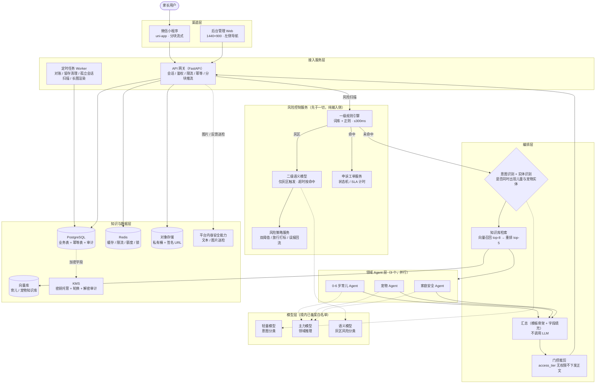
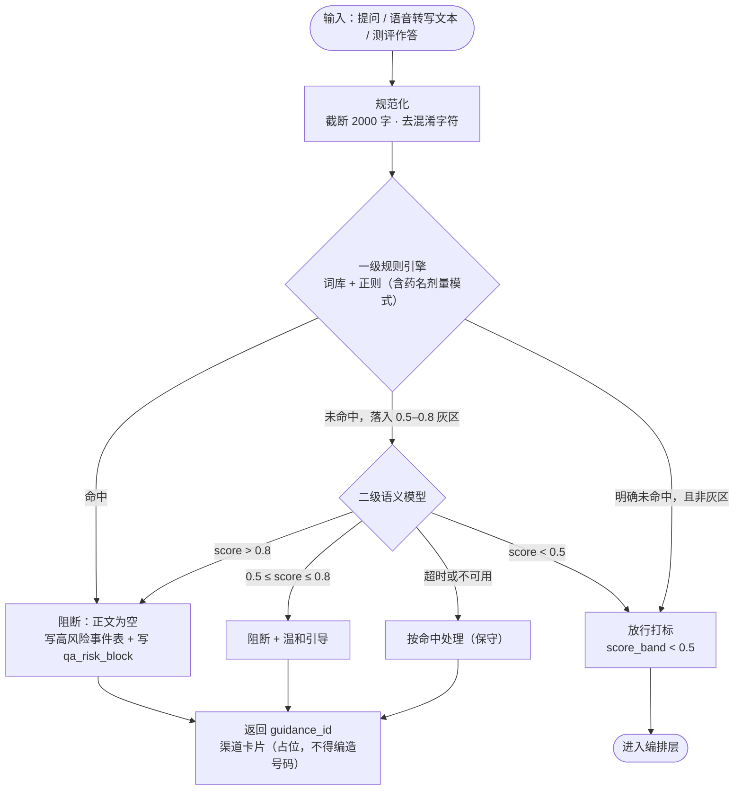
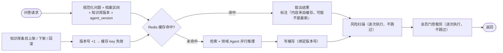
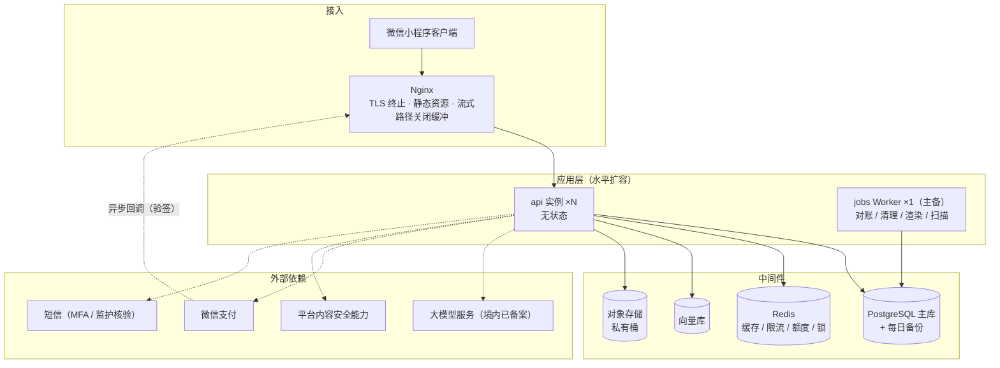

# 架构设计文档：Babe宝伴｜AI 多智能体，家庭养育科普参考工具

> 关联文档：`宝伴-PRD_V1.5.md`（2026-10-08，唯一需求基线）。本文档所有模块、技术组件与数据实体**均以 PRD 定义为准，不引入 PRD 之外的功能**；架构层命名变化不改变 FR/NFR 编号。
> 配套文档：`宝伴-数据模型文档_V1.1.md`（表结构、索引、向量与缓存键）｜`宝伴-UI原型描述_V1.3.md`（唯一界面基线）｜`DESIGN.md`（视觉 token 真源）

## 1. 文档信息

| 项目 | 内容 |
|------|------|
| 文档版本 | **v1.1**（对应 PRD V1.5）。**V1.1 变更**：① Q-38 技术选型已关闭，§8.1 与 PRD §23.2 对齐；② 延迟/首包口径与 PRD §7.7 同步；③ §8.2 未决项标注"不影响编码起步" |
| 创建日期 | 2026-10-03 |
| 适用范围 | M2 架构设计阶段交付物；研发、测试、运维、算法的施工依据 |
| 关键约束 | 首发仅微信小程序（C 端）+ 后台管理 Web；**仅境内已备案大模型**；儿童信息为敏感个人信息（加密 + 最小必要）；核心问答链路月度可用性 ≥99.5% |
| 不在本文档 | 需求与验收标准（见 PRD §6/§13）、页面与视觉（见 UI 文档）、表结构细节（见数据模型文档） |

---

## 2. 总体架构

### 2.1 分层架构图



**执行顺序（硬约束，PRD §7.6）**：收请求 → 鉴权与幂等检查 → **风险扫描（纯输入侧，不读档案）** → 意图分类与实体识别 → 检索 → 领域 Agent 并行 → 汇总（模板骨架 + 不可改写字段服务端注入）→ 输出侧过滤 → 返回。

### 2.2 架构决策记录（与 PRD 对应）

| 决策点 | 结论 | 依据 |
|--------|------|------|
| 编排器与风险控制服务的定位 | 风险控制是**独立服务（5 个组件）**，不是 Agent；编排器与风险控制服务按固定顺序执行，只有领域 Agent 并行 | PRD §7.1.3 术语替换表 |
| 风险扫描位置 | **先于一切、纯输入侧、不读档案**；命中即不进入生成链路 | PRD §7.6、FR-L2 |
| 流式传输 | **`wx.request` + `enableChunked: true` 收 HTTP 分块**，帧格式沿用 SSE 文本帧。不用 `EventSource`（小程序无此 API），WebSocket 仅作备选 | PRD §7.5.1 |
| 汇总实现 | **模板骨架 + 字段填充，不调用 LLM**；连贯性改写为可选步骤，超时 >500ms 或失败即回退模板 | PRD §7.10、FR-M2 |
| 不可改写字段 | 安全提示、冲突标注、免责声明、AI 标识、`professional_referral` 提示由**服务端注入，不经过 LLM** | PRD §7.3、§7.10 |
| 安全 Agent 失败处理 | **唯一"宁愿不出正文"的领域失败**：隐藏育儿/宠物全部正文，只出静态安全模板 | PRD §7.8 统一规则 1 |
| 灰区语义模型不可用 | **按命中处理（保守）**，不降级为放行 | PRD §7.7.3、§8.2 |
| 模型准入 | 服务端启动时加载模型白名单，**未登记的 provider/model 直接拒绝启动**（硬失败，不降级）；CI 断言 + 运行期校验三层 | PRD §11.11.3、NFR-1.10 |
| 敏感字段存储 | **KMS 托管 + 密钥与数据分离 + 轮换 + 解密审计**；排序与筛选只依赖派生列，不依赖加密字段 | PRD §9.2、NFR-1.3 |
| 付费墙门控位置 | **服务端裁剪**，无权限 block 的正文根本不下发；前端不做安全边界（不靠遮罩） | PRD §7.4、AS-20 |
| 前端技术栈 | 小程序用 uni-app（与 PRD §15.2 资源估算一致），后台用 Vue 3 + Element Plus；两端共用 API Client 与类型定义 | PRD §15.2、§10 NFR-4.4 |
| 检索与缓存边界 | 缓存 key 绑定**知识库版本号 + `agent_version`**，知识库更新即失效；缓存命中**仍然逐次执行风险扫描与会员门控** | PRD §7.13、§7.12 |

---

## 3. 模块划分

### 3.1 服务模块清单

| 模块 | 职责 | 对应 PRD 功能 |
|------|------|--------------|
| 接入服务（api） | FastAPI 网关：会话创建/恢复、鉴权、限流与配额、幂等表、分块推流、统一包络与错误码 | FR-D1、FR-J3、NFR-6.2、NFR-7.2、§18.2 |
| 准入与同意（consent） | 协议版本下发、分层同意留痕、监护人核验字段、撤回同意、文案 ID 下发 | FR-A1~A7、CG2/CG3/CG11 |
| 档案（profile） | 儿童/宠物档案 CRUD、加密字段、派生列（`age_months`/`age_band`）、级联删除、乐观锁 | FR-C1~C6、NFR-1.3 |
| 编排器（orchestrator） | 意图识别与实体识别、检索调度、领域 Agent 并行分发、汇总模板填充、冲突比对、门控裁剪 | FR-M1~M5、§7.6 |
| 育儿 Agent（agent_child） | 0-6 岁养育建议结构化输出、测评结果解读 | FR-D3、FR-E4 |
| 宠物 Agent（agent_pet） | 饲养 / 行为解读结构化输出、急症提示就医 | FR-F1、FR-F2 |
| 家庭安全 Agent（agent_safety） | 三态触发的安全内容生成，输出置顶且不参与排序 | FR-G2、FR-F3、§7.2 #5 |
| 风险控制服务（risk） | 一级规则引擎、二级语义分类、风险策略（双阈值/打标/回流）、申诉工单状态机、人工复核接口 | FR-L1~L6、§7.1.2、§7.9 |
| 知识库与检索（kb） | 条目 CRUD 与版本回滚、审核工单、向量化与增量更新、召回与重排、版本绑定与缓存失效 | FR-K1、§7.12、§12.1 |
| 词库（lexicon） | 高危/敏感词条、处理策略、两级阈值、药名剂量模式规则、一键回滚 | FR-K2、CG14 |
| 模型网关（llm-gateway） | 白名单校验、模型分级路由、主备切换、token 上限与上下文裁剪、用量落账 | FR-M5、§7.13、§11.11 |
| 测评（assessment） | 问卷引擎（16 题 / 双题干变体）、断点续填、幂等提交、计分与四类判定、题库版本与回滚 | FR-E1~E7、§12.2 |
| 报告（report） | 报告区块装配、波动与非宿命提示注入、长图异步渲染（免责 ≥15% / ≥2 次） | FR-E4、FR-E5、FR-H3 |
| 计费与订单（billing） | 商品与价格配置、下单、支付回调验签与幂等、T+1 对账、权益发放/补发/回收、退款售后 | FR-J1~J4、§8.5、§8.8、§12.9 |
| 个人信息权利（rights） | 六类请求受理与状态、导出文件生成（24h 一次性链接）、删除/注销异步任务与"已删除清单"回执 | FR-I3、FR-K7、§11.9 |
| 反馈与举报（feedback） | 反馈提交与回执、一键举报分类、涉未成年人加急、处置留痕与追溯 | FR-N1、FR-O1/O2、FR-K5 |
| 内容安全（safety-scan） | 平台内容安全能力接入（文本/图片）、超配额拒绝放行、送检记录与回调删除 | NFR-1.1、§11.5、CG5 |
| 定时任务（jobs） | 对账、留存期清理、孤立会话扫描、长图渲染、渠道清单到期提醒 | §8.5、NFR-1.9、§7.5.4、§11.3 |
| 可观测（observability） | 调用链路还原、指标采集、告警规则、审计写入 | NFR-5.1、NFR-5.2、§16.7 |
| 运营后台（admin-web） | 知识库、词库、日志、反馈举报、高风险事件、权利请求、系统开关、危机渠道清单、分级规则、内容运营（11 页） | FR-K1~K8、§16 |
| 家长端小程序（miniapp） | 26 页：准入、档案、三类问答、测评、历史、会员、个人中心、反馈举报 | §5.3、UI 文档 §4.1 |

### 3.1.1 V3.1 新增模块（PRD V3.1 附录 B 要求）

| 模块 | 落地位置 | 职责 | 对应需求 |
|---|---|---|---|
| **分级规则引擎**（triage） | `app/triage/`（`engine.py` + `templates.py`）、编排图 `triage` 节点 | 场景识别 → 信号提取（体温/时长/精神状态）→ 规则条件匹配 → 红/黄/绿定档；毫秒级纯函数，模型不得改写档位；规则条目化存 `triage_rule` 表，带专家会签与版本 | RQ-06、§5.1 三态路由、DR-29 |
| **触达服务**（touch） | `app/services/reminder_service.py`、`api/v1/reminders_api.py`、`jobs` 的 `reminder_sweep` | 里程碑提醒 / 成长周报 / 每周一问；订阅偏好与周频控（≤2 条，超频顺延）；`reminder_trace_id` 归因；模板未报备时走站内补达（不伪造外发成功） | RQ-08、NFR-A6、DR-30 |
| **图片链路**（photo） | `app/services/photo_service.py`、`api/v1/photo_api.py`、`jobs` 的 `photo_purge` | 上传 → 送检（未通过/超配额即拒绝且不扣额度）→ 绑定会话 → 24h 删除原图并写执行日志；只保留元数据，**无原图查看接口** | RQ-05、NFR-S7、DR-27/DR-28 |
| **AI 标识与文案合规**（compliance） | `app/compliance/`（`ai_label.py` + `copy_scan.py`）、`app/services/png_meta.py`、`report_image.py` | 三链路标识（页面固定位 / 长图显式 / PNG `tEXt` 隐式）；长图占比 ≥15% 且 ≥2 处，缺项即渲染失败；拟人化文案扫描（CI + 后台，fail-closed） | RQ-01、RQ-02、NFR-C13/C14 |
| **渠道清单服务**（channel） | `app/services/channel_service.py`、`api/v1/admin_v31_api.py` | `crisis_channel` 单一数据源（收敛旧「配置项 + 表」双轨）；复核到期自动降级不展示号码；核验记录 ≥3 年；角色脱敏 | RQ-03、DR-26 |
| **信任条装配**（trust） | `app/services/trust_service.py`、`answer_contract.py` | 四要素（AI 标识 / 月龄适配 / 来源等级 / 档位徽标）+ 首答信任检查单 10 项；要素缺失以「信息待补」上报而非隐藏 | RQ-07、AC-RQ07-6 |
| **分享渲染**（share） | `app/services/share_service.py`、`api/v1/share_api.py` | 测评 / 问答长图服务端渲染，标识校验留痕（`render_record`），被拦截会话 403，24h 复用 `render_id` | RQ-09、AC-RQ01-2/3 |
| **增长与内容**（growth） | `app/services/tool_service.py`、`topic_service.py`、`privacy_service.py`、`referral_service.py` | 轻工具（不耗额度）/ 专题包（交叉双签 + 红旗前置）/ 隐私承诺（只列已实现）/ LBS 转介（坐标不落库，默认关闭） | RQ-04、RQ-11~RQ-14 |

> **编排拓扑变更说明**：仅在 `risk_scan` 与 `intent_route` 之间插入 `triage` 节点，
> 三 Agent 并行与聚合拓扑、权重机制、安全置顶语义均未改动（符合 PRD「不改 Agent 拓扑」约束）。

### 3.2 代码仓库结构（建议）

```
jiaban/
├── app/
│   ├── main.py                  # FastAPI 入口
│   ├── gateway/                 # 会话、鉴权、限流、配额、幂等、分块推流
│   ├── orchestrator/            # 意图识别、调度、汇总模板、冲突比对、门控裁剪
│   ├── agents/                  # child_agent / pet_agent / safety_agent
│   ├── risk/                    # rule_engine / semantic_model / policy / appeal
│   ├── kb/                      # 条目 CRUD、审核工单、向量化、检索与重排
│   ├── lexicon/                 # 词库、阈值、药名剂量模式规则
│   ├── llm/                     # 模型网关：白名单、分级路由、用量落账
│   ├── assessment/              # 问卷引擎、计分、题库版本
│   ├── report/                  # 报告装配、长图渲染
│   ├── billing/                 # 商品、订单、支付回调、对账、权益
│   ├── rights/                  # 权利请求、导出、删除/注销任务
│   ├── feedback/                # 反馈、举报、处置
│   ├── safety_scan/             # 平台内容安全接入
│   ├── jobs/                    # 定时任务
│   └── models/                  # SQLAlchemy 业务表模型
├── miniapp/                     # uni-app 小程序（26 页）
├── admin-web/                   # Vue 3 + Element Plus 后台（8 页）
├── shared/                      # 前端共享：api client、类型、token 工具
├── deploy/                      # docker-compose.yml、nginx 配置、.env.example
└── scripts/                     # init_db.py（建表/索引）、create_admin.py、seed_lexicon.py
```

### 3.3 核心状态设计

**3.3.1 会话编排状态（`QAState`）**

```python
class QAState(TypedDict):
    request_id: str                       # 逐请求唯一
    session_id: str
    client_request_id: str                # 幂等键，重试必须复用
    question: str                         # 已过风险扫描；≤2000 字
    entry: str                            # 用户显式入口：child / pet / family
    profile_bound: bool                   # 无档案时 False，age_band 取默认 "1-3"
    age_band: str
    risk_result: dict                     # {hit, level, score_band, guidance_id}
    intent: str                           # 意图分类结果（轻量模型）
    has_child_entity: bool                # 实体识别：是否出现儿童实体
    has_pet_entity: bool                  # 实体识别：是否出现宠物实体
    render_order: list[str]               # 服务端决定：["safety","child","pet"]
    retrieved_docs: list[dict]            # [{kb_id, kb_version, section}]，top-5
    agent_outputs: dict                   # agent_id -> 结构化输出契约（§3.3.2）
    conflict_note: str | None             # 规则比对结论，不可改写字段
    degraded_reason: str | None           # risk_unavailable / safety_failed / agent_failed / rag_no_hit / kb_unavailable
    status: str                           # streaming / done / blocked / degraded / failed
```

**3.3.2 Agent 结构化输出契约（PRD §7.3 的字段级落地）**

```json
{
  "agent_id": "child_care_0_6",
  "agent_version": "1.1.0",
  "intent": "sleep_guidance",
  "topic_key": "sleep_training",
  "confidence": 0.86,
  "answer_blocks": [
    {
      "block_id": "b1",
      "type": "advice",
      "title": "建议要点",
      "content": "……",
      "access_tier": "free",
      "preconditions": "适用于 6-12 月龄、已添加辅食的宝宝",
      "evidence_ref": ["kb_child_sleep_03"],
      "stance": "support",
      "contraindications": [],
      "immutable": false
    }
  ],
  "risk_flags": [],
  "professional_referral": false,
  "medical_advice_blocked": false,
  "ai_generated_label": "AI_GEN_LABEL_V1",
  "disclaimer_id": "DISCLAIMER_V1",
  "retrieval": { "kb_ids": ["kb_child_sleep_03"], "hit": true, "kb_version": "2026-10-01" },
  "tokens_used": 812,
  "latency_ms": 3200
}
```

**3.3.3 中枢 → 前端契约（PRD §7.4）**

```json
{
  "request_id": "req_…",
  "session_id": "sess_…",
  "status": "streaming | done | blocked | degraded | failed",
  "render_order": ["safety", "child", "pet"],
  "sections": [
    { "key": "safety", "title": "家庭安全提示", "blocks": ["…"], "immutable": true, "pinned": true },
    { "key": "child",  "title": "育儿侧建议",   "blocks": ["…"] }
  ],
  "conflict_note": null,
  "agents_involved": [{ "agent_id": "child_care_0_6", "latency_ms": 3200, "status": "ok" }],
  "degraded_reason": null,
  "disclaimer_id": "DISCLAIMER_V1",
  "ai_generated_label": "AI_GEN_LABEL_V1"
}
```

**三条实现硬约束**

1. `render_order` 由服务端决定，**前端不得重排**；`pinned: true` 的分节不可折叠、不可下移。
2. 同名 `section.key` 的新分片覆盖旧的；`status=done` 为最终态，最终态必须含免责声明与 AI 标识。
3. `access_tier` 无权限的 block，**服务端不下发 `content` 字段**（不是发空串、不是发占位符）。

### 3.4 核心业务流程

风险拦截与申诉、测评、建档与分层同意、支付与对账、内容追溯处置的流程图与状态机见 PRD §8.1~§8.10，问答响应协议见 PRD §7.5，此处不重复。以下补充 PRD 未展开的**两个服务内部流程**。

**3.4.1 风险控制服务内部决策链（两级筛选 + 保守降级）**



**3.4.2 缓存与失效链路（版本绑定）**



**关键规则**：缓存命中的请求**不得**跳过风险扫描与会员门控；知识库版本变更即失效，不允许"按旧版本内容继续作答"。

### 3.5 前端架构设计

#### 3.5.1 技术栈与工程结构

| 层次 | 小程序端 | 后台端 | 说明 |
|------|---------|--------|------|
| 框架 | uni-app | Vue 3 + TypeScript + Vite | 两端独立构建；小程序不引入重组件库 |
| 组件库 | 自研组件（对齐 UI 文档 §9 的 C-01~C-25） | Element Plus | 后台以表格/抽屉为主（C-20/C-21） |
| 状态管理 | Pinia | Pinia | 小程序侧重点：`renderedSections`、额度、当前问答对象 |
| 路由 | pages.json | Vue Router 4 + 路由守卫 | 后台菜单按角色过滤（前端仅体验，鉴权在服务端） |
| 样式 | rpx + DESIGN.md token | px + 同一套 token | 圆角只用 12px（面）/ 8px（控件）两档 |
| 共享层 | `shared/`：API Client、类型定义、错误码映射、token 工具 | 同左 | 两端禁止各自硬编码接口路径与错误码 |

```
shared/
├── api/            # 按 §18 分组封装的调用方法（consent / profile / qa / assessment / billing / rights）
├── stream/         # chatStreamClient：分块收帧、按 \n\n 切帧、sequence 跳号处理、重连
├── types/          # QAState、渲染契约、错误码枚举
└── auth/           # token 存取、401 统一拦截、平台标识注入
```

#### 3.5.2 分块流式消费设计（小程序端核心）

小程序**没有** `EventSource`，`wx.request` 不支持 SSE 语义，因此统一收敛到 `shared/stream/chatStreamClient`：

| 项 | 约定 |
|----|------|
| 传输 | `wx.request({ enableChunked: true })` + `onChunkReceived` 逐块收 `ArrayBuffer`（基础库 ≥2.20.2） |
| 帧格式 | 沿用 SSE 文本帧：`event:` / `data:` 按行分隔，客户端按 `\n\n` 切帧 |
| 响应头 | `Content-Type: text/event-stream; charset=utf-8`；**禁用响应压缩**；单帧 ≤8KB；`X-Accel-Buffering: no` |
| 事件 | `started` / `section_delta` / `section_done` / `blocked` / `degraded` / `completed` / `error` / `ping`（字段唯一权威＝PRD §7.5.2） |
| 丢帧处理 | `sequence` 出现跳号 → 必须用该节最近的 `section_done` 覆盖渲染（因此 `section_done` 强制，不能只发 delta） |
| 阻断覆盖 | 收到 `blocked` 或 `degraded[failed_sections 含 safety]` → 执行 `clearAll()` 清空已渲染正文，**不允许"灰掉但仍可读"**，并移除复制入口 |
| 重连 | `GET …/stream?from_sequence=N` 从 N+1 续发；>5 分钟未重连标 `orphaned` 但仍落库 |
| 保活 | 默认 `keep_alive=true`：离开页面服务端继续生成并落库；`ping` 每 15s 无数据时下发 |
| 降级兜底 | 分块不可用 / 基础库过低 / 连续重连失败 → 轮询 `GET …/sessions/{id}`，结果必须与流式最终态一致 |
| 并发 | 同一用户同时只允许 1 个活跃流式会话，第二条返回 409 + `retry_after` |
| 取消 | 必须调用 `POST …/cancel` 并带 `started` 帧下发的 `cancel_token`，否则服务端继续生成 |

#### 3.5.3 后台端权限路由与敏感字段呈现

| 事项 | 方案 |
|------|------|
| 登录态 | `Authorization: Bearer <admin_token>`；全部角色强制 MFA，未通过不签发会话 |
| 角色来源 | **只从服务端会话读取**；请求头携带的角色值一律忽略（PRD §16.1 R-3） |
| 路由与菜单 | 按角色过滤菜单与页面（体验层）；服务端按 `角色 × 页面 × 动作` 二次校验，越权返回 403 并写审计 |
| 专家域隔离 | 专家账号与领域硬绑定（育儿 ⟷ 育儿/题库；宠物 ⟷ 宠物）；跨领域请求返回 1603 |
| 敏感字段 | P0 字段默认脱敏呈现；展开需二次确认 + 必填原因 + 写审计（C-20）；接口层不出未授权字段 |
| 二次确认 | 下架、回滚、改价、紧急下线、导出、上报、拒绝请求统一使用 C-18 形态，二次确认凭证缺失返回 1602 且不产生副作用 |
| 并发编辑 | 可变实体保存时 `WHERE version = ?`，不匹配返回 409/1601 + 提示刷新，不静默覆盖 |

---

## 4. 接口与协议

> 接口目录（109 个）、错误码分段、分页与金额约定、幂等键一览、支付回调与对账详规的唯一权威为 **PRD §18**；流式事件字段的唯一权威为 **PRD §7.5**。本节只补服务端实现侧的约定。

### 4.1 统一响应包络

```json
{ "code": 0, "message": "ok", "data": {}, "request_id": "req_...", "trace_id": "tr_..." }
```

```json
{ "code": 1201, "message": "请求过于频繁", "data": null, "request_id": "req_...",
  "error": { "type": "rate_limited", "retryable": true, "retry_after": 30, "details": {} } }
```

| 规则 | 内容 |
|------|------|
| 唯一例外 | 流式接口 `POST /api/v1/qa/sessions/{id}/stream` 不使用包络，失败以 `error` 事件送达 |
| 失败语义 | `error.retryable` 明确是否可重试；`retry_after` 单位为秒 |
| 幂等回放 | 命中幂等表时 `data` 返回上次结果引用，并附 `idempotent_replay=true` |
| 链路字段 | `request_id` 逐请求唯一；`trace_id` 贯穿网关、编排、Agent、模型调用，用于还原 NFR-5.1 |

### 4.2 错误码分段（4 位整数）

| 段 | 含义 | 代表码 |
|----|------|--------|
| 0 | 成功 | 0 |
| 1000–1099 | 通用与参数 | 1001 参数校验失败（422）、1002 资源不存在（404）、1003 乐观锁冲突（409）、1004 幂等键处理中（409）、1005 上游超时（504） |
| 1100–1199 | 鉴权与越权 | 1101 会话缺失或失效（401）、1102 越权访问（403）、1103 后台角色无权限（403）、1104 MFA 未通过（403） |
| 1200–1299 | 限流与配额 | 1201 触发限流（429）、1202 免费额度用尽（429）、1203 活跃流式会话超限（409）、1204 单用户单日请求上限 |
| 1300–1399 | 合规与同意 | 1301 基础协议未同意、1302 儿童信息单独同意缺失、1303 内容安全送检未通过、1304 删除请求与法定留存冲突 |
| 1400–1499 | 问答与风险 | 1401 风险命中阻断、1402 风险扫描不可用、1403 家庭安全 Agent 失败、1404 领域 Agent 全部失败、1405 会话已 `orphaned` |
| 1500–1599 | 支付与订单 | 1501 订单状态不允许该操作、1502 价格与商品配置不一致、1503 重复下单、1504 回调验签失败、1505 对账差异待人工处理 |
| 1600–1699 | 后台与配置 | 1601 后台乐观锁冲突、1602 危险操作缺二次确认凭证、1603 专家跨领域越权、1604 导出并发超限（排队提示，不失败） |
| 1900–1999 | 服务端故障 | 1901 依赖不可用、1902 未知错误 |

### 4.3 服务端实现约束

| 项 | 约束 |
|----|------|
| 时间 | 传输 RFC3339（UTC）；毫秒用 `_ms`（int）；自然日 / cohort / 额度周期 / 对账日一律按 Asia/Shanghai 切分；客户端时间不作为任何判定依据 |
| 金额 | `amount_micro`（int64，1 元 = 1 000 000），**禁浮点** |
| 幂等键 | `client_request_id`：uuid4，长度 ≤64，字符集 `[A-Za-z0-9_-]`；同一业务动作重试必须复用 |
| 反代 | 流式路径必须关闭响应缓冲与压缩；`nginx` 侧对 `/api/v1/qa/sessions/*/stream` 单独配置 `proxy_buffering off` |
| 流式超时 | 首包 P95 ≤1.5s；单领域整请求 P95 ≤8s（超时 15s）、复合 P95 ≤15s（超时 16s）、灰区请求单独统计 |
| 上游熔断 | 按 PRD §7.7 各阶段超时列熔断；风险扫描或输出侧过滤不可用 → **禁出正文**（不走降级放行） |
| 权限校验位置 | 网关/服务端中间件统一校验：`角色 × 页面 × 动作`；前端隐藏入口只做体验收敛，**不是安全边界** |

---

## 5. 性能、降级与可观测性

### 5.1 延迟预算落到组件

PRD §7.7 的四张表给出阶段级 P50/P95/告警/超时，本节把每个阶段映射到**承载组件与外部依赖**，便于定位与压测。

| 阶段 | 承载组件 | 外部依赖 | 单领域 P95（ms） | 超时（ms） | 超时后的行为 |
|------|---------|---------|-----------------|-----------|-------------|
| ① 鉴权 + 幂等 | API 网关 | PostgreSQL / Redis | 150 | 500 | 幂等表不可用 → 仍放行但告警 |
| ② 一级风险扫描 | 风险控制服务 | Redis（词库热加载） | 300 | 800 | **禁出正文** |
| ③ 二级语义模型（仅灰区） | 风险控制服务 | 语义模型 | 0 / 1500（灰区） | 3000 | **按命中处理（保守）** |
| ④ 意图分类 + 实体识别 | 编排器 | 轻量模型 | 400 | 1000 | 回退用户显式入口 |
| ⑤ 知识库检索 | 知识库与检索 | 向量库 | 600 | 1500 | `hit=false` → `professional_referral=true` |
| ⑥ 领域 Agent 并行 | 领域 Agent ×N | 主力模型 | 6000（单）/ 6500（复合） | **12000（单 Agent 超时）** | 该节降级；**安全 Agent 失败 → 禁出正文** |
| ⑦ 汇总（模板填充） | 编排器 | 无（不调 LLM） | 300 | 800 | 回退纯模板拼接 |
| ⑧ 输出侧过滤 | 风险控制服务 | 词库 | 200 | 600 | **禁出正文** |
| 整请求 | — | — | 7950（单）/ 8550（复合） | 15000 / 16000 | — |

**口径冻结（PRD §7.7.1）**：家庭安全 Agent **计入**复合场景的 3 个并行 Agent；12s 是**单 Agent 超时**而非整请求超时；性能达标样本**只统计 `status=done`**，`degraded` 与 `blocked` 单独出报表（降级率 ≤3%）。

### 5.2 降级与熔断的实现位置

| 失败组件 | 实现位置 | 是否出正文 | 降级后展示 | 扣额度 | UI 状态 |
|---------|---------|-----------|-----------|--------|---------|
| 风险扫描不可用 | 风险控制服务 | **否** | 静态故障页 + 危机渠道入口 | 不扣 | `failed` |
| 家庭安全 Agent 失败 | 编排器 | **否** | **仅静态安全模板**（隐藏育儿/宠物全部正文） | 不扣 | `degraded`（安全专用文案） |
| 育儿或宠物 Agent 单侧失败 | 编排器 | 是（其余节） | 失败节显示"本次部分内容未能生成"，可仅重生成该节 | 扣 | `degraded` |
| 两个领域 Agent 全部失败 | 编排器 | 否 | 兜底话术 + 稍后重试 | 不扣 | `failed` |
| 检索无命中 | 知识库与检索 | 是 | 正文 + `professional_referral` 标注 | 扣 | `done` |
| 汇总失败 | 编排器 | 是（回退模板） | 正常展示，无额外提示 | 扣 | `done` |
| 输出侧过滤不可用 | 风险控制服务 | **否** | 静态故障页 | 不扣 | `failed` |
| 知识库不可用（有缓存） | 知识库与检索 | 是 | 正文 + "内容可能不是最新" | 扣 | `done` |
| 知识库不可用（无缓存） | 知识库与检索 | 否 | 兜底话术 | 不扣 | `failed` |
| 大模型不可用 | 模型网关 | 视具体 Agent | 主备切换；无可用备选则按上表对应行处理 | 按上表 | 按上表 |
| 微信支付不可用 | 计费与订单 | — | 订单保持"支付确认中"，T+1 对账兜底 | 不影响额度 | — |

**统一规则**：所有降级一律落库并可在 SC-19 回看（含降级原因与当时状态）；`failed` 与 `degraded` 两态**不可混用**。

### 5.3 可观测性

| 维度 | 方案 | 落地要求 |
|------|------|---------|
| 链路追踪 | 每次请求一个 `trace_id`，贯穿网关 → 编排 → 各 Agent → 模型调用 → 检索 | 能在 PA-05 还原：输入摘要、调度决策、各 Agent 输出、耗时、风险判定、引用 `kb_id` |
| 指标 | 按 PRD §17 事件字典采集；性能指标只用服务端 `_ms` 差值 | 禁止用客户端上报的 `elapsed_ms` 计算 P95 |
| 告警 | Agent 失败率 >3%、超时率 >5%、风险拦截量日环比 >3σ、对账差异 >0、单位成本 >目标值 1.5 倍 | 阈值可配置，不写死 |
| 日志分级 | 业务日志 / 审计日志 / 合规留档三库分离 | 审计写入失败**按业务失败处理**，不得静默 |
| 留存 | 网络与操作日志 ≥6 个月；交易、同意、PIA、高风险事件、权利请求、举报处置 ≥3 年 | 到期由定时任务自动清理或聚合化，清理动作写审计 |

---

## 6. 安全与合规架构

### 6.1 鉴权与权限

| 端 | 获取方式 | 传递 | 绑定 | 有效期 |
|----|---------|------|------|--------|
| C 端 | `wx.login` 的 code 换取会话令牌 | `Authorization: Bearer <user_token>` | `user_id`；微信 openid 仅服务端留存，**不出现在任何响应** | 访问令牌 2 小时 + 刷新令牌 30 天 |
| 后台 | 账号密码 → MFA 校验 → 签发 | `Authorization: Bearer <admin_token>` | 账号 + 角色 + **领域绑定**（专家） | 空闲 30 分钟 / 绝对 8 小时；专家 15 分钟 / 2 小时 |

**权限矩阵唯一权威＝PRD §16.2 逐区块表**；越权防护点＝PRD §18.3.3；横向越权统一返回 1102，且**不区分"不存在"与"无权限"**（防枚举）。

### 6.2 数据加密与密钥流

| 项 | 方案 |
|----|------|
| 加密字段 | 儿童档案：出生日期、昵称、过敏项；问答会话：问题文本；订单：支付相关标识 |
| 密钥管理 | KMS 托管；密钥与数据分离；定期轮换；每次解密写审计（展开人 / 字段 / 对象 / 原因 / 时间） |
| 派生列 | `age_months`、`age_band` 写入时由服务端计算并落列；`age_months_updated_at` 记录刷新时间；**排序与筛选不得依赖加密字段** |
| 覆盖范围 | 平台内容安全送检副本：检测回调后删除并留日志；图片：私有存储 + 签名 URL，回调后删除 |
| 出境约束 | 全链路（含埋点与分析）**不得传输至境外**；只允许境内已备案服务；模型白名单硬校验 |

### 6.3 合规链路的架构落点

| 合规要求 | 架构落点 |
|---------|---------|
| AI 生成内容标识（显式 + 隐式） | 服务端注入 `ai_generated_label`；长图渲染时写入元数据；文案走文案 ID 下发 |
| 分层同意与监护人核验 | 同意记录实体 + 唯一索引（`user_id + consent_type + consent_version`）；`guardian_verified_method` 字段预留三种取值 |
| 未成年人保护 | 分享图默认插画头像 + 打码开关；举报分类"涉未成年人"单列并加急 |
| 强制报告与危机干预 | 事件登记、值班复核、上报留痕字段齐备；**上报按钮在法务结论录入前置灰**，直连返回 403 |
| 个人信息权利 | 六类请求；导出链接 24 小时过期、限一次下载；删除任务产出"已删除清单"回执（含未删除项与法定原因） |
| 留存与删除优先级 | 法定留存优先（去标识化）→ 最短必要 → 删除"可用性"而非"存在性"；备份不单独删除，自然过期 ≤35 天 |

---

## 7. 部署与运维

### 7.1 部署拓扑



### 7.2 环境与发布

| 项 | 方案 |
|----|------|
| 环境 | dev / staging / prod 三套；staging 使用独立的测试数据集与测试小程序 |
| 发布单元 | api 实例、jobs Worker、admin-web 静态资源三者独立发布；小程序走体验版 → 审核 → 全量 |
| 灰度 | 按**入口粒度**（育儿 / 宠物 / 综合 / 测评 / 会员）开关；灰度字段随埋点上报用于归因；题库版本默认灰度关闭 |
| 回滚 | 配置与价格走配置版本表一键回滚；知识库走条目版本回滚；代码走镜像回滚；小程序走版本回退 |
| 变更留痕 | 所有开关/价格/文案/渠道清单/阈值变更写配置版本表（变更前后快照 + 操作人 + 时间 + 原因） |
| 合规发布前置 | 生成式 AI 备案完成并展示备案号；未完成时首发仅做体验版内测，**不开放支付** |

### 7.3 备份与容灾

| 项 | 目标 | 实现 |
|----|------|------|
| RTO / RPO | RTO ≤4h、RPO ≤1h | 数据库每日全量 + 增量日志；主库故障按最近可用备份 + 日志回放恢复 |
| 备份留存 | ≤35 天 | 备份不参与用户删除请求，自然过期；隐私政策中说明备份周期与最长滞留 |
| 三方故障 | 有降级路径 | 大模型主备切换；内容安全超配额拒绝放行并转人工；微信支付 T+1 对账兜底 |
| 演练 | 上线前 ≥1 次 | 三方故障降级演练 + 留档（NFR-8.5） |
| 定时任务 | 幂等可重跑 | 对账 / 清理 / 渲染均以业务日或对象 ID 作幂等键，同日重复执行返回上次结果 |

---

## 8. 技术选型与未决项

### 8.1 已定选型（**V1.1：Q-38 已关闭**，以下与 PRD §23.2 一致）

| 层 | 选型 | 依据 |
|----|------|------|
| 小程序 | uni-app | PRD §15.2 资源估算与前端人力口径 |
| 后台 Web | Vue 3 + TypeScript + Element Plus | 表格/抽屉密集型后台，组件生态成熟 |
| 服务端 | Python + FastAPI（`StreamingResponse` 承载分块推流） | PRD §7.5.1 明确以 FastAPI 为服务端实现 |
| 主库 | PostgreSQL（业务表 + 幂等表 + 审计 + 高风险事件） | PRD §9.1 全部实体落此库 |
| 缓存 / 限流 / 额度 / 锁 | Redis | 缓存 key 需绑定知识库版本，方案见 §3.4.2 |
| 对象存储 | 私有桶 + 签名 URL | 图片回调后删除；分享长图与导出文件同桶分目录 |
| 密钥管理 | KMS 托管 + 轮换 + 解密审计 | NFR-1.3、NFR-7.3 硬要求 |
| 流式协议 | HTTP 分块 + SSE 文本帧 | 小程序无 `EventSource`；与未来 Web 端共用同一帧格式 |

### 8.2 未决项（唯一收纳处）

> 以下为**技术侧尚未拍板**的项。开发不因此停摆：按"默认方案"实现，结论到达后只改配置，不改架构。
> **V1.1 补充**：T-1~T-6 **全部不影响编码起步**（PRD §23.1）；其中 T-1（模型供应商）由 PRD §11.11 + §23.2 的 `Provider` 抽象层承接，T-6（专家签字形式）不影响工单机制开发。

| # | 未决项 | 默认方案 | 卡点 | 影响范围 |
|---|--------|---------|------|---------|
| T-1 | 主力模型 / 轻量模型 / 灰区语义模型 / 故障切换模型的供应商与版本 | 启动时从配置加载白名单，先用占位 provider 开发 | 需境内已备案清单 + 数据处理协议 + 备案号 | 模型网关、成本口径、CI 白名单断言 |
| T-2 | ~~向量库选型（独立向量库 vs 主库扩展）~~ **已定稿（2026-10-12，spec milvus-vector-store 接替 rag-llamaindex-migration 的存储后端）**：独立向量库 **Milvus standalone 3.0.2**（compose 三件套 etcd/minio/milvus-standalone）——集合 `jiaban_kb_entries`（智谱 embedding-3 2048 维，HNSW M=16/efC=200 COSINE，搜索 ef=128），集合级 **Strong 一致性** + 原生 upsert；过滤表达式白名单注入防护 + 哨兵 'any'；检索侧回查复核 published/child/pet 双保险；降级链保留 hashing JSONB + Python 余弦（spec D6）。rag_index 对外契约不变，业务接线零改动 | 已落地 | 检索模块、§5.1 检索规格 |
| T-3 | KMS 具体服务商与轮换周期 | 抽象为 `KeyProvider` 接口，轮换周期按季度默认 | 云厂商未定 | 加密字段读写链路 |
| T-4 | 并发承载目标（目标 DAU / 峰值并发） | 按小规模灰度（千级 DAU）设计，压测后再定扩容量 | PRD NFR-2.5 待业务方给目标 | 实例数、限流阈值、压测模型 |
| T-5 | 后台访问网络形态（内网 / VPN 白名单） | 默认允许公网 + MFA + 登录失败锁定，白名单作为可开启项 | 部署形态待技术确认 | 网关策略、登录审计 |
| T-6 | 专家签字的法律效力形式（电子签名是否满足留档） | `sign_off` 字段存工单确认号，原件存后台文档区 | 需法务确认 | 审核记录存储、后台文档区权限 |

---

## 9. 追溯：架构模块 ↔ 需求

| 架构模块 | 覆盖 FR / NFR | 验收锚点（PRD §13.4） |
|---------|--------------|---------------------|
| 准入与同意 | FR-A1~A7、NFR-1.5、CG2/CG3/CG11 | 1、2、23、25 |
| 档案 | FR-C1~C6、NFR-1.3、NFR-1.4 | 4、5、28、30 |
| 编排器 + 领域 Agent | FR-D1/D3~D6、FR-F1~F4、FR-G1~G6、FR-M1~M5 | 6、7、8、9、29、33 |
| 风险控制服务 | FR-L1~L6、NFR-9.9 | 16、17、26、38 |
| 测评与报告 | FR-E1~E7、FR-H3、NFR-2.3 | 10、11、12 |
| 计费与订单 | FR-J1~J4、NFR-9.5/9.6 | 13、14、15 |
| 个人信息权利 | FR-I3、FR-C4、CG7 | 20、24、31 |
| 反馈与举报 | FR-N1、FR-O1/O2、FR-K5 | 19、40 |
| 知识库与词库 | FR-K1/K2、NFR-9.10、FR-L1 | 18、37、38、39 |
| 内容安全 | NFR-1.1、CG5 | 21 |
| 可观测与审计 | NFR-5.1/5.2、NFR-7.4、§16 | 31、28 |
| 部署与运维 | NFR-8.1~8.5、NFR-1.7 | 22、27、34、35、36 |
