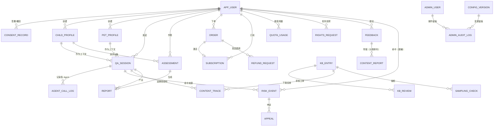

# 数据模型设计文档：小光景・一家人的养育参考

> 关联文档：`家伴-PRD_V1.5.md` §9.1（核心数据实体）、§9.2（关键字段与约束）、§11.10（删除与留存优先级）；`家伴-架构设计文档_V1.1.md`（分层与模块边界）。本文档表结构**由 PRD §9.1 的实体直接展开，不新增业务实体**。
> 类型约定：`BIGSERIAL` / `TIMESTAMPTZ` / `JSONB` / `NUMERIC(p,s)` / `VARCHAR(n)`；字段名 snake_case；**加密字段以 `_enc` 结尾**，明文不落库。

## 1. 设计原则

1. **业务表自建**：全部实体由 SQLAlchemy 模型管理，`scripts/init_db.py` 建表建索引；不使用框架自带的隐式表。
2. **加密与派生列分离**：敏感字段以密文列（`*_enc`）存储，派生列（`age_months` / `age_band`）由服务端写入时计算；**排序与筛选只允许依赖派生列**，不得依赖加密字段。
3. **乐观锁统一**：所有可变实体（档案、知识库条目、词库、配置、工单类）都带 `version`，更新走 `WHERE version = ?`，冲突返回 409。
4. **幂等表集中**：问答、测评、下单三类重复提交共用一个 `idempotency_key` 表，按业务动作前缀区分命名空间。
5. **失效但不消失**：到期、退款、下架、撤回同意一律"保留可见 + 明确标记"，不做物理删除；物理删除只发生在用户主动删除与留存期到期清理。
6. **留存期字段化**：每张表带 `retention_class`（如有必要）或在文档中标注留存期，供定时清理任务按类扫描，清理动作写审计。
7. **审计三库分离**：业务库、审计库（`admin_audit_log`）、合规留档（同意记录、高风险事件、权利请求、举报处置）分表存放，保留期不同，不混用。

## 2. ER 关系图

## 3. 表结构定义

### 3.1 用户与准入

#### 表 1：app_user（用户）

| 字段 | 类型 | 约束 | 说明 |
|------|------|------|------|
| id | BIGSERIAL | PK | 用户 ID |
| user_uid | UUID | UNIQUE, NOT NULL | 对外暴露的内部标识（不使用 openid 明文对外） |
| wx_openid_enc | TEXT | NOT NULL | 微信 openid 密文（**仅服务端留存，不出现在任何响应**，CG13） |
| wx_unionid_enc | TEXT | | unionid 密文，可为空（跨端账号体系待定） |
| phone_enc | TEXT | | 手机号密文（**可选且最小化**；仅监护核验 / MFA 场景） |
| phone_masked | VARCHAR(16) | | 脱敏展示值，如 138****5678 |
| member_status | VARCHAR(16) | NOT NULL, DEFAULT 'free' | free / member / expired |
| member_expire_at | TIMESTAMPTZ | | 会员到期时间（冗余自 subscription，便于门控判定） |
| status | VARCHAR(16) | NOT NULL, DEFAULT 'active' | active / disabled / deleting / deleted |
| register_at | TIMESTAMPTZ | NOT NULL, DEFAULT now() | 注册时间 |
| last_active_at | TIMESTAMPTZ | | 最近活跃时间 |

*留存期：账号存续期；注销后按 §5 留存优先级处理。*

#### 表 2：consent_record（同意记录）

| 字段 | 类型 | 约束 | 说明 |
|------|------|------|------|
| id | BIGSERIAL | PK | 记录 ID |
| user_id | BIGINT | FK → app_user.id, NOT NULL | 用户 |
| consent_type | VARCHAR(32) | NOT NULL | base / child_personal_info / asr_third_party |
| consent_version | VARCHAR(32) | NOT NULL | 协议或告知版本号 |
| scope | VARCHAR(64) | | 作用域：`profile:{id}`（按档案粒度撤回的依据） |
| guardian_verified | BOOLEAN | NOT NULL, DEFAULT false | 是否已留痕核验 |
| guardian_verified_method | VARCHAR(16) | | declaration / phone_otp / face（预留三值，默认 declaration） |
| device_hash | VARCHAR(128) | | 设备标识摘要 |
| ip_segment | VARCHAR(24) | | /24 网段，不存完整 IP |
| agreed_at | TIMESTAMPTZ | NOT NULL, DEFAULT now() | 同意时间 |
| withdraw_at | TIMESTAMPTZ | | 撤回时间；非空即视为已撤回 |
| retention_class | VARCHAR(16) | NOT NULL, DEFAULT 'compliance' | 合规留档类 |

**唯一索引**：`(user_id, consent_type, consent_version)`。*留存期 ≥3 年，身份标识哈希化。*

#### 表 3：text_version（文案版本）

| 字段 | 类型 | 约束 | 说明 |
|------|------|------|------|
| id | BIGSERIAL | PK | 版本 ID |
| text_id | VARCHAR(64) | NOT NULL | 文案 ID：`DISCLAIMER_V1` / `AI_GEN_LABEL_V1` / `REFUSAL_AGE_V1` / `CRISIS_CHANNELS_V1` / `QUOTA_RULE_V1` / `REFUND_NOTICE_V1` 等 |
| version | VARCHAR(32) | NOT NULL | 文案版本号 |
| content | TEXT | NOT NULL | 文案正文（服务端下发，前端不得硬编码） |
| effective_at | TIMESTAMPTZ | NOT NULL | 生效时间 |
| requires_reconsent | BOOLEAN | NOT NULL, DEFAULT false | 变更后是否触发重新同意 |
| operator_id | BIGINT | FK → admin_user.id | 修改人 |

**唯一索引**：`(text_id, version)`。

### 3.2 档案

#### 表 4：child_profile（儿童档案）

| 字段 | 类型 | 约束 | 说明 |
|------|------|------|------|
| id | BIGSERIAL | PK | 档案 ID |
| profile_uid | UUID | UNIQUE, NOT NULL | 对外标识，防枚举（越权统一返回"不存在或无权限"） |
| user_id | BIGINT | FK → app_user.id, NOT NULL | 归属用户 |
| nickname_enc | TEXT | NOT NULL | **昵称密文**（P0） |
| birth_date_enc | TEXT | NOT NULL | **出生日期密文**（P0） |
| gender | VARCHAR(8) | | male / female / unknown |
| height_cm | NUMERIC(5,1) | | 身高 |
| weight_kg | NUMERIC(5,2) | | 体重 |
| premature_flag | BOOLEAN | NOT NULL, DEFAULT false | 早产标记 |
| allergy_enc | TEXT | | **过敏项密文**（P0） |
| solid_food_month | SMALLINT | | 辅食添加月龄 |
| age_months | INTEGER | NOT NULL | **派生列**：由 `birth_date` 计算，写入时刷新 |
| age_band | VARCHAR(16) | NOT NULL | **派生列**：`0-6m` / `6-12m` / `1-3y` / `3-6y` |
| age_months_updated_at | TIMESTAMPTZ | NOT NULL | 派生列刷新时间 |
| status | VARCHAR(16) | NOT NULL, DEFAULT 'active' | active / disabled（撤回同意后置此态） |
| version | INTEGER | NOT NULL, DEFAULT 1 | 乐观锁 |
| created_at | TIMESTAMPTZ | NOT NULL, DEFAULT now() | 创建时间 |
| deleted_at | TIMESTAMPTZ | | 删除时间（软删，保留审计） |

*上限：免费 3 / 会员 10（AS-09）。留存期：账号存续期 + 30 天。*

#### 表 5：pet_profile（宠物档案）

| 字段 | 类型 | 约束 | 说明 |
|------|------|------|------|
| id | BIGSERIAL | PK | 档案 ID |
| pet_uid | UUID | UNIQUE, NOT NULL | 对外标识 |
| user_id | BIGINT | FK → app_user.id, NOT NULL | 归属用户 |
| pet_type | VARCHAR(16) | NOT NULL | cat / dog（**MVP 仅猫狗**） |
| breed | VARCHAR(64) | | 品种（枚举 + 可选自由文本，埋点只记枚举） |
| age_band | VARCHAR(16) | NOT NULL | `junior`(<1y) / `adult`(1-7y) / `senior`(>7y) |
| neutered_flag | BOOLEAN | | 绝育状态 |
| weight_kg | NUMERIC(5,2) | | 体重（选填） |
| main_food | VARCHAR(64) | | 主要食物（选填） |
| version | INTEGER | NOT NULL, DEFAULT 1 | 乐观锁 |
| created_at | TIMESTAMPTZ | NOT NULL, DEFAULT now() | 创建时间 |
| deleted_at | TIMESTAMPTZ | | 删除时间 |

#### 表 6：current_context（当前问答对象）

| 字段 | 类型 | 约束 | 说明 |
|------|------|------|------|
| user_id | BIGINT | PK, FK → app_user.id | 用户 |
| profile_type | VARCHAR(8) | NOT NULL | child / pet |
| profile_id | BIGINT | NOT NULL | 指向 child_profile 或 pet_profile |
| updated_at | TIMESTAMPTZ | NOT NULL, DEFAULT now() | 切换时间 |

*切换动作埋点 `profile_set_current`；每条问答记录档案 ID 以支撑场景 8 的追溯。*

### 3.3 问答链路

#### 表 7：qa_session（问答会话）

| 字段 | 类型 | 约束 | 说明 |
|------|------|------|------|
| id | BIGSERIAL | PK | 会话 ID |
| session_uid | UUID | UNIQUE, NOT NULL | 对外会话标识 |
| user_id | BIGINT | FK → app_user.id, NOT NULL | 用户 |
| profile_type | VARCHAR(8) | | child / pet；无档案时为空 |
| profile_id | BIGINT | | 关联档案 ID（场景 8 追溯依据） |
| entry | VARCHAR(16) | NOT NULL | child / pet / family（用户显式入口优先于模型判断） |
| question_text_enc | TEXT | NOT NULL | **问题原文密文**（P0） |
| char_len | INTEGER | NOT NULL | 问题长度（**埋点只上报长度，不上报原文**） |
| status | VARCHAR(16) | NOT NULL | pending / streaming / done / blocked / degraded / failed / orphaned |
| degraded_reason | VARCHAR(32) | | risk_unavailable / safety_failed / agent_failed / rag_no_hit / kb_unavailable |
| is_member_content | BOOLEAN | NOT NULL, DEFAULT false | 是否含会员门控内容 |
| is_retry | BOOLEAN | NOT NULL, DEFAULT false | 是否为重试（口径排除用） |
| risk_level | VARCHAR(8) | | none / gray / high |
| risk_score_band | VARCHAR(16) | | `<0.5` / `0.5-0.8` / `>0.8` |
| agents_involved | JSONB | | `[{agent_id, latency_ms, status}]` |
| kb_refs | JSONB | | `[{kb_id, kb_version, section}]`，`evidence_ref` 来源 |
| render_order | JSONB | | 服务端决定的分节顺序 |
| first_packet_ms | INTEGER | | 首包耗时（`started` 帧） |
| total_latency_ms | INTEGER | | 整请求耗时 |
| is_draft | BOOLEAN | NOT NULL, DEFAULT false | 会话是否被遗留（配合 orphaned） |
| created_at | TIMESTAMPTZ | NOT NULL, DEFAULT now() | 创建时间 |

*留存期 ≥6 个月（网络日志口径）；用户请求删除后保留元数据、删除正文。*

#### 表 8：qa_answer_section（回答分节）

| 字段 | 类型 | 约束 | 说明 |
|------|------|------|------|
| id | BIGSERIAL | PK | 分节 ID |
| session_id | BIGINT | FK → qa_session.id, NOT NULL | 所属会话 |
| section_key | VARCHAR(16) | NOT NULL | safety / child / pet |
| section_version | INTEGER | NOT NULL, DEFAULT 1 | 递增表示该节被重新生成 |
| pinned | BOOLEAN | NOT NULL, DEFAULT false | `safety` 恒为 true |
| immutable | BOOLEAN | NOT NULL, DEFAULT false | 不可改写字段（服务端注入） |
| title | VARCHAR(64) | | 分节标题 |
| blocks | JSONB | | 门控裁剪后的完整块（`access_tier` 无权限者不含 `content`） |
| status | VARCHAR(16) | NOT NULL | ok / degraded / blocked |
| updated_at | TIMESTAMPTZ | NOT NULL, DEFAULT now() | 最后更新时间 |

**唯一索引**：`(session_id, section_key)`。

#### 表 9：agent_call_log（Agent 调用日志）

| 字段 | 类型 | 约束 | 说明 |
|------|------|------|------|
| id | BIGSERIAL | PK | 日志 ID |
| session_id | BIGINT | FK → qa_session.id, NOT NULL | 会话 |
| agent_id | VARCHAR(32) | NOT NULL | child_care_0_6 / pet_care / family_safety / orchestrator |
| agent_version | VARCHAR(16) | NOT NULL | Agent 版本 |
| provider | VARCHAR(32) | NOT NULL | 模型供应商（白名单内，用于成本分账） |
| model | VARCHAR(64) | NOT NULL | 模型名 |
| model_version | VARCHAR(32) | | 模型版本 |
| input_digest | VARCHAR(64) | | 输入摘要哈希（**不可还原原文**） |
| output_json | JSONB | | 输出契约全文 |
| confidence | NUMERIC(4,3) | | 置信度 |
| conflict_flag | BOOLEAN | NOT NULL, DEFAULT false | 是否参与冲突判定 |
| evidence_ref | JSONB | | 引用 `kb_id` 列表 |
| prompt_tokens | INTEGER | | 输入 token |
| completion_tokens | INTEGER | | 输出 token |
| cost_micro | BIGINT | | 成本（1 元 = 1 000 000），由离线单价表计算 |
| latency_ms | INTEGER | | 耗时 |
| status | VARCHAR(16) | NOT NULL | ok / fail / timeout |
| created_at | TIMESTAMPTZ | NOT NULL, DEFAULT now() | 时间 |

*留存期 ≥6 个月；用户删除请求后输入摘要化 + `user_id` 换不可逆哈希。*

#### 表 10：crisis_channel（危机干预渠道清单）

| 字段 | 类型 | 约束 | 说明 |
|------|------|------|------|
| id | BIGSERIAL | PK | 渠道 ID |
| channel_code | VARCHAR(32) | NOT NULL, UNIQUE | police / minor_protection / psych_hotline / **rabies_clinic（犬伤处置门诊 / 疾控中心，V1.1 新增）** / other（**埋点只记 code，不记号码**） |
| channel_name | VARCHAR(64) | NOT NULL | 渠道名称 |
| phone_number | VARCHAR(32) | | 号码；**未确认前必须留空**，不得编造 |
| script | TEXT | | 建议话术 |
| category_scope | JSONB | | 适用命中类别（儿童自伤 / 虐待类必须含报警与未成年人保护） |
| verified_at | TIMESTAMPTZ | | 最后一次法务/运营复核时间 |
| next_review_due_at | TIMESTAMPTZ | | 复核到期日（到期前 7 天提醒） |
| status | VARCHAR(16) | NOT NULL, DEFAULT 'placeholder' | placeholder / active / expired |

#### 表 11：risk_appeal（误报申诉工单）

| 字段 | 类型 | 约束 | 说明 |
|------|------|------|------|
| id | BIGSERIAL | PK | 工单 ID |
| appeal_no | VARCHAR(32) | UNIQUE, NOT NULL | 受理编号（对用户可见） |
| session_id | BIGINT | FK → qa_session.id, NOT NULL | 来源会话 |
| user_id | BIGINT | FK → app_user.id, NOT NULL | 申诉人 |
| risk_event_id | BIGINT | FK → risk_event.id | 关联风险事件 |
| appeal_note_enc | TEXT | | **补充说明密文**（≤500 字；独立字段，不改写原问题） |
| note_risk_hit | BOOLEAN | NOT NULL, DEFAULT false | 补充文本是否命中（**命中硬类别则不予受理并升级**） |
| status | VARCHAR(24) | NOT NULL | blocked / appeal_submitted / pending_review / approved / rejected / resubmit_allowed / abandoned |
| review_result | VARCHAR(16) | | upheld（维持拦截）/ misreport（误报） |
| review_reason_code | VARCHAR(32) | | 复核理由枚举（不存自由文本） |
| reviewer_id | BIGINT | FK → admin_user.id | 复核人 |
| sla_due_at | TIMESTAMPTZ | | SLA 到期（默认 24h） |
| reviewed_at | TIMESTAMPTZ | | 复核完成时间 |
| allow_expire_at | TIMESTAMPTZ | | 放行标记有效期（24h，仅对该会话该问题有效） |
| appeal_count | SMALLINT | NOT NULL, DEFAULT 1 | 同会话同问题申诉次数（上限 2） |
| created_at | TIMESTAMPTZ | NOT NULL, DEFAULT now() | 提交时间 |

### 3.4 测评与报告

#### 表 12：assessment（测评记录）

| 字段 | 类型 | 约束 | 说明 |
|------|------|------|------|
| id | BIGSERIAL | PK | 测评 ID |
| assessment_uid | UUID | UNIQUE, NOT NULL | 对外标识 |
| user_id | BIGINT | FK → app_user.id, NOT NULL | 用户 |
| profile_id | BIGINT | FK → child_profile.id | 测评对象（可为空：无档案路径） |
| question_version | VARCHAR(16) | NOT NULL | 题库版本 `QB-<主>.<次>` |
| answers | JSONB | | 作答明细 `[{q_no, dimension, raw_score, skipped}]` |
| answered_count | SMALLINT | NOT NULL, DEFAULT 0 | 已答题数 |
| skipped_count | SMALLINT | NOT NULL, DEFAULT 0 | 缺答数（单维 ≤1、全局 ≤3） |
| dimension_scores | JSONB | | `{ACT:{mean,band,partial}, APP:{…}, ADP:{…}, EMO:{…}}` |
| type_code | VARCHAR(16) | | 四类占位名的内部代码（对外命名未定稿） |
| threshold_snapshot | JSONB | | 判定时的阈值快照（2.50 / 3.50） |
| has_draft | BOOLEAN | NOT NULL, DEFAULT true | 断点标记（断点不进历史报告列表） |
| status | VARCHAR(16) | NOT NULL | in_progress / scoring / completed / blocked |
| submitted_at | TIMESTAMPTZ | | 提交时间（与断点的区分依据） |
| draft_expire_at | TIMESTAMPTZ | | 断点有效期（90 天） |
| created_at | TIMESTAMPTZ | NOT NULL, DEFAULT now() | 创建时间 |

**幂等键**：`assessment_id + client_request_id`（复用表 26）。

#### 表 13：report（报告）

| 字段 | 类型 | 约束 | 说明 |
|------|------|------|------|
| id | BIGSERIAL | PK | 报告 ID |
| report_uid | UUID | UNIQUE, NOT NULL | 对外标识 |
| user_id | BIGINT | FK → app_user.id, NOT NULL | 用户 |
| report_type | VARCHAR(16) | NOT NULL | assessment / qa_summary |
| assessment_id | BIGINT | FK → assessment.id | 测评报告来源 |
| question_version | VARCHAR(16) | | 依据题库版本（旧版报告显示"依据旧版题库"） |
| content | JSONB | NOT NULL | 13 区块结构化内容（图标、类型、档位、建议、免责、AI 标识） |
| access_tier_map | JSONB | | 各区块的 `access_tier`（服务端裁剪依据） |
| image_rendered_at | TIMESTAMPTZ | | 长图渲染时间 |
| image_meta | JSONB | | 免责区占比、重复次数、二维码、隐式标识写入记录 |
| share_count | INTEGER | NOT NULL, DEFAULT 0 | 分享次数 |
| readonly | BOOLEAN | NOT NULL, DEFAULT false | 会员到期后转只读 |
| created_at | TIMESTAMPTZ | NOT NULL, DEFAULT now() | 生成时间 |

### 3.5 商业化

#### 表 14：product（商品与价格）

| 字段 | 类型 | 约束 | 说明 |
|------|------|------|------|
| id | BIGSERIAL | PK | 商品 ID |
| product_code | VARCHAR(32) | UNIQUE, NOT NULL | 商品编码 |
| name | VARCHAR(64) | NOT NULL | 商品名 |
| price_micro | BIGINT | NOT NULL | 价格（1 元 = 1 000 000） |
| duration_days | INTEGER | NOT NULL, DEFAULT 30 | 权益时长（**不自动续费**） |
| platform_scope | JSONB | NOT NULL | 可售平台（iOS 不返回可购商品） |
| entitlements | JSONB | NOT NULL | 本次解锁的内容类型清单（购买前必须展示） |
| status | VARCHAR(16) | NOT NULL, DEFAULT 'on' | on / off |
| version | INTEGER | NOT NULL, DEFAULT 1 | 乐观锁（改价即刻生效） |
| updated_at | TIMESTAMPTZ | NOT NULL, DEFAULT now() | 更新时间 |

#### 表 15：order（订单）

| 字段 | 类型 | 约束 | 说明 |
|------|------|------|------|
| id | BIGSERIAL | PK | 订单 ID |
| order_no | VARCHAR(32) | UNIQUE, NOT NULL | 对外订单号 |
| user_id | BIGINT | FK → app_user.id, NOT NULL | 用户 |
| product_id | BIGINT | FK → product.id, NOT NULL | 商品 |
| amount_micro | BIGINT | NOT NULL | 成交金额 |
| price_snapshot_micro | BIGINT | NOT NULL | 下单时价格快照（与配置不一致则中止） |
| out_trade_no | VARCHAR(64) | **UNIQUE**, NOT NULL | 商户订单号（防重复下单） |
| transaction_id | VARCHAR(64) | **UNIQUE** | 渠道交易号（回调后写入；重复回调幂等依据） |
| platform | VARCHAR(8) | NOT NULL | android / ios |
| status | VARCHAR(24) | NOT NULL | pending / paying / paid / confirming / closed / refunding / refunded / refund_rejected / manual |
| notify_status | VARCHAR(16) | | none / received / missed |
| reconcile_status | VARCHAR(16) | | pending / matched / diff / resolved |
| contract_confirm_at | TIMESTAMPTZ | | 退款明示勾选留痕时间 |
| paid_at | TIMESTAMPTZ | | 支付成功时间 |
| retention_class | VARCHAR(16) | NOT NULL, DEFAULT 'transaction' | 交易类留存 ≥3 年 |

#### 表 16：subscription（会员订阅）

| 字段 | 类型 | 约束 | 说明 |
|------|------|------|------|
| id | BIGSERIAL | PK | 订阅 ID |
| user_id | BIGINT | FK → app_user.id, NOT NULL | 用户 |
| source_order_id | BIGINT | FK → order.id, NOT NULL | 来源订单 |
| start_at | TIMESTAMPTZ | NOT NULL | 开始时间 |
| expire_at | TIMESTAMPTZ | NOT NULL | 到期时间 |
| status | VARCHAR(16) | NOT NULL | active / expired / revoked（退款回收） |
| revoked_at | TIMESTAMPTZ | | 回收时间 |
| created_at | TIMESTAMPTZ | NOT NULL, DEFAULT now() | 创建时间 |

*「会员不受免费额度限制」由额度服务读 `member_status` 直接放行。*

#### 表 17：refund_request（退款/售后申请）

| 字段 | 类型 | 约束 | 说明 |
|------|------|------|------|
| id | BIGSERIAL | PK | 申请 ID |
| request_no | VARCHAR(32) | UNIQUE, NOT NULL | 受理编号 |
| order_id | BIGINT | FK → order.id, NOT NULL | 订单 |
| user_id | BIGINT | FK → app_user.id, NOT NULL | 申请人 |
| reason_code | VARCHAR(32) | NOT NULL | 枚举：未成年人误购 / 重复扣款 / 权益未到账 / 其他 |
| status | VARCHAR(16) | NOT NULL | submitted / reviewing / approved / rejected |
| reject_reason_code | VARCHAR(32) | | 驳回理由枚举（**必填于驳回时**） |
| refund_amount_micro | BIGINT | | 退款金额 |
| entitlement_recycled | BOOLEAN | NOT NULL, DEFAULT false | 权益是否回收 |
| handled_by | BIGINT | FK → admin_user.id | 处理人 |
| created_at | TIMESTAMPTZ | NOT NULL, DEFAULT now() | 提交时间 |
| handled_at | TIMESTAMPTZ | | 处理完成时间 |

#### 表 18：quota_usage（免费额度用量）

| 字段 | 类型 | 约束 | 说明 |
|------|------|------|------|
| id | BIGSERIAL | PK | 记录 ID |
| user_id | BIGINT | FK → app_user.id, NOT NULL | 用户 |
| biz_date | DATE | NOT NULL | 自然日（Asia/Shanghai） |
| used_count | SMALLINT | NOT NULL, DEFAULT 0 | 已用次数 |
| limit_snapshot | SMALLINT | NOT NULL | 当日上限快照（3–5，可配置） |
| is_member | BOOLEAN | NOT NULL, DEFAULT false | 当日是否会员（会员直接放行） |
| updated_at | TIMESTAMPTZ | NOT NULL, DEFAULT now() | 更新时间 |

**唯一索引**：`(user_id, biz_date)`。*不计次：失败、被拦截、重试、缓存命中。留存期 ≥1 年（去 `user_id` 后用于成本核算）。*

### 3.6 知识库与词库

#### 表 19：kb_entry（知识库条目）

| 字段 | 类型 | 约束 | 说明 |
|------|------|------|------|
| id | BIGSERIAL | PK | 条目 ID |
| kb_id | VARCHAR(32) | UNIQUE, NOT NULL | 业务编号（`evidence_ref` 引用对象） |
| kb_kind | VARCHAR(16) | NOT NULL | child / pet / assessment_pool / risk_lexicon / sensitive_lexicon |
| domain | VARCHAR(16) | NOT NULL | 育儿 / 宠物（领域过滤检索依据） |
| topic_key | VARCHAR(64) | NOT NULL | 冲突比对归组键 |
| topic_category | VARCHAR(32) | NOT NULL | 覆盖矩阵的主题（喂养与辅食 / 睡眠 / 安全与意外预防 …） |
| age_band | VARCHAR(16) | | 适用月龄段（育儿） |
| pet_stage | VARCHAR(16) | | junior / adult / senior（宠物） |
| species | VARCHAR(8) | | cat / dog（宠物条目必填，格内需含两物种） |
| title | VARCHAR(128) | NOT NULL | 标题 |
| content | TEXT | NOT NULL | 正文 |
| preconditions | TEXT | NOT NULL | **适用前提（不得为空，一票否决项）** |
| contraindications | JSONB | | 禁忌项列表 |
| stance | VARCHAR(16) | NOT NULL | support / oppose / conditional / neutral |
| conclusion_fingerprint | VARCHAR(64) | | 结论指纹（重复判定用） |
| source_type | VARCHAR(24) | NOT NULL | expert_original / literature_rewrite / institution_license / user_question_pattern |
| source_ref | VARCHAR(256) | NOT NULL | 出处（ISBN / DOI / URL / 授权台账 ID），**不得为空** |
| license_id | VARCHAR(32) | | 授权台账 ID（机构授权来源） |
| license_expire_at | TIMESTAMPTZ | | 授权到期日（到期即视为发现违规触发下架） |
| version | INTEGER | NOT NULL, DEFAULT 1 | 乐观锁 + 版本号（上架 +1，缓存失效依据） |
| status | VARCHAR(16) | NOT NULL | draft / pending_review / published / rejected / unpublished / merged |
| is_high_risk | BOOLEAN | NOT NULL, DEFAULT false | 高危类目（100% 审核 + 合格线 90 分） |
| adjudication_ref | VARCHAR(32) | | 专家裁决记录 ID（冲突裁决留痕） |
| merged_into_kb_id | VARCHAR(32) | | 归并后的主条 ID（重复条目指向） |
| vector_synced_at | TIMESTAMPTZ | | 向量化同步时间 |
| next_review_due_at | TIMESTAMPTZ | | 复核到期（一般 12 个月 / 高危 6 个月；逾期 30 天下架） |
| published_at | TIMESTAMPTZ | | 上架时间 |
| created_by | BIGINT | FK → admin_user.id | 创建人 |

*留存期：长期（含历史版本）。历史版本**不物理删除**，`evidence_ref` 反查可用。*

#### 表 20：kb_review（知识库审核记录）

| 字段 | 类型 | 约束 | 说明 |
|------|------|------|------|
| id | BIGSERIAL | PK | 审核记录 ID |
| review_no | VARCHAR(32) | UNIQUE, NOT NULL | 审核工单号 |
| kb_id | VARCHAR(32) | NOT NULL | 关联条目 |
| kb_kind | VARCHAR(16) | NOT NULL | 五类知识库口径 |
| version | INTEGER | NOT NULL | 被审条目版本 |
| review_round | VARCHAR(24) | NOT NULL | 上线前全量 / 月度抽检 / 高危类目 100% / 驳回重提 / 逾期复核 |
| reviewer_id | BIGINT | FK → admin_user.id | 审核人 |
| reviewer_role | VARCHAR(16) | NOT NULL | 育儿顾问 / 宠物顾问 |
| submitted_at | TIMESTAMPTZ | NOT NULL | 提交时间 |
| reviewed_at | TIMESTAMPTZ | | 完成时间 |
| effort_minutes | SMALLINT | NOT NULL | 实际耗用分钟（用于校准 6/10 分钟假设） |
| score | SMALLINT | | 0–100（六维度评分表） |
| veto_hits | JSONB | | 一票否决项代码列表 |
| verdict | VARCHAR(8) | | pass / reject |
| reject_code | VARCHAR(32) | | 驳回理由代码 |
| source_ref_checked | BOOLEAN | NOT NULL, DEFAULT false | 出处是否核实 |
| sign_off | VARCHAR(64) | | 专家签字凭证（工单确认号 / 电子签名） |
| rollback_target_version | INTEGER | | 驳回后回滚目标版本 |
| next_review_due_at | TIMESTAMPTZ | | 复核到期日 |
| trace_at | TIMESTAMPTZ | NOT NULL, DEFAULT now() | 留痕时间 |

#### 表 21：lexicon_term（词库条目）

| 字段 | 类型 | 约束 | 说明 |
|------|------|------|------|
| id | BIGSERIAL | PK | 词条 ID |
| term_hash | VARCHAR(64) | UNIQUE, NOT NULL | 词条哈希（**埋点只记哈希，不上报原文**） |
| term_enc | TEXT | NOT NULL | 词条密文 |
| lexicon_type | VARCHAR(16) | NOT NULL | risk（高危）/ sensitive（敏感） |
| strategy | VARCHAR(16) | NOT NULL | block / rewrite / degrade |
| threshold_band | VARCHAR(16) | | 生效阈值档 |
| category_code | VARCHAR(32) | | 命中类别代码（脱敏统计用） |
| effective | BOOLEAN | NOT NULL, DEFAULT true | 是否生效 |
| version | INTEGER | NOT NULL, DEFAULT 1 | 乐观锁 |
| updated_by | BIGINT | FK → admin_user.id | 更新人 |
| updated_at | TIMESTAMPTZ | NOT NULL, DEFAULT now() | 更新时间 |

#### 表 22：risk_rule_config（风险规则与阈值配置）

| 字段 | 类型 | 约束 | 说明 |
|------|------|------|------|
| id | BIGSERIAL | PK | 配置 ID |
| config_key | VARCHAR(64) | UNIQUE, NOT NULL | `two_level_threshold` / `medicine_dosage_pattern` / `diagnosis_pattern` / `efficacy_pattern` |
| config_value | JSONB | NOT NULL | 具体值（双阈值 0.5 / 0.8；模式规则正则） |
| version | INTEGER | NOT NULL, DEFAULT 1 | 乐观锁 |
| effective_at | TIMESTAMPTZ | NOT NULL | 生效时间（变更后 1 分钟内全量生效） |
| updated_by | BIGINT | FK → admin_user.id | 更新人 |

**覆盖的 PRD §11.12.3 模式规则**：药名 + 剂量、诊断断言、疗效承诺；命中后必须有人工处置记录。

### 3.7 合规与处置

#### 表 23：risk_event（高风险事件表）

| 字段 | 类型 | 约束 | 说明 |
|------|------|------|------|
| id | BIGSERIAL | PK | 事件 ID |
| event_no | VARCHAR(32) | UNIQUE, NOT NULL | 事件号（与 user_id 分离存储） |
| user_id_hash | VARCHAR(64) | | **用户 ID 的不可逆哈希**（不存明文 user_id） |
| session_id | BIGINT | | 来源会话（可为空） |
| category_code | VARCHAR(32) | | 命中类别代码 |
| level | VARCHAR(8) | NOT NULL | L1（一级规则）/ L2（二级语义） |
| score_band | VARCHAR(16) | | 置信度档 |
| rule_hit_id | VARCHAR(64) | | 命中规则 ID（不存命中词条原文） |
| source_scene | VARCHAR(16) | NOT NULL | qa / assessment / appeal_note |
| body_emitted | BOOLEAN | NOT NULL, DEFAULT false | 是否曾输出正文（应为 false） |
| response_bytes | INTEGER | | 命中响应体字节数（应为 0） |
| disposal_result | VARCHAR(16) | | upheld / misreport / escalated / no_action |
| duty_officer_id | BIGINT | FK → admin_user.id | 值班人 |
| reviewed_at | TIMESTAMPTZ | | 复核时间 |
| sla_due_at | TIMESTAMPTZ | | 复核 SLA 到期 |
| reported | BOOLEAN | NOT NULL, DEFAULT false | 是否上报（**结论未录入前恒为 false，按钮置灰**） |
| reported_target | VARCHAR(64) | | 上报对象（未决策，字段预留） |
| retention_class | VARCHAR(16) | NOT NULL, DEFAULT 'compliance' | 合规留档 ≥3 年 |
| created_at | TIMESTAMPTZ | NOT NULL, DEFAULT now() | 事件登记时间 |

#### 表 24：rights_request（个人信息权利请求）

| 字段 | 类型 | 约束 | 说明 |
|------|------|------|------|
| id | BIGSERIAL | PK | 请求 ID |
| request_no | VARCHAR(32) | UNIQUE, NOT NULL | 请求号 |
| user_id | BIGINT | FK → app_user.id, NOT NULL | 请求人 |
| request_type | VARCHAR(16) | NOT NULL | access / correct / export / withdraw / delete / deactivate |
| scope | JSONB | | 请求范围（档案 ID / 全部） |
| status | VARCHAR(16) | NOT NULL | submitted / processing / done / rejected |
| reject_reason_code | VARCHAR(32) | | 拒绝理由代码（**拒绝必填**） |
| delivery_method | VARCHAR(16) | | download / email（交付方式，SLA 数值未定） |
| sla_due_at | TIMESTAMPTZ | | 处理时限（默认 15 个工作日） |
| export_file_url | VARCHAR(256) | | 导出文件私有地址（**24 小时过期、限一次下载**） |
| export_expire_at | TIMESTAMPTZ | | 过期时间 |
| export_downloaded | BOOLEAN | NOT NULL, DEFAULT false | 是否已下载 |
| deletion_receipt | JSONB | | "已删除清单"回执（含未删除项与法定原因） |
| handled_by | BIGINT | FK → admin_user.id | 处理人 |
| created_at | TIMESTAMPTZ | NOT NULL, DEFAULT now() | 受理时间 |
| handled_at | TIMESTAMPTZ | | 处理完成时间 |

#### 表 25：content_report（投诉举报处置）

| 字段 | 类型 | 约束 | 说明 |
|------|------|------|------|
| id | BIGSERIAL | PK | 举报 ID |
| report_no | VARCHAR(32) | UNIQUE, NOT NULL | 受理编号（对用户可见） |
| user_id | BIGINT | FK → app_user.id, NOT NULL | 举报人（**对后台默认不可见**，仅超管可展开） |
| object_type | VARCHAR(16) | NOT NULL | answer / report / feedback / user |
| object_id | VARCHAR(64) | NOT NULL | 被举报对象 ID |
| category | VARCHAR(24) | NOT NULL | illegal / medical_misleading / harmful_to_minor / other |
| involves_minor | BOOLEAN | NOT NULL, DEFAULT false | 涉未成年人（单列 + 更短 SLA） |
| sla_due_at | TIMESTAMPTZ | | 处置时限 |
| action | VARCHAR(16) | | reject / unpublish / escalate / no_action |
| evidence | JSONB | | 留证材料（不导出用户原文） |
| reported | BOOLEAN | NOT NULL, DEFAULT false | 是否上报（无证据不允许上报） |
| receipt_sent | BOOLEAN | NOT NULL, DEFAULT false | 是否回执 |
| handled_by | BIGINT | FK → admin_user.id | 处置人 |
| created_at | TIMESTAMPTZ | NOT NULL, DEFAULT now() | 提交时间 |
| handled_at | TIMESTAMPTZ | | 处置完成时间 |

#### 表 26：content_trace_task（内容追溯处置）

| 字段 | 类型 | 约束 | 说明 |
|------|------|------|------|
| id | BIGSERIAL | PK | 任务 ID |
| kb_id | VARCHAR(32) | NOT NULL | 触发下架的条目 |
| trigger | VARCHAR(24) | NOT NULL | violation / sampling_fail / expert_reject / license_expire / review_overdue |
| affected_sessions | INTEGER | NOT NULL, DEFAULT 0 | 受影响问答数（1 个工作日内产出） |
| affected_reports | INTEGER | NOT NULL, DEFAULT 0 | 受影响报告数 |
| disposal_level | VARCHAR(4) | | A（不改）/ B（追加提示）/ C（标记已下架） |
| disposed_count | INTEGER | NOT NULL, DEFAULT 0 | 已处置数 |
| operator_id | BIGINT | FK → admin_user.id | 执行人 |
| created_at | TIMESTAMPTZ | NOT NULL, DEFAULT now() | 触发时间 |
| decided_at | TIMESTAMPTZ | | 分级决定时间（3 个工作日内） |
| done_at | TIMESTAMPTZ | | 闭环时间（**7 个工作日内，闭环率 100%**） |

#### 表 27：sampling_check（内容抽检）

| 字段 | 类型 | 约束 | 说明 |
|------|------|------|------|
| id | BIGSERIAL | PK | 抽检记录 ID |
| batch_no | VARCHAR(32) | NOT NULL | 批次号（月度 30 条 / 每周 200 条 / 高危 100%） |
| kb_id | VARCHAR(32) | | 被抽条目 |
| agent_call_id | BIGINT | | 被抽 Agent 输出（漏报兜底抽检对象） |
| checker_id | BIGINT | FK → admin_user.id | 评分人 |
| score | SMALLINT | | 六维度 100 分制 |
| veto_hits | JSONB | | 一票否决项 |
| result | VARCHAR(8) | | pass / fail |
| detail | JSONB | | 分维度得分与说明 |
| checked_at | TIMESTAMPTZ | NOT NULL, DEFAULT now() | 抽检时间 |

#### 表 28：content_audit_record（内容安全送检记录）

| 字段 | 类型 | 约束 | 说明 |
|------|------|------|------|
| id | BIGSERIAL | PK | 记录 ID |
| object_type | VARCHAR(16) | NOT NULL | text / image |
| object_id | VARCHAR(64) | NOT NULL | 对象 ID |
| scene | VARCHAR(24) | NOT NULL | feedback / report / upload |
| audit_result | VARCHAR(16) | NOT NULL | pass / reject / reviewing |
| quota_exceeded | BOOLEAN | NOT NULL, DEFAULT false | 是否超配额（**超配额拒绝放行**） |
| action | VARCHAR(16) | | reject / pass / manual |
| raw_deleted | BOOLEAN | NOT NULL, DEFAULT false | 送检副本是否已删除（回调后即删） |
| callback_log | JSONB | | 回调摘要（不存回调原文） |
| created_at | TIMESTAMPTZ | NOT NULL, DEFAULT now() | 送检时间 |

#### 表 29：feedback（用户反馈）

| 字段 | 类型 | 约束 | 说明 |
|------|------|------|------|
| id | BIGSERIAL | PK | 反馈 ID |
| feedback_no | VARCHAR(32) | UNIQUE, NOT NULL | 反馈编号 |
| user_id | BIGINT | FK → app_user.id, NOT NULL | 用户 |
| content_enc | TEXT | NOT NULL | 反馈正文密文 |
| char_len | INTEGER | NOT NULL | 长度（埋点只报长度） |
| linked_session_id | BIGINT | | 关联问答 |
| linked_report_id | BIGINT | | 关联报告 |
| image_count | SMALLINT | NOT NULL, DEFAULT 0 | 附图数（≤3 张，先过内容安全） |
| audit_status | VARCHAR(16) | | reviewing / passed / rejected |
| status | VARCHAR(16) | NOT NULL | pending / processing / replied / closed |
| reply_template_id | VARCHAR(32) | | 回执模板（时效不承诺） |
| handled_by | BIGINT | FK → admin_user.id | 处理人 |
| created_at | TIMESTAMPTZ | NOT NULL, DEFAULT now() | 提交时间 |
| replied_at | TIMESTAMPTZ | | 回执时间 |

### 3.8 配置、幂等与审计

#### 表 30：config_version（配置版本表）

| 字段 | 类型 | 约束 | 说明 |
|------|------|------|------|
| id | BIGSERIAL | PK | 配置 ID |
| config_type | VARCHAR(24) | NOT NULL | switch / price / text / crisis_channel / lexicon_threshold / model_list / question_bank / experiment |
| config_key | VARCHAR(64) | NOT NULL | 配置键（如 `switch.entry.assessment`、`gray.assessment`） |
| snapshot | JSONB | NOT NULL | 配置快照（变更前后对比依据） |
| version | INTEGER | NOT NULL, DEFAULT 1 | 乐观锁 + 版本号（回滚目标） |
| status | VARCHAR(16) | NOT NULL | active / rolled_back |
| effective_at | TIMESTAMPTZ | NOT NULL | 生效时间（变更后 1 分钟内全量生效） |
| rollback_from_version | INTEGER | | 回滚来源版本 |
| reason | VARCHAR(128) | | 变更原因（**审计库存原文，埋点只记 reason_code**） |
| operator_id | BIGINT | FK → admin_user.id | 操作人 |

**唯一索引**：`(config_type, config_key, version)`。

#### 表 31：idempotency_key（幂等表）

| 字段 | 类型 | 约束 | 说明 |
|------|------|------|------|
| id | BIGSERIAL | PK | 记录 ID |
| scope | VARCHAR(16) | NOT NULL | qa / assessment / order / rights / feedback 等业务动作命名空间 |
| client_request_id | VARCHAR(64) | NOT NULL | 客户端 uuid4（≤64 字符） |
| request_fingerprint | VARCHAR(64) | NOT NULL | 请求指纹（参数规范化后哈希，防同键不同参） |
| result_ref | JSONB | | 上次结果引用（`session_id` / `report_id` / `order_no`） |
| status | VARCHAR(16) | NOT NULL | processing / done / failed |
| created_at | TIMESTAMPTZ | NOT NULL, DEFAULT now() | 写入时间 |
| expire_at | TIMESTAMPTZ | NOT NULL | 过期时间（到期由清理任务删除） |

**唯一索引**：`(scope, client_request_id)`。

#### 表 32：admin_user（后台账号）

| 字段 | 类型 | 约束 | 说明 |
|------|------|------|------|
| id | BIGSERIAL | PK | 账号 ID |
| admin_uid | UUID | UNIQUE, NOT NULL | 后台账号标识（审计用哈希） |
| username | VARCHAR(64) | UNIQUE, NOT NULL | 登录名 |
| password_hash | VARCHAR(128) | NOT NULL | 密码哈希 |
| display_name | VARCHAR(64) | NOT NULL | 姓名 |
| phone_enc | TEXT | NOT NULL | 手机号密文（MFA 依赖，一人一号） |
| role | VARCHAR(16) | NOT NULL | super_admin / operator / support / expert_child / expert_pet |
| domain_scope | VARCHAR(16) | | child / pet（专家领域硬绑定） |
| temp_auth_expire_at | TIMESTAMPTZ | | 专家临时授权到期（默认 30 天，到期自动失效） |
| mfa_enabled | BOOLEAN | NOT NULL, DEFAULT true | **全部角色强制 MFA** |
| trust_device_until | TIMESTAMPTZ | | 记住设备（7 天，换设备必须重验） |
| fail_count | SMALLINT | NOT NULL, DEFAULT 0 | 连续登录失败次数（5 次锁定 15 分钟） |
| locked_until | TIMESTAMPTZ | | 锁定到期 |
| status | VARCHAR(16) | NOT NULL, DEFAULT 'active' | active / disabled |
| created_at | TIMESTAMPTZ | NOT NULL, DEFAULT now() | 创建时间 |

#### 表 33：admin_audit_log（后台审计日志）

| 字段 | 类型 | 约束 | 说明 |
|------|------|------|------|
| id | BIGSERIAL | PK | 审计 ID |
| operator_id | BIGINT | FK → admin_user.id, NOT NULL | 操作人 |
| operator_role_snapshot | VARCHAR(16) | NOT NULL | **操作当时的角色快照**（不随后来变更改写） |
| action | VARCHAR(32) | NOT NULL | 动作：change_price / offline / rollback / export / expand_field / report / reject_request / kb_publish 等 |
| object_type | VARCHAR(24) | NOT NULL | kb_entry / lexicon_term / config / risk_event / report_no / request_no / account |
| object_id | VARCHAR(64) | NOT NULL | 对象 ID |
| before_snapshot | JSONB | | 变更前（配置与条目走快照 JSON） |
| after_snapshot | JSONB | | 变更后 |
| reason | VARCHAR(256) | NOT NULL | **原因必填** |
| ip_segment | VARCHAR(24) | | /24 网段（不存完整 IP） |
| device_type | VARCHAR(8) | | low / mid / high |
| mfa_passed | BOOLEAN | NOT NULL | 是否 MFA 通过 |
| confirm_used | BOOLEAN | NOT NULL, DEFAULT false | 是否经过二次确认 |
| confirm_text_version | VARCHAR(32) | | 确认文案版本 |
| result | VARCHAR(8) | NOT NULL | ok / fail / denied（**403 也写审计并触发越权告警**） |
| created_at | TIMESTAMPTZ | NOT NULL, DEFAULT now() | 服务端时间（精确到秒） |
| retention_class | VARCHAR(16) | NOT NULL, DEFAULT 'audit_6m' | 登录与操作审计 ≥6 个月；配置变更与处置 ≥3 年 |

#### 表 34：job_run_log（定时任务执行日志）

| 字段 | 类型 | 约束 | 说明 |
|------|------|------|------|
| id | BIGSERIAL | PK | 执行 ID |
| job_name | VARCHAR(32) | NOT NULL | reconcile / retention_cleanup / orphan_sweep / report_render / channel_review_remind |
| idempotency_key | VARCHAR(64) | NOT NULL | 业务日或对象 ID（同日重复执行返回上次结果） |
| biz_date | DATE | | 业务日（对账 / 清理） |
| affected_rows | INTEGER | NOT NULL, DEFAULT 0 | 影响行数 |
| status | VARCHAR(16) | NOT NULL | ok / fail / partial |
| detail | JSONB | | 执行摘要（清理类任务存"已删除清单"摘要） |
| started_at | TIMESTAMPTZ | NOT NULL | 开始时间 |
| finished_at | TIMESTAMPTZ | | 结束时间 |

**唯一索引**：`(job_name, idempotency_key)`。

## 4. 索引设计

| 表 | 索引 | 类型 | 用途 |
|----|------|------|------|
| app_user | uk_appuser_uid | UNIQUE (user_uid) | 对外标识点查 |
| app_user | idx_appuser_member | (member_status, member_expire_at) | 会员到期扫描与门控判定 |
| consent_record | uk_consent | UNIQUE (user_id, consent_type, consent_version) | 同意唯一性（合规举证） |
| consent_record | idx_consent_scope | (user_id, scope) | 按档案粒度撤回 |
| child_profile | uk_child_uid | UNIQUE (profile_uid) | 防枚举点查 |
| child_profile | idx_child_user_status | (user_id, status) | 档案列表与上限校验 |
| child_profile | idx_child_age_band | (user_id, age_band) | **派生列筛选（不得依赖加密字段）** |
| pet_profile | idx_pet_user | (user_id, deleted_at) | 宠物档案列表 |
| qa_session | uk_session_uid | UNIQUE (session_uid) | 会话点查与重连 |
| qa_session | idx_session_user_time | (user_id, created_at DESC) | 历史列表（最高频查询） |
| qa_session | idx_session_status | (status, created_at DESC) | `orphaned` 扫描、降级率统计 |
| qa_session | idx_session_risk | (risk_level, created_at DESC) | 拦截报表与误报率 |
| qa_answer_section | uk_section | UNIQUE (session_id, section_key) | 分节覆盖写与最终态判定 |
| agent_call_log | idx_agentlog_session | (session_id, agent_id) | 链路还原（PA-05 详情） |
| agent_call_log | idx_agentlog_status_time | (status, created_at DESC) | Agent 失败率 / 超时率告警 |
| agent_call_log | idx_agentlog_model | (provider, model, created_at DESC) | 成本按模型分账 |
| assessment | uk_asmt_uid | UNIQUE (assessment_uid) | 测评点查 |
| assessment | idx_asmt_draft | (user_id, has_draft, draft_expire_at) | 断点续填与过期清理 |
| report | idx_report_user_time | (user_id, created_at DESC) | 报告列表 |
| order | uk_order_out_trade | UNIQUE (out_trade_no) | **防重复下单** |
| order | uk_order_transaction | UNIQUE (transaction_id) | **回调幂等** |
| order | idx_order_user_time | (user_id, created_at DESC) | 订单列表 |
| order | idx_order_reconcile | (reconcile_status, paid_at) | T+1 对账差异单 |
| subscription | idx_sub_expire | (status, expire_at) | 会员到期转只读任务 |
| refund_request | idx_refund_status | (status, created_at DESC) | 售后工单队列 |
| quota_usage | uk_quota | UNIQUE (user_id, biz_date) | 额度裁决（服务端唯一入口） |
| kb_entry | uk_kb_id | UNIQUE (kb_id) | `evidence_ref` 反查与追溯处置 |
| kb_entry | idx_kb_retrieval | (kb_kind, domain, status, version) | 检索预过滤（含版本过滤） |
| kb_entry | idx_kb_matrix | (domain, topic_category, age_band, pet_stage, species) | 覆盖矩阵缺口统计 |
| kb_entry | idx_kb_review_due | (status, next_review_due_at) | 复核到期降权与逾期下架 |
| kb_entry | idx_kb_source | (source_type, license_expire_at) | 授权到期提醒 |
| kb_review | idx_kbreview_kb | (kb_id, version, review_round) | 审核记录追溯 |
| lexicon_term | uk_term_hash | UNIQUE (term_hash) | 词条去重与变更留痕 |
| lexicon_term | idx_term_type_effective | (lexicon_type, effective, threshold_band) | 一级规则引擎热加载 |
| risk_event | uk_risk_event_no | UNIQUE (event_no) | 事件点查 |
| risk_event | idx_risk_event_time | (created_at DESC) | 拦截量日环比告警 |
| risk_event | idx_risk_event_sla | (disposal_result, sla_due_at) | 值班复核 SLA |
| risk_appeal | uk_appeal_no | UNIQUE (appeal_no) | 受理编号点查 |
| risk_appeal | idx_appeal_sla | (status, sla_due_at) | 申诉闭环率（24h） |
| rights_request | uk_rights_no | UNIQUE (request_no) | 请求点查 |
| rights_request | idx_rights_sla | (status, sla_due_at) | 权利请求 SLA 达标率 |
| rights_request | idx_rights_export_expire | (export_expire_at) | 过期链接清理 |
| content_report | uk_report_no | UNIQUE (report_no) | 受理编号点查 |
| content_report | idx_report_minor_sla | (involves_minor, sla_due_at) | 涉未成年人加急队列 |
| content_trace_task | idx_trace_kb | (kb_id, done_at) | 追溯闭环率（7 日 / 100%） |
| feedback | idx_feedback_user_time | (user_id, created_at DESC) | 反馈记录列表 |
| config_version | uk_config | UNIQUE (config_type, config_key, version) | 配置回滚目标定位 |
| idempotency_key | uk_idem | UNIQUE (scope, client_request_id) | **幂等命中（写路径最高频）** |
| idempotency_key | idx_idem_expire | (expire_at) | 过期清理 |
| admin_user | uk_admin_username | UNIQUE (username) | 后台登录 |
| admin_audit_log | idx_audit_time | (created_at DESC) | 审计报表按时间范围 |
| admin_audit_log | idx_audit_operator | (operator_id, created_at DESC) | 按操作人追溯 |
| admin_audit_log | idx_audit_object | (object_type, object_id) | 按对象反查全部操作 |
| job_run_log | uk_job | UNIQUE (job_name, idempotency_key) | 任务幂等（同日重跑返回上次结果） |

> 向量库侧索引见 §5.1；Redis 键设计见 §5.2；加密字段一律不建索引。

## 5. 数据层补充设计

### 5.1 向量库集合设计

**集合分工**：~~育儿与宠物知识库分集合存放~~ **已定稿单集合 `jiaban_kb_entries`（2026-10-12，spec milvus-vector-store）**——领域过滤靠标量字段（domain/kb_kind），不再分集合；测评题库不参与问答检索。

**落库形态**：Milvus standalone 3.0.2 独立向量库（compose 三件套 etcd/minio/milvus-standalone）——HNSW(M=16, efConstruction=200) COSINE（搜索 ef=128）、集合级 **Strong 一致性**（写后立读）、原生 upsert；正文不落 Milvus（检索命中后按 kb_id 回主库 kb_entry 取条目）。

| 字段 | 类型 | 说明 |
|------|------|------|
| kb_id | VARCHAR(64)，主键 | 知识条目业务编号（= `kb_entry.kb_id`） |
| embedding | FLOAT_VECTOR(2048) | 条目正文稠密向量。**维度已定稿 2048（2026-10-12）**：智谱 embedding-3（境内已备案）；Milvus `float_vector` 上限 32768，2048 维可正常建 HNSW ANN 索引 |
| status | VARCHAR(16) | 标量过滤（published 等；查询固定 published，下架内容绝不泄露） |
| kb_kind | VARCHAR(8) | 标量过滤（child / pet） |
| domain | VARCHAR(32) | 标量过滤（英文码/中文别名） |
| age_band | VARCHAR(16) | 标量过滤（月龄段；空值写哨兵 'any'，过滤 IN [value,'any']） |
| species | VARCHAR(16) | 标量过滤（宠物物种；空值写 'any'，仅 pet 域参与） |
| species | VARCHAR(8) | 标量过滤（cat / dog） |
| kb_version | VARCHAR(16) | **版本过滤：检索只取当前生效版本** |
| status | VARCHAR(16) | 只检索 `published` |

- 向量索引：HNSW（`M=16`、`efConstruction=200`），检索 `ef=64`
- 标量字段建普通索引，支持"仅育儿 / 仅 1–3 岁 / 仅猫"等过滤检索
- **召回链路**：向量召回 top-k = 8 → 重排取 5；领域不匹配条目不得进入上下文
- **引用约束**：`evidence_ref` **必须来自检索结果 ID**；模型中出现的其他来源一律剔除；`hit=false` → `professional_referral=true`
- **版本绑定**：检索结果携带 `kb_version`；条目下架/回滚即失效缓存并触发内容追溯处置

### 5.2 Redis 键设计

| 键模式 | 类型 | 说明 |
|--------|------|------|
| `qa:cache:{hash}` | String + TTL | 问答结果缓存；`hash = sha1(规范化问题 + age_band + kb_version + agent_version)`；命中必须标注"内容来自缓存，可能不是最新" |
| `quota:{user_id}:{biz_date}` | String + TTL(当日 24:00) | 免费额度计数（服务端裁决，客户端不可绕过） |
| `rl:user:{user_id}` / `rl:ip:{ip_segment}` | String + TTL | 限流计数（问答提交 10 次/分钟） |
| `qa:active:{user_id}` | String + TTL | 活跃流式会话（同时只允许 1 个，第二条返回 409） |
| `lock:profile:{profile_id}` | String + TTL | 档案并发编辑短锁（配合 `version` 乐观锁） |
| `lexicon:snapshot` | String | 生效词库与阈值快照（一级规则引擎毫秒级热加载） |
| `switch:entry:{entry}` | String | 入口级开关热读（紧急下线 1 分钟内生效） |
| `appeal:allow:{session_id}:{question_hash}` | String + TTL(24h) | 误报放行标记（仅对该会话该问题有效） |
| `admin:session:{admin_uid}` | String + TTL | 后台会话（空闲 30 分钟超时；专家 15 分钟） |
| `admin:mfa:trust:{admin_uid}:{device_hash}` | String + TTL(7d) | 记住设备（换设备必须重验） |

### 5.3 对象存储

| 目录 | 内容 | 策略 |
|------|------|------|
| `feedback/{feedback_no}/` | 反馈附图（≤3 张） | **私有读写**；签名 URL 访问；内容安全回调后删除并留日志 |
| `report/{report_uid}/` | 报告长图（2 倍图） | 私有读写；内嵌免责区 + AI 标识 + 二维码 |
| `rights/{request_no}/` | 权利请求导出文件（JSON/CSV） | 私有读写；链接 24 小时过期、限一次下载；下载写审计 |
| `kb/{kb_id}/v{version}/` | 知识库条目附件（来源材料、改写对照） | 私有读写；历史版本不删除，供版权举证 |

- 桶策略：私有读写；后台经临时签名 URL 下载；**禁止公开读**
- 路径与 `content_trace_task` 的 `kb_id` 对应，支持按条目反查历史材料

## 6. 留存期与清理策略

| 留存类别 | 覆盖表 | 最短留存 | 到期处理 |
|---------|--------|---------|---------|
| transaction | order、subscription、refund_request | ≥3 年 | 到期去标识化后归档，不物理删除 |
| compliance | consent_record、risk_event、rights_request、content_report、content_trace_task、risk_appeal | ≥3 年 | 去标识化留存（`user_id` 换哈希、去用户原文） |
| network_log | qa_session（元数据）、agent_call_log、sampling_check | ≥6 个月 | 明细 90 天后只留聚合；元数据保留、正文删除 |
| content_audit | content_audit_record | ≥6 个月 | 送检副本即时删除；记录到期清理 |
| quota | quota_usage | ≥1 年 | 去 `user_id` 后用于成本核算，到期清理 |
| account | child_profile、pet_profile、assessment、report、feedback | 账号存续期 | 用户删除请求后 ≤30 天（含备份自然过期）；备份 ≤35 天 |
| config | config_version、admin_audit_log、text_version、kb_entry（含历史版本）、lexicon_term | 长期 / ≥3 年 | 配置与条目长期留存；审计 ≥3 年 |

**清理执行要求**：由 `jobs` 的 `retention_cleanup` 任务按类别扫描，产出执行日志（`job_run_log`），清理动作本身写审计；删除不可恢复，客服与后台均无恢复入口。

**用户删除请求的处理边界**（PRD §11.10.1 裁决顺序）：

1. **法定义务优先**：交易、合规留档数据不得因用户请求删除，但必须去标识化；
2. **最短必要**：无法定义务的数据按最短必要保留，用户请求删除即删；
3. **可见性区分**：删除的是"可用性"而非"存在性"——留存期内的数据必须去标识化到不可回溯到个人；
4. 删除任务必须产出"已删除清单"回执，**明确列出保留项与法定原因**；备份不参与单独删除，自然过期。

---

## 附：V1.1 同步说明（对应 PRD V1.5）

| PRD 变更 | 对本文档的影响 | 状态 |
| --- | --- | --- |
| NFR-4.3 机构维度预留（PRD §10.4） | 需预留 `org_id`：本期**只加字段与索引位，不建机构表、不做机构功能** | **待落库脚本时执行**（见下） |
| 额度计次规则唯一表（PRD §12.5）：**缓存命中不计次** | `quota_usage` 的写入条件以 PRD §12.5 为准；缓存命中不写计次 | 已对齐 |
| 留存基线定值（AS-25：网络/操作日志 ≥6 个月、交易 ≥3 年、合规留档 ≥3 年） | §3 各表 `retention` 列按此执行 | 已对齐 |
| 可用性 RTO ≤4h / RPO ≤1h（NFR-8.2） | 备份与恢复相关表结构无需变更 | 无影响 |
| 会员交付物形态已定（四类 + 每自然月更新 1 次，PRD §13.1） | `subscription` 需能表达交付物版本与生成周期 | **待确认字段**（当前无交付物版本字段） |

**`org_id` 预留的具体做法（下期建库脚本时执行）**：

- 在 `app_user`、`child_profile`、`pet_profile`、`qa_session`、`report` 五张主表各加一列 `org_id VARCHAR(32) NULL`，默认 `NULL`（表示个人用户）。
- 加索引 `idx_<表>_org_id`，**但暂不加入任何查询条件**——保持当前全部查询路径不变。
- **不建** `org` / `org_member` 表；不在权限矩阵中引入机构角色。
