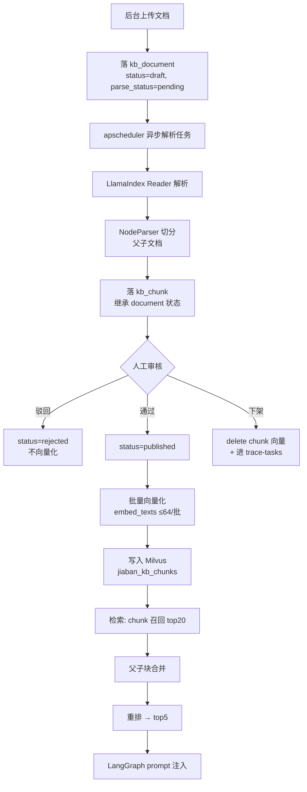

# 工作说明书：小光景知识库文档 RAG 摄入管道落地

> **交付方式**：本文件是给执行 Agent（Qoder）的完整工作说明书。执行前必须通读全文，并按本文的「执行纪律」连续推进，不要中途停下来询问。
> **项目**：D:\HomeBud（小光景，家庭养育参考小程序）
> **立单日期**：2026-10-14

---

## 一、你的角色与最终目标

你是本项目的**实现者（Implementer）**，负责在现有后端上落地「知识库文档 RAG 摄入管道」。

**最终目标**：后台上传一份（PDF / DOCX / Markdown）文档后，系统能自动解析、切分为可检索的块，经人工审核发布后进入向量库，问答检索时能命中这些块并把上下文注入回答。

**成功标准（可测）**：

1. 上传一份真实 PDF，能自动解析并生成 `kb_chunk` 记录；解析失败时有明确错误记录而不崩溃。
2. 文档走完 `draft → pending_review → published` 后，其 chunk 能被向量化并写入 Milvus。
3. 问答检索能命中已发布 chunk，并对连续上下文做父子块合并后注入 prompt。
4. 文档下架后，检索**立即**不再命中其任何 chunk（安全测试必须通过）。
5. `pytest` 全绿，且测试不触网。
6. 现有 KB 条目检索链路（`kb_entry`）**行为零回归**。

---

## 二、执行前必读（不许凭空造）

**你必须在写任何代码前读完这些文件**，本文档已核实过它们，但你需要理解细节：

| 文件 | 作用 | 你必须理解的点 |
|---|---|---|
| `backend/app/services/rag_index.py` | 向量库唯一触点（413 行） | 对外契约、集合 schema、过滤表达式、降级链 |
| `backend/app/services/retriever.py` | 混合检索（409 行） | 打分口径、候选池、回查复核逻辑 |
| `backend/app/llm/embed_client.py` | Embedding 统一入口 | provider 分发、批量上限、mock 通道 |
| `backend/app/core/config.py` | 配置项 | embedding / milvus 相关配置 |
| `backend/app/models/` | 数据模型 | `KbEntry` 及其状态机 |
| `backend/app/api/v1/kb_api.py` | 知识管理 API | 11 个端点的状态流转规则 |
| `backend/tests/conftest.py` | 测试夹具 | **测试强制 mock embedding，不触网** |
| `deploy/docker-compose.yml` | 部署编排 | Milvus 三件套配置与端口 |
| `wechat-miniapp/README.md` | 小程序口径 | 了解 evidence_ref 的消费方式 |

**禁止行为**：不要修改你没有先读过的文件。不要假设某个函数存在——先用 grep 确认。

---

## 三、本次范围

### 3.1 要做（阶段 0–5）

- 文档摄入数据模型（`kb_document` / `kb_chunk`）
- LlamaIndex 读取器 + 切分器接入
- 异步解析任务（复用 `apscheduler`）
- 文档审核状态机（与 `KbEntry` 同构，不另造一套）
- chunk 级向量化与 Milvus 新集合
- chunk 级检索 + 父子块合并 + 重排
- 后台管理 API
- 测试与回归

### 3.2 本次不做（阶段 6+，仅在代码中预留接口）

- 扫描件 OCR
- Excel / 表格特殊切分
- 网页抓取
- **家长个人文档管道**（见 4.6，必须单独设计）
- 向量库版本迁移

---

## 四、硬约束（红线，违反即视为任务失败）

### 4.1 禁止安装 `llama-index-vector-stores-milvus`

该包（含最新 1.2.0）硬性依赖 `pymilvus[milvus-lite]<3,>=2.6.7`，会强制降级 `pymilvus` 并破坏现有 Milvus 3.0.2 主通道。

**已核实**：
```
Requires-Dist: pymilvus[milvus-lite]<3,>=2.6.7
```

**正确做法**：只装 `llama-index-core` 及其读取器/切分器组件。向量存储自己写适配层，直接调用现有 `rag_index`。

### 4.2 禁止改动 Milvus 与 pymilvus 版本

- `deploy/docker-compose.yml` 里 `milvusdb/milvus:v3.0.2` **不动**
- `backend/requirements.txt` 里 `pymilvus>=3.0,<4.0` **不动**
- 本机当前 `pymilvus 3.0.2`

**原因**：降级会失去逐调用 Strong 一致性，且属于推翻已确认架构决策，不给用户带来任何价值。

### 4.3 禁止绕过审核状态机写向量

这是本项目最重要的红线。知识库是**合规审核流水线**，不是普通语料库。

**必须**：
```
文档上传 → 解析 → 落库（draft）
  → 送审（pending_review）
  → 审核通过（published）→ 才允许向量化写入 Milvus
  → 驳回 / 下架 / 删除 → 必须从 Milvus 删除对应 chunk
```

**绝对不允许**：解析完成后直接向量化入库，或让 LlamaIndex 的 `IngestionPipeline` 自行写入向量库。

**原因**：本项目承诺「下架内容绝不泄露」，且有 `trace-tasks` 内容追溯机制（下架需统计影响的会话数）。绕过状态机会直接导致该承诺失效。

### 4.4 禁止修改现有对外契约（只可增，不可改）

`rag_index` 现有契约必须保持不变：

```python
available() -> bool
query(question, domain_alias, age_band=None, species=None, top_k=8) -> List[Tuple[str, float]]
upsert_entry(db, kb_id) -> None
delete_entry(kb_id) -> None
sync_entry(db, kb_id) -> None
reindex_all(db, batch_size=32) -> int
```

`retriever.Retriever.retrieve(db, question, domain, age_band=None, species=None) -> {"hit": bool, "docs": [...]}` 的返回结构必须保持兼容（可增量新增字段）。

现有 API 的入参出参不可变更，只能新增端点。

### 4.5 禁止破坏现有降级链

`rag_index` 的三分支降级链（Milvus → hashing 稀疏 + Python 余弦 → 纯关键词）必须保持可用。新加的 chunk 检索也必须能降级。

### 4.6 禁止把用户上传文档写入公共知识库

本次**不实现**家长个人文档管道，但你要在设计上把口子留对：

- `kb_document.owner_user_uid` 字段：`NULL` 表示公共知识库，非空表示个人文档
- Milvus 集合必须有 `owner_scope` 标量字段（公共固定 `'public'`）
- **适配器层强制注入过滤条件**，让上层代码无法"忘记"加用户隔离
- 个人文档永远不能出现在公共检索结果中

如果本次顺手实现了个人文档上传，**必须**同时具备：用户级强制隔离、来源标注（回答中标注「你自己上传的资料」）、删除权联动。做不到就留在阶段 6。

### 4.7 其他禁止项

- 禁止执行 `git commit` / `git push`（本机 D:\ 是整个仓库根，误提交影响面极大）
- 禁止修改 `wechat-miniapp/dist/`、`backend/` 之外的构建产物
- 禁止删除 pgvector 回滚路径（`data_kb_dense` 表、`kb_entry.embedding_vec` 列、`migrate_pgvector.sql`）——那是回滚预案
- 禁止修改 `kb_entry` 表已有字段的语义
- 禁止在测试中真实调用智谱 API
- 禁止引入需要 GPU 的本地模型
- 禁止为了赶进度写「暂时跳过审核」之类的临时分支

---

## 五、已核实的技术事实（直接采信，不必重复验证）

### 5.1 向量库现状

```python
# backend/app/services/rag_index.py
COLLECTION_NAME = "jiaban_kb_entries"
ANY_SENTINEL = "any"
_SEARCH_EF = 128
```

- 现有集合主键 `kb_id` VARCHAR(64)，`enable_dynamic_field=False`
- 索引：HNSW `M=16, efConstruction=200`，`COSINE`，搜索 `ef=128`
- 一致性：集合级 `Strong`
- 正文不落 Milvus：命中后按 `kb_id` 回主库取内容
- **重要**：pymilvus 3.0.2 主键参数名是 `is_primary=True`（不是 `is_primary_key`）。写错会**静默创建无主键集合**，导致写入看似成功但查询永远为空。新集合务必照抄现有写法并加验证。

**结论**：现有集合 schema 装不下 chunk 级数据，必须新建集合 `jiaban_kb_chunks`。

### 5.2 Embedding 通道

```python
# backend/app/llm/embed_client.py
from ..llm.embed_client import embed_texts
ZHIPU_BATCH_SIZE = 64          # 单批上限，超限 4xx
```

- `embedding_provider`：`zhipu`（生产）/ `mock`（测试）
- 模型 `embedding-3`，维度 `2048`
- 批量调用时单批 ≤64 条，由 `embed_client` 内部管理
- 失败抛 `EmbeddingError`，调用方负责降级

### 5.3 检索打分口径（必须保持一致）

```python
# backend/app/services/retriever.py
TOP_K = 5
CANDIDATE_SIZE = 8
W_COSINE = 0.6
W_KEYWORD = 0.4
EMBED_DIM = 512
```

总分 = `0.6 × 向量余弦 + 0.4 × 关键词归一化分`，先粗筛 top8 再精选 top5。

`domain_alias` 映射（库内可能存中文或英文码，两种都要匹配）：
```python
{"child": ("child", "育儿"), "pet": ("pet", "宠物")}
```

### 5.4 审核状态机（`KbEntry.status`）

```
draft → pending_review → published
                 ↓            ↓
             rejected    unpublished
                              ↓
                           merged
```

- `kb_kind` ∈ `child / pet / assessment_pool / risk_lexicon / sensitive_lexicon`
- 只有 `published` 且 `kb_kind ∈ {child, pet}` 的条目才进向量库
- 高危类目（`is_high_risk`）需 100% 审核且合格线 90 分
- 现有字段：`source_type`(24) / `source_ref`(256) / `license_id`(32)

**版权硬要求**：专家上传的第三方文档（如育儿书籍）必须校验 `license_id`，无授权不得进入 `published`。这是法务要求，不是可选项。

### 5.5 其他环境事实

- 后端：FastAPI + SQLAlchemy 2.x + PostgreSQL + `apscheduler`
- 测试：`pytest`，`conftest.py` 强制 mock embedding，**全量不触网**
- 现有测试规模约 258 项，必须保持全绿
- 编排：LangGraph 节点调用 `Retriever`，检索结果作为 evidence 注入 prompt
- 图片上传参考实现：`backend/app/api/v1/profiles_api.py`（`UploadFile`，≤8MB，Pillow 规范化）

---

## 六、目标架构

### 6.1 数据流



### 6.2 数据模型

**`kb_document`**（新表）

| 字段 | 类型 | 说明 |
|---|---|---|
| `id` | BigInteger PK | 自增 |
| `doc_id` | String(32) UNIQUE | 业务编号 |
| `title` | String(256) | 文档标题 |
| `source_type` | String(24) | `expert_upload` / `user_upload` |
| `source_ref` | String(512) | 文件路径或 URL |
| `license_id` | String(32) NULL | 版权授权编号，第三方文档必填 |
| `owner_user_uid` | String(64) NULL | **NULL=公共知识库** |
| `mime_type` | String(64) | |
| `file_size` | BigInteger | 字节 |
| `file_hash` | String(64) | 内容哈希，用于去重 |
| `page_count` | Integer NULL | |
| `status` | String(16) | 与 `KbEntry` 状态机同构 |
| `parse_status` | String(16) | `pending/parsing/parsed/failed` |
| `parse_error` | Text NULL | 解析失败原因 |
| `domain` | String(16) | child / pet |
| `kb_kind` | String(16) | |
| `age_band` | String(16) NULL | |
| `species` | String(8) NULL | |
| `is_high_risk` | Boolean | |
| `created_at` / `updated_at` | DateTime | |

**`kb_chunk`**（新表）

| 字段 | 类型 | 说明 |
|---|---|---|
| `id` | BigInteger PK | 自增 |
| `chunk_id` | String(64) UNIQUE | 业务编号，Milvus 主键 |
| `doc_id` | String(32) | 关联文档 |
| `chunk_index` | Integer | 文档内顺序 |
| `parent_chunk_id` | String(64) NULL | 父子文档：指向父块 |
| `node_type` | String(16) | `root` / `leaf` |
| `content` | Text | 块正文 |
| `token_count` | Integer | |
| `status` | String(16) | 随 document |
| `owner_user_uid` | String(64) NULL | 冗余自 document |
| `domain` / `kb_kind` / `age_band` / `species` | 同 document | 冗余，用于 Milvus 过滤标量 |
| `embedding_synced_at` | DateTime NULL | |

**`jiaban_kb_chunks`**（新 Milvus 集合）

- 主键：`chunk_id` VARCHAR(64)
- 向量：`embedding` FLOAT_VECTOR(2048)
- 标量：`status` / `kb_kind` / `domain` / `age_band` / `species` / `owner_scope`
- 空值写哨兵 `'any'`（沿用现有约定）
- 索引：HNSW `M=16, efConstruction=200`，`COSINE`，搜索 `ef=128`
- 一致性：`Strong`
- 正文不落 Milvus，命中后按 `chunk_id` 回主库取

### 6.3 模块划分

```
backend/app/services/doc_ingest/
├── __init__.py
├── readers.py      # 扩展名 → Reader 注册表
├── splitters.py    # NodeParser 配置（父子文档）
├── store.py        # kb_document / kb_chunk 持久化
├── pipeline.py     # 解析 → 切分 → 落库 编排
└── tasks.py        # apscheduler 异步任务

backend/app/api/v1/kb_documents_api.py   # 上传/列表/详情/chunk 预览/送审/审核/下架

backend/app/services/rag_index.py        # 扩展 chunk 级能力（不改现有函数）
```

### 6.4 新增接口签名（阶段 0 先定，之后不许改）

```python
# rag_index.py 新增
def ensure_chunk_collection() -> bool: ...
def upsert_chunks(db: Session, doc_id: str) -> int: ...
def delete_chunks(doc_id: str) -> None: ...
def sync_document(db: Session, doc_id: str) -> None: ...
def query_chunks(
    question: str,
    domain_alias: Sequence[str],
    age_band: Optional[str] = None,
    species: Optional[str] = None,
    top_k: int = 20,
    owner_scope: str = "public",
    owner_user_uid: Optional[str] = None,
) -> List[Tuple[str, float]]: ...
def reindex_all_chunks(db: Session, batch_size: int = 32) -> int: ...

# doc_ingest/pipeline.py
def ingest_document(db: Session, doc_id: str) -> dict: ...
    # 返回 {"ok": bool, "chunk_count": int, "error": str | None}

# doc_ingest/readers.py
def resolve_reader(mime_type: str, filename: str): ...
def supported_extensions() -> list[str]: ...

# doc_ingest/splitters.py
def build_node_parser(domain: str) -> object: ...
```

---

## 七、分阶段任务

> 每个阶段都必须：实现 → 写测试 → 跑全量 `pytest` → 更新 `PROJECT_PROGRESS.md`（本地维护的进度文件，不随仓库分发） → 进入下一阶段。
> **不要停下来问人，但也不要跳过阶段自检。**

### 阶段 0：契约冻结与依赖确认

**目标**：把接口签名和依赖边界钉死，避免后面反复改。

**任务**：
1. 读完全部「执行前必读」文件
2. 在 `rag_index.py` 中用 `NotImplementedError` 占位新增 6 个 chunk 级函数（签名如 6.4）
3. 确认 `llama-index-core` 版本（本机 0.14.24），写入 `requirements.txt`，注明**禁止** `llama-index-vector-stores-milvus`
4. `pip check` 记录当前依赖状态（已知存在一条 llama-index 与 pymilvus 的冲突记录，属历史遗留，不要试图通过降级 pymilvus 解决）
5. 在 `docs/04-工程/` 建 ADR：说明为什么不用官方 Milvus 集成、为什么保留 3.0.2

**验收**：`pytest` 全绿（占位函数不影响现有测试）；ADR 落档。

### 阶段 1：数据模型与持久化

**目标**：`kb_document` / `kb_chunk` 建表与仓储层可用。

**任务**：
1. 新增 SQLAlchemy 模型（放在 `backend/app/models/`，遵循现有命名与注释风格）
2. 写幂等建表/迁移脚本（参考现有 `init_db.py` 与迁移脚本风格）
3. 实现 `doc_ingest/store.py`：创建文档、批量写 chunk、按 doc_id 查询、状态流转
4. 状态流转必须校验合法性（`draft → pending_review → published` 等），非法流转抛异常
5. 测试：模型 CRUD、状态机合法/非法流转、chunk 顺序

**验收**：`pytest` 全绿；新测试覆盖状态机所有合法与非法分支。

### 阶段 2：解析与切分

**目标**：上传的文档能解析成块。

**任务**：
1. `doc_ingest/readers.py`：实现扩展名 → Reader 注册表
   - 本次支持：`.pdf`（文本型）、`.docx`、`.md`、`.txt`
   - **不支持的类型必须明确报错**，不要静默返回空
2. `doc_ingest/splitters.py`：父子文档切分
   - 父块：较大粒度（如 1024 token）
   - 子块：较小粒度（如 256 token），带 overlap
   - 保留标题层级信息写入 chunk 元数据
3. `doc_ingest/pipeline.py`：`ingest_document()` 编排
4. 文件去重：`file_hash` 相同则复用已有解析结果，不重复解析
5. 解析失败必须写 `parse_status=failed` + `parse_error`，不得抛到接口层
6. 测试：用**自己构造的**小型 PDF/DOCX/MD 样本（放在 `backend/tests/fixtures/`），覆盖成功、空文档、损坏文件、不支持类型四种情况

**验收**：`pytest` 全绿；能对 fixtures 里的样本产出预期数量的 chunk。

### 阶段 3：异步任务与上传 API

**目标**：后台上传接口可用，解析异步执行。

**任务**：
1. `doc_ingest/tasks.py`：apscheduler 任务，轮询 `parse_status=pending` 的文档
2. `kb_documents_api.py` 端点（参考 `kb_api.py` 的鉴权与响应格式）：
   - `POST /kb/documents`（上传，`UploadFile`）
   - `GET /kb/documents`（列表，分页）
   - `GET /kb/documents/{doc_id}`（详情，含解析状态）
   - `GET /kb/documents/{doc_id}/chunks`（chunk 预览）
   - `POST /kb/documents/{doc_id}/submit`（送审）
   - `POST /kb/documents/{doc_id}/review`（审核，pass/reject）
   - `POST /kb/documents/{doc_id}/unpublish`（下架）
3. 上传限制：文件类型白名单、大小上限（与 `profiles_api.py` 保持一致风格，图片 ≤8MB；文档建议 ≤50MB，可配）
4. 权限：只有专家角色可上传与审核（复用现有鉴权依赖）
5. **版权校验**：`source_type=expert_upload` 且非自有内容时，`license_id` 为空则禁止进入 `published`
6. 测试：端点鉴权、非法类型拒绝、超限拒绝、状态流转、无授权禁止发布

**验收**：`pytest` 全绿；端点有完整错误分支测试。

### 阶段 4：向量化与 Milvus 集合

**目标**：published 文档的 chunk 进 Milvus，下架能删干净。

**任务**：
1. `ensure_chunk_collection()`：建 `jiaban_kb_chunks`
   - **照抄**现有 `ensure_collection()` 的 schema/索引写法
   - 主键用 `is_primary=True`（pymilvus 3.0.2 的正确参数名）
   - **必须加验证**：建完后断言集合主键存在，防止静默建出无主键集合
2. `upsert_chunks(db, doc_id)`：批量向量化（`embed_texts` 单批 ≤64）+ 原生 upsert
3. `delete_chunks(doc_id)`：按 doc_id 查出全部 chunk_id 后批量删除
4. `sync_document(db, doc_id)`：best-effort 同步，语义与现有 `sync_entry` 一致
   - `published` → upsert
   - 其他状态 → delete
   - 异常只 warning，不阻断业务
5. `reindex_all_chunks(db)`：全量重建（分批，幂等）
6. 接入 `rag_index.available()` 的探测语义：新集合不可用时 chunk 检索走降级
7. 测试：
   - 集合 schema 断言（主键、维度、标量字段）
   - upsert / delete / 幂等性
   - **下架后检索不到**（安全测试，必须覆盖）
   - 未发布状态不进集合

**验收**：`pytest` 全绿；安全测试通过。

### 阶段 5：chunk 检索与父子合并

**目标**：问答能命中文档块。

**任务**：
1. `query_chunks()`：向量近邻检索，`top_k=20`（比条目级候选池大）
   - 过滤表达式：`status == "published"` + `kb_kind` + `domain` + `age_band`/`species` 哨兵 + **`owner_scope == "public"` 强制注入**
   - 沿用现有 `_safe_value` 白名单防注入
2. `retriever.py` 扩展：`_retrieve_by_chunks()` 新路径
   - 子块命中 → 回带父块上下文
   - 同父块的多个子块命中时去重，合并为一个证据单元
   - 打分沿用 `0.6 × 余弦 + 0.4 × 关键词`
3. `retrieve()` 的合并策略：
   - 条目级（`kb_entry`）与 chunk 级结果合并后统一排序取 top5
   - **保持返回结构兼容**，新增字段为增量
4. 回查复核：命中 chunk 后按 `chunk_id`/`doc_id` 回主库复核 `status == published`（沿用现有第二层保险思路）
5. 降级：Milvus 不可用 → 现有 hashing 路径 + 条目级结果，chunk 路径跳过并 warning
6. 测试：
   - 父子合并正确性（同一父块的多个子块只出现一次）
   - 过滤条件正确性（跨域、年龄段、物种）
   - **公共检索绝不返回 `owner_user_uid` 非空的结果**
   - 降级路径可用
   - 现有条目级检索无回归

**验收**：`pytest` 全绿；回归测试证明 `kb_entry` 检索行为未变。

---

## 八、测试要求

1. **TDD**：每个新函数先写失败测试，再写实现
2. **不触网**：全部测试走 `mock` embedding provider，沿用 `conftest.py` 现有机制
3. **测试数据自造**：fixtures 里自己生成小型 PDF/DOCX/MD，不要依赖外部文件
4. **安全测试必须显式覆盖**：
   - 下架后检索不到
   - 未发布不进向量库
   - 公共检索不返回个人文档
   - 非法状态流转被拒
   - 无 `license_id` 的第三方文档禁止发布
5. **回归**：现有约 258 项测试必须全绿，不得为了通过而修改现有测试断言（除非该断言本身与新契约冲突，此时必须在 `DECISIONS.md` 记录原因）
6. 每阶段结束运行：
   ```bash
   cd backend && python -m pytest -q
   ```

---

## 九、执行纪律（「不要停」机制）

### 9.1 连续推进规则

- **不要停下来询问**设计细节。遇到本文未覆盖的设计决策时，选择**最保守、最易回滚**的方案，并记录到 `docs/04-工程/DECISIONS.md`，然后继续。
- 每阶段完成后**立即进入下一阶段**，不要等待确认。
- 每阶段结束在 `PROJECT_PROGRESS.md`（本地维护的进度文件，不随仓库分发） 追加一小节：阶段名、状态、测试结果、遗留问题。

### 9.2 阻塞处理

遇到以下情况时，不要卡住：

| 阻塞 | 处理方式 |
|---|---|
| 某个依赖装不上 | 用最小可行替代（如自己写简单解析），记录到 `BLOCKED.md`，继续 |
| 某个 LlamaIndex API 与本机版本不符 | 查本机实际版本的实际签名，按实际写，记录差异 |
| 某个测试无法通过且判断是环境问题 | 标记 `xfail` 并写明原因，继续下一阶段 |
| 设计上二义 | 选保守方案 + 记 `DECISIONS.md` |

**唯一允许停下的情况**：发现现有代码存在会导致数据泄露或数据损坏的严重缺陷。此时写入 `BLOCKED.md` 并停止。

### 9.3 每阶段提交规范

禁止 `git commit` / `git push`。改为在 `docs/04-工程/变更说明_文档RAG摄入管道.md` 按阶段追加变更摘要（改了哪些文件、为什么、测试结果）。

### 9.4 代码风格

- 遵循现有代码风格：中文 docstring，`Args:` / `Returns:` / `Raises:` 分节
- 类型注解完整（项目用 `mypy` 风格注解）
- 日志用 `logging.getLogger("jiaban.xxx")` 命名约定
- 异常处理：可选依赖缺失按降级处理，不抛到接口层

---

## 十、交付物清单

| 交付物 | 路径 |
|---|---|
| 数据模型 | `backend/app/models/` |
| 摄入管道 | `backend/app/services/doc_ingest/` |
| 向量库扩展 | `backend/app/services/rag_index.py` |
| 检索扩展 | `backend/app/services/retriever.py` |
| 管理 API | `backend/app/api/v1/kb_documents_api.py` |
| 迁移脚本 | `backend/scripts/` |
| 测试 | `backend/tests/` |
| 架构决策 | `docs/04-工程/DECISIONS.md` |
| ADR | `docs/04-工程/ADR_文档RAG摄入管道.md` |
| 变更说明 | `docs/04-工程/变更说明_文档RAG摄入管道.md` |
| 阻塞记录 | `docs/04-工程/BLOCKED.md` |
| 进度 | `PROJECT_PROGRESS.md`（本地维护的进度文件，不随仓库分发） |

---

## 十一、完成自检清单

任务结束前逐项确认：

- [ ] `python -m pytest -q` 全绿，且测试不触网
- [ ] 现有约 258 项测试无回归
- [ ] `requirements.txt` **未**引入 `llama-index-vector-stores-milvus`
- [ ] `pymilvus` 版本仍为 3.x，`docker-compose.yml` 中 Milvus 仍为 `v3.0.2`
- [ ] 新 Milvus 集合主键经过显式断言验证（防 `is_primary` 静默失败）
- [ ] 下架后检索不到（有对应测试）
- [ ] 未发布文档不进向量库（有对应测试）
- [ ] 公共检索不返回个人文档（有对应测试）
- [ ] 无授权第三方文档禁止发布（有对应测试）
- [ ] `rag_index` / `retriever` 现有契约签名未变
- [ ] 降级链仍可用（有对应测试）
- [ ] 文档全部落档（ADR / DECISIONS / 变更说明 / 进度）
- [ ] 未执行任何 git commit

---

## 十二、阶段 6 预留说明（本次不实现，但要留口）

后续需要在此架构上扩展时，按以下顺序：

1. **OCR**：`doc_ingest/readers.py` 注册表加图片/扫描件 Reader，解析产物同样过内容安全审核
2. **Excel**：单独切分策略（按行/按表），不要复用正文切分器
3. **家长个人文档管道**（**独立设计，不得复用专家侧写入路径**）：
   - 必须实现：用户级强制隔离（适配器层注入）、KMS 信封加密、留存期、删除权联动、回答来源标注为「你自己上传的资料」、上传内容过安全审核
   - 必须先过合规评审，再动代码
4. **重排**：接入 cross-encoder reranker 替换 0.6/0.4 线性加权
5. **评测闭环**：建 20–50 条评测集，记录 hit@5 / MRR

---

**开始执行。按阶段推进，每阶段自检通过后自动进入下一阶段。**
