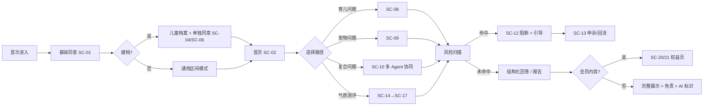
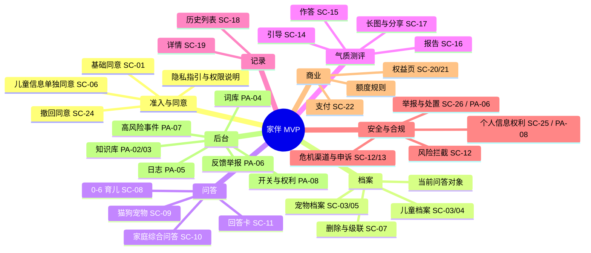
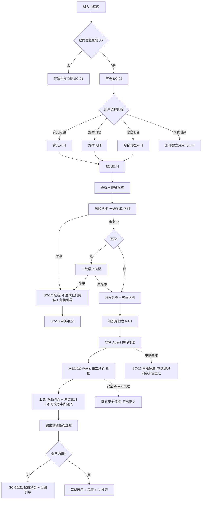
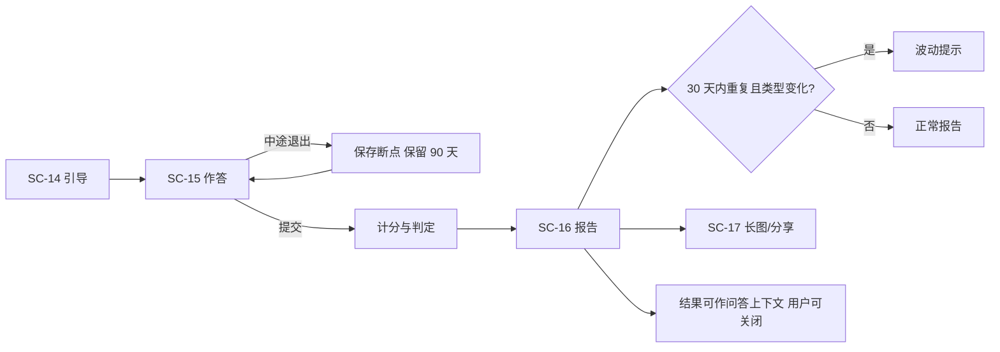
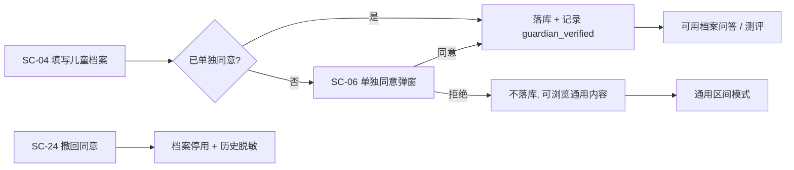

# 家伴・家庭养育多智能体助手 —— 产品需求文档（PRD）

> **文档版本**：V1.1（决策级 PRD）
> **文档状态**：待评审 · 需业务方/法务/专家拍板
> **编制日期**：2026-10-02
> **上位文档**：`家伴-家庭养育多智能体助手_需求说明文档_V1.0.md`（1099 行，需求条目与验收标准的唯一来源）
> **配套文档**：`家伴-UI原型描述_V1.1.md`（页面清单、线框、设计系统规范与 token、交互与状态、组件规格）｜`DESIGN.md`（机器可读 token）｜`家伴-设计系统样式瓦片.html`（可视证据）
> **决策依据**：`家伴需求评审材料_V1.md`（D1–D12 推荐决策、M1–M10 技术冲突、I1–I10 实现缺口、N1–N9 缺失需求域、范围裁剪表决）
> **审计依据**：`家伴-需求文档V1.0-第二轮审计发现.md`（A/B/C/D 共 53 条）、`家伴需求文档_审核意见_V1.md`
> **产品形态**：微信小程序（C 端，优先）+ 后台管理 Web；Web 端用户侧列后续版本
> **产品定位**：家庭养育科普参考工具。覆盖分龄儿童养育 + 伴侣宠物科学饲养。**输出仅作养育参考，不替代医生、心理咨询师、学校教师、执业兽医。**

---

## 0. 文档信息与阅读指引

### 0.1 本文档的定位：决策级，不重写验收标准

V1.0 需求文档的问题不是"不够细"，而是三类：**决策未定**（39 项 Q，其中 10 项阻塞）、**存在硬伤**（M1–M10 技术冲突、A/B/C 共 35 条矛盾与不可测项）、**缺失需求域**（N1–N9，含原型与文案资产）。

因此本文档只承担四件事，其余引用 V1.0：

| 本文档承担 | 具体做法 |
| --- | --- |
| ① 把前提补齐 | 用 `AS-xx` 假定基线登记册（附录 A）给出默认取值，使全文自洽、可开工；每条标注来源与待拍板状态 |
| ② 把硬伤改掉 | 用 `M-x`/`I-x`/`N-x`/`CG-x` 修正索引（附录 D）逐条给出"原文问题 → 本文档处理" |
| ③ 把缺口编号化 | 缺失需求域与合规缺口全部落成 `FR-x`/`NFR-x` 条目，挂验收方式 |
| ④ 把决策集中 | 所有待拍板项集中在附录 B（决策登记册）与附录 C（待确认清单），一张表可改 |

**本文档不做**：不重写 V1.0 的 US/FR 条目正文；不做高保真视觉稿；不写代码；不替法务、专家、财务拍板。

### 0.2 与 V1.0 的关系：三类内容

| 类型 | 含义 | 处理 |
| --- | --- | --- |
| **继承** | V1.0 已定义且无争议的内容（如四大入口、五个 Agent 的职责边界） | 直接引用编号，不重复描述 |
| **修正** | V1.0 自相矛盾或不可测的内容 | 本文档给新结论，附录 D 给出对照，V1.0 需回填 |
| **新增** | 审计与评审发现的缺失需求 | 本文档首次定义，编号不与 V1.0 冲突 |

### 0.3 编号约定

| 标记 | 含义 | 落点 |
| --- | --- | --- |
| `FR-x.x` | 功能需求条目 | 第 6 章 |
| `NFR-x.x` | 非功能需求条目 | 第 10 章 |
| `AS-xx` | **假定基线**：为推进评审而采用的默认取值，必须由责任方确认或推翻 | 附录 A |
| `D-xx` | 待拍板决策项（沿用评审材料 D1–D12 编号，新增项续编） | 附录 B |
| `Q-xx` | V1.0 原有待确认问题（Q-01~Q-39），本文档新增续编 Q-40+ | 附录 C |
| `M-x` / `I-x` | 评审材料的技术冲突 / 实现缺口 | 附录 D |
| `N-x` | 评审材料识别的缺失需求域 | 附录 D |
| `CG-x` | 合规缺口（Compliance Gap，来自审计 D1–D18 与评审 §四之二） | 第 11 章 + 附录 D |
| `S1/S2/S3` | 审计严重度（S1＝开工或上线阻塞） | 全文标注 |
| `SC-xx` / `PA-xx` | UI 页面编号（小程序 / 后台） | UI 文档第 4 章 |
| `P0/P1/P2` | P0＝MVP 必须上线；P1＝MVP 尽力上线；P2＝明确不在 V1.0 | 全文标注 |
| **G1/G2/G3** | 待确认项的阻塞级别：G1＝开工阻塞；G2＝上线阻塞；G3＝运营参数待定 | 附录 C |

**硬规则（评审门槛）**：
1. **验收标准中不得出现 `⚠️`、`Q-xx`、`AS-xx` 标注。** 待确认项必须与验收标准分离（V1.0 有 33 处违反，见 C1）。
2. 每个 FR 条目必须给出：优先级 + 依赖的 AS/决策 + 验收方式（可测）+ 对应页面编号。
3. 识别出的风险必须需求化：**识别不需求化 ＝ 没有工时、没有用例、没有验收**（V1.0 §9 的 8 类自查项全部未需求化，见 I3/N-x）。

### 0.4 阅读指引

| 读者 | 建议路径 |
| --- | --- |
| 业务方 / 决策者 | §2 目标与指标 → §4 范围基线 → 附录 B 决策登记册 → 附录 C 待确认清单 |
| 产品 / 设计 | §3 用户与场景 → §5 信息架构 → §6 功能需求 → UI 文档全文 |
| 研发 / 测试 | §6 功能需求 → §7 多智能体规格 → §8 流程与状态机 → §9 数据与口径 → §10 NFR |
| 法务 / 合规 | §11 合规专项 → 附录 C 中 G1/G2 项 → 附录 D 中 CG-x 条目 |
| 算法 | §7 全文（契约、延迟预算、降级矩阵、检索规格、模型与成本） |

### 0.5 修订记录

| 版本 | 日期 | 修订人 | 说明 |
| --- | --- | --- | --- |
| V1.0 | 2026-10-01 | 产品 | 需求说明文档草案（1099 行），识别 39 项待确认 |
| V1.1 | 2026-10-02 | 产品 | 本 PRD：采纳评审推荐决策为 AS 假定基线；修正 M1–M10 与 I1–I10；补齐 N1–N9；合规缺口 CG1–CG18 需求化；新增决策/待确认/修正三本登记册 |

---

## 1. 产品概述

### 1.1 一句话定位

**家伴是一个家庭养育科普参考工具**：用多个按领域拆分的 AI Agent，回答"分龄怎么养孩子"和"猫狗怎么科学养"，并且能回答**"孩子和宠物一起生活该怎么办"**这类单一工具答不全的复合问题。

### 1.2 用户问题 → 产品解法

| 编号 | 用户问题 | 现状（用户怎么将就） | 家伴的解法 | 对应 Agent |
| --- | --- | --- | --- | --- |
| P-1 | 信息嘈杂、互相矛盾 | 短视频/社群/长辈经验三套说法 | 结构化建议：给**适用前提**与**不建议做法的原因**，而不是一句结论 | 育儿 Agent |
| P-2 | 气质话题热度高但缺科学配套 | 市面内容偏玄学，只给标签不给方法 | 「四象宝宝」趣味包装 + 底层儿童气质理论 + 配套养育方式与沟通技巧，**明确非宿命判定** | 育儿 Agent + 测评 |
| P-3 | 养娃 + 养宠的交叉问题无工具承接 | 育儿工具只答孩子、宠物工具只答宠物 | **一次问、三面答**：安全提示置顶 + 育儿侧 + 宠物侧 | 中枢调度 + 育儿 + 宠物 + 家庭安全 |
| P-4 | 亲子冲突与情绪沟通缺场景化指导 | 通用大模型给通用建议 | V1.0 **不承诺** 6 岁以上（见 §4 范围裁定 Q-01），拒答话术统一（FR-D6） | — |

### 1.3 差异化：多 Agent 协同 + 安全前置

1. **多 Agent 协同**：跨领域问题由中枢调度多个 Agent 并行推理，中枢按结构化字段汇总，比单模型单点回答更可校验。
2. **风险预警前置**：风险扫描在**调度之前、纯输入侧**执行（修正 M7/A1），命中即阻断且**不输出任何内容**。
3. **可追溯**：每次回答可还原调度决策、各 Agent 输出、耗时、风险判定、知识库引用（`evidence_ref` 必须来自检索结果，禁止模型编造）。

### 1.4 非目标（V1.0 明确不做）

| 编号 | 不做的事 | 原因 |
| --- | --- | --- |
| NG-1 | 不上线 6 岁以上小学/初中/高中学科辅导模块 | 教研成本高，后续版本 |
| NG-2 | 不做心理诊断、儿童心理疾病评估、心理治疗 | 合规红线 |
| NG-3 | 不代替老师批改作业、不代做习题、不代写作文 | 合规红线 |
| NG-4 | 不提供宠物疾病诊断、不开兽药处方、不替代执业兽医 | 合规红线 |
| NG-5 | 不做宿命论性格判定、星座算命、不对孩子终身性格下定论 | 合规红线 |
| NG-6 | 无直播、无社区 UGC 板块 | 减少内容审核压力 |
| NG-7 | 不做 B 端机构对接（早教中心、宠物门店） | 列入 V3.0 |
| NG-8 | 不支持多语言、不支持非微信小程序的其他端首发 | 收敛 MVP 范围 |
| NG-9（新） | **不做 Agent 权重配置功能**（含后台配置项与权重数据实体） | 机制无法定义且与"安全置顶"冲突，见 AS-17 / D7 |
| NG-10（新） | **不做自动续费**；不做专题付费内容包的 MVP 售卖 | iOS 虚拟支付受限，先用月卡验证转化，见 D9 |
| NG-11（新） | 不做语音输入（V1.0 内移除，保留设计位与入口占位） | ASR 服务商、方言、时长、落盘全未定，见 AS-04 |
| NG-12（新） | 不做"科学测评/信效度检验"类对外宣称 | 合规与成本交换，见 AS-14 / D3 |

### 1.5 合规地位声明（产品级，落到全部文案与分享图）

- 本产品输出内容**仅作为养育参考**，不替代医生、心理咨询师、学校教师、执业兽医。
- 全部 AI 生成内容带**显式标识 + 隐式标识**（CG1，见 §11.1）。
- 危机与高危场景**不生成任何内容**，只做引导（§11.3）。
- 儿童个人信息属敏感个人信息，需**监护人单独同意**并支持撤回（CG2/CG3/CG7，见 §11.4）。

---

## 2. 目标与成功指标

### 2.1 产品目标（V1.0 目标的结构化转写 + 修订）

| 编号 | 目标 | 类型 | 衡量方式（唯一权威见 §9.4） |
| --- | --- | --- | --- |
| G-1 | 搭建多智能体调度框架，上线 0-6 岁养育 + 猫狗饲养两大板块 | 能力 | 5 个 Agent 全部可调用；两大模块可用 |
| G-2 | 上线气质测评作为核心引流功能，底层使用儿童气质理论 | 增长 | 测评入口点击率、测评完成率 |
| G-3 | 支持单领域问答 + 儿童&宠物交叉场景联合问答 | 能力 | 家庭综合问答可正确调度 ≥3 个 Agent；调度正确率 |
| G-4 | 内置风险预警，识别高危并强制引导线下专业机构 | 合规 | **冻结标注集上的召回率 ≥95%、误报率 ≤5%**；命中后不输出任何内容 = 100% |
| G-5 | 基础内容免费，会员解锁深度方案，验证留存与付费转化 | 商业 | 留存曲线、付费转化率、单位问答成本 |
| G-6 | 知识库内容经育儿/宠物专家审核，规避玄学、教育、心理、医疗红线 | 合规 | 抽检合格率、违规词命中率、**内容追溯处置闭环率** |

> **修正**：G-4 的"高危拦截率 100%"不可达且与漏报兜底策略互斥（M4/A7/C2）。改为"召回率 + 误报率 + 漏报兜底"三件套，只对"命中后不输出任何内容"保留 100%（AS-30 同类口径思路）。

### 2.2 量化指标（采纳评审 D1 推荐值 → AS-01）

【假定基线 AS-01】以下为**内部考核目标，不对外承诺**；灰度期用真实基线校准一次。

| 指标 | 目标值 | 口径（唯一权威 §9.4） |
| --- | --- | --- |
| 新用户 7 日留存 | ≥ 25% | 第 7 日回访用户数 / 当日新增用户数（cohort 窗口） |
| 气质测评完成率 | ≥ 60% | 完成提交的**用户数** / 进入测评的**用户数**（去重） |
| 问答二次提问率 | ≥ 30% | 有跟进提问的**会话数** / 有提交的**会话数**（排除重试） |
| 免费 → 会员付费转化率 | ≥ 2% | 首次支付成功**用户数** / 同期新增**用户数** |
| 高危拦截后离开率 | ≥ 90% | 拦截后未继续追问的**会话数** / 拦截**会话数** |

**触发规则（待拍板 D1）**：若灰度期 7 日留存 < 25%，则**冻结新模块开发**，资源转向留存优化。

### 2.3 护栏指标（新增，评审 N1/N3 的落点）

| 指标 | 护栏阈值 | 说明 |
| --- | --- | --- |
| 单位问答模型成本 | ≤ 目标值（待财务与技术共同定） | 一次复合问答 ≈ 5–6 次 LLM 调用，无成本测算是 V1.0 的空白 |
| Agent 失败率 / 超时率 | 超阈值告警（阈值见 NFR-5.2） | — |
| 风险误报率 | ≤ 5%（冻结标注集） | 误报必须有申诉出口 |
| 内容追溯处置闭环率 | 100%（7 日内） | 知识库驳回后受影响内容的处置 |

### 2.4 指标口径的唯一权威

**§9.4 是全文唯一指标口径权威。** V1.0 存在 4 套口径打架（C3/C4/M2）：
- 场景卡中的"成功标准"（如"8s 内拿到回答"）**不得作为指标口径**，仅作体验描述。
- 免费额度、拦截率、留存、完成率的分母一律以 §9.4 为准。

---

## 3. 用户角色与使用场景

### 3.1 角色定义

| 角色 | 类型 | 描述 | 核心诉求 | 频次 | MVP |
| --- | --- | --- | --- | --- | --- |
| 家长用户（核心） | C 端 | 25–40 岁父母，家中以 0–6 岁幼儿为主，部分养猫狗 | 拿到贴合自家孩子/宠物的可执行参考 | 每周 2–5 次 | ✅ |
| 后台管理员 | 内部 | 知识库维护、日志查看、反馈与投诉处置、开关配置 | 高效维护质量与合规 | 每日 | ✅ |
| 内容运营（新，N6） | 内部 | 内容质量标准、抽检、知识库条目数量目标、增长与分享 | 内容供给侧可控 | 每日 | ✅（可由管理员兼任，D-15） |
| 客服（新，Q-26） | 内部 | 反馈与投诉回执、误报申诉复核 | 闭环与时效 | 每日 | P1（可由管理员兼任） |
| 外部专家顾问 | 外部 | 育儿 1 名 + 宠物行为 1 名；审核知识库 + 输出抽样，**不在线接待用户** | 一次性集中审核 | 每月 8–10 小时/人 | ✅（**未签约即上线阻塞**，D5） |

### 3.2 场景卡

| 编号 | 场景 | 角色 | 期望结果 | 成功标准（体验描述，非指标口径） | 页面 |
| --- | --- | --- | --- | --- | --- |
| 场景 1 | 新手妈妈判断"该听谁的"（8 月龄夜醒） | 家长 | 给结构化建议 + 适用条件与风险，而非一句结论 | 回答引用本档案月龄 | SC-02→SC-08 |
| 场景 2 | "孩子追猫、猫哈气"（3 岁 + 1 猫） | 家长 | 一次输出三部分，**安全提示置顶** | 三维度齐全、安全置顶 | SC-10 |
| 场景 3 | 被"四象宝宝"吸引做测评（2 岁，中途被打断） | 家长 | 断点续填 → 报告 + 非宿命提示 | 断点续填生效；分享图带完整免责与 AI 标识 | SC-14→SC-17 |
| 场景 4 | 高危输入被拦截 | 家长（情绪崩溃） | **不生成任何内容**，强警示 + 线下机构引导 | 命中后正文为空 | SC-12 |
| 场景 5 | 宠物行为解读（狗护食低吼） | 家长（养狗） | 行为科普 + 家庭安全提醒 | 标注"非疾病诊断"；急症提示就医 | SC-09 |
| 场景 6 | 专家离线校验输出 | 专家 | 查看知识库与抽样 → 标注意见 → 提交 | 审核记录可追溯；驳回有回滚路径 | PA-02/PA-03 |
| 场景 7 | 管理员处置内容问题 | 管理员 | 下架条目 → 追溯受影响内容 → 留痕 | 处置闭环率 100%（7 日） | PA-07 |
| **场景 8（新）** | **多孩/多宠切换问答对象** | 家长（2 娃 1 猫） | 提问前明确"这次问的是谁" | 每条问答可追溯到档案 ID | SC-03/SC-08 |
| **场景 9（新）** | **免费额度用尽** | 家长 | 明确告知额度规则与恢复时间，给出升级入口 | 额度提示可见、不误导 | SC-02/SC-21 |
| **场景 10（新）** | **误报申诉** | 家长（正常提问被拦） | 24h 内人工复核，可继续提问 | 申诉入口可见、有受理编号 | SC-13 |
| **场景 11（新）** | **撤回同意与删除数据** | 家长 | 分项撤回 + 删除 + 导出 | 有明确后果说明与 SLA | SC-24/SC-25 |

### 3.3 用户旅程（主线）



### 3.4 场景 → 页面 → 需求 的追溯

追溯矩阵见 §17；页面清单见 UI 文档 §4。

---

## 4. MVP 范围基线

> 依据评审材料 §六「范围裁剪表决」的推荐结论，落为 AS-03/AS-04/NG-9/NG-10/NG-11/AS-33。**裁剪原则**：依赖未定且不在开发可控范围内的功能移出 MVP。

### 4.1 保留清单（V1.0 建议范围）

免责与同意（含监护人单独同意）＋ 儿童/宠物档案 ＋ 免费问答（育儿/宠物）＋ 家庭综合问答 ＋ 气质测评 ＋ 会员月卡 ＋ 风险预警与危机引导 ＋ 个人信息权利中心 ＋ 后台最小集（知识库/词库/日志/反馈与举报/高风险事件/权利请求/开关）。

### 4.2 移出清单

| 移出项 | 原编号 | 理由 | 处理方式 |
| --- | --- | --- | --- |
| Agent 权重配置 | §4.3、US-K4、§7.1 权重实体 | 机制无法定义，与"安全置顶"冲突 | **删除功能**（NG-9/AS-17）；配置版本表机制保留给知识库与开关使用 |
| 专题付费内容包 | US-J2 | iOS 支付受限，与会员权益关系未定 | 移出 MVP（AS-03）；入口不展示，需求降为 P2 |
| 语音输入 | US-D1/F1 部分、NFR-3.1 | ASR 服务商/方言/时长/落盘全未定 | 移出 MVP（AS-04）；UI 保留灰态入口与一行说明，见 SC-08 |
| 分享图"免责声明不可删除"硬验收 | US-A2 第 3 条 | 技术上无法约束截图裁剪 | **改渲染规格**：面积占比 + 重复 ≥2 次 + 字号下限 + 短链二维码（FR-E5） |
| 无障碍专项 | NFR-3.3 | 无明确标准与预算 | 保留**最低底线**（AS-33）：字号、对比度、热区 |
| 图片反馈 | US-N1 第 2 条 | 低价值且增审核负担 | **保留但加约束**：≤3 张、走内容安全检测、审核中态可见（FR-N1） |

### 4.3 边界功能的改写（移出后 V1.0 条目如何回填）

| V1.0 条目 | 改写为 |
| --- | --- |
| US-D1 验收 1/2（语音输入） | 保留文字输入；语音入口为灰态，点击提示"语音输入暂不支持，敬请期待"，不产生埋点误读 |
| US-F1 验收 1 | 同上 |
| NFR-3.1 | 改为 **P2 需求**，写入 §10 NFR-3 并标注"移出 MVP" |
| US-K4 | 删除，改由 FR-K8（系统开关与渠道清单维护）承接其"变更留痕与回滚"能力 |
| US-J2 | 降为 P2，写在 §6 模块 J 备注 |

### 4.4 版本规划（修订）

| 版本 | 内容 | 修订点 |
| --- | --- | --- |
| **V1.0 MVP** | 见 §4.1；开发周期见 §15 | 相比 V1.0 需求文档：删权重配置、移出专题包与语音、补齐 8 类缺失需求域 |
| V1.1 | 冲突处理优化、扩充小宠（需同步扩档案字段与知识库）、测评问卷与文案优化、**语音输入回归**、**Agent 权重/择时策略（若确有需要）** | — |
| V2.0 | 6-12 岁小学模块（学习习惯、亲子沟通；仅思路引导）、亲子情绪沟通 Agent | — |
| V3.0 | 初高中板块、B 端机构对接 | — |

### 4.5 范围与产能的对齐（必须提醒）

即使按上表裁剪，仍有 **4 项阻塞不在开发可控范围**：测评命名与量表（Q-06/07/08）、iOS 支付策略（Q-25）、生成式 AI 备案（Q-32）、专家资源签约（Q-11）。

**结论（待业务方拍板，D-13）**：按 §15 的估算，原"2 个月"含 5 个 Agent + 完整后台 + 支付 + 合规链路，**不成立**。建议二选一：
- **方案 A（推荐）**：周期 3 个月，保留当前范围；
- **方案 B**：仍 2 个月，但**会员与支付移出 MVP**（先验证留存与内容质量，商业化顺延到 V1.1）。

## 5. 信息架构与功能地图

### 5.1 功能地图



### 5.2 小程序导航结构

| 层级 | 内容 |
| --- | --- |
| 底部 Tab（4 个） | 首页 / 档案 / 记录 / 我的 |
| 首页一级入口（4 个） | 🔥 四象宝宝气质测评（置顶引流位）→ 0-6 岁宝宝养育 → 猫狗宠物饲养 → 家庭综合问答（AS-07） |
| 首页二级入口 | 会员权益、额度条、未建档提示条 |
| 全局常驻元素 | 免责小字 + AI 生成内容标识（每个内容页底部，不可关闭）；额度条（首页与问答页顶部） |
| 全局交互规则 | 危险操作二次确认；合规相关弹窗不可通过系统返回键关闭；生成中可离开并回看（会话状态保留） |

### 5.3 页面清单（编号与 UI 文档一致）

| 端 | 编号 | 页面 | 优先级 |
| --- | --- | --- | --- |
| C 端 | SC-01 ~ SC-07 | 准入与同意、首页、档案管理 | P0 |
| C 端 | SC-08 ~ SC-11 | 三类问答与回答卡 | P0 |
| C 端 | SC-12 ~ SC-13 | 风险拦截、申诉与回流 | P0 / P1 |
| C 端 | SC-14 ~ SC-17 | 测评引导、作答、报告、长图 | P0 |
| C 端 | SC-18 ~ SC-19 | 历史与详情 | P0 |
| C 端 | SC-20 ~ SC-22 | 会员权益（Android/iOS）、支付 | P0 |
| C 端 | SC-23 ~ SC-25 | 个人中心、账号与安全、个人信息权利中心 | P0 |
| C 端 | SC-26 | 反馈提交与一键举报 | P0 |
| 后台 | PA-01 ~ PA-08 | 登录 MFA、知识库、词库、日志、反馈举报、高风险事件、开关与权利请求 | P0 |

### 5.4 优先级与人日（估算区间，供排期，D-14）

| 模块 | 优先级 | 人日（开发，含联调） | 备注 |
| --- | --- | --- | --- |
| 准入与同意（含分层同意、版本管理） | P0 | 3–5 | 合规硬需求 |
| 档案（CRUD + 加密 + 派生 + 级联删除） | P0 | 5–7 | 含密钥与派生列方案 |
| 问答链路（前端 + 会话状态 + 分节渲染） | P0 | 8–12 | 含降级态与额度 |
| 测评（问卷引擎 + 计分 + 报告 + 长图） | P0 | 10–14 | 依赖题量与命名定稿 |
| 风险预警（两级筛选 + 渠道卡片 + 申诉） | P0 | 5–8 | 依赖高危清单 |
| 多 Agent 编排（中枢 + 3 领域 + 检索 + 汇总） | P0 | 12–18 | 含延迟预算调优 |
| 会员与支付（单次购买 + 幂等 + 对账） | P0 | 6–9 | iOS 分支另行处理 |
| 后台（7 个功能页 + 权限 + 审计） | P0 | 10–15 | 含内容追溯处置 |
| 个人信息权利中心 + 导出 | P0 | 4–6 | 合规硬需求 |
| 合规链路（内容安全、标识、留存、投诉） | P0 | 6–10 | 依赖法务清单 |
| 埋点与数据看板 | P0 | 4–6 | 口径 §9.4 |
| **合计** | — | **73–110 人日** | 未含测试、专家审核与合规申报周期 |

---

## 6. 功能需求（FR）

> **条目规则**：`状态`列标 `保留`（继承 V1.0，只补依赖）/ `改`（修正 V1.0 定义）/ `新`（本文档新增）/ `删`（移出）。每条 FR 的验收方式必须可测，且**不得引用待确认项**。

### 6.1 模块 A：准入与同意

| 编号 | 条目 | 优先级 | 说明与验收要点 | 依赖 | 状态 |
| --- | --- | --- | --- | --- | --- |
| FR-A1 | 免责声明强制同意 | P0 | 首次进入全屏弹窗；未勾选时"进入"按钮置灰不可点；同意记录持久化（类型/版本/时间/设备/IP 摘要）；协议版本变更后重新强制 | AS-05、AS-26 | 改 |
| FR-A2 | 儿童个人信息单独同意 | P0 | 建档前独立弹窗（SC-06），与 FR-A1 **分离**；写明目的、字段清单、保存期限、第三方共享、撤回方式；未同意不得落库但可浏览通用内容 | AS-06、CG2/CG3 | 新 |
| FR-A3 | 监护人身份核验与留痕 | P0 | MVP：监护声明勾选 + 操作留痕（可选手机号验证）；核验强度与文案由法务确认；记录 `guardian_verified` | AS-27、CG3 | 新 |
| FR-A4 | 隐私保护指引与权限前置说明 | P0 | 首次使用相册/录音等接口前给出场景化说明；《小程序用户隐私保护指引》与第三方 SDK 清单可查 | CG11 | 新 |
| FR-A5 | 协议与文案版本管理 | P0 | 全部合规文案走"文案 ID + 服务端下发"；版本号变更触发重新同意；AI 生成内容标识说明并入协议 | AS-26、CG1 | 新 |
| FR-A6 | 撤回同意 | P1 | 支持分项撤回（基础同意 / 儿童信息单独同意）；撤回后档案停用、历史保留但脱敏；撤回入口在 SC-24 | AS-06、CG7 | 新 |
| FR-A7 | 拒答话术（超范围问题） | P0 | 6 岁以上问题按统一话术拒答并给出替代建议；话术不可由模型自由生成 | Q-01（D-16） | 新 |

**验收（示例，逐条可测）**
- A1-1：清空本地存储 + 新用户身份进入 → 弹窗出现且"进入"不可点；勾选后可进入。
- A1-2：协议版本号 +1 → 已同意用户再次进入时重新弹窗。
- A2-1：未勾选单独同意 → 提交儿童档案的请求体**不发出**（抓包验证无档案写入）。
- A6-1：撤回儿童信息同意 → 档案 `status=disabled`，历史记录中昵称字段显示为"宝宝 A"。

### 6.2 模块 B：首页

| 编号 | 条目 | 优先级 | 说明与验收要点 | 依赖 | 状态 |
| --- | --- | --- | --- | --- | --- |
| FR-B1 | 首页入口与额度条 | P0 | 四入口 + 会员入口 + 额度条；入口排序按 AS-07；额度用尽时额度条转橙并置顶 | AS-07、AS-08 | 改 |
| FR-B2 | 未建档引导与测评断点入口 | P0 | 无档案时展示提示条；存在测评断点时测评卡显示"继续填写"并直达断点题 | AS-11、NFR-2.3 | 新 |
| FR-B3 | 一次性引导气泡 | P1 | 每日首次进入展示免责与 AI 标识说明，1 次后不再展示 | AS-07 | 新 |
| FR-B4 | 首页加载与远程开关 | P0 | 首页 ≤2s（4G）；入口支持远程开关（紧急下线时入口置灰并给说明） | NFR-2.4、FR-K8 | 新 |

### 6.3 模块 C：档案管理

| 编号 | 条目 | 优先级 | 说明与验收要点 | 依赖 | 状态 |
| --- | --- | --- | --- | --- | --- |
| FR-C1 | 儿童档案 CRUD | P0 | 字段见 AS-12；出生日期自动算月龄；多档案；加密存储；数量上限 AS-09 | AS-09、AS-12 | 改 |
| FR-C2 | 宠物档案 CRUD | P0 | 类型/品种/年龄/绝育状态（+体重、主要食物选填）；MVP 仅猫狗 | AS-10 | 改 |
| FR-C3 | 加密字段与派生列 | P0 | 明确加密字段清单（出生日期、过敏项、昵称等）；派生列 `age_months`、`age_band` 用于检索与排序；密钥 KMS 管理 + 轮换 + 解密审计 | I5、M-改 | 新 |
| FR-C4 | 档案删除与级联处置 | P0 | 二次确认；两选项："仅删档案"（历史与报告脱敏保留）/"一并删除全部相关数据"；删除不可恢复；写审计日志 | AS-13、Q-20 | 改 |
| FR-C5 | 多档案与当前问答对象 | P0 | 问答页顶部可切换"这次问的是谁"；每条问答记录档案 ID；无档案走通用区间 | AS-11、场景 8 | 新 |
| FR-C6 | 并发编辑冲突 | P1 | 可变实体带 `version`；冲突时提示"档案已被更新，请刷新"，不静默覆盖 | AS-23、I8 | 新 |

### 6.4 模块 D：0-6 岁儿童养育

| 编号 | 条目 | 优先级 | 说明与验收要点 | 依赖 | 状态 |
| --- | --- | --- | --- | --- | --- |
| FR-D1 | 文字问答 | P0 | 支持多轮追问；单 Agent 响应口径见 §7.5（首包 ≤3s、完整 ≤8s P95） | AS-30 | 改 |
| FR-D2 | 语音输入 | P2 | **移出 MVP**（AS-04）；入口为灰态并给出说明；转写文本必须过风险扫描（回归时） | AS-04 | 删 |
| FR-D3 | 结构化养育建议 | P0 | 输出分节：建议要点 / 适用前提 / 不建议做法及原因 / 观察指标 / 何时需咨询专业人士 / 免责；含 AI 标识 | §7.2 契约 | 改 |
| FR-D4 | 免费额度与会员门控 | P0 | 免费用户得单条建议；会员专属 block 按 `access_tier` 服务端不下发正文；标注哪些是会员权益 | AS-08、AS-20 | 改 |
| FR-D5 | 无档案路径 | P0 | 未绑定档案时按"通用月龄区间 1-3 岁"回答，并在回答中提示"补充档案可获得更贴合建议" | AS-11、I10 | 新 |
| FR-D6 | 超范围拒答 | P0 | 6 岁以上或超知识库范围 → 统一标注"该问题仅供参考，建议咨询专业人员"（BR-4） | FR-A7 | 改 |

### 6.5 模块 E：四象宝宝气质测评

| 编号 | 条目 | 优先级 | 说明与验收要点 | 依赖 | 状态 |
| --- | --- | --- | --- | --- | --- |
| FR-E1 | 测评引导与断点续填 | P0 | 明确"非心理测评、非宿命判定、非科学测评宣称"；断点保留 90 天；重新进入直达断点题 | AS-14、AS-15 | 改 |
| FR-E2 | 情境问卷作答 | P0 | 12–16 题、5 点李克特式情境选择题、4 个维度（每维 3–4 题）；单题单屏；作答即存 | AS-15 | 新 |
| FR-E3 | 计分与四类判定 | P0 | 维度均分 → 高/中/低三档；四象类型由 2 个主导维度交叉判定（**不做唯一类型**）；规则可配置 | AS-15、AS-16 | 新 |
| FR-E4 | 报告生成与展示 | P0 | 类型解读 + 4 维度分档展示 + 养育方式 + 沟通技巧 + 非宿命提示 + 免责 + AI 标识 | AS-16、CG1 | 改 |
| FR-E5 | 报告长图与分享 | P0 | 长图渲染规格：免责声明占比 ≥ 底部 15% 且重复 ≥2 次、字号下限、短链二维码；分享前隐私提示与默认插画头像 | A2、CG1 | 改 |
| FR-E6 | 重复测评波动提示 | P1 | 30 天内重复测评且类型变化 → 报告提示"仅反映近期行为倾向" | AS-15 | 改 |
| FR-E7 | 测评结果作为问答上下文 | P1 | 结果可作为问答上下文（用户可关闭）；关闭后调度不读取测评字段 | Q-39（D-17） | 新 |

### 6.6 模块 F：宠物饲养

| 编号 | 条目 | 优先级 | 说明与验收要点 | 依赖 | 状态 |
| --- | --- | --- | --- | --- | --- |
| FR-F1 | 宠物文字问答 | P0 | 覆盖喂养/护理/行为科普/应激识别；**不做疾病诊断**；识别急症提示就医 | — | 改 |
| FR-F2 | 宠物行为解读 | P0 | 按关键词查询（甩尾/低吼/哈气/护食）；输出"行为含义 + 可能情绪状态 + 建议应对" | — | 保留 |
| FR-F3 | 家庭安全附加提醒 | P0 | 有儿童档案且问题涉及互动风险时，自动附加"儿童—宠物互动安全"提醒（**规则化附加**，不依赖安全 Agent 触发条件） | A2、M5 | 改 |
| FR-F4 | 免费清单 / 会员长期规划 | P0 | 基础饲养清单免费；长期规划（3 个月滚动）需会员；到期只读 | AS-22 | 改 |

### 6.7 模块 G：家庭综合问答（核心差异化）

| 编号 | 条目 | 优先级 | 说明与验收要点 | 依赖 | 状态 |
| --- | --- | --- | --- | --- | --- |
| FR-G1 | 多 Agent 协同调度与三节输出 | P0 | 命中复合场景 → 育儿 + 宠物 + 家庭安全 Agent 并行；输出三节（顺序见 FR-G2） | §7.4 | 改 |
| FR-G2 | 安全提示置顶 | P0 | 安全内容**置顶且不参与排序**；独立分节，不可被折叠或下移 | AS-17 | 新 |
| FR-G3 | 参与 Agent 折叠展示 | P1 | 底部可折叠区列出参与 Agent 与耗时（可关闭） | — | 改 |
| FR-G4 | 冲突标注（规则判定） | P0 | 中枢按 `stance`/`contraindications` 规则比对；冲突时标注"观点存在差异，建议多方参考"，不阻断生成 | AS-18、M10 | 改 |
| FR-G5 | 分节渐进呈现 | P0 | 每个 Agent 返回即渲染该节；未返回节显示骨架屏；**首包＝进度占位包**（不计入 8s 验收） | M3、AS-30 | 新 |
| FR-G6 | 部分失败降级 | P0 | 按 Agent 类别降级：领域 Agent 失败 → 标注"本次部分内容未能生成"并保留其余节；**家庭安全 Agent 失败 → 禁出正文，走静态安全模板** | M8、A5 | 新 |

### 6.8 模块 H：报告与历史记录

| 编号 | 条目 | 优先级 | 说明与验收要点 | 依赖 | 状态 |
| --- | --- | --- | --- | --- | --- |
| FR-H1 | 历史列表与筛选 | P0 | 时间倒序；按档案/类型筛选；会员内容标签；分页加载 | — | 改 |
| FR-H2 | 记录详情 | P0 | 回看问答/报告；会员到期后只读；内容已被更新时提示"内容已更新"（不追溯改写历史） | AS-22、R-5 | 改 |
| FR-H3 | 报告保存图片与分享 | P0 | 保存长图；分享图带完整免责与 AI 标识（同 FR-E5） | CG1 | 改 |
| FR-H4 | 跨设备查看 | P1 | 依赖账号体系；MVP 以微信账号为边界 | Q-28 | 新 |

### 6.9 模块 I：个人中心

| 编号 | 条目 | 优先级 | 说明与验收要点 | 依赖 | 状态 |
| --- | --- | --- | --- | --- | --- |
| FR-I1 | 个人中心聚合 | P0 | 档案、历史、会员与订单、反馈记录、权利中心、协议与共享清单、账号与安全 | — | 改 |
| FR-I2 | 账号与安全 | P0 | 账号注销（后果说明 + 二次确认 + 处置时限）；权限管理（麦克风/相册状态）；登录方式说明 | NFR-1.4、CG7 | 新 |
| FR-I3 | 个人信息权利中心 | P0 | 查阅 / 更正 / 复制导出（JSON/CSV）/ 分项撤回 / 删除 / 注销；每项显示处理时限；拒绝须给理由 | CG7、N-x | 新 |

### 6.10 模块 J：会员与支付

| 编号 | 条目 | 优先级 | 说明与验收要点 | 依赖 | 状态 |
| --- | --- | --- | --- | --- | --- |
| FR-J1 | 会员权益页（Android / iOS 分支） | P0 | 权益对照表；Android 展示价格与购买；**iOS 不展示购买入口**，给设备说明 | AS-21、D9 | 改 |
| FR-J2 | 下单与支付（单次购买） | P0 | 不自动续费；价格从服务端商品配置读取（后台改价即生效）；支付幂等（`out_trade_no`/`transaction_id` 唯一索引）+ T+1 对账 | AS-21、I1/I3 | 改 |
| FR-J3 | 免费额度规则与展示 | P0 | 额度 3–5 次/日（AS-02）；失败/拦截/重试不计次；用尽后说明恢复时间与升级入口 | AS-02、AS-08、AS-24 | 新 |
| FR-J4 | 退款与售后 | P1 | 虚拟内容解锁后不支持退款（购买前明示 + 勾选留痕）；订单状态含"退款申请中""已驳回（含理由）" | CG17 | 新 |
| FR-J5 | 专题付费内容包 | P2 | **移出 MVP**（AS-03）；需求保留在 V1.1 评估 | AS-03 | 删 |

### 6.11 模块 K：后台管理端

| 编号 | 条目 | 优先级 | 说明与验收要点 | 依赖 | 状态 |
| --- | --- | --- | --- | --- | --- |
| FR-K1 | 知识库管理（含版本回滚） | P0 | 五类知识库；增删改 + 上下架 + 变更留痕；版本回滚；审核工单状态机（待审/通过/驳回） | D5、Q-10 | 改 |
| FR-K2 | 词库维护 | P0 | 高危/敏感词库；处理策略（阻断/改写/降级）；两级判定阈值配置；医疗药名剂量模式规则 | D6、CG14、I4 | 改 |
| FR-K3 | Agent 调用日志 | P0 | 记录输入摘要（脱敏）、参与 Agent、各 Agent 输出、汇总、耗时、风险命中、冲突标注；按维度筛选 | NFR-5.1、Q-34 | 改 |
| FR-K4 | 用户反馈处理 | P0 | 列表 + 状态标记 + 关联对话 + 回执（是否回执待定 Q-26） | Q-26 | 改 |
| FR-K5 | 投诉举报处置 | P0 | 分类（违法违规/医疗误导/有害未成年人/其他）；涉未成年人单列且更短 SLA；处置动作、留证、上报 | CG15/CG16 | 新 |
| FR-K6 | 高风险事件与内容追溯处置 | P0 | 事件表（含置信度、处置结果、值班人、复核 SLA）；按 kb_id 反查受影响内容 → 分级处置 → 留痕 | R-5、CG9 | 新 |
| FR-K7 | 个人信息权利请求处理 | P0 | 请求列表 + 处理（导出生成、拒绝理由）+ SLA 计时 + 留痕 | CG7 | 新 |
| FR-K8 | 系统开关与配置 | P0 | 紧急下线开关（按入口粒度）、价格配置、AI 标识与渠道清单维护、灰度开关；变更留痕与一键回滚 | NFR-7.4、FR-B4、D10 | 新 |
| FR-K9 | Agent 权重配置 | — | **删除**（NG-9/AS-17） | — | 删 |

### 6.12 模块 L：风险预警（最高优先级，独立运行）

| 编号 | 条目 | 优先级 | 说明与验收要点 | 依赖 | 状态 |
| --- | --- | --- | --- | --- | --- |
| FR-L1 | 两级风险识别流水线 | P0 | 一级：词库 + 正则（毫秒级，命中即阻断）；二级：仅灰区调语义模型，置信度双阈值（>0.8 直接拦截；0.5–0.8 拦截 + 温和引导；<0.5 放行打标） | D6、I4 | 新 |
| FR-L2 | 高危阻断与引导 | P0 | 覆盖全部输入（提问、语音转写文本、测评作答）；命中即**不输出任何内容**；先于一切 Agent 执行；纯输入侧、不读档案 | M7、A1 | 改 |
| FR-L3 | 危机干预渠道卡片 | P0 | 固定模板：渠道名 + 号码 + 一键拨号/复制 + 建议话术；儿童自伤/虐待类必须含紧急报警与未成年人保护渠道；渠道清单与复核周期由法务与运营维护 | CG9、D9 | 新 |
| FR-L4 | 误报申诉与人工复核 | P1 | 结果页提供"这不是高风险，我要继续提问"；人工复核 SLA 24h；申诉受理编号；复核结果回执 | C2、场景 10 | 新 |
| FR-L5 | 漏报兜底 | P1 | 用户举报入口 + 每周抽检 200 条 + 命中后的处置留痕 | C2、CG15 | 新 |
| FR-L6 | 强制报告与升级流程 | P0 | 是否负有强制报告义务、上报对象与留透由法务定（CG9）；系统侧提供事件登记、值班复核、上报留痕 | CG9 | 新 |

**安全验收唯一权威（修正 C2/A7）**：以**冻结标注集**为准，验收口径为"召回率 ≥95% + 误报率 ≤5% + 命中后正文为空 100% + 申诉闭环率 100%"。不接受"拦截率 100%"这类不可达指标。

### 6.13 模块 M：中枢调度

| 编号 | 条目 | 优先级 | 说明与验收要点 | 依赖 | 状态 |
| --- | --- | --- | --- | --- | --- |
| FR-M1 | 意图识别与调度决策 | P0 | 意图分类 + 实体识别（是否同时出现儿童与宠物实体）；用户显式选择入口时以用户选择为准；调度决策写日志 | §7.4 | 改 |
| FR-M2 | 汇总输出（模板骨架 + 不可改写字段） | P0 | 模板骨架 + 字段填充；安全提示、冲突标注、免责声明、AI 标识为**不可改写字段**，服务端注入；连贯性改写可选且失败回退模板 | AS-19、M9/B1 | 新 |
| FR-M3 | 中枢 → 前端输出契约 | P0 | 明确字段、渲染顺序、`access_tier` 门控、`disclaimer_id`、`ai_generated_label`；无权限 block 不下发正文 | AS-20、I6 | 新 |
| FR-M4 | RAG 检索与引用约束 | P0 | `evidence_ref` 必须来自检索结果 ID，禁止模型编造；无引用时强制 `professional_referral: true`；检索规格见 §7.9 | M10/B6 | 新 |
| FR-M5 | 成本控制 | P0 | 单请求 token 上限、上下文裁剪、缓存（同问题 + 同档案区间 + 同知识库版本复用）、模型分级 | B4、N1 | 新 |

### 6.14 模块 N：用户反馈

| 编号 | 条目 | 优先级 | 说明与验收要点 | 依赖 | 状态 |
| --- | --- | --- | --- | --- | --- |
| FR-N1 | 提交反馈 | P0 | 文字；可关联对话/报告；图片 ≤3 张且走内容安全检测（审核中态可见）；提交成功有编号 | CG5 | 改 |

### 6.15 模块 O：投诉举报与内容处置（新增）

| 编号 | 条目 | 优先级 | 说明与验收要点 | 依赖 | 状态 |
| --- | --- | --- | --- | --- | --- |
| FR-O1 | 一键举报 | P0 | 回答页/报告页提供入口；分类：违法违规 / 医疗误导 / 有害未成年人 / 其他；提交后给受理编号与处置时限 | CG15/CG16 | 新 |
| FR-O2 | 违法内容处置与上报 | P0 | 处置动作（驳回/下架/上报）+ 留证 + 处置记录；涉未成年人更短 SLA | CG15 | 新 |

## 7. 多智能体能力规格

> 本章修正 M1–M10、B1–B13、I4 的实现缺口，并新增 RAG 检索规格与成本策略。**冲突处理原则**：架构硬约束（风险最优先、安全置顶）> 用户显式选择 > 模型判断。

### 7.1 Agent 清单与职责矩阵（修订版）

| # | Agent | MVP | 触发条件（修订） | 输入 | 输出 | 硬约束 |
| --- | --- | --- | --- | --- | --- | --- |
| 1 | **风险预警 Agent** | ✅ 最高优先级 | **所有输入，在任何 Agent 之前**（纯输入侧，不读档案） | 用户提问文本、语音转写文本、测评作答 | 是否命中 / 类别 / 置信度 / 引导文案 ID | 命中即阻断生成；不受其他 Agent 影响 |
| 2 | **中枢调度 Agent** | ✅ | 风险扫描通过后 | 用户问题、用户显式入口、档案区间 | 调度决策 + 汇总结果 | 汇总采用模板骨架 + 字段填充；不可改写字段服务端注入 |
| 3 | **0-6 岁幼儿养育 Agent** | ✅ 核心 | 育儿类问题、测评解读 | 宝宝档案（最小必要字段）、提问 | 结构化养育建议 / 测评解读 | 仅科普参考；不做诊断；不判定终身性格 |
| 4 | **宠物养育 Agent** | ✅ 核心 | 宠物类问题 | 宠物档案、提问 | 饲养 / 行为解读结构化内容 | 只做科普；急症提示就医 |
| 5 | **家庭安全 Agent** | ✅ | **三态触发（修正 A2/M5）**：① 同时涉及儿童 + 宠物的复合问题 → 独立分节并置顶；② 仅宠物问题但存在儿童档案且识别到互动风险 → **规则化附加提醒**（不视为独立分节）；③ 用户显式进入家庭综合问答 → 始终执行 | 复合问题、儿童与宠物档案 | 安全注意事项、行为引导 | 安全内容**置顶且不参与排序**；失败时禁出正文并走静态安全模板 |
| 6 | 学龄育儿 / 学科辅导 / 亲子情绪沟通 Agent | P2 | — | — | — | V1.1/V2.0 |
| — | ~~Agent 权重配置~~ | 删除 | — | — | — | AS-17：MVP 删除 |

**Agent 注册协议（支撑 NFR-4.1 的可验收性）**：每个 Agent 需声明 `agent_id`、`版本`、`领域`、`必需档案字段`、`输出 block 类型集合`、`超时阈值`、`降级策略`。新增 Agent 不得要求修改既有 Agent 逻辑与中枢主流程（验收：新增一个 mock Agent 并可在不改动主流程代码的前提下被调度）。

### 7.2 结构化输出契约 v2（修正 B10/M10，供后端与算法）

```json
{
  "agent_id": "child_care_0_6",
  "agent_version": "1.1.0",
  "intent": "sleep_guidance",
  "topic_key": "sleep_training",
  "confidence": 0.86,
  "answer_blocks": [
    {
      "block_id": "b1",
      "type": "advice",
      "title": "建议要点",
      "content": "……",
      "access_tier": "free",
      "preconditions": "适用于 6-12 月龄、已添加辅食的宝宝",
      "evidence_ref": ["kb_child_sleep_03"],
      "stance": "support",
      "contraindications": [],
      "immutable": false
    }
  ],
  "risk_flags": [],
  "professional_referral": false,
  "medical_advice_blocked": false,
  "ai_generated_label": "AI_GEN_LABEL_V1",
  "disclaimer_id": "DISCLAIMER_V1",
  "retrieval": { "kb_ids": ["kb_child_sleep_03"], "hit": true, "kb_version": "2026-10-01" },
  "tokens_used": 812,
  "latency_ms": 3200
}
```

| 字段 | 必需 | 说明 | 变更依据 |
| --- | --- | --- | --- |
| `topic_key` | 是 | 冲突比对的归组键（如 `sleep_training`） | 新增，M10/D8 |
| `access_tier` | 是 | `free` / `member` / `topic:{id}`；**无权限 block 不下发正文** | 新增，I6/B10 |
| `stance` | 是 | 建议方向枚举：`support` / `oppose` / `conditional` / `neutral` | 新增，D8/M10 |
| `contraindications` | 是 | 禁忌项列表（字符串数组） | 新增，D8 |
| `evidence_ref` | 是 | **必须来自检索结果 ID，禁止编造**；无命中时为空数组 | 修正，B6/M10 |
| `ai_generated_label` | 是 | AI 生成内容标识 ID（显式标识），服务端固定注入 | 新增，CG1 |
| `medical_advice_blocked` | 是 | 是否触发医疗/兽药边界规则（药名 + 剂量模式） | 新增，CG14 |
| `immutable` | 是 | 是否不可被汇总改写（`true` 时汇总只能原样透传） | 新增，M9 |

**不可改写字段（服务端注入，不经过 LLM）**：安全提示分节、冲突标注、免责声明、AI 生成标识、`professional_referral` 提示。

### 7.3 中枢 → 前端输出契约（新增，修正 A4/B1/M3）

```json
{
  "request_id": "req_…",
  "session_id": "sess_…",
  "status": "streaming | done | blocked | degraded | failed",
  "render_order": ["safety", "child", "pet"],
  "sections": [
    { "key": "safety", "title": "家庭安全提示", "blocks": ["…"], "immutable": true, "pinned": true },
    { "key": "child",  "title": "育儿侧建议",   "blocks": ["…"] }
  ],
  "conflict_note": null,
  "agents_involved": [{ "agent_id": "child_care_0_6", "latency_ms": 3200, "status": "ok" }],
  "degraded_reason": null,
  "disclaimer_id": "DISCLAIMER_V1",
  "ai_generated_label": "AI_GEN_LABEL_V1"
}
```

| 规则 | 内容 |
| --- | --- |
| 渲染顺序 | 由服务端 `render_order` 决定，前端不得重排；`pinned: true` 的分节不可折叠、不可下移 |
| 流式方案 | **分节渐进呈现**：每个 Agent 返回即渲染该节，未返回节显示骨架屏；**首包＝进度占位包**（不计入 8s 验收） |
| 覆盖与撤回 | 同名 `section.key` 的新分片覆盖旧的；若某节在渲染后变为 `blocked`，前端必须替换为阻断态并提示"内容已更新"，不允许残留 |
| 门控 | 会员 block 由服务端裁剪，前端**不做安全边界**（不靠遮罩） |
| 一致性 | `status=done` 为最终态；最终态必须包含免责声明与 AI 标识 |

### 7.4 调度规则（修正 M7/A1、I10、B13）

**执行顺序（硬约束）**：收请求 → 鉴权与幂等检查 → **风险扫描（一级 + 灰区二级；纯输入侧，不读档案）** → 意图分类与实体识别 → 检索 → 领域 Agent 并行 → 汇总（模板骨架 + 不可改写注入）→ 输出侧过滤 → 返回。

| 规则 | 内容 |
| --- | --- |
| 风险扫描位置 | **先于一切**（修正 V1.0 §5.1 步骤 5/7 与 §5.4 流程图的"先调度后扫描"） |
| 入口优先 | 用户显式选择入口时以用户选择为准（§3.13 US-M1 验收 4 保留） |
| 安全 Agent 触发 | 三态触发（见 §7.1 #5） |
| 无档案输入契约（I10/B13） | 无档案时：`age_band = "1-3"`（默认通用区间）、`profile_bound = false`；回答中必须带"补充档案可获得更贴合建议"提示；`preconditions` 字段必须写明"未绑定档案，按通用区间给出" |
| 测评上下文 | 测评结果可作上下文（FR-E7），用户可关闭；关闭后调度不读取测评字段 |
| 调度日志 | 每次请求记录：命中意图、是否复合场景、调用的 Agent 列表、决策依据（规则 or 分类模型） |

### 7.5 端到端延迟预算表（**全文唯一性能权威**，修正 M1/A3/A4/M2）

**口径（AS-30）**：目标值 = P95；告警值 = 目标值 × 1.5；熔断降级值 = 目标值 × 2。所有口径均指**完整响应**，除注明"首包"外。

| # | 阶段 | 单领域预算 (ms) | 复合场景预算 (ms) | 备注 / 超时阈值 |
| --- | --- | --- | --- | --- |
| 1 | 鉴权 + 幂等检查 | 150 | 150 | 幂等表命中直接返回上次结果 |
| 2 | 一级风险扫描（词库 + 正则） | 300 | 300 | 输入长度上限 2000 字；毫秒级 |
| 3 | 二级语义模型（**仅灰区触发**） | 0（灰区请求另计 ≤800） | 0（同左） | 灰区请求单独统计 P95 ≤ 9500ms（单领域） |
| 4 | 意图分类 + 实体识别 | 400 | 400 | 小模型 |
| 5 | 知识库检索 | 600 | 600 | top-k=5 |
| 6 | 领域 Agent 并行推理 | 6000 | 6000（3 个并行） | 单 Agent 超时 12s |
| 7 | 汇总（模板骨架 + 注入） | 300 | 400 | 不调用 LLM；连贯性改写可选（超时即回退） |
| 8 | 输出侧敏感词过滤 | 200 | 200 | 不可绕过 |
| **合计（P95）** | — | **≈ 7950（≤8s）** | **≈ 8050** | 复合场景另有家庭安全 Agent（≤1500ms，与领域并行）→ **≈ 9550（≤15s，余量充足）** |
| 首包 | 进度占位包 | ≤ 3000 | ≤ 3000 | 明确不计入完整响应验收 |
| 灰区整体 | 含二级语义 | ≤ 9500（告警 14250） | ≤ 11000 | 单独监控 |

**说明（回应 M1）**：并行只节省了领域 Agent 的时间，风险扫描、意图分类、检索、汇总、过滤都是串行且必须有预算。上表把这些环节逐项列出，任何"再调一次 LLM 汇总"的方案都会使预算失衡（这正是 §7.7 禁止 LLM 汇总的原因）。

### 7.6 降级矩阵（修正 M8/A5/B2）

| 失败组件 | 是否出正文 | 用户可见表现 | 额度与埋点 |
| --- | --- | --- | --- |
| 风险扫描（一级或二级）不可用 | **禁止出正文** | "内容安全检查暂时不可用，请稍后重试" + 危机渠道入口保留 | 不计次；埋点 `qa_degraded(reason=risk_unavailable)` |
| 意图分类失败 | 出正文 | 回退到用户显式选择的入口；无显式入口则提示改问具体领域 | 计次 |
| 检索无命中 | 出正文 | 标注"未匹配到知识库内容，该问题仅供参考，建议咨询专业人员"（`professional_referral=true`） | 计次 |
| 单一领域 Agent 失败 | 出其余节 | 失败节位置显示"本次部分内容未能生成"，保留免责与 AI 标识 | 计次（部分内容） |
| **家庭安全 Agent 失败** | **禁止出正文**（安全优先） | 展示**静态安全模板**（预置通用安全提示）+ "本次详细内容未能生成，请稍后重试" | 不计次 |
| 全部领域 Agent 失败 | 不出正文 | 兜底话术 + 稍后重试 | 不计次 |
| 汇总失败 | 回退模板拼接 | 若模板拼接也失败 → 按"全部领域 Agent 失败"处理 | 见上 |
| 知识库服务不可用 | 视缓存 | 命中缓存：正常出正文 + 标注"内容可能不是最新"；无缓存：不出正文 | 不计次 |
| 支付回调丢失 | — | 订单显示"支付确认中"，权益在 T+1 对账后自动生效或人工补发 | 见 §8.5 |

### 7.7 汇总实现规格（修正 M9/B1）

1. **主体**：**模板骨架 + 字段填充**，由服务端完成，不调用 LLM。
2. **连贯性改写（可选）**：可选的低成本改写步骤，必须满足：① 只改写 `immutable=false` 的 `advice` 类 block；② 超时（>500ms）或失败立即回退到模板结果；③ 改写后再跑一次输出侧敏感词过滤。
3. **禁止**：任何允许模型重排分节、改写安全提示、改写冲突标注、删除免责或 AI 标识的实现。
4. **验收**：构造"汇总改写失败"与"改写模型返回恶意内容"两个用例，验证安全分节仍置顶、免责与 AI 标识仍存在。

### 7.8 冲突判定规则（修正 Q-16/D8/M10）

| 规则 | 内容 |
| --- | --- |
| 判定方式 | **结构化字段规则比对**，不用 LLM 自由判断 |
| 归组 | 按 `topic_key` 归组不同 Agent 的同一议题 block |
| 冲突条件 | 同一 `topic_key` 下，两个 Agent 的 `stance` 为相反极性（`support` vs `oppose`），或一方的 `contraindications` 命中另一方的建议 |
| 输出 | 冲突标注"观点存在差异，建议多方参考"（不可改写字段，服务端注入）；**不阻断生成** |
| 监控 | 冲突率作为线上指标（§9.4）；异常升高触发内容复核 |
| 验收 | 构造两组固定输入（一组应判冲突、一组不应判冲突），判定结果必须可复现 |

### 7.9 知识库与检索规格（**新增，修正 B6/M10**）

| 项 | 规格 |
| --- | --- |
| 检索源 | 育儿知识库、宠物知识库分别按领域过滤；测评题库不参与问答检索 |
| 召回 | 向量召回 top-k = 8 → 重排取 5；领域不匹配的条目不得进入上下文 |
| 引用约束 | `evidence_ref` **必须来自检索结果 ID**；模型中出现的其他来源一律剔除 |
| 无命中 | `hit=false` → `professional_referral=true`，正文标注超范围提示 |
| 版本绑定 | 检索结果携带知识库版本号；缓存 key 绑定版本号，知识库更新即失效 |
| 前端展示 | 引用来源**后台可见、前端不展示**（AS 沿用 V1.0 §4.2 假设，Q-33） |
| 验收 | ① 构造幻觉用例：模型编造 kb_id → 服务端剔除且 `evidence_ref` 为空；② 构造无命中用例 → 必须出现超范围标注；③ 知识库条目下架后缓存失效 |

### 7.10 模型、成本与缓存策略（新增，修正 B4/N1）

| 项 | 策略 |
| --- | --- |
| 模型分级 | 一级风险筛选/意图分类用轻量模型；领域推理用主力模型；汇总**不用模型** |
| token 上限 | 单 Agent 输入 ≤ 8k tokens（含检索上下文与档案，超出即裁剪）；输出 ≤ 2k tokens |
| 上下文裁剪 | 只传最小必要档案字段（儿童：月龄区间、性别、过敏项；宠物：类型、年龄段） |
| 缓存 | key = hash(规范化问题 + 档案区间 + 知识库版本 + `agent_version`)；命中缓存必须标注"内容来自缓存，可能不是最新"；风险扫描与会员门控**仍逐次执行**，不跳过 |
| 成本观测 | 每次请求记录 token 用量与模型调用次数；§2.3 护栏指标口径 |
| 成本闸门 | 免费额度（AS-02）是成本与转化的双重闸门；单用户单日请求上限由额度服务统一裁决 |

---

## 8. 关键流程与状态机

### 8.1 主流程（修正版，覆盖 A1/A13/M6/M7）



### 8.2 风险拦截流程（两级筛选，修正 I4/M4）

| 步骤 | 动作 | 预算 | 失败处理 |
| --- | --- | --- | --- |
| 1 | 输入规范化（长度截断 2000 字、去混淆字符） | 50ms | — |
| 2 | 一级：高危词库 + 正则（含药名剂量模式） | ≤300ms | 不可用 → 禁止出正文 |
| 3 | 命中即阻断 → 写高风险事件表 → 返回引导文案 ID | — | — |
| 4 | 灰区（二级阈值 0.5–0.8 或特征命中）→ 语义模型 | ≤800ms | 不可用 → 按命中处理（保守） |
| 5 | 置信度 >0.8 直接拦截；0.5–0.8 拦截 + 温和引导；<0.5 放行并打标 | — | — |
| 6 | 记录埋点 `qa_risk_block`，记录类别（脱敏统计） | — | — |

**覆盖范围**：用户全部输入（提问、语音转写文本、测评作答）。**上线首批 5 类**：儿童虐待、孩子自伤/自杀想法、幼儿持续高烧惊厥、严重抑郁、宠物中毒/大出血；（D6 建议）"儿童被宠物抓咬伤"是否纳入高危清单待专家与法务确认（CG18）。

### 8.3 测评流程（**独立分支**，修正 M6/A8）



**说明**：测评**不进入多 Agent 推理链路**（V1.0 §5.4 把测评并入领域 Agent 链路，与测评状态机不一致）。测评作答仍需**先过风险扫描**（§3.12 US-L1 验收 1）。

### 8.4 建档与分层同意流程（新增，CG2/CG3）



### 8.5 支付与对账流程（修正 I1/I2/B3）

```mermaid
flowchart TD
    A[SC-20 权益页] --> B{平台?}
    B -- iOS --> C[提示暂不支持购买]
    B -- Android --> D[SC-22 下单]
    D --> E[微信支付]
    E -- 成功 --> F[回调: 幂等校验]
    F --> G[权益生效 + 写流水]
    E -- 失败/取消 --> H[订单关闭, 可重新发起]
    F -- 重复回调 --> I[幂等返回上次结果]
    F -- 回调丢失 --> J[订单: 支付确认中]
    J --> K[T+1 自动对账]
    K -- 一致 --> G
    K -- 差异 --> L[待人工处理 + 告警]
    G --> M{申请退款?}
    M -- 是 --> N[退款申请中 → 通过/驳回(含理由)]
```

**幂等要求**：订单表 `out_trade_no`、`transaction_id` 唯一索引；重复提交不重复发放权益；T+1 对账任务与告警（验收项见 §13.4）。

### 8.6 问答会话状态机（修正 A13）

| 当前状态 | 触发动作 | 目标状态 | 副作用 |
| --- | --- | --- | --- |
| 待提交 | 用户提交 | 幂等检查 | 记录 `client_request_id` |
| 幂等检查 | 命中重复 | 已生成（复用） | 直接返回上次结果，不扣额度 |
| 幂等检查 | 新请求 | 风险扫描中 | 启动风险 Agent |
| 风险扫描中 | 命中高危 | 已阻断 | 不生成内容、弹引导、写风险日志、埋点 |
| 风险扫描中 | 未命中 | 检索与调度中 | 记录调度决策 |
| 检索与调度中 | 完成 | 推理中 | 并行调用 1–N 个 Agent |
| 推理中 | 部分返回 | 渲染中（分节） | 逐节渲染 + 骨架屏 |
| 推理中 | 全部成功 | 汇总中 | 冲突比对 + 敏感词过滤 |
| 推理中 | 部分失败 | 已降级 | 按 §7.6 矩阵标注 |
| 推理中 | 全部失败 | 已失败 | 兜底话术、不计次 |
| 汇总中 | 完成 | 已生成 | 落库、返回、埋点 |
| **已阻断 / 已失败** | **用户重新提交** | **待提交** | **回边：允许在同一会话重试（不计次）** |
| 已生成 | 用户追问 | 待提交 | 同一会话内二次提问计数 |

### 8.7 测评状态机（修正 A13）

| 当前状态 | 触发 | 目标 | 副作用 |
| --- | --- | --- | --- |
| 未开始 | 进入测评 | 进行中 | 创建测评记录 |
| 进行中 | 中途退出 | 进行中 + `has_draft=true` | 保存断点（90 天） |
| 进行中 | 提交 | 风险扫描中 | 作答内容过风险扫描 |
| 风险扫描中 | 命中 | 已阻断 | 不生成报告 + 引导 |
| 风险扫描中 | 未命中 | 计分中 | 维度计分 |
| 计分中 | 完成 | 已完成 | 生成报告；30 天内重复且类型变化 → 波动提示 |
| 已完成 | 重新测评 | 进行中 | 新建记录，不影响历史报告 |

### 8.8 订单状态机（修正 I1/B3）

| 当前状态 | 触发 | 目标 | 副作用 |
| --- | --- | --- | --- |
| 待支付 | 调起支付 | 支付确认中 | 防重复提交 |
| 支付确认中 | 回调成功 | 已支付 | 权益生效、写流水 |
| 支付确认中 | 回调超时 | 支付确认中（保持） | T+1 对账兜底 |
| 待支付 | 取消 / 超时 | 已关闭 | 可重新发起 |
| 待支付 | 支付失败 | 已关闭 | 记录失败原因，允许重试 |
| 已支付 | 重复回调 | 已支付 | **幂等**：返回上次结果，不重复发放 |
| 已支付 | 对账差异 | 待人工处理 | 告警 + 人工补发/冲正 |
| 已支付 | 申请退款 | 退款申请中 | 记录申请留痕 |
| 退款申请中 | 通过 | 已退款 | 权益回收（未使用部分）、写退款流水 |
| 退款申请中 | 驳回 | 已支付 | 展示驳回理由 |
| 已支付 | 到期 | 已过期 | 深度内容转只读（AS-22） |

### 8.9 知识库上架与申诉工单状态机（新增，支撑 D5）

| 当前状态 | 触发 | 目标 | 副作用 |
| --- | --- | --- | --- |
| 草稿 | 提交审核 | 待审核 | 生成审核工单 |
| 待审核 | 专家通过 | 已上架 | 版本号 +1、缓存失效 |
| 待审核 | 专家驳回 | 已驳回 | 记录驳回理由；条目不可上架 |
| 已上架 | 发现违规 / 抽检不合格 | 已下架 | 触发内容追溯处置（§8.10） |
| 已下架 | 回滚到历史版本 | 已上架 | 版本回滚留痕（FR-K1） |

### 8.10 内容追溯处置流程（修正 A11/R-5）

| 步骤 | 动作 | 时限 |
| --- | --- | --- |
| 1 | 条目下架 → 按 `kb_id` 反查引用该条目的问答与报告 | 1 个工作日内 |
| 2 | 分级处置：A 无实质影响（不改）；B 追加"内容已更新，请以最新建议为准"提示；C 下架内容并在用户回看时标记"该内容已下架" | 处置决定 3 个工作日内 |
| 3 | 执行与留痕（操作人、时间、影响面、处置等级） | 7 个工作日内闭环 |
| 4 | 汇总报告给内容负责人；异常量级触发告警 | 7 个工作日内 |

**说明**：已生成的历史内容**不追溯重写正文**（成本与可解释性），只做提示级处置（对应 R-5 的闭环）。

## 9. 数据需求

### 9.1 核心数据实体（含新增与留存期）

> 新增依据：评审 §四之二"5 个合规举证实体"、I1/I5/I8、N1/N3。

| 实体 | 关键字段 | 脱敏级别 | 留存期 |
| --- | --- | --- | --- |
| 用户 | user_id、微信 openid、会员状态、注册时间、手机号（**可选且最小化**） | P1 | 账号存续期 |
| **同意记录**（改） | 记录 ID、user_id、`consent_type`（`base`/`child_personal_info`/`asr_third_party`）、`consent_version`、同意时间、`guardian_verified`、设备标识、`withdraw_at` | P1 | ≥3 年（合规留档） |
| 儿童档案 | profile_id、user_id、昵称、出生日期、性别、身高、体重、早产标记、过敏项、辅食月龄、`version`、`age_months`（派生）、`age_band`（派生）、`status` | P0（出生日期/过敏项加密） | 账号存续期 + 30 天 |
| 宠物档案 | pet_id、user_id、类型、品种、年龄、绝育状态、`version`、`age_band` | P2 | 账号存续期 |
| 问答会话 | session_id、user_id、关联档案 ID、问题文本、`client_request_id`、命中风险标记、参与 Agent、回答内容、耗时、`is_member_content`、`is_retry`、`kb_refs` | P0（问题文本） | ≥6 个月（网络日志口径） |
| Agent 调用日志 | log_id、session_id、agent_id、输入摘要（脱敏）、输出 JSON、耗时、置信度、是否冲突、`evidence_ref` | P0 | ≥6 个月 |
| 测评记录 | assessment_id、user_id、profile_id、题目版本、作答明细、各维度得分、气质类型、完成状态、断点数据、创建时间 | P1 | 断点 90 天；报告随账号 |
| 报告 | report_id、user_id、类型、内容、图片生成记录、分享次数 | P1 | 账号存续期 |
| 订单（改） | order_id、user_id、商品 ID、金额、状态、`out_trade_no`（唯一）、`transaction_id`（唯一）、`notify_status`、`reconcile_status`、`refund_*`、`contract_confirm_at` | P0 | ≥3 年（交易信息） |
| 会员订阅 | subscription_id、user_id、开始时间、到期时间、状态、来源订单 | P2 | ≥3 年 |
| **免费额度用量**（新） | user_id、日期、已用次数、上限快照、是否会员 | P2 | ≥1 年 |
| 知识库条目 | kb_id、领域、标题、内容、版本、审核状态、审核人、上架时间、适用月龄/宠物类型 | P2 | 长期（含历史版本） |
| 词库条目 | term_id、词库类型、词条、处理策略、阈值档、生效状态、更新人 | P2 | 长期 |
| **内容安全审核记录**（新） | 记录 ID、对象类型（文本/图片）、对象 ID、送检时间、结果、处置动作、回调日志 | P1 | ≥6 个月 |
| **高风险事件表**（新） | 事件号、user_id（脱敏）、命中类别、置信度、判定层级、处置结果、值班人、复核 SLA、是否上报 | P0 | ≥3 年（合规留档） |
| **权利请求记录**（新） | 请求号、user_id、类型（查阅/更正/导出/撤回/删除/注销）、受理时间、SLA、状态、拒绝理由、处理人 | P1 | ≥3 年 |
| **投诉举报处置记录**（新） | 举报号、对象（内容/用户）、分类、是否涉未成年人、SLA、处置动作、留证、上报、回执 | P1 | ≥3 年 |
| **配置版本表**（新，替代权重表） | 配置 ID、类型（开关/价格/文案/渠道清单/词库阈值）、快照 JSON、状态、生效时间、操作人、`version` | P2 | 长期 |

### 9.2 关键字段与约束（修正 I5/I8/B7/B11）

| 约束 | 内容 |
| --- | --- |
| 加密字段清单 | 儿童档案：出生日期、昵称、过敏项；问答会话：问题文本；订单：支付相关标识。加密算法与密钥管理由技术定，**密钥与数据分离（KMS + 轮换 + 解密审计）** |
| 派生列方案 | `age_months`、`age_band` 由服务端在写入时计算并落为派生列，**排序列与筛选列不得依赖加密字段**；`age_months_updated_at` 记录刷新时间 |
| 乐观锁 | 可变实体（档案、知识库条目、配置）均带 `version`；更新时 `WHERE version = ?`，冲突返回 409 并提示刷新（AS-23） |
| 唯一索引 | 订单 `out_trade_no`、`transaction_id`；幂等表 `client_request_id`；同意记录（user_id + consent_type + consent_version） |
| 幂等表 | `client_request_id` + 请求指纹 + 结果引用 + 过期时间；命中直接返回上次结果，不重复扣额度 |
| 分页与极值 | 提问文本上限 2000 字；历史记录默认每页 20 条；单用户历史保留上限与档案上限见 §10 NFR-9 |

### 9.3 埋点事件（补全，修正 I7/C8）

| 事件名 | 触发时机 | 关键参数 |
| --- | --- | --- |
| `app_launch` | 小程序启动 | 来源场景、是否新用户 |
| `disclaimer_show` / `disclaimer_agree` / `disclaimer_decline` | 弹窗展示 / 同意 / 拒绝离开 | 协议版本 |
| `consent_child_show` / `consent_child_agree` / `consent_child_decline` | 儿童信息单独同意 | 版本、guardian_verified |
| `consent_withdraw` | 撤回同意 | 类型、后果确认 |
| `home_view` | 进入首页 | — |
| `entry_click` | 点击首页入口卡 | 卡片类型、是否已建档（去重维度） |
| `profile_view` / `profile_create` / `profile_set_current` / `profile_delete_start` / `profile_delete_confirm` | 档案相关 | 类型、是否级联删除 |
| `qa_submit` | 提交提问 | 输入方式、是否绑定档案、入口 |
| **`qa_retry`** | 失败或阻断后重试 | `is_retry=true`、重试原因 |
| `qa_risk_block` | 风险拦截 | 命中类别（脱敏）、层级（一级/二级）、置信度档 |
| **`qa_risk_block_followup`** | 拦截后的用户行为 | 离开会话 / 转向非高风险提问 / 重复提交 / 点击求助渠道 / 提交申诉 |
| `qa_result_view` | 查看回答 | 耗时、参与 Agent 数、是否冲突标注、是否降级 |
| **`qa_degraded`** | 降级输出 | 原因（risk_unavailable / agent_failed / rag_no_hit / kb_unavailable） |
| `qa_followup` | 同一会话再次提问 | — |
| `assessment_start` / `assessment_resume` / `assessment_complete` | 测评 | 题量、耗时、气质类型、是否断点续填 |
| **`assessment_answer` / `assessment_exit_save`** | 作答 / 退出保存断点 | 当前题号 |
| `report_view` / `report_save_image` / `report_share` / **`report_link_copy`** | 报告相关 | 报告类型、是否含二维码 |
| **`history_view`** / **`content_report`** | 历史查看 / 内容举报 | 筛选条件、举报分类、是否涉未成年人 |
| `paywall_view` | 查看会员权益页 | 来源页 |
| `order_create` / `pay_success` / `pay_fail` / **`pay_confirming`** | 支付链路 | 商品 ID、金额、失败原因、平台 |
| **`quota_exhausted`** | 免费额度用尽 | 当日已用次数 |
| `feedback_submit` | 提交反馈 | 是否关联对话 |
| **`kb_review`** / **`content_removal`** | 后台审核 / 内容下架处置 | 结果、影响面分级 |

### 9.4 指标口径（**全文唯一权威**，修正 C3/C4/C8）

**线上指标表**

| 指标 | 分子 | 分母 | 去重维度 | 排除规则 |
| --- | --- | --- | --- | --- |
| 新用户 7 日留存 | 第 7 日回访用户数 | 当日新增用户数 | user_id | cohort 窗口 = 自然日 |
| 测评完成率 | `assessment_complete` 用户数 | `assessment_start` 用户数 | user_id | 排除 7 日内重复计算 |
| 问答二次提问率 | 有 `qa_followup` 的会话数 | 有 `qa_submit` 的会话数 | session_id | **排除 `is_retry=true`、排除被拦截会话** |
| 付费转化率 | 首次 `pay_success` 用户数 | 同期新增用户数 | user_id | 排除退款用户（退款后不计入） |
| 高危拦截后离开率 | 拦截后无 `qa_risk_block_followup`（继续追问）的会话数 | 拦截会话数 | session_id | 只计 `qa_risk_block` 命中的会话 |
| 冲突标注率 | 含冲突标注的回答数 | 多 Agent 协同回答数 | session_id | — |
| 单位问答成本 | 周期内模型费用 | 周期内问答数 | — | 含缓存命中为 0 的请求 |
| P95 响应时长 | — | — | — | 按单领域 / 复合 / 灰区分别统计（§7.5） |

**离线（安全）指标表**

| 指标 | 口径 |
| --- | --- |
| 召回率 | 冻结标注集中被命中的高危样本数 / 标注集高危样本总数（目标 ≥95%） |
| 误报率 | 冻结标注集中被误拦的正常样本数 / 标注集正常样本总数（目标 ≤5%） |
| 命中后正文为空率 | 命中且响应体正文为空的请求数 / 命中请求数（目标 100%） |
| 申诉闭环率 | 24h 内完成复核的申诉数 / 申诉总数（目标 100%） |

### 9.5 数据流向与出境约束（CG8）

- 仅允许使用**境内已备案**的大模型服务；**禁止**将用户数据（尤其儿童信息）传输至境外。
- 不得将用户数据用于模型训练或微调（硬约束）。
- 第三方 SDK 与共享清单必须在《隐私保护指引》中声明；新增 SDK 需走上线前置检查表。

---

## 10. 非功能需求（NFR）

### 10.1 NFR-1 合规安全（最高优先级）

| 编号 | 需求 | 验收标准 |
| --- | --- | --- |
| NFR-1.1 | 全链路敏感词过滤（**拆两层**，修正 CG5） | 自建词库：输入侧 + 输出侧均拦截；**平台内容安全能力**：文本与图片送检，超配额不得放行 |
| NFR-1.2 | 免责声明强制附着 | 所有回答、报告 100% 附带；可自动化抽检 |
| NFR-1.3 | 档案加密存储 | 加密字段清单可枚举；密钥与数据分离；解密有审计日志 |
| NFR-1.4 | 用户可删除档案数据 | 删除后不可恢复；支持账号注销并给出处置时限 |
| NFR-1.5 | 儿童信息特殊保护 | 单独同意 + 监护人核验留痕 + 可撤回（FR-A2/A3/A6） |
| NFR-1.6 | 生成式 AI 服务合规 | 完成**生成式 AI 服务备案**；展示备案号（G2 阻塞项） |
| **NFR-1.7** | **AI 生成内容标识** | 显式标识（页面固定位 + 分享图渲染）+ 隐式标识（文件元数据）；抽检项 |
| **NFR-1.8** | **个人信息保护影响评估（PIA）** | 上线前完成并留档 ≥3 年 |
| **NFR-1.9** | **留存期与自动清理** | 各实体留存期见 §9.1；到期自动清理任务与执行日志 |
| **NFR-1.10** | **禁止境外模型与数据出境** | 模型接入白名单仅含境内已备案服务；CI/评审检查项 |
| **NFR-1.11** | **第三方清单与权限声明** | 《隐私保护指引》+ SDK 清单；录音/相册接口前置说明（FR-A4） |

### 10.2 NFR-2 性能（口径见 §7.5）

| 编号 | 需求 | 验收标准 |
| --- | --- | --- |
| NFR-2.1 | 单领域问答响应 | P95 ≤ 8s（完整响应）；首包 ≤3s（进度占位包，不计入 8s）；告警 12s、熔断 16s |
| NFR-2.2 | 复合场景响应 | P95 ≤ 15s；告警 22.5s、熔断 30s |
| NFR-2.3 | 测评断点续填 | 断点保留 90 天；重新进入直达断点题 |
| NFR-2.4 | 首页加载 | ≤2s（4G） |
| NFR-2.5 | 并发承载 | 待业务方给出目标 DAU / 峰值并发（G3）；压测报告作为上线前置项 |

### 10.3 NFR-3 体验

| 编号 | 需求 | 验收标准 |
| --- | --- | --- |
| NFR-3.1 | 语音输入 | **P2，移出 MVP**（AS-04） |
| NFR-3.2 | 表达通俗 | 回答避免晦涩术语；出现专业词必须旁注通俗解释（抽检项） |
| NFR-3.3 | 无障碍底线 | 正文字号 ≥28rpx、对比度 ≥4.5:1、可点热区 ≥88rpx；不做独立专项（AS-33） |

### 10.4 NFR-4 可扩展性

| 编号 | 需求 | 验收标准 |
| --- | --- | --- |
| NFR-4.1 | Agent 解耦 | 新增 mock Agent 可在不改动既有 Agent 与中枢主流程的前提下被调度（见 §7.1 注册协议） |
| NFR-4.2 | 后续可扩展 | 支持新增学龄育儿、亲子情绪 Agent |
| NFR-4.3 | B 端预留 | 数据模型支持后续机构维度 |
| NFR-4.4 | 端可扩展 | 前端与后端接口解耦，支持后续 Web 端 |

### 10.5 NFR-5 可观测性

| 编号 | 需求 | 验收标准 |
| --- | --- | --- |
| NFR-5.1 | 调用链路可追溯 | 每次请求可还原：输入、调度决策、各 Agent 输出、耗时、风险判定、引用 kb_id |
| NFR-5.2 | 异常告警 | 阈值：Agent 失败率 >3%、超时率 >5%、风险拦截量日环比 >3σ、对账差异 >0 → 告警；阈值可配置 |

### 10.6 NFR-6 成本与配额（新增，N1）

| 编号 | 需求 | 验收标准 |
| --- | --- | --- |
| NFR-6.1 | 单请求成本上限 | 单次问答模型调用次数与 token 上限可配置并可观测 |
| NFR-6.2 | 免费额度闸门 | 额度裁决统一由服务端执行，客户端不可绕过；超额请求拒绝且不产生模型调用 |
| NFR-6.3 | 成本告警 | 单位问答成本超过目标值 1.5 倍告警；日报可见 |
| NFR-6.4 | 毛利测算 | 上线前给出会员定价与单位成本的敏感性分析（§12.5） |

### 10.7 NFR-7 安全（新增，N3）

| 编号 | 需求 | 验收标准 |
| --- | --- | --- |
| NFR-7.1 | 鉴权与越权防护 | 用户 A 不可访问用户 B 的档案/报告/订单（横向越权自动化用例） |
| NFR-7.2 | 限流与防刷 | 按用户与 IP 限流；异常刷量可拦截并告警 |
| NFR-7.3 | 密钥管理 | KMS 托管；密钥轮换；解密审计 |
| NFR-7.4 | 后台权限分级与审计 | 角色（超管/内容运营/客服/专家）最小权限；敏感操作（改价、下线、导出、改词库）全部留痕；后台登录启用 MFA |

### 10.8 NFR-8 可靠性与可用性（新增，N4）

| 编号 | 需求 | 验收标准 |
| --- | --- | --- |
| NFR-8.1 | 可用性目标 | 核心问答链路月度可用性 ≥99.5%（待业务确认） |
| NFR-8.2 | 备份与恢复 | 数据库每日备份；RTO ≤4h、RPO ≤1h（待技术确认） |
| NFR-8.3 | 三方故障降级 | 大模型/ASR（P2）/微信支付故障均有降级路径（§7.6、§8.5） |
| NFR-8.4 | 熔断与重试 | 超阈值熔断；重试使用 `client_request_id` 幂等 |
| NFR-8.5 | 故障演练 | 上线前至少完成 1 次三方故障降级演练并留记录 |

### 10.9 NFR-9 内容质量与边界异常（把 V1.0 §9 自查清单需求化，修正 I3）

| 编号 | 需求 | 验收标准 |
| --- | --- | --- |
| NFR-9.1 | 空态覆盖 | 无档案首页、无历史记录、无订单、无反馈、宠物模块无宠物、无权限页均定义空态（UI 文档 §6） |
| NFR-9.2 | 极值约束 | 提问 ≤2000 字、历史分页 20 条、档案上限 3/10、测评断点数据上限、图片 ≤3 张 |
| NFR-9.3 | 并发一致性 | 同档案并发编辑返回冲突提示；后台同条目并发编辑有锁与审计 |
| NFR-9.4 | 失败兜底 | LLM 超时/限流、支付失败与回调丢失、断网重试均有可验收行为（§7.6/§8.5） |
| NFR-9.5 | 幂等 | 重复提交提问不重复生成、不重复扣额度；重复支付回调不重复发放权益（验收用例） |
| NFR-9.6 | 对账 | T+1 自动对账任务 + 差异告警 + 人工处理入口（§8.5） |
| NFR-9.7 | 权限边界 | 横向越权用例通过；后台角色越权用例通过 |
| NFR-9.8 | 合规边界可执行 | "科普 vs 诊疗建议"判定规则 + 药名剂量模式规则（CG14），抽检通过率 ≥98% |
| NFR-9.9 | 风险误报/漏报 | 误报有申诉入口与 24h 复核；漏报有举报入口与每周抽检 200 条 |
| NFR-9.10 | 内容质量闭环 | 知识库上线前 100% 审核；上线后每月抽检 30 条 + 高危类目 100%；合格线 ≥98% |

---

## 11. 合规专项（CG1–CG18 落点）

> 合规缺口的**法律定性一律标注"待法务确认"**，本文档只做需求化与落点，不代替法律意见。

### 11.1 AI 生成内容标识（CG1）

| 项 | 要求 |
| --- | --- |
| 显式标识 | 回答页、测评报告页、月度计划页、分享长图固定位展示"AI 生成内容"；分享图在**生成时即渲染**，产品内不可删除 |
| 隐式标识 | 导出文件（PDF/图片）写入元数据标识；接口响应包含 `ai_generated_label` |
| 抽检 | 前端固定文案 + 分享图纳入抽检范围（修正 C5-10） |
| 落点 | FR-A5、FR-E4/E5、FR-H3、NFR-1.7、PA-08（文案维护） |

### 11.2 未成年人保护（CG2/CG3/CG16）

- 分层同意（FR-A2）、监护人核验与留痕（FR-A3）、儿童个人信息处理规则易懂版入口、第三方共享清单。
- 分享图隐私提示与默认插画头像/打码（FR-E5）。
- 举报分类单列"涉未成年人"并给更短 SLA（FR-O1）。
- 《未成年人网络保护条例》等法规的适用性结论**待法务论证**（CG16，V1.0 未做）。

### 11.3 强制报告与危机干预（CG9）

| 项 | 要求 |
| --- | --- |
| 渠道清单 | 固定模板：渠道名 + 号码 + 一键拨号/复制 + 建议话术；儿童自伤/虐待类必须含紧急报警与未成年人保护渠道 |
| 复核机制 | 渠道清单需**定期复核**（热线失效是真实合规风险），复核周期与责任人待定，系统提供到期提醒（PA-08） |
| 强制报告 | 是否负有报告义务、上报对象与流程待法务认定；系统提供事件登记、值班复核、上报留痕（FR-L6、PA-07） |
| 落点 | FR-L3/L6、PA-07、PA-08 |

### 11.4 隐私与个人信息权利（CG7/CG6）

- 个人信息权利中心：查阅 / 更正 / 复制导出（JSON/CSV）/ 分项撤回 / 删除 / 注销（FR-I3、SC-25）。
- 撤回同意的后果说明与留痕（FR-A6）。
- PIA 与合规留档 ≥3 年（NFR-1.8）。

### 11.5 平台内容安全（CG5/CG11）

- 接入微信内容安全能力：文本（含反馈文本）与图片送检；**超配额不得放行**（NFR-1.1）。
- 图片存储：私有存储 + 签名 URL + 检测回调后删除并留日志（修正 I9；音频方案随语音需求延后）。
- 《小程序用户隐私保护指引》与第三方 SDK 声明；录音/相册权限前置说明（FR-A4）。

### 11.6 备案与资质（CG10、G2 阻塞项）

| 项 | 说明 |
| --- | --- |
| 三类备案辨析 | **生成式 AI 服务备案 ≠ 算法备案 ≠ 安全评估**，三者路径与材料不同，需分别核对 |
| 小程序类目与前置资质 | 教育/健康类目常有资质要求，与主体备案联动（Q-04） |
| 排期要求 | 建议**开发第 1 周**即启动备案，按 1–2 个月预留；备案未完成时首发仅做体验版内测 |

### 11.7 留存期基线（CG6）

| 数据 | 最短留存 |
| --- | --- |
| 网络与操作日志 | ≥6 个月 |
| 交易与订单信息 | ≥3 年 |
| 同意记录、PIA、高风险事件、权利请求、举报处置 | ≥3 年（合规留档） |
| 其他个人信息 | 最短必要；儿童档案账号注销后 30 天删除 |

### 11.8 上线前置合规检查表（新增，替代 V1.0 §11.1 中无法验收的条目）

| # | 检查项 | 判定 | 责任 |
| --- | --- | --- | --- |
| 1 | 生成式 AI 服务备案完成并展示备案号 | ☐ | 业务/法务 |
| 2 | 小程序主体与服务类目资质核对完成 | ☐ | 业务 |
| 3 | 《小程序用户隐私保护指引》与 SDK 清单发布 | ☐ | 技术 |
| 4 | 分层同意 + 监护人核验流程上线并留痕可查 | ☐ | 产品/法务 |
| 5 | PIA 完成并留档 | ☐ | 法务 |
| 6 | AI 生成内容标识（显式 + 隐式）全链路生效 | ☐ | 技术 |
| 7 | 内容安全能力（文本 + 图片）接入并验证超配额拒绝 | ☐ | 技术 |
| 8 | 留存期与自动清理任务上线 | ☐ | 技术/法务 |
| 9 | 危险内容处置与举报 SLA 工单可运行 | ☐ | 产品/运营 |
| 10 | 危机干预渠道清单已复核且系统有到期提醒 | ☐ | 法务/运营 |
| 11 | "科普 vs 诊疗建议"判定规则 + 药名剂量模式规则已上线 | ☐ | 法务/专家 |
| 12 | 冻结标注集安全验收通过（召回 ≥95%、误报 ≤5%） | ☐ | 算法/测试 |

---

## 12. 商业化与成本

### 12.1 定价与权益

| 层级 | 内容 | 价格 |
| --- | --- | --- |
| 免费 | 基础问答、单次简易测评、基础饲养清单 | 免费（含每日额度） |
| 会员（核心盈利） | 深度气质养育方案、月度养育计划、宠物长期规划、复合场景完整方案 | 19.9 元/月（**单次购买，不自动续费**） |
| 专题内容包 | 幼儿睡眠引导专题、猫狗行为矫正专题 | **移出 MVP**（AS-03），V1.1 评估 |
| B 端 | 早教中心、宠物门店 | V3.0，价格未定 |

**价格实现要求**：价格从服务端商品配置读取，后台改价即生效、无需发版（修正 C6）。

### 12.2 平台策略（AS-21 / D9）

| 平台 | 行为 |
| --- | --- |
| Android | 正常展示价格与购买入口 |
| iOS | **不展示购买入口**；展示"当前设备暂不支持购买，可在 Android 设备开通会员" |
| 验收 | 按平台拆分：iOS 端的验收项为"购买入口不出现 + 说明文案出现"，而非"可支付"（修正 I2/C9） |

### 12.3 免费额度规则（AS-02 / D11）

- 免费用户每日 3–5 次问答（**数值待业务方拍板**）。
- 不计次：失败、被拦截、重试、缓存命中（重试与缓存仍需过风险扫描）。
- 用尽后：明确恢复时间（次日 0 点）+ 升级入口；额度条在首页与问答页可见。
- 额度同时是**成本闸门**与**转化闸门**（NFR-6.2）。

### 12.4 退款与售后（CG17）

- 虚拟内容一经解锁**不支持退款**；购买前必须明示并勾选确认，`contract_confirm_at` 留痕。
- 退款政策、发票开具方式按微信支付平台规则执行。
- 订单状态支持"退款申请中""已驳回（含理由）"（§8.8）。

### 12.5 成本-毛利测算（新增，N1）

| 项 | 说明 |
| --- | --- |
| 单次问答成本 | 单领域约 1–2 次 LLM 调用；复合场景约 5–6 次（含安全 Agent）；缓存命中约 0 |
| 单用户成本 | = 日均问答次数 × 单次成本 × 30 |
| 毛利公式 | 毛利 = 19.9 − 单用户月成本 − 支付通道费 − 内容审核与运营分摊 |
| 上线前提 | **需在开发中期完成敏感性分析**（问答次数、缓存命中率、模型单价三变量）；若不达目标，触发降本方案（模型分级、额度收紧、缓存策略加强） |

### 12.6 增长与分享（新增，N7）

| 项 | 要求 |
| --- | --- |
| 分享路径 | 报告/回答长图带短链或小程序码，可归因到分享者 |
| 分享图内容 | 结论脱敏（不暴露孩子可识别信息）+ 完整免责 + AI 标识 |
| 增长指标 | 分享率、分享带来的新增用户数、测评入口点击率（V1.0 的 G-2 无埋点支撑，已补 `entry_click` 去重维度） |
| 激励机制 | MVP **不做**邀请激励（避免合规与预算风险），仅做可归因分享 |

## 13. 发布与验收

### 13.1 阶段门槛（进入下一阶段的条件）

| 阶段 | 进入条件 |
| --- | --- |
| 开发启动 | 附录 B 中 **G1 开工阻塞项**（Q-06/07/08/12/14/16）全部有结论；知识库首批内容有来源与版权结论 |
| 提测 | 契约 v2（§7.2/§7.3）冻结；延迟预算表（§7.5）被技术确认；降级矩阵（§7.6）实现 |
| 内测 | §11.8 上线前置合规检查表 **≥ 8 项通过**；冻结标注集安全验收通过；支付链路幂等与对账用例通过 |
| 正式发布 | §11.8 全部通过；§13.4 验收清单全绿（按平台拆分） |

### 13.2 灰度与发布策略

1. 首发仅做**微信小程序体验版 + 邀请制内测**，验证风险拦截、合规文案与降级路径。
2. 内测期**不开放支付**（AS-32），待支付与备案合规确认后再开。
3. 首周重点监控：风险拦截量、误报率、申诉量、降级率、Agent 失败率、单位问答成本。
4. 灰度开关按入口粒度控制（PA-08），可只放开育儿问答而不放开测评。

### 13.3 回滚方案

| 场景 | 回滚动作 |
| --- | --- |
| 知识库条目有问题 | 版本回滚 + 触发内容追溯处置（§8.10） |
| 配置 / 价格 / 开关异常 | 配置版本表一键回滚 |
| 支付异常 | 订单状态人工修正 + 权益补发/冲正（T+1 对账兜底） |
| 合规事故 | 立即远程下线相关入口 → 追溯日志 → 评估已生成内容 → 上报评估 |

### 13.4 验收清单（按类别与平台拆分，标注来源与依赖）

**功能验收**

| # | 验收项 | 来源 | 平台差异 |
| --- | --- | --- | --- |
| 1 | 基础免责弹窗阻断生效，同意记录可追溯 | US-A1 | — |
| 2 | 儿童信息单独同意生效，未同意不落库 | FR-A2 | — |
| 3 | 首页入口、额度条、未建档提示可正常跳转 | US-B1 | — |
| 4 | 儿童/宠物档案增删改查 + 加密落库 + 派生月龄正确 | US-C1/C2 | — |
| 5 | 档案删除支持两种级联选择且不可恢复 | FR-C4 | — |
| 6 | 单领域问答返回结构化回答（含各分节） | US-D1/F1 | — |
| 7 | 家庭综合问答自动调度 ≥3 个 Agent，安全提示置顶，P95 ≤15s | US-G1 | — |
| 8 | 部分失败时按降级矩阵展示；安全 Agent 失败禁出正文 | FR-G6 | — |
| 9 | 冲突标注按规则判定且可复现 | FR-G4 | — |
| 10 | 测评可完成、可断点续填、生成报告、长图带免责与 AI 标识 | US-E1 | — |
| 11 | 30 天内重复测评触发波动提示 | US-E2 | — |
| 12 | 历史与报告可查看、可保存图片；到期后只读 | US-H1 | — |
| 13 | 会员下单、支付、权益生效 | US-J1 | **Android 必测；iOS 验收项＝购买入口不出现 + 说明文案出现** |
| 14 | 支付幂等：重复回调不重复发放；T+1 对账差异有告警与人工入口 | I1/NFR-9.6 | — |
| 15 | 免费额度裁决在服务端生效，超额请求不产生模型调用 | FR-J3 | — |
| 16 | 风险预警对冻结标注集召回 ≥95%、误报 ≤5%、命中后正文为空 100% | G-4（修正） | — |
| 17 | 误报申诉 24h 内闭环，且有受理编号与回执 | FR-L4 | — |
| 18 | 后台可管理知识库（含版本回滚）、词库、日志、反馈举报、高风险事件、权利请求、开关 | US-K1~K3/FR-K1~K8 | — |
| 19 | 一键举报分类含"涉未成年人"且 SLA 更短；处置留痕 | FR-O1/O2 | — |
| 20 | 个人信息权利中心六类请求可提交并显示状态与时限 | FR-I3 | — |

**安全与合规验收**

| # | 验收项 | 来源 |
| --- | --- | --- |
| 21 | 敏感词输入/输出双侧过滤生效；平台内容安全超配额拒绝放行 | NFR-1.1 |
| 22 | AI 生成内容标识（显式 + 隐式）全链路生效，分享图内渲染不可删 | NFR-1.7 |
| 23 | 分层同意、监护人核验留痕、撤回同意后果可见 | FR-A2/A3/A6 |
| 24 | 留存期与自动清理任务执行并有日志 | NFR-1.9 |
| 25 | PIA 完成并留档；上线前置合规检查表全绿 | NFR-1.8/§11.8 |
| 26 | "科普 vs 诊疗建议"判定规则 + 药名剂量模式规则抽检通过率 ≥98% | NFR-9.8 |
| 27 | 生成式 AI 服务备案完成并展示备案号 | NFR-1.6 |

**数据与一致性验收**

| # | 验收项 | 来源 |
| --- | --- | --- |
| 28 | 横向越权用例通过（A 不可访问 B 的档案/报告/订单） | NFR-7.1 |
| 29 | 重复提交提问幂等（不重复生成、不重复扣额度） | NFR-9.5 |
| 30 | 并发编辑返回冲突提示，不静默覆盖 | FR-C6 |
| 31 | 全链路日志可追溯且隐私字段脱敏；留存期标注齐全 | NFR-5.1 |
| 32 | 会员专属内容在免费账号响应体中不存在（抓包验证） | AS-20/I6 |

**性能验收**

| # | 验收项 | 来源 |
| --- | --- | --- |
| 33 | 单领域 P95 ≤8s、复合 ≤15s、灰区请求单独统计达标 | NFR-2.1/2.2 |
| 34 | 首包（进度占位包）≤3s | §7.5 |
| 35 | 首页 ≤2s（4G） | NFR-2.4 |
| 36 | 三方故障降级演练通过并留记录 | NFR-8.5 |

**内容验收**

| # | 验收项 | 来源 |
| --- | --- | --- |
| 37 | 知识库经育儿 + 宠物专家审核并签字 | C-18 |
| 38 | 高危词库、敏感词库完成并经过冻结标注集压测 | §2.2 |
| 39 | 强制用词规范抽检通过（含前端固定文案与分享图） | §8.2 |
| 40 | 内容追溯处置闭环率 100%（7 个工作日内） | §8.10 |

---

## 14. 风险与依赖登记册

### 14.1 业务与合规风险

| 编号 | 风险 | 等级 | 应对 | 责任 |
| --- | --- | --- | --- | --- |
| R-1 | 用户提问含高危内容 | 高 | 风险预警拦截 + 危机引导（FR-L1/L2/L3） | 产品/算法 |
| R-2 | 多 Agent 结论冲突 | 中 | 规则判定 + 冲突标注 | 算法 |
| R-3 | 问题超出知识库范围 | 中 | 超范围标注 + `professional_referral` | 算法/内容 |
| R-4 | 反复测评结果波动 | 中 | 波动提示 + 三档而非唯一类型 | 产品/专家 |
| R-5 | 知识库/输出被专家判定不通过 | 高 | 下架 + 版本回滚 + 内容追溯处置（§8.10） | 内容/技术 |
| R-6 | 专家资源未到位 | **高（上线阻塞）** | 提前签约；未签约则知识库无法上架 | 业务 |
| R-7 | 四象命名/量表版权争议 | **高（开工阻塞）** | 商标与在先使用检索；自研问卷不含既有量表题目文本 | 业务/法务 |
| R-8 | iOS 虚拟支付受限导致付费不可用 | **高** | iOS 不开放支付 + 平台拆分验收 | 业务 |
| R-9 | 生成式 AI 备案未完成 | **高（上线阻塞）** | 开发第 1 周启动；未完成则只做内测 | 业务/法务 |
| R-10 | 危机热线失效 | 中 | 渠道清单定期复核 + 系统到期提醒 | 法务/运营 |
| R-11 | 模型成本失控 | 中 | 额度闸门 + 缓存 + 模型分级 + 成本告警（NFR-6） | 技术/财务 |
| R-12 | 风险误报伤害体验 | 中 | 申诉入口 + 24h 复核 + 双阈值 | 产品/算法 |
| R-13 | 儿童信息泄露 | **高** | 加密 + 最小必要 + 权限分级 + 审计 + 泄露应急预案 | 技术/法务 |
| R-14 | 内容安全能力超配额 | 中 | 超配额拒绝放行 + 转人工，不得静默通过 | 技术 |
| R-15 | 排期不可行（2 个月） | **高** | §4.5 方案 A/B 二选一 | 业务 |
| R-16 | 无档案用户答案不贴合导致口碑差 | 中 | 通用区间 + 补档案引导 + 文案说明适用范围 | 产品 |

### 14.2 外部依赖

| 依赖 | 用途 | 状态 / 门槛 |
| --- | --- | --- |
| 大模型服务 | 全部 Agent 推理 | **仅境内已备案模型**（NFR-1.10）；附录 C 模型选型表需登记备案号 |
| ASR 服务 | 语音输入 | **移出 MVP**（AS-04），V1.1 回归 |
| 微信支付 | 会员购买 | Android 可用；iOS 受限 |
| 微信登录 | 账号体系 | Q-28 待定（换机与迁移规则） |
| 微信内容安全能力 | 文本/图片送检 | 入参与配额规则待核对（CG5/I9） |
| 专家资源（育儿 1 + 宠物 1） | 知识库审核 | **是否已签约未知（R-6）** |
| 可备案的小程序主体 | 上线前提 | Q-04 未确认 |

---

## 15. 里程碑与资源（D-13）

### 15.1 周粒度里程碑（按 3 个月 / 13 周估算）

| 周 | 里程碑 | 产出与门槛 |
| --- | --- | --- |
| W1 | 立项与合规启动 | 备案启动、主体与类目核对、专家签约推进、契约 v2 冻结 |
| W2 | 架构与契约 | Agent 注册协议、延迟预算表确认、数据模型与加密方案评审 |
| W3–W4 | 基础能力 | 准入与同意（含分层）、档案（含派生列与级联删除）、首页 |
| W5–W6 | 问答链路 | 风险两级筛选、调度与检索、单领域问答、降级矩阵 |
| W7 | 综合问答 | 多 Agent 协同、安全置顶、冲突比对、分节渐进呈现 |
| W8–W9 | 测评 | 题库与计分（依赖 D2/D4 定稿）、报告、长图渲染规格 |
| W10 | 会员与支付 | 商品配置、下单支付、幂等与对账、iOS 分支 |
| W11 | 后台与合规链路 | 知识库/词库/日志/反馈举报/高风险事件/权利请求/开关；内容安全接入 |
| W12 | 联调与内测 | 冻结标注集安全验收、压测、三方故障演练、合规检查表 |
| W13 | 灰度与发布 | 体验版内测 → 正式发布（或按方案 B 顺延商业化） |

### 15.2 资源需求

| 角色 | 数量 | 关键职责 | 风险 |
| --- | --- | --- | --- |
| 产品 | 1 | 决策收口、验收、文案与合规对接 | — |
| 设计 | 1 | 页面与组件、状态与线框落地 | — |
| 前端（uni-app） | 1–2 | 小程序 + 后台前端 | 后台工作量易被低估 |
| 后端（FastAPI） | 2 | 业务 + 调度 + 支付 + 合规链路 | 排期最紧 |
| 算法 | 1 | Agent 编排、检索、风险模型、评测集 | 依赖标注集建设 |
| 测试 | 1 | 用例、安全标注集验收、压测 | — |
| 育儿顾问 / 宠物顾问 | 各 1 | 知识库 100% 审核 + 月度抽检（8–10 小时/人月） | **未签约即阻塞** |
| 法务（外部） | 0.2 | 分层同意、报告义务、判定规则、PIA | 结论滞后会阻塞上线 |

### 15.3 结论与建议

按 §5.4 估算，P0 范围约 **73–110 人日**（不含测试、专家审核与合规申报周期）。原"2 个月"仅在**移出会员与支付**（方案 B）时才勉强成立。

**建议**：采用方案 A（3 个月 + 保留商业化），并在 W1 同步启动备案与专家签约——这两项是**唯一无法用开发人力压缩的外部依赖**。

---

## 16. 附录

### 附录 A：假定基线登记册（AS）

> 用途：让文档自洽、可开工。**每条必须由责任方确认或推翻**；推翻后需回填本文档相关章节。来源标注：`评审 Dn` = 评审材料对应推荐决策；`Q-nn` = V1.0 待确认项；`审计 Ax/Bx` = 第二轮审计条目。

| 编号 | 假定内容 | 来源 | 责任方 | 状态 |
| --- | --- | --- | --- | --- |
| AS-01 | MVP 量化目标：7 日留存 25%、测评完成率 60%、二次提问率 30%、付费转化 2%、拦截后离开率 90%；定性为内部目标不对外承诺 | 评审 D1＝Q-02 | 业务方 | 待确认 |
| AS-02 | 免费额度 3–5 次/日，次日 0 点恢复 | 评审 D11 | 业务方 | 待确认 |
| AS-03 | 专题付费内容包移出 MVP | 评审 D9 | 业务方 | 待确认 |
| AS-04 | 语音输入移出 MVP，入口灰态；ASR 方案后续定义 | Q-18 | 技术 | 待确认 |
| AS-05 | 免责同意频次：首次强制 + 协议版本升级重新强制；后续进入以常驻小字替代 | Q-17 | 业务/法务 | 待确认 |
| AS-06 | 基础同意与儿童信息单独同意分离，可分别撤回 | 评审 D2 | 产品/法务 | 待确认 |
| AS-07 | 首页入口排序：测评置顶；不做强制新手引导，仅每日首次一次性气泡 | Q-30 | 业务方 | 待确认 |
| AS-08 | 额度用尽：说明恢复时间 + 升级入口；额度条转橙并置顶 | 评审 D11 | 产品 | 待确认 |
| AS-09 | 档案上限：免费 3 个/类，会员 10 个/类 | Q-20 | 业务方 | 待确认 |
| AS-10 | 宠物范围 MVP 仅猫、狗 | V1.0 §13 | 业务方 | 待确认 |
| AS-11 | 提问不强制绑定档案；无档案按通用区间"1-3 岁"回答并提示补档案 | Q-21、I10 | 产品 | 待确认 |
| AS-12 | "简单生长情况"字段集：身高、体重、是否早产、已知过敏项、辅食开始月龄 | Q-19 | 业务/专家 | 待确认 |
| AS-13 | 档案删除级联：历史与报告保留但脱敏为"宝宝 A"；可选一并删除 | Q-20 | 业务方 | 待确认 |
| AS-14 | 测评量源自研通俗情境问卷；不引用既有量表题目文本；**放弃"科学测评/信效度"对外宣称**；育儿顾问出具《内容依据说明》存档 | 评审 D3＝Q-07 | 专家/法务 | 待确认 |
| AS-15 | 测评参数：12–16 题、5 点李克特式情境题、4 维度（每维 3–4 题）、维度均分分三档、四象由 2 个主导维度交叉判定；"短期"＝30 天；断点 90 天 | 评审 D4＝Q-08 | 专家 | 待确认 |
| AS-16 | 四象命名用中性描述性词（慢热型/活跃型/敏感型/随和型暂用），禁用火水风土等玄学联想；上线前完成商标检索 | 评审 D2＝Q-06 | 业务/法务 | 待确认 |
| AS-17 | **删除 Agent 权重配置**（功能 + 后台项 + 权重实体），改为固定规则：安全内容置顶且不参与排序 | 评审 D7＝Q-14 | 产品/算法 | 待确认 |
| AS-18 | 冲突判定用结构化字段（`stance`/`contraindications`）规则比对，不用 LLM 自由判断 | 评审 D8＝Q-16 | 算法 | 待确认 |
| AS-19 | 汇总＝模板骨架 + 字段填充；安全提示、冲突标注、免责、AI 标识为不可改写字段，服务端注入 | M9/B1 | 技术 | 待确认 |
| AS-20 | 付费墙在 block 级切分（`access_tier`），无权限 block 服务端不下发正文 | I6/B10 | 技术 | 待确认 |
| AS-21 | iOS 端 MVP 不开放付费入口；Android 正常售卖；不做自动续费 | 评审 D9＝Q-25 | 业务/财务 | 待确认 |
| AS-22 | 会员到期后深度内容保留只读，不再生成新方案 | Q-24 | 业务方 | 待确认 |
| AS-23 | 可变实体带 `version` 乐观锁，冲突返回提示 | I8 | 技术 | 待确认 |
| AS-24 | 重试与幂等：`client_request_id` + 幂等表；失败/拦截/重试不计次、不计入二次提问率 | I7/B2 | 技术 | 待确认 |
| AS-25 | 留存基线：网络/操作日志 ≥6 个月；交易信息 ≥3 年；合规留档 ≥3 年 | 评审 D6 | 法务 | 待确认 |
| AS-26 | 合规文案走"文案 ID + 服务端下发"；版本号变更触发重新同意 | 新增 | 产品 | 待确认 |
| AS-27 | 监护人核验 MVP＝监护声明勾选 + 操作留痕（可选手机号验证） | 评审 D3 | 法务 | 待确认 |
| AS-28 | 内容安全：接入微信内容安全能力；图片私有存储 + 签名 URL + 检测后删除并留日志 | 评审 D5/I9 | 技术 | 待确认 |
| AS-29 | 仅使用境内已备案模型；禁止用户数据用于训练 | 评审 D8 | 业务/法务 | 待确认 |
| AS-30 | 性能三档口径：目标＝P95、告警＝1.5×、熔断＝2×；首包＝进度占位包不计入完整响应 | M2/A3/Q-36 | 技术 | 待确认 |
| AS-31 | 缓存 key＝问题 + 档案区间 + 知识库版本 + Agent 版本；命中缓存仍逐次执行风险扫描与门控 | B4 | 技术 | 待确认 |
| AS-32 | 灰度：体验版邀请内测 → 正式发布；内测期不开放支付；首周重点监控拦截与误报 | Q-30 | 业务方 | 待确认 |
| AS-33 | 无障碍底线：正文 ≥28rpx、对比度 ≥4.5:1、热区 ≥88rpx；不做独立专项 | Q-29 | 产品 | 待确认 |
| AS-34 | 举报处置：涉未成年人单列并给更短 SLA（具体时效待定） | 评审 D15 | 运营/法务 | 待确认 |
| AS-35 | 虚拟内容解锁后不退款，购买前明示 + 勾选留痕 | 评审 D17 | 财务/法务 | 待确认 |

### 附录 B：决策登记册（D）

> 沿用评审材料 D1–D12 编号；本文档新增 D-13 ~ D-16。**结论列由决策人填写。**

| 编号 | 议题 | 推荐结论（＝对应 AS） | 决策人 | 结论 | 截止日 |
| --- | --- | --- | --- | --- | --- |
| D-01 | 量化成功指标（Q-02） | 采纳 5 项内部目标（AS-01） | 业务方 | | |
| D-02 | 四象命名与理论映射（Q-06） | 中性命名 + 4 维度映射（AS-16） | 业务 + 法务 | | |
| D-03 | 量表来源与"科学"宣称（Q-07） | 自研 + 放弃科学宣称（AS-14） | 专家 + 法务 | | |
| D-04 | 题量/计分/分档/阈值（Q-08） | 12–16 题、4 维度、三档 + 交叉（AS-15） | 专家 | | |
| D-05 | 专家审核与资源（Q-11，**补标 G1/G2**） | 抽样审核 + 确认签约（见 NFR-9.10） | 业务 + 产品 | | |
| D-06 | 高危识别与报告义务（Q-12） | 三层判定 + 双阈值 + 法务定性（FR-L1） | 业务 + 法务 + 专家 | | |
| D-07 | Agent 权重机制（Q-14） | **删除该功能**（AS-17） | 产品 + 算法 | | |
| D-08 | 冲突判定（Q-16） | 结构化字段规则比对（AS-18） | 算法 + 产品 | | |
| D-09 | iOS 支付与定价（Q-25） | iOS 不开放支付 + 免费限额（AS-21/AS-03） | 业务 + 财务 + 法务 | | |
| D-10 | 备案与类目（Q-32） | W1 启动备案（§11.6） | 业务 + 法务 | | |
| D-11 | 免费问答额度 | 3–5 次/日（AS-02） | 业务方 | | |
| D-12 | 监护人单独同意实现方式 | 建档独立弹窗 + 可撤回（AS-06/AS-27） | 产品 + 法务 | | |
| **D-13** | **总周期与范围取舍** | 方案 A：3 个月保留范围（§4.5/§15.3） | 业务方 | | |
| **D-14** | **人日估算与人力配置确认** | 采纳 §5.4/§15.2 | 业务 + 技术 | | |
| **D-15** | **内容运营与客服角色是否拆分** | MVP 由管理员兼任 | 业务方 | | |
| **D-16** | **6 岁以上问题的拒答边界与话术** | 统一拒答 + 替代建议（FR-A7） | 业务 + 产品 | | |

### 附录 C：待确认问题登记册（Q）

> 级别：**G1**＝开工阻塞；**G2**＝上线阻塞；**G3**＝运营参数待定。状态列由责任人更新。

| 编号 | 问题摘要 | 级别 | 落点 | 状态 |
| --- | --- | --- | --- | --- |
| Q-01 | 是否允许回答 6 岁以上问题；拒答话术 | G1 | FR-A7 / D-16 | 待确认 |
| Q-02 | 量化成功指标目标值 | G3 | AS-01 / D-01 | 待确认 |
| Q-03 | 周期起止日期与对外发布时间 | G1 | §15 | 待确认 |
| Q-04 | 小程序主体是否可备案 | G2 | §11.6 | 待确认 |
| Q-05 | 目标用户量级 / 峰值并发 | G2 | NFR-2.5 | 待确认 |
| Q-06 | 四象命名与映射、商标风险 | G1 | AS-16 / D-02 | 待确认 |
| Q-07 | 量表来源与信效度、"科学"宣称边界 | G1 | AS-14 / D-03 | 待确认 |
| Q-08 | 题量/题型/计分/维度/阈值/短期定义 | G1 | AS-15 / D-04 | 待确认 |
| Q-09 | 气质测评与心理测评的文案边界 | G2 | §11.2 / FR-E1 | 待确认 |
| Q-10 | 知识库来源与版权归属 | G1 | FR-K1 | 待确认 |
| Q-11 | 专家审核对象/频次/SLA/回滚 + 是否签约 | G1+G2 | NFR-9.10 / D-05 | 待确认 |
| Q-12 | 高危清单/判定方式/误报漏报/申诉 | G1 | FR-L1/L4/L5 / D-06 | 待确认 |
| Q-13 | 敏感词库来源/责任人/命中策略 | G1 | FR-K2 | 待确认 |
| Q-14 | 权重机制（**判定：删除**） | 已处理 | AS-17 / D-07 | 建议关闭 |
| Q-15 | 家庭安全 Agent 是否有一票否决 | G1 | §7.1 / FR-G2 | 待确认 |
| Q-16 | 冲突判定标准 | G1 | AS-18 / D-08 | 已给方案，待确认 |
| Q-17 | 免责勾选频次 | G3 | AS-05 | 待确认 |
| Q-18 | 语音方案（服务商/方言/时长/落盘） | G3（P2） | AS-04 | 待确认 |
| Q-19 | "简单生长情况"字段穷举 | G1 | AS-12 | 待确认 |
| Q-20 | 档案上限与删除级联规则 | G3 | AS-09/AS-13 | 待确认 |
| Q-21 | 是否强制绑定档案 | G3 | AS-11 | 待确认 |
| Q-22 | 分享图免责"不可删除"的可接受程度 | G3 | FR-E5 渲染规格 | 已改规格 |
| Q-23 | 会员交付物形态与更新频率 | G1 | §12.1 | 待确认 |
| Q-24 | 会员到期后深度内容是否可访问 | G3 | AS-22 | 待确认 |
| Q-25 | iOS 支付策略/续费/退款/发票/价格/额度 | **G1+G2** | AS-21/AS-35/§12 | 待确认 |
| Q-26 | 反馈响应时效/回执/图片/责任人 | G3 | FR-N1/FR-K4 | 待确认 |
| Q-27 | 后台权限分级 | G2 | NFR-7.4 | 待确认 |
| Q-28 | 账号体系/迁移/注销/手机号 | G2 | FR-I2/FR-H4 | 待确认 |
| Q-29 | 无障碍要求 | G3 | AS-33 | 已给底线 |
| Q-30 | 灰度策略/入口排序/新手引导 | G3 | AS-07/AS-32 | 待确认 |
| Q-31 | 监护人同意流程实现 | G2 | FR-A3 | 待确认 |
| Q-32 | 生成式 AI 服务备案 | **G2** | §11.6 / D-10 | 待确认 |
| Q-33 | 境外模型/数据出境/引用是否前端展示 | G2 | NFR-1.10 / §7.9 | 待确认 |
| Q-34 | 日志脱敏与留存期 | G2 | NFR-1.9 | 待确认 |
| Q-35 | "科普 vs 诊疗建议"判定规则 | **G1+G2** | NFR-9.8 / CG14 | 待确认 |
| Q-36 | ≤8s/≤15s 口径 | G3 | AS-30 | 已给口径 |
| Q-37 | 超时阈值/降级策略/告警阈值 | G3 | §7.6 / NFR-5.2 | 已给方案 |
| Q-38 | 框架与模型选型 | G1 | §14.2 依赖表 | 待确认 |
| Q-39 | 测评结果是否作为问答上下文 | G3 | FR-E7 | 待确认 |
| **Q-40** | 知识库条目数量目标（决定专家工时） | G1 | NFR-9.10 | 待确认 |
| **Q-41** | 内容抽检的评分标准与合格线 | G1 | NFR-9.10 | 待确认 |
| **Q-42** | 渠道清单复核周期与责任人 | G2 | §11.3 | 待确认 |
| **Q-43** | 是否负有强制报告义务与上报流程 | **G2** | FR-L6 / CG9 | 待确认 |
| **Q-44** | 个人信息权利请求的 SLA 与导出交付方式 | G2 | FR-I3 | 待确认 |
| **Q-45** | 可用性目标 / RTO / RPO | G2 | NFR-8.1/8.2 | 待确认 |

### 附录 D：修正索引（原文问题 → 本文档处理）

**技术冲突（评审 M1–M10）**

| 编号 | 原文问题 | 本文档处理 |
| --- | --- | --- |
| M1 | 延迟预算算术不成立 | §7.5 端到端延迟预算表（逐环节列预算） |
| M2 | 响应时间 4 套口径并存 | AS-30 三档口径（目标/告警/熔断）+ §7.5 |
| M3 | JSON 契约与流式首包互斥 | §7.3 分节渐进呈现 + 首包＝进度占位包（不计入 8s） |
| M4 | 拦截率 100% 不可达 | G-4 修正为召回 + 误报 + 兜底；§9.4 离线指标表 |
| M5 | 家庭安全 Agent 触发条件冲突 | §7.1 #5 三态触发（独立分节 / 附加提醒 / 显式入口） |
| M6 | 流程图把测评并入多 Agent 链路 | §8.3 测评独立分支 |
| M7 | 风险扫描位置三方冲突 | §7.4 硬约束：风险扫描先于一切（纯输入侧） |
| M8 | 降级与"三节完整"互斥、安全 Agent 无兜底 | §7.6 降级矩阵（安全 Agent 失败→静态模板 + 禁出正文） |
| M9 | 中枢"统一整理"实现主体未定 | §7.7 模板骨架 + 字段填充 + 不可改写字段 |
| M10 | RAG 链路未定义而 `evidence_ref` 已入契约 | §7.9 检索规格 + 引用约束 |

**实现缺口（评审 I1–I10）**：I1→§8.8/NFR-9.6；I2→§13.4 平台拆分；I3→NFR-9.x；I4→§8.2 两级筛选；I5→§9.1/§9.2；I6→AS-20/§7.3；I7→AS-24/§9.3；I8→AS-23/§9.2；I9→AS-28；I10→AS-11/§7.4。

**缺失需求域（评审 N1–N9）**：N1→NFR-6/§12.5；N2→§11.5/§11.8；N3→NFR-7；N4→NFR-8；N5→§7.2/§7.3；N6→NFR-9.10 + Q-40/41；N7→§12.6；N8→§15；N9→UI 文档全文 + §11.3。

**合规缺口（CG1–CG18，映射审计/评审条目）**

| 编号 | 缺口 | 来源 | 落点 |
| --- | --- | --- | --- |
| CG1 | AI 生成内容标识（显式 + 隐式） | 评审 D1 / 审计 D1 | §11.1、NFR-1.7、PA-08 |
| CG2 | 儿童信息"单独同意" | 评审 D2 / 审计 D2 | FR-A2、SC-06 |
| CG3 | 监护人核验与专门文本 | 评审 D3 / 审计 D3 | FR-A3、SC-06/SC-23 |
| CG4 | 个人信息保护影响评估（PIA） | 评审 D4 / 审计 D4 | NFR-1.8、§11.8 |
| CG5 | 微信平台内容安全能力 | 评审 D5 / 审计 D5 | NFR-1.1、AS-28、SC-26 |
| CG6 | 留存期与自动清理 | 评审 D6 / 审计 D6 | NFR-1.9、§9.1、§11.7 |
| CG7 | 可携带权与撤回同意 | 评审 D7 / 审计 D7 | FR-I3、SC-25、FR-A6 |
| CG8 | 禁止境外模型与数据出境 | 评审 D8 / 审计 D8 | NFR-1.10、AS-29 |
| CG9 | 危机渠道清单与强制报告流程 | 评审 D9 / 审计 D9 | FR-L3/L6、§11.3、PA-07 |
| CG10 | 类目资质与三类备案 | 评审 D10 / 审计 D10 | §11.6、§11.8 |
| CG11 | 隐私保护指引与 SDK 声明 | 评审 D11 / 审计 D11 | FR-A4、NFR-1.11 |
| CG12 | 用户数据是否用于训练 | 审计 D12 | AS-29 |
| CG13 | 手机号采集必要性 | 审计 D13 | §9.1 用户实体（标注可选且最小化） |
| CG14 | 药名 + 剂量模式规则 | 评审 D14 / 审计 D14 | NFR-9.8、FR-K2、PA-03/PA-04 |
| CG15 | 投诉举报与违法内容处置 | 评审 D15 / 审计 D15 | FR-O1/O2、FR-K5、SC-26/PA-06 |
| CG16 | 未成年人保护适用性论证 | 审计 D16 | §11.2、FR-O1 |
| CG17 | 电商法义务（退款/留痕/合同时点） | 评审 D17 / 审计 D17 | AS-35、FR-J4、§12.4 |
| CG18 | "儿童被宠物抓咬伤"是否纳入高危清单 | 审计 D18 | §8.2 备注、待专家确认 |

**审计发现的落点（摘要）**：A1→§7.4；A2→§7.1；A3/A4→§7.5；A5→§7.6；A6→AS-17；A7→§2.1；A8→附录 C 拆号；A9→附录 C 级别列；A10→FR-J3；A11→§8.10；A13→§8.6/§8.7；B1→§7.7；B2→AS-24；B3→§8.8；B4→§7.10；B5→§8.2；B6→§7.9；B7→§9.2；B8→AS-28；B9→AS-14；B10→AS-20；B11→AS-23；B12→§14.2；B13→§7.4；C1→§0.3 硬规则；C2→§6.12 安全验收权威；C3/C4/C8→§9.4；C5→§13.4；C6→§12.1；C7→§13.4；C9→§13.4。

### 附录 E：术语表

| 术语 | 定义 |
| --- | --- |
| 多智能体（Multi-Agent） | 按领域拆分的多个 AI 智能体，由中枢统一调度协同 |
| 中枢调度 Agent | 负责领域识别、调度决策、结果汇总、冲突校验、敏感词过滤的总控 |
| 风险预警 Agent | 独立运行、优先级最高的安全 Agent，命中高危即阻断生成 |
| 两级风险筛选 | 一级词库 + 正则（毫秒级）＋ 二级语义模型（仅灰区） |
| 四象宝宝 | 气质分类的趣味包装命名，底层为儿童气质理论，**非玄学算命** |
| 气质测评 | 对儿童当下行为倾向的参考性评估，**非心理诊断、非终身性格判定** |
| 家庭综合问答 | 同时涉及儿童与宠物的复合场景问答，触发多 Agent 协同 |
| 断点续填 | 测评中途退出后从上次进度继续作答（保留 90 天） |
| 冲突标注 | 多 Agent 结论矛盾时提示"观点存在差异，建议多方参考" |
| 不可改写字段 | 安全提示、冲突标注、免责声明、AI 标识，由服务端注入，模型不得改写 |
| `access_tier` | 内容块的付费门控级别，服务端据此裁剪正文 |
| 冻结标注集 | 用于安全验收的固定样本集，指标口径的解释权以它为准 |
| 幂等表 | 以 `client_request_id` 去重的服务端记录，避免重复生成与重复扣额度 |

---

## 17. 追溯矩阵

### 17.1 需求 → 页面 → 埋点 → 验收

| FR | 页面 | 关键埋点 | 验收条目（§13.4） |
| --- | --- | --- | --- |
| FR-A1 | SC-01 | `disclaimer_show/agree/decline` | 1 |
| FR-A2/A3/A6 | SC-06、SC-24 | `consent_child_*`、`consent_withdraw` | 2、23 |
| FR-A4/A5 | SC-23、SC-24 | — | 22、25 |
| FR-B1/B2/B4 | SC-02 | `home_view`、`entry_click`、`paywall_view` | 3 |
| FR-C1/C2/C3 | SC-03/04/05 | `profile_create`、`profile_view` | 4 |
| FR-C4 | SC-07 | `profile_delete_confirm` | 5 |
| FR-C5/C6 | SC-08、SC-03 | `profile_set_current` | 30 |
| FR-D1/D3/D5 | SC-08 | `qa_submit`、`qa_result_view` | 6 |
| FR-F1/F2/F3/F4 | SC-09 | `qa_submit`、`qa_result_view` | 6 |
| FR-G1~G6 | SC-10、SC-11 | `qa_result_view`、`qa_degraded` | 7、8、9 |
| FR-E1~E7 | SC-14~SC-17 | `assessment_*`、`report_*` | 10、11 |
| FR-H1~H4 | SC-18、SC-19 | `history_view`、`report_save_image` | 12 |
| FR-I1~I3 | SC-23、SC-24、SC-25 | `consent_withdraw` | 20 |
| FR-J1/J2/J4 | SC-20/21/22 | `paywall_view`、`order_create`、`pay_success`、`pay_fail` | 13、14 |
| FR-J3 | SC-02、SC-21 | `quota_exhausted` | 15 |
| FR-K1~K8 | PA-02~PA-08 | `kb_review`、`content_removal` | 18、40 |
| FR-L1~L6 | SC-12、SC-13、PA-07 | `qa_risk_block`、`qa_risk_block_followup` | 16、17 |
| FR-M1~M5 | 后端链路（PA-05 可见） | `qa_result_view` | 31、32 |
| FR-N1 | SC-26 | `feedback_submit` | 18 |
| FR-O1/O2 | SC-26、PA-06 | `content_report` | 19 |
| NFR-1.x | 全链路 | — | 21~27 |
| NFR-6.x | SC-02、SC-21、PA-08 | `quota_exhausted` | 15 |
| NFR-7.x | PA-01、PA-08 | — | 28 |
| NFR-9.x | 全域 | — | 29~32 |

### 17.2 本文档 → V1.0 回填清单

| # | 需回填 V1.0 的章节 | 回填内容 |
| --- | --- | --- |
| 1 | §1.2 | G-4 指标口径（召回 + 误报 + 兜底） |
| 2 | §3 全模块 | 待确认项从验收标准中剥离；补 P0/P1/P2 与人日；补 FR 编号 |
| 3 | §3.1 | 新增 FR-A2~A7（分层同意、核验、隐私指引、版本管理、撤回、拒答） |
| 4 | §3.3 | 删除 Q-19/Q-20/Q-21 悬空标注，改为 AS-12/AS-13/AS-11 |
| 5 | §3.5 | 测评参数与命名按 D-02/D-03/D-04 结论回填 |
| 6 | §3.7 | 安全提示置顶、降级矩阵、分节呈现回填 |
| 7 | §3.10 | iOS 分支、单次购买、退款政策、幂等与对账回填 |
| 8 | §3.11 | 删除 US-K4；新增 FR-K5~K8 |
| 9 | §3.12 | 两级筛选、双阈值、申诉、强制报告回填 |
| 10 | §4.2/§4.3 | 契约 v2（`stance`/`contraindications`/`access_tier`/`ai_generated_label`）；删除权重机制 |
| 11 | §4.4 | 风险扫描位置改为"先于一切"；补降级矩阵 |
| 12 | §5.1/§5.3/§5.4 | 流程图修正：风险前置、测评独立分支；状态机补回边与流式中 |
| 13 | §6 | 性能三档口径 + 延迟预算表；新增 NFR-6~NFR-9 |
| 14 | §7 | 实体与留存期、埋点补全、口径唯一权威化 |
| 15 | §8 | C-12 移出约束或标"待定"；新增 C-20（仅境内已备案模型） |
| 16 | §9 | 全部转成 NFR-9.x 需求条目 |
| 17 | §11 | 验收清单按类别与平台拆分；新增 11.4 上线前置合规检查表 |
| 18 | §12/§13 | 补退款售后、成本毛利测算、语音与专题包移出说明 |
| 19 | §14 | Q 清单拆号 + 新增 5 列（级别/责任人/截止日/结论/回填章节） |
| 20 | 附录 | 新增 AS 登记册、修正索引、追溯矩阵；统一"附录 E"的两种用法 |
